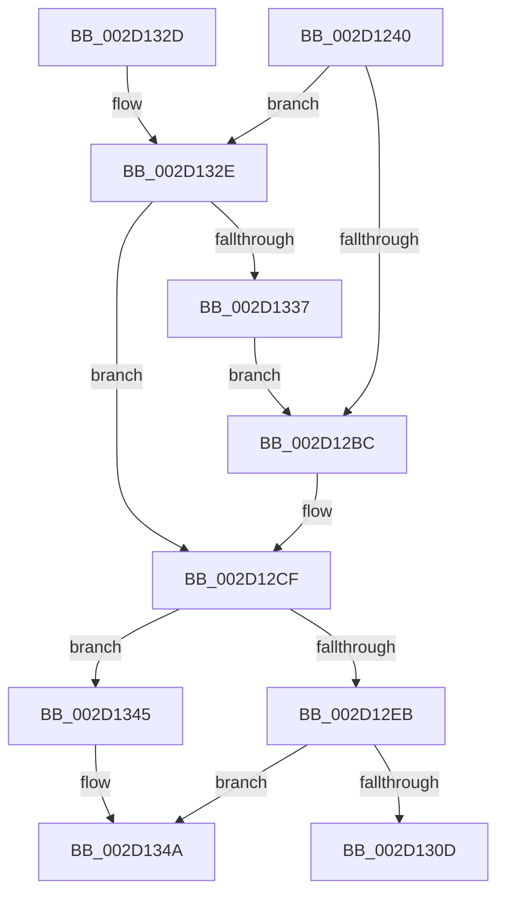

# KiIntRedirectQueueRequestOnProcessor

- RVA: `0x002D1240`–`0x002D1368` (길이 `296` bytes)
- VA: `0x00000001402D1240`
- 실행 섹션: `.text`
- PDB 이름 있음: `예`; PDB Function 태그: `아니요`
- unwind 정보 RVA: `0x0006F770`
- 디코드: `76`개 명령, `296/296` bytes 표시
- 미해석 바이트: `0` (있으면 어셈블리에 `.byte`로 보존)

> 이 문서는 커널 이미지의 기계어와 PDB 기호를 분석해 생성했습니다. 4번과 5번은 함수 원형과 자료형을 바이너리 사용 방식에서 추정한 C 해석이며 원본 소스 복구 결과는 아닙니다.

## 1. Dependencies

- 직접 호출 지점: **6**; 고유 호출 대상: **5**
- 직접 호출자로 확인된 함수: **1**
- RIP 상대 이미지 참조: **2**

### Outgoing calls
- `0x002D1274` → [memset](../6C/memset_function_006C6C40.md) (function, `0x006C6C40`)
- `0x002D1299` → [memset](../6C/memset_function_006C6C40.md) (function, `0x006C6C40`)
- `0x002D12E2` → [KeIsEmptyAffinityEx](KeIsEmptyAffinityEx_function_002D1580.md) (function, `0x002D1580`)
- `0x002D1304` → [HalpInterruptSendIpi](../25/HalpInterruptSendIpi_function_00252310.md) (function, `0x00252310`)
- `0x002D1314` → [_security_check_cookie](../6A/_security_check_cookie_function_006AC640.md) (function, `0x006AC640`)
- `0x002D1362` → [KeBugCheckEx](../4F/KeBugCheckEx_function_004FD660.md) (function, `0x004FD660`)

### Direct callers
- [sub_00208DED](../20/Unknown_function_00208DED.md) at `0x00208E3E`

### Static image references
- `0x002D1255` → RVA `0x00E0A740` (`.data`; read)
- `0x002D129E` → RVA `0x00F231B0` (`.data`; read)

## 2. Other-region calls and transfers

- 다른 실행 섹션으로 향하는 call: **0**
- 별도 외부 분기/꼬리 이동을 확인하지 못했습니다.

## 3. Assembly (complete function range)

```asm
002D1240  48 89 5C 24 18                  mov qword ptr [rsp + 0x18], rbx
002D1245  55                              push rbp
002D1246  57                              push rdi
002D1247  41 57                           push r15
002D1249  48 8D 6C 24 90                  lea rbp, [rsp - 0x70]
002D124E  48 81 EC 70 01 00 00            sub rsp, 0x170
002D1255  48 8B 05 E4 94 B3 00            mov rax, qword ptr [rip + 0xb394e4]
002D125C  48 33 C4                        xor rax, rsp
002D125F  48 89 45 60                     mov qword ptr [rbp + 0x60], rax
002D1263  8B FA                           mov edi, edx
002D1265  8B D9                           mov ebx, ecx
002D1267  33 D2                           xor edx, edx
002D1269  48 8D 4C 24 58                  lea rcx, [rsp + 0x58]
002D126E  41 B8 00 01 00 00               mov r8d, 0x100
002D1274  E8 C7 59 3F 00                  call 0x1406c6c40
002D1279  83 64 24 54 00                  and dword ptr [rsp + 0x54], 0
002D127E  48 8D 4C 24 58                  lea rcx, [rsp + 0x58]
002D1283  33 D2                           xor edx, edx
002D1285  C7 44 24 50 01 00 20 00         mov dword ptr [rsp + 0x50], 0x200001
002D128D  41 B8 00 01 00 00               mov r8d, 0x100
002D1293  41 BF 01 00 00 00               mov r15d, 1
002D1299  E8 A2 59 3F 00                  call 0x1406c6c40
002D129E  48 8B 05 0B 1F C5 00            mov rax, qword ptr [rip + 0xc51f0b]
002D12A5  44 8B 04 98                     mov r8d, dword ptr [rax + rbx*4]
002D12A9  41 8B C8                        mov ecx, r8d
002D12AC  0F B7 44 24 50                  movzx eax, word ptr [rsp + 0x50]
002D12B1  41 83 E0 3F                     and r8d, 0x3f
002D12B5  C1 E9 06                        shr ecx, 6
002D12B8  3B C1                           cmp eax, ecx
002D12BA  76 72                           jbe 0x1402d132e
002D12BC  8B D1                           mov edx, ecx
002D12BE  48 8B 4C CC 58                  mov rcx, qword ptr [rsp + rcx*8 + 0x58]
002D12C3  41 8B C0                        mov eax, r8d
002D12C6  48 0F AB C1                     bts rcx, rax
002D12CA  48 89 4C D4 58                  mov qword ptr [rsp + rdx*8 + 0x58], rcx
002D12CF  33 C0                           xor eax, eax
002D12D1  48 8D 4C 24 50                  lea rcx, [rsp + 0x50]
002D12D6  21 44 24 40                     and dword ptr [rsp + 0x40], eax
002D12DA  89 44 24 34                     mov dword ptr [rsp + 0x34], eax
002D12DE  21 44 24 34                     and dword ptr [rsp + 0x34], eax
002D12E2  E8 99 02 00 00                  call 0x1402d1580
002D12E7  85 C0                           test eax, eax
002D12E9  75 5A                           jne 0x1402d1345
002D12EB  48 8D 44 24 50                  lea rax, [rsp + 0x50]
002D12F0  C7 44 24 30 02 00 00 00         mov dword ptr [rsp + 0x30], 2
002D12F8  8B D7                           mov edx, edi
002D12FA  48 89 44 24 38                  mov qword ptr [rsp + 0x38], rax
002D12FF  48 8D 4C 24 30                  lea rcx, [rsp + 0x30]
002D1304  E8 07 10 F8 FF                  call 0x140252310
002D1309  85 C0                           test eax, eax
002D130B  78 3D                           js 0x1402d134a
002D130D  48 8B 4D 60                     mov rcx, qword ptr [rbp + 0x60]
002D1311  48 33 CC                        xor rcx, rsp
002D1314  E8 27 B3 3D 00                  call 0x1406ac640
002D1319  48 8B 9C 24 A0 01 00 00         mov rbx, qword ptr [rsp + 0x1a0]
002D1321  48 81 C4 70 01 00 00            add rsp, 0x170
002D1328  41 5F                           pop r15
002D132A  5F                              pop rdi
002D132B  5D                              pop rbp
002D132C  C3                              ret
002D132D  CC                              int3
002D132E  0F B7 44 24 52                  movzx eax, word ptr [rsp + 0x52]
002D1333  3B C1                           cmp eax, ecx
002D1335  76 98                           jbe 0x1402d12cf
002D1337  41 8D 04 0F                     lea eax, [r15 + rcx]
002D133B  66 89 44 24 50                  mov word ptr [rsp + 0x50], ax
002D1340  E9 77 FF FF FF                  jmp 0x1402d12bc
002D1345  B8 0D 00 00 C0                  mov eax, 0xc000000d
002D134A  B9 A0 00 00 00                  mov ecx, 0xa0
002D134F  48 98                           cdqe
002D1351  4C 8B CB                        mov r9, rbx
002D1354  48 89 44 24 20                  mov qword ptr [rsp + 0x20], rax
002D1359  BA 01 40 00 00                  mov edx, 0x4001
002D135E  44 8D 41 63                     lea r8d, [rcx + 0x63]
002D1362  E8 F9 C2 22 00                  call 0x1404fd660
002D1367  CC                              int3
```

## 4. C-style interpretation (structured pseudocode)

```c
__int64 __fastcall KiIntRedirectQueueRequestOnProcessor(int a1, int a2)
{
    __int64 result;
    __int64 v_rsp;
    unsigned __int64 v_stack_m130;
    unsigned int v_stack_m134;
    unsigned int v_stack_m138;
    unsigned int v_stack_m148;
    unsigned __int64 v_stack_m150;
    unsigned int v_stack_m154;
    unsigned int v_stack_m158;
    unsigned __int64 v_stack_m28;
    unsigned __int64 v_stack_m88;
    unsigned __int64 v_stack_p18;
    unsigned __int64 v_stack_p20;
    unsigned __int16 v_stack_p50;
    unsigned __int16 v_stack_p52;

    v_stack_p18 = v_rbx;
    v_rsp = (v_rsp) - (368);
    result = (*(unsigned __int64 *)(v_rip + 11769060)) ^ (v_rsp);
    v_stack_m28 = result;
    a2 = 0;
    result = memset(v_stack_m130, a2, 256, a4);
    a2 = 0;
    v_stack_m138 = 0x200001ULL;
    result = memset(v_stack_m130, a2, 256, a4);
    a3 = (unsigned int)(((unsigned int)(*(unsigned int *)(*(unsigned __int64 *)(v_rip + 12918539) + (unsigned int)(a1) * 4))) & (63));
    a1 = (unsigned int)(((unsigned int)((unsigned int)((unsigned int)(*(unsigned int *)(*(unsigned __int64 *)(v_rip + 12918539) + (unsigned int)(a1) * 4))))) >> (6));
    if (((unsigned int)(v_stack_m138)) <= a1) goto loc_002D132E;
loc_002D12BC:
    *(unsigned __int64 *)(v_rsp + (unsigned int)(a1) * 8 + 88) = *(unsigned __int64 *)(v_rsp + a1 * 8 + 88);
loc_002D12CF:
    result = 0;
    v_stack_m154 = 0;
    result = KeIsEmptyAffinityEx(v_stack_m138, (unsigned int)(a1), a3, a4);
    if ((unsigned int)(result) != 0) goto loc_002D1345;
    v_stack_m158 = 2;
    v_stack_m150 = v_stack_m138;
    result = HalpInterruptSendIpi(v_stack_m158, (unsigned int)((unsigned int)((unsigned int)(a2))), a3, a4);
    if (sign_flag) goto loc_002D134A;
    a1 = (v_stack_m28) ^ (v_rsp);
    result = _security_check_cookie(a1, (unsigned int)((unsigned int)((unsigned int)(a2))), a3, a4);
    v_rsp = (v_rsp) + (368);
    return result;
loc_002D132E:
    if (((unsigned int)(v_stack_p52)) <= a1) goto loc_002D12CF;
    v_stack_p50 = (unsigned __int16)(1 + a1 * 1);
    goto loc_002D12BC;
loc_002D1345:
loc_002D134A:
    v_stack_p20 = (unsigned int)(0xC000000DULL);
    result = KeBugCheckEx(160, (unsigned int)(0x4001ULL), 160 + 99, v_stack_p18);
    return result;
}
```

## 5. (Beta) C Style

```c
int64_t KiIntRedirectQueueRequestOnProcessor(int32_t Arg1, int32_t Arg2)
{
    int64_t result;
    int64_t local_rsp;
    uint64_t v_stack_m130;
    uint32_t v_stack_m134;
    uint32_t v_stack_m138;
    uint32_t v_stack_m148;
    uint64_t v_stack_m150;
    uint32_t v_stack_m154;
    uint32_t v_stack_m158;
    uint64_t v_stack_m28;
    uint64_t v_stack_m88;
    uint64_t v_stack_p18;
    uint64_t v_stack_p20;
    uint16_t v_stack_p50;
    uint16_t v_stack_p52;

    v_stack_p18 = local_rbx;
    local_rsp = (local_rsp) - (368);
    result = (*(uint64_t *)(v_rip + 0xB394E4)) ^ (local_rsp);
    v_stack_m28 = result;
    Arg2 = 0;
    result = memset(v_stack_m130, Arg2, 256, a4);
    Arg2 = 0;
    v_stack_m138 = 0x200001ULL;
    result = memset(v_stack_m130, Arg2, 256, a4);
    a3 = (uint32_t)(((uint32_t)(*(uint32_t *)(*(uint64_t *)(v_rip + 0xC51F0B) + (uint32_t)(Arg1) * 4))) & (63));
    Arg1 = (uint32_t)(((uint32_t)((uint32_t)((uint32_t)(*(uint32_t *)(*(uint64_t *)(v_rip + 0xC51F0B) + (uint32_t)(Arg1) * 4))))) >> (6));
    if (((uint32_t)(v_stack_m138)) <= Arg1) goto loc_002D132E;
loc_002D12BC:
    *(uint64_t *)(local_rsp + (uint32_t)(Arg1) * 8 + 0x58) = *(uint64_t *)(local_rsp + Arg1 * 8 + 0x58);
loc_002D12CF:
    result = 0;
    v_stack_m154 = 0;
    result = KeIsEmptyAffinityEx(v_stack_m138, (uint32_t)(Arg1), a3, a4);
    if ((uint32_t)(result) != 0) goto loc_002D1345;
    v_stack_m158 = 2;
    v_stack_m150 = v_stack_m138;
    result = HalpInterruptSendIpi(v_stack_m158, (uint32_t)((uint32_t)((uint32_t)(Arg2))), a3, a4);
    if (sign_flag) goto loc_002D134A;
    Arg1 = (v_stack_m28) ^ (local_rsp);
    result = _security_check_cookie(Arg1, (uint32_t)((uint32_t)((uint32_t)(Arg2))), a3, a4);
    local_rsp = (local_rsp) + (368);
    return result;
loc_002D132E:
    if (((uint32_t)(v_stack_p52)) <= Arg1) goto loc_002D12CF;
    v_stack_p50 = (uint16_t)(1 + Arg1 * 1);
    goto loc_002D12BC;
loc_002D1345:
loc_002D134A:
    v_stack_p20 = (uint32_t)(0xC000000DULL);
    result = KeBugCheckEx(160, (uint32_t)(0x4001ULL), 160 + 99, v_stack_p18);
    return result;
}
```

## 6. Execution-region graph

[열기: 2D/3D 그래프와 함수 탐색 컨트롤 패널](../../../control-panel.html?section=text&rva=0x002D1240&view=graph)

- 2D 그래프는 위에서 아래로 흐르고, 3D 그래프는 빈 공간을 드래그해 회전합니다. Shift+드래그는 이동, 휠은 확대·축소, 함수 노드 선택은 대상 보고서 이동입니다.

### Static fallback


