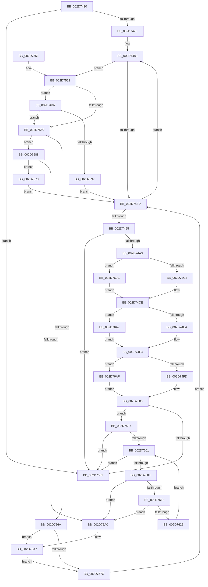

# KiIntSteerCalculateDistribution

- RVA: `0x002D7420`–`0x002D76B7` (길이 `663` bytes)
- VA: `0x00000001402D7420`
- 실행 섹션: `.text`
- PDB 이름 있음: `예`; PDB Function 태그: `아니요`
- unwind 정보 RVA: `0x0006FFB8`
- 디코드: `170`개 명령, `663/663` bytes 표시
- 미해석 바이트: `0` (있으면 어셈블리에 `.byte`로 보존)

> 이 문서는 커널 이미지의 기계어와 PDB 기호를 분석해 생성했습니다. 4번과 5번은 함수 원형과 자료형을 바이너리 사용 방식에서 추정한 C 해석이며 원본 소스 복구 결과는 아닙니다.

## 1. Dependencies

- 직접 호출 지점: **5**; 고유 호출 대상: **4**
- 직접 호출자로 확인된 함수: **1**
- RIP 상대 이미지 참조: **2**

### Outgoing calls
- `0x002D751E` → [KiIntSteerCalculatePriorityDistribution](KiIntSteerCalculatePriorityDistribution_function_002D8760.md) (function, `0x002D8760`)
- `0x002D75AB` → [KiIntPartGetLowestClassProcessorInMask](KiIntPartGetLowestClassProcessorInMask_function_002D89D4.md) (function, `0x002D89D4`)
- `0x002D75EB` → [KiIntSteerCalculateUniformDistribution](KiIntSteerCalculateUniformDistribution_function_002D5698.md) (function, `0x002D5698`)
- `0x002D7638` → [KiIntPartGetLowestClassProcessorInMask](KiIntPartGetLowestClassProcessorInMask_function_002D89D4.md) (function, `0x002D89D4`)
- `0x002D768A` → [KiIntSteerComputeCpuSet](../4B/KiIntSteerComputeCpuSet_function_004B0B24.md) (function, `0x004B0B24`)

### Direct callers
- [KeIntSteerPeriodic](KeIntSteerPeriodic_function_002D6D04.md) at `0x002D6E1E`

### Static image references
- `0x002D7449` → RVA `0x00F10D50` (`.data`; read)
- `0x002D75B7` → RVA `0x00F231B0` (`.data`; read)

## 2. Other-region calls and transfers

- 다른 실행 섹션으로 향하는 call: **0**
- 별도 외부 분기/꼬리 이동을 확인하지 못했습니다.

## 3. Assembly (complete function range)

```asm
002D7420  48 89 5C 24 08                  mov qword ptr [rsp + 8], rbx
002D7425  48 89 74 24 10                  mov qword ptr [rsp + 0x10], rsi
002D742A  48 89 7C 24 18                  mov qword ptr [rsp + 0x18], rdi
002D742F  55                              push rbp
002D7430  41 54                           push r12
002D7432  41 55                           push r13
002D7434  41 56                           push r14
002D7436  41 57                           push r15
002D7438  48 8B EC                        mov rbp, rsp
002D743B  48 83 EC 60                     sub rsp, 0x60
002D743F  4D 8B 10                        mov r10, qword ptr [r8]
002D7442  48 8D 45 D0                     lea rax, [rbp - 0x30]
002D7446  4D 0B 11                        or r10, qword ptr [r9]
002D7449  4C 8D 2D 00 99 C3 00            lea r13, [rip + 0xc39900]
002D7450  48 8B 3A                        mov rdi, qword ptr [rdx]
002D7453  4D 8B F9                        mov r15, r9
002D7456  48 8B 1D F3 98 C3 00            mov rbx, qword ptr [rip + 0xc398f3]
002D745D  49 0B FA                        or rdi, r10
002D7460  48 89 45 D8                     mov qword ptr [rbp - 0x28], rax
002D7464  48 8D 45 D0                     lea rax, [rbp - 0x30]
002D7468  48 89 45 D0                     mov qword ptr [rbp - 0x30], rax
002D746C  4D 8B F0                        mov r14, r8
002D746F  48 8B F2                        mov rsi, rdx
002D7472  4C 8B E1                        mov r12, rcx
002D7475  49 3B DD                        cmp rbx, r13
002D7478  0F 84 B3 00 00 00               je 0x1402d7531
002D747E  66 90                           nop
002D7480  80 BB 84 00 00 00 00            cmp byte ptr [rbx + 0x84], 0
002D7487  0F 85 C5 00 00 00               jne 0x1402d7552
002D748D  48 8B 1B                        mov rbx, qword ptr [rbx]
002D7490  49 3B DD                        cmp rbx, r13
002D7493  75 EB                           jne 0x1402d7480
002D7495  48 8D 45 D0                     lea rax, [rbp - 0x30]
002D7499  48 39 45 D0                     cmp qword ptr [rbp - 0x30], rax
002D749D  0F 84 8E 00 00 00               je 0x1402d7531
002D74A3  41 0F B7 56 08                  movzx edx, word ptr [r14 + 8]
002D74A8  0F 57 C0                        xorps xmm0, xmm0
002D74AB  44 0F B7 4E 08                  movzx r9d, word ptr [rsi + 8]
002D74B0  0F 11 45 F0                     movups xmmword ptr [rbp - 0x10], xmm0
002D74B4  66 89 55 F8                     mov word ptr [rbp - 8], dx
002D74B8  66 41 3B D1                     cmp dx, r9w
002D74BC  0F 85 DA 01 00 00               jne 0x1402d769c
002D74C2  48 8B 0E                        mov rcx, qword ptr [rsi]
002D74C5  49 8B 06                        mov rax, qword ptr [r14]
002D74C8  48 F7 D1                        not rcx
002D74CB  48 23 C8                        and rcx, rax
002D74CE  45 0F B7 47 08                  movzx r8d, word ptr [r15 + 8]
002D74D3  48 89 4D F0                     mov qword ptr [rbp - 0x10], rcx
002D74D7  0F 11 45 E0                     movups xmmword ptr [rbp - 0x20], xmm0
002D74DB  66 44 89 45 E8                  mov word ptr [rbp - 0x18], r8w
002D74E0  66 45 3B C1                     cmp r8w, r9w
002D74E4  0F 85 BD 01 00 00               jne 0x1402d76a7
002D74EA  48 8B 0E                        mov rcx, qword ptr [rsi]
002D74ED  48 F7 D1                        not rcx
002D74F0  49 23 0F                        and rcx, qword ptr [r15]
002D74F3  66 44 3B C2                     cmp r8w, dx
002D74F7  0F 85 B2 01 00 00               jne 0x1402d76af
002D74FD  48 F7 D0                        not rax
002D7500  48 23 C1                        and rax, rcx
002D7503  48 89 45 E0                     mov qword ptr [rbp - 0x20], rax
002D7507  4C 8D 4D F0                     lea r9, [rbp - 0x10]
002D750B  48 8D 45 E0                     lea rax, [rbp - 0x20]
002D750F  4C 8B C6                        mov r8, rsi
002D7512  48 8D 55 D0                     lea rdx, [rbp - 0x30]
002D7516  48 89 44 24 20                  mov qword ptr [rsp + 0x20], rax
002D751B  49 8B CC                        mov rcx, r12
002D751E  E8 3D 12 00 00                  call 0x1402d8760
002D7523  48 8D 45 D0                     lea rax, [rbp - 0x30]
002D7527  48 39 45 D0                     cmp qword ptr [rbp - 0x30], rax
002D752B  0F 85 B3 00 00 00               jne 0x1402d75e4
002D7531  4C 8D 5C 24 60                  lea r11, [rsp + 0x60]
002D7536  33 C0                           xor eax, eax
002D7538  49 8B 5B 30                     mov rbx, qword ptr [r11 + 0x30]
002D753C  49 8B 73 38                     mov rsi, qword ptr [r11 + 0x38]
002D7540  49 8B 7B 40                     mov rdi, qword ptr [r11 + 0x40]
002D7544  49 8B E3                        mov rsp, r11
002D7547  41 5F                           pop r15
002D7549  41 5E                           pop r14
002D754B  41 5D                           pop r13
002D754D  41 5C                           pop r12
002D754F  5D                              pop rbp
002D7550  C3                              ret
002D7551  CC                              int3
002D7552  48 83 BB 88 00 00 00 00         cmp qword ptr [rbx + 0x88], 0
002D755A  0F 85 27 01 00 00               jne 0x1402d7687
002D7560  48 83 BB C0 00 00 00 00         cmp qword ptr [rbx + 0xc0], 0
002D7568  75 1E                           jne 0x1402d7588
002D756A  48 8B 93 A0 00 00 00            mov rdx, qword ptr [rbx + 0xa0]
002D7571  48 8B C2                        mov rax, rdx
002D7574  48 23 C7                        and rax, rdi
002D7577  48 3B C2                        cmp rax, rdx
002D757A  75 2B                           jne 0x1402d75a7
002D757C  48 89 93 B0 00 00 00            mov qword ptr [rbx + 0xb0], rdx
002D7583  E9 05 FF FF FF                  jmp 0x1402d748d
002D7588  48 8B 45 D8                     mov rax, qword ptr [rbp - 0x28]
002D758C  48 8D 55 D0                     lea rdx, [rbp - 0x30]
002D7590  48 8D 8B D0 00 00 00            lea rcx, [rbx + 0xd0]
002D7597  48 39 10                        cmp qword ptr [rax], rdx
002D759A  0F 84 D0 00 00 00               je 0x1402d7670
002D75A0  B9 03 00 00 00                  mov ecx, 3
002D75A5  CD 29                           int 0x29
002D75A7  48 8D 4B 40                     lea rcx, [rbx + 0x40]
002D75AB  E8 24 14 00 00                  call 0x1402d89d4
002D75B0  8B C8                           mov ecx, eax
002D75B2  BA 01 00 00 00                  mov edx, 1
002D75B7  48 8B 05 F2 BB C4 00            mov rax, qword ptr [rip + 0xc4bbf2]
002D75BE  8B 0C 88                        mov ecx, dword ptr [rax + rcx*4]
002D75C1  33 C0                           xor eax, eax
002D75C3  89 83 BA 00 00 00               mov dword ptr [rbx + 0xba], eax
002D75C9  66 89 83 BE 00 00 00            mov word ptr [rbx + 0xbe], ax
002D75D0  8B C1                           mov eax, ecx
002D75D2  C1 E8 06                        shr eax, 6
002D75D5  83 E1 3F                        and ecx, 0x3f
002D75D8  66 89 83 B8 00 00 00            mov word ptr [rbx + 0xb8], ax
002D75DF  48 D3 E2                        shl rdx, cl
002D75E2  EB 98                           jmp 0x1402d757c
002D75E4  49 8B D7                        mov rdx, r15
002D75E7  48 8D 4D D0                     lea rcx, [rbp - 0x30]
002D75EB  E8 A8 E0 FF FF                  call 0x1402d5698
002D75F0  48 8B 5D D0                     mov rbx, qword ptr [rbp - 0x30]
002D75F4  48 8D 45 D0                     lea rax, [rbp - 0x30]
002D75F8  48 3B D8                        cmp rbx, rax
002D75FB  0F 84 30 FF FF FF               je 0x1402d7531
002D7601  48 8D 45 D0                     lea rax, [rbp - 0x30]
002D7605  48 3B D8                        cmp rbx, rax
002D7608  0F 84 23 FF FF FF               je 0x1402d7531
002D760E  48 8D 45 D0                     lea rax, [rbp - 0x30]
002D7612  48 39 43 08                     cmp qword ptr [rbx + 8], rax
002D7616  75 88                           jne 0x1402d75a0
002D7618  48 8B 03                        mov rax, qword ptr [rbx]
002D761B  48 39 58 08                     cmp qword ptr [rax + 8], rbx
002D761F  0F 85 7B FF FF FF               jne 0x1402d75a0
002D7625  48 8D 4D D0                     lea rcx, [rbp - 0x30]
002D7629  48 89 45 D0                     mov qword ptr [rbp - 0x30], rax
002D762D  48 89 48 08                     mov qword ptr [rax + 8], rcx
002D7631  48 8D 8B 70 FF FF FF            lea rcx, [rbx - 0x90]
002D7638  E8 97 13 00 00                  call 0x1402d89d4
002D763D  8B C8                           mov ecx, eax
002D763F  48 8B 05 6A BB C4 00            mov rax, qword ptr [rip + 0xc4bb6a]
002D7646  8B 0C 88                        mov ecx, dword ptr [rax + rcx*4]
002D7649  33 C0                           xor eax, eax
002D764B  89 43 EA                        mov dword ptr [rbx - 0x16], eax
002D764E  66 89 43 EE                     mov word ptr [rbx - 0x12], ax
002D7652  8B C1                           mov eax, ecx
002D7654  C1 E8 06                        shr eax, 6
002D7657  83 E1 3F                        and ecx, 0x3f
002D765A  66 89 43 E8                     mov word ptr [rbx - 0x18], ax
002D765E  B8 01 00 00 00                  mov eax, 1
002D7663  48 D3 E0                        shl rax, cl
002D7666  48 89 43 E0                     mov qword ptr [rbx - 0x20], rax
002D766A  48 8B 5D D0                     mov rbx, qword ptr [rbp - 0x30]
002D766E  EB 91                           jmp 0x1402d7601
002D7670  48 89 41 08                     mov qword ptr [rcx + 8], rax
002D7674  48 8D 55 D0                     lea rdx, [rbp - 0x30]
002D7678  48 89 11                        mov qword ptr [rcx], rdx
002D767B  48 89 08                        mov qword ptr [rax], rcx
002D767E  48 89 4D D8                     mov qword ptr [rbp - 0x28], rcx
002D7682  E9 06 FE FF FF                  jmp 0x1402d748d
002D7687  48 8B CB                        mov rcx, rbx
002D768A  E8 95 94 1D 00                  call 0x1404b0b24
002D768F  85 C0                           test eax, eax
002D7691  0F 88 C9 FE FF FF               js 0x1402d7560
002D7697  E9 F1 FD FF FF                  jmp 0x1402d748d
002D769C  49 8B 0E                        mov rcx, qword ptr [r14]
002D769F  48 8B C1                        mov rax, rcx
002D76A2  E9 27 FE FF FF                  jmp 0x1402d74ce
002D76A7  49 8B 0F                        mov rcx, qword ptr [r15]
002D76AA  E9 44 FE FF FF                  jmp 0x1402d74f3
002D76AF  48 8B C1                        mov rax, rcx
002D76B2  E9 4C FE FF FF                  jmp 0x1402d7503
```

## 4. C-style interpretation (structured pseudocode)

```c
__int64 __fastcall KiIntSteerCalculateDistribution(__int64 a1, __int64 a2, __int64 a3, __int64 a4)
{
    __int64 result;
    __int64 v_r10;
    __int64 v_rdi;
    __int64 v_rsp;
    unsigned __int64 v_stack_m28;
    unsigned __int16 v_stack_m30;
    unsigned __int64 v_stack_m38;
    unsigned __int16 v_stack_m40;
    unsigned __int64 v_stack_m48;
    unsigned __int64 v_stack_m50;
    unsigned __int64 v_stack_m58;
    unsigned __int64 v_stack_m68;
    unsigned __int64 v_stack_p10;
    unsigned __int64 v_stack_p18;
    unsigned __int64 v_stack_p8;

    v_stack_p8 = v_rbx;
    v_stack_p10 = v_rsi;
    v_stack_p18 = v_rdi;
    v_rsp = (v_rsp) - (96);
    v_r10 = (*(unsigned __int64 *)(a3)) | (*(unsigned __int64 *)(a4));
    v_rdi = (*(unsigned __int64 *)(a2)) | (v_r10);
    v_stack_m50 = v_stack_m58;
    v_stack_m58 = v_stack_m58;
    if ((*(unsigned __int64 *)(v_rip + 12818675)) == (v_rip + 12818688)) goto loc_002D7531;
loc_002D7480:
    if ((*(unsigned __int8 *)(*(unsigned __int64 *)(v_rip + 12818675) + 132)) != 0) goto loc_002D7552;
loc_002D748D:
    if ((*(unsigned __int64 *)(*(unsigned __int64 *)(v_rip + 12818675))) != (v_rip + 12818688)) goto loc_002D7480;
    if (v_stack_m58 == v_stack_m58) goto loc_002D7531;
    v_stack_m38 = v_xmm0;
    v_stack_m30 = (unsigned __int16)(*(unsigned __int16 *)(a3 + 8));
    if (((unsigned __int16)(*(unsigned __int16 *)(a3 + 8))) != ((unsigned __int16)(*(unsigned __int16 *)(a2 + 8)))) goto loc_002D769C;
    a1 = ~(*(unsigned __int64 *)(a2));
    a1 = (a1) & (*(unsigned __int64 *)(a3));
loc_002D74CE:
    v_stack_m38 = a1;
    v_stack_m48 = v_xmm0;
    v_stack_m40 = (unsigned __int16)(*(unsigned __int16 *)(a4 + 8));
    if (((unsigned __int16)(*(unsigned __int16 *)(a4 + 8))) != ((unsigned __int16)(*(unsigned __int16 *)(a2 + 8)))) goto loc_002D76A7;
    a1 = ~(*(unsigned __int64 *)(a2));
    a1 = (a1) & (*(unsigned __int64 *)(a4));
loc_002D74F3:
    if (((unsigned __int16)(*(unsigned __int16 *)(a4 + 8))) != ((unsigned __int16)(*(unsigned __int16 *)(a3 + 8)))) goto loc_002D76AF;
    result = ~(*(unsigned __int64 *)(a3));
    result = (result) & (a1);
loc_002D7503:
    v_stack_m48 = result;
    v_stack_m68 = v_stack_m48;
    result = KiIntSteerCalculatePriorityDistribution(a1, v_stack_m58, a2, v_stack_m38);
    if (v_stack_m58 != v_stack_m58) goto loc_002D75E4;
loc_002D7531:
    result = 0;
    return result;
loc_002D7552:
    if ((*(unsigned __int64 *)(*(unsigned __int64 *)(v_stack_m28 + 48) + 136)) != 0) goto loc_002D7687;
loc_002D7560:
    if ((*(unsigned __int64 *)(*(unsigned __int64 *)(v_stack_m28 + 48) + 192)) != 0) goto loc_002D7588;
    result = (*(unsigned __int64 *)(*(unsigned __int64 *)(v_stack_m28 + 48) + 160)) & (*(unsigned __int64 *)(v_stack_m28 + 64));
    if (result != (*(unsigned __int64 *)(*(unsigned __int64 *)(v_stack_m28 + 48) + 160))) goto loc_002D75A7;
loc_002D757C:
    *(unsigned __int64 *)(*(unsigned __int64 *)(v_stack_m28 + 48) + 176) = *(unsigned __int64 *)(*(unsigned __int64 *)(v_stack_m28 + 48) + 160);
    goto loc_002D748D;
loc_002D7588:
    if ((*(unsigned __int64 *)(v_stack_m50)) == v_stack_m58) goto loc_002D7670;
loc_002D75A0:
loc_002D75A7:
    result = KiIntPartGetLowestClassProcessorInMask(*(unsigned __int64 *)(v_stack_m28 + 48) + 64, v_stack_m58, a2, v_stack_m38);
    result = 0;
    *(unsigned int *)(*(unsigned __int64 *)(v_stack_m28 + 48) + 186) = 0;
    *(unsigned __int16 *)(*(unsigned __int64 *)(v_stack_m28 + 48) + 190) = 0;
    result = (unsigned int)(((unsigned int)((unsigned int)((unsigned int)(*(unsigned int *)(*(unsigned __int64 *)(v_rip + 12893170) + (unsigned int)((unsigned int)(result)) * 4))))) >> (6));
    a1 = (unsigned int)(((unsigned int)(*(unsigned int *)(*(unsigned __int64 *)(v_rip + 12893170) + (unsigned int)((unsigned int)(result)) * 4))) & (63));
    *(unsigned __int16 *)(*(unsigned __int64 *)(v_stack_m28 + 48) + 184) = (unsigned __int16)(result);
    a2 = (1) << ((unsigned __int8)(a1));
    goto loc_002D757C;
loc_002D75E4:
    result = KiIntSteerCalculateUniformDistribution(v_stack_m58, a4, a2, v_stack_m38);
    if (v_stack_m58 == v_stack_m58) goto loc_002D7531;
loc_002D7601:
    if (v_stack_m58 == v_stack_m58) goto loc_002D7531;
    if ((*(unsigned __int64 *)(v_stack_m58 + 8)) != v_stack_m58) goto loc_002D75A0;
    if ((*(unsigned __int64 *)(*(unsigned __int64 *)(v_stack_m58) + 8)) != v_stack_m58) goto loc_002D75A0;
    v_stack_m58 = *(unsigned __int64 *)(v_stack_m58);
    *(unsigned __int64 *)(*(unsigned __int64 *)(v_stack_m58) + 8) = v_stack_m58;
    result = KiIntPartGetLowestClassProcessorInMask(v_stack_m58 - 144, a4, a2, v_stack_m38);
    result = 0;
    *(unsigned int *)(v_stack_m58 - 22) = 0;
    *(unsigned __int16 *)(v_stack_m58 - 18) = 0;
    result = (unsigned int)(((unsigned int)((unsigned int)((unsigned int)(*(unsigned int *)(*(unsigned __int64 *)(v_rip + 12893034) + (unsigned int)((unsigned int)(result)) * 4))))) >> (6));
    a1 = (unsigned int)(((unsigned int)(*(unsigned int *)(*(unsigned __int64 *)(v_rip + 12893034) + (unsigned int)((unsigned int)(result)) * 4))) & (63));
    *(unsigned __int16 *)(v_stack_m58 - 24) = (unsigned __int16)(result);
    result = (1) << ((unsigned __int8)(a1));
    *(unsigned __int64 *)(v_stack_m58 - 32) = result;
    goto loc_002D7601;
loc_002D7670:
    *(unsigned __int64 *)(a1 + 8) = result;
    *(unsigned __int64 *)(a1) = v_stack_m58;
    *(unsigned __int64 *)(result) = a1;
    v_stack_m50 = a1;
    goto loc_002D748D;
loc_002D7687:
    result = KiIntSteerComputeCpuSet(v_stack_m58, v_stack_m58, a2, v_stack_m38);
    if (sign_flag) goto loc_002D7560;
    goto loc_002D748D;
loc_002D769C:
    goto loc_002D74CE;
loc_002D76A7:
    goto loc_002D74F3;
loc_002D76AF:
    goto loc_002D7503;
}
```

## 5. (Beta) C Style

```c
int64_t KiIntSteerCalculateDistribution(int64_t Arg1, void *Arg2, void *Arg3, void *Arg4)
{
    uint8_t *arg2 = (uint8_t *)Arg2;
    uint8_t *arg3 = (uint8_t *)Arg3;
    uint8_t *arg4 = (uint8_t *)Arg4;

    int64_t result;
    int64_t local_r10;
    int64_t local_rdi;
    int64_t local_rsp;
    uint64_t v_stack_m28;
    uint16_t v_stack_m30;
    uint64_t v_stack_m38;
    uint16_t v_stack_m40;
    uint64_t v_stack_m48;
    uint64_t v_stack_m50;
    uint64_t v_stack_m58;
    uint64_t v_stack_m68;
    uint64_t v_stack_p10;
    uint64_t v_stack_p18;
    uint64_t v_stack_p8;

    v_stack_p8 = local_rbx;
    v_stack_p10 = local_rsi;
    v_stack_p18 = local_rdi;
    local_rsp = (local_rsp) - (96);
    local_r10 = (*(uint64_t *)(arg3)) | (*(uint64_t *)(arg4));
    local_rdi = (*(uint64_t *)(arg2)) | (local_r10);
    v_stack_m50 = v_stack_m58;
    v_stack_m58 = v_stack_m58;
    if ((*(uint64_t *)(v_rip + 0xC398F3)) == (v_rip + 12818688)) goto loc_002D7531;
loc_002D7480:
    if ((*(uint8_t *)(*(uint64_t *)(v_rip + 0xC398F3) + 0x84)) != 0) goto loc_002D7552;
loc_002D748D:
    if ((*(uint64_t *)(*(uint64_t *)(v_rip + 0xC398F3))) != (v_rip + 12818688)) goto loc_002D7480;
    if (v_stack_m58 == v_stack_m58) goto loc_002D7531;
    v_stack_m38 = v_xmm0;
    v_stack_m30 = (uint16_t)(*(uint16_t *)(arg3 + 0x8));
    if (((uint16_t)(*(uint16_t *)(arg3 + 0x8))) != ((uint16_t)(*(uint16_t *)(arg2 + 0x8)))) goto loc_002D769C;
    Arg1 = ~(*(uint64_t *)(arg2));
    Arg1 = (Arg1) & (*(uint64_t *)(arg3));
loc_002D74CE:
    v_stack_m38 = Arg1;
    v_stack_m48 = v_xmm0;
    v_stack_m40 = (uint16_t)(*(uint16_t *)(arg4 + 0x8));
    if (((uint16_t)(*(uint16_t *)(arg4 + 0x8))) != ((uint16_t)(*(uint16_t *)(arg2 + 0x8)))) goto loc_002D76A7;
    Arg1 = ~(*(uint64_t *)(arg2));
    Arg1 = (Arg1) & (*(uint64_t *)(arg4));
loc_002D74F3:
    if (((uint16_t)(*(uint16_t *)(arg4 + 0x8))) != ((uint16_t)(*(uint16_t *)(arg3 + 0x8)))) goto loc_002D76AF;
    result = ~(*(uint64_t *)(arg3));
    result = (result) & (Arg1);
loc_002D7503:
    v_stack_m48 = result;
    v_stack_m68 = v_stack_m48;
    result = KiIntSteerCalculatePriorityDistribution(Arg1, v_stack_m58, Arg2, v_stack_m38);
    if (v_stack_m58 != v_stack_m58) goto loc_002D75E4;
loc_002D7531:
    result = 0;
    return result;
loc_002D7552:
    if ((*(uint64_t *)(*(uint64_t *)(v_stack_m28 + 0x30) + 0x88)) != 0) goto loc_002D7687;
loc_002D7560:
    if ((*(uint64_t *)(*(uint64_t *)(v_stack_m28 + 0x30) + 0xC0)) != 0) goto loc_002D7588;
    result = (*(uint64_t *)(*(uint64_t *)(v_stack_m28 + 0x30) + 0xA0)) & (*(uint64_t *)(v_stack_m28 + 0x40));
    if (result != (*(uint64_t *)(*(uint64_t *)(v_stack_m28 + 0x30) + 0xA0))) goto loc_002D75A7;
loc_002D757C:
    *(uint64_t *)(*(uint64_t *)(v_stack_m28 + 0x30) + 0xB0) = *(uint64_t *)(*(uint64_t *)(v_stack_m28 + 0x30) + 0xA0);
    goto loc_002D748D;
loc_002D7588:
    if ((*(uint64_t *)(v_stack_m50)) == v_stack_m58) goto loc_002D7670;
loc_002D75A0:
loc_002D75A7:
    result = KiIntPartGetLowestClassProcessorInMask(*(uint64_t *)(v_stack_m28 + 0x30) + 64, v_stack_m58, Arg2, v_stack_m38);
    result = 0;
    *(uint32_t *)(*(uint64_t *)(v_stack_m28 + 0x30) + 0xBA) = 0;
    *(uint16_t *)(*(uint64_t *)(v_stack_m28 + 0x30) + 0xBE) = 0;
    result = (uint32_t)(((uint32_t)((uint32_t)((uint32_t)(*(uint32_t *)(*(uint64_t *)(v_rip + 0xC4BBF2) + (uint32_t)((uint32_t)(result)) * 4))))) >> (6));
    Arg1 = (uint32_t)(((uint32_t)(*(uint32_t *)(*(uint64_t *)(v_rip + 0xC4BBF2) + (uint32_t)((uint32_t)(result)) * 4))) & (63));
    *(uint16_t *)(*(uint64_t *)(v_stack_m28 + 0x30) + 0xB8) = (uint16_t)(result);
    Arg2 = (1) << ((uint8_t)(Arg1));
    goto loc_002D757C;
loc_002D75E4:
    result = KiIntSteerCalculateUniformDistribution(v_stack_m58, Arg4, Arg2, v_stack_m38);
    if (v_stack_m58 == v_stack_m58) goto loc_002D7531;
loc_002D7601:
    if (v_stack_m58 == v_stack_m58) goto loc_002D7531;
    if ((*(uint64_t *)(v_stack_m58 + 0x8)) != v_stack_m58) goto loc_002D75A0;
    if ((*(uint64_t *)(*(uint64_t *)(v_stack_m58) + 0x8)) != v_stack_m58) goto loc_002D75A0;
    v_stack_m58 = *(uint64_t *)(v_stack_m58);
    *(uint64_t *)(*(uint64_t *)(v_stack_m58) + 0x8) = v_stack_m58;
    result = KiIntPartGetLowestClassProcessorInMask(v_stack_m58 - 144, Arg4, Arg2, v_stack_m38);
    result = 0;
    *(uint32_t *)(v_stack_m58 - 0x16) = 0;
    *(uint16_t *)(v_stack_m58 - 0x12) = 0;
    result = (uint32_t)(((uint32_t)((uint32_t)((uint32_t)(*(uint32_t *)(*(uint64_t *)(v_rip + 0xC4BB6A) + (uint32_t)((uint32_t)(result)) * 4))))) >> (6));
    Arg1 = (uint32_t)(((uint32_t)(*(uint32_t *)(*(uint64_t *)(v_rip + 0xC4BB6A) + (uint32_t)((uint32_t)(result)) * 4))) & (63));
    *(uint16_t *)(v_stack_m58 - 0x18) = (uint16_t)(result);
    result = (1) << ((uint8_t)(Arg1));
    *(uint64_t *)(v_stack_m58 - 0x20) = result;
    goto loc_002D7601;
loc_002D7670:
    *(uint64_t *)(Arg1 + 0x8) = result;
    *(uint64_t *)(Arg1) = v_stack_m58;
    *(uint64_t *)(result) = Arg1;
    v_stack_m50 = Arg1;
    goto loc_002D748D;
loc_002D7687:
    result = KiIntSteerComputeCpuSet(v_stack_m58, v_stack_m58, Arg2, v_stack_m38);
    if (sign_flag) goto loc_002D7560;
    goto loc_002D748D;
loc_002D769C:
    goto loc_002D74CE;
loc_002D76A7:
    goto loc_002D74F3;
loc_002D76AF:
    goto loc_002D7503;
}
```

### 관측된 메모리 오프셋

구조체 형식이 확인되지 않은 접근은 인자 기준의 오프셋으로만 기록했습니다.

| 기준 인자 | 오프셋 표현 | 폭 (bit) | 접근 |
|---|---:|---:|---|
| `Arg2` | `+ 0x0` | `64` | `R` |
| `Arg2` | `+ 0x8` | `16` | `R` |
| `Arg3` | `+ 0x0` | `64` | `R` |
| `Arg3` | `+ 0x8` | `16` | `R` |
| `Arg4` | `+ 0x0` | `64` | `R` |
| `Arg4` | `+ 0x8` | `16` | `R` |

## 6. Execution-region graph

[열기: 2D/3D 그래프와 함수 탐색 컨트롤 패널](../../../control-panel.html?section=text&rva=0x002D7420&view=graph)

- 2D 그래프는 위에서 아래로 흐르고, 3D 그래프는 빈 공간을 드래그해 회전합니다. Shift+드래그는 이동, 휠은 확대·축소, 함수 노드 선택은 대상 보고서 이동입니다.

### Static fallback


