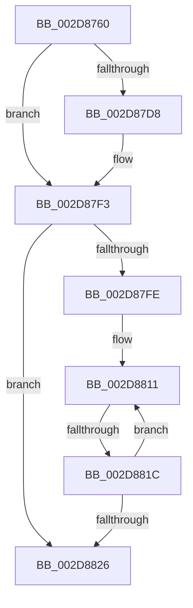

# KiIntSteerCalculatePriorityDistribution

- RVA: `0x002D8760`–`0x002D8832` (길이 `210` bytes)
- VA: `0x00000001402D8760`
- 실행 섹션: `.text`
- PDB 이름 있음: `예`; PDB Function 태그: `아니요`
- unwind 정보 RVA: `0x000701EC`
- 디코드: `53`개 명령, `210/210` bytes 표시
- 미해석 바이트: `0` (있으면 어셈블리에 `.byte`로 보존)

> 이 문서는 커널 이미지의 기계어와 PDB 기호를 분석해 생성했습니다. 4번과 5번은 함수 원형과 자료형을 바이너리 사용 방식에서 추정한 C 해석이며 원본 소스 복구 결과는 아닙니다.

## 1. Dependencies

- 직접 호출 지점: **2**; 고유 호출 대상: **2**
- 직접 호출자로 확인된 함수: **1**
- RIP 상대 이미지 참조: **3**

### Outgoing calls
- `0x002D87EE` → [memset](../6C/memset_function_006C6C40.md) (function, `0x006C6C40`)
- `0x002D87F5` → [KeQueryActiveProcessorCountEx](../24/KeQueryActiveProcessorCountEx_function_00249EF0.md) (function, `0x00249EF0`)

### Direct callers
- [KiIntSteerCalculateDistribution](KiIntSteerCalculateDistribution_function_002D7420.md) at `0x002D751E`

### Static image references
- `0x002D876F` → RVA `0x00E0A740` (`.data`; read)
- `0x002D87D8` → RVA `0x00F10BB8` (`.data`; read)
- `0x002D87FE` → RVA `0x00F231B0` (`.data`; read)

## 2. Other-region calls and transfers

- 다른 실행 섹션으로 향하는 call: **0**
- call이 아닌 외부 분기/꼬리 이동: **2**
  - `0x002D8816` → [sub_002D899F](Unknown_function_002D899F.md) (`tail-transfer`)
  - `0x002D882C` → [sub_002D8954](Unknown_function_002D8954.md) (`tail-transfer`)

## 3. Assembly (complete function range)

```asm
002D8760  40 53                           push rbx
002D8762  55                              push rbp
002D8763  41 54                           push r12
002D8765  41 55                           push r13
002D8767  41 56                           push r14
002D8769  41 57                           push r15
002D876B  48 83 EC 78                     sub rsp, 0x78
002D876F  48 8B 05 CA 1F B3 00            mov rax, qword ptr [rip + 0xb31fca]
002D8776  48 33 C4                        xor rax, rsp
002D8779  48 89 44 24 60                  mov qword ptr [rsp + 0x60], rax
002D877E  41 0F B7 40 08                  movzx eax, word ptr [r8 + 8]
002D8783  0F 57 C0                        xorps xmm0, xmm0
002D8786  49 8B 28                        mov rbp, qword ptr [r8]
002D8789  4C 8B F1                        mov r14, rcx
002D878C  48 8B 8C 24 D0 00 00 00         mov rcx, qword ptr [rsp + 0xd0]
002D8794  4C 8B FA                        mov r15, rdx
002D8797  4D 8B 21                        mov r12, qword ptr [r9]
002D879A  0F 11 44 24 30                  movups xmmword ptr [rsp + 0x30], xmm0
002D879F  66 89 44 24 38                  mov word ptr [rsp + 0x38], ax
002D87A4  41 0F B7 41 08                  movzx eax, word ptr [r9 + 8]
002D87A9  4C 8B 29                        mov r13, qword ptr [rcx]
002D87AC  48 89 6C 24 30                  mov qword ptr [rsp + 0x30], rbp
002D87B1  0F 11 44 24 40                  movups xmmword ptr [rsp + 0x40], xmm0
002D87B6  66 89 44 24 48                  mov word ptr [rsp + 0x48], ax
002D87BB  0F B7 41 08                     movzx eax, word ptr [rcx + 8]
002D87BF  4C 89 64 24 40                  mov qword ptr [rsp + 0x40], r12
002D87C4  0F 11 44 24 50                  movups xmmword ptr [rsp + 0x50], xmm0
002D87C9  66 89 44 24 58                  mov word ptr [rsp + 0x58], ax
002D87CE  4C 89 6C 24 50                  mov qword ptr [rsp + 0x50], r13
002D87D3  4D 85 F6                        test r14, r14
002D87D6  75 1B                           jne 0x1402d87f3
002D87D8  4C 8B 35 D9 83 C3 00            mov r14, qword ptr [rip + 0xc383d9]
002D87DF  33 D2                           xor edx, edx
002D87E1  41 B8 00 01 00 00               mov r8d, 0x100
002D87E7  49 8D 8E 04 01 00 00            lea rcx, [r14 + 0x104]
002D87EE  E8 4D E4 3E 00                  call 0x1406c6c40
002D87F3  33 C9                           xor ecx, ecx
002D87F5  E8 F6 16 F7 FF                  call 0x140249ef0
002D87FA  85 C0                           test eax, eax
002D87FC  74 28                           je 0x1402d8826
002D87FE  48 8B 0D AB A9 C4 00            mov rcx, qword ptr [rip + 0xc4a9ab]
002D8805  4D 8B D6                        mov r10, r14
002D8808  45 8B 0E                        mov r9d, dword ptr [r14]
002D880B  4C 2B D1                        sub r10, rcx
002D880E  44 8B C0                        mov r8d, eax
002D8811  45 3B 4C 0A 04                  cmp r9d, dword ptr [r10 + rcx + 4]
002D8816  0F 86 83 01 00 00               jbe 0x1402d899f
002D881C  48 83 C1 04                     add rcx, 4
002D8820  49 83 E8 01                     sub r8, 1
002D8824  75 EB                           jne 0x1402d8811
002D8826  49 8B 1F                        mov rbx, qword ptr [r15]
002D8829  49 3B DF                        cmp rbx, r15
002D882C  0F 84 22 01 00 00               je 0x1402d8954
```

## 4. C-style interpretation (structured pseudocode)

```c
__int64 __fastcall KiIntSteerCalculatePriorityDistribution(__int64 a1, __int64 a2, __int64 a3, __int64 a4, __int64 a5)
{
    __int64 result;
    __int64 v_r10;
    __int64 v_r14;
    __int64 v_rsp;
    unsigned __int64 v_stack_m48;
    unsigned __int16 v_stack_m50;
    unsigned __int64 v_stack_m58;
    unsigned __int16 v_stack_m60;
    unsigned __int64 v_stack_m68;
    unsigned __int16 v_stack_m70;
    unsigned __int64 v_stack_m78;

    v_rsp = (v_rsp) - (120);
    result = (*(unsigned __int64 *)(v_rip + 11739082)) ^ (v_rsp);
    v_stack_m48 = result;
    v_stack_m78 = v_xmm0;
    v_stack_m70 = (unsigned __int16)(*(unsigned __int16 *)(a3 + 8));
    v_stack_m78 = *(unsigned __int64 *)(a3);
    v_stack_m68 = v_xmm0;
    v_stack_m60 = (unsigned __int16)(*(unsigned __int16 *)(a4 + 8));
    v_stack_m68 = *(unsigned __int64 *)(a4);
    v_stack_m58 = v_xmm0;
    v_stack_m50 = (unsigned __int16)(*(unsigned __int16 *)(a5 + 8));
    v_stack_m58 = *(unsigned __int64 *)(a5);
    result = *(unsigned __int16 *)(a5 + 8);
    v_r14 = a1;
    if (a1 == 0) {
        v_r14 = *(unsigned __int64 *)(v_rip + 12813273);
        a2 = 0;
        a3 = 256;
        a1 = v_r14 + 260;
        result = memset(a1, a2, a3, a4);
    }
    a1 = 0;
    result = KeQueryActiveProcessorCountEx(a1, a2, a3, a4);
    if ((unsigned int)(result) == 0) goto loc_002D8826;
    v_r10 = (v_r14) - (*(unsigned __int64 *)(v_rip + 12888491));
loc_002D8811:
    a1 = (*(unsigned __int64 *)(v_rip + 12888491)) + (4);
    a3 = ((unsigned int)((unsigned int)(result))) - (1);
    if (condition_is_not_equal) goto loc_002D8811;
loc_002D8826:
}
```

## 5. (Beta) C Style

```c
int64_t KiIntSteerCalculatePriorityDistribution(int64_t Arg1, void *Arg2, void *Arg3, void *Arg4, void *Arg5)
{
    uint8_t *arg2 = (uint8_t *)Arg2;
    uint8_t *arg3 = (uint8_t *)Arg3;
    uint8_t *arg4 = (uint8_t *)Arg4;
    uint8_t *arg5 = (uint8_t *)Arg5;

    int64_t result;
    int64_t local_r10;
    int64_t local_r14;
    int64_t local_rsp;
    uint64_t v_stack_m48;
    uint16_t v_stack_m50;
    uint64_t v_stack_m58;
    uint16_t v_stack_m60;
    uint64_t v_stack_m68;
    uint16_t v_stack_m70;
    uint64_t v_stack_m78;

    local_rsp = (local_rsp) - (120);
    result = (*(uint64_t *)(v_rip + 0xB31FCA)) ^ (local_rsp);
    v_stack_m48 = result;
    v_stack_m78 = v_xmm0;
    v_stack_m70 = (uint16_t)(*(uint16_t *)(arg3 + 0x8));
    v_stack_m78 = *(uint64_t *)(arg3);
    v_stack_m68 = v_xmm0;
    v_stack_m60 = (uint16_t)(*(uint16_t *)(arg4 + 0x8));
    v_stack_m68 = *(uint64_t *)(arg4);
    v_stack_m58 = v_xmm0;
    v_stack_m50 = (uint16_t)(*(uint16_t *)(arg5 + 0x8));
    v_stack_m58 = *(uint64_t *)(arg5);
    result = *(uint16_t *)(arg5 + 0x8);
    local_r14 = Arg1;
    if (Arg1 == 0) {
        local_r14 = *(uint64_t *)(v_rip + 0xC383D9);
        Arg2 = 0;
        Arg3 = 256;
        Arg1 = local_r14 + 260;
        result = memset(Arg1, Arg2, Arg3, Arg4);
    }
    Arg1 = 0;
    result = KeQueryActiveProcessorCountEx(Arg1, Arg2, Arg3, Arg4);
    if ((uint32_t)(result) == 0) goto loc_002D8826;
    local_r10 = (local_r14) - (*(uint64_t *)(v_rip + 0xC4A9AB));
loc_002D8811:
    Arg1 = (*(uint64_t *)(v_rip + 0xC4A9AB)) + (4);
    Arg3 = ((uint32_t)((uint32_t)(result))) - (1);
    if (condition_is_not_equal) goto loc_002D8811;
loc_002D8826:
}
```

### 관측된 메모리 오프셋

구조체 형식이 확인되지 않은 접근은 인자 기준의 오프셋으로만 기록했습니다.

| 기준 인자 | 오프셋 표현 | 폭 (bit) | 접근 |
|---|---:|---:|---|
| `Arg2` | `+ 0x0` | `64` | `R` |
| `Arg3` | `+ 0x0` | `64` | `R` |
| `Arg3` | `+ 0x8` | `16` | `R` |
| `Arg4` | `+ 0x0` | `64` | `R` |
| `Arg4` | `+ 0x8` | `16` | `R` |
| `Arg5` | `+ 0x0` | `64` | `R` |
| `Arg5` | `+ 0x8` | `16` | `R` |

## 6. Execution-region graph

[열기: 2D/3D 그래프와 함수 탐색 컨트롤 패널](../../../control-panel.html?section=text&rva=0x002D8760&view=graph)

- 2D 그래프는 위에서 아래로 흐르고, 3D 그래프는 빈 공간을 드래그해 회전합니다. Shift+드래그는 이동, 휠은 확대·축소, 함수 노드 선택은 대상 보고서 이동입니다.

### Static fallback


