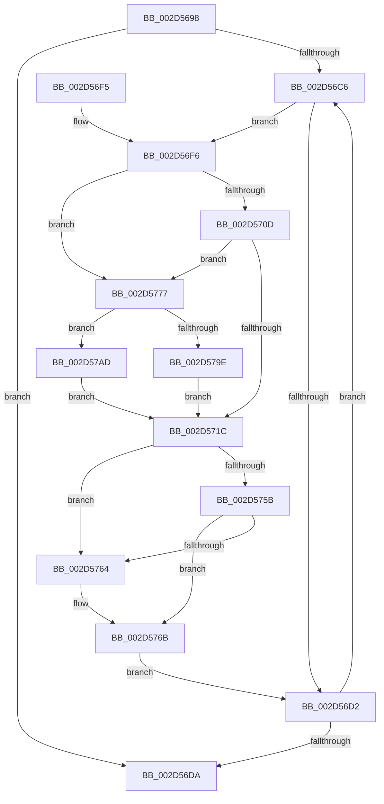

# KiIntSteerCalculateUniformDistribution

- RVA: `0x002D5698`–`0x002D57B5` (길이 `285` bytes)
- VA: `0x00000001402D5698`
- 실행 섹션: `.text`
- PDB 이름 있음: `예`; PDB Function 태그: `아니요`
- unwind 정보 RVA: `0x0006FC90`
- 디코드: `80`개 명령, `285/285` bytes 표시
- 미해석 바이트: `0` (있으면 어셈블리에 `.byte`로 보존)

> 이 문서는 커널 이미지의 기계어와 PDB 기호를 분석해 생성했습니다. 4번과 5번은 함수 원형과 자료형을 바이너리 사용 방식에서 추정한 C 해석이며 원본 소스 복구 결과는 아닙니다.

## 1. Dependencies

- 직접 호출 지점: **2**; 고유 호출 대상: **1**
- 직접 호출자로 확인된 함수: **1**
- RIP 상대 이미지 참조: **1**

### Outgoing calls
- `0x002D5712` → [KiIntPartGetLowestClassProcessorInMask](KiIntPartGetLowestClassProcessorInMask_function_002D89D4.md) (function, `0x002D89D4`)
- `0x002D57A3` → [KiIntPartGetLowestClassProcessorInMask](KiIntPartGetLowestClassProcessorInMask_function_002D89D4.md) (function, `0x002D89D4`)

### Direct callers
- [KiIntSteerCalculateDistribution](KiIntSteerCalculateDistribution_function_002D7420.md) at `0x002D75EB`

### Static image references
- `0x002D571E` → RVA `0x00F231B0` (`.data`; read)

## 2. Other-region calls and transfers

- 다른 실행 섹션으로 향하는 call: **0**
- 별도 외부 분기/꼬리 이동을 확인하지 못했습니다.

## 3. Assembly (complete function range)

```asm
002D5698  48 8B C4                        mov rax, rsp
002D569B  48 89 58 08                     mov qword ptr [rax + 8], rbx
002D569F  48 89 68 10                     mov qword ptr [rax + 0x10], rbp
002D56A3  48 89 70 18                     mov qword ptr [rax + 0x18], rsi
002D56A7  48 89 78 20                     mov qword ptr [rax + 0x20], rdi
002D56AB  41 56                           push r14
002D56AD  48 83 EC 30                     sub rsp, 0x30
002D56B1  48 8B 19                        mov rbx, qword ptr [rcx]
002D56B4  48 8B F2                        mov rsi, rdx
002D56B7  0F B7 6A 08                     movzx ebp, word ptr [rdx + 8]
002D56BB  4C 8B F1                        mov r14, rcx
002D56BE  48 8B 3A                        mov rdi, qword ptr [rdx]
002D56C1  48 3B D9                        cmp rbx, rcx
002D56C4  74 14                           je 0x1402d56da
002D56C6  48 8B 83 70 FF FF FF            mov rax, qword ptr [rbx - 0x90]
002D56CD  48 85 06                        test qword ptr [rsi], rax
002D56D0  75 24                           jne 0x1402d56f6
002D56D2  48 8B 1B                        mov rbx, qword ptr [rbx]
002D56D5  49 3B DE                        cmp rbx, r14
002D56D8  75 EC                           jne 0x1402d56c6
002D56DA  48 8B 5C 24 40                  mov rbx, qword ptr [rsp + 0x40]
002D56DF  48 8B 6C 24 48                  mov rbp, qword ptr [rsp + 0x48]
002D56E4  48 8B 74 24 50                  mov rsi, qword ptr [rsp + 0x50]
002D56E9  48 8B 7C 24 58                  mov rdi, qword ptr [rsp + 0x58]
002D56EE  48 83 C4 30                     add rsp, 0x30
002D56F2  41 5E                           pop r14
002D56F4  C3                              ret
002D56F5  CC                              int3
002D56F6  0F 57 C0                        xorps xmm0, xmm0
002D56F9  48 23 C7                        and rax, rdi
002D56FC  0F 11 44 24 20                  movups xmmword ptr [rsp + 0x20], xmm0
002D5701  66 89 6C 24 28                  mov word ptr [rsp + 0x28], bp
002D5706  48 89 44 24 20                  mov qword ptr [rsp + 0x20], rax
002D570B  74 6A                           je 0x1402d5777
002D570D  48 8D 4C 24 20                  lea rcx, [rsp + 0x20]
002D5712  E8 BD 32 00 00                  call 0x1402d89d4
002D5717  83 F8 FF                        cmp eax, -1
002D571A  74 5B                           je 0x1402d5777
002D571C  8B C8                           mov ecx, eax
002D571E  48 8B 05 8B DA C4 00            mov rax, qword ptr [rip + 0xc4da8b]
002D5725  8B 0C 88                        mov ecx, dword ptr [rax + rcx*4]
002D5728  8B C1                           mov eax, ecx
002D572A  83 E0 3F                        and eax, 0x3f
002D572D  48 0F B3 C7                     btr rdi, rax
002D5731  33 C0                           xor eax, eax
002D5733  89 43 EA                        mov dword ptr [rbx - 0x16], eax
002D5736  66 89 43 EE                     mov word ptr [rbx - 0x12], ax
002D573A  8B C1                           mov eax, ecx
002D573C  C1 E8 06                        shr eax, 6
002D573F  83 E1 3F                        and ecx, 0x3f
002D5742  66 89 43 E8                     mov word ptr [rbx - 0x18], ax
002D5746  B8 01 00 00 00                  mov eax, 1
002D574B  48 D3 E0                        shl rax, cl
002D574E  48 89 43 E0                     mov qword ptr [rbx - 0x20], rax
002D5752  48 8B 0B                        mov rcx, qword ptr [rbx]
002D5755  48 39 59 08                     cmp qword ptr [rcx + 8], rbx
002D5759  75 09                           jne 0x1402d5764
002D575B  48 8B 43 08                     mov rax, qword ptr [rbx + 8]
002D575F  48 39 18                        cmp qword ptr [rax], rbx
002D5762  74 07                           je 0x1402d576b
002D5764  B9 03 00 00 00                  mov ecx, 3
002D5769  CD 29                           int 0x29
002D576B  48 89 08                        mov qword ptr [rax], rcx
002D576E  48 89 41 08                     mov qword ptr [rcx + 8], rax
002D5772  E9 5B FF FF FF                  jmp 0x1402d56d2
002D5777  48 8B 8B 70 FF FF FF            mov rcx, qword ptr [rbx - 0x90]
002D577E  0F 11 44 24 20                  movups xmmword ptr [rsp + 0x20], xmm0
002D5783  48 8B C1                        mov rax, rcx
002D5786  66 89 6C 24 28                  mov word ptr [rsp + 0x28], bp
002D578B  48 23 06                        and rax, qword ptr [rsi]
002D578E  48 0B F8                        or rdi, rax
002D5791  48 8B C7                        mov rax, rdi
002D5794  48 23 C1                        and rax, rcx
002D5797  48 89 44 24 20                  mov qword ptr [rsp + 0x20], rax
002D579C  74 0F                           je 0x1402d57ad
002D579E  48 8D 4C 24 20                  lea rcx, [rsp + 0x20]
002D57A3  E8 2C 32 00 00                  call 0x1402d89d4
002D57A8  E9 6F FF FF FF                  jmp 0x1402d571c
002D57AD  83 C8 FF                        or eax, 0xffffffff
002D57B0  E9 67 FF FF FF                  jmp 0x1402d571c
```

## 4. C-style interpretation (structured pseudocode)

```c
__int64 __fastcall KiIntSteerCalculateUniformDistribution(__int64 a1, __int64 a2)
{
    __int64 result;
    __int64 v_rdi;
    __int64 v_rsp;
    unsigned __int64 v_stack_p10;
    unsigned __int64 v_stack_p18;
    unsigned __int64 v_stack_p20;
    unsigned __int16 v_stack_p28;
    unsigned __int64 v_stack_p8;

    *(unsigned __int64 *)(v_rsp + 8) = v_rbx;
    *(unsigned __int64 *)(v_rsp + 16) = v_rbp;
    *(unsigned __int64 *)(v_rsp + 24) = v_rsi;
    *(unsigned __int64 *)(v_rsp + 32) = v_rdi;
    v_rsp = (v_rsp) - (48);
    if ((*(unsigned __int64 *)(a1)) == a1) goto loc_002D56DA;
loc_002D56C6:
    if (((*(unsigned __int64 *)(a2)) & (*(unsigned __int64 *)(*(unsigned __int64 *)(a1) - 144))) != 0) goto loc_002D56F6;
loc_002D56D2:
    if ((*(unsigned __int64 *)(*(unsigned __int64 *)(a1))) != a1) goto loc_002D56C6;
loc_002D56DA:
    v_rsp = (v_rsp) + (48);
    return *(unsigned __int64 *)(*(unsigned __int64 *)(a1) - 144);
loc_002D56F6:
    result = (*(unsigned __int64 *)(*(unsigned __int64 *)(a1) - 144)) & (v_stack_p20);
    v_stack_p20 = v_xmm0;
    v_stack_p28 = (unsigned __int16)(v_stack_p10);
    v_stack_p20 = result;
    if (condition_is_equal) goto loc_002D5777;
    result = KiIntPartGetLowestClassProcessorInMask(v_stack_p20, a2, a3, a4);
    if (((unsigned int)(result)) == -1) goto loc_002D5777;
loc_002D571C:
    result = (unsigned int)(((unsigned int)((unsigned int)((unsigned int)(*(unsigned int *)(*(unsigned __int64 *)(v_rip + 12901003) + (unsigned int)((unsigned int)(result)) * 4))))) & (63));
    result = 0;
    *(unsigned int *)(v_stack_p8 - 22) = 0;
    *(unsigned __int16 *)(v_stack_p8 - 18) = 0;
    result = (unsigned int)(((unsigned int)((unsigned int)((unsigned int)(*(unsigned int *)(*(unsigned __int64 *)(v_rip + 12901003) + (unsigned int)((unsigned int)(result)) * 4))))) >> (6));
    a1 = (unsigned int)(((unsigned int)(*(unsigned int *)(*(unsigned __int64 *)(v_rip + 12901003) + (unsigned int)((unsigned int)(result)) * 4))) & (63));
    *(unsigned __int16 *)(v_stack_p8 - 24) = (unsigned __int16)(result);
    result = (1) << ((unsigned __int8)(a1));
    *(unsigned __int64 *)(v_stack_p8 - 32) = result;
    if ((*(unsigned __int64 *)(*(unsigned __int64 *)(v_stack_p8) + 8)) != v_stack_p8) goto loc_002D5764;
    if ((*(unsigned __int64 *)(*(unsigned __int64 *)(v_stack_p8 + 8))) != v_stack_p8) {
        a1 = 3;
    }
    *(unsigned __int64 *)(*(unsigned __int64 *)(v_stack_p8 + 8)) = a1;
    *(unsigned __int64 *)(a1 + 8) = *(unsigned __int64 *)(v_stack_p8 + 8);
    goto loc_002D56D2;
loc_002D5777:
    v_stack_p20 = v_xmm0;
    v_stack_p28 = (unsigned __int16)(v_stack_p10);
    result = (*(unsigned __int64 *)(v_stack_p8 - 144)) & (*(unsigned __int64 *)(v_stack_p18));
    v_rdi = (v_stack_p20) | (result);
    result = (v_rdi) & (*(unsigned __int64 *)(v_stack_p8 - 144));
    v_stack_p20 = result;
    if (condition_is_equal) goto loc_002D57AD;
    result = KiIntPartGetLowestClassProcessorInMask(v_stack_p20, a2, a3, a4);
    goto loc_002D571C;
loc_002D57AD:
    result = (unsigned int)((result) | (0xFFFFFFFFULL));
    goto loc_002D571C;
}
```

## 5. (Beta) C Style

```c
int64_t KiIntSteerCalculateUniformDistribution(void *Arg1, void *Arg2)
{
    uint8_t *arg1 = (uint8_t *)Arg1;
    uint8_t *arg2 = (uint8_t *)Arg2;

    int64_t result;
    int64_t local_rdi;
    int64_t local_rsp;
    uint64_t v_stack_p10;
    uint64_t v_stack_p18;
    uint64_t v_stack_p20;
    uint16_t v_stack_p28;
    uint64_t v_stack_p8;

    *(uint64_t *)(local_rsp + 0x8) = local_rbx;
    *(uint64_t *)(local_rsp + 0x10) = local_rbp;
    *(uint64_t *)(local_rsp + 0x18) = local_rsi;
    *(uint64_t *)(local_rsp + 0x20) = local_rdi;
    local_rsp = (local_rsp) - (48);
    if ((*(uint64_t *)(arg1)) == Arg1) goto loc_002D56DA;
loc_002D56C6:
    if (((*(uint64_t *)(arg2)) & (*(uint64_t *)(*(uint64_t *)(arg1) - 0x90))) != 0) goto loc_002D56F6;
loc_002D56D2:
    if ((*(uint64_t *)(*(uint64_t *)(arg1))) != Arg1) goto loc_002D56C6;
loc_002D56DA:
    local_rsp = (local_rsp) + (48);
    return *(uint64_t *)(*(uint64_t *)(arg1) - 0x90);
loc_002D56F6:
    result = (*(uint64_t *)(*(uint64_t *)(arg1) - 0x90)) & (v_stack_p20);
    v_stack_p20 = v_xmm0;
    v_stack_p28 = (uint16_t)(v_stack_p10);
    v_stack_p20 = result;
    if (condition_is_equal) goto loc_002D5777;
    result = KiIntPartGetLowestClassProcessorInMask(v_stack_p20, Arg2, a3, a4);
    if (((uint32_t)(result)) == -1) goto loc_002D5777;
loc_002D571C:
    result = (uint32_t)(((uint32_t)((uint32_t)((uint32_t)(*(uint32_t *)(*(uint64_t *)(v_rip + 0xC4DA8B) + (uint32_t)((uint32_t)(result)) * 4))))) & (63));
    result = 0;
    *(uint32_t *)(v_stack_p8 - 0x16) = 0;
    *(uint16_t *)(v_stack_p8 - 0x12) = 0;
    result = (uint32_t)(((uint32_t)((uint32_t)((uint32_t)(*(uint32_t *)(*(uint64_t *)(v_rip + 0xC4DA8B) + (uint32_t)((uint32_t)(result)) * 4))))) >> (6));
    Arg1 = (uint32_t)(((uint32_t)(*(uint32_t *)(*(uint64_t *)(v_rip + 0xC4DA8B) + (uint32_t)((uint32_t)(result)) * 4))) & (63));
    *(uint16_t *)(v_stack_p8 - 0x18) = (uint16_t)(result);
    result = (1) << ((uint8_t)(Arg1));
    *(uint64_t *)(v_stack_p8 - 0x20) = result;
    if ((*(uint64_t *)(*(uint64_t *)(v_stack_p8) + 0x8)) != v_stack_p8) goto loc_002D5764;
    if ((*(uint64_t *)(*(uint64_t *)(v_stack_p8 + 0x8))) != v_stack_p8) {
        Arg1 = 3;
    }
    *(void **)(*(uint64_t *)(v_stack_p8 + 0x8)) = Arg1;
    *(uint64_t *)(arg1 + 0x8) = *(uint64_t *)(v_stack_p8 + 0x8);
    goto loc_002D56D2;
loc_002D5777:
    v_stack_p20 = v_xmm0;
    v_stack_p28 = (uint16_t)(v_stack_p10);
    result = (*(uint64_t *)(v_stack_p8 - 0x90)) & (*(uint64_t *)(v_stack_p18));
    local_rdi = (v_stack_p20) | (result);
    result = (local_rdi) & (*(uint64_t *)(v_stack_p8 - 0x90));
    v_stack_p20 = result;
    if (condition_is_equal) goto loc_002D57AD;
    result = KiIntPartGetLowestClassProcessorInMask(v_stack_p20, Arg2, a3, a4);
    goto loc_002D571C;
loc_002D57AD:
    result = (uint32_t)((result) | (0xFFFFFFFFULL));
    goto loc_002D571C;
}
```

### 관측된 메모리 오프셋

구조체 형식이 확인되지 않은 접근은 인자 기준의 오프셋으로만 기록했습니다.

| 기준 인자 | 오프셋 표현 | 폭 (bit) | 접근 |
|---|---:|---:|---|
| `Arg1` | `+ 0x0` | `64` | `R` |
| `Arg2` | `+ 0x0` | `64` | `R` |
| `Arg2` | `+ 0x8` | `16` | `R` |

## 6. Execution-region graph

[열기: 2D/3D 그래프와 함수 탐색 컨트롤 패널](../../../control-panel.html?section=text&rva=0x002D5698&view=graph)

- 2D 그래프는 위에서 아래로 흐르고, 3D 그래프는 빈 공간을 드래그해 회전합니다. Shift+드래그는 이동, 휠은 확대·축소, 함수 노드 선택은 대상 보고서 이동입니다.

### Static fallback


