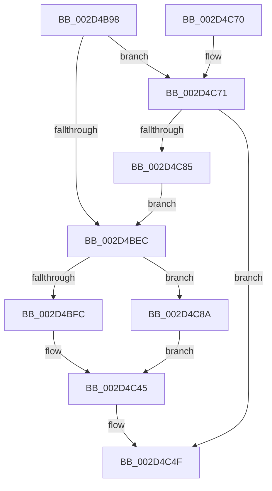

# KiIntSteerChooseInitialTargetProcessors

- RVA: `0x002D4B98`–`0x002D4C9E` (길이 `262` bytes)
- VA: `0x00000001402D4B98`
- 실행 섹션: `.text`
- PDB 이름 있음: `예`; PDB Function 태그: `아니요`
- unwind 정보 RVA: `0x0006FBD4`
- 디코드: `74`개 명령, `262/262` bytes 표시
- 미해석 바이트: `0` (있으면 어셈블리에 `.byte`로 보존)

> 이 문서는 커널 이미지의 기계어와 PDB 기호를 분석해 생성했습니다. 4번과 5번은 함수 원형과 자료형을 바이너리 사용 방식에서 추정한 C 해석이며 원본 소스 복구 결과는 아닙니다.

## 1. Dependencies

- 직접 호출 지점: **4**; 고유 호출 대상: **4**
- 직접 호출자로 확인된 함수: **1**
- RIP 상대 이미지 참조: **3**

### Outgoing calls
- `0x002D4BDC` → [KeIntSteerGetSteeringMode](KeIntSteerGetSteeringMode_function_002D4CA4.md) (function, `0x002D4CA4`)
- `0x002D4C14` → [KiIntPartGetLowestClassProcessorInMask](KiIntPartGetLowestClassProcessorInMask_function_002D89D4.md) (function, `0x002D89D4`)
- `0x002D4C7A` → [KiIntRedirectConnnect](../4D/KiIntRedirectConnnect_function_004D3E64.md) (function, `0x004D3E64`)
- `0x002D4C97` → [KeAddGroupAffinityEx](../25/KeAddGroupAffinityEx_function_0025B6C0.md) (function, `0x0025B6C0`)

### Direct callers
- [KiIntSteerConnect](KiIntSteerConnect_function_002D44F0.md) at `0x002D4663`

### Static image references
- `0x002D4BFC` → RVA `0x00F10BE8` (`.data`; read)
- `0x002D4C1B` → RVA `0x00F231B0` (`.data`; read)
- `0x002D4C8D` → RVA `0x00F10AA0` (`.data`; read)

## 2. Other-region calls and transfers

- 다른 실행 섹션으로 향하는 call: **0**
- 별도 외부 분기/꼬리 이동을 확인하지 못했습니다.

## 3. Assembly (complete function range)

```asm
002D4B98  48 8B C4                        mov rax, rsp
002D4B9B  48 89 58 08                     mov qword ptr [rax + 8], rbx
002D4B9F  48 89 68 10                     mov qword ptr [rax + 0x10], rbp
002D4BA3  48 89 70 18                     mov qword ptr [rax + 0x18], rsi
002D4BA7  48 89 78 20                     mov qword ptr [rax + 0x20], rdi
002D4BAB  41 54                           push r12
002D4BAD  41 56                           push r14
002D4BAF  41 57                           push r15
002D4BB1  48 83 EC 30                     sub rsp, 0x30
002D4BB5  48 8B 5C 24 78                  mov rbx, qword ptr [rsp + 0x78]
002D4BBA  49 8D 78 18                     lea rdi, [r8 + 0x18]
002D4BBE  0F 57 C0                        xorps xmm0, xmm0
002D4BC1  48 89 78 D8                     mov qword ptr [rax - 0x28], rdi
002D4BC5  4D 8B F0                        mov r14, r8
002D4BC8  44 8B FA                        mov r15d, edx
002D4BCB  4C 8B E1                        mov r12, rcx
002D4BCE  33 F6                           xor esi, esi
002D4BD0  0F 11 03                        movups xmmword ptr [rbx], xmm0
002D4BD3  45 8B 48 10                     mov r9d, dword ptr [r8 + 0x10]
002D4BD7  44 8A 44 24 70                  mov r8b, byte ptr [rsp + 0x70]
002D4BDC  E8 C3 00 00 00                  call 0x1402d4ca4
002D4BE1  8B E8                           mov ebp, eax
002D4BE3  83 F8 02                        cmp eax, 2
002D4BE6  0F 84 85 00 00 00               je 0x1402d4c71
002D4BEC  0F B7 57 08                     movzx edx, word ptr [rdi + 8]
002D4BF0  66 89 53 08                     mov word ptr [rbx + 8], dx
002D4BF4  85 ED                           test ebp, ebp
002D4BF6  0F 84 8E 00 00 00               je 0x1402d4c8a
002D4BFC  4C 8D 05 E5 BF C3 00            lea r8, [rip + 0xc3bfe5]
002D4C03  4D 8B 04 D0                     mov r8, qword ptr [r8 + rdx*8]
002D4C07  4C 23 07                        and r8, qword ptr [rdi]
002D4C0A  4C 89 03                        mov qword ptr [rbx], r8
002D4C0D  48 0F 45 FB                     cmovne rdi, rbx
002D4C11  48 8B CF                        mov rcx, rdi
002D4C14  E8 BB 3D 00 00                  call 0x1402d89d4
002D4C19  8B C8                           mov ecx, eax
002D4C1B  48 8B 05 8E E5 C4 00            mov rax, qword ptr [rip + 0xc4e58e]
002D4C22  8B 0C 88                        mov ecx, dword ptr [rax + rcx*4]
002D4C25  33 C0                           xor eax, eax
002D4C27  89 43 0A                        mov dword ptr [rbx + 0xa], eax
002D4C2A  66 89 43 0E                     mov word ptr [rbx + 0xe], ax
002D4C2E  8B C1                           mov eax, ecx
002D4C30  C1 E8 06                        shr eax, 6
002D4C33  83 E1 3F                        and ecx, 0x3f
002D4C36  66 89 43 08                     mov word ptr [rbx + 8], ax
002D4C3A  B8 01 00 00 00                  mov eax, 1
002D4C3F  48 D3 E0                        shl rax, cl
002D4C42  48 89 03                        mov qword ptr [rbx], rax
002D4C45  48 8B 84 24 80 00 00 00         mov rax, qword ptr [rsp + 0x80]
002D4C4D  89 28                           mov dword ptr [rax], ebp
002D4C4F  48 8B 5C 24 50                  mov rbx, qword ptr [rsp + 0x50]
002D4C54  8B C6                           mov eax, esi
002D4C56  48 8B 74 24 60                  mov rsi, qword ptr [rsp + 0x60]
002D4C5B  48 8B 6C 24 58                  mov rbp, qword ptr [rsp + 0x58]
002D4C60  48 8B 7C 24 68                  mov rdi, qword ptr [rsp + 0x68]
002D4C65  48 83 C4 30                     add rsp, 0x30
002D4C69  41 5F                           pop r15
002D4C6B  41 5E                           pop r14
002D4C6D  41 5C                           pop r12
002D4C6F  C3                              ret
002D4C70  CC                              int3
002D4C71  4D 8B C6                        mov r8, r14
002D4C74  41 8B D7                        mov edx, r15d
002D4C77  49 8B CC                        mov rcx, r12
002D4C7A  E8 E5 F1 1F 00                  call 0x1404d3e64
002D4C7F  8B F0                           mov esi, eax
002D4C81  85 C0                           test eax, eax
002D4C83  78 CA                           js 0x1402d4c4f
002D4C85  E9 62 FF FF FF                  jmp 0x1402d4bec
002D4C8A  4C 8B 07                        mov r8, qword ptr [rdi]
002D4C8D  48 8D 0D 0C BE C3 00            lea rcx, [rip + 0xc3be0c]
002D4C94  4C 89 03                        mov qword ptr [rbx], r8
002D4C97  E8 24 6A F8 FF                  call 0x14025b6c0
002D4C9C  EB A7                           jmp 0x1402d4c45
```

## 4. C-style interpretation (structured pseudocode)

```c
__int64 __fastcall KiIntSteerChooseInitialTargetProcessors(__int64 a1, int a2, __int64 a3, __int64 a4, unsigned __int8 a5, __int64 a6, __int64 a7)
{
    __int64 result;
    __int64 v_rdi;
    __int64 v_rsi;
    __int64 v_rsp;
    unsigned __int64 v_stack_p10;
    unsigned __int64 v_stack_p18;
    unsigned __int64 v_stack_p20;
    unsigned __int64 v_stack_p8;

    *(unsigned __int64 *)(v_rsp + 8) = v_rbx;
    *(unsigned __int64 *)(v_rsp + 16) = v_rbp;
    *(unsigned __int64 *)(v_rsp + 24) = v_rsi;
    *(unsigned __int64 *)(v_rsp + 32) = v_rdi;
    v_rsp = (v_rsp) - (48);
    *(unsigned __int64 *)(v_rsp - 40) = a3 + 24;
    v_rsi = 0;
    *(unsigned __int64 *)(a6) = v_xmm0;
    result = KeIntSteerGetSteeringMode(a1, a2, a5, (unsigned int)(*(unsigned int *)(a3 + 16)));
    if (((unsigned int)(result)) == 2) goto loc_002D4C71;
loc_002D4BEC:
    *(unsigned __int16 *)(a6 + 8) = (unsigned __int16)(*(unsigned __int16 *)(a3 + 24 + 8));
    if ((unsigned int)((unsigned int)((unsigned int)(result))) == 0) goto loc_002D4C8A;
    a3 = (*(unsigned __int64 *)(v_rip + 12828645 + *(unsigned __int16 *)(a3 + 24 + 8) * 8)) & (*(unsigned __int64 *)(a3 + 24));
    *(unsigned __int64 *)(a6) = a3;
    v_rdi = a3 + 24;
    if (condition_is_not_equal) { v_rdi = a6; }
    result = KiIntPartGetLowestClassProcessorInMask(v_rdi, *(unsigned __int16 *)(a3 + 24 + 8), a3, (unsigned int)(*(unsigned int *)(a3 + 16)));
    result = 0;
    *(unsigned int *)(a6 + 10) = 0;
    *(unsigned __int16 *)(a6 + 14) = 0;
    result = (unsigned int)(((unsigned int)((unsigned int)((unsigned int)(*(unsigned int *)(*(unsigned __int64 *)(v_rip + 12903822) + (unsigned int)((unsigned int)(result)) * 4))))) >> (6));
    a1 = (unsigned int)(((unsigned int)(*(unsigned int *)(*(unsigned __int64 *)(v_rip + 12903822) + (unsigned int)((unsigned int)(result)) * 4))) & (63));
    *(unsigned __int16 *)(a6 + 8) = (unsigned __int16)(result);
    result = (1) << ((unsigned __int8)(a1));
    *(unsigned __int64 *)(a6) = result;
loc_002D4C45:
    *(unsigned int *)(a7) = (unsigned int)((unsigned int)((unsigned int)(result)));
loc_002D4C4F:
    v_rsp = (v_rsp) + (48);
    return 0;
loc_002D4C71:
    result = KiIntRedirectConnnect(a1, (unsigned int)((unsigned int)((unsigned int)(a2))), a3, (unsigned int)(*(unsigned int *)(a3 + 16)));
    if (sign_flag) goto loc_002D4C4F;
    goto loc_002D4BEC;
loc_002D4C8A:
    *(unsigned __int64 *)(v_stack_p8) = *(unsigned __int64 *)(v_stack_p20);
    result = KeAddGroupAffinityEx(v_rip + 12828172, (unsigned int)((unsigned int)((unsigned int)(a2))), *(unsigned __int64 *)(v_stack_p20), (unsigned int)(*(unsigned int *)(a3 + 16)));
    goto loc_002D4C45;
}
```

## 5. (Beta) C Style

```c
int64_t KiIntSteerChooseInitialTargetProcessors(int64_t Arg1, int32_t Arg2, void *Arg3, int64_t Arg4, uint8_t Arg5, void *Arg6, void *Arg7)
{
    uint8_t *arg3 = (uint8_t *)Arg3;
    uint8_t *arg6 = (uint8_t *)Arg6;
    uint8_t *arg7 = (uint8_t *)Arg7;

    int64_t result;
    int64_t local_rdi;
    int64_t local_rsi;
    int64_t local_rsp;
    uint64_t v_stack_p10;
    uint64_t v_stack_p18;
    uint64_t v_stack_p20;
    uint64_t v_stack_p8;

    *(uint64_t *)(local_rsp + 0x8) = local_rbx;
    *(uint64_t *)(local_rsp + 0x10) = local_rbp;
    *(uint64_t *)(local_rsp + 0x18) = local_rsi;
    *(uint64_t *)(local_rsp + 0x20) = local_rdi;
    local_rsp = (local_rsp) - (48);
    *(void **)(local_rsp - 0x28) = Arg3 + 24;
    local_rsi = 0;
    *(uint64_t *)(arg6) = v_xmm0;
    result = KeIntSteerGetSteeringMode(Arg1, Arg2, Arg5, (uint32_t)(*(uint32_t *)(arg3 + 0x10)));
    if (((uint32_t)(result)) == 2) goto loc_002D4C71;
loc_002D4BEC:
    *(uint16_t *)(arg6 + 0x8) = (uint16_t)(*(uint16_t *)(arg3 + 0x18 + 0x8));
    if ((uint32_t)((uint32_t)((uint32_t)(result))) == 0) goto loc_002D4C8A;
    Arg3 = (*(uint64_t *)(v_rip + 0xC3BFE5 + *(uint16_t *)(arg3 + 0x18 + 0x8) * 8)) & (*(uint64_t *)(arg3 + 0x18));
    *(void **)(arg6) = Arg3;
    local_rdi = Arg3 + 24;
    if (condition_is_not_equal) { local_rdi = Arg6; }
    result = KiIntPartGetLowestClassProcessorInMask(local_rdi, *(uint16_t *)(arg3 + 0x18 + 0x8), Arg3, (uint32_t)(*(uint32_t *)(arg3 + 0x10)));
    result = 0;
    *(uint32_t *)(arg6 + 0xA) = 0;
    *(uint16_t *)(arg6 + 0xE) = 0;
    result = (uint32_t)(((uint32_t)((uint32_t)((uint32_t)(*(uint32_t *)(*(uint64_t *)(v_rip + 0xC4E58E) + (uint32_t)((uint32_t)(result)) * 4))))) >> (6));
    Arg1 = (uint32_t)(((uint32_t)(*(uint32_t *)(*(uint64_t *)(v_rip + 0xC4E58E) + (uint32_t)((uint32_t)(result)) * 4))) & (63));
    *(uint16_t *)(arg6 + 0x8) = (uint16_t)(result);
    result = (1) << ((uint8_t)(Arg1));
    *(uint64_t *)(arg6) = result;
loc_002D4C45:
    *(uint32_t *)(arg7) = (uint32_t)((uint32_t)((uint32_t)(result)));
loc_002D4C4F:
    local_rsp = (local_rsp) + (48);
    return 0;
loc_002D4C71:
    result = KiIntRedirectConnnect(Arg1, (uint32_t)((uint32_t)((uint32_t)(Arg2))), Arg3, (uint32_t)(*(uint32_t *)(arg3 + 0x10)));
    if (sign_flag) goto loc_002D4C4F;
    goto loc_002D4BEC;
loc_002D4C8A:
    *(uint64_t *)(v_stack_p8) = *(uint64_t *)(v_stack_p20);
    result = KeAddGroupAffinityEx(v_rip + 12828172, (uint32_t)((uint32_t)((uint32_t)(Arg2))), *(uint64_t *)(v_stack_p20), (uint32_t)(*(uint32_t *)(arg3 + 0x10)));
    goto loc_002D4C45;
}
```

### 관측된 메모리 오프셋

구조체 형식이 확인되지 않은 접근은 인자 기준의 오프셋으로만 기록했습니다.

| 기준 인자 | 오프셋 표현 | 폭 (bit) | 접근 |
|---|---:|---:|---|
| `Arg3` | `+ 0x0` | `64` | `R` |
| `Arg3` | `+ 0x8` | `16` | `R` |
| `Arg3` | `+ 0x10` | `32` | `R` |
| `Arg3` | `+ 0x18` | `64` | `R` |
| `Arg6` | `+ 0x0` | `64` | `W` |
| `Arg6` | `+ 0x0` | `128` | `R` |
| `Arg6` | `+ 0x8` | `16` | `W` |
| `Arg6` | `+ 0xA` | `32` | `W` |
| `Arg6` | `+ 0xE` | `16` | `W` |
| `Arg7` | `+ 0x0` | `32` | `W` |

## 6. Execution-region graph

[열기: 2D/3D 그래프와 함수 탐색 컨트롤 패널](../../../control-panel.html?section=text&rva=0x002D4B98&view=graph)

- 2D 그래프는 위에서 아래로 흐르고, 3D 그래프는 빈 공간을 드래그해 회전합니다. Shift+드래그는 이동, 휠은 확대·축소, 함수 노드 선택은 대상 보고서 이동입니다.

### Static fallback


