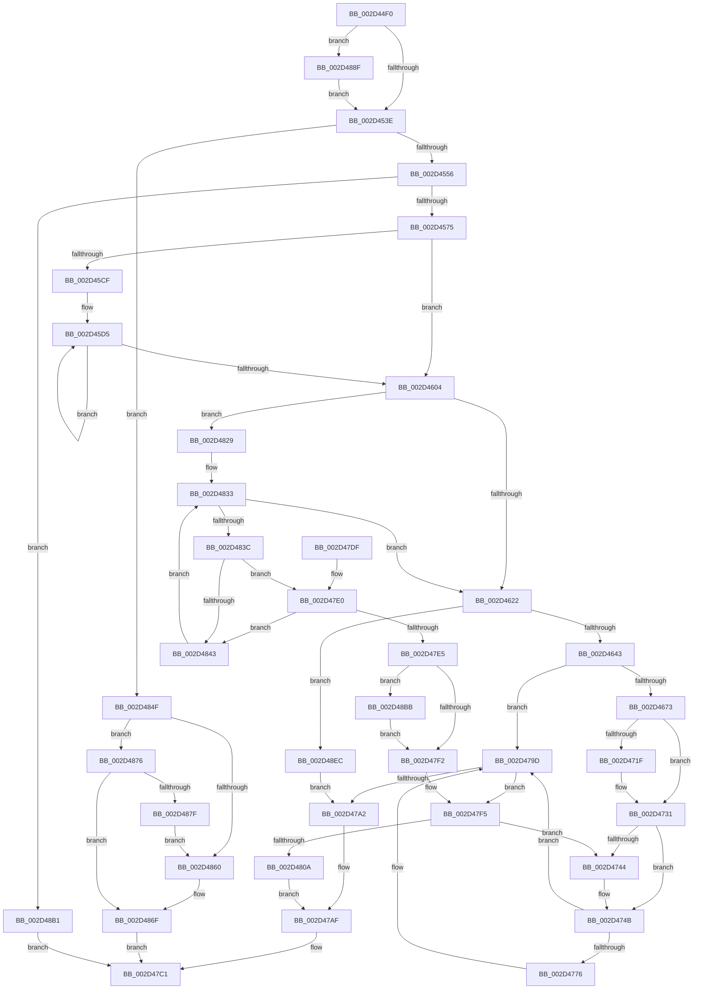

# KiIntSteerConnect

- RVA: `0x002D44F0`–`0x002D48F7` (길이 `1,031` bytes)
- VA: `0x00000001402D44F0`
- 실행 섹션: `.text`
- PDB 이름 있음: `예`; PDB Function 태그: `아니요`
- unwind 정보 RVA: `0x0006FB84`
- 디코드: `245`개 명령, `1,031/1,031` bytes 표시
- 미해석 바이트: `0` (있으면 어셈블리에 `.byte`로 보존)

> 이 문서는 커널 이미지의 기계어와 PDB 기호를 분석해 생성했습니다. 4번과 5번은 함수 원형과 자료형을 바이너리 사용 방식에서 추정한 C 해석이며 원본 소스 복구 결과는 아닙니다.

## 1. Dependencies

- 직접 호출 지점: **13**; 고유 호출 대상: **12**
- 직접 호출자로 확인된 함수: **1**
- RIP 상대 이미지 참조: **12**

### Outgoing calls
- `0x002D4549` → [KiIntSteerGetLineInformation](KiIntSteerGetLineInformation_function_002D4B04.md) (function, `0x002D4B04`)
- `0x002D4564` → [ExAllocatePool2](../../poolcode/B8/ExAllocatePool2_function_00B820F0.md) (function, `0x00B820F0`)
- `0x002D460B` → [KeAcquireSpinLockRaiseToDpc](../20/KeAcquireSpinLockRaiseToDpc_function_00208470.md) (function, `0x00208470`)
- `0x002D4632` → [ExAllocatePool2](../../poolcode/B8/ExAllocatePool2_function_00B820F0.md) (function, `0x00B820F0`)
- `0x002D4663` → [KiIntSteerChooseInitialTargetProcessors](KiIntSteerChooseInitialTargetProcessors_function_002D4B98.md) (function, `0x002D4B98`)
- `0x002D467E` → [memset](../6C/memset_function_006C6C40.md) (function, `0x006C6C40`)
- `0x002D4768` → [KiIntSteerUpdateDeviceInterruptMask](KiIntSteerUpdateDeviceInterruptMask_function_002D55B8.md) (function, `0x002D55B8`)
- `0x002D477C` → [KiIntSteerSetDestination](KiIntSteerSetDestination_function_002D581C.md) (function, `0x002D581C`)
- `0x002D47AA` → [ExFreePoolWithTag](../../poolcode/B8/ExFreePoolWithTag_function_00B82870.md) (function, `0x00B82870`)
- `0x002D47B9` → [KeReleaseSpinLock](../39/KeReleaseSpinLock_function_00392BA0.md) (function, `0x00392BA0`)
- `0x002D4822` → [KiIntSteerLogState](KiIntSteerLogState_function_002D57BC.md) (function, `0x002D57BC`)
- `0x002D48A7` → [EtwRegister](../../page/92/EtwRegister_function_00920960.md) (function, `0x00920960`)
- `0x002D48E2` → [KeAddGroupAffinityEx](../25/KeAddGroupAffinityEx_function_0025B6C0.md) (function, `0x0025B6C0`)

### Direct callers
- [KeConnectInterrupt](KeConnectInterrupt_function_002D3D5C.md) at `0x002D3E33`

### Static image references
- `0x002D4518` → RVA `0x00E66948` (`.data`; read)
- `0x002D4604` → RVA `0x00F10CF0` (`.data`; read)
- `0x002D4613` → RVA `0x00F10D50` (`.data`; read)
- `0x002D4731` → RVA `0x00F10D58` (`.data`; read)
- `0x002D475A` → RVA `0x00F10D40` (`.data`; read/write)
- `0x002D4761` → RVA `0x00F10D58` (`.data`; write)
- `0x002D480D` → RVA `0x00010FB0` (`.rdata`; read)
- `0x002D4853` → RVA `0x00F10AA0` (`.data`; read)
- `0x002D4876` → RVA `0x00F10AA2` (`.data`; read)
- `0x002D4886` → RVA `0x00F10AA0` (`.data`; write)
- `0x002D4899` → RVA `0x00747370` (`KiIntSteerEventTraceControlCallback`; read)
- `0x002D48A0` → RVA `0x00022DB0` (`.rdata`; read)

## 2. Other-region calls and transfers

- 다른 실행 섹션으로 향하는 call: **4**
  - `0x002D4564` → [ExAllocatePool2](../../poolcode/B8/ExAllocatePool2_function_00B820F0.md) (`.text` → `POOLCODE`)
  - `0x002D4632` → [ExAllocatePool2](../../poolcode/B8/ExAllocatePool2_function_00B820F0.md) (`.text` → `POOLCODE`)
  - `0x002D47AA` → [ExFreePoolWithTag](../../poolcode/B8/ExFreePoolWithTag_function_00B82870.md) (`.text` → `POOLCODE`)
  - `0x002D48A7` → [EtwRegister](../../page/92/EtwRegister_function_00920960.md) (`.text` → `PAGE`)
- 별도 외부 분기/꼬리 이동을 확인하지 못했습니다.

## 3. Assembly (complete function range)

```asm
002D44F0  48 8B C4                        mov rax, rsp
002D44F3  48 89 58 08                     mov qword ptr [rax + 8], rbx
002D44F7  48 89 70 10                     mov qword ptr [rax + 0x10], rsi
002D44FB  48 89 78 18                     mov qword ptr [rax + 0x18], rdi
002D44FF  4C 89 48 20                     mov qword ptr [rax + 0x20], r9
002D4503  55                              push rbp
002D4504  41 54                           push r12
002D4506  41 55                           push r13
002D4508  41 56                           push r14
002D450A  41 57                           push r15
002D450C  48 8B EC                        mov rbp, rsp
002D450F  48 83 EC 60                     sub rsp, 0x60
002D4513  33 DB                           xor ebx, ebx
002D4515  44 8B F2                        mov r14d, edx
002D4518  48 39 1D 29 24 B9 00            cmp qword ptr [rip + 0xb92429], rbx
002D451F  0F 57 C0                        xorps xmm0, xmm0
002D4522  49 8B F0                        mov rsi, r8
002D4525  88 5D E0                        mov byte ptr [rbp - 0x20], bl
002D4528  4C 8B E9                        mov r13, rcx
002D452B  89 5D E4                        mov dword ptr [rbp - 0x1c], ebx
002D452E  89 5D E8                        mov dword ptr [rbp - 0x18], ebx
002D4531  0F 11 45 F0                     movups xmmword ptr [rbp - 0x10], xmm0
002D4535  41 88 19                        mov byte ptr [r9], bl
002D4538  0F 84 51 03 00 00               je 0x1402d488f
002D453E  4C 8D 45 E0                     lea r8, [rbp - 0x20]
002D4542  48 8B CE                        mov rcx, rsi
002D4545  48 8D 55 E4                     lea rdx, [rbp - 0x1c]
002D4549  E8 B6 05 00 00                  call 0x1402d4b04
002D454E  85 C0                           test eax, eax
002D4550  0F 88 F9 02 00 00               js 0x1402d484f
002D4556  BA 98 00 00 00                  mov edx, 0x98
002D455B  41 B8 49 54 72 6B               mov r8d, 0x6b725449
002D4561  8D 4A A8                        lea ecx, [rdx - 0x58]
002D4564  E8 87 DB 8A 00                  call 0x140b820f0
002D4569  48 8B F8                        mov rdi, rax
002D456C  48 85 C0                        test rax, rax
002D456F  0F 84 3C 03 00 00               je 0x1402d48b1
002D4575  44 8A 65 E0                     mov r12b, byte ptr [rbp - 0x20]
002D4579  41 BF 01 00 00 00               mov r15d, 1
002D457F  44 88 60 38                     mov byte ptr [rax + 0x38], r12b
002D4583  4C 89 68 20                     mov qword ptr [rax + 0x20], r13
002D4587  44 89 70 18                     mov dword ptr [rax + 0x18], r14d
002D458B  48 89 58 28                     mov qword ptr [rax + 0x28], rbx
002D458F  48 89 58 30                     mov qword ptr [rax + 0x30], rbx
002D4593  0F 10 06                        movups xmm0, xmmword ptr [rsi]
002D4596  0F 11 40 40                     movups xmmword ptr [rax + 0x40], xmm0
002D459A  0F 10 4E 10                     movups xmm1, xmmword ptr [rsi + 0x10]
002D459E  0F 11 48 50                     movups xmmword ptr [rax + 0x50], xmm1
002D45A2  0F 10 46 20                     movups xmm0, xmmword ptr [rsi + 0x20]
002D45A6  0F 11 40 60                     movups xmmword ptr [rax + 0x60], xmm0
002D45AA  0F 10 4E 30                     movups xmm1, xmmword ptr [rsi + 0x30]
002D45AE  0F 11 48 70                     movups xmmword ptr [rax + 0x70], xmm1
002D45B2  0F 10 46 40                     movups xmm0, xmmword ptr [rsi + 0x40]
002D45B6  0F 11 80 80 00 00 00            movups xmmword ptr [rax + 0x80], xmm0
002D45BD  F2 0F 10 4E 50                  movsd xmm1, qword ptr [rsi + 0x50]
002D45C2  F2 0F 11 88 90 00 00 00         movsd qword ptr [rax + 0x90], xmm1
002D45CA  45 85 F6                        test r14d, r14d
002D45CD  74 35                           je 0x1402d4604
002D45CF  49 8B CD                        mov rcx, r13
002D45D2  49 8B D6                        mov rdx, r14
002D45D5  48 8B 01                        mov rax, qword ptr [rcx]
002D45D8  48 8D 49 08                     lea rcx, [rcx + 8]
002D45DC  48 89 98 B0 00 00 00            mov qword ptr [rax + 0xb0], rbx
002D45E3  48 89 98 C0 00 00 00            mov qword ptr [rax + 0xc0], rbx
002D45EA  48 89 98 C8 00 00 00            mov qword ptr [rax + 0xc8], rbx
002D45F1  48 89 98 D8 00 00 00            mov qword ptr [rax + 0xd8], rbx
002D45F8  48 89 B8 A8 00 00 00            mov qword ptr [rax + 0xa8], rdi
002D45FF  49 2B D7                        sub rdx, r15
002D4602  75 D1                           jne 0x1402d45d5
002D4604  48 8D 0D E5 C6 C3 00            lea rcx, [rip + 0xc3c6e5]
002D460B  E8 60 3E F3 FF                  call 0x140208470
002D4610  88 45 E0                        mov byte ptr [rbp - 0x20], al
002D4613  48 8D 05 36 C7 C3 00            lea rax, [rip + 0xc3c736]
002D461A  39 1E                           cmp dword ptr [rsi], ebx
002D461C  0F 84 07 02 00 00               je 0x1402d4829
002D4622  BA E0 00 00 00                  mov edx, 0xe0
002D4627  B9 40 00 00 00                  mov ecx, 0x40
002D462C  41 B8 49 54 72 6B               mov r8d, 0x6b725449
002D4632  E8 B9 DA 8A 00                  call 0x140b820f0
002D4637  48 8B D8                        mov rbx, rax
002D463A  48 85 C0                        test rax, rax
002D463D  0F 84 A9 02 00 00               je 0x1402d48ec
002D4643  48 8D 45 E8                     lea rax, [rbp - 0x18]
002D4647  4C 8B C6                        mov r8, rsi
002D464A  48 89 44 24 30                  mov qword ptr [rsp + 0x30], rax
002D464F  41 8B D6                        mov edx, r14d
002D4652  48 8D 45 F0                     lea rax, [rbp - 0x10]
002D4656  49 8B CD                        mov rcx, r13
002D4659  48 89 44 24 28                  mov qword ptr [rsp + 0x28], rax
002D465E  44 88 64 24 20                  mov byte ptr [rsp + 0x20], r12b
002D4663  E8 30 05 00 00                  call 0x1402d4b98
002D4668  44 8B F0                        mov r14d, eax
002D466B  85 C0                           test eax, eax
002D466D  0F 88 2A 01 00 00               js 0x1402d479d
002D4673  33 D2                           xor edx, edx
002D4675  41 B8 E0 00 00 00               mov r8d, 0xe0
002D467B  48 8B CB                        mov rcx, rbx
002D467E  E8 BD 25 3F 00                  call 0x1406c6c40
002D4683  8B 45 E4                        mov eax, dword ptr [rbp - 0x1c]
002D4686  48 8D 4B 10                     lea rcx, [rbx + 0x10]
002D468A  48 89 49 08                     mov qword ptr [rcx + 8], rcx
002D468E  4C 8D A3 A0 00 00 00            lea r12, [rbx + 0xa0]
002D4695  48 89 09                        mov qword ptr [rcx], rcx
002D4698  89 43 20                        mov dword ptr [rbx + 0x20], eax
002D469B  33 C0                           xor eax, eax
002D469D  88 83 84 00 00 00               mov byte ptr [rbx + 0x84], al
002D46A3  48 89 83 98 00 00 00            mov qword ptr [rbx + 0x98], rax
002D46AA  0F B7 4E 20                     movzx ecx, word ptr [rsi + 0x20]
002D46AE  48 89 83 88 00 00 00            mov qword ptr [rbx + 0x88], rax
002D46B5  8B 45 E8                        mov eax, dword ptr [rbp - 0x18]
002D46B8  89 83 80 00 00 00               mov dword ptr [rbx + 0x80], eax
002D46BE  48 8B 45 F0                     mov rax, qword ptr [rbp - 0x10]
002D46C2  66 89 8B 90 00 00 00            mov word ptr [rbx + 0x90], cx
002D46C9  0F B7 4D F8                     movzx ecx, word ptr [rbp - 8]
002D46CD  49 89 04 24                     mov qword ptr [r12], rax
002D46D1  66 41 89 4C 24 08               mov word ptr [r12 + 8], cx
002D46D7  66 89 8B B8 00 00 00            mov word ptr [rbx + 0xb8], cx
002D46DE  48 89 83 B0 00 00 00            mov qword ptr [rbx + 0xb0], rax
002D46E5  83 BB 80 00 00 00 02            cmp dword ptr [rbx + 0x80], 2
002D46EC  0F 10 06                        movups xmm0, xmmword ptr [rsi]
002D46EF  0F 11 43 28                     movups xmmword ptr [rbx + 0x28], xmm0
002D46F3  0F 10 4E 10                     movups xmm1, xmmword ptr [rsi + 0x10]
002D46F7  0F 11 4B 38                     movups xmmword ptr [rbx + 0x38], xmm1
002D46FB  0F 10 46 20                     movups xmm0, xmmword ptr [rsi + 0x20]
002D46FF  0F 11 43 48                     movups xmmword ptr [rbx + 0x48], xmm0
002D4703  0F 10 4E 30                     movups xmm1, xmmword ptr [rsi + 0x30]
002D4707  0F 11 4B 58                     movups xmmword ptr [rbx + 0x58], xmm1
002D470B  0F 10 46 40                     movups xmm0, xmmword ptr [rsi + 0x40]
002D470F  0F 11 43 68                     movups xmmword ptr [rbx + 0x68], xmm0
002D4713  F2 0F 10 4E 50                  movsd xmm1, qword ptr [rsi + 0x50]
002D4718  F2 0F 11 4B 78                  movsd qword ptr [rbx + 0x78], xmm1
002D471D  75 12                           jne 0x1402d4731
002D471F  49 8B 45 00                     mov rax, qword ptr [r13]
002D4723  48 8B 88 10 01 00 00            mov rcx, qword ptr [rax + 0x110]
002D472A  48 89 8B C8 00 00 00            mov qword ptr [rbx + 0xc8], rcx
002D4731  48 8B 05 20 C6 C3 00            mov rax, qword ptr [rip + 0xc3c620]
002D4738  48 8D 0D 11 C6 C3 00            lea rcx, [rip + 0xc3c611]
002D473F  48 39 08                        cmp qword ptr [rax], rcx
002D4742  74 07                           je 0x1402d474b
002D4744  B9 03 00 00 00                  mov ecx, 3
002D4749  CD 29                           int 0x29
002D474B  48 89 0B                        mov qword ptr [rbx], rcx
002D474E  33 D2                           xor edx, edx
002D4750  48 89 43 08                     mov qword ptr [rbx + 8], rax
002D4754  49 8B CC                        mov rcx, r12
002D4757  48 89 18                        mov qword ptr [rax], rbx
002D475A  44 01 3D DF C5 C3 00            add dword ptr [rip + 0xc3c5df], r15d
002D4761  48 89 1D F0 C5 C3 00            mov qword ptr [rip + 0xc3c5f0], rbx
002D4768  E8 4B 0E 00 00                  call 0x1402d55b8
002D476D  83 BB 80 00 00 00 00            cmp dword ptr [rbx + 0x80], 0
002D4774  74 27                           je 0x1402d479d
002D4776  49 8B D4                        mov rdx, r12
002D4779  48 8B CB                        mov rcx, rbx
002D477C  E8 9B 10 00 00                  call 0x1402d581c
002D4781  48 8B 45 48                     mov rax, qword ptr [rbp + 0x48]
002D4785  48 8B 4D 50                     mov rcx, qword ptr [rbp + 0x50]
002D4789  44 88 38                        mov byte ptr [rax], r15b
002D478C  41 0F B7 44 24 08               movzx eax, word ptr [r12 + 8]
002D4792  66 89 41 08                     mov word ptr [rcx + 8], ax
002D4796  49 8B 04 24                     mov rax, qword ptr [r12]
002D479A  48 89 01                        mov qword ptr [rcx], rax
002D479D  45 85 F6                        test r14d, r14d
002D47A0  74 53                           je 0x1402d47f5
002D47A2  BA 49 54 72 6B                  mov edx, 0x6b725449
002D47A7  48 8B CF                        mov rcx, rdi
002D47AA  E8 C1 E0 8A 00                  call 0x140b82870
002D47AF  8A 55 E0                        mov dl, byte ptr [rbp - 0x20]
002D47B2  48 8D 0D 37 C5 C3 00            lea rcx, [rip + 0xc3c537]
002D47B9  E8 E2 E3 0B 00                  call 0x140392ba0
002D47BE  41 8B C6                        mov eax, r14d
002D47C1  4C 8D 5C 24 60                  lea r11, [rsp + 0x60]
002D47C6  49 8B 5B 30                     mov rbx, qword ptr [r11 + 0x30]
002D47CA  49 8B 73 38                     mov rsi, qword ptr [r11 + 0x38]
002D47CE  49 8B 7B 40                     mov rdi, qword ptr [r11 + 0x40]
002D47D2  49 8B E3                        mov rsp, r11
002D47D5  41 5F                           pop r15
002D47D7  41 5E                           pop r14
002D47D9  41 5D                           pop r13
002D47DB  41 5C                           pop r12
002D47DD  5D                              pop rbp
002D47DE  C3                              ret
002D47DF  CC                              int3
002D47E0  83 F8 FF                        cmp eax, -1
002D47E3  74 5E                           je 0x1402d4843
002D47E5  83 BB 80 00 00 00 02            cmp dword ptr [rbx + 0x80], 2
002D47EC  0F 84 C9 00 00 00               je 0x1402d48bb
002D47F2  45 33 F6                        xor r14d, r14d
002D47F5  48 89 5F 10                     mov qword ptr [rdi + 0x10], rbx
002D47F9  48 83 C3 10                     add rbx, 0x10
002D47FD  48 8B 43 08                     mov rax, qword ptr [rbx + 8]
002D4801  48 39 18                        cmp qword ptr [rax], rbx
002D4804  0F 85 3A FF FF FF               jne 0x1402d4744
002D480A  48 89 1F                        mov qword ptr [rdi], rbx
002D480D  48 8D 15 9C C7 D3 FF            lea rdx, [rip - 0x2c3864]
002D4814  48 89 47 08                     mov qword ptr [rdi + 8], rax
002D4818  48 8B CF                        mov rcx, rdi
002D481B  48 89 38                        mov qword ptr [rax], rdi
002D481E  48 89 7B 08                     mov qword ptr [rbx + 8], rdi
002D4822  E8 95 0F 00 00                  call 0x1402d57bc
002D4827  EB 86                           jmp 0x1402d47af
002D4829  48 8B 1D 20 C5 C3 00            mov rbx, qword ptr [rip + 0xc3c520]
002D4830  8B 4D E4                        mov ecx, dword ptr [rbp - 0x1c]
002D4833  48 3B D8                        cmp rbx, rax
002D4836  0F 84 E6 FD FF FF               je 0x1402d4622
002D483C  8B 43 20                        mov eax, dword ptr [rbx + 0x20]
002D483F  3B C1                           cmp eax, ecx
002D4841  74 9D                           je 0x1402d47e0
002D4843  48 8B 1B                        mov rbx, qword ptr [rbx]
002D4846  48 8D 05 03 C5 C3 00            lea rax, [rip + 0xc3c503]
002D484D  EB E4                           jmp 0x1402d4833
002D484F  0F B7 4E 20                     movzx ecx, word ptr [rsi + 0x20]
002D4853  66 39 0D 46 C2 C3 00            cmp word ptr [rip + 0xc3c246], cx
002D485A  48 8B 56 18                     mov rdx, qword ptr [rsi + 0x18]
002D485E  76 16                           jbe 0x1402d4876
002D4860  48 8B C1                        mov rax, rcx
002D4863  48 8D 0D 36 C2 C3 00            lea rcx, [rip + 0xc3c236]
002D486A  48 09 54 C1 08                  or qword ptr [rcx + rax*8 + 8], rdx
002D486F  33 C0                           xor eax, eax
002D4871  E9 4B FF FF FF                  jmp 0x1402d47c1
002D4876  66 39 0D 25 C2 C3 00            cmp word ptr [rip + 0xc3c225], cx
002D487D  76 F0                           jbe 0x1402d486f
002D487F  B8 01 00 00 00                  mov eax, 1
002D4884  03 C1                           add eax, ecx
002D4886  66 89 05 13 C2 C3 00            mov word ptr [rip + 0xc3c213], ax
002D488D  EB D1                           jmp 0x1402d4860
002D488F  4C 8D 0D B2 20 B9 00            lea r9, [rip + 0xb920b2]
002D4896  45 33 C0                        xor r8d, r8d
002D4899  48 8D 15 D0 2A 47 00            lea rdx, [rip + 0x472ad0]
002D48A0  48 8D 0D 09 E5 D4 FF            lea rcx, [rip - 0x2b1af7]
002D48A7  E8 B4 C0 64 00                  call 0x140920960
002D48AC  E9 8D FC FF FF                  jmp 0x1402d453e
002D48B1  B8 9A 00 00 C0                  mov eax, 0xc000009a
002D48B6  E9 06 FF FF FF                  jmp 0x1402d47c1
002D48BB  48 8B 83 C8 00 00 00            mov rax, qword ptr [rbx + 0xc8]
002D48C2  33 C9                           xor ecx, ecx
002D48C4  88 48 10                        mov byte ptr [rax + 0x10], cl
002D48C7  89 8B 80 00 00 00               mov dword ptr [rbx + 0x80], ecx
002D48CD  88 8B 84 00 00 00               mov byte ptr [rbx + 0x84], cl
002D48D3  48 8D 0D C6 C1 C3 00            lea rcx, [rip + 0xc3c1c6]
002D48DA  4C 8B 46 18                     mov r8, qword ptr [rsi + 0x18]
002D48DE  0F B7 56 20                     movzx edx, word ptr [rsi + 0x20]
002D48E2  E8 D9 6D F8 FF                  call 0x14025b6c0
002D48E7  E9 06 FF FF FF                  jmp 0x1402d47f2
002D48EC  41 BE 9A 00 00 C0               mov r14d, 0xc000009a
002D48F2  E9 AB FE FF FF                  jmp 0x1402d47a2
```

## 4. C-style interpretation (structured pseudocode)

```c
__int64 __fastcall KiIntSteerConnect(__int64 a1, int a2, __int64 a3, __int64 a4, __int64 a5)
{
    __int64 result;
    __int64 v_r14;
    __int64 v_rbx;
    __int64 v_rsp;
    unsigned __int64 v_stack_m28;
    unsigned __int16 v_stack_m30;
    unsigned __int64 v_stack_m38;
    unsigned int v_stack_m40;
    unsigned int v_stack_m44;
    unsigned __int8 v_stack_m48;
    unsigned __int64 v_stack_m58;
    unsigned __int64 v_stack_m60;
    unsigned __int8 v_stack_m68;
    unsigned __int64 v_stack_p20;

    *(unsigned __int64 *)(v_rsp + 8) = v_rbx;
    *(unsigned __int64 *)(v_rsp + 16) = v_rsi;
    *(unsigned __int64 *)(v_rsp + 24) = v_rdi;
    *(unsigned __int64 *)(v_rsp + 32) = a4;
    v_rsp = (v_rsp) - (96);
    v_rbx = 0;
    v_stack_m48 = 0;
    v_stack_m44 = 0;
    v_stack_m40 = 0;
    v_stack_m38 = v_xmm0;
    *(unsigned __int8 *)(a4) = 0;
    if ((*(unsigned __int64 *)(v_rip + 12133417)) == 0) goto loc_002D488F;
loc_002D453E:
    result = KiIntSteerGetLineInformation(a3, v_stack_m44, v_stack_m48, a4);
    if (sign_flag) goto loc_002D484F;
    result = ExAllocatePool2(152 - 88, 152, (unsigned int)(0x6B725449ULL), a4);
    if (result == 0) goto loc_002D48B1;
    *(unsigned __int8 *)(result + 56) = (unsigned __int8)(v_stack_m48);
    *(unsigned __int64 *)(result + 32) = a1;
    *(unsigned int *)(result + 24) = (unsigned int)((unsigned int)(a2));
    *(unsigned __int64 *)(result + 40) = 0;
    *(unsigned __int64 *)(result + 48) = 0;
    *(unsigned __int64 *)(result + 64) = v_xmm0;
    *(unsigned __int64 *)(result + 80) = v_xmm1;
    *(unsigned __int64 *)(result + 96) = v_xmm0;
    *(unsigned __int64 *)(result + 112) = v_xmm1;
    *(unsigned __int64 *)(result + 128) = v_xmm0;
    *(unsigned __int64 *)(result + 144) = v_xmm1;
    if ((unsigned int)((unsigned int)(a2)) == 0) goto loc_002D4604;
loc_002D45D5:
    *(unsigned __int64 *)(*(unsigned __int64 *)(a1) + 176) = 0;
    *(unsigned __int64 *)(*(unsigned __int64 *)(a1) + 192) = 0;
    *(unsigned __int64 *)(*(unsigned __int64 *)(a1) + 200) = 0;
    *(unsigned __int64 *)(*(unsigned __int64 *)(a1) + 216) = 0;
    *(unsigned __int64 *)(*(unsigned __int64 *)(a1) + 168) = result;
    a2 = ((unsigned int)(a2)) - (1);
    if (condition_is_not_equal) goto loc_002D45D5;
loc_002D4604:
    result = KeAcquireSpinLockRaiseToDpc(v_rip + 12830437, a2, (unsigned int)(0x6B725449ULL), a4);
    v_stack_m48 = (unsigned __int8)(result);
    if ((*(unsigned int *)(a3)) == 0) goto loc_002D4829;
loc_002D4622:
    result = ExAllocatePool2(64, 224, (unsigned int)(0x6B725449ULL), a4);
    if (result == 0) goto loc_002D48EC;
    v_stack_m58 = v_stack_m40;
    v_stack_m60 = v_stack_m38;
    v_stack_m68 = (unsigned __int8)(v_stack_m48);
    result = KiIntSteerChooseInitialTargetProcessors(a1, (unsigned int)((unsigned int)((unsigned int)(a2))), a3, a4);
    if (sign_flag) goto loc_002D479D;
    a2 = 0;
    result = memset(result, a2, 224, a4);
    *(unsigned __int64 *)(result + 16 + 8) = result + 16;
    *(unsigned __int64 *)(result + 16) = result + 16;
    *(unsigned int *)(result + 32) = (unsigned int)((unsigned int)(v_stack_m44));
    result = 0;
    *(unsigned __int8 *)(result + 132) = 0;
    *(unsigned __int64 *)(result + 152) = 0;
    *(unsigned __int64 *)(result + 136) = 0;
    *(unsigned int *)(result + 128) = (unsigned int)((unsigned int)(v_stack_m40));
    *(unsigned __int16 *)(result + 144) = (unsigned __int16)(*(unsigned __int16 *)(a3 + 32));
    *(unsigned __int64 *)(result + 160) = v_stack_m38;
    *(unsigned __int16 *)(result + 160 + 8) = (unsigned __int16)(v_stack_m30);
    *(unsigned __int16 *)(result + 184) = (unsigned __int16)(v_stack_m30);
    *(unsigned __int64 *)(result + 176) = v_stack_m38;
    *(unsigned __int64 *)(result + 40) = v_xmm0;
    *(unsigned __int64 *)(result + 56) = v_xmm1;
    *(unsigned __int64 *)(result + 72) = v_xmm0;
    *(unsigned __int64 *)(result + 88) = v_xmm1;
    *(unsigned __int64 *)(result + 104) = v_xmm0;
    *(unsigned __int64 *)(result + 120) = v_xmm1;
    result = v_stack_m38;
    if ((*(unsigned int *)(result + 128)) == 2) {
        result = *(unsigned __int64 *)(a1);
        a1 = *(unsigned __int64 *)(result + 272);
        *(unsigned __int64 *)(result + 200) = a1;
    }
    if ((*(unsigned __int64 *)(*(unsigned __int64 *)(v_rip + 12830240))) != (v_rip + 12830225)) {
        a1 = 3;
    }
    *(unsigned __int64 *)(result) = a1;
    a2 = 0;
    *(unsigned __int64 *)(result + 8) = *(unsigned __int64 *)(v_rip + 12830240);
    *(unsigned __int64 *)(*(unsigned __int64 *)(v_rip + 12830240)) = result;
    *(unsigned __int64 *)(v_rip + 12830192) = result;
    result = KiIntSteerUpdateDeviceInterruptMask(result + 160, a2, 224, a4);
    if ((*(unsigned int *)(result + 128)) != 0) {
        a2 = result + 160;
        a1 = result;
        result = KiIntSteerSetDestination(a1, a2, 224, a4);
        result = v_stack_p20;
        a1 = a5;
        *(unsigned __int8 *)(result) = 1;
        result = *(unsigned __int16 *)(result + 160 + 8);
        *(unsigned __int16 *)(a1 + 8) = (unsigned __int16)(result);
        result = *(unsigned __int64 *)(result + 160);
        *(unsigned __int64 *)(a1) = result;
    }
    if ((unsigned int)((unsigned int)((unsigned int)(result))) == 0) goto loc_002D47F5;
loc_002D47A2:
    result = ExFreePoolWithTag(result, (unsigned int)(0x6B725449ULL), 224, a4);
loc_002D47AF:
    result = KeReleaseSpinLock(v_rip + 12830007, v_stack_m48, 224, a4);
loc_002D47C1:
    return (unsigned int)((unsigned int)((unsigned int)((unsigned int)(result))));
loc_002D47E0:
    if (((unsigned int)((unsigned int)((unsigned int)((unsigned int)((unsigned int)(result)))))) == -1) goto loc_002D4843;
    if ((*(unsigned int *)(*(unsigned __int64 *)(v_stack_m28 + 48) + 128)) == 2) goto loc_002D48BB;
loc_002D47F2:
    v_r14 = 0;
loc_002D47F5:
    *(unsigned __int64 *)(*(unsigned __int64 *)(v_stack_m28 + 64) + 16) = *(unsigned __int64 *)(v_stack_m28 + 48);
    v_rbx = (*(unsigned __int64 *)(v_stack_m28 + 48)) + (16);
    if ((*(unsigned __int64 *)(*(unsigned __int64 *)(v_rbx + 8))) != v_rbx) goto loc_002D4744;
    *(unsigned __int64 *)(*(unsigned __int64 *)(v_stack_m28 + 64)) = v_rbx;
    *(unsigned __int64 *)(*(unsigned __int64 *)(v_stack_m28 + 64) + 8) = *(unsigned __int64 *)(v_rbx + 8);
    *(unsigned __int64 *)(*(unsigned __int64 *)(v_rbx + 8)) = *(unsigned __int64 *)(v_stack_m28 + 64);
    *(unsigned __int64 *)(v_rbx + 8) = *(unsigned __int64 *)(v_stack_m28 + 64);
    result = KiIntSteerLogState(*(unsigned __int64 *)(v_stack_m28 + 64), v_rip - 2898020, 224, a4);
    goto loc_002D47AF;
loc_002D4829:
loc_002D4833:
    if ((*(unsigned __int64 *)(v_rip + 12829984)) == result) goto loc_002D4622;
    if (((unsigned int)((unsigned int)(*(unsigned int *)(*(unsigned __int64 *)(v_rip + 12829984) + 32)))) == ((unsigned int)((unsigned int)(v_stack_m44)))) goto loc_002D47E0;
loc_002D4843:
    goto loc_002D4833;
loc_002D484F:
    if ((*(unsigned __int16 *)(v_rip + 12829254)) <= ((unsigned __int16)(*(unsigned __int16 *)(*(unsigned __int64 *)(v_stack_m28 + 56) + 32)))) goto loc_002D4876;
loc_002D4860:
loc_002D486F:
    result = 0;
    goto loc_002D47C1;
loc_002D4876:
    if ((*(unsigned __int16 *)(v_rip + 12829221)) <= ((unsigned __int16)(v_rip + 12829238))) goto loc_002D486F;
    result = (unsigned int)((1) + ((unsigned int)(v_rip + 12829238)));
    *(unsigned __int16 *)(v_rip + 12829203) = (unsigned __int16)(result);
    goto loc_002D4860;
loc_002D488F:
    a3 = 0;
    result = EtwRegister(v_rip - 2824951, v_rip + 4664016, a3, v_rip + 12132530);
    goto loc_002D453E;
loc_002D48B1:
    goto loc_002D47C1;
loc_002D48BB:
    a1 = 0;
    *(unsigned __int8 *)(*(unsigned __int64 *)(*(unsigned __int64 *)(*(unsigned __int64 *)(v_rip + 12829984)) + 200) + 16) = 0;
    *(unsigned int *)(*(unsigned __int64 *)(*(unsigned __int64 *)(v_rip + 12829984)) + 128) = 0;
    *(unsigned __int8 *)(*(unsigned __int64 *)(*(unsigned __int64 *)(v_rip + 12829984)) + 132) = 0;
    result = KeAddGroupAffinityEx(v_rip + 12829126, *(unsigned __int16 *)(*(unsigned __int64 *)(v_stack_m28 + 56) + 32), *(unsigned __int64 *)(*(unsigned __int64 *)(v_stack_m28 + 56) + 24), v_rip + 12132530);
    goto loc_002D47F2;
loc_002D48EC:
    goto loc_002D47A2;
}
```

## 5. (Beta) C Style

```c
int64_t KiIntSteerConnect(void *Arg1, int32_t Arg2, void *Arg3, void *Arg4, void *Arg5)
{
    uint8_t *arg1 = (uint8_t *)Arg1;
    uint8_t *arg3 = (uint8_t *)Arg3;
    uint8_t *arg4 = (uint8_t *)Arg4;
    uint8_t *arg5 = (uint8_t *)Arg5;

    int64_t result;
    int64_t local_r14;
    int64_t local_rbx;
    int64_t local_rsp;
    uint64_t v_stack_m28;
    uint16_t v_stack_m30;
    uint64_t v_stack_m38;
    uint32_t v_stack_m40;
    uint32_t v_stack_m44;
    uint8_t v_stack_m48;
    uint64_t v_stack_m58;
    uint64_t v_stack_m60;
    uint8_t v_stack_m68;
    uint64_t v_stack_p20;

    *(uint64_t *)(local_rsp + 0x8) = local_rbx;
    *(uint64_t *)(local_rsp + 0x10) = local_rsi;
    *(uint64_t *)(local_rsp + 0x18) = local_rdi;
    *(void **)(local_rsp + 0x20) = Arg4;
    local_rsp = (local_rsp) - (96);
    local_rbx = 0;
    v_stack_m48 = 0;
    v_stack_m44 = 0;
    v_stack_m40 = 0;
    v_stack_m38 = v_xmm0;
    *(uint8_t *)(arg4) = 0;
    if ((*(uint64_t *)(v_rip + 0xB92429)) == 0) goto loc_002D488F;
loc_002D453E:
    result = KiIntSteerGetLineInformation(Arg3, v_stack_m44, v_stack_m48, Arg4);
    if (sign_flag) goto loc_002D484F;
    result = ExAllocatePool2(152 - 88, 152, (uint32_t)(0x6B725449ULL), Arg4);
    if (result == 0) goto loc_002D48B1;
    *(uint8_t *)(result + 0x38) = (uint8_t)(v_stack_m48);
    *(void **)(result + 0x20) = Arg1;
    *(uint32_t *)(result + 0x18) = (uint32_t)((uint32_t)(Arg2));
    *(uint64_t *)(result + 0x28) = 0;
    *(uint64_t *)(result + 0x30) = 0;
    *(uint64_t *)(result + 0x40) = v_xmm0;
    *(uint64_t *)(result + 0x50) = v_xmm1;
    *(uint64_t *)(result + 0x60) = v_xmm0;
    *(uint64_t *)(result + 0x70) = v_xmm1;
    *(uint64_t *)(result + 0x80) = v_xmm0;
    *(uint64_t *)(result + 0x90) = v_xmm1;
    if ((uint32_t)((uint32_t)(Arg2)) == 0) goto loc_002D4604;
loc_002D45D5:
    *(uint64_t *)(*(uint64_t *)(arg1) + 0xB0) = 0;
    *(uint64_t *)(*(uint64_t *)(arg1) + 0xC0) = 0;
    *(uint64_t *)(*(uint64_t *)(arg1) + 0xC8) = 0;
    *(uint64_t *)(*(uint64_t *)(arg1) + 0xD8) = 0;
    *(uint64_t *)(*(uint64_t *)(arg1) + 0xA8) = result;
    Arg2 = ((uint32_t)(Arg2)) - (1);
    if (condition_is_not_equal) goto loc_002D45D5;
loc_002D4604:
    result = KeAcquireSpinLockRaiseToDpc(v_rip + 12830437, Arg2, (uint32_t)(0x6B725449ULL), Arg4);
    v_stack_m48 = (uint8_t)(result);
    if ((*(uint32_t *)(arg3)) == 0) goto loc_002D4829;
loc_002D4622:
    result = ExAllocatePool2(64, 224, (uint32_t)(0x6B725449ULL), Arg4);
    if (result == 0) goto loc_002D48EC;
    v_stack_m58 = v_stack_m40;
    v_stack_m60 = v_stack_m38;
    v_stack_m68 = (uint8_t)(v_stack_m48);
    result = KiIntSteerChooseInitialTargetProcessors(Arg1, (uint32_t)((uint32_t)((uint32_t)(Arg2))), Arg3, Arg4);
    if (sign_flag) goto loc_002D479D;
    Arg2 = 0;
    result = memset(result, Arg2, 224, Arg4);
    *(uint64_t *)(result + 0x10 + 0x8) = result + 16;
    *(uint64_t *)(result + 0x10) = result + 16;
    *(uint32_t *)(result + 0x20) = (uint32_t)((uint32_t)(v_stack_m44));
    result = 0;
    *(uint8_t *)(result + 0x84) = 0;
    *(uint64_t *)(result + 0x98) = 0;
    *(uint64_t *)(result + 0x88) = 0;
    *(uint32_t *)(result + 0x80) = (uint32_t)((uint32_t)(v_stack_m40));
    *(uint16_t *)(result + 0x90) = (uint16_t)(*(uint16_t *)(arg3 + 0x20));
    *(uint64_t *)(result + 0xA0) = v_stack_m38;
    *(uint16_t *)(result + 0xA0 + 0x8) = (uint16_t)(v_stack_m30);
    *(uint16_t *)(result + 0xB8) = (uint16_t)(v_stack_m30);
    *(uint64_t *)(result + 0xB0) = v_stack_m38;
    *(uint64_t *)(result + 0x28) = v_xmm0;
    *(uint64_t *)(result + 0x38) = v_xmm1;
    *(uint64_t *)(result + 0x48) = v_xmm0;
    *(uint64_t *)(result + 0x58) = v_xmm1;
    *(uint64_t *)(result + 0x68) = v_xmm0;
    *(uint64_t *)(result + 0x78) = v_xmm1;
    result = v_stack_m38;
    if ((*(uint32_t *)(result + 0x80)) == 2) {
        result = *(uint64_t *)(arg1);
        Arg1 = *(uint64_t *)(result + 0x110);
        *(void **)(result + 0xC8) = Arg1;
    }
    if ((*(uint64_t *)(*(uint64_t *)(v_rip + 0xC3C620))) != (v_rip + 12830225)) {
        Arg1 = 3;
    }
    *(void **)(result) = Arg1;
    Arg2 = 0;
    *(uint64_t *)(result + 0x8) = *(uint64_t *)(v_rip + 0xC3C620);
    *(uint64_t *)(*(uint64_t *)(v_rip + 0xC3C620)) = result;
    *(uint64_t *)(v_rip + 0xC3C5F0) = result;
    result = KiIntSteerUpdateDeviceInterruptMask(result + 160, Arg2, 224, Arg4);
    if ((*(uint32_t *)(result + 0x80)) != 0) {
        Arg2 = result + 160;
        Arg1 = result;
        result = KiIntSteerSetDestination(Arg1, Arg2, 224, Arg4);
        result = v_stack_p20;
        Arg1 = Arg5;
        *(uint8_t *)(result) = 1;
        result = *(uint16_t *)(result + 0xA0 + 0x8);
        *(uint16_t *)(arg1 + 0x8) = (uint16_t)(result);
        result = *(uint64_t *)(result + 0xA0);
        *(uint64_t *)(arg1) = result;
    }
    if ((uint32_t)((uint32_t)((uint32_t)(result))) == 0) goto loc_002D47F5;
loc_002D47A2:
    result = ExFreePoolWithTag(result, (uint32_t)(0x6B725449ULL), 224, Arg4);
loc_002D47AF:
    result = KeReleaseSpinLock(v_rip + 12830007, v_stack_m48, 224, Arg4);
loc_002D47C1:
    return (uint32_t)((uint32_t)((uint32_t)((uint32_t)(result))));
loc_002D47E0:
    if (((uint32_t)((uint32_t)((uint32_t)((uint32_t)((uint32_t)(result)))))) == -1) goto loc_002D4843;
    if ((*(uint32_t *)(*(uint64_t *)(v_stack_m28 + 0x30) + 0x80)) == 2) goto loc_002D48BB;
loc_002D47F2:
    local_r14 = 0;
loc_002D47F5:
    *(uint64_t *)(*(uint64_t *)(v_stack_m28 + 0x40) + 0x10) = *(uint64_t *)(v_stack_m28 + 0x30);
    local_rbx = (*(uint64_t *)(v_stack_m28 + 0x30)) + (16);
    if ((*(uint64_t *)(*(uint64_t *)(local_rbx + 0x8))) != local_rbx) goto loc_002D4744;
    *(uint64_t *)(*(uint64_t *)(v_stack_m28 + 0x40)) = local_rbx;
    *(uint64_t *)(*(uint64_t *)(v_stack_m28 + 0x40) + 0x8) = *(uint64_t *)(local_rbx + 0x8);
    *(uint64_t *)(*(uint64_t *)(local_rbx + 0x8)) = *(uint64_t *)(v_stack_m28 + 0x40);
    *(uint64_t *)(local_rbx + 0x8) = *(uint64_t *)(v_stack_m28 + 0x40);
    result = KiIntSteerLogState(*(uint64_t *)(v_stack_m28 + 0x40), v_rip - 2898020, 224, Arg4);
    goto loc_002D47AF;
loc_002D4829:
loc_002D4833:
    if ((*(uint64_t *)(v_rip + 0xC3C520)) == result) goto loc_002D4622;
    if (((uint32_t)((uint32_t)(*(uint32_t *)(*(uint64_t *)(v_rip + 0xC3C520) + 0x20)))) == ((uint32_t)((uint32_t)(v_stack_m44)))) goto loc_002D47E0;
loc_002D4843:
    goto loc_002D4833;
loc_002D484F:
    if ((*(uint16_t *)(v_rip + 0xC3C246)) <= ((uint16_t)(*(uint16_t *)(*(uint64_t *)(v_stack_m28 + 0x38) + 0x20)))) goto loc_002D4876;
loc_002D4860:
loc_002D486F:
    result = 0;
    goto loc_002D47C1;
loc_002D4876:
    if ((*(uint16_t *)(v_rip + 0xC3C225)) <= ((uint16_t)(v_rip + 12829238))) goto loc_002D486F;
    result = (uint32_t)((1) + ((uint32_t)(v_rip + 12829238)));
    *(uint16_t *)(v_rip + 0xC3C213) = (uint16_t)(result);
    goto loc_002D4860;
loc_002D488F:
    Arg3 = 0;
    result = EtwRegister(v_rip - 2824951, v_rip + 4664016, Arg3, v_rip + 12132530);
    goto loc_002D453E;
loc_002D48B1:
    goto loc_002D47C1;
loc_002D48BB:
    Arg1 = 0;
    *(uint8_t *)(*(uint64_t *)(*(uint64_t *)(*(uint64_t *)(v_rip + 0xC3C520)) + 0xC8) + 0x10) = 0;
    *(uint32_t *)(*(uint64_t *)(*(uint64_t *)(v_rip + 0xC3C520)) + 0x80) = 0;
    *(uint8_t *)(*(uint64_t *)(*(uint64_t *)(v_rip + 0xC3C520)) + 0x84) = 0;
    result = KeAddGroupAffinityEx(v_rip + 12829126, *(uint16_t *)(*(uint64_t *)(v_stack_m28 + 0x38) + 0x20), *(uint64_t *)(*(uint64_t *)(v_stack_m28 + 0x38) + 0x18), v_rip + 12132530);
    goto loc_002D47F2;
loc_002D48EC:
    goto loc_002D47A2;
}
```

### 관측된 메모리 오프셋

구조체 형식이 확인되지 않은 접근은 인자 기준의 오프셋으로만 기록했습니다.

| 기준 인자 | 오프셋 표현 | 폭 (bit) | 접근 |
|---|---:|---:|---|
| `Arg1` | `+ 0x0` | `64` | `R` |
| `Arg1` | `+ 0x8` | `64` | `R` |
| `Arg3` | `+ 0x0` | `32` | `R` |
| `Arg3` | `+ 0x0` | `128` | `R` |
| `Arg3` | `+ 0x10` | `128` | `R` |
| `Arg3` | `+ 0x18` | `64` | `R` |
| `Arg3` | `+ 0x20` | `16` | `R` |
| `Arg3` | `+ 0x20` | `128` | `R` |
| `Arg3` | `+ 0x30` | `128` | `R` |
| `Arg3` | `+ 0x40` | `128` | `R` |
| `Arg3` | `+ 0x50` | `64` | `R` |
| `Arg4` | `+ 0x0` | `8` | `W` |
| `Arg5` | `+ 0x0` | `64` | `W` |
| `Arg5` | `+ 0x8` | `16` | `W` |

## 6. Execution-region graph

[열기: 2D/3D 그래프와 함수 탐색 컨트롤 패널](../../../control-panel.html?section=text&rva=0x002D44F0&view=graph)

- 2D 그래프는 위에서 아래로 흐르고, 3D 그래프는 빈 공간을 드래그해 회전합니다. Shift+드래그는 이동, 휠은 확대·축소, 함수 노드 선택은 대상 보고서 이동입니다.

### Static fallback


