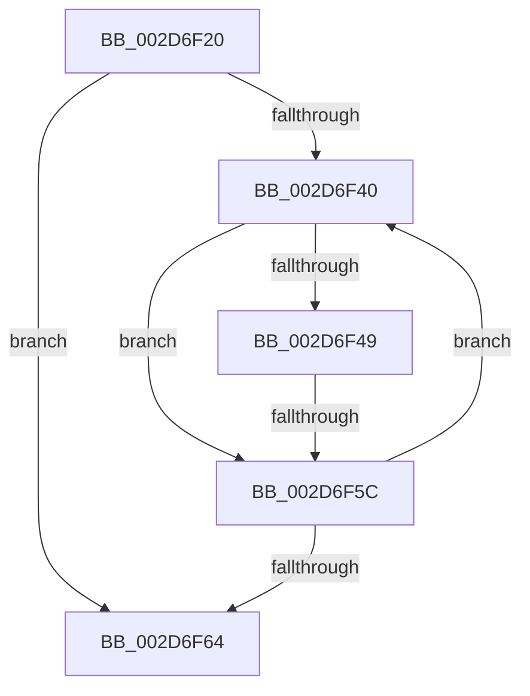

# KiIntSteerDistributeInterrupts

- RVA: `0x002D6F20`–`0x002D6F70` (길이 `80` bytes)
- VA: `0x00000001402D6F20`
- 실행 섹션: `.text`
- PDB 이름 있음: `예`; PDB Function 태그: `아니요`
- unwind 정보 RVA: `0x0006FED4`
- 디코드: `21`개 명령, `80/80` bytes 표시
- 미해석 바이트: `0` (있으면 어셈블리에 `.byte`로 보존)

> 이 문서는 커널 이미지의 기계어와 PDB 기호를 분석해 생성했습니다. 4번과 5번은 함수 원형과 자료형을 바이너리 사용 방식에서 추정한 C 해석이며 원본 소스 복구 결과는 아닙니다.

## 1. Dependencies

- 직접 호출 지점: **0**; 고유 호출 대상: **0**
- 직접 호출자로 확인된 함수: **1**
- RIP 상대 이미지 참조: **1**

### Outgoing calls
- 직접 디코드된 call 명령이 없습니다.

### Direct callers
- [KeIntSteerPeriodic](KeIntSteerPeriodic_function_002D6D04.md) at `0x002D6E45`

### Static image references
- `0x002D6F2D` → RVA `0x00F10D50` (`.data`; read)

## 2. Other-region calls and transfers

- 다른 실행 섹션으로 향하는 call: **0**
- call이 아닌 외부 분기/꼬리 이동: **2**
  - `0x002D6F5A` → [sub_002D6F9F + 0x11](Unknown_function_002D6F9F.md) (`tail-transfer`)
  - `0x002D6F6E` → [sub_002D6F9F](Unknown_function_002D6F9F.md) (`tail-transfer`)

## 3. Assembly (complete function range)

```asm
002D6F20  48 89 5C 24 20                  mov qword ptr [rsp + 0x20], rbx
002D6F25  56                              push rsi
002D6F26  57                              push rdi
002D6F27  41 56                           push r14
002D6F29  48 83 EC 20                     sub rsp, 0x20
002D6F2D  48 8B 1D 1C 9E C3 00            mov rbx, qword ptr [rip + 0xc39e1c]
002D6F34  4C 8D 35 15 9E C3 00            lea r14, [rip + 0xc39e15]
002D6F3B  49 3B DE                        cmp rbx, r14
002D6F3E  74 24                           je 0x1402d6f64
002D6F40  80 BB 84 00 00 00 00            cmp byte ptr [rbx + 0x84], 0
002D6F47  74 13                           je 0x1402d6f5c
002D6F49  48 8B 83 B0 00 00 00            mov rax, qword ptr [rbx + 0xb0]
002D6F50  48 8B BB A0 00 00 00            mov rdi, qword ptr [rbx + 0xa0]
002D6F57  48 3B C7                        cmp rax, rdi
002D6F5A  75 54                           jne 0x1402d6fb0
002D6F5C  48 8B 1B                        mov rbx, qword ptr [rbx]
002D6F5F  49 3B DE                        cmp rbx, r14
002D6F62  75 DC                           jne 0x1402d6f40
002D6F64  48 8B 1D E5 9D C3 00            mov rbx, qword ptr [rip + 0xc39de5]
002D6F6B  49 3B DE                        cmp rbx, r14
002D6F6E  74 2F                           je 0x1402d6f9f
```

## 4. C-style interpretation (structured pseudocode)

```c
__int64 __fastcall KiIntSteerDistributeInterrupts(void)
{
    __int64 v_rsp;
    unsigned __int64 v_stack_p20;

    v_stack_p20 = v_rbx;
    v_rsp = (v_rsp) - (32);
    if ((*(unsigned __int64 *)(v_rip + 12819996)) == (v_rip + 12819989)) goto loc_002D6F64;
loc_002D6F40:
    if ((*(unsigned __int8 *)(*(unsigned __int64 *)(v_rip + 12819996) + 132)) == 0) goto loc_002D6F5C;
loc_002D6F5C:
    if ((*(unsigned __int64 *)(*(unsigned __int64 *)(v_rip + 12819996))) != (v_rip + 12819989)) goto loc_002D6F40;
loc_002D6F64:
}
```

## 5. (Beta) C Style

```c
void KiIntSteerDistributeInterrupts(void)
{
    int64_t local_rsp;
    uint64_t v_stack_p20;

    v_stack_p20 = local_rbx;
    local_rsp = (local_rsp) - (32);
    if ((*(uint64_t *)(v_rip + 0xC39E1C)) == (v_rip + 12819989)) goto loc_002D6F64;
loc_002D6F40:
    if ((*(uint8_t *)(*(uint64_t *)(v_rip + 0xC39E1C) + 0x84)) == 0) goto loc_002D6F5C;
loc_002D6F5C:
    if ((*(uint64_t *)(*(uint64_t *)(v_rip + 0xC39E1C))) != (v_rip + 12819989)) goto loc_002D6F40;
loc_002D6F64:
}
```

## 6. Execution-region graph

[열기: 2D/3D 그래프와 함수 탐색 컨트롤 패널](../../../control-panel.html?section=text&rva=0x002D6F20&view=graph)

- 2D 그래프는 위에서 아래로 흐르고, 3D 그래프는 빈 공간을 드래그해 회전합니다. Shift+드래그는 이동, 휠은 확대·축소, 함수 노드 선택은 대상 보고서 이동입니다.

### Static fallback


