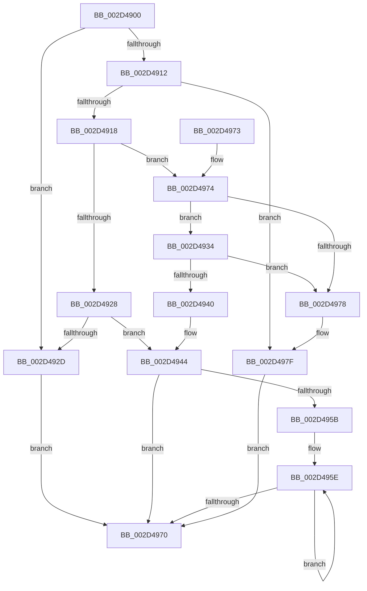

# KiIntSteerEnable

- RVA: `0x002D4900`–`0x002D4983` (길이 `131` bytes)
- VA: `0x00000001402D4900`
- 실행 섹션: `.text`
- PDB 이름 있음: `예`; PDB Function 태그: `아니요`
- unwind 정보 RVA: `0x000DB714`
- 디코드: `40`개 명령, `131/131` bytes 표시
- 미해석 바이트: `0` (있으면 어셈블리에 `.byte`로 보존)

> 이 문서는 커널 이미지의 기계어와 PDB 기호를 분석해 생성했습니다. 4번과 5번은 함수 원형과 자료형을 바이너리 사용 방식에서 추정한 C 해석이며 원본 소스 복구 결과는 아닙니다.

## 1. Dependencies

- 직접 호출 지점: **0**; 고유 호출 대상: **0**
- 직접 호출자로 확인된 함수: **1**
- RIP 상대 이미지 참조: **1**

### Outgoing calls
- 직접 디코드된 call 명령이 없습니다.

### Direct callers
- [KeConnectInterrupt](KeConnectInterrupt_function_002D3D5C.md) at `0x002D3EB1`

### Static image references
- `0x002D4951` → RVA `0x00F10CEC` (`.data`; read/write)

## 2. Other-region calls and transfers

- 다른 실행 섹션으로 향하는 call: **0**
- 별도 외부 분기/꼬리 이동을 확인하지 못했습니다.

## 3. Assembly (complete function range)

```asm
002D4900  4C 8B C1                        mov r8, rcx
002D4903  48 8B 09                        mov rcx, qword ptr [rcx]
002D4906  48 8B 81 A8 00 00 00            mov rax, qword ptr [rcx + 0xa8]
002D490D  48 85 C0                        test rax, rax
002D4910  74 1B                           je 0x1402d492d
002D4912  80 78 38 00                     cmp byte ptr [rax + 0x38], 0
002D4916  74 67                           je 0x1402d497f
002D4918  4C 8B 48 10                     mov r9, qword ptr [rax + 0x10]
002D491C  41 8B 81 80 00 00 00            mov eax, dword ptr [r9 + 0x80]
002D4923  83 F8 02                        cmp eax, 2
002D4926  74 4C                           je 0x1402d4974
002D4928  83 F8 01                        cmp eax, 1
002D492B  74 17                           je 0x1402d4944
002D492D  B9 BB 00 00 C0                  mov ecx, 0xc00000bb
002D4932  EB 3C                           jmp 0x1402d4970
002D4934  48 8B 81 10 01 00 00            mov rax, qword ptr [rcx + 0x110]
002D493B  48 85 C0                        test rax, rax
002D493E  74 38                           je 0x1402d4978
002D4940  C6 40 10 01                     mov byte ptr [rax + 0x10], 1
002D4944  33 C9                           xor ecx, ecx
002D4946  41 C6 81 84 00 00 00 01         mov byte ptr [r9 + 0x84], 1
002D494E  8D 41 01                        lea eax, [rcx + 1]
002D4951  87 05 95 C3 C3 00               xchg dword ptr [rip + 0xc3c395], eax
002D4957  85 D2                           test edx, edx
002D4959  74 15                           je 0x1402d4970
002D495B  44 8B CA                        mov r9d, edx
002D495E  49 8B 00                        mov rax, qword ptr [r8]
002D4961  F0 83 48 68 04                  lock or dword ptr [rax + 0x68], 4
002D4966  4D 8D 40 08                     lea r8, [r8 + 8]
002D496A  49 83 E9 01                     sub r9, 1
002D496E  75 EE                           jne 0x1402d495e
002D4970  8B C1                           mov eax, ecx
002D4972  C3                              ret
002D4973  CC                              int3
002D4974  85 D2                           test edx, edx
002D4976  75 BC                           jne 0x1402d4934
002D4978  B9 05 00 00 00                  mov ecx, 5
002D497D  CD 29                           int 0x29
002D497F  33 C9                           xor ecx, ecx
002D4981  EB ED                           jmp 0x1402d4970
```

## 4. C-style interpretation (structured pseudocode)

```c
__int64 __fastcall KiIntSteerEnable(__int64 a1, int a2)
{
    if (*(unsigned __int64 *)(*(unsigned __int64 *)(a1) + 168) == 0) goto loc_002D492D;
    if ((*(unsigned __int8 *)(*(unsigned __int64 *)(*(unsigned __int64 *)(a1) + 168) + 56)) == 0) goto loc_002D497F;
    if (((unsigned int)((unsigned int)(*(unsigned int *)(*(unsigned __int64 *)(*(unsigned __int64 *)(*(unsigned __int64 *)(a1) + 168) + 16) + 128)))) == 2) goto loc_002D4974;
    if (((unsigned int)((unsigned int)(*(unsigned int *)(*(unsigned __int64 *)(*(unsigned __int64 *)(*(unsigned __int64 *)(a1) + 168) + 16) + 128)))) == 1) goto loc_002D4944;
loc_002D492D:
    goto loc_002D4970;
loc_002D4934:
    if (*(unsigned __int64 *)((unsigned int)(0xC00000BBULL) + 272) == 0) goto loc_002D4978;
    *(unsigned __int8 *)(*(unsigned __int64 *)((unsigned int)(0xC00000BBULL) + 272) + 16) = 1;
loc_002D4944:
    a1 = 0;
    *(unsigned __int8 *)(*(unsigned __int64 *)(*(unsigned __int64 *)(*(unsigned __int64 *)(a1) + 168) + 16) + 132) = 1;
    if (a2 == 0) goto loc_002D4970;
loc_002D495E:
    a4 = ((unsigned int)(a2)) - (1);
    if (condition_is_not_equal) goto loc_002D495E;
loc_002D4970:
    return 0;
loc_002D4974:
    if (a2 != 0) goto loc_002D4934;
loc_002D4978:
loc_002D497F:
    a1 = 0;
    goto loc_002D4970;
}
```

## 5. (Beta) C Style

```c
int64_t KiIntSteerEnable(void *Arg1, int32_t Arg2)
{
    uint8_t *arg1 = (uint8_t *)Arg1;

    if (*(uint64_t *)(*(uint64_t *)(arg1) + 0xA8) == 0) goto loc_002D492D;
    if ((*(uint8_t *)(*(uint64_t *)(*(uint64_t *)(arg1) + 0xA8) + 0x38)) == 0) goto loc_002D497F;
    if (((uint32_t)((uint32_t)(*(uint32_t *)(*(uint64_t *)(*(uint64_t *)(*(uint64_t *)(arg1) + 0xA8) + 0x10) + 0x80)))) == 2) goto loc_002D4974;
    if (((uint32_t)((uint32_t)(*(uint32_t *)(*(uint64_t *)(*(uint64_t *)(*(uint64_t *)(arg1) + 0xA8) + 0x10) + 0x80)))) == 1) goto loc_002D4944;
loc_002D492D:
    goto loc_002D4970;
loc_002D4934:
    if (*(uint64_t *)((uint32_t)(0xC00000BBULL) + 0x110) == 0) goto loc_002D4978;
    *(uint8_t *)(*(uint64_t *)((uint32_t)(0xC00000BBULL) + 0x110) + 0x10) = 1;
loc_002D4944:
    Arg1 = 0;
    *(uint8_t *)(*(uint64_t *)(*(uint64_t *)(*(uint64_t *)(arg1) + 0xA8) + 0x10) + 0x84) = 1;
    if (Arg2 == 0) goto loc_002D4970;
loc_002D495E:
    a4 = ((uint32_t)(Arg2)) - (1);
    if (condition_is_not_equal) goto loc_002D495E;
loc_002D4970:
    return 0;
loc_002D4974:
    if (Arg2 != 0) goto loc_002D4934;
loc_002D4978:
loc_002D497F:
    Arg1 = 0;
    goto loc_002D4970;
}
```

### 관측된 메모리 오프셋

구조체 형식이 확인되지 않은 접근은 인자 기준의 오프셋으로만 기록했습니다.

| 기준 인자 | 오프셋 표현 | 폭 (bit) | 접근 |
|---|---:|---:|---|
| `Arg1` | `+ 0x0` | `64` | `R` |
| `Arg1` | `+ 0x8` | `64` | `R` |

## 6. Execution-region graph

[열기: 2D/3D 그래프와 함수 탐색 컨트롤 패널](../../../control-panel.html?section=text&rva=0x002D4900&view=graph)

- 2D 그래프는 위에서 아래로 흐르고, 3D 그래프는 빈 공간을 드래그해 회전합니다. Shift+드래그는 이동, 휠은 확대·축소, 함수 노드 선택은 대상 보고서 이동입니다.

### Static fallback


