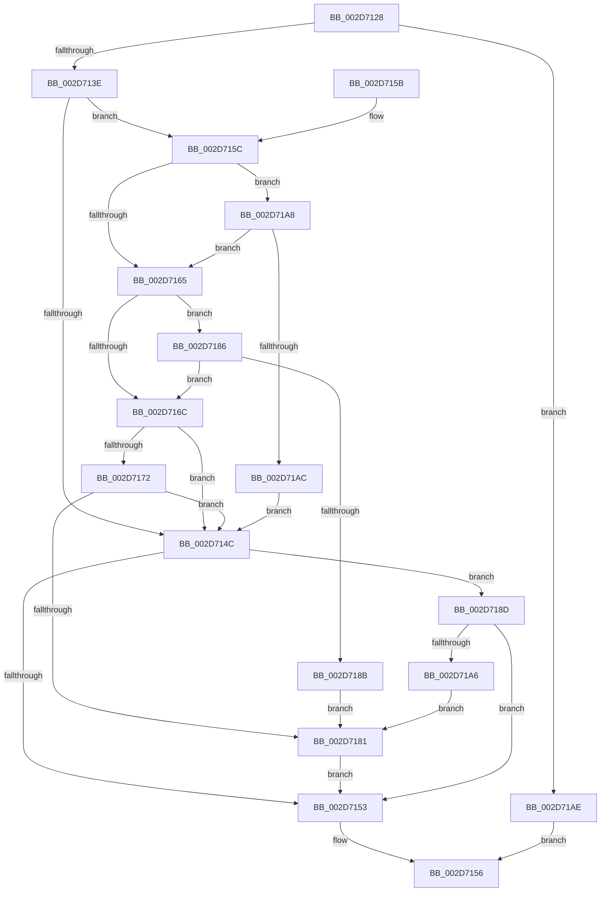

# KiIntSteerEtwEventEnabled

- RVA: `0x002D7128`–`0x002D71B2` (길이 `138` bytes)
- VA: `0x00000001402D7128`
- 실행 섹션: `.text`
- PDB 이름 있음: `예`; PDB Function 태그: `아니요`
- unwind 정보 RVA: `0x0006FF68`
- 디코드: `47`개 명령, `138/138` bytes 표시
- 미해석 바이트: `0` (있으면 어셈블리에 `.byte`로 보존)

> 이 문서는 커널 이미지의 기계어와 PDB 기호를 분석해 생성했습니다. 4번과 5번은 함수 원형과 자료형을 바이너리 사용 방식에서 추정한 C 해석이며 원본 소스 복구 결과는 아닙니다.

## 1. Dependencies

- 직접 호출 지점: **1**; 고유 호출 대상: **1**
- 직접 호출자로 확인된 함수: **5**
- RIP 상대 이미지 참조: **1**

### Outgoing calls
- `0x002D719D` → [EtwpLevelKeywordEnabled](../2F/EtwpLevelKeywordEnabled_function_002FD110.md) (function, `0x002FD110`)

### Direct callers
- [KiIntSteerLogState](KiIntSteerLogState_function_002D57BC.md) at `0x002D57E5`
- [KiIntSteerLogStatus](KiIntSteerLogStatus_function_002D6400.md) at `0x002D6440`
- [KeIntSteerPeriodic](KeIntSteerPeriodic_function_002D6D04.md) at `0x002D6E38`
- [KiIntSteerLogMask](KiIntSteerLogMask_function_002D71B8.md) at `0x002D71F4`
- [KiIntSteerLogProc](KiIntSteerLogProc_function_002D72D8.md) at `0x002D731D`

### Static image references
- `0x002D712C` → RVA `0x00E66948` (`.data`; read)

## 2. Other-region calls and transfers

- 다른 실행 섹션으로 향하는 call: **0**
- 별도 외부 분기/꼬리 이동을 확인하지 못했습니다.

## 3. Assembly (complete function range)

```asm
002D7128  48 83 EC 28                     sub rsp, 0x28
002D712C  48 8B 15 15 F8 B8 00            mov rdx, qword ptr [rip + 0xb8f815]
002D7133  45 33 C9                        xor r9d, r9d
002D7136  4C 8B D1                        mov r10, rcx
002D7139  48 85 D2                        test rdx, rdx
002D713C  74 70                           je 0x1402d71ae
002D713E  4C 8B 41 08                     mov r8, qword ptr [rcx + 8]
002D7142  48 8B 4A 20                     mov rcx, qword ptr [rdx + 0x20]
002D7146  44 39 49 60                     cmp dword ptr [rcx + 0x60], r9d
002D714A  75 10                           jne 0x1402d715c
002D714C  66 44 39 4A 66                  cmp word ptr [rdx + 0x66], r9w
002D7151  75 3A                           jne 0x1402d718d
002D7153  41 8A C1                        mov al, r9b
002D7156  48 83 C4 28                     add rsp, 0x28
002D715A  C3                              ret
002D715B  CC                              int3
002D715C  8A 41 64                        mov al, byte ptr [rcx + 0x64]
002D715F  41 38 42 04                     cmp byte ptr [r10 + 4], al
002D7163  77 43                           ja 0x1402d71a8
002D7165  8B 41 68                        mov eax, dword ptr [rcx + 0x68]
002D7168  A8 40                           test al, 0x40
002D716A  75 1A                           jne 0x1402d7186
002D716C  4C 85 41 70                     test qword ptr [rcx + 0x70], r8
002D7170  74 DA                           je 0x1402d714c
002D7172  48 8B 49 78                     mov rcx, qword ptr [rcx + 0x78]
002D7176  48 8B C1                        mov rax, rcx
002D7179  49 23 C0                        and rax, r8
002D717C  48 3B C1                        cmp rax, rcx
002D717F  75 CB                           jne 0x1402d714c
002D7181  41 B1 01                        mov r9b, 1
002D7184  EB CD                           jmp 0x1402d7153
002D7186  4D 85 C0                        test r8, r8
002D7189  75 E1                           jne 0x1402d716c
002D718B  EB F4                           jmp 0x1402d7181
002D718D  48 8B 4A 28                     mov rcx, qword ptr [rdx + 0x28]
002D7191  4D 8B 42 08                     mov r8, qword ptr [r10 + 8]
002D7195  48 83 C1 60                     add rcx, 0x60
002D7199  41 8A 52 04                     mov dl, byte ptr [r10 + 4]
002D719D  E8 6E 5F 02 00                  call 0x1402fd110
002D71A2  84 C0                           test al, al
002D71A4  74 AD                           je 0x1402d7153
002D71A6  EB D9                           jmp 0x1402d7181
002D71A8  84 C0                           test al, al
002D71AA  74 B9                           je 0x1402d7165
002D71AC  EB 9E                           jmp 0x1402d714c
002D71AE  32 C0                           xor al, al
002D71B0  EB A4                           jmp 0x1402d7156
```

## 4. C-style interpretation (structured pseudocode)

```c
__int64 __fastcall KiIntSteerEtwEventEnabled(__int64 a1, __int64 a2, __int64 a3, int a4)
{
    __int64 result;
    __int64 v_rsp;

    v_rsp = (v_rsp) - (40);
    a4 = 0;
    if (*(unsigned __int64 *)(v_rip + 12122133) == 0) goto loc_002D71AE;
    if ((*(unsigned int *)(*(unsigned __int64 *)(*(unsigned __int64 *)(v_rip + 12122133) + 32) + 96)) != 0) goto loc_002D715C;
loc_002D714C:
    if ((*(unsigned __int16 *)(*(unsigned __int64 *)(v_rip + 12122133) + 102)) != 0) goto loc_002D718D;
loc_002D7153:
loc_002D7156:
    v_rsp = (v_rsp) + (40);
    return 0;
loc_002D715C:
    if ((*(unsigned __int8 *)(a1 + 4)) > ((unsigned __int8)(*(unsigned __int8 *)(*(unsigned __int64 *)(*(unsigned __int64 *)(v_rip + 12122133) + 32) + 100)))) goto loc_002D71A8;
loc_002D7165:
    if ((((unsigned __int8)((unsigned int)(*(unsigned int *)(*(unsigned __int64 *)(*(unsigned __int64 *)(v_rip + 12122133) + 32) + 104)))) & (64)) != 0) goto loc_002D7186;
loc_002D716C:
    if (((*(unsigned __int64 *)(*(unsigned __int64 *)(*(unsigned __int64 *)(v_rip + 12122133) + 32) + 112)) & (*(unsigned __int64 *)(a1 + 8))) == 0) goto loc_002D714C;
    result = (*(unsigned __int64 *)(*(unsigned __int64 *)(*(unsigned __int64 *)(v_rip + 12122133) + 32) + 120)) & (*(unsigned __int64 *)(a1 + 8));
    if (result != (*(unsigned __int64 *)(*(unsigned __int64 *)(*(unsigned __int64 *)(v_rip + 12122133) + 32) + 120))) goto loc_002D714C;
loc_002D7181:
    goto loc_002D7153;
loc_002D7186:
    if (*(unsigned __int64 *)(a1 + 8) != 0) goto loc_002D716C;
    goto loc_002D7181;
loc_002D718D:
    a1 = (*(unsigned __int64 *)(*(unsigned __int64 *)(v_rip + 12122133) + 40)) + (96);
    result = EtwpLevelKeywordEnabled(a1, *(unsigned __int8 *)(a1 + 4), *(unsigned __int64 *)(a1 + 8), 1);
    if ((unsigned __int8)(result) == 0) goto loc_002D7153;
    goto loc_002D7181;
loc_002D71A8:
    if ((unsigned __int8)(result) == 0) goto loc_002D7165;
    goto loc_002D714C;
loc_002D71AE:
    result = 0;
    goto loc_002D7156;
}
```

## 5. (Beta) C Style

```c
int64_t KiIntSteerEtwEventEnabled(void *Arg1, int64_t Arg2, int64_t Arg3, int32_t Arg4)
{
    uint8_t *arg1 = (uint8_t *)Arg1;

    int64_t result;
    int64_t local_rsp;

    local_rsp = (local_rsp) - (40);
    Arg4 = 0;
    if (*(uint64_t *)(v_rip + 0xB8F815) == 0) goto loc_002D71AE;
    if ((*(uint32_t *)(*(uint64_t *)(*(uint64_t *)(v_rip + 0xB8F815) + 0x20) + 0x60)) != 0) goto loc_002D715C;
loc_002D714C:
    if ((*(uint16_t *)(*(uint64_t *)(v_rip + 0xB8F815) + 0x66)) != 0) goto loc_002D718D;
loc_002D7153:
loc_002D7156:
    local_rsp = (local_rsp) + (40);
    return 0;
loc_002D715C:
    if ((*(uint8_t *)(arg1 + 0x4)) > ((uint8_t)(*(uint8_t *)(*(uint64_t *)(*(uint64_t *)(v_rip + 0xB8F815) + 0x20) + 0x64)))) goto loc_002D71A8;
loc_002D7165:
    if ((((uint8_t)((uint32_t)(*(uint32_t *)(*(uint64_t *)(*(uint64_t *)(v_rip + 0xB8F815) + 0x20) + 0x68)))) & (64)) != 0) goto loc_002D7186;
loc_002D716C:
    if (((*(uint64_t *)(*(uint64_t *)(*(uint64_t *)(v_rip + 0xB8F815) + 0x20) + 0x70)) & (*(uint64_t *)(arg1 + 0x8))) == 0) goto loc_002D714C;
    result = (*(uint64_t *)(*(uint64_t *)(*(uint64_t *)(v_rip + 0xB8F815) + 0x20) + 0x78)) & (*(uint64_t *)(arg1 + 0x8));
    if (result != (*(uint64_t *)(*(uint64_t *)(*(uint64_t *)(v_rip + 0xB8F815) + 0x20) + 0x78))) goto loc_002D714C;
loc_002D7181:
    goto loc_002D7153;
loc_002D7186:
    if (*(uint64_t *)(arg1 + 0x8) != 0) goto loc_002D716C;
    goto loc_002D7181;
loc_002D718D:
    Arg1 = (*(uint64_t *)(*(uint64_t *)(v_rip + 0xB8F815) + 0x28)) + (96);
    result = EtwpLevelKeywordEnabled(Arg1, *(uint8_t *)(arg1 + 0x4), *(uint64_t *)(arg1 + 0x8), 1);
    if ((uint8_t)(result) == 0) goto loc_002D7153;
    goto loc_002D7181;
loc_002D71A8:
    if ((uint8_t)(result) == 0) goto loc_002D7165;
    goto loc_002D714C;
loc_002D71AE:
    result = 0;
    goto loc_002D7156;
}
```

### 관측된 메모리 오프셋

구조체 형식이 확인되지 않은 접근은 인자 기준의 오프셋으로만 기록했습니다.

| 기준 인자 | 오프셋 표현 | 폭 (bit) | 접근 |
|---|---:|---:|---|
| `Arg1` | `+ 0x4` | `8` | `R` |
| `Arg1` | `+ 0x8` | `64` | `R` |

## 6. Execution-region graph

[열기: 2D/3D 그래프와 함수 탐색 컨트롤 패널](../../../control-panel.html?section=text&rva=0x002D7128&view=graph)

- 2D 그래프는 위에서 아래로 흐르고, 3D 그래프는 빈 공간을 드래그해 회전합니다. Shift+드래그는 이동, 휠은 확대·축소, 함수 노드 선택은 대상 보고서 이동입니다.

### Static fallback


