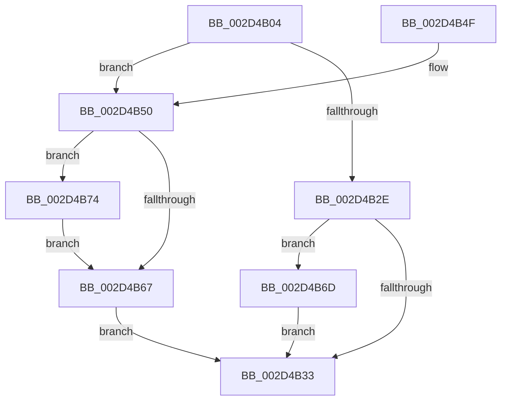

# KiIntSteerGetLineInformation

- RVA: `0x002D4B04`–`0x002D4B8F` (길이 `139` bytes)
- VA: `0x00000001402D4B04`
- 실행 섹션: `.text`
- PDB 이름 있음: `예`; PDB Function 태그: `아니요`
- unwind 정보 RVA: `0x0006FBBC`
- 디코드: `45`개 명령, `139/139` bytes 표시
- 미해석 바이트: `0` (있으면 어셈블리에 `.byte`로 보존)

> 이 문서는 커널 이미지의 기계어와 PDB 기호를 분석해 생성했습니다. 4번과 5번은 함수 원형과 자료형을 바이너리 사용 방식에서 추정한 C 해석이며 원본 소스 복구 결과는 아닙니다.

## 1. Dependencies

- 직접 호출 지점: **2**; 고유 호출 대상: **1**
- 직접 호출자로 확인된 함수: **1**
- RIP 상대 이미지 참조: **2**

### Outgoing calls
- `0x002D4B5E` → [guard_dispatch_icall](../6B/guard_dispatch_icall_function_006BAAD0.md) (function, `0x006BAAD0`)
- `0x002D4B86` → [guard_dispatch_icall](../6B/guard_dispatch_icall_function_006BAAD0.md) (function, `0x006BAAD0`)

### Direct callers
- [KiIntSteerConnect](KiIntSteerConnect_function_002D44F0.md) at `0x002D4549`

### Static image references
- `0x002D4B53` → RVA `0x00E009E0` (`.data`; read)
- `0x002D4B74` → RVA `0x00E009C8` (`.data`; read)

## 2. Other-region calls and transfers

- 다른 실행 섹션으로 향하는 call: **0**
- 별도 외부 분기/꼬리 이동을 확인하지 못했습니다.

## 3. Assembly (complete function range)

```asm
002D4B04  48 89 5C 24 10                  mov qword ptr [rsp + 0x10], rbx
002D4B09  48 89 74 24 18                  mov qword ptr [rsp + 0x18], rsi
002D4B0E  57                              push rdi
002D4B0F  41 56                           push r14
002D4B11  41 57                           push r15
002D4B13  48 83 EC 20                     sub rsp, 0x20
002D4B17  48 8B F1                        mov rsi, rcx
002D4B1A  83 C8 FF                        or eax, 0xffffffff
002D4B1D  8B 09                           mov ecx, dword ptr [rcx]
002D4B1F  33 DB                           xor ebx, ebx
002D4B21  4D 8B F0                        mov r14, r8
002D4B24  4C 8B FA                        mov r15, rdx
002D4B27  40 B7 01                        mov dil, 1
002D4B2A  85 C9                           test ecx, ecx
002D4B2C  74 22                           je 0x1402d4b50
002D4B2E  83 F9 03                        cmp ecx, 3
002D4B31  75 3A                           jne 0x1402d4b6d
002D4B33  48 8B 74 24 50                  mov rsi, qword ptr [rsp + 0x50]
002D4B38  41 89 07                        mov dword ptr [r15], eax
002D4B3B  8B C3                           mov eax, ebx
002D4B3D  48 8B 5C 24 48                  mov rbx, qword ptr [rsp + 0x48]
002D4B42  41 88 3E                        mov byte ptr [r14], dil
002D4B45  48 83 C4 20                     add rsp, 0x20
002D4B49  41 5F                           pop r15
002D4B4B  41 5E                           pop r14
002D4B4D  5F                              pop rdi
002D4B4E  C3                              ret
002D4B4F  CC                              int3
002D4B50  8B 56 38                        mov edx, dword ptr [rsi + 0x38]
002D4B53  48 8B 05 86 BE B2 00            mov rax, qword ptr [rip + 0xb2be86]
002D4B5A  89 54 24 40                     mov dword ptr [rsp + 0x40], edx
002D4B5E  E8 6D 5F 3E 00                  call 0x1406baad0
002D4B63  84 C0                           test al, al
002D4B65  75 0D                           jne 0x1402d4b74
002D4B67  8B 44 24 40                     mov eax, dword ptr [rsp + 0x40]
002D4B6B  EB C6                           jmp 0x1402d4b33
002D4B6D  BB BB 00 00 C0                  mov ebx, 0xc00000bb
002D4B72  EB BF                           jmp 0x1402d4b33
002D4B74  48 8B 05 4D BE B2 00            mov rax, qword ptr [rip + 0xb2be4d]
002D4B7B  48 8D 54 24 40                  lea rdx, [rsp + 0x40]
002D4B80  48 8B CE                        mov rcx, rsi
002D4B83  40 8A FB                        mov dil, bl
002D4B86  E8 45 5F 3E 00                  call 0x1406baad0
002D4B8B  8B D8                           mov ebx, eax
002D4B8D  EB D8                           jmp 0x1402d4b67
```

## 4. C-style interpretation (structured pseudocode)

```c
__int64 __fastcall KiIntSteerGetLineInformation(__int64 a1, __int64 a2, __int64 a3)
{
    __int64 result;
    __int64 v_rbx;
    __int64 v_rsp;
    unsigned __int64 v_stack_p10;
    unsigned __int64 v_stack_p18;
    unsigned int v_stack_p40;

    v_stack_p10 = v_rbx;
    v_stack_p18 = v_rsi;
    v_rsp = (v_rsp) - (32);
    result = (unsigned int)((result) | (0xFFFFFFFFULL));
    v_rbx = 0;
    if ((unsigned int)((unsigned int)(*(unsigned int *)(a1))) == 0) goto loc_002D4B50;
    if (((unsigned int)((unsigned int)(*(unsigned int *)(a1)))) != 3) goto loc_002D4B6D;
loc_002D4B33:
    *(unsigned int *)(a2) = (unsigned int)(result);
    *(unsigned __int8 *)(a3) = 1;
    v_rsp = (v_rsp) + (32);
    return 0;
loc_002D4B50:
    v_stack_p40 = (unsigned int)((unsigned int)(*(unsigned int *)(v_stack_p18 + 56)));
    result = guard_dispatch_icall((unsigned int)(*(unsigned int *)(a1)), (unsigned int)(*(unsigned int *)(v_stack_p18 + 56)), a3, a4);
    if ((unsigned __int8)(result) != 0) goto loc_002D4B74;
loc_002D4B67:
    goto loc_002D4B33;
loc_002D4B6D:
    goto loc_002D4B33;
loc_002D4B74:
    result = guard_dispatch_icall(v_stack_p18, v_stack_p40, a3, a4);
    goto loc_002D4B67;
}
```

## 5. (Beta) C Style

```c
int64_t KiIntSteerGetLineInformation(void *Arg1, void *Arg2, void *Arg3)
{
    uint8_t *arg1 = (uint8_t *)Arg1;
    uint8_t *arg2 = (uint8_t *)Arg2;
    uint8_t *arg3 = (uint8_t *)Arg3;

    int64_t result;
    int64_t local_rbx;
    int64_t local_rsp;
    uint64_t v_stack_p10;
    uint64_t v_stack_p18;
    uint32_t v_stack_p40;

    v_stack_p10 = local_rbx;
    v_stack_p18 = local_rsi;
    local_rsp = (local_rsp) - (32);
    result = (uint32_t)((result) | (0xFFFFFFFFULL));
    local_rbx = 0;
    if ((uint32_t)((uint32_t)(*(uint32_t *)(arg1))) == 0) goto loc_002D4B50;
    if (((uint32_t)((uint32_t)(*(uint32_t *)(arg1)))) != 3) goto loc_002D4B6D;
loc_002D4B33:
    *(uint32_t *)(arg2) = (uint32_t)(result);
    *(uint8_t *)(arg3) = 1;
    local_rsp = (local_rsp) + (32);
    return 0;
loc_002D4B50:
    v_stack_p40 = (uint32_t)((uint32_t)(*(uint32_t *)(v_stack_p18 + 0x38)));
    result = guard_dispatch_icall((uint32_t)(*(uint32_t *)(arg1)), (uint32_t)(*(uint32_t *)(v_stack_p18 + 0x38)), Arg3, a4);
    if ((uint8_t)(result) != 0) goto loc_002D4B74;
loc_002D4B67:
    goto loc_002D4B33;
loc_002D4B6D:
    goto loc_002D4B33;
loc_002D4B74:
    result = guard_dispatch_icall(v_stack_p18, v_stack_p40, Arg3, a4);
    goto loc_002D4B67;
}
```

### 관측된 메모리 오프셋

구조체 형식이 확인되지 않은 접근은 인자 기준의 오프셋으로만 기록했습니다.

| 기준 인자 | 오프셋 표현 | 폭 (bit) | 접근 |
|---|---:|---:|---|
| `Arg1` | `+ 0x0` | `32` | `R` |
| `Arg1` | `+ 0x38` | `32` | `R` |
| `Arg2` | `+ 0x0` | `32` | `W` |
| `Arg3` | `+ 0x0` | `8` | `W` |

## 6. Execution-region graph

[열기: 2D/3D 그래프와 함수 탐색 컨트롤 패널](../../../control-panel.html?section=text&rva=0x002D4B04&view=graph)

- 2D 그래프는 위에서 아래로 흐르고, 3D 그래프는 빈 공간을 드래그해 회전합니다. Shift+드래그는 이동, 휠은 확대·축소, 함수 노드 선택은 대상 보고서 이동입니다.

### Static fallback


