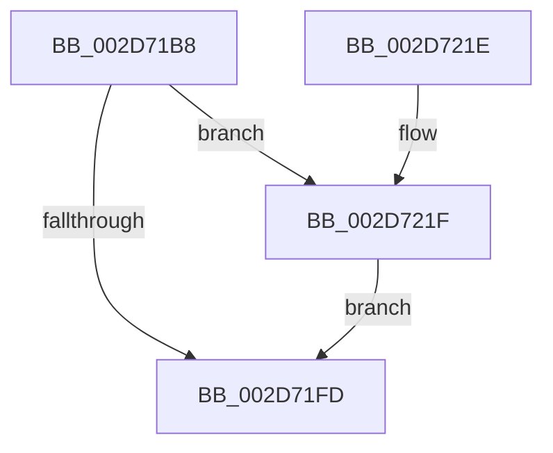

# KiIntSteerLogMask

- RVA: `0x002D71B8`–`0x002D72D2` (길이 `282` bytes)
- VA: `0x00000001402D71B8`
- 실행 섹션: `.text`
- PDB 이름 있음: `예`; PDB Function 태그: `아니요`
- unwind 정보 RVA: `0x0006FF74`
- 디코드: `62`개 명령, `282/282` bytes 표시
- 미해석 바이트: `0` (있으면 어셈블리에 `.byte`로 보존)

> 이 문서는 커널 이미지의 기계어와 PDB 기호를 분석해 생성했습니다. 4번과 5번은 함수 원형과 자료형을 바이너리 사용 방식에서 추정한 C 해석이며 원본 소스 복구 결과는 아닙니다.

## 1. Dependencies

- 직접 호출 지점: **4**; 고유 호출 대상: **4**
- 직접 호출자로 확인된 함수: **2**
- RIP 상대 이미지 참조: **8**

### Outgoing calls
- `0x002D71F4` → [KiIntSteerEtwEventEnabled](KiIntSteerEtwEventEnabled_function_002D7128.md) (function, `0x002D7128`)
- `0x002D7204` → [_security_check_cookie](../6A/_security_check_cookie_function_006AC640.md) (function, `0x006AC640`)
- `0x002D7255` → [KeCountSetBitsAffinityEx](../2C/KeCountSetBitsAffinityEx_function_002CE6E0.md) (function, `0x002CE6E0`)
- `0x002D72C8` → [EtwWriteEx](../25/EtwWriteEx_function_0025F0D0.md) (function, `0x0025F0D0`)

### Direct callers
- [KiIntSteerLogStatus](KiIntSteerLogStatus_function_002D6400.md) at `0x002D641B`
- [KeIntSteerPeriodic](KeIntSteerPeriodic_function_002D6D04.md) at `0x002D6E25`

### Static image references
- `0x002D71CF` → RVA `0x00E0A740` (`.data`; read)
- `0x002D71DF` → RVA `0x00010AF8` (`.rdata`; read)
- `0x002D71E6` → RVA `0x00010B08` (`.rdata`; read)
- `0x002D7223` → RVA `0x00F10CE8` (`.data`; read)
- `0x002D722E` → RVA `0x00F10BE0` (`.data`; read)
- `0x002D723C` → RVA `0x00F10D40` (`.data`; read)
- `0x002D726F` → RVA `0x00E66948` (`.data`; read)
- `0x002D7281` → RVA `0x00F10BE8` (`.data`; read)

## 2. Other-region calls and transfers

- 다른 실행 섹션으로 향하는 call: **0**
- 별도 외부 분기/꼬리 이동을 확인하지 못했습니다.

## 3. Assembly (complete function range)

```asm
002D71B8  48 89 5C 24 08                  mov qword ptr [rsp + 8], rbx
002D71BD  48 89 7C 24 10                  mov qword ptr [rsp + 0x10], rdi
002D71C2  55                              push rbp
002D71C3  48 8D 6C 24 A9                  lea rbp, [rsp - 0x57]
002D71C8  48 81 EC B0 00 00 00            sub rsp, 0xb0
002D71CF  48 8B 05 6A 35 B3 00            mov rax, qword ptr [rip + 0xb3356a]
002D71D6  48 33 C4                        xor rax, rsp
002D71D9  48 89 45 47                     mov qword ptr [rbp + 0x47], rax
002D71DD  84 C9                           test cl, cl
002D71DF  48 8D 05 12 99 D3 FF            lea rax, [rip - 0x2c66ee]
002D71E6  48 8D 1D 1B 99 D3 FF            lea rbx, [rip - 0x2c66e5]
002D71ED  48 0F 45 D8                     cmovne rbx, rax
002D71F1  48 8B CB                        mov rcx, rbx
002D71F4  E8 2F FF FF FF                  call 0x1402d7128
002D71F9  84 C0                           test al, al
002D71FB  75 22                           jne 0x1402d721f
002D71FD  48 8B 4D 47                     mov rcx, qword ptr [rbp + 0x47]
002D7201  48 33 CC                        xor rcx, rsp
002D7204  E8 37 54 3D 00                  call 0x1406ac640
002D7209  4C 8D 9C 24 B0 00 00 00         lea r11, [rsp + 0xb0]
002D7211  49 8B 5B 10                     mov rbx, qword ptr [r11 + 0x10]
002D7215  49 8B 7B 18                     mov rdi, qword ptr [r11 + 0x18]
002D7219  49 8B E3                        mov rsp, r11
002D721C  5D                              pop rbp
002D721D  C3                              ret
002D721E  CC                              int3
002D721F  83 65 03 00                     and dword ptr [rbp + 3], 0
002D7223  48 8D 05 BE 9A C3 00            lea rax, [rip + 0xc39abe]
002D722A  83 65 13 00                     and dword ptr [rbp + 0x13], 0
002D722E  48 8D 3D AB 99 C3 00            lea rdi, [rip + 0xc399ab]
002D7235  48 89 45 F7                     mov qword ptr [rbp - 9], rax
002D7239  48 8B CF                        mov rcx, rdi
002D723C  48 8D 05 FD 9A C3 00            lea rax, [rip + 0xc39afd]
002D7243  C7 45 FF 04 00 00 00            mov dword ptr [rbp - 1], 4
002D724A  48 89 45 07                     mov qword ptr [rbp + 7], rax
002D724E  C7 45 0F 04 00 00 00            mov dword ptr [rbp + 0xf], 4
002D7255  E8 86 74 FF FF                  call 0x1402ce6e0
002D725A  83 65 23 00                     and dword ptr [rbp + 0x23], 0
002D725E  45 33 C9                        xor r9d, r9d
002D7261  83 65 33 00                     and dword ptr [rbp + 0x33], 0
002D7265  45 33 C0                        xor r8d, r8d
002D7268  83 65 43 00                     and dword ptr [rbp + 0x43], 0
002D726C  48 8B D3                        mov rdx, rbx
002D726F  48 8B 0D D2 F6 B8 00            mov rcx, qword ptr [rip + 0xb8f6d2]
002D7276  89 45 E7                        mov dword ptr [rbp - 0x19], eax
002D7279  48 8D 45 E7                     lea rax, [rbp - 0x19]
002D727D  48 89 45 17                     mov qword ptr [rbp + 0x17], rax
002D7281  48 8D 05 60 99 C3 00            lea rax, [rip + 0xc39960]
002D7288  48 89 45 37                     mov qword ptr [rbp + 0x37], rax
002D728C  0F B7 05 4D 99 C3 00            movzx eax, word ptr [rip + 0xc3994d]
002D7293  C1 E0 03                        shl eax, 3
002D7296  89 45 3F                        mov dword ptr [rbp + 0x3f], eax
002D7299  48 8D 45 F7                     lea rax, [rbp - 9]
002D729D  48 89 44 24 38                  mov qword ptr [rsp + 0x38], rax
002D72A2  C7 44 24 30 05 00 00 00         mov dword ptr [rsp + 0x30], 5
002D72AA  48 83 64 24 28 00               and qword ptr [rsp + 0x28], 0
002D72B0  48 83 64 24 20 00               and qword ptr [rsp + 0x20], 0
002D72B6  C7 45 1F 04 00 00 00            mov dword ptr [rbp + 0x1f], 4
002D72BD  48 89 7D 27                     mov qword ptr [rbp + 0x27], rdi
002D72C1  C7 45 2F 02 00 00 00            mov dword ptr [rbp + 0x2f], 2
002D72C8  E8 03 7E F8 FF                  call 0x14025f0d0
002D72CD  E9 2B FF FF FF                  jmp 0x1402d71fd
```

## 4. C-style interpretation (structured pseudocode)

```c
__int64 __fastcall KiIntSteerLogMask(unsigned __int8 a1, __int64 a2, int a3, int a4)
{
    __int64 result;
    __int64 v_rbx;
    __int64 v_rsp;
    unsigned __int64 v_stack_m18;
    unsigned int v_stack_m1C;
    unsigned int v_stack_m20;
    unsigned __int64 v_stack_m28;
    unsigned int v_stack_m2C;
    unsigned int v_stack_m30;
    unsigned __int64 v_stack_m38;
    unsigned int v_stack_m3C;
    unsigned int v_stack_m40;
    unsigned __int64 v_stack_m48;
    unsigned int v_stack_m4C;
    unsigned int v_stack_m50;
    unsigned __int64 v_stack_m58;
    unsigned int v_stack_m5C;
    unsigned __int64 v_stack_m5F;
    unsigned int v_stack_m60;
    unsigned __int64 v_stack_m68;
    unsigned int v_stack_m78;
    unsigned __int64 v_stack_m8;
    unsigned int v_stack_m80;
    unsigned __int64 v_stack_m88;
    unsigned __int64 v_stack_m90;
    unsigned __int64 v_stack_p10;
    unsigned __int64 v_stack_p8;

    v_stack_p8 = v_rbx;
    v_stack_p10 = v_rdi;
    v_rsp = (v_rsp) - (176);
    result = (*(unsigned __int64 *)(v_rip + 11744618)) ^ (v_rsp);
    v_stack_m18 = result;
    v_rbx = v_rip - 2909925;
    if (a1 != 0) { v_rbx = v_rip - 2909934; }
    result = KiIntSteerEtwEventEnabled(v_rbx, a2, a3, a4);
    if ((unsigned __int8)(result) != 0) goto loc_002D721F;
loc_002D71FD:
    a1 = (v_stack_m18) ^ (v_rsp);
    result = _security_check_cookie(a1, a2, a3, a4);
    return result;
loc_002D721F:
    v_stack_m68 = v_rip + 12819134;
    v_stack_m60 = 4;
    v_stack_m58 = v_rip + 12819197;
    v_stack_m50 = 4;
    result = KeCountSetBitsAffinityEx(v_rip + 12818859, a2, a3, a4);
    a4 = 0;
    a3 = 0;
    v_stack_m78 = (unsigned int)(result);
    v_stack_m48 = v_stack_m78;
    v_stack_m28 = v_rip + 12818784;
    result = (unsigned int)((*(unsigned __int16 *)(v_rip + 12818765)) << (3));
    v_stack_m20 = (unsigned int)(result);
    v_stack_m78 = v_stack_m68;
    v_stack_m80 = 5;
    v_stack_m40 = 4;
    v_stack_m38 = v_rip + 12818859;
    v_stack_m30 = 2;
    result = EtwWriteEx(*(unsigned __int64 *)(v_rip + 12121810), *(unsigned __int64 *)(v_stack_m8 + 16), a3, a4);
    goto loc_002D71FD;
}
```

## 5. (Beta) C Style

```c
int64_t KiIntSteerLogMask(uint8_t Arg1, int64_t Arg2, int32_t Arg3, int32_t Arg4)
{
    int64_t result;
    int64_t local_rbx;
    int64_t local_rsp;
    uint64_t v_stack_m18;
    uint32_t v_stack_m1C;
    uint32_t v_stack_m20;
    uint64_t v_stack_m28;
    uint32_t v_stack_m2C;
    uint32_t v_stack_m30;
    uint64_t v_stack_m38;
    uint32_t v_stack_m3C;
    uint32_t v_stack_m40;
    uint64_t v_stack_m48;
    uint32_t v_stack_m4C;
    uint32_t v_stack_m50;
    uint64_t v_stack_m58;
    uint32_t v_stack_m5C;
    uint64_t v_stack_m5F;
    uint32_t v_stack_m60;
    uint64_t v_stack_m68;
    uint32_t v_stack_m78;
    uint64_t v_stack_m8;
    uint32_t v_stack_m80;
    uint64_t v_stack_m88;
    uint64_t v_stack_m90;
    uint64_t v_stack_p10;
    uint64_t v_stack_p8;

    v_stack_p8 = local_rbx;
    v_stack_p10 = local_rdi;
    local_rsp = (local_rsp) - (176);
    result = (*(uint64_t *)(v_rip + 0xB3356A)) ^ (local_rsp);
    v_stack_m18 = result;
    local_rbx = v_rip - 2909925;
    if (Arg1 != 0) { local_rbx = v_rip - 2909934; }
    result = KiIntSteerEtwEventEnabled(local_rbx, Arg2, Arg3, Arg4);
    if ((uint8_t)(result) != 0) goto loc_002D721F;
loc_002D71FD:
    Arg1 = (v_stack_m18) ^ (local_rsp);
    result = _security_check_cookie(Arg1, Arg2, Arg3, Arg4);
    return result;
loc_002D721F:
    v_stack_m68 = v_rip + 12819134;
    v_stack_m60 = 4;
    v_stack_m58 = v_rip + 12819197;
    v_stack_m50 = 4;
    result = KeCountSetBitsAffinityEx(v_rip + 12818859, Arg2, Arg3, Arg4);
    Arg4 = 0;
    Arg3 = 0;
    v_stack_m78 = (uint32_t)(result);
    v_stack_m48 = v_stack_m78;
    v_stack_m28 = v_rip + 12818784;
    result = (uint32_t)((*(uint16_t *)(v_rip + 0xC3994D)) << (3));
    v_stack_m20 = (uint32_t)(result);
    v_stack_m78 = v_stack_m68;
    v_stack_m80 = 5;
    v_stack_m40 = 4;
    v_stack_m38 = v_rip + 12818859;
    v_stack_m30 = 2;
    result = EtwWriteEx(*(uint64_t *)(v_rip + 0xB8F6D2), *(uint64_t *)(v_stack_m8 + 0x10), Arg3, Arg4);
    goto loc_002D71FD;
}
```

## 6. Execution-region graph

[열기: 2D/3D 그래프와 함수 탐색 컨트롤 패널](../../../control-panel.html?section=text&rva=0x002D71B8&view=graph)

- 2D 그래프는 위에서 아래로 흐르고, 3D 그래프는 빈 공간을 드래그해 회전합니다. Shift+드래그는 이동, 휠은 확대·축소, 함수 노드 선택은 대상 보고서 이동입니다.

### Static fallback


