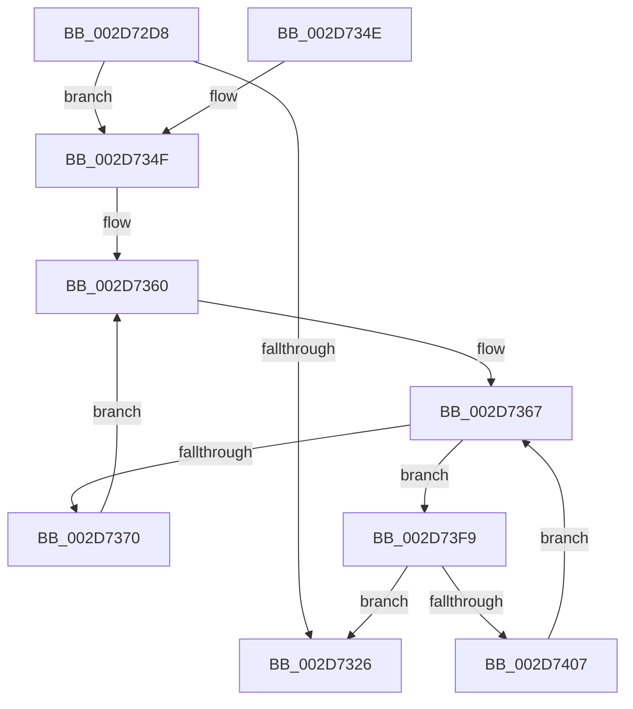

# KiIntSteerLogProc

- RVA: `0x002D72D8`–`0x002D7417` (길이 `319` bytes)
- VA: `0x00000001402D72D8`
- 실행 섹션: `.text`
- PDB 이름 있음: `예`; PDB Function 태그: `아니요`
- unwind 정보 RVA: `0x0006FF94`
- 디코드: `73`개 명령, `319/319` bytes 표시
- 미해석 바이트: `0` (있으면 어셈블리에 `.byte`로 보존)

> 이 문서는 커널 이미지의 기계어와 PDB 기호를 분석해 생성했습니다. 4번과 5번은 함수 원형과 자료형을 바이너리 사용 방식에서 추정한 C 해석이며 원본 소스 복구 결과는 아닙니다.

## 1. Dependencies

- 직접 호출 지점: **3**; 고유 호출 대상: **3**
- 직접 호출자로 확인된 함수: **2**
- RIP 상대 이미지 참조: **8**

### Outgoing calls
- `0x002D731D` → [KiIntSteerEtwEventEnabled](KiIntSteerEtwEventEnabled_function_002D7128.md) (function, `0x002D7128`)
- `0x002D732E` → [_security_check_cookie](../6A/_security_check_cookie_function_006AC640.md) (function, `0x006AC640`)
- `0x002D73EF` → [EtwWriteEx](../25/EtwWriteEx_function_0025F0D0.md) (function, `0x0025F0D0`)

### Direct callers
- [KiIntSteerLogStatus](KiIntSteerLogStatus_function_002D6400.md) at `0x002D6423`
- [KeIntSteerPeriodic](KeIntSteerPeriodic_function_002D6D04.md) at `0x002D6E2C`

### Static image references
- `0x002D72F1` → RVA `0x00E0A740` (`.data`; read)
- `0x002D7302` → RVA `0x00010B18` (`.rdata`; read)
- `0x002D730F` → RVA `0x00010B28` (`.rdata`; read)
- `0x002D734F` → RVA `0x00FC7128` (`ALMOSTRO`; read)
- `0x002D7356` → RVA `0x00000000` (`image boundary/outside`; read)
- `0x002D7360` → RVA `0x00FC7120` (`ALMOSTRO`; read)
- `0x002D738C` → RVA `0x00F231B8` (`.data`; read)
- `0x002D739B` → RVA `0x00E66948` (`.data`; read)

## 2. Other-region calls and transfers

- 다른 실행 섹션으로 향하는 call: **0**
- 별도 외부 분기/꼬리 이동을 확인하지 못했습니다.

## 3. Assembly (complete function range)

```asm
002D72D8  48 8B C4                        mov rax, rsp
002D72DB  48 89 58 08                     mov qword ptr [rax + 8], rbx
002D72DF  48 89 68 10                     mov qword ptr [rax + 0x10], rbp
002D72E3  48 89 70 18                     mov qword ptr [rax + 0x18], rsi
002D72E7  48 89 78 20                     mov qword ptr [rax + 0x20], rdi
002D72EB  41 56                           push r14
002D72ED  48 83 EC 70                     sub rsp, 0x70
002D72F1  48 8B 05 48 34 B3 00            mov rax, qword ptr [rip + 0xb33448]
002D72F8  48 33 C4                        xor rax, rsp
002D72FB  48 89 44 24 68                  mov qword ptr [rsp + 0x68], rax
002D7300  33 ED                           xor ebp, ebp
002D7302  48 8D 05 0F 98 D3 FF            lea rax, [rip - 0x2c67f1]
002D7309  84 C9                           test cl, cl
002D730B  89 6C 24 40                     mov dword ptr [rsp + 0x40], ebp
002D730F  48 8D 35 12 98 D3 FF            lea rsi, [rip - 0x2c67ee]
002D7316  48 0F 45 F0                     cmovne rsi, rax
002D731A  48 8B CE                        mov rcx, rsi
002D731D  E8 06 FE FF FF                  call 0x1402d7128
002D7322  84 C0                           test al, al
002D7324  75 29                           jne 0x1402d734f
002D7326  48 8B 4C 24 68                  mov rcx, qword ptr [rsp + 0x68]
002D732B  48 33 CC                        xor rcx, rsp
002D732E  E8 0D 53 3D 00                  call 0x1406ac640
002D7333  4C 8D 5C 24 70                  lea r11, [rsp + 0x70]
002D7338  49 8B 5B 10                     mov rbx, qword ptr [r11 + 0x10]
002D733C  49 8B 6B 18                     mov rbp, qword ptr [r11 + 0x18]
002D7340  49 8B 73 20                     mov rsi, qword ptr [r11 + 0x20]
002D7344  49 8B 7B 28                     mov rdi, qword ptr [r11 + 0x28]
002D7348  49 8B E3                        mov rsp, r11
002D734B  41 5E                           pop r14
002D734D  C3                              ret
002D734E  CC                              int3
002D734F  48 8B 3D D2 FD CE 00            mov rdi, qword ptr [rip + 0xcefdd2]
002D7356  4C 8D 35 A3 8C D2 FF            lea r14, [rip - 0x2d735d]
002D735D  0F B7 DD                        movzx ebx, bp
002D7360  0F B7 0D B9 FD CE 00            movzx ecx, word ptr [rip + 0xcefdb9]
002D7367  48 85 FF                        test rdi, rdi
002D736A  0F 84 89 00 00 00               je 0x1402d73f9
002D7370  48 0F BC D7                     bsf rdx, rdi
002D7374  0F B7 CB                        movzx ecx, bx
002D7377  45 33 C9                        xor r9d, r9d
002D737A  0F B6 C2                        movzx eax, dl
002D737D  45 33 C0                        xor r8d, r8d
002D7380  48 0F B3 C7                     btr rdi, rax
002D7384  C1 E1 06                        shl ecx, 6
002D7387  0F B6 C2                        movzx eax, dl
002D738A  03 C8                           add ecx, eax
002D738C  48 8B 05 25 BE C4 00            mov rax, qword ptr [rip + 0xc4be25]
002D7393  8B 14 88                        mov edx, dword ptr [rax + rcx*4]
002D7396  48 8D 44 24 40                  lea rax, [rsp + 0x40]
002D739B  48 8B 0D A6 F5 B8 00            mov rcx, qword ptr [rip + 0xb8f5a6]
002D73A2  48 89 44 24 48                  mov qword ptr [rsp + 0x48], rax
002D73A7  89 54 24 40                     mov dword ptr [rsp + 0x40], edx
002D73AB  49 8B 84 D6 40 8C FC 00         mov rax, qword ptr [r14 + rdx*8 + 0xfc8c40]
002D73B3  48 8B D6                        mov rdx, rsi
002D73B6  48 05 98 2D 00 00               add rax, 0x2d98
002D73BC  48 C7 44 24 50 04 00 00 00      mov qword ptr [rsp + 0x50], 4
002D73C5  48 89 44 24 58                  mov qword ptr [rsp + 0x58], rax
002D73CA  48 8D 44 24 48                  lea rax, [rsp + 0x48]
002D73CF  48 89 44 24 38                  mov qword ptr [rsp + 0x38], rax
002D73D4  C7 44 24 30 02 00 00 00         mov dword ptr [rsp + 0x30], 2
002D73DC  48 89 6C 24 28                  mov qword ptr [rsp + 0x28], rbp
002D73E1  48 89 6C 24 20                  mov qword ptr [rsp + 0x20], rbp
002D73E6  48 C7 44 24 60 04 00 00 00      mov qword ptr [rsp + 0x60], 4
002D73EF  E8 DC 7C F8 FF                  call 0x14025f0d0
002D73F4  E9 67 FF FF FF                  jmp 0x1402d7360
002D73F9  66 FF C3                        inc bx
002D73FC  0F B7 C3                        movzx eax, bx
002D73FF  3B C1                           cmp eax, ecx
002D7401  0F 83 1F FF FF FF               jae 0x1402d7326
002D7407  0F B7 C3                        movzx eax, bx
002D740A  49 8B BC C6 28 71 FC 00         mov rdi, qword ptr [r14 + rax*8 + 0xfc7128]
002D7412  E9 50 FF FF FF                  jmp 0x1402d7367
```

## 4. C-style interpretation (structured pseudocode)

```c
__int64 __fastcall KiIntSteerLogProc(unsigned __int8 a1, __int64 a2, int a3, int a4)
{
    __int64 result;
    __int64 v_rbp;
    __int64 v_rbx;
    __int64 v_rsi;
    __int64 v_rsp;
    unsigned __int64 v_stack_m10;
    unsigned __int64 v_stack_m18;
    unsigned __int64 v_stack_m20;
    unsigned __int64 v_stack_m28;
    unsigned __int64 v_stack_m30;
    unsigned int v_stack_m38;
    unsigned int v_stack_m40;
    unsigned __int64 v_stack_m48;
    unsigned __int64 v_stack_m50;
    unsigned __int64 v_stack_m8;

    *(unsigned __int64 *)(v_rsp + 8) = v_rbx;
    *(unsigned __int64 *)(v_rsp + 16) = v_rbp;
    *(unsigned __int64 *)(v_rsp + 24) = v_rsi;
    *(unsigned __int64 *)(v_rsp + 32) = v_rdi;
    v_rsp = (v_rsp) - (112);
    result = (*(unsigned __int64 *)(v_rip + 11744328)) ^ (v_rsp);
    v_stack_m10 = result;
    v_rbp = 0;
    v_stack_m38 = 0;
    v_rsi = v_rip - 2910190;
    if (a1 != 0) { v_rsi = v_rip - 2910193; }
    result = KiIntSteerEtwEventEnabled(v_rsi, a2, a3, a4);
    if ((unsigned __int8)(result) != 0) goto loc_002D734F;
loc_002D7326:
    a1 = (v_stack_m10) ^ (v_rsp);
    result = _security_check_cookie(a1, a2, a3, a4);
    return result;
loc_002D734F:
loc_002D7360:
loc_002D7367:
    if (*(unsigned __int64 *)(v_rip + 13565394) == 0) goto loc_002D73F9;
    a4 = 0;
    a3 = 0;
    a1 = (unsigned int)(((unsigned __int16)((unsigned __int16)(*(unsigned __int64 *)(v_stack_m8 + 24)))) << (6));
    a1 = (unsigned int)((a1) + ((unsigned int)((unsigned __int8)(a2))));
    v_stack_m28 = v_stack_m30;
    v_stack_m30 = (unsigned int)((unsigned int)(*(unsigned int *)(*(unsigned __int64 *)(v_rip + 12893733) + a1 * 4)));
    result = (*(unsigned __int64 *)(v_rip - 2978653 + (unsigned int)(*(unsigned int *)(*(unsigned __int64 *)(v_rip + 12893733) + a1 * 4)) * 8 + 16550976)) + (0x2D98ULL);
    v_stack_m20 = 4;
    v_stack_m18 = result;
    v_stack_m38 = v_stack_m28;
    v_stack_m40 = 2;
    v_stack_m48 = *(unsigned __int64 *)(v_stack_m8 + 24);
    v_stack_m50 = *(unsigned __int64 *)(v_stack_m8 + 24);
    v_stack_m10 = 4;
    result = EtwWriteEx(*(unsigned __int64 *)(v_rip + 12121510), *(unsigned __int64 *)(v_stack_m8 + 32), a3, a4);
    goto loc_002D7360;
loc_002D73F9:
    v_rbx = (unsigned __int16)(((unsigned __int16)(*(unsigned __int64 *)(v_stack_m8 + 24))) + 1);
    if (((unsigned int)((unsigned __int16)(v_rbx))) >= ((unsigned int)(*(unsigned __int64 *)(v_rip + 12121510)))) goto loc_002D7326;
    goto loc_002D7367;
}
```

## 5. (Beta) C Style

```c
int64_t KiIntSteerLogProc(uint8_t Arg1, int64_t Arg2, int32_t Arg3, int32_t Arg4)
{
    int64_t result;
    int64_t local_rbp;
    int64_t local_rbx;
    int64_t local_rsi;
    int64_t local_rsp;
    uint64_t v_stack_m10;
    uint64_t v_stack_m18;
    uint64_t v_stack_m20;
    uint64_t v_stack_m28;
    uint64_t v_stack_m30;
    uint32_t v_stack_m38;
    uint32_t v_stack_m40;
    uint64_t v_stack_m48;
    uint64_t v_stack_m50;
    uint64_t v_stack_m8;

    *(uint64_t *)(local_rsp + 0x8) = local_rbx;
    *(uint64_t *)(local_rsp + 0x10) = local_rbp;
    *(uint64_t *)(local_rsp + 0x18) = local_rsi;
    *(uint64_t *)(local_rsp + 0x20) = local_rdi;
    local_rsp = (local_rsp) - (112);
    result = (*(uint64_t *)(v_rip + 0xB33448)) ^ (local_rsp);
    v_stack_m10 = result;
    local_rbp = 0;
    v_stack_m38 = 0;
    local_rsi = v_rip - 2910190;
    if (Arg1 != 0) { local_rsi = v_rip - 2910193; }
    result = KiIntSteerEtwEventEnabled(local_rsi, Arg2, Arg3, Arg4);
    if ((uint8_t)(result) != 0) goto loc_002D734F;
loc_002D7326:
    Arg1 = (v_stack_m10) ^ (local_rsp);
    result = _security_check_cookie(Arg1, Arg2, Arg3, Arg4);
    return result;
loc_002D734F:
loc_002D7360:
loc_002D7367:
    if (*(uint64_t *)(v_rip + 0xCEFDD2) == 0) goto loc_002D73F9;
    Arg4 = 0;
    Arg3 = 0;
    Arg1 = (uint32_t)(((uint16_t)((uint16_t)(*(uint64_t *)(v_stack_m8 + 0x18)))) << (6));
    Arg1 = (uint32_t)((Arg1) + ((uint32_t)((uint8_t)(Arg2))));
    v_stack_m28 = v_stack_m30;
    v_stack_m30 = (uint32_t)((uint32_t)(*(uint32_t *)(*(uint64_t *)(v_rip + 0xC4BE25) + Arg1 * 4)));
    result = (*(uint64_t *)(v_rip - 0x2D735D + (uint32_t)(*(uint32_t *)(*(uint64_t *)(v_rip + 0xC4BE25) + Arg1 * 4)) * 8 + 0xFC8C40)) + (0x2D98ULL);
    v_stack_m20 = 4;
    v_stack_m18 = result;
    v_stack_m38 = v_stack_m28;
    v_stack_m40 = 2;
    v_stack_m48 = *(uint64_t *)(v_stack_m8 + 0x18);
    v_stack_m50 = *(uint64_t *)(v_stack_m8 + 0x18);
    v_stack_m10 = 4;
    result = EtwWriteEx(*(uint64_t *)(v_rip + 0xB8F5A6), *(uint64_t *)(v_stack_m8 + 0x20), Arg3, Arg4);
    goto loc_002D7360;
loc_002D73F9:
    local_rbx = (uint16_t)(((uint16_t)(*(uint64_t *)(v_stack_m8 + 0x18))) + 1);
    if (((uint32_t)((uint16_t)(local_rbx))) >= ((uint32_t)(*(uint64_t *)(v_rip + 0xB8F5A6)))) goto loc_002D7326;
    goto loc_002D7367;
}
```

## 6. Execution-region graph

[열기: 2D/3D 그래프와 함수 탐색 컨트롤 패널](../../../control-panel.html?section=text&rva=0x002D72D8&view=graph)

- 2D 그래프는 위에서 아래로 흐르고, 3D 그래프는 빈 공간을 드래그해 회전합니다. Shift+드래그는 이동, 휠은 확대·축소, 함수 노드 선택은 대상 보고서 이동입니다.

### Static fallback


