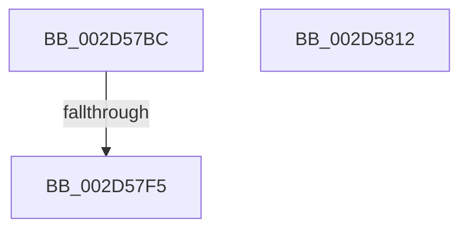

# KiIntSteerLogState

- RVA: `0x002D57BC`–`0x002D5813` (길이 `87` bytes)
- VA: `0x00000001402D57BC`
- 실행 섹션: `.text`
- PDB 이름 있음: `예`; PDB Function 태그: `예`
- unwind 정보 RVA: `0x0006FCAC`
- 디코드: `22`개 명령, `87/87` bytes 표시
- 미해석 바이트: `0` (있으면 어셈블리에 `.byte`로 보존)

> 이 문서는 커널 이미지의 기계어와 PDB 기호를 분석해 생성했습니다. 4번과 5번은 함수 원형과 자료형을 바이너리 사용 방식에서 추정한 C 해석이며 원본 소스 복구 결과는 아닙니다.

## 1. Dependencies

- 직접 호출 지점: **2**; 고유 호출 대상: **2**
- 직접 호출자로 확인된 함수: **4**
- RIP 상대 이미지 참조: **1**

### Outgoing calls
- `0x002D57E5` → [KiIntSteerEtwEventEnabled](KiIntSteerEtwEventEnabled_function_002D7128.md) (function, `0x002D7128`)
- `0x002D57FC` → [_security_check_cookie](../6A/_security_check_cookie_function_006AC640.md) (function, `0x006AC640`)

### Direct callers
- [KiIntSteerConnect](KiIntSteerConnect_function_002D44F0.md) at `0x002D4822`
- [KiIntSteerDisable](../49/KiIntSteerDisable_function_00497144.md) at `0x00497178`
- [sub_006DDBE2](../6D/Unknown_function_006DDBE2.md) at `0x006DDBE8`
- [sub_006DDC12](../6D/Unknown_function_006DDC12.md) at `0x006DDC1C`

### Static image references
- `0x002D57CE` → RVA `0x00E0A740` (`.data`; read)

## 2. Other-region calls and transfers

- 다른 실행 섹션으로 향하는 call: **0**
- call이 아닌 외부 분기/꼬리 이동: **1**
  - `0x002D57EF` → [sub_006DDB2C](../6D/Unknown_function_006DDB2C.md) (`tail-transfer`)

## 3. Assembly (complete function range)

```asm
002D57BC  48 89 5C 24 08                  mov qword ptr [rsp + 8], rbx
002D57C1  55                              push rbp
002D57C2  48 8D 6C 24 A9                  lea rbp, [rsp - 0x57]
002D57C7  48 81 EC D0 00 00 00            sub rsp, 0xd0
002D57CE  48 8B 05 6B 4F B3 00            mov rax, qword ptr [rip + 0xb34f6b]
002D57D5  48 33 C4                        xor rax, rsp
002D57D8  48 89 45 47                     mov qword ptr [rbp + 0x47], rax
002D57DC  4C 8B D9                        mov r11, rcx
002D57DF  48 8B DA                        mov rbx, rdx
002D57E2  48 8B CA                        mov rcx, rdx
002D57E5  E8 3E 19 00 00                  call 0x1402d7128
002D57EA  45 33 C9                        xor r9d, r9d
002D57ED  84 C0                           test al, al
002D57EF  0F 85 37 83 40 00               jne 0x1406ddb2c
002D57F5  48 8B 4D 47                     mov rcx, qword ptr [rbp + 0x47]
002D57F9  48 33 CC                        xor rcx, rsp
002D57FC  E8 3F 6E 3D 00                  call 0x1406ac640
002D5801  48 8B 9C 24 E0 00 00 00         mov rbx, qword ptr [rsp + 0xe0]
002D5809  48 81 C4 D0 00 00 00            add rsp, 0xd0
002D5810  5D                              pop rbp
002D5811  C3                              ret
002D5812  CC                              int3
```

## 4. C-style interpretation (structured pseudocode)

```c
__int64 __fastcall KiIntSteerLogState(__int64 a1, __int64 a2, __int64 a3, int a4)
{
    __int64 result;
    __int64 v_rsp;
    unsigned __int64 v_stack_m18;
    unsigned __int64 v_stack_m5F;
    unsigned __int64 v_stack_p8;

    v_stack_p8 = v_rbx;
    v_rsp = (v_rsp) - (208);
    result = (*(unsigned __int64 *)(v_rip + 11751275)) ^ (v_rsp);
    v_stack_m18 = result;
    result = KiIntSteerEtwEventEnabled(a2, a2, a3, a4);
    a4 = 0;
    a1 = (v_stack_m18) ^ (v_rsp);
    result = _security_check_cookie(a1, a2, a3, a4);
    v_rsp = (v_rsp) + (208);
    return result;
}
```

## 5. (Beta) C Style

```c
int64_t KiIntSteerLogState(int64_t Arg1, int64_t Arg2, int64_t Arg3, int32_t Arg4)
{
    int64_t result;
    int64_t local_rsp;
    uint64_t v_stack_m18;
    uint64_t v_stack_m5F;
    uint64_t v_stack_p8;

    v_stack_p8 = local_rbx;
    local_rsp = (local_rsp) - (208);
    result = (*(uint64_t *)(v_rip + 0xB34F6B)) ^ (local_rsp);
    v_stack_m18 = result;
    result = KiIntSteerEtwEventEnabled(Arg2, Arg2, Arg3, Arg4);
    Arg4 = 0;
    Arg1 = (v_stack_m18) ^ (local_rsp);
    result = _security_check_cookie(Arg1, Arg2, Arg3, Arg4);
    local_rsp = (local_rsp) + (208);
    return result;
}
```

## 6. Execution-region graph

[열기: 2D/3D 그래프와 함수 탐색 컨트롤 패널](../../../control-panel.html?section=text&rva=0x002D57BC&view=graph)

- 2D 그래프는 위에서 아래로 흐르고, 3D 그래프는 빈 공간을 드래그해 회전합니다. Shift+드래그는 이동, 휠은 확대·축소, 함수 노드 선택은 대상 보고서 이동입니다.

### Static fallback


