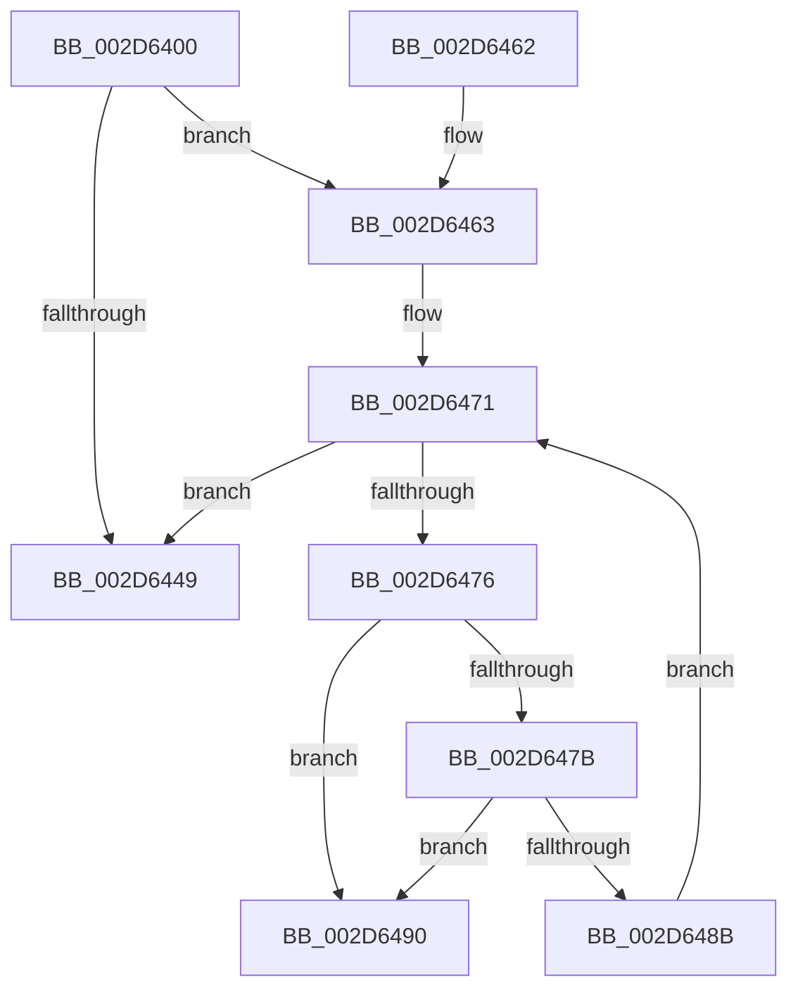

# KiIntSteerLogStatus

- RVA: `0x002D6400`–`0x002D649C` (길이 `156` bytes)
- VA: `0x00000001402D6400`
- 실행 섹션: `.text`
- PDB 이름 있음: `예`; PDB Function 태그: `예`
- unwind 정보 RVA: `0x0006FDA0`
- 디코드: `42`개 명령, `156/156` bytes 표시
- 미해석 바이트: `0` (있으면 어셈블리에 `.byte`로 보존)

> 이 문서는 커널 이미지의 기계어와 PDB 기호를 분석해 생성했습니다. 4번과 5번은 함수 원형과 자료형을 바이너리 사용 방식에서 추정한 C 해석이며 원본 소스 복구 결과는 아닙니다.

## 1. Dependencies

- 직접 호출 지점: **3**; 고유 호출 대상: **3**
- 직접 호출자로 확인된 함수: **1**
- RIP 상대 이미지 참조: **3**

### Outgoing calls
- `0x002D641B` → [KiIntSteerLogMask](KiIntSteerLogMask_function_002D71B8.md) (function, `0x002D71B8`)
- `0x002D6423` → [KiIntSteerLogProc](KiIntSteerLogProc_function_002D72D8.md) (function, `0x002D72D8`)
- `0x002D6440` → [KiIntSteerEtwEventEnabled](KiIntSteerEtwEventEnabled_function_002D7128.md) (function, `0x002D7128`)

### Direct callers
- [KiIntSteerEventTraceControlCallback](../../page/74/KiIntSteerEventTraceControlCallback_function_00747370.md) at `0x0074737E`

### Static image references
- `0x002D6428` → RVA `0x00010AE8` (`.rdata`; read)
- `0x002D6432` → RVA `0x00010AD8` (`.rdata`; read)
- `0x002D6463` → RVA `0x00F10D50` (`.data`; read)

## 2. Other-region calls and transfers

- 다른 실행 섹션으로 향하는 call: **0**
- call이 아닌 외부 분기/꼬리 이동: **1**
  - `0x002D6497` → [sub_006DDBE2 + 0xE](../6D/Unknown_function_006DDBE2.md) (`tail-transfer`)

## 3. Assembly (complete function range)

```asm
002D6400  48 89 5C 24 08                  mov qword ptr [rsp + 8], rbx
002D6405  48 89 6C 24 10                  mov qword ptr [rsp + 0x10], rbp
002D640A  48 89 74 24 18                  mov qword ptr [rsp + 0x18], rsi
002D640F  57                              push rdi
002D6410  41 56                           push r14
002D6412  41 57                           push r15
002D6414  48 83 EC 20                     sub rsp, 0x20
002D6418  40 8A E9                        mov bpl, cl
002D641B  E8 98 0D 00 00                  call 0x1402d71b8
002D6420  40 8A CD                        mov cl, bpl
002D6423  E8 B0 0E 00 00                  call 0x1402d72d8
002D6428  48 8D 05 B9 A6 D3 FF            lea rax, [rip - 0x2c5947]
002D642F  40 84 ED                        test bpl, bpl
002D6432  4C 8D 35 9F A6 D3 FF            lea r14, [rip - 0x2c5961]
002D6439  4C 0F 45 F0                     cmovne r14, rax
002D643D  49 8B CE                        mov rcx, r14
002D6440  E8 E3 0C 00 00                  call 0x1402d7128
002D6445  84 C0                           test al, al
002D6447  75 1A                           jne 0x1402d6463
002D6449  48 8B 5C 24 40                  mov rbx, qword ptr [rsp + 0x40]
002D644E  48 8B 6C 24 48                  mov rbp, qword ptr [rsp + 0x48]
002D6453  48 8B 74 24 50                  mov rsi, qword ptr [rsp + 0x50]
002D6458  48 83 C4 20                     add rsp, 0x20
002D645C  41 5F                           pop r15
002D645E  41 5E                           pop r14
002D6460  5F                              pop rdi
002D6461  C3                              ret
002D6462  CC                              int3
002D6463  48 8B 1D E6 A8 C3 00            mov rbx, qword ptr [rip + 0xc3a8e6]
002D646A  4C 8D 3D DF A8 C3 00            lea r15, [rip + 0xc3a8df]
002D6471  49 3B DF                        cmp rbx, r15
002D6474  74 D3                           je 0x1402d6449
002D6476  40 84 ED                        test bpl, bpl
002D6479  75 15                           jne 0x1402d6490
002D647B  48 8B 83 A0 00 00 00            mov rax, qword ptr [rbx + 0xa0]
002D6482  48 39 83 B0 00 00 00            cmp qword ptr [rbx + 0xb0], rax
002D6489  75 05                           jne 0x1402d6490
002D648B  48 8B 1B                        mov rbx, qword ptr [rbx]
002D648E  EB E1                           jmp 0x1402d6471
002D6490  48 8D 73 10                     lea rsi, [rbx + 0x10]
002D6494  48 8B 3E                        mov rdi, qword ptr [rsi]
002D6497  E9 54 77 40 00                  jmp 0x1406ddbf0
```

## 4. C-style interpretation (structured pseudocode)

```c
__int64 __fastcall KiIntSteerLogStatus(unsigned __int8 a1)
{
    __int64 result;
    __int64 v_r14;
    __int64 v_rsp;
    unsigned __int64 v_stack_p10;
    unsigned __int64 v_stack_p18;
    unsigned __int64 v_stack_p8;

    v_stack_p8 = v_rbx;
    v_stack_p10 = v_rbp;
    v_stack_p18 = v_rsi;
    v_rsp = (v_rsp) - (32);
    result = KiIntSteerLogMask(a1, a2, a3, a4);
    result = KiIntSteerLogProc(a1, a2, a3, a4);
    v_r14 = v_rip - 2906465;
    if (a1 != 0) { v_r14 = v_rip - 2906439; }
    result = KiIntSteerEtwEventEnabled(v_r14, a2, a3, a4);
    if ((unsigned __int8)(result) != 0) goto loc_002D6463;
loc_002D6449:
    v_rsp = (v_rsp) + (32);
    return result;
loc_002D6463:
loc_002D6471:
    if ((*(unsigned __int64 *)(v_rip + 12822758)) == (v_rip + 12822751)) goto loc_002D6449;
    if ((unsigned __int8)(v_stack_p10) != 0) goto loc_002D6490;
    if ((*(unsigned __int64 *)(*(unsigned __int64 *)(v_rip + 12822758) + 176)) != (*(unsigned __int64 *)(*(unsigned __int64 *)(v_rip + 12822758) + 160))) goto loc_002D6490;
    goto loc_002D6471;
loc_002D6490:
}
```

## 5. (Beta) C Style

```c
int64_t KiIntSteerLogStatus(uint8_t Arg1)
{
    int64_t result;
    int64_t local_r14;
    int64_t local_rsp;
    uint64_t v_stack_p10;
    uint64_t v_stack_p18;
    uint64_t v_stack_p8;

    v_stack_p8 = local_rbx;
    v_stack_p10 = local_rbp;
    v_stack_p18 = local_rsi;
    local_rsp = (local_rsp) - (32);
    result = KiIntSteerLogMask(Arg1, a2, a3, a4);
    result = KiIntSteerLogProc(Arg1, a2, a3, a4);
    local_r14 = v_rip - 2906465;
    if (Arg1 != 0) { local_r14 = v_rip - 2906439; }
    result = KiIntSteerEtwEventEnabled(local_r14, a2, a3, a4);
    if ((uint8_t)(result) != 0) goto loc_002D6463;
loc_002D6449:
    local_rsp = (local_rsp) + (32);
    return result;
loc_002D6463:
loc_002D6471:
    if ((*(uint64_t *)(v_rip + 0xC3A8E6)) == (v_rip + 12822751)) goto loc_002D6449;
    if ((uint8_t)(v_stack_p10) != 0) goto loc_002D6490;
    if ((*(uint64_t *)(*(uint64_t *)(v_rip + 0xC3A8E6) + 0xB0)) != (*(uint64_t *)(*(uint64_t *)(v_rip + 0xC3A8E6) + 0xA0))) goto loc_002D6490;
    goto loc_002D6471;
loc_002D6490:
}
```

## 6. Execution-region graph

[열기: 2D/3D 그래프와 함수 탐색 컨트롤 패널](../../../control-panel.html?section=text&rva=0x002D6400&view=graph)

- 2D 그래프는 위에서 아래로 흐르고, 3D 그래프는 빈 공간을 드래그해 회전합니다. Shift+드래그는 이동, 휠은 확대·축소, 함수 노드 선택은 대상 보고서 이동입니다.

### Static fallback


