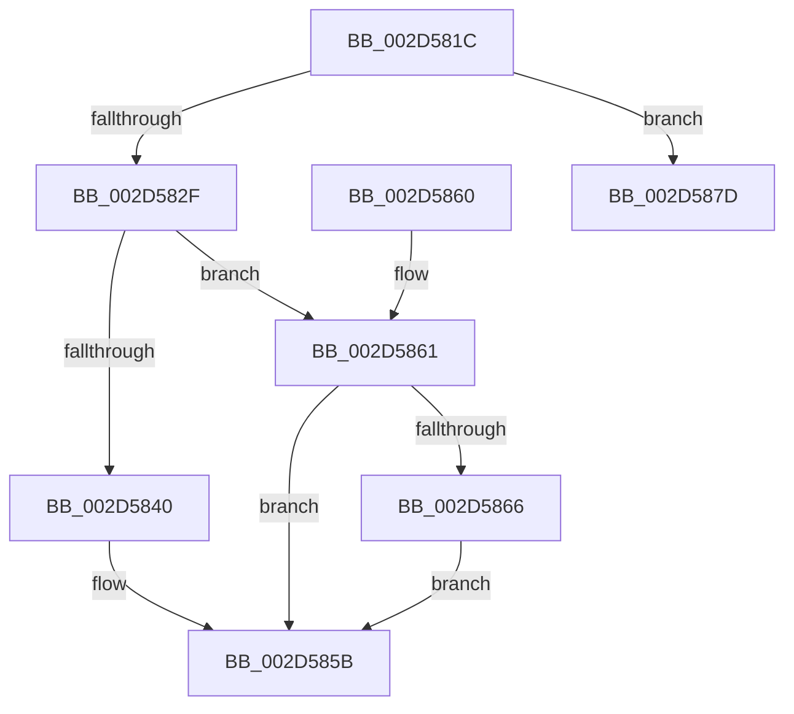

# KiIntSteerSetDestination

- RVA: `0x002D581C`–`0x002D5896` (길이 `122` bytes)
- VA: `0x00000001402D581C`
- 실행 섹션: `.text`
- PDB 이름 있음: `예`; PDB Function 태그: `아니요`
- unwind 정보 RVA: `0x0006FCD8`
- 디코드: `33`개 명령, `122/122` bytes 표시
- 미해석 바이트: `0` (있으면 어셈블리에 `.byte`로 보존)

> 이 문서는 커널 이미지의 기계어와 PDB 기호를 분석해 생성했습니다. 4번과 5번은 함수 원형과 자료형을 바이너리 사용 방식에서 추정한 C 해석이며 원본 소스 복구 결과는 아닙니다.

## 1. Dependencies

- 직접 호출 지점: **3**; 고유 호출 대상: **3**
- 직접 호출자로 확인된 함수: **2**
- RIP 상대 이미지 참조: **1**

### Outgoing calls
- `0x002D5823` → [KiIntSteerVerifyDestination](KiIntSteerVerifyDestination_function_002D589C.md) (function, `0x002D589C`)
- `0x002D5856` → [guard_dispatch_icall](../6B/guard_dispatch_icall_function_006BAAD0.md) (function, `0x006BAAD0`)
- `0x002D5890` → [KeBugCheckEx](../4F/KeBugCheckEx_function_004FD660.md) (function, `0x004FD660`)

### Direct callers
- [KiIntSteerConnect](KiIntSteerConnect_function_002D44F0.md) at `0x002D477C`
- [sub_002D702E](Unknown_function_002D702E.md) at `0x002D7038`

### Static image references
- `0x002D584F` → RVA `0x00E00AC8` (`.data`; read)

## 2. Other-region calls and transfers

- 다른 실행 섹션으로 향하는 call: **0**
- 별도 외부 분기/꼬리 이동을 확인하지 못했습니다.

## 3. Assembly (complete function range)

```asm
002D581C  48 83 EC 38                     sub rsp, 0x38
002D5820  4C 8B C9                        mov r9, rcx
002D5823  E8 74 00 00 00                  call 0x1402d589c
002D5828  45 33 C0                        xor r8d, r8d
002D582B  85 C0                           test eax, eax
002D582D  78 4E                           js 0x1402d587d
002D582F  41 8B 89 80 00 00 00            mov ecx, dword ptr [r9 + 0x80]
002D5836  8D 41 FF                        lea eax, [rcx - 1]
002D5839  A9 FD FF FF FF                  test eax, 0xfffffffd
002D583E  75 21                           jne 0x1402d5861
002D5840  49 8D 41 20                     lea rax, [r9 + 0x20]
002D5844  83 38 FF                        cmp dword ptr [rax], -1
002D5847  49 8D 49 28                     lea rcx, [r9 + 0x28]
002D584B  4C 0F 45 C0                     cmovne r8, rax
002D584F  48 8B 05 72 B2 B2 00            mov rax, qword ptr [rip + 0xb2b272]
002D5856  E8 75 52 3E 00                  call 0x1406baad0
002D585B  48 83 C4 38                     add rsp, 0x38
002D585F  C3                              ret
002D5860  CC                              int3
002D5861  83 F9 02                        cmp ecx, 2
002D5864  75 F5                           jne 0x1402d585b
002D5866  0F B7 42 08                     movzx eax, word ptr [rdx + 8]
002D586A  49 8B 89 C8 00 00 00            mov rcx, qword ptr [r9 + 0xc8]
002D5871  66 89 41 08                     mov word ptr [rcx + 8], ax
002D5875  48 8B 02                        mov rax, qword ptr [rdx]
002D5878  48 89 01                        mov qword ptr [rcx], rax
002D587B  EB DE                           jmp 0x1402d585b
002D587D  B9 A0 00 00 00                  mov ecx, 0xa0
002D5882  48 89 54 24 20                  mov qword ptr [rsp + 0x20], rdx
002D5887  BA 01 40 00 00                  mov edx, 0x4001
002D588C  44 8D 41 61                     lea r8d, [rcx + 0x61]
002D5890  E8 CB 7D 22 00                  call 0x1404fd660
002D5895  CC                              int3
```

## 4. C-style interpretation (structured pseudocode)

```c
__int64 __fastcall KiIntSteerSetDestination(__int64 a1, __int64 a2, int a3)
{
    __int64 result;
    __int64 v_rsp;
    unsigned __int64 v_stack_p20;

    v_rsp = (v_rsp) - (56);
    result = KiIntSteerVerifyDestination(a1, a2, a3, a1);
    a3 = 0;
    if (sign_flag) goto loc_002D587D;
    if ((((unsigned int)((unsigned int)(*(unsigned int *)(a1 + 128)) - 1)) & (0xFFFFFFFDULL)) != 0) goto loc_002D5861;
    if ((*(unsigned int *)(a1 + 32)) != -1) { a3 = a1 + 32; }
    result = guard_dispatch_icall(a1 + 40, a2, a3, a1);
loc_002D585B:
    v_rsp = (v_rsp) + (56);
    return result;
loc_002D5861:
    if (((unsigned int)(a1 + 40)) != 2) goto loc_002D585B;
    *(unsigned __int16 *)(*(unsigned __int64 *)(a1 + 200) + 8) = (unsigned __int16)(*(unsigned __int16 *)(a2 + 8));
    *(unsigned __int64 *)(*(unsigned __int64 *)(a1 + 200)) = *(unsigned __int64 *)(a2);
    goto loc_002D585B;
loc_002D587D:
    v_stack_p20 = a2;
    result = KeBugCheckEx(160, (unsigned int)(0x4001ULL), 160 + 97, a1);
    return result;
}
```

## 5. (Beta) C Style

```c
int64_t KiIntSteerSetDestination(int64_t Arg1, int64_t Arg2, int32_t Arg3)
{
    int64_t result;
    int64_t local_rsp;
    uint64_t v_stack_p20;

    local_rsp = (local_rsp) - (56);
    result = KiIntSteerVerifyDestination(Arg1, Arg2, Arg3, Arg1);
    Arg3 = 0;
    if (sign_flag) goto loc_002D587D;
    if ((((uint32_t)((uint32_t)(*(uint32_t *)(Arg1 + 0x80)) - 1)) & (0xFFFFFFFDULL)) != 0) goto loc_002D5861;
    if ((*(uint32_t *)(Arg1 + 0x20)) != -1) { Arg3 = Arg1 + 32; }
    result = guard_dispatch_icall(Arg1 + 40, Arg2, Arg3, Arg1);
loc_002D585B:
    local_rsp = (local_rsp) + (56);
    return result;
loc_002D5861:
    if (((uint32_t)(Arg1 + 40)) != 2) goto loc_002D585B;
    *(uint16_t *)(*(uint64_t *)(Arg1 + 0xC8) + 0x8) = (uint16_t)(*(uint16_t *)(Arg2 + 0x8));
    *(uint64_t *)(*(uint64_t *)(Arg1 + 0xC8)) = *(uint64_t *)(Arg2);
    goto loc_002D585B;
loc_002D587D:
    v_stack_p20 = Arg2;
    result = KeBugCheckEx(160, (uint32_t)(0x4001ULL), 160 + 97, Arg1);
    return result;
}
```

## 6. Execution-region graph

[열기: 2D/3D 그래프와 함수 탐색 컨트롤 패널](../../../control-panel.html?section=text&rva=0x002D581C&view=graph)

- 2D 그래프는 위에서 아래로 흐르고, 3D 그래프는 빈 공간을 드래그해 회전합니다. Shift+드래그는 이동, 휠은 확대·축소, 함수 노드 선택은 대상 보고서 이동입니다.

### Static fallback


