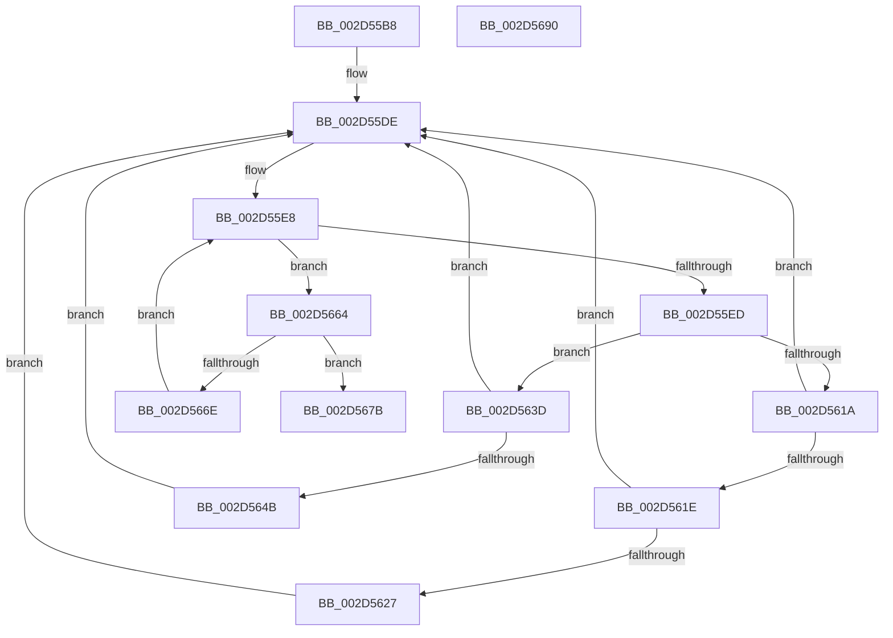

# KiIntSteerUpdateDeviceInterruptMask

- RVA: `0x002D55B8`–`0x002D5691` (길이 `217` bytes)
- VA: `0x00000001402D55B8`
- 실행 섹션: `.text`
- PDB 이름 있음: `예`; PDB Function 태그: `아니요`
- unwind 정보 RVA: `0x0006FC78`
- 디코드: `57`개 명령, `217/217` bytes 표시
- 미해석 바이트: `0` (있으면 어셈블리에 `.byte`로 보존)

> 이 문서는 커널 이미지의 기계어와 PDB 기호를 분석해 생성했습니다. 4번과 5번은 함수 원형과 자료형을 바이너리 사용 방식에서 추정한 C 해석이며 원본 소스 복구 결과는 아닙니다.

## 1. Dependencies

- 직접 호출 지점: **1**; 고유 호출 대상: **1**
- 직접 호출자로 확인된 함수: **1**
- RIP 상대 이미지 참조: **1**

### Outgoing calls
- `0x002D5611` → [KeGetPrcb](KeGetPrcb_function_002D85D0.md) (function, `0x002D85D0`)

### Direct callers
- [KiIntSteerConnect](KiIntSteerConnect_function_002D44F0.md) at `0x002D4768`

### Static image references
- `0x002D5607` → RVA `0x00F231B8` (`.data`; read)

## 2. Other-region calls and transfers

- 다른 실행 섹션으로 향하는 call: **0**
- 별도 외부 분기/꼬리 이동을 확인하지 못했습니다.

## 3. Assembly (complete function range)

```asm
002D55B8  48 8B C4                        mov rax, rsp
002D55BB  48 89 58 08                     mov qword ptr [rax + 8], rbx
002D55BF  48 89 68 10                     mov qword ptr [rax + 0x10], rbp
002D55C3  48 89 70 20                     mov qword ptr [rax + 0x20], rsi
002D55C7  4C 89 40 18                     mov qword ptr [rax + 0x18], r8
002D55CB  57                              push rdi
002D55CC  48 83 EC 20                     sub rsp, 0x20
002D55D0  0F B7 59 08                     movzx ebx, word ptr [rcx + 8]
002D55D4  8B F2                           mov esi, edx
002D55D6  48 8B 39                        mov rdi, qword ptr [rcx]
002D55D9  BD 01 00 00 00                  mov ebp, 1
002D55DE  83 64 24 40 00                  and dword ptr [rsp + 0x40], 0
002D55E3  0F B7 CB                        movzx ecx, bx
002D55E6  03 CD                           add ecx, ebp
002D55E8  48 85 FF                        test rdi, rdi
002D55EB  74 77                           je 0x1402d5664
002D55ED  48 0F BC D7                     bsf rdx, rdi
002D55F1  0F B7 CB                        movzx ecx, bx
002D55F4  0F B6 C2                        movzx eax, dl
002D55F7  48 0F B3 C7                     btr rdi, rax
002D55FB  C1 E1 06                        shl ecx, 6
002D55FE  0F B6 C2                        movzx eax, dl
002D5601  03 C8                           add ecx, eax
002D5603  89 54 24 40                     mov dword ptr [rsp + 0x40], edx
002D5607  48 8B 05 AA DB C4 00            mov rax, qword ptr [rip + 0xc4dbaa]
002D560E  8B 0C 88                        mov ecx, dword ptr [rax + rcx*4]
002D5611  E8 BA 2F 00 00                  call 0x1402d85d0
002D5616  85 F6                           test esi, esi
002D5618  74 23                           je 0x1402d563d
002D561A  3B F5                           cmp esi, ebp
002D561C  75 C0                           jne 0x1402d55de
002D561E  83 80 98 2D 00 00 FF            add dword ptr [rax + 0x2d98], -1
002D5625  75 B7                           jne 0x1402d55de
002D5627  0F B6 88 D1 00 00 00            movzx ecx, byte ptr [rax + 0xd1]
002D562E  48 8B 80 C0 00 00 00            mov rax, qword ptr [rax + 0xc0]
002D5635  F0 48 0F AB 48 70               lock bts qword ptr [rax + 0x70], rcx
002D563B  EB A1                           jmp 0x1402d55de
002D563D  01 A8 98 2D 00 00               add dword ptr [rax + 0x2d98], ebp
002D5643  39 A8 98 2D 00 00               cmp dword ptr [rax + 0x2d98], ebp
002D5649  75 93                           jne 0x1402d55de
002D564B  0F B6 88 D1 00 00 00            movzx ecx, byte ptr [rax + 0xd1]
002D5652  48 8B 80 C0 00 00 00            mov rax, qword ptr [rax + 0xc0]
002D5659  F0 48 0F B3 48 70               lock btr qword ptr [rax + 0x70], rcx
002D565F  E9 7A FF FF FF                  jmp 0x1402d55de
002D5664  66 03 DD                        add bx, bp
002D5667  0F B7 DB                        movzx ebx, bx
002D566A  3B D9                           cmp ebx, ecx
002D566C  73 0D                           jae 0x1402d567b
002D566E  48 8B 3C DD 08 00 00 00         mov rdi, qword ptr [rbx*8 + 8]
002D5676  E9 6D FF FF FF                  jmp 0x1402d55e8
002D567B  48 8B 5C 24 30                  mov rbx, qword ptr [rsp + 0x30]
002D5680  48 8B 6C 24 38                  mov rbp, qword ptr [rsp + 0x38]
002D5685  48 8B 74 24 48                  mov rsi, qword ptr [rsp + 0x48]
002D568A  48 83 C4 20                     add rsp, 0x20
002D568E  5F                              pop rdi
002D568F  C3                              ret
002D5690  CC                              int3
```

## 4. C-style interpretation (structured pseudocode)

```c
__int64 __fastcall KiIntSteerUpdateDeviceInterruptMask(__int64 a1, int a2, __int64 a3)
{
    __int64 result;
    __int64 v_rbx;
    __int64 v_rsp;
    unsigned __int64 v_stack_p10;
    unsigned int v_stack_p18;
    unsigned __int64 v_stack_p20;
    unsigned __int64 v_stack_p8;

    *(unsigned __int64 *)(v_rsp + 8) = v_rbx;
    *(unsigned __int64 *)(v_rsp + 16) = v_rbp;
    *(unsigned __int64 *)(v_rsp + 32) = v_rsi;
    *(unsigned __int64 *)(v_rsp + 24) = a3;
    v_rsp = (v_rsp) - (32);
loc_002D55DE:
    a1 = (unsigned int)(((unsigned __int16)(*(unsigned __int16 *)(a1 + 8))) + (1));
loc_002D55E8:
    if (*(unsigned __int64 *)(a1) == 0) goto loc_002D5664;
    a1 = (unsigned int)(((unsigned __int16)(*(unsigned __int16 *)(a1 + 8))) << (6));
    a1 = (unsigned int)((a1) + ((unsigned int)((unsigned __int8)(a2))));
    v_stack_p18 = a2;
    result = KeGetPrcb((unsigned int)(*(unsigned int *)(*(unsigned __int64 *)(v_rip + 12901290) + a1 * 4)), a2, a3, a4);
    if ((unsigned int)((unsigned int)(a2)) == 0) goto loc_002D563D;
    if (((unsigned int)((unsigned int)(a2))) != 1) goto loc_002D55DE;
    if (((unsigned int)((unsigned int)(a2))) != 1) goto loc_002D55DE;
    goto loc_002D55DE;
loc_002D563D:
    if ((*(unsigned int *)(*(unsigned __int64 *)(result + 192) + 11672)) != 1) goto loc_002D55DE;
    goto loc_002D55DE;
loc_002D5664:
    v_rbx = (unsigned __int16)((*(unsigned __int16 *)(a1 + 8)) + (1));
    if (((unsigned int)((unsigned __int16)(v_rbx))) >= ((unsigned int)(*(unsigned __int8 *)(*(unsigned __int64 *)(result + 192) + 209)))) goto loc_002D567B;
    goto loc_002D55E8;
loc_002D567B:
    v_rsp = (v_rsp) + (32);
    return *(unsigned __int64 *)(*(unsigned __int64 *)(result + 192) + 192);
}
```

## 5. (Beta) C Style

```c
int64_t KiIntSteerUpdateDeviceInterruptMask(void *Arg1, int32_t Arg2, int64_t Arg3)
{
    uint8_t *arg1 = (uint8_t *)Arg1;

    int64_t result;
    int64_t local_rbx;
    int64_t local_rsp;
    uint64_t v_stack_p10;
    uint32_t v_stack_p18;
    uint64_t v_stack_p20;
    uint64_t v_stack_p8;

    *(uint64_t *)(local_rsp + 0x8) = local_rbx;
    *(uint64_t *)(local_rsp + 0x10) = local_rbp;
    *(uint64_t *)(local_rsp + 0x20) = local_rsi;
    *(uint64_t *)(local_rsp + 0x18) = Arg3;
    local_rsp = (local_rsp) - (32);
loc_002D55DE:
    Arg1 = (uint32_t)(((uint16_t)(*(uint16_t *)(arg1 + 0x8))) + (1));
loc_002D55E8:
    if (*(uint64_t *)(arg1) == 0) goto loc_002D5664;
    Arg1 = (uint32_t)(((uint16_t)(*(uint16_t *)(arg1 + 0x8))) << (6));
    Arg1 = (uint32_t)((Arg1) + ((uint32_t)((uint8_t)(Arg2))));
    v_stack_p18 = Arg2;
    result = KeGetPrcb((uint32_t)(*(uint32_t *)(*(uint64_t *)(v_rip + 0xC4DBAA) + arg1 * 4)), Arg2, Arg3, a4);
    if ((uint32_t)((uint32_t)(Arg2)) == 0) goto loc_002D563D;
    if (((uint32_t)((uint32_t)(Arg2))) != 1) goto loc_002D55DE;
    if (((uint32_t)((uint32_t)(Arg2))) != 1) goto loc_002D55DE;
    goto loc_002D55DE;
loc_002D563D:
    if ((*(uint32_t *)(*(uint64_t *)(result + 0xC0) + 0x2D98)) != 1) goto loc_002D55DE;
    goto loc_002D55DE;
loc_002D5664:
    local_rbx = (uint16_t)((*(uint16_t *)(arg1 + 0x8)) + (1));
    if (((uint32_t)((uint16_t)(local_rbx))) >= ((uint32_t)(*(uint8_t *)(*(uint64_t *)(result + 0xC0) + 0xD1)))) goto loc_002D567B;
    goto loc_002D55E8;
loc_002D567B:
    local_rsp = (local_rsp) + (32);
    return *(uint64_t *)(*(uint64_t *)(result + 0xC0) + 0xC0);
}
```

### 관측된 메모리 오프셋

구조체 형식이 확인되지 않은 접근은 인자 기준의 오프셋으로만 기록했습니다.

| 기준 인자 | 오프셋 표현 | 폭 (bit) | 접근 |
|---|---:|---:|---|
| `Arg1` | `+ 0x0` | `64` | `R` |
| `Arg1` | `+ 0x8` | `16` | `R` |

## 6. Execution-region graph

[열기: 2D/3D 그래프와 함수 탐색 컨트롤 패널](../../../control-panel.html?section=text&rva=0x002D55B8&view=graph)

- 2D 그래프는 위에서 아래로 흐르고, 3D 그래프는 빈 공간을 드래그해 회전합니다. Shift+드래그는 이동, 휠은 확대·축소, 함수 노드 선택은 대상 보고서 이동입니다.

### Static fallback


