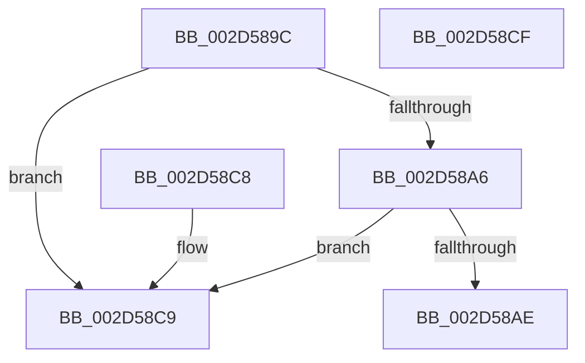

# KiIntSteerVerifyDestination

- RVA: `0x002D589C`–`0x002D58D0` (길이 `52` bytes)
- VA: `0x00000001402D589C`
- 실행 섹션: `.text`
- PDB 이름 있음: `예`; PDB Function 태그: `아니요`
- unwind 정보 RVA: `0x000DB714`
- 디코드: `19`개 명령, `52/52` bytes 표시
- 미해석 바이트: `0` (있으면 어셈블리에 `.byte`로 보존)

> 이 문서는 커널 이미지의 기계어와 PDB 기호를 분석해 생성했습니다. 4번과 5번은 함수 원형과 자료형을 바이너리 사용 방식에서 추정한 C 해석이며 원본 소스 복구 결과는 아닙니다.

## 1. Dependencies

- 직접 호출 지점: **0**; 고유 호출 대상: **0**
- 직접 호출자로 확인된 함수: **1**
- RIP 상대 이미지 참조: **0**

### Outgoing calls
- 직접 디코드된 call 명령이 없습니다.

### Direct callers
- [KiIntSteerSetDestination](KiIntSteerSetDestination_function_002D581C.md) at `0x002D5823`

### Static image references
- 디코드된 RIP-relative 메모리 참조가 없습니다.

## 2. Other-region calls and transfers

- 다른 실행 섹션으로 향하는 call: **0**
- 별도 외부 분기/꼬리 이동을 확인하지 못했습니다.

## 3. Assembly (complete function range)

```asm
002D589C  0F B7 42 08                     movzx eax, word ptr [rdx + 8]
002D58A0  66 39 41 48                     cmp word ptr [rcx + 0x48], ax
002D58A4  75 23                           jne 0x1402d58c9
002D58A6  4C 8B 02                        mov r8, qword ptr [rdx]
002D58A9  4D 85 C0                        test r8, r8
002D58AC  74 1B                           je 0x1402d58c9
002D58AE  48 8B 41 40                     mov rax, qword ptr [rcx + 0x40]
002D58B2  48 8B C8                        mov rcx, rax
002D58B5  49 0B C8                        or rcx, r8
002D58B8  48 2B C8                        sub rcx, rax
002D58BB  B8 0D 00 00 C0                  mov eax, 0xc000000d
002D58C0  48 F7 D9                        neg rcx
002D58C3  1B C9                           sbb ecx, ecx
002D58C5  23 C1                           and eax, ecx
002D58C7  C3                              ret
002D58C8  CC                              int3
002D58C9  B8 0D 00 00 C0                  mov eax, 0xc000000d
002D58CE  C3                              ret
002D58CF  CC                              int3
```

## 4. C-style interpretation (structured pseudocode)

```c
__int64 __fastcall KiIntSteerVerifyDestination(__int64 a1, __int64 a2)
{
    __int64 result;

    if ((*(unsigned __int16 *)(a1 + 72)) != ((unsigned __int16)(*(unsigned __int16 *)(a2 + 8)))) goto loc_002D58C9;
    if (*(unsigned __int64 *)(a2) == 0) goto loc_002D58C9;
    a1 = (*(unsigned __int64 *)(a1 + 64)) | (*(unsigned __int64 *)(a2));
    a1 = (a1) - (*(unsigned __int64 *)(a1 + 64));
    a1 = -(a1);
    result = (unsigned int)(((unsigned int)(0xC000000DULL)) & ((unsigned int)(a1)));
    return result;
loc_002D58C9:
    return (unsigned int)(0xC000000DULL);
}
```

## 5. (Beta) C Style

```c
int64_t KiIntSteerVerifyDestination(void *Arg1, void *Arg2)
{
    uint8_t *arg1 = (uint8_t *)Arg1;
    uint8_t *arg2 = (uint8_t *)Arg2;

    int64_t result;

    if ((*(uint16_t *)(arg1 + 0x48)) != ((uint16_t)(*(uint16_t *)(arg2 + 0x8)))) goto loc_002D58C9;
    if (*(uint64_t *)(arg2) == 0) goto loc_002D58C9;
    Arg1 = (*(uint64_t *)(arg1 + 0x40)) | (*(uint64_t *)(arg2));
    Arg1 = (Arg1) - (*(uint64_t *)(arg1 + 0x40));
    Arg1 = -(Arg1);
    result = (uint32_t)(((uint32_t)(0xC000000DULL)) & ((uint32_t)(Arg1)));
    return result;
loc_002D58C9:
    return (uint32_t)(0xC000000DULL);
}
```

### 관측된 메모리 오프셋

구조체 형식이 확인되지 않은 접근은 인자 기준의 오프셋으로만 기록했습니다.

| 기준 인자 | 오프셋 표현 | 폭 (bit) | 접근 |
|---|---:|---:|---|
| `Arg1` | `+ 0x40` | `64` | `R` |
| `Arg1` | `+ 0x48` | `16` | `R` |
| `Arg2` | `+ 0x0` | `64` | `R` |
| `Arg2` | `+ 0x8` | `16` | `R` |

## 6. Execution-region graph

[열기: 2D/3D 그래프와 함수 탐색 컨트롤 패널](../../../control-panel.html?section=text&rva=0x002D589C&view=graph)

- 2D 그래프는 위에서 아래로 흐르고, 3D 그래프는 빈 공간을 드래그해 회전합니다. Shift+드래그는 이동, 휠은 확대·축소, 함수 노드 선택은 대상 보고서 이동입니다.

### Static fallback


