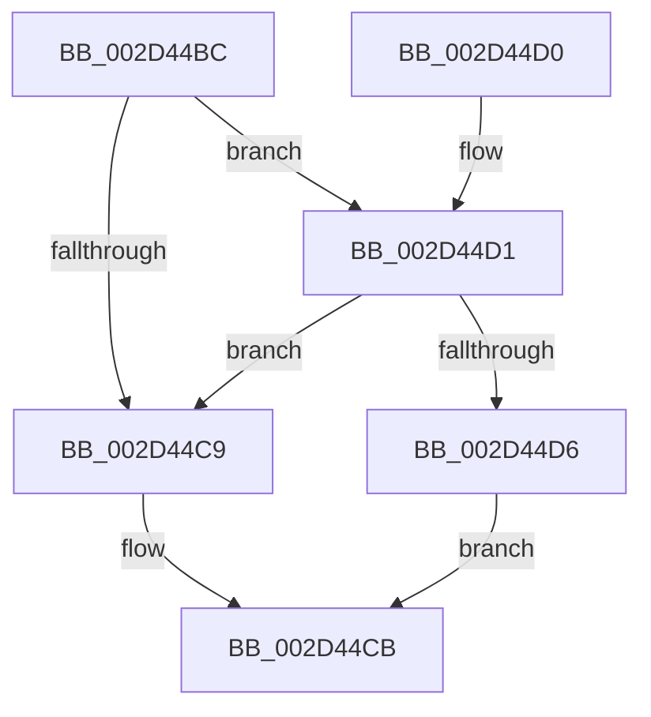

# KiIsInterruptTypeSecondary

- RVA: `0x002D44BC`–`0x002D44EA` (길이 `46` bytes)
- VA: `0x00000001402D44BC`
- 실행 섹션: `.text`
- PDB 이름 있음: `예`; PDB Function 태그: `아니요`
- unwind 정보 RVA: `0x0005E0D8`
- 디코드: `14`개 명령, `46/46` bytes 표시
- 미해석 바이트: `0` (있으면 어셈블리에 `.byte`로 보존)

> 이 문서는 커널 이미지의 기계어와 PDB 기호를 분석해 생성했습니다. 4번과 5번은 함수 원형과 자료형을 바이너리 사용 방식에서 추정한 C 해석이며 원본 소스 복구 결과는 아닙니다.

## 1. Dependencies

- 직접 호출 지점: **1**; 고유 호출 대상: **1**
- 직접 호출자로 확인된 함수: **4**
- RIP 상대 이미지 참조: **2**

### Outgoing calls
- `0x002D44E3` → [guard_dispatch_icall](../6B/guard_dispatch_icall_function_006BAAD0.md) (function, `0x006BAAD0`)

### Direct callers
- [KeDisconnectInterrupt](KeDisconnectInterrupt_function_002D3588.md) at `0x002D35BC`
- [KeConnectInterrupt](KeConnectInterrupt_function_002D3D5C.md) at `0x002D3D96`
- [KeMaskInterrupt](KeMaskInterrupt_function_002D42FC.md) at `0x002D433C`
- [KeUnmaskInterrupt](../47/KeUnmaskInterrupt_function_00479C04.md) at `0x00479C24`

### Static image references
- `0x002D44C0` → RVA `0x00F11030` (`.data`; read)
- `0x002D44DC` → RVA `0x00E009E0` (`.data`; read)

## 2. Other-region calls and transfers

- 다른 실행 섹션으로 향하는 call: **0**
- 별도 외부 분기/꼬리 이동을 확인하지 못했습니다.

## 3. Assembly (complete function range)

```asm
002D44BC  48 83 EC 28                     sub rsp, 0x28
002D44C0  80 3D 69 CB C3 00 00            cmp byte ptr [rip + 0xc3cb69], 0
002D44C7  75 08                           jne 0x1402d44d1
002D44C9  32 C0                           xor al, al
002D44CB  48 83 C4 28                     add rsp, 0x28
002D44CF  C3                              ret
002D44D0  CC                              int3
002D44D1  83 39 01                        cmp dword ptr [rcx], 1
002D44D4  75 F3                           jne 0x1402d44c9
002D44D6  8B 51 40                        mov edx, dword ptr [rcx + 0x40]
002D44D9  8B 49 08                        mov ecx, dword ptr [rcx + 8]
002D44DC  48 8B 05 FD C4 B2 00            mov rax, qword ptr [rip + 0xb2c4fd]
002D44E3  E8 E8 65 3E 00                  call 0x1406baad0
002D44E8  EB E1                           jmp 0x1402d44cb
```

## 4. C-style interpretation (structured pseudocode)

```c
__int64 __fastcall KiIsInterruptTypeSecondary(__int64 a1)
{
    __int64 result;
    __int64 v_rsp;

    v_rsp = (v_rsp) - (40);
    if ((*(unsigned __int8 *)(v_rip + 12831593)) != 0) goto loc_002D44D1;
loc_002D44C9:
    result = 0;
loc_002D44CB:
    v_rsp = (v_rsp) + (40);
    return result;
loc_002D44D1:
    if ((*(unsigned int *)(a1)) != 1) goto loc_002D44C9;
    result = guard_dispatch_icall((unsigned int)(*(unsigned int *)(a1 + 8)), (unsigned int)(*(unsigned int *)(a1 + 64)), a3, a4);
    goto loc_002D44CB;
}
```

## 5. (Beta) C Style

```c
int64_t KiIsInterruptTypeSecondary(void *Arg1)
{
    uint8_t *arg1 = (uint8_t *)Arg1;

    int64_t result;
    int64_t local_rsp;

    local_rsp = (local_rsp) - (40);
    if ((*(uint8_t *)(v_rip + 0xC3CB69)) != 0) goto loc_002D44D1;
loc_002D44C9:
    result = 0;
loc_002D44CB:
    local_rsp = (local_rsp) + (40);
    return result;
loc_002D44D1:
    if ((*(uint32_t *)(arg1)) != 1) goto loc_002D44C9;
    result = guard_dispatch_icall((uint32_t)(*(uint32_t *)(arg1 + 0x8)), (uint32_t)(*(uint32_t *)(arg1 + 0x40)), a3, a4);
    goto loc_002D44CB;
}
```

### 관측된 메모리 오프셋

구조체 형식이 확인되지 않은 접근은 인자 기준의 오프셋으로만 기록했습니다.

| 기준 인자 | 오프셋 표현 | 폭 (bit) | 접근 |
|---|---:|---:|---|
| `Arg1` | `+ 0x0` | `32` | `R` |
| `Arg1` | `+ 0x8` | `32` | `R` |
| `Arg1` | `+ 0x40` | `32` | `R` |

## 6. Execution-region graph

[열기: 2D/3D 그래프와 함수 탐색 컨트롤 패널](../../../control-panel.html?section=text&rva=0x002D44BC&view=graph)

- 2D 그래프는 위에서 아래로 흐르고, 3D 그래프는 빈 공간을 드래그해 회전합니다. Shift+드래그는 이동, 휠은 확대·축소, 함수 노드 선택은 대상 보고서 이동입니다.

### Static fallback


