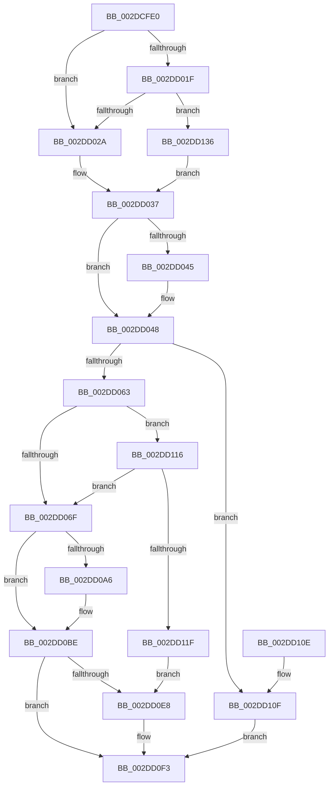

# KiSetIdealProcessorThread

- RVA: `0x002DCFE0`–`0x002DD148` (길이 `360` bytes)
- VA: `0x00000001402DCFE0`
- 실행 섹션: `.text`
- PDB 이름 있음: `예`; PDB Function 태그: `아니요`
- unwind 정보 RVA: `0x000707C4`
- 디코드: `93`개 명령, `360/360` bytes 표시
- 미해석 바이트: `0` (있으면 어셈블리에 `.byte`로 보존)

> 이 문서는 커널 이미지의 기계어와 PDB 기호를 분석해 생성했습니다. 4번과 5번은 함수 원형과 자료형을 바이너리 사용 방식에서 추정한 C 해석이며 원본 소스 복구 결과는 아닙니다.

## 1. Dependencies

- 직접 호출 지점: **5**; 고유 호출 대상: **5**
- 직접 호출자로 확인된 함수: **2**
- RIP 상대 이미지 참조: **1**

### Outgoing calls
- `0x002DD056` → [KiCheckPrcbAffinityEx](../43/KiCheckPrcbAffinityEx_function_004366A0.md) (function, `0x004366A0`)
- `0x002DD087` → [KiAcquireThreadStateLockForWrite](../30/KiAcquireThreadStateLockForWrite_function_0030E8C0.md) (function, `0x0030E8C0`)
- `0x002DD0C4` → [KiUpdateSharedReadyQueueAffinityThread](../2C/KiUpdateSharedReadyQueueAffinityThread_function_002CE470.md) (function, `0x002CE470`)
- `0x002DD0DE` → [KiReleaseThreadStateLock](../21/KiReleaseThreadStateLock_function_00217910.md) (function, `0x00217910`)
- `0x002DD0EE` → [KiQueueTebUpdateApc](../2C/KiQueueTebUpdateApc_function_002CE3F4.md) (function, `0x002CE3F4`)

### Direct callers
- [KeSetIdealProcessorThreadEx](KeSetIdealProcessorThreadEx_function_002DD36C.md) at `0x002DD3C8`
- [sub_006FAFDA](../6F/Unknown_function_006FAFDA.md) at `0x006FB044`

### Static image references
- `0x002DD048` → RVA `0x00FC8C40` (`ALMOSTRO`; read)

## 2. Other-region calls and transfers

- 다른 실행 섹션으로 향하는 call: **0**
- 별도 외부 분기/꼬리 이동을 확인하지 못했습니다.

## 3. Assembly (complete function range)

```asm
002DCFE0  48 89 5C 24 08                  mov qword ptr [rsp + 8], rbx
002DCFE5  48 89 74 24 10                  mov qword ptr [rsp + 0x10], rsi
002DCFEA  55                              push rbp
002DCFEB  57                              push rdi
002DCFEC  41 54                           push r12
002DCFEE  41 56                           push r14
002DCFF0  41 57                           push r15
002DCFF2  48 8B EC                        mov rbp, rsp
002DCFF5  48 83 EC 50                     sub rsp, 0x50
002DCFF9  33 FF                           xor edi, edi
002DCFFB  44 8B F2                        mov r14d, edx
002DCFFE  48 89 7D E8                     mov qword ptr [rbp - 0x18], rdi
002DD002  0F 57 C0                        xorps xmm0, xmm0
002DD005  48 89 7D 48                     mov qword ptr [rbp + 0x48], rdi
002DD009  45 8A F8                        mov r15b, r8b
002DD00C  48 89 7D E0                     mov qword ptr [rbp - 0x20], rdi
002DD010  48 8B D9                        mov rbx, rcx
002DD013  44 8A E7                        mov r12b, dil
002DD016  0F 11 45 F0                     movups xmmword ptr [rbp - 0x10], xmm0
002DD01A  45 84 C0                        test r8b, r8b
002DD01D  75 0B                           jne 0x1402dd02a
002DD01F  8B 41 74                        mov eax, dword ptr [rcx + 0x74]
002DD022  A8 08                           test al, 8
002DD024  0F 85 0C 01 00 00               jne 0x1402dd136
002DD02A  8B 83 4C 02 00 00               mov eax, dword ptr [rbx + 0x24c]
002DD030  48 8B 89 40 02 00 00            mov rcx, qword ptr [rcx + 0x240]
002DD037  4C 8B D3                        mov r10, rbx
002DD03A  41 B8 74 00 00 00               mov r8d, 0x74
002DD040  4D 85 C9                        test r9, r9
002DD043  74 03                           je 0x1402dd048
002DD045  41 89 01                        mov dword ptr [r9], eax
002DD048  48 8D 35 F1 BB CE 00            lea rsi, [rip + 0xcebbf1]
002DD04F  4A 8B 34 F6                     mov rsi, qword ptr [rsi + r14*8]
002DD053  48 8B D6                        mov rdx, rsi
002DD056  E8 45 96 15 00                  call 0x1404366a0
002DD05B  84 C0                           test al, al
002DD05D  0F 84 AC 00 00 00               je 0x1402dd10f
002DD063  43 8B 04 10                     mov eax, dword ptr [r8 + r10]
002DD067  A8 08                           test al, 8
002DD069  0F 85 A7 00 00 00               jne 0x1402dd116
002DD06F  48 8D 45 F0                     lea rax, [rbp - 0x10]
002DD073  48 8B CB                        mov rcx, rbx
002DD076  4C 8D 4D 48                     lea r9, [rbp + 0x48]
002DD07A  48 89 44 24 20                  mov qword ptr [rsp + 0x20], rax
002DD07F  4C 8D 45 E0                     lea r8, [rbp - 0x20]
002DD083  48 8D 55 E8                     lea rdx, [rbp - 0x18]
002DD087  E8 34 18 03 00                  call 0x14030e8c0
002DD08C  44 89 B3 4C 02 00 00            mov dword ptr [rbx + 0x24c], r14d
002DD093  0F B6 86 D0 00 00 00            movzx eax, byte ptr [rsi + 0xd0]
002DD09A  66 89 83 48 02 00 00            mov word ptr [rbx + 0x248], ax
002DD0A1  45 84 FF                        test r15b, r15b
002DD0A4  75 18                           jne 0x1402dd0be
002DD0A6  44 89 B3 C4 00 00 00            mov dword ptr [rbx + 0xc4], r14d
002DD0AD  41 B4 01                        mov r12b, 1
002DD0B0  0F B6 86 D0 00 00 00            movzx eax, byte ptr [rsi + 0xd0]
002DD0B7  66 89 83 30 02 00 00            mov word ptr [rbx + 0x230], ax
002DD0BE  48 8B D3                        mov rdx, rbx
002DD0C1  48 8B CE                        mov rcx, rsi
002DD0C4  E8 A7 13 FF FF                  call 0x1402ce470
002DD0C9  4C 8B 4D 48                     mov r9, qword ptr [rbp + 0x48]
002DD0CD  48 8D 55 F0                     lea rdx, [rbp - 0x10]
002DD0D1  48 89 54 24 20                  mov qword ptr [rsp + 0x20], rdx
002DD0D6  4C 8D 45 E0                     lea r8, [rbp - 0x20]
002DD0DA  48 8B 55 E8                     mov rdx, qword ptr [rbp - 0x18]
002DD0DE  E8 2D A8 F3 FF                  call 0x140217910
002DD0E3  45 84 E4                        test r12b, r12b
002DD0E6  74 0B                           je 0x1402dd0f3
002DD0E8  8A 55 50                        mov dl, byte ptr [rbp + 0x50]
002DD0EB  48 8B CB                        mov rcx, rbx
002DD0EE  E8 01 13 FF FF                  call 0x1402ce3f4
002DD0F3  4C 8D 5C 24 50                  lea r11, [rsp + 0x50]
002DD0F8  8B C7                           mov eax, edi
002DD0FA  49 8B 5B 30                     mov rbx, qword ptr [r11 + 0x30]
002DD0FE  49 8B 73 38                     mov rsi, qword ptr [r11 + 0x38]
002DD102  49 8B E3                        mov rsp, r11
002DD105  41 5F                           pop r15
002DD107  41 5E                           pop r14
002DD109  41 5C                           pop r12
002DD10B  5F                              pop rdi
002DD10C  5D                              pop rbp
002DD10D  C3                              ret
002DD10E  CC                              int3
002DD10F  BF 01 00 00 C0                  mov edi, 0xc0000001
002DD114  EB DD                           jmp 0x1402dd0f3
002DD116  45 84 FF                        test r15b, r15b
002DD119  0F 85 50 FF FF FF               jne 0x1402dd06f
002DD11F  44 89 B3 C4 00 00 00            mov dword ptr [rbx + 0xc4], r14d
002DD126  0F B6 86 D0 00 00 00            movzx eax, byte ptr [rsi + 0xd0]
002DD12D  66 89 83 30 02 00 00            mov word ptr [rbx + 0x230], ax
002DD134  EB B2                           jmp 0x1402dd0e8
002DD136  48 8B 89 28 02 00 00            mov rcx, qword ptr [rcx + 0x228]
002DD13D  8B 83 C4 00 00 00               mov eax, dword ptr [rbx + 0xc4]
002DD143  E9 EF FE FF FF                  jmp 0x1402dd037
```

## 4. C-style interpretation (structured pseudocode)

```c
__int64 __fastcall KiSetIdealProcessorThread(__int64 a1, int a2, unsigned __int8 a3, __int64 a4, unsigned __int8 a5)
{
    __int64 result;
    __int64 v_r12;
    __int64 v_rdi;
    __int64 v_rsp;
    unsigned __int64 v_stack_m28;
    unsigned __int64 v_stack_m38;
    unsigned __int64 v_stack_m40;
    unsigned __int64 v_stack_m48;
    unsigned __int64 v_stack_m58;
    unsigned __int64 v_stack_p10;
    unsigned __int64 v_stack_p20;
    unsigned __int64 v_stack_p8;

    v_stack_p8 = v_rbx;
    v_stack_p10 = v_rsi;
    v_rsp = (v_rsp) - (80);
    v_rdi = 0;
    v_stack_m40 = 0;
    v_stack_p20 = 0;
    v_stack_m48 = 0;
    v_stack_m38 = v_xmm0;
    if (a3 != 0) goto loc_002DD02A;
    if ((((unsigned __int8)((unsigned int)(*(unsigned int *)(a1 + 116)))) & (8)) != 0) goto loc_002DD136;
loc_002DD02A:
loc_002DD037:
    if (a4 != 0) {
        *(unsigned int *)(a4) = (unsigned int)((unsigned int)(*(unsigned int *)(a1 + 588)));
    }
    result = KiCheckPrcbAffinityEx(*(unsigned __int64 *)(a1 + 576), *(unsigned __int64 *)(v_rip + 13548529 + (unsigned int)(a2) * 8), 116, a4);
    if ((unsigned __int8)(result) == 0) goto loc_002DD10F;
    if ((((unsigned __int8)((unsigned int)(*(unsigned int *)(116 + a1 * 1)))) & (8)) != 0) goto loc_002DD116;
loc_002DD06F:
    v_stack_m58 = v_stack_m38;
    result = KiAcquireThreadStateLockForWrite(a1, v_stack_m40, v_stack_m48, v_stack_p20);
    *(unsigned int *)(a1 + 588) = (unsigned int)((unsigned int)(a2));
    *(unsigned __int16 *)(a1 + 584) = (unsigned __int16)(*(unsigned __int8 *)(*(unsigned __int64 *)(v_rip + 13548529 + (unsigned int)(a2) * 8) + 208));
    result = *(unsigned __int8 *)(*(unsigned __int64 *)(v_rip + 13548529 + (unsigned int)(a2) * 8) + 208);
    v_r12 = 0;
    if (a3 == 0) {
        *(unsigned int *)(a1 + 196) = (unsigned int)((unsigned int)(a2));
        v_r12 = 1;
        result = *(unsigned __int8 *)(*(unsigned __int64 *)(v_rip + 13548529 + (unsigned int)(a2) * 8) + 208);
        *(unsigned __int16 *)(a1 + 560) = (unsigned __int16)(result);
    }
    result = KiUpdateSharedReadyQueueAffinityThread(*(unsigned __int64 *)(v_rip + 13548529 + (unsigned int)(a2) * 8), a1, v_stack_m48, v_stack_p20);
    v_stack_m58 = v_stack_m38;
    result = KiReleaseThreadStateLock(*(unsigned __int64 *)(v_rip + 13548529 + (unsigned int)(a2) * 8), v_stack_m40, v_stack_m48, v_stack_p20);
    if ((unsigned __int8)(v_r12) != 0) {
        a2 = a5;
        a1 = a1;
        result = KiQueueTebUpdateApc(a1, a2, v_stack_m48, v_stack_p20);
    }
    return 0;
loc_002DD10F:
    goto loc_002DD0F3;
loc_002DD116:
    if (a3 != 0) goto loc_002DD06F;
    *(unsigned int *)(*(unsigned __int64 *)(v_stack_m28 + 48) + 196) = (unsigned int)((unsigned int)(a2));
    *(unsigned __int16 *)(*(unsigned __int64 *)(v_stack_m28 + 48) + 560) = (unsigned __int16)(*(unsigned __int8 *)(*(unsigned __int64 *)(v_stack_m28 + 56) + 208));
    goto loc_002DD0E8;
loc_002DD136:
    goto loc_002DD037;
}
```

## 5. (Beta) C Style

```c
int64_t KiSetIdealProcessorThread(void *Arg1, int32_t Arg2, uint8_t Arg3, int64_t Arg4, uint8_t Arg5)
{
    uint8_t *arg1 = (uint8_t *)Arg1;

    int64_t result;
    int64_t local_r12;
    int64_t local_rdi;
    int64_t local_rsp;
    uint64_t v_stack_m28;
    uint64_t v_stack_m38;
    uint64_t v_stack_m40;
    uint64_t v_stack_m48;
    uint64_t v_stack_m58;
    uint64_t v_stack_p10;
    uint64_t v_stack_p20;
    uint64_t v_stack_p8;

    v_stack_p8 = local_rbx;
    v_stack_p10 = local_rsi;
    local_rsp = (local_rsp) - (80);
    local_rdi = 0;
    v_stack_m40 = 0;
    v_stack_p20 = 0;
    v_stack_m48 = 0;
    v_stack_m38 = v_xmm0;
    if (Arg3 != 0) goto loc_002DD02A;
    if ((((uint8_t)((uint32_t)(*(uint32_t *)(arg1 + 0x74)))) & (8)) != 0) goto loc_002DD136;
loc_002DD02A:
loc_002DD037:
    if (Arg4 != 0) {
        *(uint32_t *)(Arg4) = (uint32_t)((uint32_t)(*(uint32_t *)(arg1 + 0x24C)));
    }
    result = KiCheckPrcbAffinityEx(*(uint64_t *)(arg1 + 0x240), *(uint64_t *)(v_rip + 0xCEBBF1 + (uint32_t)(Arg2) * 8), 116, Arg4);
    if ((uint8_t)(result) == 0) goto loc_002DD10F;
    if ((((uint8_t)((uint32_t)(*(uint32_t *)(116 + arg1 * 1)))) & (8)) != 0) goto loc_002DD116;
loc_002DD06F:
    v_stack_m58 = v_stack_m38;
    result = KiAcquireThreadStateLockForWrite(Arg1, v_stack_m40, v_stack_m48, v_stack_p20);
    *(uint32_t *)(arg1 + 0x24C) = (uint32_t)((uint32_t)(Arg2));
    *(uint16_t *)(arg1 + 0x248) = (uint16_t)(*(uint8_t *)(*(uint64_t *)(v_rip + 0xCEBBF1 + (uint32_t)(Arg2) * 8) + 0xD0));
    result = *(uint8_t *)(*(uint64_t *)(v_rip + 0xCEBBF1 + (uint32_t)(Arg2) * 8) + 0xD0);
    local_r12 = 0;
    if (Arg3 == 0) {
        *(uint32_t *)(arg1 + 0xC4) = (uint32_t)((uint32_t)(Arg2));
        local_r12 = 1;
        result = *(uint8_t *)(*(uint64_t *)(v_rip + 0xCEBBF1 + (uint32_t)(Arg2) * 8) + 0xD0);
        *(uint16_t *)(arg1 + 0x230) = (uint16_t)(result);
    }
    result = KiUpdateSharedReadyQueueAffinityThread(*(uint64_t *)(v_rip + 0xCEBBF1 + (uint32_t)(Arg2) * 8), Arg1, v_stack_m48, v_stack_p20);
    v_stack_m58 = v_stack_m38;
    result = KiReleaseThreadStateLock(*(uint64_t *)(v_rip + 0xCEBBF1 + (uint32_t)(Arg2) * 8), v_stack_m40, v_stack_m48, v_stack_p20);
    if ((uint8_t)(local_r12) != 0) {
        Arg2 = Arg5;
        Arg1 = Arg1;
        result = KiQueueTebUpdateApc(Arg1, Arg2, v_stack_m48, v_stack_p20);
    }
    return 0;
loc_002DD10F:
    goto loc_002DD0F3;
loc_002DD116:
    if (Arg3 != 0) goto loc_002DD06F;
    *(uint32_t *)(*(uint64_t *)(v_stack_m28 + 0x30) + 0xC4) = (uint32_t)((uint32_t)(Arg2));
    *(uint16_t *)(*(uint64_t *)(v_stack_m28 + 0x30) + 0x230) = (uint16_t)(*(uint8_t *)(*(uint64_t *)(v_stack_m28 + 0x38) + 0xD0));
    goto loc_002DD0E8;
loc_002DD136:
    goto loc_002DD037;
}
```

### 관측된 메모리 오프셋

구조체 형식이 확인되지 않은 접근은 인자 기준의 오프셋으로만 기록했습니다.

| 기준 인자 | 오프셋 표현 | 폭 (bit) | 접근 |
|---|---:|---:|---|
| `Arg1` | `+ 0x74` | `32` | `R` |
| `Arg1` | `+ 0xC4` | `32` | `R` |
| `Arg1` | `+ 0xC4` | `32` | `W` |
| `Arg1` | `+ 0x228` | `64` | `R` |
| `Arg1` | `+ 0x230` | `16` | `W` |
| `Arg1` | `+ 0x240` | `64` | `R` |
| `Arg1` | `+ 0x248` | `16` | `W` |
| `Arg1` | `+ 0x24C` | `32` | `R` |
| `Arg1` | `+ 0x24C` | `32` | `W` |

## 6. Execution-region graph

[열기: 2D/3D 그래프와 함수 탐색 컨트롤 패널](../../../control-panel.html?section=text&rva=0x002DCFE0&view=graph)

- 2D 그래프는 위에서 아래로 흐르고, 3D 그래프는 빈 공간을 드래그해 회전합니다. Shift+드래그는 이동, 휠은 확대·축소, 함수 노드 선택은 대상 보고서 이동입니다.

### Static fallback


