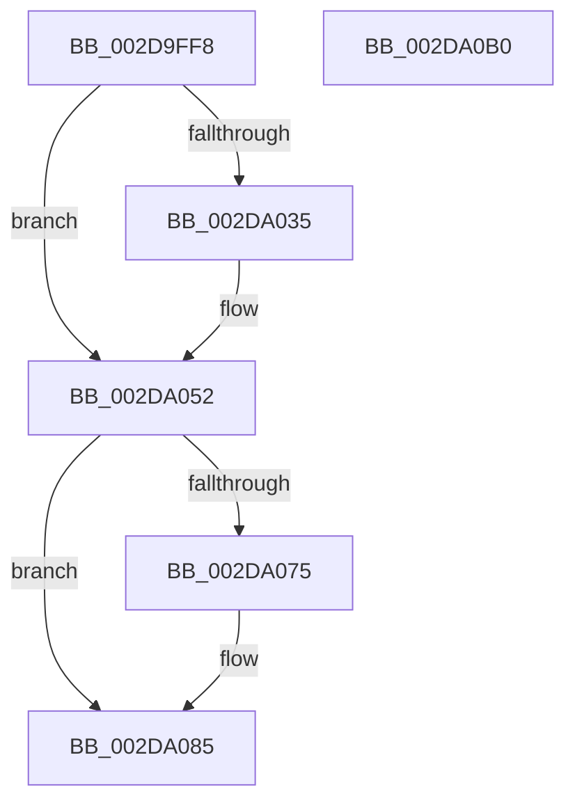

# KiSetSystemPriorityThread

- RVA: `0x002D9FF8`–`0x002DA0B1` (길이 `185` bytes)
- VA: `0x00000001402D9FF8`
- 실행 섹션: `.text`
- PDB 이름 있음: `예`; PDB Function 태그: `아니요`
- unwind 정보 RVA: `0x000704AC`
- 디코드: `46`개 명령, `185/185` bytes 표시
- 미해석 바이트: `0` (있으면 어셈블리에 `.byte`로 보존)

> 이 문서는 커널 이미지의 기계어와 PDB 기호를 분석해 생성했습니다. 4번과 5번은 함수 원형과 자료형을 바이너리 사용 방식에서 추정한 C 해석이며 원본 소스 복구 결과는 아닙니다.

## 1. Dependencies

- 직접 호출 지점: **4**; 고유 호출 대상: **4**
- 직접 호출자로 확인된 함수: **8**
- RIP 상대 이미지 참조: **0**

### Outgoing calls
- `0x002DA022` → [KiAcquireThreadLockRaiseToDpc](../39/KiAcquireThreadLockRaiseToDpc_function_00396280.md) (function, `0x00396280`)
- `0x002DA04C` → [KeBugCheckEx](../4F/KeBugCheckEx_function_004FD660.md) (function, `0x004FD660`)
- `0x002DA080` → [KiSetPriorityThread](../22/KiSetPriorityThread_function_00220E78.md) (function, `0x00220E78`)
- `0x002DA0A0` → [KiProcessDeferredReadyList](../25/KiProcessDeferredReadyList_function_00250800.md) (function, `0x00250800`)

### Direct callers
- [PopFxIdleComponent](../2C/PopFxIdleComponent_function_002C01D8.md) at `0x002C0300`
- [KeDisconnectInterrupt](KeDisconnectInterrupt_function_002D3588.md) at `0x002D35DC`
- [KeConnectInterrupt](KeConnectInterrupt_function_002D3D5C.md) at `0x002D3DAE`
- [PpmAcquireLock](PpmAcquireLock_function_002D9AA4.md) at `0x002D9ACC`
- [PopFxActivateComponent](PopFxActivateComponent_function_002D9DBC.md) at `0x002D9E97`
- [MiReplenishSlabAllocator](../37/MiReplenishSlabAllocator_function_003788E4.md) at `0x00378A8C`
- [PpmTryAcquireLock](../3B/PpmTryAcquireLock_function_003BEB9C.md) at `0x003BEBCA`
- [MiDemoteSlabEntries](../4D/MiDemoteSlabEntries_function_004D89A0.md) at `0x004D89E4`

### Static image references
- 디코드된 RIP-relative 메모리 참조가 없습니다.

## 2. Other-region calls and transfers

- 다른 실행 섹션으로 향하는 call: **0**
- 별도 외부 분기/꼬리 이동을 확인하지 못했습니다.

## 3. Assembly (complete function range)

```asm
002D9FF8  48 8B C4                        mov rax, rsp
002D9FFB  48 89 58 10                     mov qword ptr [rax + 0x10], rbx
002D9FFF  44 89 40 18                     mov dword ptr [rax + 0x18], r8d
002DA003  57                              push rdi
002DA004  48 83 EC 30                     sub rsp, 0x30
002DA008  BF 1F 00 00 00                  mov edi, 0x1f
002DA00D  C6 40 18 00                     mov byte ptr [rax + 0x18], 0
002DA011  3B D7                           cmp edx, edi
002DA013  48 8B D9                        mov rbx, rcx
002DA016  0F 4E FA                        cmovle edi, edx
002DA019  48 83 60 08 00                  and qword ptr [rax + 8], 0
002DA01E  48 8D 50 18                     lea rdx, [rax + 0x18]
002DA022  E8 59 C2 0B 00                  call 0x140396280
002DA027  48 63 CF                        movsxd rcx, edi
002DA02A  8A 84 19 38 03 00 00            mov al, byte ptr [rcx + rbx + 0x338]
002DA031  3C FF                           cmp al, 0xff
002DA033  75 1D                           jne 0x1402da052
002DA035  48 83 64 24 20 00               and qword ptr [rsp + 0x20], 0
002DA03B  4C 8B C1                        mov r8, rcx
002DA03E  B9 57 01 00 00                  mov ecx, 0x157
002DA043  41 B9 01 00 00 00               mov r9d, 1
002DA049  48 8B D3                        mov rdx, rbx
002DA04C  E8 0F 36 22 00                  call 0x1404fd660
002DA051  CC                              int3
002DA052  FE C0                           inc al
002DA054  88 84 19 38 03 00 00            mov byte ptr [rcx + rbx + 0x338], al
002DA05B  8B 83 58 03 00 00               mov eax, dword ptr [rbx + 0x358]
002DA061  0F AB F8                        bts eax, edi
002DA064  89 83 58 03 00 00               mov dword ptr [rbx + 0x358], eax
002DA06A  0F BE 83 C3 00 00 00            movsx eax, byte ptr [rbx + 0xc3]
002DA071  3B C7                           cmp eax, edi
002DA073  7D 10                           jge 0x1402da085
002DA075  44 8B C7                        mov r8d, edi
002DA078  48 8D 54 24 40                  lea rdx, [rsp + 0x40]
002DA07D  48 8B CB                        mov rcx, rbx
002DA080  E8 F3 6D F4 FF                  call 0x140220e78
002DA085  48 C7 43 40 00 00 00 00         mov qword ptr [rbx + 0x40], 0
002DA08D  48 8D 54 24 40                  lea rdx, [rsp + 0x40]
002DA092  65 48 8B 0C 25 20 00 00 00      mov rcx, qword ptr gs:[0x20]
002DA09B  44 8A 44 24 50                  mov r8b, byte ptr [rsp + 0x50]
002DA0A0  E8 5B 67 F7 FF                  call 0x140250800
002DA0A5  48 8B 5C 24 48                  mov rbx, qword ptr [rsp + 0x48]
002DA0AA  48 83 C4 30                     add rsp, 0x30
002DA0AE  5F                              pop rdi
002DA0AF  C3                              ret
002DA0B0  CC                              int3
```

## 4. C-style interpretation (structured pseudocode)

```c
__int64 __fastcall KiSetSystemPriorityThread(__int64 a1, int a2, int a3)
{
    __int64 result;
    __int64 v_rdi;
    __int64 v_rsp;
    unsigned __int64 v_stack_m18;
    unsigned __int64 v_stack_p10;
    unsigned __int8 v_stack_p18;
    unsigned __int64 v_stack_p8;

    *(unsigned __int64 *)(v_rsp + 16) = v_rbx;
    *(unsigned int *)(v_rsp + 24) = a3;
    v_rsp = (v_rsp) - (48);
    *(unsigned __int8 *)(v_rsp + 24) = 0;
    v_rdi = 31;
    if (a2 <= 31) { v_rdi = a2; }
    result = KiAcquireThreadLockRaiseToDpc(a1, v_rsp + 24, a3, a4);
    result = *(unsigned __int8 *)((int)((unsigned int)(v_rdi)) + a1 * 1 + 824);
    if (((unsigned __int8)(*(unsigned __int8 *)((int)((unsigned int)(v_rdi)) + a1 * 1 + 824))) == 255) {
        a3 = (int)((unsigned int)(v_rdi));
        a1 = 343;
        a4 = 1;
        a2 = a1;
        result = KeBugCheckEx(a1, a2, a3, a4);
    }
    result = (unsigned __int8)((result) + 1);
    *(unsigned __int8 *)(a1 + a1 * 1 + 824) = (unsigned __int8)(result);
    *(unsigned int *)(a1 + 856) = (unsigned int)((unsigned int)(*(unsigned int *)(a1 + 856)));
    result = (__int8)(*(unsigned __int8 *)(a1 + 195));
    if (((unsigned int)((__int8)(*(unsigned __int8 *)(a1 + 195)))) < ((unsigned int)(v_rdi))) {
        a3 = (unsigned int)(v_rdi);
        a2 = v_stack_p8;
        a1 = a1;
        result = KiSetPriorityThread(a1, a2, a3, a4);
    }
    *(unsigned __int64 *)(a1 + 64) = 0;
    result = KiProcessDeferredReadyList(*(unsigned __int64 *)(gs_base + (0 + 32)), v_stack_p8, v_stack_p18, a4);
    v_rsp = (v_rsp) + (48);
    return result;
}
```

## 5. (Beta) C Style

```c
int64_t KiSetSystemPriorityThread(void *Arg1, int32_t Arg2, int32_t Arg3)
{
    uint8_t *arg1 = (uint8_t *)Arg1;

    int64_t result;
    int64_t local_rdi;
    int64_t local_rsp;
    uint64_t v_stack_m18;
    uint64_t v_stack_p10;
    uint8_t v_stack_p18;
    uint64_t v_stack_p8;

    *(uint64_t *)(local_rsp + 0x10) = local_rbx;
    *(uint32_t *)(local_rsp + 0x18) = Arg3;
    local_rsp = (local_rsp) - (48);
    *(uint8_t *)(local_rsp + 0x18) = 0;
    local_rdi = 31;
    if (Arg2 <= 31) { local_rdi = Arg2; }
    result = KiAcquireThreadLockRaiseToDpc(Arg1, local_rsp + 24, Arg3, a4);
    result = *(uint8_t *)((int32_t)((uint32_t)(local_rdi)) + arg1 * 1 + 0x338);
    if (((uint8_t)(*(uint8_t *)((int32_t)((uint32_t)(local_rdi)) + arg1 * 1 + 0x338))) == 255) {
        Arg3 = (int32_t)((uint32_t)(local_rdi));
        Arg1 = 343;
        a4 = 1;
        Arg2 = Arg1;
        result = KeBugCheckEx(Arg1, Arg2, Arg3, a4);
    }
    result = (uint8_t)((result) + 1);
    *(uint8_t *)(arg1 + arg1 * 1 + 0x338) = (uint8_t)(result);
    *(uint32_t *)(arg1 + 0x358) = (uint32_t)((uint32_t)(*(uint32_t *)(arg1 + 0x358)));
    result = (int8_t)(*(uint8_t *)(arg1 + 0xC3));
    if (((uint32_t)((int8_t)(*(uint8_t *)(arg1 + 0xC3)))) < ((uint32_t)(local_rdi))) {
        Arg3 = (uint32_t)(local_rdi);
        Arg2 = v_stack_p8;
        Arg1 = Arg1;
        result = KiSetPriorityThread(Arg1, Arg2, Arg3, a4);
    }
    *(uint64_t *)(arg1 + 0x40) = 0;
    result = KiProcessDeferredReadyList(*(uint64_t *)(gs_base + (0 + 0x20)), v_stack_p8, v_stack_p18, a4);
    local_rsp = (local_rsp) + (48);
    return result;
}
```

### 관측된 메모리 오프셋

구조체 형식이 확인되지 않은 접근은 인자 기준의 오프셋으로만 기록했습니다.

| 기준 인자 | 오프셋 표현 | 폭 (bit) | 접근 |
|---|---:|---:|---|
| `Arg1` | `+ 0x40` | `64` | `W` |
| `Arg1` | `+ 0xC3` | `8` | `R` |
| `Arg1` | `+ 0x358` | `32` | `R` |
| `Arg1` | `+ 0x358` | `32` | `W` |

## 6. Execution-region graph

[열기: 2D/3D 그래프와 함수 탐색 컨트롤 패널](../../../control-panel.html?section=text&rva=0x002D9FF8&view=graph)

- 2D 그래프는 위에서 아래로 흐르고, 3D 그래프는 빈 공간을 드래그해 회전합니다. Shift+드래그는 이동, 휠은 확대·축소, 함수 노드 선택은 대상 보고서 이동입니다.

### Static fallback


