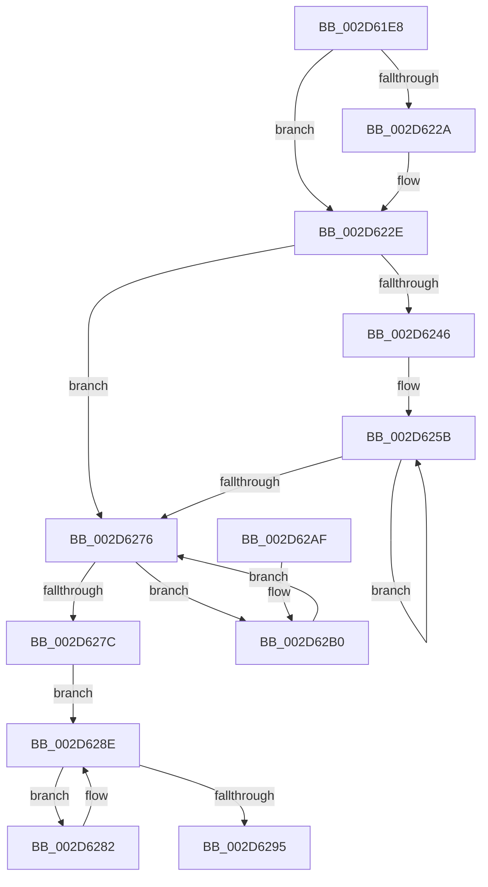

# KiSubtractAffinityEx

- RVA: `0x002D61E8`–`0x002D62CA` (길이 `226` bytes)
- VA: `0x00000001402D61E8`
- 실행 섹션: `.text`
- PDB 이름 있음: `예`; PDB Function 태그: `아니요`
- unwind 정보 RVA: `0x0006FD68`
- 디코드: `64`개 명령, `226/226` bytes 표시
- 미해석 바이트: `0` (있으면 어셈블리에 `.byte`로 보존)

> 이 문서는 커널 이미지의 기계어와 PDB 기호를 분석해 생성했습니다. 4번과 5번은 함수 원형과 자료형을 바이너리 사용 방식에서 추정한 C 해석이며 원본 소스 복구 결과는 아닙니다.

## 1. Dependencies

- 직접 호출 지점: **0**; 고유 호출 대상: **0**
- 직접 호출자로 확인된 함수: **17**
- RIP 상대 이미지 참조: **0**

### Outgoing calls
- 직접 디코드된 call 명령이 없습니다.

### Direct callers
- [PpmIdleSelectStates](../2C/PpmIdleSelectStates_function_002CFFE8.md) at `0x002D0564`
- [KeSubtractAffinityEx2](KeSubtractAffinityEx2_function_002D5BA0.md) at `0x002D5BAE`
- [PpmParkReportUnparkedCores](PpmParkReportUnparkedCores_function_002D5BD0.md) at `0x002D5C0C`
- [PpmParkReportParkedCores](PpmParkReportParkedCores_function_002D5CB0.md) at `0x002D5E0D`
- [sub_002D6584](Unknown_function_002D6584.md) at `0x002D69E8`
- [PpmCheckContinueExecution](PpmCheckContinueExecution_function_002D836C.md) at `0x002D8462`
- [PpmIdleUpdateSystemLatencyLimit](PpmIdleUpdateSystemLatencyLimit_function_002D9204.md) at `0x002D92C9`
- [PpmIdleUpdateSystemLatencyLimit](PpmIdleUpdateSystemLatencyLimit_function_002D9204.md) at `0x002D939E`
- [KiIpiSendRequest](../31/KiIpiSendRequest_function_003113C0.md) at `0x0031196E`
- [PpmHeteroDistributeUtilityEx](../4E/PpmHeteroDistributeUtilityEx_function_004EFC00.md) at `0x004EFF6F`
- [PpmHeteroDistributeUtilityEx](../4E/PpmHeteroDistributeUtilityEx_function_004EFC00.md) at `0x004F00BD`
- [KeUpdateProcessorRestrictionsEx](../5B/KeUpdateProcessorRestrictionsEx_function_005B64E8.md) at `0x005B67D3`
- [KeSubtractAffinityEx](../5B/KeSubtractAffinityEx_function_005B9630.md) at `0x005B9646`
- [PpmHeteroHgsDetectContainmentPresence](../5D/PpmHeteroHgsDetectContainmentPresence_function_005D8768.md) at `0x005D89A5`
- [PpmHeteroComputeMultiClassUnparkCountEx](../5D/PpmHeteroComputeMultiClassUnparkCountEx_function_005DF584.md) at `0x005DF7E5`
- [PpmParkComputeUnparkMaskEx](../5E/PpmParkComputeUnparkMaskEx_function_005E05E0.md) at `0x005E11A1`
- [PpmParkComputeUnparkMaskEx](../5E/PpmParkComputeUnparkMaskEx_function_005E05E0.md) at `0x005E1237`
- [PpmPostProcessMediaBuffering](../../page/A5/PpmPostProcessMediaBuffering_function_00A53004.md) at `0x00A530B8`
- [PpmCheckInitProcessors](../../page/A8/PpmCheckInitProcessors_function_00A84AE8.md) at `0x00A84B97`
- [sub_00B3B096](../../page/B3/Unknown_function_00B3B096.md) at `0x00B3B0D6`

### Static image references
- 디코드된 RIP-relative 메모리 참조가 없습니다.

## 2. Other-region calls and transfers

- 다른 실행 섹션으로 향하는 call: **0**
- 별도 외부 분기/꼬리 이동을 확인하지 못했습니다.

## 3. Assembly (complete function range)

```asm
002D61E8  48 8B C4                        mov rax, rsp
002D61EB  48 89 58 08                     mov qword ptr [rax + 8], rbx
002D61EF  48 89 68 10                     mov qword ptr [rax + 0x10], rbp
002D61F3  48 89 70 18                     mov qword ptr [rax + 0x18], rsi
002D61F7  48 89 78 20                     mov qword ptr [rax + 0x20], rdi
002D61FB  41 56                           push r14
002D61FD  0F B7 02                        movzx eax, word ptr [rdx]
002D6200  48 8B FA                        mov rdi, rdx
002D6203  44 0F B7 19                     movzx r11d, word ptr [rcx]
002D6207  48 8B D9                        mov rbx, rcx
002D620A  66 44 3B D8                     cmp r11w, ax
002D620E  66 45 89 48 02                  mov word ptr [r8 + 2], r9w
002D6213  66 44 0F 43 D8                  cmovae r11w, ax
002D6218  0F B7 01                        movzx eax, word ptr [rcx]
002D621B  33 ED                           xor ebp, ebp
002D621D  66 41 89 00                     mov word ptr [r8], ax
002D6221  44 8B D5                        mov r10d, ebp
002D6224  66 41 3B C1                     cmp ax, r9w
002D6228  76 04                           jbe 0x1402d622e
002D622A  66 45 89 08                     mov word ptr [r8], r9w
002D622E  66 45 3B D9                     cmp r11w, r9w
002D6232  0F B7 D5                        movzx edx, bp
002D6235  41 BE 01 00 00 00               mov r14d, 1
002D623B  66 45 0F 47 D9                  cmova r11w, r9w
002D6240  66 41 3B EB                     cmp bp, r11w
002D6244  73 30                           jae 0x1402d6276
002D6246  48 83 C1 08                     add rcx, 8
002D624A  41 0F B7 F3                     movzx esi, r11w
002D624E  48 2B FB                        sub rdi, rbx
002D6251  4D 8B C8                        mov r9, r8
002D6254  4C 2B CB                        sub r9, rbx
002D6257  41 0F B7 D3                     movzx edx, r11w
002D625B  48 8B 04 0F                     mov rax, qword ptr [rdi + rcx]
002D625F  48 F7 D0                        not rax
002D6262  48 23 01                        and rax, qword ptr [rcx]
002D6265  49 89 04 09                     mov qword ptr [r9 + rcx], rax
002D6269  48 8D 49 08                     lea rcx, [rcx + 8]
002D626D  45 0F 45 D6                     cmovne r10d, r14d
002D6271  49 2B F6                        sub rsi, r14
002D6274  75 E5                           jne 0x1402d625b
002D6276  66 41 3B 10                     cmp dx, word ptr [r8]
002D627A  72 34                           jb 0x1402d62b0
002D627C  41 89 68 04                     mov dword ptr [r8 + 4], ebp
002D6280  EB 0C                           jmp 0x1402d628e
002D6282  0F B7 CA                        movzx ecx, dx
002D6285  66 41 03 D6                     add dx, r14w
002D6289  49 89 6C C8 08                  mov qword ptr [r8 + rcx*8 + 8], rbp
002D628E  66 41 3B 50 02                  cmp dx, word ptr [r8 + 2]
002D6293  72 ED                           jb 0x1402d6282
002D6295  48 8B 5C 24 10                  mov rbx, qword ptr [rsp + 0x10]
002D629A  41 8B C2                        mov eax, r10d
002D629D  48 8B 6C 24 18                  mov rbp, qword ptr [rsp + 0x18]
002D62A2  48 8B 74 24 20                  mov rsi, qword ptr [rsp + 0x20]
002D62A7  48 8B 7C 24 28                  mov rdi, qword ptr [rsp + 0x28]
002D62AC  41 5E                           pop r14
002D62AE  C3                              ret
002D62AF  CC                              int3
002D62B0  0F B7 C2                        movzx eax, dx
002D62B3  48 8B 4C C3 08                  mov rcx, qword ptr [rbx + rax*8 + 8]
002D62B8  48 85 C9                        test rcx, rcx
002D62BB  49 89 4C C0 08                  mov qword ptr [r8 + rax*8 + 8], rcx
002D62C0  45 0F 45 D6                     cmovne r10d, r14d
002D62C4  66 41 03 D6                     add dx, r14w
002D62C8  EB AC                           jmp 0x1402d6276
```

## 4. C-style interpretation (structured pseudocode)

```c
__int64 __fastcall KiSubtractAffinityEx(__int64 a1, __int64 a2, __int64 a3, unsigned __int16 a4)
{
    __int64 result;
    __int64 v_r10;
    __int64 v_r11;
    __int64 v_rbp;
    __int64 v_rdi;
    __int64 v_rsi;
    unsigned __int64 v_stack_p10;
    unsigned __int64 v_stack_p18;
    unsigned __int64 v_stack_p20;
    unsigned __int64 v_stack_p8;

    *(unsigned __int64 *)(v_rsp + 8) = v_rbx;
    *(unsigned __int64 *)(v_rsp + 16) = v_rbp;
    *(unsigned __int64 *)(v_rsp + 24) = v_rsi;
    *(unsigned __int64 *)(v_rsp + 32) = v_rdi;
    *(unsigned __int16 *)(a3 + 2) = a4;
    v_r11 = *(unsigned __int16 *)(a1);
    if (((unsigned __int16)(*(unsigned __int16 *)(a1))) >= ((unsigned __int16)(*(unsigned __int16 *)(a2)))) { v_r11 = (unsigned __int16)(*(unsigned __int16 *)(a2)); }
    v_rbp = 0;
    *(unsigned __int16 *)(a3) = (unsigned __int16)(*(unsigned __int16 *)(a1));
    if (((unsigned __int16)(*(unsigned __int16 *)(a1))) >= = a4) {
        *(unsigned __int16 *)(a3) = a4;
    }
    if (((unsigned __int16)(v_r11)) > a4) { v_r11 = a4; }
    if (0 >= ((unsigned __int16)(v_r11))) goto loc_002D6276;
    a1 = (a1) + (8);
    v_rdi = (a2) - (a1);
    a4 = (a3) - (a1);
loc_002D625B:
    result = ~(*(unsigned __int64 *)(v_rdi + a1 * 1));
    result = (result) & (*(unsigned __int64 *)(a1));
    *(unsigned __int64 *)(a4 + a1 * 1) = result;
    v_r10 = 0;
    if (condition_is_not_equal) { v_r10 = 1; }
    v_rsi = ((unsigned __int16)(v_r11)) - (1);
    if (condition_is_not_equal) goto loc_002D625B;
loc_002D6276:
    if (((unsigned __int16)((unsigned __int16)(v_r11))) < (*(unsigned __int16 *)(a3))) goto loc_002D62B0;
    *(unsigned int *)(a3 + 4) = 0;
    goto loc_002D628E;
loc_002D6282:
    a2 = (unsigned __int16)(((unsigned __int16)(v_r11)) + (1));
    *(unsigned __int64 *)(a3 + (unsigned __int16)((unsigned __int16)(v_r11)) * 8 + 8) = 0;
loc_002D628E:
    if (((unsigned __int16)(a2)) < (*(unsigned __int16 *)(a3 + 2))) goto loc_002D6282;
    return (unsigned int)((unsigned int)(v_r10));
loc_002D62B0:
    *(unsigned __int64 *)(a3 + (unsigned __int16)(a2) * 8 + 8) = *(unsigned __int64 *)(v_stack_p8 + (unsigned __int16)(a2) * 8 + 8);
    if (*(unsigned __int64 *)(v_stack_p8 + (unsigned __int16)(a2) * 8 + 8) != 0) { v_r10 = 1; }
    a2 = (unsigned __int16)((a2) + (1));
    goto loc_002D6276;
}
```

## 5. (Beta) C Style

```c
int64_t KiSubtractAffinityEx(void *Arg1, void *Arg2, void *Arg3, uint16_t Arg4)
{
    uint8_t *arg1 = (uint8_t *)Arg1;
    uint8_t *arg2 = (uint8_t *)Arg2;
    uint8_t *arg3 = (uint8_t *)Arg3;

    int64_t result;
    int64_t local_r10;
    int64_t local_r11;
    int64_t local_rbp;
    int64_t local_rdi;
    int64_t local_rsi;
    uint64_t v_stack_p10;
    uint64_t v_stack_p18;
    uint64_t v_stack_p20;
    uint64_t v_stack_p8;

    *(uint64_t *)(local_rsp + 0x8) = local_rbx;
    *(uint64_t *)(local_rsp + 0x10) = local_rbp;
    *(uint64_t *)(local_rsp + 0x18) = local_rsi;
    *(uint64_t *)(local_rsp + 0x20) = local_rdi;
    *(uint16_t *)(arg3 + 0x2) = Arg4;
    local_r11 = *(uint16_t *)(arg1);
    if (((uint16_t)(*(uint16_t *)(arg1))) >= ((uint16_t)(*(uint16_t *)(arg2)))) { local_r11 = (uint16_t)(*(uint16_t *)(arg2)); }
    local_rbp = 0;
    *(uint16_t *)(arg3) = (uint16_t)(*(uint16_t *)(arg1));
    if (((uint16_t)(*(uint16_t *)(arg1))) >= = Arg4) {
        *(uint16_t *)(arg3) = Arg4;
    }
    if (((uint16_t)(local_r11)) > Arg4) { local_r11 = Arg4; }
    if (0 >= ((uint16_t)(local_r11))) goto loc_002D6276;
    Arg1 = (Arg1) + (8);
    local_rdi = (Arg2) - (Arg1);
    Arg4 = (Arg3) - (Arg1);
loc_002D625B:
    result = ~(*(uint64_t *)(local_rdi + arg1 * 1));
    result = (result) & (*(uint64_t *)(arg1));
    *(uint64_t *)(Arg4 + arg1 * 1) = result;
    local_r10 = 0;
    if (condition_is_not_equal) { local_r10 = 1; }
    local_rsi = ((uint16_t)(local_r11)) - (1);
    if (condition_is_not_equal) goto loc_002D625B;
loc_002D6276:
    if (((uint16_t)((uint16_t)(local_r11))) < (*(uint16_t *)(arg3))) goto loc_002D62B0;
    *(uint32_t *)(arg3 + 0x4) = 0;
    goto loc_002D628E;
loc_002D6282:
    Arg2 = (uint16_t)(((uint16_t)(local_r11)) + (1));
    *(uint64_t *)(arg3 + (uint16_t)((uint16_t)(local_r11)) * 8 + 0x8) = 0;
loc_002D628E:
    if (((uint16_t)(Arg2)) < (*(uint16_t *)(arg3 + 0x2))) goto loc_002D6282;
    return (uint32_t)((uint32_t)(local_r10));
loc_002D62B0:
    *(uint64_t *)(arg3 + (uint16_t)(arg2) * 8 + 0x8) = *(uint64_t *)(v_stack_p8 + (uint16_t)(arg2) * 8 + 0x8);
    if (*(uint64_t *)(v_stack_p8 + (uint16_t)(arg2) * 8 + 0x8) != 0) { local_r10 = 1; }
    Arg2 = (uint16_t)((Arg2) + (1));
    goto loc_002D6276;
}
```

### 관측된 메모리 오프셋

구조체 형식이 확인되지 않은 접근은 인자 기준의 오프셋으로만 기록했습니다.

| 기준 인자 | 오프셋 표현 | 폭 (bit) | 접근 |
|---|---:|---:|---|
| `Arg1` | `+ 0x0` | `16` | `R` |
| `Arg1` | `+ 0x0` | `64` | `R` |
| `Arg1` | `+ 0x8` | `64` | `R` |
| `Arg1` | `+ 0x8 + rax*8` | `64` | `R` |
| `Arg2` | `+ 0x0` | `16` | `R` |
| `Arg2` | `+ 0x0 + rcx*1` | `64` | `R` |
| `Arg3` | `+ 0x0` | `16` | `R` |
| `Arg3` | `+ 0x0` | `16` | `W` |
| `Arg3` | `+ 0x0 + rcx*1` | `64` | `W` |
| `Arg3` | `+ 0x2` | `16` | `R` |
| `Arg3` | `+ 0x2` | `16` | `W` |
| `Arg3` | `+ 0x4` | `32` | `W` |
| `Arg3` | `+ 0x8 + rax*8` | `64` | `W` |
| `Arg3` | `+ 0x8 + rcx*8` | `64` | `W` |

## 6. Execution-region graph

[열기: 2D/3D 그래프와 함수 탐색 컨트롤 패널](../../../control-panel.html?section=text&rva=0x002D61E8&view=graph)

- 2D 그래프는 위에서 아래로 흐르고, 3D 그래프는 빈 공간을 드래그해 회전합니다. Shift+드래그는 이동, 휠은 확대·축소, 함수 노드 선택은 대상 보고서 이동입니다.

### Static fallback


