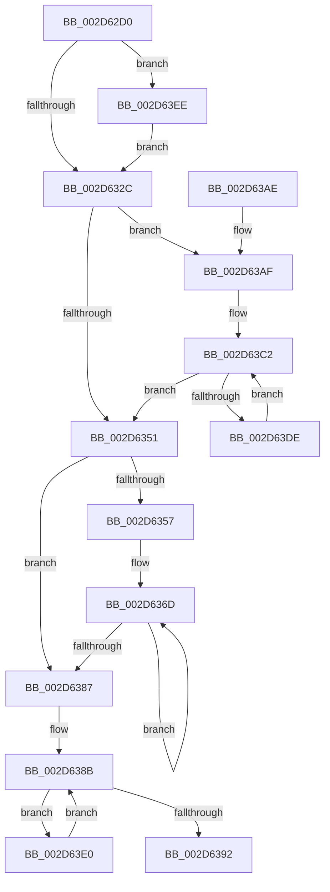

# KiXorAffinityEx

- RVA: `0x002D62D0`–`0x002D63F7` (길이 `295` bytes)
- VA: `0x00000001402D62D0`
- 실행 섹션: `.text`
- PDB 이름 있음: `예`; PDB Function 태그: `아니요`
- unwind 정보 RVA: `0x0006FD84`
- 디코드: `81`개 명령, `295/295` bytes 표시
- 미해석 바이트: `0` (있으면 어셈블리에 `.byte`로 보존)

> 이 문서는 커널 이미지의 기계어와 PDB 기호를 분석해 생성했습니다. 4번과 5번은 함수 원형과 자료형을 바이너리 사용 방식에서 추정한 C 해석이며 원본 소스 복구 결과는 아닙니다.

## 1. Dependencies

- 직접 호출 지점: **0**; 고유 호출 대상: **0**
- 직접 호출자로 확인된 함수: **4**
- RIP 상대 이미지 참조: **0**

### Outgoing calls
- 직접 디코드된 call 명령이 없습니다.

### Direct callers
- [KeXorAffinityEx2](KeXorAffinityEx2_function_002D5B70.md) at `0x002D5B7E`
- [PpmParkReportParkedCores](PpmParkReportParkedCores_function_002D5CB0.md) at `0x002D5E3F`
- [PpmParkReportParkedCores](PpmParkReportParkedCores_function_002D5CB0.md) at `0x002D5EE5`
- [PpmParkComputeDiff](../4A/PpmParkComputeDiff_function_004ADCAC.md) at `0x004ADD81`
- [PpmParkDistributeUtilityEx](../4F/PpmParkDistributeUtilityEx_function_004F020C.md) at `0x004F02F2`

### Static image references
- 디코드된 RIP-relative 메모리 참조가 없습니다.

## 2. Other-region calls and transfers

- 다른 실행 섹션으로 향하는 call: **0**
- 별도 외부 분기/꼬리 이동을 확인하지 못했습니다.

## 3. Assembly (complete function range)

```asm
002D62D0  48 8B C4                        mov rax, rsp
002D62D3  48 89 58 08                     mov qword ptr [rax + 8], rbx
002D62D7  48 89 68 10                     mov qword ptr [rax + 0x10], rbp
002D62DB  48 89 70 18                     mov qword ptr [rax + 0x18], rsi
002D62DF  48 89 78 20                     mov qword ptr [rax + 0x20], rdi
002D62E3  41 56                           push r14
002D62E5  41 57                           push r15
002D62E7  44 0F B7 11                     movzx r10d, word ptr [rcx]
002D62EB  48 8B FA                        mov rdi, rdx
002D62EE  0F B7 02                        movzx eax, word ptr [rdx]
002D62F1  48 8B F1                        mov rsi, rcx
002D62F4  66 44 3B D0                     cmp r10w, ax
002D62F8  45 0F B7 D9                     movzx r11d, r9w
002D62FC  0F B7 C8                        movzx ecx, ax
002D62FF  66 45 89 58 02                  mov word ptr [r8 + 2], r11w
002D6304  66 41 0F 43 CA                  cmovae cx, r10w
002D6309  41 0F B7 D2                     movzx edx, r10w
002D630D  66 0F 43 D0                     cmovae dx, ax
002D6311  66 41 89 08                     mov word ptr [r8], cx
002D6315  48 8B EF                        mov rbp, rdi
002D6318  48 0F 43 EE                     cmovae rbp, rsi
002D631C  45 33 FF                        xor r15d, r15d
002D631F  45 8B CF                        mov r9d, r15d
002D6322  66 41 3B CB                     cmp cx, r11w
002D6326  0F 87 C2 00 00 00               ja 0x1402d63ee
002D632C  66 41 3B D3                     cmp dx, r11w
002D6330  41 0F B7 C3                     movzx eax, r11w
002D6334  41 BE 01 00 00 00               mov r14d, 1
002D633A  66 0F 46 C2                     cmovbe ax, dx
002D633E  66 41 3B CB                     cmp cx, r11w
002D6342  41 0F B7 D7                     movzx edx, r15w
002D6346  66 44 0F 46 D9                  cmovbe r11w, cx
002D634B  66 44 3B F8                     cmp r15w, ax
002D634F  72 5E                           jb 0x1402d63af
002D6351  66 41 3B D3                     cmp dx, r11w
002D6355  73 30                           jae 0x1402d6387
002D6357  0F B7 CA                        movzx ecx, dx
002D635A  41 0F B7 C3                     movzx eax, r11w
002D635E  48 C1 E1 03                     shl rcx, 3
002D6362  66 2B C2                        sub ax, dx
002D6365  41 0F B7 D3                     movzx edx, r11w
002D6369  44 0F B7 D0                     movzx r10d, ax
002D636D  48 8B 44 29 08                  mov rax, qword ptr [rcx + rbp + 8]
002D6372  49 89 44 08 08                  mov qword ptr [r8 + rcx + 8], rax
002D6377  48 8D 49 08                     lea rcx, [rcx + 8]
002D637B  48 85 C0                        test rax, rax
002D637E  45 0F 45 CE                     cmovne r9d, r14d
002D6382  4D 2B D6                        sub r10, r14
002D6385  75 E6                           jne 0x1402d636d
002D6387  45 89 78 04                     mov dword ptr [r8 + 4], r15d
002D638B  66 41 3B 50 02                  cmp dx, word ptr [r8 + 2]
002D6390  72 4E                           jb 0x1402d63e0
002D6392  48 8B 5C 24 18                  mov rbx, qword ptr [rsp + 0x18]
002D6397  41 8B C1                        mov eax, r9d
002D639A  48 8B 6C 24 20                  mov rbp, qword ptr [rsp + 0x20]
002D639F  48 8B 74 24 28                  mov rsi, qword ptr [rsp + 0x28]
002D63A4  48 8B 7C 24 30                  mov rdi, qword ptr [rsp + 0x30]
002D63A9  41 5F                           pop r15
002D63AB  41 5E                           pop r14
002D63AD  C3                              ret
002D63AE  CC                              int3
002D63AF  48 2B F7                        sub rsi, rdi
002D63B2  4C 8D 57 08                     lea r10, [rdi + 8]
002D63B6  49 8B D8                        mov rbx, r8
002D63B9  0F B7 D0                        movzx edx, ax
002D63BC  48 2B DF                        sub rbx, rdi
002D63BF  0F B7 F8                        movzx edi, ax
002D63C2  4A 8B 0C 16                     mov rcx, qword ptr [rsi + r10]
002D63C6  49 33 0A                        xor rcx, qword ptr [r10]
002D63C9  4A 89 0C 13                     mov qword ptr [rbx + r10], rcx
002D63CD  4D 8D 52 08                     lea r10, [r10 + 8]
002D63D1  45 0F 45 CE                     cmovne r9d, r14d
002D63D5  49 2B FE                        sub rdi, r14
002D63D8  0F 84 73 FF FF FF               je 0x1402d6351
002D63DE  EB E2                           jmp 0x1402d63c2
002D63E0  0F B7 CA                        movzx ecx, dx
002D63E3  66 41 03 D6                     add dx, r14w
002D63E7  4D 89 7C C8 08                  mov qword ptr [r8 + rcx*8 + 8], r15
002D63EC  EB 9D                           jmp 0x1402d638b
002D63EE  66 45 89 18                     mov word ptr [r8], r11w
002D63F2  E9 35 FF FF FF                  jmp 0x1402d632c
```

## 4. C-style interpretation (structured pseudocode)

```c
__int64 __fastcall KiXorAffinityEx(__int64 a1, __int64 a2, __int64 a3, unsigned __int16 a4)
{
    __int64 result;
    __int64 v_r10;
    __int64 v_r15;
    __int64 v_rbx;
    __int64 v_rdi;
    __int64 v_rsi;
    unsigned __int64 v_stack_p10;
    unsigned __int64 v_stack_p18;
    unsigned __int64 v_stack_p20;
    unsigned __int64 v_stack_p8;

    *(unsigned __int64 *)(v_rsp + 8) = v_rbx;
    *(unsigned __int64 *)(v_rsp + 16) = v_rbp;
    *(unsigned __int64 *)(v_rsp + 24) = v_rsi;
    *(unsigned __int64 *)(v_rsp + 32) = v_rdi;
    *(unsigned __int16 *)(a3 + 2) = a4;
    a1 = (unsigned __int16)(*(unsigned __int16 *)(a2));
    if (((unsigned __int16)(*(unsigned __int16 *)(a1))) >= ((unsigned __int16)(*(unsigned __int16 *)(a2)))) { a1 = (unsigned __int16)(*(unsigned __int16 *)(a1)); }
    a2 = (unsigned __int16)(*(unsigned __int16 *)(a1));
    if (((unsigned __int16)(*(unsigned __int16 *)(a1))) >= ((unsigned __int16)(*(unsigned __int16 *)(a2)))) { a2 = (unsigned __int16)(*(unsigned __int16 *)(a2)); }
    *(unsigned __int16 *)(a3) = (unsigned __int16)(a1);
    if (((unsigned __int16)(*(unsigned __int16 *)(a1))) >= ((unsigned __int16)(*(unsigned __int16 *)(a2)))) { a2 = a1; }
    v_r15 = 0;
    if (((unsigned __int16)(a1)) > a4) goto loc_002D63EE;
loc_002D632C:
    if (((unsigned __int16)(a2)) <= a4) { a4 = (unsigned __int16)(a2); }
    if (((unsigned __int16)(a1)) <= a4) { a4 = (unsigned __int16)(a1); }
    if (0 < a4) goto loc_002D63AF;
loc_002D6351:
    if (0 >= a4) goto loc_002D6387;
    a1 = (0) << (3);
    result = (unsigned __int16)((a4) - (0));
loc_002D636D:
    *(unsigned __int64 *)(a3 + a1 * 1 + 8) = *(unsigned __int64 *)(a1 + a2 * 1 + 8);
    a4 = 0;
    if (*(unsigned __int64 *)(a1 + a2 * 1 + 8) != 0) { a4 = 1; }
    v_r10 = ((unsigned __int16)(result)) - (1);
    if (condition_is_not_equal) goto loc_002D636D;
loc_002D6387:
    *(unsigned int *)(a3 + 4) = 0;
loc_002D638B:
    if (a4 < (*(unsigned __int16 *)(a3 + 2))) goto loc_002D63E0;
    return (unsigned int)(a4);
loc_002D63AF:
    v_rsi = (v_stack_p18) - (v_stack_p20);
    v_rbx = (a3) - (v_stack_p20);
loc_002D63C2:
    a1 = (*(unsigned __int64 *)(v_rsi + v_stack_p20 + 8 * 1)) ^ (*(unsigned __int64 *)(v_stack_p20 + 8));
    *(unsigned __int64 *)(v_rbx + v_stack_p20 + 8 * 1) = a1;
    if (condition_is_not_equal) { a4 = 1; }
    v_rdi = ((unsigned __int16)((unsigned int)(a4))) - (1);
    if (condition_is_equal) goto loc_002D6351;
    goto loc_002D63C2;
loc_002D63E0:
    a2 = (unsigned __int16)(((unsigned __int16)((unsigned int)(a4))) + (1));
    *(unsigned __int64 *)(a3 + (unsigned __int16)((unsigned __int16)((unsigned int)(a4))) * 8 + 8) = 0;
    goto loc_002D638B;
loc_002D63EE:
    *(unsigned __int16 *)(a3) = a4;
    goto loc_002D632C;
}
```

## 5. (Beta) C Style

```c
int64_t KiXorAffinityEx(void *Arg1, void *Arg2, void *Arg3, uint16_t Arg4)
{
    uint8_t *arg1 = (uint8_t *)Arg1;
    uint8_t *arg2 = (uint8_t *)Arg2;
    uint8_t *arg3 = (uint8_t *)Arg3;

    int64_t result;
    int64_t local_r10;
    int64_t local_r15;
    int64_t local_rbx;
    int64_t local_rdi;
    int64_t local_rsi;
    uint64_t v_stack_p10;
    uint64_t v_stack_p18;
    uint64_t v_stack_p20;
    uint64_t v_stack_p8;

    *(uint64_t *)(local_rsp + 0x8) = local_rbx;
    *(uint64_t *)(local_rsp + 0x10) = local_rbp;
    *(uint64_t *)(local_rsp + 0x18) = local_rsi;
    *(uint64_t *)(local_rsp + 0x20) = local_rdi;
    *(uint16_t *)(arg3 + 0x2) = Arg4;
    Arg1 = (uint16_t)(*(uint16_t *)(arg2));
    if (((uint16_t)(*(uint16_t *)(arg1))) >= ((uint16_t)(*(uint16_t *)(arg2)))) { Arg1 = (uint16_t)(*(uint16_t *)(arg1)); }
    Arg2 = (uint16_t)(*(uint16_t *)(arg1));
    if (((uint16_t)(*(uint16_t *)(arg1))) >= ((uint16_t)(*(uint16_t *)(arg2)))) { Arg2 = (uint16_t)(*(uint16_t *)(arg2)); }
    *(uint16_t *)(arg3) = (uint16_t)(Arg1);
    if (((uint16_t)(*(uint16_t *)(arg1))) >= ((uint16_t)(*(uint16_t *)(arg2)))) { Arg2 = Arg1; }
    local_r15 = 0;
    if (((uint16_t)(Arg1)) > Arg4) goto loc_002D63EE;
loc_002D632C:
    if (((uint16_t)(Arg2)) <= Arg4) { Arg4 = (uint16_t)(Arg2); }
    if (((uint16_t)(Arg1)) <= Arg4) { Arg4 = (uint16_t)(Arg1); }
    if (0 < Arg4) goto loc_002D63AF;
loc_002D6351:
    if (0 >= Arg4) goto loc_002D6387;
    Arg1 = (0) << (3);
    result = (uint16_t)((Arg4) - (0));
loc_002D636D:
    *(uint64_t *)(arg3 + arg1 * 1 + 0x8) = *(uint64_t *)(arg1 + arg2 * 1 + 0x8);
    Arg4 = 0;
    if (*(uint64_t *)(arg1 + arg2 * 1 + 0x8) != 0) { Arg4 = 1; }
    local_r10 = ((uint16_t)(result)) - (1);
    if (condition_is_not_equal) goto loc_002D636D;
loc_002D6387:
    *(uint32_t *)(arg3 + 0x4) = 0;
loc_002D638B:
    if (Arg4 < (*(uint16_t *)(arg3 + 0x2))) goto loc_002D63E0;
    return (uint32_t)(Arg4);
loc_002D63AF:
    local_rsi = (v_stack_p18) - (v_stack_p20);
    local_rbx = (Arg3) - (v_stack_p20);
loc_002D63C2:
    Arg1 = (*(uint64_t *)(local_rsi + v_stack_p20 + 0x8 * 1)) ^ (*(uint64_t *)(v_stack_p20 + 0x8));
    *(void **)(local_rbx + v_stack_p20 + 0x8 * 1) = Arg1;
    if (condition_is_not_equal) { Arg4 = 1; }
    local_rdi = ((uint16_t)((uint32_t)(Arg4))) - (1);
    if (condition_is_equal) goto loc_002D6351;
    goto loc_002D63C2;
loc_002D63E0:
    Arg2 = (uint16_t)(((uint16_t)((uint32_t)(Arg4))) + (1));
    *(uint64_t *)(arg3 + (uint16_t)((uint16_t)((uint32_t)(Arg4))) * 8 + 0x8) = 0;
    goto loc_002D638B;
loc_002D63EE:
    *(uint16_t *)(arg3) = Arg4;
    goto loc_002D632C;
}
```

### 관측된 메모리 오프셋

구조체 형식이 확인되지 않은 접근은 인자 기준의 오프셋으로만 기록했습니다.

| 기준 인자 | 오프셋 표현 | 폭 (bit) | 접근 |
|---|---:|---:|---|
| `Arg1` | `+ 0x0` | `16` | `R` |
| `Arg1` | `+ 0x0 + r10*1` | `64` | `R` |
| `Arg2` | `+ 0x0` | `16` | `R` |
| `Arg2` | `+ 0x0` | `64` | `R` |
| `Arg2` | `+ 0x8` | `64` | `R` |
| `Arg3` | `+ 0x0` | `16` | `W` |
| `Arg3` | `+ 0x0 + r10*1` | `64` | `W` |
| `Arg3` | `+ 0x2` | `16` | `R` |
| `Arg3` | `+ 0x2` | `16` | `W` |
| `Arg3` | `+ 0x4` | `32` | `W` |
| `Arg3` | `+ 0x8 + rcx*1` | `64` | `W` |
| `Arg3` | `+ 0x8 + rcx*8` | `64` | `W` |

## 6. Execution-region graph

[열기: 2D/3D 그래프와 함수 탐색 컨트롤 패널](../../../control-panel.html?section=text&rva=0x002D62D0&view=graph)

- 2D 그래프는 위에서 아래로 흐르고, 3D 그래프는 빈 공간을 드래그해 회전합니다. Shift+드래그는 이동, 휠은 확대·축소, 함수 노드 선택은 대상 보고서 이동입니다.

### Static fallback


