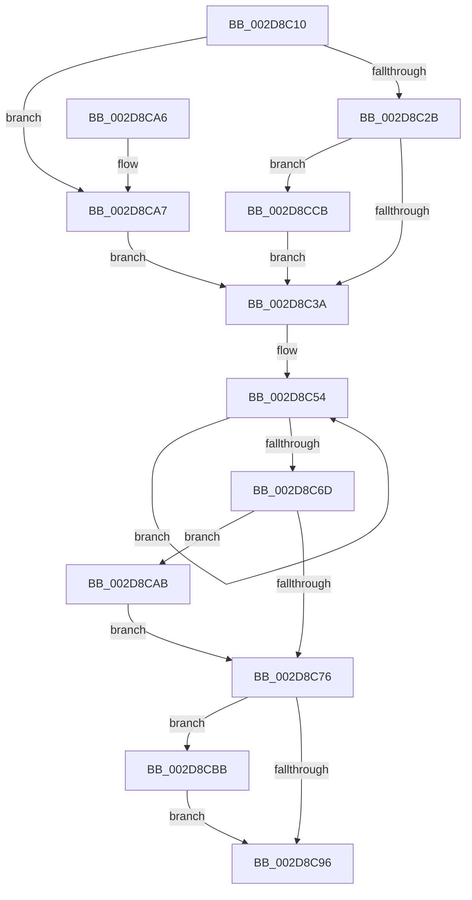

# MiAdjustCachedStackList

- RVA: `0x002D8C10`–`0x002D8CDC` (길이 `204` bytes)
- VA: `0x00000001402D8C10`
- 실행 섹션: `.text`
- PDB 이름 있음: `예`; PDB Function 태그: `아니요`
- unwind 정보 RVA: `0x00070298`
- 디코드: `60`개 명령, `204/204` bytes 표시
- 미해석 바이트: `0` (있으면 어셈블리에 `.byte`로 보존)

> 이 문서는 커널 이미지의 기계어와 PDB 기호를 분석해 생성했습니다. 4번과 5번은 함수 원형과 자료형을 바이너리 사용 방식에서 추정한 C 해석이며 원본 소스 복구 결과는 아닙니다.

## 1. Dependencies

- 직접 호출 지점: **2**; 고유 호출 대상: **2**
- 직접 호출자로 확인된 함수: **1**
- RIP 상대 이미지 참조: **0**

### Outgoing calls
- `0x002D8CC4` → [MiPruneCachedStackList](../49/MiPruneCachedStackList_function_00495638.md) (function, `0x00495638`)
- `0x002D8CCE` → [MiRemoveNonIdealCachedStacks](../68/MiRemoveNonIdealCachedStacks_function_00686620.md) (function, `0x00686620`)

### Direct callers
- [MiAdjustCachedStacks](MiAdjustCachedStacks_function_002D8AAC.md) at `0x002D8B6C`

### Static image references
- 디코드된 RIP-relative 메모리 참조가 없습니다.

## 2. Other-region calls and transfers

- 다른 실행 섹션으로 향하는 call: **0**
- 별도 외부 분기/꼬리 이동을 확인하지 못했습니다.

## 3. Assembly (complete function range)

```asm
002D8C10  48 89 5C 24 08                  mov qword ptr [rsp + 8], rbx
002D8C15  48 89 74 24 10                  mov qword ptr [rsp + 0x10], rsi
002D8C1A  57                              push rdi
002D8C1B  48 83 EC 20                     sub rsp, 0x20
002D8C1F  48 8B DA                        mov rbx, rdx
002D8C22  48 8B F1                        mov rsi, rcx
002D8C25  41 83 F8 03                     cmp r8d, 3
002D8C29  7C 7C                           jl 0x1402d8ca7
002D8C2B  80 7A 2C 00                     cmp byte ptr [rdx + 0x2c], 0
002D8C2F  BF 01 00 00 00                  mov edi, 1
002D8C34  0F 85 91 00 00 00               jne 0x1402d8ccb
002D8C3A  8B 4B 20                        mov ecx, dword ptr [rbx + 0x20]
002D8C3D  4C 8D 43 10                     lea r8, [rbx + 0x10]
002D8C41  45 33 C9                        xor r9d, r9d
002D8C44  83 F9 03                        cmp ecx, 3
002D8C47  8D 41 01                        lea eax, [rcx + 1]
002D8C4A  44 0F 45 C8                     cmovne r9d, eax
002D8C4E  33 D2                           xor edx, edx
002D8C50  44 8D 5A 04                     lea r11d, [rdx + 4]
002D8C54  41 8B 00                        mov eax, dword ptr [r8]
002D8C57  33 C9                           xor ecx, ecx
002D8C59  85 C0                           test eax, eax
002D8C5B  4D 8D 40 04                     lea r8, [r8 + 4]
002D8C5F  0F 49 C8                        cmovns ecx, eax
002D8C62  3B D1                           cmp edx, ecx
002D8C64  0F 42 D1                        cmovb edx, ecx
002D8C67  49 83 EB 01                     sub r11, 1
002D8C6B  75 E7                           jne 0x1402d8c54
002D8C6D  45 8D 43 05                     lea r8d, [r11 + 5]
002D8C71  41 3B D0                        cmp edx, r8d
002D8C74  73 35                           jae 0x1402d8cab
002D8C76  8B 4B 28                        mov ecx, dword ptr [rbx + 0x28]
002D8C79  44 89 43 28                     mov dword ptr [rbx + 0x28], r8d
002D8C7D  C7 43 24 00 00 00 00            mov dword ptr [rbx + 0x24], 0
002D8C84  44 89 4B 20                     mov dword ptr [rbx + 0x20], r9d
002D8C88  42 C7 44 8B 10 00 00 00 00      mov dword ptr [rbx + r9*4 + 0x10], 0
002D8C91  41 3B C8                        cmp ecx, r8d
002D8C94  77 25                           ja 0x1402d8cbb
002D8C96  48 8B 5C 24 30                  mov rbx, qword ptr [rsp + 0x30]
002D8C9B  48 8B 74 24 38                  mov rsi, qword ptr [rsp + 0x38]
002D8CA0  48 83 C4 20                     add rsp, 0x20
002D8CA4  5F                              pop rdi
002D8CA5  C3                              ret
002D8CA6  CC                              int3
002D8CA7  33 FF                           xor edi, edi
002D8CA9  EB 8F                           jmp 0x1402d8c3a
002D8CAB  B8 00 02 00 00                  mov eax, 0x200
002D8CB0  44 8B C2                        mov r8d, edx
002D8CB3  3B D0                           cmp edx, eax
002D8CB5  44 0F 47 C0                     cmova r8d, eax
002D8CB9  EB BB                           jmp 0x1402d8c76
002D8CBB  44 8B CF                        mov r9d, edi
002D8CBE  48 8B D3                        mov rdx, rbx
002D8CC1  48 8B CE                        mov rcx, rsi
002D8CC4  E8 6F C9 1B 00                  call 0x140495638
002D8CC9  EB CB                           jmp 0x1402d8c96
002D8CCB  48 8B CB                        mov rcx, rbx
002D8CCE  E8 4D D9 3A 00                  call 0x140686620
002D8CD3  C6 43 2C 00                     mov byte ptr [rbx + 0x2c], 0
002D8CD7  E9 5E FF FF FF                  jmp 0x1402d8c3a
```

## 4. C-style interpretation (structured pseudocode)

```c
__int64 __fastcall MiAdjustCachedStackList(__int64 a1, __int64 a2, int a3, int a4)
{
    __int64 result;
    __int64 v_r11;
    __int64 v_rdi;
    __int64 v_rsp;
    unsigned __int64 v_stack_p10;
    unsigned __int64 v_stack_p8;

    v_stack_p8 = v_rbx;
    v_stack_p10 = v_rsi;
    v_rsp = (v_rsp) - (32);
    if (a3 < 3) goto loc_002D8CA7;
    if ((*(unsigned __int8 *)(a2 + 44)) != 0) goto loc_002D8CCB;
loc_002D8C3A:
    a4 = 0;
    if (((unsigned int)((unsigned int)(*(unsigned int *)(a2 + 32)))) != 3) { a4 = (unsigned int)((unsigned int)(*(unsigned int *)(a2 + 32)) + 1); }
    a2 = 0;
loc_002D8C54:
    a1 = 0;
    if (!sign_flag) { a1 = (unsigned int)((unsigned int)(*(unsigned int *)(a2 + 16))); }
    if (0 < ((unsigned int)(a1))) { a2 = (unsigned int)(a1); }
    v_r11 = (a2 + 4) - (1);
    if (condition_is_not_equal) goto loc_002D8C54;
    if (((unsigned int)(a2)) >= ((unsigned int)(v_r11 + 5))) goto loc_002D8CAB;
loc_002D8C76:
    *(unsigned int *)(a2 + 40) = (unsigned int)(v_r11 + 5);
    *(unsigned int *)(a2 + 36) = 0;
    *(unsigned int *)(a2 + 32) = a4;
    *(unsigned int *)(a2 + a4 * 4 + 16) = 0;
    if (((unsigned int)((unsigned int)(*(unsigned int *)(a2 + 40)))) > ((unsigned int)(v_r11 + 5))) goto loc_002D8CBB;
loc_002D8C96:
    v_rsp = (v_rsp) + (32);
    return (unsigned int)(*(unsigned int *)(a2 + 16));
loc_002D8CA7:
    v_rdi = 0;
    goto loc_002D8C3A;
loc_002D8CAB:
    a3 = (unsigned int)((unsigned int)(a2));
    if (((unsigned int)(a2)) > 512) { a3 = 512; }
    goto loc_002D8C76;
loc_002D8CBB:
    result = MiPruneCachedStackList(v_stack_p10, v_stack_p8, a3, 0);
    goto loc_002D8C96;
loc_002D8CCB:
    result = MiRemoveNonIdealCachedStacks(v_stack_p8, v_stack_p8, a3, 0);
    *(unsigned __int8 *)(v_stack_p8 + 44) = 0;
    goto loc_002D8C3A;
}
```

## 5. (Beta) C Style

```c
int64_t MiAdjustCachedStackList(int64_t Arg1, void *Arg2, int32_t Arg3, int32_t Arg4)
{
    uint8_t *arg2 = (uint8_t *)Arg2;

    int64_t result;
    int64_t local_r11;
    int64_t local_rdi;
    int64_t local_rsp;
    uint64_t v_stack_p10;
    uint64_t v_stack_p8;

    v_stack_p8 = local_rbx;
    v_stack_p10 = local_rsi;
    local_rsp = (local_rsp) - (32);
    if (Arg3 < 3) goto loc_002D8CA7;
    if ((*(uint8_t *)(arg2 + 0x2C)) != 0) goto loc_002D8CCB;
loc_002D8C3A:
    Arg4 = 0;
    if (((uint32_t)((uint32_t)(*(uint32_t *)(arg2 + 0x20)))) != 3) { Arg4 = (uint32_t)((uint32_t)(*(uint32_t *)(arg2 + 0x20)) + 1); }
    Arg2 = 0;
loc_002D8C54:
    Arg1 = 0;
    if (!sign_flag) { Arg1 = (uint32_t)((uint32_t)(*(uint32_t *)(arg2 + 0x10))); }
    if (0 < ((uint32_t)(Arg1))) { Arg2 = (uint32_t)(Arg1); }
    local_r11 = (Arg2 + 4) - (1);
    if (condition_is_not_equal) goto loc_002D8C54;
    if (((uint32_t)(Arg2)) >= ((uint32_t)(local_r11 + 5))) goto loc_002D8CAB;
loc_002D8C76:
    *(uint32_t *)(arg2 + 0x28) = (uint32_t)(local_r11 + 5);
    *(uint32_t *)(arg2 + 0x24) = 0;
    *(uint32_t *)(arg2 + 0x20) = Arg4;
    *(uint32_t *)(arg2 + Arg4 * 4 + 0x10) = 0;
    if (((uint32_t)((uint32_t)(*(uint32_t *)(arg2 + 0x28)))) > ((uint32_t)(local_r11 + 5))) goto loc_002D8CBB;
loc_002D8C96:
    local_rsp = (local_rsp) + (32);
    return (uint32_t)(*(uint32_t *)(arg2 + 0x10));
loc_002D8CA7:
    local_rdi = 0;
    goto loc_002D8C3A;
loc_002D8CAB:
    Arg3 = (uint32_t)((uint32_t)(Arg2));
    if (((uint32_t)(Arg2)) > 512) { Arg3 = 512; }
    goto loc_002D8C76;
loc_002D8CBB:
    result = MiPruneCachedStackList(v_stack_p10, v_stack_p8, Arg3, 0);
    goto loc_002D8C96;
loc_002D8CCB:
    result = MiRemoveNonIdealCachedStacks(v_stack_p8, v_stack_p8, Arg3, 0);
    *(uint8_t *)(v_stack_p8 + 0x2C) = 0;
    goto loc_002D8C3A;
}
```

### 관측된 메모리 오프셋

구조체 형식이 확인되지 않은 접근은 인자 기준의 오프셋으로만 기록했습니다.

| 기준 인자 | 오프셋 표현 | 폭 (bit) | 접근 |
|---|---:|---:|---|
| `Arg2` | `+ 0x0` | `32` | `R` |
| `Arg2` | `+ 0x4` | `64` | `R` |
| `Arg2` | `+ 0x10` | `64` | `R` |
| `Arg2` | `+ 0x10 + r9*4` | `32` | `W` |
| `Arg2` | `+ 0x20` | `32` | `R` |
| `Arg2` | `+ 0x20` | `32` | `W` |
| `Arg2` | `+ 0x24` | `32` | `W` |
| `Arg2` | `+ 0x28` | `32` | `R` |
| `Arg2` | `+ 0x28` | `32` | `W` |
| `Arg2` | `+ 0x2C` | `8` | `R` |
| `Arg2` | `+ 0x2C` | `8` | `W` |

## 6. Execution-region graph

[열기: 2D/3D 그래프와 함수 탐색 컨트롤 패널](../../../control-panel.html?section=text&rva=0x002D8C10&view=graph)

- 2D 그래프는 위에서 아래로 흐르고, 3D 그래프는 빈 공간을 드래그해 회전합니다. Shift+드래그는 이동, 휠은 확대·축소, 함수 노드 선택은 대상 보고서 이동입니다.

### Static fallback


