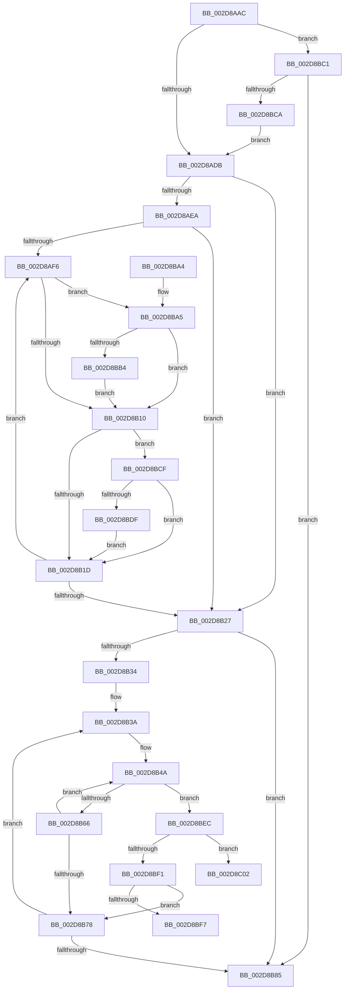

# MiAdjustCachedStacks

- RVA: `0x002D8AAC`–`0x002D8C0A` (길이 `350` bytes)
- VA: `0x00000001402D8AAC`
- 실행 섹션: `.text`
- PDB 이름 있음: `예`; PDB Function 태그: `예`
- unwind 정보 RVA: `0x00070268`
- 디코드: `95`개 명령, `350/350` bytes 표시
- 미해석 바이트: `0` (있으면 어셈블리에 `.byte`로 보존)

> 이 문서는 커널 이미지의 기계어와 PDB 기호를 분석해 생성했습니다. 4번과 5번은 함수 원형과 자료형을 바이너리 사용 방식에서 추정한 C 해석이며 원본 소스 복구 결과는 아닙니다.

## 1. Dependencies

- 직접 호출 지점: **4**; 고유 호출 대상: **4**
- 직접 호출자로 확인된 함수: **6**
- RIP 상대 이미지 참조: **4**

### Outgoing calls
- `0x002D8AF8` → [KeGetPrcb](KeGetPrcb_function_002D85D0.md) (function, `0x002D85D0`)
- `0x002D8B6C` → [MiAdjustCachedStackList](MiAdjustCachedStackList_function_002D8C10.md) (function, `0x002D8C10`)
- `0x002D8BB7` → [MiDeleteCachedKernelStack](MiDeleteCachedKernelStack_function_002D986C.md) (function, `0x002D986C`)
- `0x002D8BE2` → [MiDeleteCachedKernelShadowStack](../49/MiDeleteCachedKernelShadowStack_function_004956CC.md) (function, `0x004956CC`)

### Direct callers
- [MiFindContiguousPagesEx](../28/MiFindContiguousPagesEx_function_0028BDE0.md) at `0x0028C24C`
- [MiFindContiguousPagesEx](../28/MiFindContiguousPagesEx_function_0028BDE0.md) at `0x0028CCD1`
- [MiWorkingSetManager](MiWorkingSetManager_function_002DA7E0.md) at `0x002DA96D`
- [MiDefragmentSlabWorker](../68/MiDefragmentSlabWorker_function_0068D730.md) at `0x0068D943`
- [MiDeletePartitionResources](../../page/80/MiDeletePartitionResources_function_0080D074.md) at `0x0080D115`
- [MmRelocatePfnList](../../page/90/MmRelocatePfnList_function_00901E70.md) at `0x00902002`
- [MiScrubNode](../../page/A4/MiScrubNode_function_00A46098.md) at `0x00A461E7`

### Static image references
- `0x002D8ADB` → RVA `0x00E38D00` (`.data`; read)
- `0x002D8AEA` → RVA `0x00FC6A80` (`ALMOSTRO`; read)
- `0x002D8B27` → RVA `0x00FC5000` (`ALMOSTRO`; read)
- `0x002D8BC1` → RVA `0x00E2DBC9` (`.data`; read)

## 2. Other-region calls and transfers

- 다른 실행 섹션으로 향하는 call: **0**
- call이 아닌 외부 분기/꼬리 이동: **2**
  - `0x002D8BFD` → [sub_006DDD38](../6D/Unknown_function_006DDD38.md) (`tail-transfer`)
  - `0x002D8C05` → [sub_006DDD38](../6D/Unknown_function_006DDD38.md) (`tail-transfer`)

## 3. Assembly (complete function range)

```asm
002D8AAC  48 8B C4                        mov rax, rsp
002D8AAF  48 89 58 08                     mov qword ptr [rax + 8], rbx
002D8AB3  48 89 68 10                     mov qword ptr [rax + 0x10], rbp
002D8AB7  48 89 70 18                     mov qword ptr [rax + 0x18], rsi
002D8ABB  48 89 78 20                     mov qword ptr [rax + 0x20], rdi
002D8ABF  41 54                           push r12
002D8AC1  41 56                           push r14
002D8AC3  41 57                           push r15
002D8AC5  48 83 EC 20                     sub rsp, 0x20
002D8AC9  8B C2                           mov eax, edx
002D8ACB  44 8B FA                        mov r15d, edx
002D8ACE  24 03                           and al, 3
002D8AD0  48 8B F1                        mov rsi, rcx
002D8AD3  3C 01                           cmp al, 1
002D8AD5  0F 84 E6 00 00 00               je 0x1402d8bc1
002D8ADB  48 8D 05 1E 02 B6 00            lea rax, [rip + 0xb6021e]
002D8AE2  45 33 E4                        xor r12d, r12d
002D8AE5  48 3B F0                        cmp rsi, rax
002D8AE8  75 3D                           jne 0x1402d8b27
002D8AEA  44 39 25 8F DF CE 00            cmp dword ptr [rip + 0xcedf8f], r12d
002D8AF1  41 8B FC                        mov edi, r12d
002D8AF4  76 31                           jbe 0x1402d8b27
002D8AF6  8B CF                           mov ecx, edi
002D8AF8  E8 D3 FA FF FF                  call 0x1402d85d0
002D8AFD  48 8D 98 30 87 00 00            lea rbx, [rax + 0x8730]
002D8B04  48 8B 0B                        mov rcx, qword ptr [rbx]
002D8B07  48 85 C9                        test rcx, rcx
002D8B0A  0F 85 95 00 00 00               jne 0x1402d8ba5
002D8B10  48 8B 43 08                     mov rax, qword ptr [rbx + 8]
002D8B14  48 85 C0                        test rax, rax
002D8B17  0F 85 B2 00 00 00               jne 0x1402d8bcf
002D8B1D  FF C7                           inc edi
002D8B1F  3B 3D 5B DF CE 00               cmp edi, dword ptr [rip + 0xcedf5b]
002D8B25  72 CF                           jb 0x1402d8af6
002D8B27  66 44 3B 25 D1 C4 CE 00         cmp r12w, word ptr [rip + 0xcec4d1]
002D8B2F  41 8B DC                        mov ebx, r12d
002D8B32  73 51                           jae 0x1402d8b85
002D8B34  41 8B EF                        mov ebp, r15d
002D8B37  83 E5 01                        and ebp, 1
002D8B3A  8B C3                           mov eax, ebx
002D8B3C  41 8B FC                        mov edi, r12d
002D8B3F  4C 69 F0 80 DF 00 00            imul r14, rax, 0xdf80
002D8B46  4C 03 76 10                     add r14, qword ptr [rsi + 0x10]
002D8B4A  48 63 C7                        movsxd rax, edi
002D8B4D  48 05 3F 01 00 00               add rax, 0x13f
002D8B53  48 8D 14 40                     lea rdx, [rax + rax*2]
002D8B57  48 C1 E2 04                     shl rdx, 4
002D8B5B  49 03 D6                        add rdx, r14
002D8B5E  85 ED                           test ebp, ebp
002D8B60  0F 85 86 00 00 00               jne 0x1402d8bec
002D8B66  44 8B C7                        mov r8d, edi
002D8B69  48 8B CE                        mov rcx, rsi
002D8B6C  E8 9F 00 00 00                  call 0x1402d8c10
002D8B71  FF C7                           inc edi
002D8B73  83 FF 08                        cmp edi, 8
002D8B76  7C D2                           jl 0x1402d8b4a
002D8B78  0F B7 05 81 C4 CE 00            movzx eax, word ptr [rip + 0xcec481]
002D8B7F  FF C3                           inc ebx
002D8B81  3B D8                           cmp ebx, eax
002D8B83  72 B5                           jb 0x1402d8b3a
002D8B85  48 8B 5C 24 40                  mov rbx, qword ptr [rsp + 0x40]
002D8B8A  48 8B 6C 24 48                  mov rbp, qword ptr [rsp + 0x48]
002D8B8F  48 8B 74 24 50                  mov rsi, qword ptr [rsp + 0x50]
002D8B94  48 8B 7C 24 58                  mov rdi, qword ptr [rsp + 0x58]
002D8B99  48 83 C4 20                     add rsp, 0x20
002D8B9D  41 5F                           pop r15
002D8B9F  41 5E                           pop r14
002D8BA1  41 5C                           pop r12
002D8BA3  C3                              ret
002D8BA4  CC                              int3
002D8BA5  49 8B D4                        mov rdx, r12
002D8BA8  48 87 13                        xchg qword ptr [rbx], rdx
002D8BAB  48 85 D2                        test rdx, rdx
002D8BAE  0F 84 5C FF FF FF               je 0x1402d8b10
002D8BB4  48 8B CE                        mov rcx, rsi
002D8BB7  E8 B0 0C 00 00                  call 0x1402d986c
002D8BBC  E9 4F FF FF FF                  jmp 0x1402d8b10
002D8BC1  F6 05 01 50 B5 00 01            test byte ptr [rip + 0xb55001], 1
002D8BC8  75 BB                           jne 0x1402d8b85
002D8BCA  E9 0C FF FF FF                  jmp 0x1402d8adb
002D8BCF  49 8B D4                        mov rdx, r12
002D8BD2  48 87 53 08                     xchg qword ptr [rbx + 8], rdx
002D8BD6  48 85 D2                        test rdx, rdx
002D8BD9  0F 84 3E FF FF FF               je 0x1402d8b1d
002D8BDF  48 8B CE                        mov rcx, rsi
002D8BE2  E8 E5 CA 1B 00                  call 0x1404956cc
002D8BE7  E9 31 FF FF FF                  jmp 0x1402d8b1d
002D8BEC  83 FF 03                        cmp edi, 3
002D8BEF  7C 11                           jl 0x1402d8c02
002D8BF1  41 F6 C7 02                     test r15b, 2
002D8BF5  74 81                           je 0x1402d8b78
002D8BF7  41 B9 01 00 00 00               mov r9d, 1
002D8BFD  E9 36 51 40 00                  jmp 0x1406ddd38
002D8C02  45 8B CC                        mov r9d, r12d
002D8C05  E9 2E 51 40 00                  jmp 0x1406ddd38
```

## 4. C-style interpretation (structured pseudocode)

```c
__int64 __fastcall MiAdjustCachedStacks(__int64 a1, int a2)
{
    __int64 result;
    __int64 v_r12;
    __int64 v_r14;
    __int64 v_rbp;
    __int64 v_rbx;
    __int64 v_rdi;
    __int64 v_rsp;
    unsigned __int64 v_stack_p10;
    unsigned __int64 v_stack_p18;
    unsigned __int64 v_stack_p20;
    unsigned __int64 v_stack_p8;

    *(unsigned __int64 *)(v_rsp + 8) = v_rbx;
    *(unsigned __int64 *)(v_rsp + 16) = v_rbp;
    *(unsigned __int64 *)(v_rsp + 24) = v_rsi;
    *(unsigned __int64 *)(v_rsp + 32) = v_rdi;
    v_rsp = (v_rsp) - (32);
    result = (unsigned __int8)(((unsigned int)(a2)) & (3));
    if (((unsigned __int8)(result)) == 1) goto loc_002D8BC1;
loc_002D8ADB:
    v_r12 = 0;
    if (a1 != (v_rip + 11928094)) goto loc_002D8B27;
    if ((*(unsigned int *)(v_rip + 13557647)) <= 0) goto loc_002D8B27;
loc_002D8AF6:
    result = KeGetPrcb(0, a2, a3, a4);
    if (*(unsigned __int64 *)(result + 34608) != 0) goto loc_002D8BA5;
loc_002D8B10:
    if (*(unsigned __int64 *)(result + 34608 + 8) != 0) goto loc_002D8BCF;
loc_002D8B1D:
    v_rdi = (unsigned int)((0) + 1);
    if (((unsigned int)(v_rdi)) < (*(unsigned int *)(v_rip + 13557595))) goto loc_002D8AF6;
loc_002D8B27:
    if (0 >= (*(unsigned __int16 *)(v_rip + 13550801))) goto loc_002D8B85;
    v_rbp = (unsigned int)(((unsigned int)((unsigned int)((unsigned int)(a2)))) & (1));
loc_002D8B3A:
    v_r14 = (v_r14) * (0);
    v_r14 = (v_r14) + (*(unsigned __int64 *)(a1 + 16));
loc_002D8B4A:
    result = ((int)(0)) + (319);
    a2 = (result + result * 2) << (4);
    a2 = (a2) + (v_r14);
    if ((unsigned int)(v_rbp) != 0) goto loc_002D8BEC;
    result = MiAdjustCachedStackList(a1, a2, 0, a4);
    v_rdi = (unsigned int)((0) + 1);
    if (((unsigned int)(v_rdi)) < 8) goto loc_002D8B4A;
loc_002D8B78:
    v_rbx = (unsigned int)((0) + 1);
    if (((unsigned int)(v_rbx)) < ((unsigned int)(*(unsigned __int16 *)(v_rip + 13550721)))) goto loc_002D8B3A;
loc_002D8B85:
    v_rsp = (v_rsp) + (32);
    return *(unsigned __int16 *)(v_rip + 13550721);
loc_002D8BA5:
    if (0 == 0) goto loc_002D8B10;
    result = MiDeleteCachedKernelStack(v_stack_p18, 0, 0, a4);
    goto loc_002D8B10;
loc_002D8BC1:
    if (((*(unsigned __int8 *)(v_rip + 11882497)) & (1)) != 0) goto loc_002D8B85;
    goto loc_002D8ADB;
loc_002D8BCF:
    if (0 == 0) goto loc_002D8B1D;
    result = MiDeleteCachedKernelShadowStack(v_stack_p18, 0, 0, a4);
    goto loc_002D8B1D;
loc_002D8BEC:
    if (((unsigned int)(v_stack_p20)) < 3) goto loc_002D8C02;
    if ((((unsigned __int8)((unsigned int)(a2))) & (2)) == 0) goto loc_002D8B78;
loc_002D8C02:
}
```

## 5. (Beta) C Style

```c
int64_t MiAdjustCachedStacks(int64_t Arg1, int32_t Arg2)
{
    int64_t result;
    int64_t local_r12;
    int64_t local_r14;
    int64_t local_rbp;
    int64_t local_rbx;
    int64_t local_rdi;
    int64_t local_rsp;
    uint64_t v_stack_p10;
    uint64_t v_stack_p18;
    uint64_t v_stack_p20;
    uint64_t v_stack_p8;

    *(uint64_t *)(local_rsp + 0x8) = local_rbx;
    *(uint64_t *)(local_rsp + 0x10) = local_rbp;
    *(uint64_t *)(local_rsp + 0x18) = local_rsi;
    *(uint64_t *)(local_rsp + 0x20) = local_rdi;
    local_rsp = (local_rsp) - (32);
    result = (uint8_t)(((uint32_t)(Arg2)) & (3));
    if (((uint8_t)(result)) == 1) goto loc_002D8BC1;
loc_002D8ADB:
    local_r12 = 0;
    if (Arg1 != (v_rip + 11928094)) goto loc_002D8B27;
    if ((*(uint32_t *)(v_rip + 0xCEDF8F)) <= 0) goto loc_002D8B27;
loc_002D8AF6:
    result = KeGetPrcb(0, Arg2, a3, a4);
    if (*(uint64_t *)(result + 0x8730) != 0) goto loc_002D8BA5;
loc_002D8B10:
    if (*(uint64_t *)(result + 0x8730 + 0x8) != 0) goto loc_002D8BCF;
loc_002D8B1D:
    local_rdi = (uint32_t)((0) + 1);
    if (((uint32_t)(local_rdi)) < (*(uint32_t *)(v_rip + 0xCEDF5B))) goto loc_002D8AF6;
loc_002D8B27:
    if (0 >= (*(uint16_t *)(v_rip + 0xCEC4D1))) goto loc_002D8B85;
    local_rbp = (uint32_t)(((uint32_t)((uint32_t)((uint32_t)(Arg2)))) & (1));
loc_002D8B3A:
    local_r14 = (local_r14) * (0);
    local_r14 = (local_r14) + (*(uint64_t *)(Arg1 + 0x10));
loc_002D8B4A:
    result = ((int32_t)(0)) + (319);
    Arg2 = (result + result * 2) << (4);
    Arg2 = (Arg2) + (local_r14);
    if ((uint32_t)(local_rbp) != 0) goto loc_002D8BEC;
    result = MiAdjustCachedStackList(Arg1, Arg2, 0, a4);
    local_rdi = (uint32_t)((0) + 1);
    if (((uint32_t)(local_rdi)) < 8) goto loc_002D8B4A;
loc_002D8B78:
    local_rbx = (uint32_t)((0) + 1);
    if (((uint32_t)(local_rbx)) < ((uint32_t)(*(uint16_t *)(v_rip + 0xCEC481)))) goto loc_002D8B3A;
loc_002D8B85:
    local_rsp = (local_rsp) + (32);
    return *(uint16_t *)(v_rip + 0xCEC481);
loc_002D8BA5:
    if (0 == 0) goto loc_002D8B10;
    result = MiDeleteCachedKernelStack(v_stack_p18, 0, 0, a4);
    goto loc_002D8B10;
loc_002D8BC1:
    if (((*(uint8_t *)(v_rip + 0xB55001)) & (1)) != 0) goto loc_002D8B85;
    goto loc_002D8ADB;
loc_002D8BCF:
    if (0 == 0) goto loc_002D8B1D;
    result = MiDeleteCachedKernelShadowStack(v_stack_p18, 0, 0, a4);
    goto loc_002D8B1D;
loc_002D8BEC:
    if (((uint32_t)(v_stack_p20)) < 3) goto loc_002D8C02;
    if ((((uint8_t)((uint32_t)(Arg2))) & (2)) == 0) goto loc_002D8B78;
loc_002D8C02:
}
```

## 6. Execution-region graph

[열기: 2D/3D 그래프와 함수 탐색 컨트롤 패널](../../../control-panel.html?section=text&rva=0x002D8AAC&view=graph)

- 2D 그래프는 위에서 아래로 흐르고, 3D 그래프는 빈 공간을 드래그해 회전합니다. Shift+드래그는 이동, 휠은 확대·축소, 함수 노드 선택은 대상 보고서 이동입니다.

### Static fallback


