# MiAdjustModifiedPageLoad

- RVA: `0x002DC07C`–`0x002DC30F` (길이 `659` bytes)
- VA: `0x00000001402DC07C`
- 실행 섹션: `.text`
- PDB 이름 있음: `예`; PDB Function 태그: `예`
- unwind 정보 RVA: `0x000706F4`
- 디코드: `160`개 명령, `659/659` bytes 표시
- 미해석 바이트: `0` (있으면 어셈블리에 `.byte`로 보존)

> 이 문서는 커널 이미지의 기계어와 PDB 기호를 분석해 생성했습니다. 4번과 5번은 함수 원형과 자료형을 바이너리 사용 방식에서 추정한 C 해석이며 원본 소스 복구 결과는 아닙니다.

## 1. Dependencies

- 직접 호출 지점: **7**; 고유 호출 대상: **7**
- 직접 호출자로 확인된 함수: **1**
- RIP 상대 이미지 참조: **1**

### Outgoing calls
- `0x002DC1C1` → [MiStoreUpdateMemoryConditions](../34/MiStoreUpdateMemoryConditions_function_0034CF3C.md) (function, `0x0034CF3C`)
- `0x002DC239` → [MiUpdateReserveClusterInfo](../46/MiUpdateReserveClusterInfo_function_0046606C.md) (function, `0x0046606C`)
- `0x002DC24D` → [ExAcquireSpinLockExclusive](../24/ExAcquireSpinLockExclusive_function_00248690.md) (function, `0x00248690`)
- `0x002DC27E` → [MiReleaseSpinLockExclusive](../24/MiReleaseSpinLockExclusive_function_002482C0.md) (function, `0x002482C0`)
- `0x002DC29A` → [MiUseLowIoPriorityForModifiedPages](../34/MiUseLowIoPriorityForModifiedPages_function_0034D284.md) (function, `0x0034D284`)
- `0x002DC2AF` → [MiWakeModifiedPageWriter](../3B/MiWakeModifiedPageWriter_function_003BCB18.md) (function, `0x003BCB18`)
- `0x002DC2D4` → [KiQueryUnbiasedInterruptTime](../42/KiQueryUnbiasedInterruptTime_function_0042D180.md) (function, `0x0042D180`)

### Direct callers
- [MiWorkingSetManager](MiWorkingSetManager_function_002DA7E0.md) at `0x002DA984`
- [MiWorkingSetManager](MiWorkingSetManager_function_002DA7E0.md) at `0x002DAB08`

### Static image references
- `0x002DC25F` → RVA `0x00FC520C` (`ALMOSTRO`; read)

## 2. Other-region calls and transfers

- 다른 실행 섹션으로 향하는 call: **0**
- call이 아닌 외부 분기/꼬리 이동: **2**
  - `0x002DC2CC` → [sub_006DDF10](../6D/Unknown_function_006DDF10.md) (`tail-transfer`)
  - `0x002DC2EF` → [sub_006DDF10](../6D/Unknown_function_006DDF10.md) (`tail-transfer`)

## 3. Assembly (complete function range)

```asm
002DC07C  48 89 5C 24 08                  mov qword ptr [rsp + 8], rbx
002DC081  48 89 6C 24 10                  mov qword ptr [rsp + 0x10], rbp
002DC086  48 89 74 24 18                  mov qword ptr [rsp + 0x18], rsi
002DC08B  57                              push rdi
002DC08C  41 56                           push r14
002DC08E  41 57                           push r15
002DC090  48 83 EC 20                     sub rsp, 0x20
002DC094  4C 8B 99 00 49 00 00            mov r11, qword ptr [rcx + 0x4900]
002DC09B  48 8B D9                        mov rbx, rcx
002DC09E  4C 8B 91 A0 4C 00 00            mov r10, qword ptr [rcx + 0x4ca0]
002DC0A5  49 8B C3                        mov rax, r11
002DC0A8  48 8B 89 40 0B 00 00            mov rcx, qword ptr [rcx + 0xb40]
002DC0AF  41 BF 00 40 00 00               mov r15d, 0x4000
002DC0B5  48 C1 E8 05                     shr rax, 5
002DC0B9  4C 8B F2                        mov r14, rdx
002DC0BC  48 8B 93 C0 0B 00 00            mov rdx, qword ptr [rbx + 0xbc0]
002DC0C3  49 3B C7                        cmp rax, r15
002DC0C6  45 8B CF                        mov r9d, r15d
002DC0C9  41 8B E8                        mov ebp, r8d
002DC0CC  4C 0F 47 C8                     cmova r9, rax
002DC0D0  48 8B 83 C0 44 00 00            mov rax, qword ptr [rbx + 0x44c0]
002DC0D7  49 C1 EB 04                     shr r11, 4
002DC0DB  4D 3B D9                        cmp r11, r9
002DC0DE  4D 0F 43 D9                     cmovae r11, r9
002DC0E2  48 03 D1                        add rdx, rcx
002DC0E5  48 8B 88 38 01 00 00            mov rcx, qword ptr [rax + 0x138]
002DC0EC  33 F6                           xor esi, esi
002DC0EE  B8 20 4E 00 00                  mov eax, 0x4e20
002DC0F3  48 3B C8                        cmp rcx, rax
002DC0F6  48 0F 47 C1                     cmova rax, rcx
002DC0FA  48 3B D0                        cmp rdx, rax
002DC0FD  76 1A                           jbe 0x1402dc119
002DC0FF  48 B8 CD CC CC CC CC CC CC CC   movabs rax, 0xcccccccccccccccd
002DC109  48 F7 E2                        mul rdx
002DC10C  48 C1 EA 03                     shr rdx, 3
002DC110  4C 3B D2                        cmp r10, rdx
002DC113  0F 82 8D 00 00 00               jb 0x1402dc1a6
002DC119  48 8D BB 68 03 00 00            lea rdi, [rbx + 0x368]
002DC120  4D 3B D3                        cmp r10, r11
002DC123  0F 83 68 01 00 00               jae 0x1402dc291
002DC129  48 8B 07                        mov rax, qword ptr [rdi]
002DC12C  49 8B D2                        mov rdx, r10
002DC12F  48 C1 E8 04                     shr rax, 4
002DC133  48 6B C8 0F                     imul rcx, rax, 0xf
002DC137  48 C1 EA 04                     shr rdx, 4
002DC13B  48 03 D1                        add rdx, rcx
002DC13E  48 89 17                        mov qword ptr [rdi], rdx
002DC141  48 3B CA                        cmp rcx, rdx
002DC144  0F 87 4D 01 00 00               ja 0x1402dc297
002DC14A  49 81 FA 20 03 00 00            cmp r10, 0x320
002DC151  0F 82 2E 01 00 00               jb 0x1402dc285
002DC157  48 8B 83 60 03 00 00            mov rax, qword ptr [rbx + 0x360]
002DC15E  49 3B D2                        cmp rdx, r10
002DC161  0F 86 82 00 00 00               jbe 0x1402dc1e9
002DC167  48 2B C2                        sub rax, rdx
002DC16A  49 03 C2                        add rax, r10
002DC16D  4A 8D 0C 10                     lea rcx, [rax + r10]
002DC171  48 89 8B 60 03 00 00            mov qword ptr [rbx + 0x360], rcx
002DC178  48 3B C1                        cmp rax, rcx
002DC17B  0F 8F 16 01 00 00               jg 0x1402dc297
002DC181  48 B8 9D 36 D0 69 03 9D 36 00   movabs rax, 0x369d0369d0369d
002DC18B  49 D1 EB                        shr r11, 1
002DC18E  4C 3B D8                        cmp r11, rax
002DC191  48 B8 FF FF FF FF FF FF FF 7F   movabs rax, 0x7fffffffffffffff
002DC19B  72 43                           jb 0x1402dc1e0
002DC19D  48 3B C8                        cmp rcx, rax
002DC1A0  0F 8D F1 00 00 00               jge 0x1402dc297
002DC1A6  4C 89 B3 70 03 00 00            mov qword ptr [rbx + 0x370], r14
002DC1AD  40 F6 C5 07                     test bpl, 7
002DC1B1  74 41                           je 0x1402dc1f4
002DC1B3  8B 83 B4 04 00 00               mov eax, dword ptr [rbx + 0x4b4]
002DC1B9  83 F8 FF                        cmp eax, -1
002DC1BC  74 08                           je 0x1402dc1c6
002DC1BE  48 8B CB                        mov rcx, rbx
002DC1C1  E8 76 0D 07 00                  call 0x14034cf3c
002DC1C6  48 8B 5C 24 40                  mov rbx, qword ptr [rsp + 0x40]
002DC1CB  48 8B 6C 24 48                  mov rbp, qword ptr [rsp + 0x48]
002DC1D0  48 8B 74 24 50                  mov rsi, qword ptr [rsp + 0x50]
002DC1D5  48 83 C4 20                     add rsp, 0x20
002DC1D9  41 5F                           pop r15
002DC1DB  41 5E                           pop r14
002DC1DD  5F                              pop rdi
002DC1DE  C3                              ret
002DC1DF  CC                              int3
002DC1E0  49 69 C3 58 02 00 00            imul rax, r11, 0x258
002DC1E7  EB B4                           jmp 0x1402dc19d
002DC1E9  49 2B C2                        sub rax, r10
002DC1EC  48 03 C2                        add rax, rdx
002DC1EF  E9 79 FF FF FF                  jmp 0x1402dc16d
002DC1F4  33 ED                           xor ebp, ebp
002DC1F6  F6 83 9C 03 00 00 01            test byte ptr [rbx + 0x39c], 1
002DC1FD  0F 85 C2 00 00 00               jne 0x1402dc2c5
002DC203  8B 83 58 48 00 00               mov eax, dword ptr [rbx + 0x4858]
002DC209  85 C0                           test eax, eax
002DC20B  74 20                           je 0x1402dc22d
002DC20D  48 8D B3 60 48 00 00            lea rsi, [rbx + 0x4860]
002DC214  44 8B F0                        mov r14d, eax
002DC217  48 8B 3E                        mov rdi, qword ptr [rsi]
002DC21A  F6 87 AC 00 00 00 40            test byte ptr [rdi + 0xac], 0x40
002DC221  74 20                           je 0x1402dc243
002DC223  48 83 C6 08                     add rsi, 8
002DC227  49 83 EE 01                     sub r14, 1
002DC22B  75 EA                           jne 0x1402dc217
002DC22D  85 ED                           test ebp, ebp
002DC22F  74 82                           je 0x1402dc1b3
002DC231  45 33 C0                        xor r8d, r8d
002DC234  33 D2                           xor edx, edx
002DC236  48 8B CB                        mov rcx, rbx
002DC239  E8 2E 9E 18 00                  call 0x14046606c
002DC23E  E9 70 FF FF FF                  jmp 0x1402dc1b3
002DC243  4C 8D BF C8 00 00 00            lea r15, [rdi + 0xc8]
002DC24A  49 8B CF                        mov rcx, r15
002DC24D  E8 3E C4 F6 FF                  call 0x140248690
002DC252  8B 57 64                        mov edx, dword ptr [rdi + 0x64]
002DC255  44 8A C0                        mov r8b, al
002DC258  8B 4F 60                        mov ecx, dword ptr [rdi + 0x60]
002DC25B  3B D1                           cmp edx, ecx
002DC25D  74 09                           je 0x1402dc268
002DC25F  8B 0D A7 8F CE 00               mov ecx, dword ptr [rip + 0xce8fa7]
002DC265  89 4F 5C                        mov dword ptr [rdi + 0x5c], ecx
002DC268  8B 0D 9E 8F CE 00               mov ecx, dword ptr [rip + 0xce8f9e]
002DC26E  C1 E1 02                        shl ecx, 2
002DC271  89 4F 68                        mov dword ptr [rdi + 0x68], ecx
002DC274  85 ED                           test ebp, ebp
002DC276  75 7C                           jne 0x1402dc2f4
002DC278  41 8A D0                        mov dl, r8b
002DC27B  49 8B CF                        mov rcx, r15
002DC27E  E8 3D C0 F6 FF                  call 0x1402482c0
002DC283  EB 9E                           jmp 0x1402dc223
002DC285  48 21 B3 60 03 00 00            and qword ptr [rbx + 0x360], rsi
002DC28C  E9 15 FF FF FF                  jmp 0x1402dc1a6
002DC291  49 8B F3                        mov rsi, r11
002DC294  48 D1 EE                        shr rsi, 1
002DC297  48 8B CB                        mov rcx, rbx
002DC29A  E8 E5 0F 07 00                  call 0x14034d284
002DC29F  48 83 C9 FF                     or rcx, 0xffffffffffffffff
002DC2A3  85 C0                           test eax, eax
002DC2A5  48 0F 44 F1                     cmove rsi, rcx
002DC2A9  48 8B CB                        mov rcx, rbx
002DC2AC  48 8B D6                        mov rdx, rsi
002DC2AF  E8 64 08 0E 00                  call 0x1403bcb18
002DC2B4  48 83 A3 60 03 00 00 00         and qword ptr [rbx + 0x360], 0
002DC2BC  48 83 27 00                     and qword ptr [rdi], 0
002DC2C0  E9 E1 FE FF FF                  jmp 0x1402dc1a6
002DC2C5  F0 09 2C 24                     lock or dword ptr [rsp], ebp
002DC2C9  4D 3B F7                        cmp r14, r15
002DC2CC  0F 87 3E 1C 40 00               ja 0x1406ddf10
002DC2D2  B1 01                           mov cl, 1
002DC2D4  E8 A7 0E 15 00                  call 0x14042d180
002DC2D9  48 8B 8B 90 03 00 00            mov rcx, qword ptr [rbx + 0x390]
002DC2E0  48 2B C1                        sub rax, rcx
002DC2E3  48 3D 00 8C 86 47               cmp rax, 0x47868c00
002DC2E9  0F 82 14 FF FF FF               jb 0x1402dc203
002DC2EF  E9 1C 1C 40 00                  jmp 0x1406ddf10
002DC2F4  8A 87 AF 00 00 00               mov al, byte ptr [rdi + 0xaf]
002DC2FA  A8 01                           test al, 1
002DC2FC  0F 84 76 FF FF FF               je 0x1402dc278
002DC302  24 FE                           and al, 0xfe
002DC304  88 87 AF 00 00 00               mov byte ptr [rdi + 0xaf], al
002DC30A  E9 69 FF FF FF                  jmp 0x1402dc278
```

## 4. C-style interpretation (structured pseudocode)

```c
__int64 __fastcall MiAdjustModifiedPageLoad(__int64 a1, __int64 a2, int a3)
{
    __int64 result;
    __int64 v_r11;
    __int64 v_r14;
    __int64 v_rbp;
    __int64 v_rsi;
    __int64 v_rsp;
    unsigned int v_stack_p0;
    unsigned __int64 v_stack_p10;
    unsigned __int64 v_stack_p18;
    unsigned __int64 v_stack_p8;

    v_stack_p8 = v_rbx;
    v_stack_p10 = v_rbp;
    v_stack_p18 = v_rsi;
    v_rsp = (v_rsp) - (32);
    result = (*(unsigned __int64 *)(a1 + 18688)) >> (5);
    a4 = (unsigned int)((unsigned int)((unsigned int)(0x4000ULL)));
    if (result > ((unsigned int)(0x4000ULL))) { a4 = result; }
    v_r11 = (*(unsigned __int64 *)(a1 + 18688)) >> (4);
    if (v_r11 >= a4) { v_r11 = a4; }
    a2 = (*(unsigned __int64 *)(a1 + 3008)) + (*(unsigned __int64 *)(a1 + 2880));
    v_rsi = 0;
    result = (unsigned int)(0x4E20ULL);
    if ((*(unsigned __int64 *)(*(unsigned __int64 *)(a1 + 17600) + 312)) > ((unsigned int)(0x4E20ULL))) { result = *(unsigned __int64 *)(*(unsigned __int64 *)(a1 + 17600) + 312); }
    if (a2 <= result) goto loc_002DC119;
    a2 = (a2) >> (3);
    if ((*(unsigned __int64 *)(a1 + 19616)) < a2) goto loc_002DC1A6;
loc_002DC119:
    if ((*(unsigned __int64 *)(a1 + 19616)) >= v_r11) goto loc_002DC291;
    result = (*(unsigned __int64 *)(a1 + 872)) >> (4);
    a1 = (*(unsigned __int64 *)(*(unsigned __int64 *)(a1 + 17600) + 312)) * (result);
    a2 = (*(unsigned __int64 *)(a1 + 19616)) >> (4);
    a2 = (a2) + (a1);
    *(unsigned __int64 *)(a1 + 872) = a2;
    if (a1 > a2) goto loc_002DC297;
    if ((*(unsigned __int64 *)(a1 + 19616)) < 800) goto loc_002DC285;
    if (a2 <= (*(unsigned __int64 *)(a1 + 19616))) goto loc_002DC1E9;
    result = (*(unsigned __int64 *)(a1 + 864)) - (a2);
    result = (result) + (*(unsigned __int64 *)(a1 + 19616));
loc_002DC16D:
    *(unsigned __int64 *)(a1 + 864) = result + *(unsigned __int64 *)(a1 + 19616) * 1;
    if (result > (result + *(unsigned __int64 *)(a1 + 19616) * 1)) goto loc_002DC297;
    v_r11 = (v_r11) >> (1);
    if (v_r11 < result) goto loc_002DC1E0;
loc_002DC19D:
    if ((result + *(unsigned __int64 *)(a1 + 19616) * 1) >= result) goto loc_002DC297;
loc_002DC1A6:
    *(unsigned __int64 *)(a1 + 880) = a2;
    if ((((unsigned __int8)((unsigned int)(a3))) & (7)) == 0) goto loc_002DC1F4;
loc_002DC1B3:
    result = (unsigned int)(*(unsigned int *)(a1 + 1204));
    if (((unsigned int)((unsigned int)(*(unsigned int *)(a1 + 1204)))) != -1) {
        a1 = a1;
        result = MiStoreUpdateMemoryConditions(a1, a2, a3, a4);
    }
    v_rsp = (v_rsp) + (32);
    return result;
loc_002DC1E0:
    result = (result) * (v_r11);
    goto loc_002DC19D;
loc_002DC1E9:
    result = (result) - (*(unsigned __int64 *)(a1 + 19616));
    result = (result) + (a2);
    goto loc_002DC16D;
loc_002DC1F4:
    v_rbp = 0;
    if (((*(unsigned __int8 *)(v_stack_p8 + 924)) & (1)) != 0) goto loc_002DC2C5;
loc_002DC203:
    if ((unsigned int)((unsigned int)(*(unsigned int *)(v_stack_p8 + 18520))) == 0) goto loc_002DC22D;
loc_002DC217:
    if (((*(unsigned __int8 *)(*(unsigned __int64 *)(v_stack_p8 + 18528) + 172)) & (64)) == 0) goto loc_002DC243;
loc_002DC223:
    v_rsi = (v_stack_p8 + 18528) + (8);
    v_r14 = ((unsigned int)((unsigned int)((unsigned int)(*(unsigned int *)(v_stack_p8 + 18520))))) - (1);
    if (condition_is_not_equal) goto loc_002DC217;
loc_002DC22D:
    if (0 == 0) goto loc_002DC1B3;
    a3 = 0;
    a2 = 0;
    result = MiUpdateReserveClusterInfo(v_stack_p8, a2, a3, a4);
    goto loc_002DC1B3;
loc_002DC243:
    result = ExAcquireSpinLockExclusive(*(unsigned __int64 *)(v_stack_p8 + 18528) + 200, a2, a3, a4);
    if (((unsigned int)((unsigned int)(*(unsigned int *)(*(unsigned __int64 *)(v_stack_p8 + 18528) + 100)))) != ((unsigned int)((unsigned int)(*(unsigned int *)(*(unsigned __int64 *)(v_stack_p8 + 18528) + 96))))) {
        a1 = *(unsigned int *)(v_rip + 13537191);
        *(unsigned int *)(*(unsigned __int64 *)(v_stack_p8 + 18528) + 92) = (unsigned int)(a1);
    }
    a1 = (unsigned int)(((unsigned int)(*(unsigned int *)(v_rip + 13537182))) << (2));
    *(unsigned int *)(*(unsigned __int64 *)(v_stack_p8 + 18528) + 104) = (unsigned int)(a1);
    if (0 != 0) goto loc_002DC2F4;
loc_002DC278:
    result = MiReleaseSpinLockExclusive(*(unsigned __int64 *)(v_stack_p8 + 18528) + 200, (unsigned __int8)((unsigned __int8)(result)), (unsigned __int8)(result), a4);
    goto loc_002DC223;
loc_002DC285:
    goto loc_002DC1A6;
loc_002DC291:
    v_rsi = (v_r11) >> (1);
loc_002DC297:
    result = MiUseLowIoPriorityForModifiedPages(v_stack_p8, (unsigned __int8)((unsigned __int8)(result)), (unsigned __int8)(result), a4);
    a1 = (v_stack_p8) | (-1);
    if ((unsigned int)(result) == 0) { v_rsi = a1; }
    result = MiWakeModifiedPageWriter(v_stack_p8, v_rsi, (unsigned __int8)(result), a4);
    goto loc_002DC1A6;
loc_002DC2C5:
    result = KiQueryUnbiasedInterruptTime(1, v_rsi, (unsigned __int8)(result), a4);
    result = (result) - (*(unsigned __int64 *)(v_stack_p8 + 912));
    if (result < 0x47868C00ULL) goto loc_002DC203;
loc_002DC2F4:
    if ((((unsigned __int8)(*(unsigned __int8 *)(*(unsigned __int64 *)(v_stack_p8 + 18528) + 175))) & (1)) == 0) goto loc_002DC278;
    result = (unsigned __int8)((*(unsigned __int8 *)(*(unsigned __int64 *)(v_stack_p8 + 18528) + 175)) & (254));
    *(unsigned __int8 *)(*(unsigned __int64 *)(v_stack_p8 + 18528) + 175) = (unsigned __int8)(result);
    goto loc_002DC278;
}
```

## 5. (Beta) C Style

```c
int64_t MiAdjustModifiedPageLoad(void *Arg1, int64_t Arg2, int32_t Arg3)
{
    uint8_t *arg1 = (uint8_t *)Arg1;

    int64_t result;
    int64_t local_r11;
    int64_t local_r14;
    int64_t local_rbp;
    int64_t local_rsi;
    int64_t local_rsp;
    uint32_t v_stack_p0;
    uint64_t v_stack_p10;
    uint64_t v_stack_p18;
    uint64_t v_stack_p8;

    v_stack_p8 = local_rbx;
    v_stack_p10 = local_rbp;
    v_stack_p18 = local_rsi;
    local_rsp = (local_rsp) - (32);
    result = (*(uint64_t *)(arg1 + 0x4900)) >> (5);
    a4 = (uint32_t)((uint32_t)((uint32_t)(0x4000ULL)));
    if (result > ((uint32_t)(0x4000ULL))) { a4 = result; }
    local_r11 = (*(uint64_t *)(arg1 + 0x4900)) >> (4);
    if (local_r11 >= a4) { local_r11 = a4; }
    Arg2 = (*(uint64_t *)(arg1 + 0xBC0)) + (*(uint64_t *)(arg1 + 0xB40));
    local_rsi = 0;
    result = (uint32_t)(0x4E20ULL);
    if ((*(uint64_t *)(*(uint64_t *)(arg1 + 0x44C0) + 0x138)) > ((uint32_t)(0x4E20ULL))) { result = *(uint64_t *)(*(uint64_t *)(arg1 + 0x44C0) + 0x138); }
    if (Arg2 <= result) goto loc_002DC119;
    Arg2 = (Arg2) >> (3);
    if ((*(uint64_t *)(arg1 + 0x4CA0)) < Arg2) goto loc_002DC1A6;
loc_002DC119:
    if ((*(uint64_t *)(arg1 + 0x4CA0)) >= local_r11) goto loc_002DC291;
    result = (*(uint64_t *)(arg1 + 0x368)) >> (4);
    Arg1 = (*(uint64_t *)(*(uint64_t *)(arg1 + 0x44C0) + 0x138)) * (result);
    Arg2 = (*(uint64_t *)(arg1 + 0x4CA0)) >> (4);
    Arg2 = (Arg2) + (Arg1);
    *(uint64_t *)(arg1 + 0x368) = Arg2;
    if (Arg1 > Arg2) goto loc_002DC297;
    if ((*(uint64_t *)(arg1 + 0x4CA0)) < 800) goto loc_002DC285;
    if (Arg2 <= (*(uint64_t *)(arg1 + 0x4CA0))) goto loc_002DC1E9;
    result = (*(uint64_t *)(arg1 + 0x360)) - (Arg2);
    result = (result) + (*(uint64_t *)(arg1 + 0x4CA0));
loc_002DC16D:
    *(uint64_t *)(arg1 + 0x360) = result + *(uint64_t *)(arg1 + 0x4CA0) * 1;
    if (result > (result + *(uint64_t *)(arg1 + 0x4CA0) * 1)) goto loc_002DC297;
    local_r11 = (local_r11) >> (1);
    if (local_r11 < result) goto loc_002DC1E0;
loc_002DC19D:
    if ((result + *(uint64_t *)(arg1 + 0x4CA0) * 1) >= result) goto loc_002DC297;
loc_002DC1A6:
    *(uint64_t *)(arg1 + 0x370) = Arg2;
    if ((((uint8_t)((uint32_t)(Arg3))) & (7)) == 0) goto loc_002DC1F4;
loc_002DC1B3:
    result = (uint32_t)(*(uint32_t *)(arg1 + 0x4B4));
    if (((uint32_t)((uint32_t)(*(uint32_t *)(arg1 + 0x4B4)))) != -1) {
        Arg1 = Arg1;
        result = MiStoreUpdateMemoryConditions(Arg1, Arg2, Arg3, a4);
    }
    local_rsp = (local_rsp) + (32);
    return result;
loc_002DC1E0:
    result = (result) * (local_r11);
    goto loc_002DC19D;
loc_002DC1E9:
    result = (result) - (*(uint64_t *)(arg1 + 0x4CA0));
    result = (result) + (Arg2);
    goto loc_002DC16D;
loc_002DC1F4:
    local_rbp = 0;
    if (((*(uint8_t *)(v_stack_p8 + 0x39C)) & (1)) != 0) goto loc_002DC2C5;
loc_002DC203:
    if ((uint32_t)((uint32_t)(*(uint32_t *)(v_stack_p8 + 0x4858))) == 0) goto loc_002DC22D;
loc_002DC217:
    if (((*(uint8_t *)(*(uint64_t *)(v_stack_p8 + 0x4860) + 0xAC)) & (64)) == 0) goto loc_002DC243;
loc_002DC223:
    local_rsi = (v_stack_p8 + 18528) + (8);
    local_r14 = ((uint32_t)((uint32_t)((uint32_t)(*(uint32_t *)(v_stack_p8 + 0x4858))))) - (1);
    if (condition_is_not_equal) goto loc_002DC217;
loc_002DC22D:
    if (0 == 0) goto loc_002DC1B3;
    Arg3 = 0;
    Arg2 = 0;
    result = MiUpdateReserveClusterInfo(v_stack_p8, Arg2, Arg3, a4);
    goto loc_002DC1B3;
loc_002DC243:
    result = ExAcquireSpinLockExclusive(*(uint64_t *)(v_stack_p8 + 0x4860) + 200, Arg2, Arg3, a4);
    if (((uint32_t)((uint32_t)(*(uint32_t *)(*(uint64_t *)(v_stack_p8 + 0x4860) + 0x64)))) != ((uint32_t)((uint32_t)(*(uint32_t *)(*(uint64_t *)(v_stack_p8 + 0x4860) + 0x60))))) {
        Arg1 = *(uint32_t *)(v_rip + 0xCE8FA7);
        *(uint32_t *)(*(uint64_t *)(v_stack_p8 + 0x4860) + 0x5C) = (uint32_t)(Arg1);
    }
    Arg1 = (uint32_t)(((uint32_t)(*(uint32_t *)(v_rip + 0xCE8F9E))) << (2));
    *(uint32_t *)(*(uint64_t *)(v_stack_p8 + 0x4860) + 0x68) = (uint32_t)(Arg1);
    if (0 != 0) goto loc_002DC2F4;
loc_002DC278:
    result = MiReleaseSpinLockExclusive(*(uint64_t *)(v_stack_p8 + 0x4860) + 200, (uint8_t)((uint8_t)(result)), (uint8_t)(result), a4);
    goto loc_002DC223;
loc_002DC285:
    goto loc_002DC1A6;
loc_002DC291:
    local_rsi = (local_r11) >> (1);
loc_002DC297:
    result = MiUseLowIoPriorityForModifiedPages(v_stack_p8, (uint8_t)((uint8_t)(result)), (uint8_t)(result), a4);
    Arg1 = (v_stack_p8) | (-1);
    if ((uint32_t)(result) == 0) { local_rsi = Arg1; }
    result = MiWakeModifiedPageWriter(v_stack_p8, local_rsi, (uint8_t)(result), a4);
    goto loc_002DC1A6;
loc_002DC2C5:
    result = KiQueryUnbiasedInterruptTime(1, local_rsi, (uint8_t)(result), a4);
    result = (result) - (*(uint64_t *)(v_stack_p8 + 0x390));
    if (result < 0x47868C00ULL) goto loc_002DC203;
loc_002DC2F4:
    if ((((uint8_t)(*(uint8_t *)(*(uint64_t *)(v_stack_p8 + 0x4860) + 0xAF))) & (1)) == 0) goto loc_002DC278;
    result = (uint8_t)((*(uint8_t *)(*(uint64_t *)(v_stack_p8 + 0x4860) + 0xAF)) & (254));
    *(uint8_t *)(*(uint64_t *)(v_stack_p8 + 0x4860) + 0xAF) = (uint8_t)(result);
    goto loc_002DC278;
}
```

### 관측된 메모리 오프셋

구조체 형식이 확인되지 않은 접근은 인자 기준의 오프셋으로만 기록했습니다.

| 기준 인자 | 오프셋 표현 | 폭 (bit) | 접근 |
|---|---:|---:|---|
| `Arg1` | `+ 0x0` | `64` | `R` |
| `Arg1` | `+ 0x0` | `64` | `R/W` |
| `Arg1` | `+ 0x0` | `64` | `W` |
| `Arg1` | `+ 0x360` | `64` | `R` |
| `Arg1` | `+ 0x360` | `64` | `R/W` |
| `Arg1` | `+ 0x360` | `64` | `W` |
| `Arg1` | `+ 0x368` | `64` | `R` |
| `Arg1` | `+ 0x370` | `64` | `W` |
| `Arg1` | `+ 0x390` | `64` | `R` |
| `Arg1` | `+ 0x39C` | `8` | `R` |
| `Arg1` | `+ 0x4B4` | `32` | `R` |
| `Arg1` | `+ 0xB40` | `64` | `R` |
| `Arg1` | `+ 0xBC0` | `64` | `R` |
| `Arg1` | `+ 0x44C0` | `64` | `R` |
| `Arg1` | `+ 0x4858` | `32` | `R` |
| `Arg1` | `+ 0x4860` | `64` | `R` |
| `Arg1` | `+ 0x4900` | `64` | `R` |
| `Arg1` | `+ 0x4CA0` | `64` | `R` |

## 6. Execution-region graph

[열기: 2D/3D 그래프와 함수 탐색 컨트롤 패널](../../../control-panel.html?section=text&rva=0x002DC07C&view=graph)

- 2D 그래프는 위에서 아래로 흐르고, 3D 그래프는 빈 공간을 드래그해 회전합니다. Shift+드래그는 이동, 휠은 확대·축소, 함수 노드 선택은 대상 보고서 이동입니다.

### Static fallback

```mermaid
flowchart TD
  bb_002DC07C[BB_002DC07C]
  bb_002DC0FF[BB_002DC0FF]
  bb_002DC119[BB_002DC119]
  bb_002DC129[BB_002DC129]
  bb_002DC14A[BB_002DC14A]
  bb_002DC157[BB_002DC157]
  bb_002DC167[BB_002DC167]
  bb_002DC16D[BB_002DC16D]
  bb_002DC181[BB_002DC181]
  bb_002DC19D[BB_002DC19D]
  bb_002DC1A6[BB_002DC1A6]
  bb_002DC1B3[BB_002DC1B3]
  bb_002DC1BE[BB_002DC1BE]
  bb_002DC1C6[BB_002DC1C6]
  bb_002DC1DF[BB_002DC1DF]
  bb_002DC1E0[BB_002DC1E0]
  bb_002DC1E9[BB_002DC1E9]
  bb_002DC1F4[BB_002DC1F4]
  bb_002DC203[BB_002DC203]
  bb_002DC20D[BB_002DC20D]
  bb_002DC217[BB_002DC217]
  bb_002DC223[BB_002DC223]
  bb_002DC22D[BB_002DC22D]
  bb_002DC231[BB_002DC231]
  bb_002DC243[BB_002DC243]
  bb_002DC25F[BB_002DC25F]
  bb_002DC268[BB_002DC268]
  bb_002DC278[BB_002DC278]
  bb_002DC285[BB_002DC285]
  bb_002DC291[BB_002DC291]
  bb_002DC297[BB_002DC297]
  bb_002DC2C5[BB_002DC2C5]
  bb_002DC2D2[BB_002DC2D2]
  bb_002DC2EF[BB_002DC2EF]
  bb_002DC2F4[BB_002DC2F4]
  bb_002DC302[BB_002DC302]
  bb_002DC07C -->|branch| bb_002DC119
  bb_002DC07C -->|fallthrough| bb_002DC0FF
  bb_002DC0FF -->|branch| bb_002DC1A6
  bb_002DC0FF -->|fallthrough| bb_002DC119
  bb_002DC119 -->|branch| bb_002DC291
  bb_002DC119 -->|fallthrough| bb_002DC129
  bb_002DC129 -->|branch| bb_002DC297
  bb_002DC129 -->|fallthrough| bb_002DC14A
  bb_002DC14A -->|branch| bb_002DC285
  bb_002DC14A -->|fallthrough| bb_002DC157
  bb_002DC157 -->|branch| bb_002DC1E9
  bb_002DC157 -->|fallthrough| bb_002DC167
  bb_002DC167 -->|flow| bb_002DC16D
  bb_002DC16D -->|branch| bb_002DC297
  bb_002DC16D -->|fallthrough| bb_002DC181
  bb_002DC181 -->|branch| bb_002DC1E0
  bb_002DC181 -->|fallthrough| bb_002DC19D
  bb_002DC19D -->|branch| bb_002DC297
  bb_002DC19D -->|fallthrough| bb_002DC1A6
  bb_002DC1A6 -->|branch| bb_002DC1F4
  bb_002DC1A6 -->|fallthrough| bb_002DC1B3
  bb_002DC1B3 -->|branch| bb_002DC1C6
  bb_002DC1B3 -->|fallthrough| bb_002DC1BE
  bb_002DC1BE -->|flow| bb_002DC1C6
  bb_002DC1DF -->|flow| bb_002DC1E0
  bb_002DC1E0 -->|branch| bb_002DC19D
  bb_002DC1E9 -->|branch| bb_002DC16D
  bb_002DC1F4 -->|branch| bb_002DC2C5
  bb_002DC1F4 -->|fallthrough| bb_002DC203
  bb_002DC203 -->|branch| bb_002DC22D
  bb_002DC203 -->|fallthrough| bb_002DC20D
  bb_002DC20D -->|flow| bb_002DC217
  bb_002DC217 -->|branch| bb_002DC243
  bb_002DC217 -->|fallthrough| bb_002DC223
  bb_002DC223 -->|branch| bb_002DC217
  bb_002DC223 -->|fallthrough| bb_002DC22D
  bb_002DC22D -->|branch| bb_002DC1B3
  bb_002DC22D -->|fallthrough| bb_002DC231
  bb_002DC231 -->|branch| bb_002DC1B3
  bb_002DC243 -->|branch| bb_002DC268
  bb_002DC243 -->|fallthrough| bb_002DC25F
  bb_002DC25F -->|flow| bb_002DC268
  bb_002DC268 -->|branch| bb_002DC2F4
  bb_002DC268 -->|fallthrough| bb_002DC278
  bb_002DC278 -->|branch| bb_002DC223
  bb_002DC285 -->|branch| bb_002DC1A6
  bb_002DC291 -->|flow| bb_002DC297
  bb_002DC297 -->|branch| bb_002DC1A6
  bb_002DC2C5 -->|fallthrough| bb_002DC2D2
  bb_002DC2D2 -->|branch| bb_002DC203
  bb_002DC2D2 -->|fallthrough| bb_002DC2EF
  bb_002DC2F4 -->|branch| bb_002DC278
  bb_002DC2F4 -->|fallthrough| bb_002DC302
  bb_002DC302 -->|branch| bb_002DC278
```


