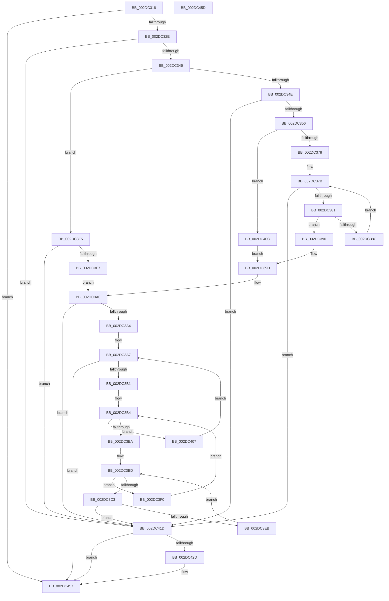

# MiCheckLogPinDriverAddresses

- RVA: `0x002DC318`–`0x002DC45E` (길이 `326` bytes)
- VA: `0x00000001402DC318`
- 실행 섹션: `.text`
- PDB 이름 있음: `예`; PDB Function 태그: `아니요`
- unwind 정보 RVA: `0x0005CF00`
- 디코드: `88`개 명령, `326/326` bytes 표시
- 미해석 바이트: `0` (있으면 어셈블리에 `.byte`로 보존)

> 이 문서는 커널 이미지의 기계어와 PDB 기호를 분석해 생성했습니다. 4번과 5번은 함수 원형과 자료형을 바이너리 사용 방식에서 추정한 C 해석이며 원본 소스 복구 결과는 아닙니다.

## 1. Dependencies

- 직접 호출 지점: **1**; 고유 호출 대상: **1**
- 직접 호출자로 확인된 함수: **1**
- RIP 상대 이미지 참조: **10**

### Outgoing calls
- `0x002DC452` → [ExQueueWorkItem](../2F/ExQueueWorkItem_function_002F9520.md) (function, `0x002F9520`)

### Direct callers
- [MiWorkingSetManager](MiWorkingSetManager_function_002DA7E0.md) at `0x002DA8C5`

### Static image references
- `0x002DC321` → RVA `0x00E37618` (`.data`; read)
- `0x002DC32E` → RVA `0x00EF4E60` (`.data`; read)
- `0x002DC356` → RVA `0x00EF4E68` (`.data`; read)
- `0x002DC3D4` → RVA `0x00EF0E60` (`.data`; read)
- `0x002DC41F` → RVA `0x00EF4FD0` (`.data`; read)
- `0x002DC42D` → RVA `0x00A441B0` (`MiLogPinDriverAddressesWorker`; read)
- `0x002DC434` → RVA `0x00EF4FC8` (`.data`; write)
- `0x002DC43D` → RVA `0x00EF4FC0` (`.data`; write)
- `0x002DC444` → RVA `0x00EF4FB0` (`.data`; read)
- `0x002DC44B` → RVA `0x00EF4FB0` (`.data`; write)

## 2. Other-region calls and transfers

- 다른 실행 섹션으로 향하는 call: **0**
- 별도 외부 분기/꼬리 이동을 확인하지 못했습니다.

## 3. Assembly (complete function range)

```asm
002DC318  40 53                           push rbx
002DC31A  48 83 EC 20                     sub rsp, 0x20
002DC31E  45 33 DB                        xor r11d, r11d
002DC321  4C 39 1D F0 B2 B5 00            cmp qword ptr [rip + 0xb5b2f0], r11
002DC328  0F 84 29 01 00 00               je 0x1402dc457
002DC32E  8B 05 2C 8B C1 00               mov eax, dword ptr [rip + 0xc18b2c]
002DC334  41 8D 5B 01                     lea ebx, [r11 + 1]
002DC338  8B 15 22 8B C1 00               mov edx, dword ptr [rip + 0xc18b22]
002DC33E  85 C0                           test eax, eax
002DC340  0F 84 D7 00 00 00               je 0x1402dc41d
002DC346  3B D3                           cmp edx, ebx
002DC348  0F 86 A7 00 00 00               jbe 0x1402dc3f5
002DC34E  3B C2                           cmp eax, edx
002DC350  0F 82 C7 00 00 00               jb 0x1402dc41d
002DC356  48 8B 0D 0B 8B C1 00            mov rcx, qword ptr [rip + 0xc18b0b]
002DC35D  44 8D 42 FF                     lea r8d, [rdx - 1]
002DC361  41 8B C0                        mov eax, r8d
002DC364  48 C1 E8 05                     shr rax, 5
002DC368  44 8B 09                        mov r9d, dword ptr [rcx]
002DC36B  4C 8D 14 81                     lea r10, [rcx + rax*4]
002DC36F  49 3B CA                        cmp rcx, r10
002DC372  0F 84 94 00 00 00               je 0x1402dc40c
002DC378  45 85 C9                        test r9d, r9d
002DC37B  0F 85 9C 00 00 00               jne 0x1402dc41d
002DC381  48 83 C1 04                     add rcx, 4
002DC385  8B 11                           mov edx, dword ptr [rcx]
002DC387  49 3B CA                        cmp rcx, r10
002DC38A  74 04                           je 0x1402dc390
002DC38C  85 D2                           test edx, edx
002DC38E  EB EB                           jmp 0x1402dc37b
002DC390  83 C8 FF                        or eax, 0xffffffff
002DC393  41 F7 D0                        not r8d
002DC396  41 8A C8                        mov cl, r8b
002DC399  D3 E8                           shr eax, cl
002DC39B  85 D0                           test eax, edx
002DC39D  0F 94 C0                        sete al
002DC3A0  84 C0                           test al, al
002DC3A2  74 79                           je 0x1402dc41d
002DC3A4  45 8B C3                        mov r8d, r11d
002DC3A7  41 83 F8 02                     cmp r8d, 2
002DC3AB  0F 83 A6 00 00 00               jae 0x1402dc457
002DC3B1  45 8B CB                        mov r9d, r11d
002DC3B4  41 83 F9 02                     cmp r9d, 2
002DC3B8  73 4D                           jae 0x1402dc407
002DC3BA  45 8B D3                        mov r10d, r11d
002DC3BD  41 83 FA 02                     cmp r10d, 2
002DC3C1  73 2D                           jae 0x1402dc3f0
002DC3C3  41 8B C8                        mov ecx, r8d
002DC3C6  41 8B C1                        mov eax, r9d
002DC3C9  48 8D 14 48                     lea rdx, [rax + rcx*2]
002DC3CD  41 8B C2                        mov eax, r10d
002DC3D0  48 8D 0C 50                     lea rcx, [rax + rdx*2]
002DC3D4  48 8D 15 85 4A C1 00            lea rdx, [rip + 0xc14a85]
002DC3DB  8B 84 CA 10 41 00 00            mov eax, dword ptr [rdx + rcx*8 + 0x4110]
002DC3E2  3B 84 CA 14 41 00 00            cmp eax, dword ptr [rdx + rcx*8 + 0x4114]
002DC3E9  75 32                           jne 0x1402dc41d
002DC3EB  44 03 D3                        add r10d, ebx
002DC3EE  EB CD                           jmp 0x1402dc3bd
002DC3F0  44 03 CB                        add r9d, ebx
002DC3F3  EB BF                           jmp 0x1402dc3b4
002DC3F5  75 26                           jne 0x1402dc41d
002DC3F7  48 8B 05 6A 8A C1 00            mov rax, qword ptr [rip + 0xc18a6a]
002DC3FE  0F BA 20 00                     bt dword ptr [rax], 0
002DC402  0F 93 C0                        setae al
002DC405  EB 99                           jmp 0x1402dc3a0
002DC407  44 03 C3                        add r8d, ebx
002DC40A  EB 9B                           jmp 0x1402dc3a7
002DC40C  83 C8 FF                        or eax, 0xffffffff
002DC40F  B9 20 00 00 00                  mov ecx, 0x20
002DC414  2B CA                           sub ecx, edx
002DC416  D3 E8                           shr eax, cl
002DC418  44 85 C8                        test eax, r9d
002DC41B  EB 80                           jmp 0x1402dc39d
002DC41D  33 C0                           xor eax, eax
002DC41F  66 F0 0F B1 1D A8 8B C1 00      lock cmpxchg word ptr [rip + 0xc18ba8], bx
002DC428  66 85 C0                        test ax, ax
002DC42B  75 2A                           jne 0x1402dc457
002DC42D  48 8D 05 7C 7D 76 00            lea rax, [rip + 0x767d7c]
002DC434  4C 89 1D 8D 8B C1 00            mov qword ptr [rip + 0xc18b8d], r11
002DC43B  8B D3                           mov edx, ebx
002DC43D  48 89 05 7C 8B C1 00            mov qword ptr [rip + 0xc18b7c], rax
002DC444  48 8D 0D 65 8B C1 00            lea rcx, [rip + 0xc18b65]
002DC44B  4C 89 1D 5E 8B C1 00            mov qword ptr [rip + 0xc18b5e], r11
002DC452  E8 C9 D0 01 00                  call 0x1402f9520
002DC457  48 83 C4 20                     add rsp, 0x20
002DC45B  5B                              pop rbx
002DC45C  C3                              ret
002DC45D  CC                              int3
```

## 4. C-style interpretation (structured pseudocode)

```c
__int64 __fastcall MiCheckLogPinDriverAddresses(void)
{
    __int64 result;
    __int64 v_r10;
    __int64 v_r11;
    __int64 v_rsp;

    v_rsp = (v_rsp) - (32);
    v_r11 = 0;
    if ((*(unsigned __int64 *)(v_rip + 11907824)) == 0) goto loc_002DC457;
    if ((unsigned int)((unsigned int)(*(unsigned int *)(v_rip + 12684076))) == 0) goto loc_002DC41D;
    if (((unsigned int)((unsigned int)(*(unsigned int *)(v_rip + 12684066)))) <= ((unsigned int)(v_r11 + 1))) goto loc_002DC3F5;
    if (((unsigned int)((unsigned int)(*(unsigned int *)(v_rip + 12684076)))) < ((unsigned int)((unsigned int)(*(unsigned int *)(v_rip + 12684066))))) goto loc_002DC41D;
    result = ((unsigned int)((unsigned int)((unsigned int)(*(unsigned int *)(v_rip + 12684066)) - 1))) >> (5);
    if ((*(unsigned __int64 *)(v_rip + 12684043)) == (*(unsigned __int64 *)(v_rip + 12684043) + result * 4)) goto loc_002DC40C;
loc_002DC37B:
    if ((unsigned int)((unsigned int)(*(unsigned int *)(*(unsigned __int64 *)(v_rip + 12684043)))) != 0) goto loc_002DC41D;
    a1 = (*(unsigned __int64 *)(v_rip + 12684043)) + (4);
    if (a1 == (*(unsigned __int64 *)(v_rip + 12684043) + result * 4)) goto loc_002DC390;
    goto loc_002DC37B;
loc_002DC390:
    result = (unsigned int)((result) | (0xFFFFFFFFULL));
    a3 = (unsigned int)(~((unsigned int)(*(unsigned int *)(v_rip + 12684066)) - 1));
    result = (unsigned int)((result) >> ((unsigned __int8)((unsigned __int8)(a3))));
loc_002DC39D:
    result = ((((unsigned int)(result)) & ((unsigned int)((unsigned int)(*(unsigned int *)(a1))))) == 0) ? 1 : 0;
loc_002DC3A0:
    if ((unsigned __int8)(result) == 0) goto loc_002DC41D;
loc_002DC3A7:
    if (0 >= 2) goto loc_002DC457;
loc_002DC3B4:
    if (0 >= 2) goto loc_002DC407;
loc_002DC3BD:
    if (0 >= 2) goto loc_002DC3F0;
    if (((unsigned int)((unsigned int)(*(unsigned int *)(v_rip + 12667525 + 0 + 0 + 0 * 2 * 2 * 8 + 16656)))) != (*(unsigned int *)(v_rip + 12667525 + 0 + 0 + 0 * 2 * 2 * 8 + 16660))) goto loc_002DC41D;
    v_r10 = (unsigned int)((0) + ((unsigned int)(v_r11 + 1)));
    goto loc_002DC3BD;
loc_002DC3F0:
    a4 = (unsigned int)((0) + ((unsigned int)(v_r11 + 1)));
    goto loc_002DC3B4;
loc_002DC3F5:
    if (condition_is_not_equal) goto loc_002DC41D;
    result = (condition_is_above_or_equal) ? 1 : 0;
    goto loc_002DC3A0;
loc_002DC407:
    a3 = (unsigned int)((0) + ((unsigned int)(v_r11 + 1)));
    goto loc_002DC3A7;
loc_002DC40C:
    result = (unsigned int)((result) | (0xFFFFFFFFULL));
    a1 = (unsigned int)((32) - ((unsigned int)(v_rip + 12667525)));
    result = (unsigned int)((result) >> ((unsigned __int8)(a1)));
    goto loc_002DC39D;
loc_002DC41D:
    result = 0;
    if (0 == 0) {
        result = v_rip + 7765372;
        *(unsigned __int64 *)(v_rip + 12684173) = 0;
        a2 = (unsigned int)(v_r11 + 1);
        *(unsigned __int64 *)(v_rip + 12684156) = result;
        a1 = v_rip + 12684133;
        *(unsigned __int64 *)(v_rip + 12684126) = 0;
        result = ExQueueWorkItem(a1, a2, a3, a4);
    }
    v_rsp = (v_rsp) + (32);
    return result;
}
```

## 5. (Beta) C Style

```c
void MiCheckLogPinDriverAddresses(void)
{
    int64_t result;
    int64_t local_r10;
    int64_t local_r11;
    int64_t local_rsp;

    local_rsp = (local_rsp) - (32);
    local_r11 = 0;
    if ((*(uint64_t *)(v_rip + 0xB5B2F0)) == 0) goto loc_002DC457;
    if ((uint32_t)((uint32_t)(*(uint32_t *)(v_rip + 0xC18B2C))) == 0) goto loc_002DC41D;
    if (((uint32_t)((uint32_t)(*(uint32_t *)(v_rip + 0xC18B22)))) <= ((uint32_t)(local_r11 + 1))) goto loc_002DC3F5;
    if (((uint32_t)((uint32_t)(*(uint32_t *)(v_rip + 0xC18B2C)))) < ((uint32_t)((uint32_t)(*(uint32_t *)(v_rip + 0xC18B22))))) goto loc_002DC41D;
    result = ((uint32_t)((uint32_t)((uint32_t)(*(uint32_t *)(v_rip + 0xC18B22)) - 1))) >> (5);
    if ((*(uint64_t *)(v_rip + 0xC18B0B)) == (*(uint64_t *)(v_rip + 0xC18B0B) + result * 4)) goto loc_002DC40C;
loc_002DC37B:
    if ((uint32_t)((uint32_t)(*(uint32_t *)(*(uint64_t *)(v_rip + 0xC18B0B)))) != 0) goto loc_002DC41D;
    a1 = (*(uint64_t *)(v_rip + 0xC18B0B)) + (4);
    if (a1 == (*(uint64_t *)(v_rip + 0xC18B0B) + result * 4)) goto loc_002DC390;
    goto loc_002DC37B;
loc_002DC390:
    result = (uint32_t)((result) | (0xFFFFFFFFULL));
    a3 = (uint32_t)(~((uint32_t)(*(uint32_t *)(v_rip + 0xC18B22)) - 1));
    result = (uint32_t)((result) >> ((uint8_t)((uint8_t)(a3))));
loc_002DC39D:
    result = ((((uint32_t)(result)) & ((uint32_t)((uint32_t)(*(uint32_t *)(a1))))) == 0) ? 1 : 0;
loc_002DC3A0:
    if ((uint8_t)(result) == 0) goto loc_002DC41D;
loc_002DC3A7:
    if (0 >= 2) goto loc_002DC457;
loc_002DC3B4:
    if (0 >= 2) goto loc_002DC407;
loc_002DC3BD:
    if (0 >= 2) goto loc_002DC3F0;
    if (((uint32_t)((uint32_t)(*(uint32_t *)(v_rip + 0xC14A85 + 0x0 + 0x0 + 0x0 * 2 * 2 * 8 + 0x4110)))) != (*(uint32_t *)(v_rip + 0xC14A85 + 0x0 + 0x0 + 0x0 * 2 * 2 * 8 + 0x4114))) goto loc_002DC41D;
    local_r10 = (uint32_t)((0) + ((uint32_t)(local_r11 + 1)));
    goto loc_002DC3BD;
loc_002DC3F0:
    a4 = (uint32_t)((0) + ((uint32_t)(local_r11 + 1)));
    goto loc_002DC3B4;
loc_002DC3F5:
    if (condition_is_not_equal) goto loc_002DC41D;
    result = (condition_is_above_or_equal) ? 1 : 0;
    goto loc_002DC3A0;
loc_002DC407:
    a3 = (uint32_t)((0) + ((uint32_t)(local_r11 + 1)));
    goto loc_002DC3A7;
loc_002DC40C:
    result = (uint32_t)((result) | (0xFFFFFFFFULL));
    a1 = (uint32_t)((32) - ((uint32_t)(v_rip + 12667525)));
    result = (uint32_t)((result) >> ((uint8_t)(a1)));
    goto loc_002DC39D;
loc_002DC41D:
    result = 0;
    if (0 == 0) {
        result = v_rip + 7765372;
        *(uint64_t *)(v_rip + 0xC18B8D) = 0;
        a2 = (uint32_t)(local_r11 + 1);
        *(uint64_t *)(v_rip + 0xC18B7C) = result;
        a1 = v_rip + 12684133;
        *(uint64_t *)(v_rip + 0xC18B5E) = 0;
        result = ExQueueWorkItem(a1, a2, a3, a4);
    }
    local_rsp = (local_rsp) + (32);
    return result;
}
```

## 6. Execution-region graph

[열기: 2D/3D 그래프와 함수 탐색 컨트롤 패널](../../../control-panel.html?section=text&rva=0x002DC318&view=graph)

- 2D 그래프는 위에서 아래로 흐르고, 3D 그래프는 빈 공간을 드래그해 회전합니다. Shift+드래그는 이동, 휠은 확대·축소, 함수 노드 선택은 대상 보고서 이동입니다.

### Static fallback


