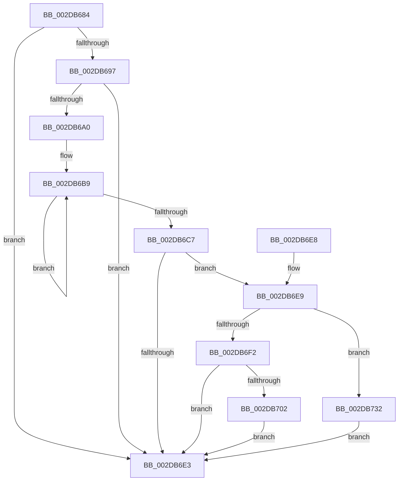

# MiCheckTrimUnusedPageFileRegions

- RVA: `0x002DB684`–`0x002DB748` (길이 `196` bytes)
- VA: `0x00000001402DB684`
- 실행 섹션: `.text`
- PDB 이름 있음: `예`; PDB Function 태그: `아니요`
- unwind 정보 RVA: `0x00070664`
- 디코드: `45`개 명령, `196/196` bytes 표시
- 미해석 바이트: `0` (있으면 어셈블리에 `.byte`로 보존)

> 이 문서는 커널 이미지의 기계어와 PDB 기호를 분석해 생성했습니다. 4번과 5번은 함수 원형과 자료형을 바이너리 사용 방식에서 추정한 C 해석이며 원본 소스 복구 결과는 아닙니다.

## 1. Dependencies

- 직접 호출 지점: **3**; 고유 호출 대상: **3**
- 직접 호출자로 확인된 함수: **1**
- RIP 상대 이미지 참조: **2**

### Outgoing calls
- `0x002DB68B` → [MiNumberWsSwapPagefiles](MiNumberWsSwapPagefiles_function_002DCFA4.md) (function, `0x002DCFA4`)
- `0x002DB6F9` → [PsReferencePartitionSafe](../3B/PsReferencePartitionSafe_function_003BA6C0.md) (function, `0x003BA6C0`)
- `0x002DB72B` → [ExQueueWorkItemToPartition](../35/ExQueueWorkItemToPartition_function_00356E2C.md) (function, `0x00356E2C`)

### Direct callers
- [MiWorkingSetManager](MiWorkingSetManager_function_002DA7E0.md) at `0x002DA994`

### Static image references
- `0x002DB6E9` → RVA `0x00E30141` (`.data`; read)
- `0x002DB711` → RVA `0x002AA320` (`MiTrimUnusedPageFileRegionsWorker`; read)

## 2. Other-region calls and transfers

- 다른 실행 섹션으로 향하는 call: **0**
- 별도 외부 분기/꼬리 이동을 확인하지 못했습니다.

## 3. Assembly (complete function range)

```asm
002DB684  48 83 EC 28                     sub rsp, 0x28
002DB688  4C 8B D1                        mov r10, rcx
002DB68B  E8 14 19 00 00                  call 0x1402dcfa4
002DB690  45 33 C0                        xor r8d, r8d
002DB693  85 C0                           test eax, eax
002DB695  74 4C                           je 0x1402db6e3
002DB697  4D 39 82 60 04 00 00            cmp qword ptr [r10 + 0x460], r8
002DB69E  75 43                           jne 0x1402db6e3
002DB6A0  F0 44 09 04 24                  lock or dword ptr [rsp], r8d
002DB6A5  49 B9 B0 03 00 00 80 F7 FF FF   movabs r9, 0xfffff780000003b0
002DB6AF  49 BB 08 00 00 00 80 F7 FF FF   movabs r11, 0xfffff78000000008
002DB6B9  49 8B 11                        mov rdx, qword ptr [r9]
002DB6BC  49 8B 0B                        mov rcx, qword ptr [r11]
002DB6BF  49 8B 01                        mov rax, qword ptr [r9]
002DB6C2  48 3B D0                        cmp rdx, rax
002DB6C5  75 F2                           jne 0x1402db6b9
002DB6C7  48 2B CA                        sub rcx, rdx
002DB6CA  48 BA 00 68 C4 61 08 00 00 00   movabs rdx, 0x861c46800
002DB6D4  48 8B C1                        mov rax, rcx
002DB6D7  49 2B 82 68 04 00 00            sub rax, qword ptr [r10 + 0x468]
002DB6DE  48 3B C2                        cmp rax, rdx
002DB6E1  73 06                           jae 0x1402db6e9
002DB6E3  48 83 C4 28                     add rsp, 0x28
002DB6E7  C3                              ret
002DB6E8  CC                              int3
002DB6E9  44 38 05 51 4A B5 00            cmp byte ptr [rip + 0xb54a51], r8b
002DB6F0  75 40                           jne 0x1402db732
002DB6F2  49 8B 8A B8 00 00 00            mov rcx, qword ptr [r10 + 0xb8]
002DB6F9  E8 C2 EF 0D 00                  call 0x1403ba6c0
002DB6FE  84 C0                           test al, al
002DB700  74 E1                           je 0x1402db6e3
002DB702  49 8D 8A 48 04 00 00            lea rcx, [r10 + 0x448]
002DB709  BA 03 00 00 00                  mov edx, 3
002DB70E  4C 89 01                        mov qword ptr [rcx], r8
002DB711  48 8D 05 08 EC FC FF            lea rax, [rip - 0x313f8]
002DB718  48 89 41 10                     mov qword ptr [rcx + 0x10], rax
002DB71C  41 83 C8 FF                     or r8d, 0xffffffff
002DB720  4C 89 51 18                     mov qword ptr [rcx + 0x18], r10
002DB724  4D 8B 8A B8 00 00 00            mov r9, qword ptr [r10 + 0xb8]
002DB72B  E8 FC B6 07 00                  call 0x140356e2c
002DB730  EB B1                           jmp 0x1402db6e3
002DB732  48 B8 00 F6 0B 51 F8 FF FF FF   movabs rax, 0xfffffff8510bf600
002DB73C  48 03 C1                        add rax, rcx
002DB73F  49 89 82 68 04 00 00            mov qword ptr [r10 + 0x468], rax
002DB746  EB 9B                           jmp 0x1402db6e3
```

## 4. C-style interpretation (structured pseudocode)

```c
__int64 __fastcall MiCheckTrimUnusedPageFileRegions(__int64 a1, __int64 a2, int a3)
{
    __int64 result;
    __int64 v_rsp;
    unsigned int v_stack_m28;

    v_rsp = (v_rsp) - (40);
    result = MiNumberWsSwapPagefiles(a1, a2, a3, a4);
    a3 = 0;
    if ((unsigned int)(result) == 0) goto loc_002DB6E3;
    if ((*(unsigned __int64 *)(a1 + 1120)) != 0) goto loc_002DB6E3;
loc_002DB6B9:
    if ((*(unsigned __int64 *)(a4)) != (*(unsigned __int64 *)(a4))) goto loc_002DB6B9;
    a1 = (*(unsigned __int64 *)(v_r11)) - (*(unsigned __int64 *)(a4));
    result = (a1) - (*(unsigned __int64 *)(a1 + 1128));
    if (result >= (*(unsigned __int64 *)(a4))) goto loc_002DB6E9;
loc_002DB6E3:
    v_rsp = (v_rsp) + (40);
    return result;
loc_002DB6E9:
    if ((*(unsigned __int8 *)(v_rip + 11881041)) != 0) goto loc_002DB732;
    result = PsReferencePartitionSafe(*(unsigned __int64 *)(a1 + 184), *(unsigned __int64 *)(a4), a3, a4);
    if ((unsigned __int8)(result) == 0) goto loc_002DB6E3;
    *(unsigned __int64 *)(a1 + 1096) = 0;
    *(unsigned __int64 *)(a1 + 1096 + 16) = v_rip - 201720;
    a3 = (unsigned int)((a3) | (0xFFFFFFFFULL));
    *(unsigned __int64 *)(a1 + 1096 + 24) = a1;
    result = ExQueueWorkItemToPartition(a1 + 1096, 3, a3, *(unsigned __int64 *)(a1 + 184));
    goto loc_002DB6E3;
loc_002DB732:
    result = (result) + (a1 + 1096);
    *(unsigned __int64 *)(a1 + 1128) = result;
    goto loc_002DB6E3;
}
```

## 5. (Beta) C Style

```c
int64_t MiCheckTrimUnusedPageFileRegions(int64_t Arg1, int64_t Arg2, int32_t Arg3)
{
    int64_t result;
    int64_t local_rsp;
    uint32_t v_stack_m28;

    local_rsp = (local_rsp) - (40);
    result = MiNumberWsSwapPagefiles(Arg1, Arg2, Arg3, a4);
    Arg3 = 0;
    if ((uint32_t)(result) == 0) goto loc_002DB6E3;
    if ((*(uint64_t *)(Arg1 + 0x460)) != 0) goto loc_002DB6E3;
loc_002DB6B9:
    if ((*(uint64_t *)(a4)) != (*(uint64_t *)(a4))) goto loc_002DB6B9;
    Arg1 = (*(uint64_t *)(local_r11)) - (*(uint64_t *)(a4));
    result = (Arg1) - (*(uint64_t *)(Arg1 + 0x468));
    if (result >= (*(uint64_t *)(a4))) goto loc_002DB6E9;
loc_002DB6E3:
    local_rsp = (local_rsp) + (40);
    return result;
loc_002DB6E9:
    if ((*(uint8_t *)(v_rip + 0xB54A51)) != 0) goto loc_002DB732;
    result = PsReferencePartitionSafe(*(uint64_t *)(Arg1 + 0xB8), *(uint64_t *)(a4), Arg3, a4);
    if ((uint8_t)(result) == 0) goto loc_002DB6E3;
    *(uint64_t *)(Arg1 + 0x448) = 0;
    *(uint64_t *)(Arg1 + 0x448 + 0x10) = v_rip - 201720;
    Arg3 = (uint32_t)((Arg3) | (0xFFFFFFFFULL));
    *(uint64_t *)(Arg1 + 0x448 + 0x18) = Arg1;
    result = ExQueueWorkItemToPartition(Arg1 + 1096, 3, Arg3, *(uint64_t *)(Arg1 + 0xB8));
    goto loc_002DB6E3;
loc_002DB732:
    result = (result) + (Arg1 + 1096);
    *(uint64_t *)(Arg1 + 0x468) = result;
    goto loc_002DB6E3;
}
```

## 6. Execution-region graph

[열기: 2D/3D 그래프와 함수 탐색 컨트롤 패널](../../../control-panel.html?section=text&rva=0x002DB684&view=graph)

- 2D 그래프는 위에서 아래로 흐르고, 3D 그래프는 빈 공간을 드래그해 회전합니다. Shift+드래그는 이동, 휠은 확대·축소, 함수 노드 선택은 대상 보고서 이동입니다.

### Static fallback


