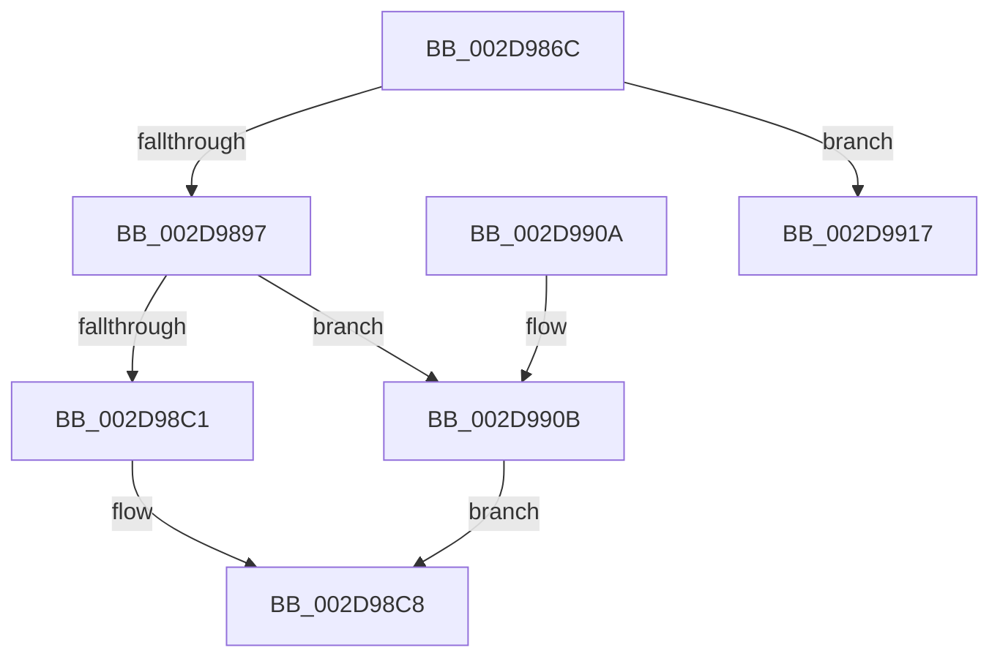

# MiDeleteCachedKernelStack

- RVA: `0x002D986C`–`0x002D992F` (길이 `195` bytes)
- VA: `0x00000001402D986C`
- 실행 섹션: `.text`
- PDB 이름 있음: `예`; PDB Function 태그: `아니요`
- unwind 정보 RVA: `0x0007042C`
- 디코드: `46`개 명령, `195/195` bytes 표시
- 미해석 바이트: `0` (있으면 어셈블리에 `.byte`로 보존)

> 이 문서는 커널 이미지의 기계어와 PDB 기호를 분석해 생성했습니다. 4번과 5번은 함수 원형과 자료형을 바이너리 사용 방식에서 추정한 C 해석이며 원본 소스 복구 결과는 아닙니다.

## 1. Dependencies

- 직접 호출 지점: **3**; 고유 호출 대상: **3**
- 직접 호출자로 확인된 함수: **2**
- RIP 상대 이미지 참조: **4**

### Outgoing calls
- `0x002D98E7` → [MiDeleteKernelStackPages](MiDeleteKernelStackPages_function_002D9938.md) (function, `0x002D9938`)
- `0x002D98FA` → [MiReleasePtes](../24/MiReleasePtes_function_00247240.md) (function, `0x00247240`)
- `0x002D9929` → [KeBugCheckEx](../4F/KeBugCheckEx_function_004FD660.md) (function, `0x004FD660`)

### Direct callers
- [MiAdjustCachedStacks](MiAdjustCachedStacks_function_002D8AAC.md) at `0x002D8BB7`
- [MiPruneCachedStackList](../49/MiPruneCachedStackList_function_00495638.md) at `0x0049569C`

### Static image references
- `0x002D9887` → RVA `0x00E37600` (`.data`; read)
- `0x002D98C1` → RVA `0x00E35FA4` (`.data`; read)
- `0x002D98F3` → RVA `0x00E35EE0` (`.data`; read)
- `0x002D990B` → RVA `0x00FC6CF8` (`ALMOSTRO`; read)

## 2. Other-region calls and transfers

- 다른 실행 섹션으로 향하는 call: **0**
- 별도 외부 분기/꼬리 이동을 확인하지 못했습니다.

## 3. Assembly (complete function range)

```asm
002D986C  48 89 5C 24 08                  mov qword ptr [rsp + 8], rbx
002D9871  57                              push rdi
002D9872  48 83 EC 30                     sub rsp, 0x30
002D9876  4C 8B 4A F0                     mov r9, qword ptr [rdx - 0x10]
002D987A  48 81 C2 10 F0 FF FF            add rdx, -0xff0
002D9881  48 8B C2                        mov rax, rdx
002D9884  4C 8B D1                        mov r10, rcx
002D9887  48 33 05 72 DD B5 00            xor rax, qword ptr [rip + 0xb5dd72]
002D988E  4C 3B C8                        cmp r9, rax
002D9891  0F 85 80 00 00 00               jne 0x1402d9917
002D9897  48 8B CA                        mov rcx, rdx
002D989A  48 B8 F8 FF FF FF 7F 00 00 00   movabs rax, 0x7ffffffff8
002D98A4  48 C1 E9 09                     shr rcx, 9
002D98A8  48 23 C8                        and rcx, rax
002D98AB  48 B8 00 00 00 00 80 F6 FF FF   movabs rax, 0xfffff68000000000
002D98B5  48 03 C8                        add rcx, rax
002D98B8  83 BA F8 0F 00 00 02            cmp dword ptr [rdx + 0xff8], 2
002D98BF  74 4A                           je 0x1402d990b
002D98C1  0F B6 3D DC C6 B5 00            movzx edi, byte ptr [rip + 0xb5c6dc]
002D98C8  48 83 64 24 20 00               and qword ptr [rsp + 0x20], 0
002D98CE  48 8B C7                        mov rax, rdi
002D98D1  48 F7 D8                        neg rax
002D98D4  41 B9 05 00 00 00               mov r9d, 5
002D98DA  4C 8B C7                        mov r8, rdi
002D98DD  48 8D 1C C1                     lea rbx, [rcx + rax*8]
002D98E1  49 8B CA                        mov rcx, r10
002D98E4  48 8B D3                        mov rdx, rbx
002D98E7  E8 4C 00 00 00                  call 0x1402d9938
002D98EC  44 8D 47 01                     lea r8d, [rdi + 1]
002D98F0  48 8B D3                        mov rdx, rbx
002D98F3  48 8D 0D E6 C5 B5 00            lea rcx, [rip + 0xb5c5e6]
002D98FA  E8 41 D9 F6 FF                  call 0x140247240
002D98FF  48 8B 5C 24 40                  mov rbx, qword ptr [rsp + 0x40]
002D9904  48 83 C4 30                     add rsp, 0x30
002D9908  5F                              pop rdi
002D9909  C3                              ret
002D990A  CC                              int3
002D990B  8B 3D E7 D3 CE 00               mov edi, dword ptr [rip + 0xced3e7]
002D9911  48 C1 EF 0C                     shr rdi, 0xc
002D9915  EB B1                           jmp 0x1402d98c8
002D9917  4C 8B C2                        mov r8, rdx
002D991A  48 89 44 24 20                  mov qword ptr [rsp + 0x20], rax
002D991F  BA 70 34 00 00                  mov edx, 0x3470
002D9924  B9 1A 00 00 00                  mov ecx, 0x1a
002D9929  E8 32 3D 22 00                  call 0x1404fd660
002D992E  CC                              int3
```

## 4. C-style interpretation (structured pseudocode)

```c
__int64 __fastcall MiDeleteCachedKernelStack(__int64 a1, __int64 a2)
{
    __int64 result;
    __int64 v_rdi;
    __int64 v_rsp;
    unsigned __int64 v_stack_m18;
    unsigned __int64 v_stack_p20;
    unsigned __int64 v_stack_p8;

    v_stack_p8 = v_rbx;
    v_rsp = (v_rsp) - (48);
    a2 = (a2) + (0xFFFFFFFFFFFFF010ULL);
    result = (a2) ^ (*(unsigned __int64 *)(v_rip + 11918706));
    if ((*(unsigned __int64 *)(a2 - 16)) != result) goto loc_002D9917;
    a1 = (a2) >> (9);
    a1 = (a1) & (result);
    a1 = (a1) + (result);
    if ((*(unsigned int *)(a2 + 4088)) == 2) goto loc_002D990B;
loc_002D98C8:
    result = -(*(unsigned __int8 *)(v_rip + 11912924));
    result = MiDeleteKernelStackPages(a1, a1 + result * 8, *(unsigned __int8 *)(v_rip + 11912924), 5);
    result = MiReleasePtes(v_rip + 11912678, a1 + result * 8, *(unsigned __int8 *)(v_rip + 11912924) + 1, 5);
    v_rsp = (v_rsp) + (48);
    return result;
loc_002D990B:
    v_rdi = ((unsigned int)(*(unsigned int *)(v_rip + 13554663))) >> (12);
    goto loc_002D98C8;
loc_002D9917:
    v_stack_p20 = result;
    result = KeBugCheckEx(26, (unsigned int)(0x3470ULL), a1 + result * 8, 5);
    return result;
}
```

## 5. (Beta) C Style

```c
int64_t MiDeleteCachedKernelStack(int64_t Arg1, void *Arg2)
{
    uint8_t *arg2 = (uint8_t *)Arg2;

    int64_t result;
    int64_t local_rdi;
    int64_t local_rsp;
    uint64_t v_stack_m18;
    uint64_t v_stack_p20;
    uint64_t v_stack_p8;

    v_stack_p8 = local_rbx;
    local_rsp = (local_rsp) - (48);
    Arg2 = (Arg2) + (0xFFFFFFFFFFFFF010ULL);
    result = (Arg2) ^ (*(uint64_t *)(v_rip + 0xB5DD72));
    if ((*(uint64_t *)(arg2 - 0x10)) != result) goto loc_002D9917;
    Arg1 = (Arg2) >> (9);
    Arg1 = (Arg1) & (result);
    Arg1 = (Arg1) + (result);
    if ((*(uint32_t *)(arg2 + 0xFF8)) == 2) goto loc_002D990B;
loc_002D98C8:
    result = -(*(uint8_t *)(v_rip + 0xB5C6DC));
    result = MiDeleteKernelStackPages(Arg1, Arg1 + result * 8, *(uint8_t *)(v_rip + 0xB5C6DC), 5);
    result = MiReleasePtes(v_rip + 11912678, Arg1 + result * 8, *(uint8_t *)(v_rip + 0xB5C6DC) + 1, 5);
    local_rsp = (local_rsp) + (48);
    return result;
loc_002D990B:
    local_rdi = ((uint32_t)(*(uint32_t *)(v_rip + 0xCED3E7))) >> (12);
    goto loc_002D98C8;
loc_002D9917:
    v_stack_p20 = result;
    result = KeBugCheckEx(26, (uint32_t)(0x3470ULL), Arg1 + result * 8, 5);
    return result;
}
```

### 관측된 메모리 오프셋

구조체 형식이 확인되지 않은 접근은 인자 기준의 오프셋으로만 기록했습니다.

| 기준 인자 | 오프셋 표현 | 폭 (bit) | 접근 |
|---|---:|---:|---|
| `Arg2` | `- 0x10` | `64` | `R` |
| `Arg2` | `+ 0xFF8` | `32` | `R` |

## 6. Execution-region graph

[열기: 2D/3D 그래프와 함수 탐색 컨트롤 패널](../../../control-panel.html?section=text&rva=0x002D986C&view=graph)

- 2D 그래프는 위에서 아래로 흐르고, 3D 그래프는 빈 공간을 드래그해 회전합니다. Shift+드래그는 이동, 휠은 확대·축소, 함수 노드 선택은 대상 보고서 이동입니다.

### Static fallback


