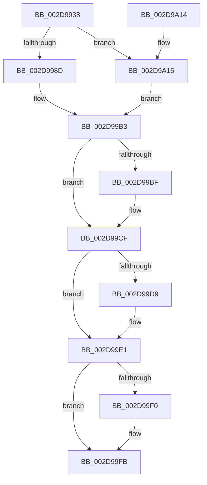

# MiDeleteKernelStackPages

- RVA: `0x002D9938`–`0x002D9A3A` (길이 `258` bytes)
- VA: `0x00000001402D9938`
- 실행 섹션: `.text`
- PDB 이름 있음: `예`; PDB Function 태그: `아니요`
- unwind 정보 RVA: `0x0007043C`
- 디코드: `66`개 명령, `258/258` bytes 표시
- 미해석 바이트: `0` (있으면 어셈블리에 `.byte`로 보존)

> 이 문서는 커널 이미지의 기계어와 PDB 기호를 분석해 생성했습니다. 4번과 5번은 함수 원형과 자료형을 바이너리 사용 방식에서 추정한 C 해석이며 원본 소스 복구 결과는 아닙니다.

## 1. Dependencies

- 직접 호출 지점: **5**; 고유 호출 대상: **5**
- 직접 호출자로 확인된 함수: **5**
- RIP 상대 이미지 참조: **2**

### Outgoing calls
- `0x002D9977` → [MiVaToFlushVm](../31/MiVaToFlushVm_function_0031AD84.md) (function, `0x0031AD84`)
- `0x002D99AE` → [MiDecommitPages](../24/MiDecommitPages_function_00241BD0.md) (function, `0x00241BD0`)
- `0x002D99DC` → [MiReturnResident](../28/MiReturnResident_function_00286890.md) (function, `0x00286890`)
- `0x002D99F6` → [MiReturnCommit](../24/MiReturnCommit_function_00248410.md) (function, `0x00248410`)
- `0x002D9A2D` → [MiDeleteShadowStackPtes](../49/MiDeleteShadowStackPtes_function_00493AE4.md) (function, `0x00493AE4`)

### Direct callers
- [MiAllocateKernelStackPages](../2A/MiAllocateKernelStackPages_function_002A1BEC.md) at `0x002A1FCD`
- [MiDeleteCachedKernelStack](MiDeleteCachedKernelStack_function_002D986C.md) at `0x002D98E7`
- [MmDeleteKernelStack](../33/MmDeleteKernelStack_function_0033A960.md) at `0x0033AD72`
- [MmDeleteKernelStack](../33/MmDeleteKernelStack_function_0033A960.md) at `0x0033AE81`
- [MiDeleteCachedKernelShadowStack](../49/MiDeleteCachedKernelShadowStack_function_004956CC.md) at `0x00495703`
- [sub_006E1FEC](../6E/Unknown_function_006E1FEC.md) at `0x006E2009`

### Static image references
- `0x002D99B3` → RVA `0x00E38D00` (`.data`; read)
- `0x002D99C7` → RVA `0x00E376E8` (`.data`; read/write)

## 2. Other-region calls and transfers

- 다른 실행 섹션으로 향하는 call: **0**
- 별도 외부 분기/꼬리 이동을 확인하지 못했습니다.

## 3. Assembly (complete function range)

```asm
002D9938  4C 8B DC                        mov r11, rsp
002D993B  49 89 5B 08                     mov qword ptr [r11 + 8], rbx
002D993F  49 89 6B 10                     mov qword ptr [r11 + 0x10], rbp
002D9943  49 89 73 18                     mov qword ptr [r11 + 0x18], rsi
002D9947  57                              push rdi
002D9948  48 81 EC 80 00 00 00            sub rsp, 0x80
002D994F  0F 57 C0                        xorps xmm0, xmm0
002D9952  48 8D 72 08                     lea rsi, [rdx + 8]
002D9956  48 8B F9                        mov rdi, rcx
002D9959  33 C0                           xor eax, eax
002D995B  0F 11 44 24 40                  movups xmmword ptr [rsp + 0x40], xmm0
002D9960  48 8B CE                        mov rcx, rsi
002D9963  41 8B D9                        mov ebx, r9d
002D9966  0F 11 44 24 50                  movups xmmword ptr [rsp + 0x50], xmm0
002D996B  49 8B E8                        mov rbp, r8
002D996E  0F 11 44 24 60                  movups xmmword ptr [rsp + 0x60], xmm0
002D9973  49 89 43 E8                     mov qword ptr [r11 - 0x18], rax
002D9977  E8 08 14 04 00                  call 0x14031ad84
002D997C  48 8B D0                        mov rdx, rax
002D997F  48 8D 44 24 40                  lea rax, [rsp + 0x40]
002D9984  83 FB 05                        cmp ebx, 5
002D9987  0F 85 88 00 00 00               jne 0x1402d9a15
002D998D  33 DB                           xor ebx, ebx
002D998F  48 89 44 24 38                  mov qword ptr [rsp + 0x38], rax
002D9994  48 89 5C 24 30                  mov qword ptr [rsp + 0x30], rbx
002D9999  45 33 C9                        xor r9d, r9d
002D999C  89 5C 24 28                     mov dword ptr [rsp + 0x28], ebx
002D99A0  45 33 C0                        xor r8d, r8d
002D99A3  48 8B D5                        mov rdx, rbp
002D99A6  48 89 5C 24 20                  mov qword ptr [rsp + 0x20], rbx
002D99AB  48 8B CE                        mov rcx, rsi
002D99AE  E8 1D 82 F6 FF                  call 0x140241bd0
002D99B3  48 8D 05 46 F3 B5 00            lea rax, [rip + 0xb5f346]
002D99BA  48 3B F8                        cmp rdi, rax
002D99BD  75 10                           jne 0x1402d99cf
002D99BF  48 8B CB                        mov rcx, rbx
002D99C2  48 2B 4C 24 58                  sub rcx, qword ptr [rsp + 0x58]
002D99C7  F0 48 01 0D 19 DD B5 00         lock add qword ptr [rip + 0xb5dd19], rcx
002D99CF  48 8B 54 24 40                  mov rdx, qword ptr [rsp + 0x40]
002D99D4  48 2B D3                        sub rdx, rbx
002D99D7  74 08                           je 0x1402d99e1
002D99D9  48 8B CF                        mov rcx, rdi
002D99DC  E8 AF CE FA FF                  call 0x140286890
002D99E1  48 8B 54 24 58                  mov rdx, qword ptr [rsp + 0x58]
002D99E6  48 2B 54 24 48                  sub rdx, qword ptr [rsp + 0x48]
002D99EB  48 2B D3                        sub rdx, rbx
002D99EE  74 0B                           je 0x1402d99fb
002D99F0  45 33 C0                        xor r8d, r8d
002D99F3  48 8B CF                        mov rcx, rdi
002D99F6  E8 15 EA F6 FF                  call 0x140248410
002D99FB  4C 8D 9C 24 80 00 00 00         lea r11, [rsp + 0x80]
002D9A03  49 8B 5B 10                     mov rbx, qword ptr [r11 + 0x10]
002D9A07  49 8B 6B 18                     mov rbp, qword ptr [r11 + 0x18]
002D9A0B  49 8B 73 20                     mov rsi, qword ptr [r11 + 0x20]
002D9A0F  49 8B E3                        mov rsp, r11
002D9A12  5F                              pop rdi
002D9A13  C3                              ret
002D9A14  CC                              int3
002D9A15  48 89 44 24 28                  mov qword ptr [rsp + 0x28], rax
002D9A1A  4C 8B CD                        mov r9, rbp
002D9A1D  48 8B 84 24 B0 00 00 00         mov rax, qword ptr [rsp + 0xb0]
002D9A25  4C 8B C6                        mov r8, rsi
002D9A28  48 89 44 24 20                  mov qword ptr [rsp + 0x20], rax
002D9A2D  E8 B2 A0 1B 00                  call 0x140493ae4
002D9A32  48 8B D8                        mov rbx, rax
002D9A35  E9 79 FF FF FF                  jmp 0x1402d99b3
```

## 4. C-style interpretation (structured pseudocode)

```c
__int64 __fastcall MiDeleteKernelStackPages(__int64 a1, __int64 a2, __int64 a3, int a4, __int64 a5)
{
    __int64 result;
    __int64 v_rbx;
    __int64 v_rsp;
    unsigned __int64 v_stack_m28;
    unsigned __int64 v_stack_m30;
    unsigned __int64 v_stack_m38;
    unsigned __int64 v_stack_m40;
    unsigned __int64 v_stack_m48;
    unsigned __int64 v_stack_m50;
    unsigned __int64 v_stack_m58;
    unsigned int v_stack_m60;
    unsigned __int64 v_stack_m68;
    unsigned __int64 v_stack_m8;

    *(unsigned __int64 *)(v_rsp + 8) = v_rbx;
    *(unsigned __int64 *)(v_rsp + 16) = v_rbp;
    *(unsigned __int64 *)(v_rsp + 24) = v_rsi;
    v_rsp = (v_rsp) - (128);
    result = 0;
    v_stack_m48 = v_xmm0;
    v_stack_m38 = v_xmm0;
    v_stack_m28 = v_xmm0;
    *(unsigned __int64 *)(v_rsp - 24) = 0;
    result = MiVaToFlushVm(a2 + 8, a2, a3, a4);
    if (((unsigned int)((unsigned int)(a4))) != 5) goto loc_002D9A15;
    v_rbx = 0;
    v_stack_m50 = v_stack_m48;
    v_stack_m58 = 0;
    a4 = 0;
    v_stack_m60 = 0;
    a3 = 0;
    v_stack_m68 = 0;
    result = MiDecommitPages(a2 + 8, 0, a3, a4);
loc_002D99B3:
    if (a1 == (v_rip + 11924294)) {
        a1 = 0;
        a1 = (a1) - (v_stack_m30);
    }
    a2 = (v_stack_m48) - (0);
    result = v_rip + 11924294;
    if (!(condition_is_equal)) {
        a1 = a1;
        result = MiReturnResident(a1, a2, a3, a4);
    }
    a2 = (v_stack_m30) - (v_stack_m40);
    a2 = (a2) - (0);
    if (!(condition_is_equal)) {
        a3 = 0;
        a1 = a1;
        result = MiReturnCommit(a1, a2, a3, a4);
    }
    return result;
loc_002D9A15:
    v_stack_m58 = result;
    v_stack_m60 = a5;
    result = MiDeleteShadowStackPtes(a1, a2, *(unsigned __int64 *)(v_stack_m8 + 32), *(unsigned __int64 *)(v_stack_m8 + 24));
    goto loc_002D99B3;
}
```

## 5. (Beta) C Style

```c
int64_t MiDeleteKernelStackPages(int64_t Arg1, void *Arg2, int64_t Arg3, int32_t Arg4, int64_t Arg5)
{
    uint8_t *arg2 = (uint8_t *)Arg2;

    int64_t result;
    int64_t local_rbx;
    int64_t local_rsp;
    uint64_t v_stack_m28;
    uint64_t v_stack_m30;
    uint64_t v_stack_m38;
    uint64_t v_stack_m40;
    uint64_t v_stack_m48;
    uint64_t v_stack_m50;
    uint64_t v_stack_m58;
    uint32_t v_stack_m60;
    uint64_t v_stack_m68;
    uint64_t v_stack_m8;

    *(uint64_t *)(local_rsp + 0x8) = local_rbx;
    *(uint64_t *)(local_rsp + 0x10) = local_rbp;
    *(uint64_t *)(local_rsp + 0x18) = local_rsi;
    local_rsp = (local_rsp) - (128);
    result = 0;
    v_stack_m48 = v_xmm0;
    v_stack_m38 = v_xmm0;
    v_stack_m28 = v_xmm0;
    *(uint64_t *)(local_rsp - 0x18) = 0;
    result = MiVaToFlushVm(Arg2 + 8, Arg2, Arg3, Arg4);
    if (((uint32_t)((uint32_t)(Arg4))) != 5) goto loc_002D9A15;
    local_rbx = 0;
    v_stack_m50 = v_stack_m48;
    v_stack_m58 = 0;
    Arg4 = 0;
    v_stack_m60 = 0;
    Arg3 = 0;
    v_stack_m68 = 0;
    result = MiDecommitPages(Arg2 + 8, 0, Arg3, Arg4);
loc_002D99B3:
    if (Arg1 == (v_rip + 11924294)) {
        Arg1 = 0;
        Arg1 = (Arg1) - (v_stack_m30);
    }
    Arg2 = (v_stack_m48) - (0);
    result = v_rip + 11924294;
    if (!(condition_is_equal)) {
        Arg1 = Arg1;
        result = MiReturnResident(Arg1, Arg2, Arg3, Arg4);
    }
    Arg2 = (v_stack_m30) - (v_stack_m40);
    Arg2 = (Arg2) - (0);
    if (!(condition_is_equal)) {
        Arg3 = 0;
        Arg1 = Arg1;
        result = MiReturnCommit(Arg1, Arg2, Arg3, Arg4);
    }
    return result;
loc_002D9A15:
    v_stack_m58 = result;
    v_stack_m60 = Arg5;
    result = MiDeleteShadowStackPtes(Arg1, Arg2, *(uint64_t *)(v_stack_m8 + 0x20), *(uint64_t *)(v_stack_m8 + 0x18));
    goto loc_002D99B3;
}
```

### 관측된 메모리 오프셋

구조체 형식이 확인되지 않은 접근은 인자 기준의 오프셋으로만 기록했습니다.

| 기준 인자 | 오프셋 표현 | 폭 (bit) | 접근 |
|---|---:|---:|---|
| `Arg2` | `+ 0x8` | `64` | `R` |

## 6. Execution-region graph

[열기: 2D/3D 그래프와 함수 탐색 컨트롤 패널](../../../control-panel.html?section=text&rva=0x002D9938&view=graph)

- 2D 그래프는 위에서 아래로 흐르고, 3D 그래프는 빈 공간을 드래그해 회전합니다. Shift+드래그는 이동, 휠은 확대·축소, 함수 노드 선택은 대상 보고서 이동입니다.

### Static fallback


