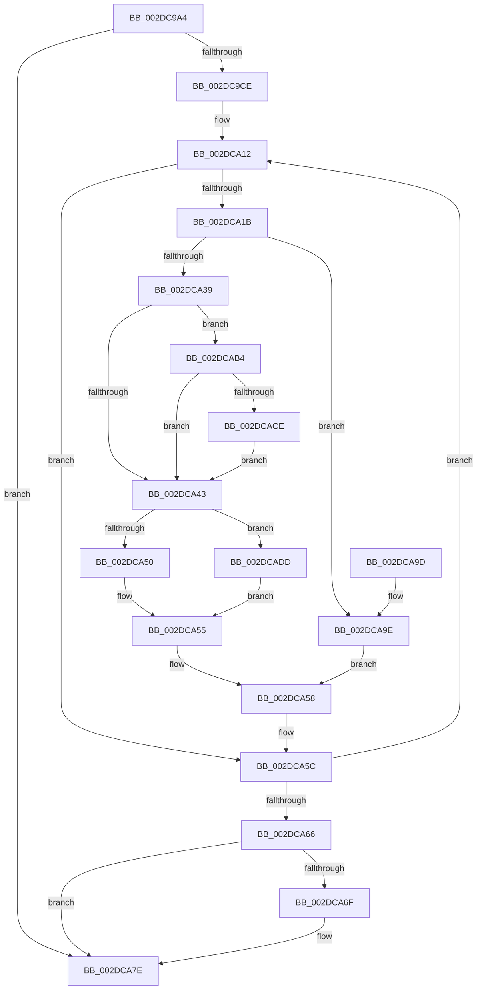

# MiDeleteUltraMapContext

- RVA: `0x002DC9A4`–`0x002DCAE7` (길이 `323` bytes)
- VA: `0x00000001402DC9A4`
- 실행 섹션: `.text`
- PDB 이름 있음: `예`; PDB Function 태그: `아니요`
- unwind 정보 RVA: `0x00070788`
- 디코드: `82`개 명령, `323/323` bytes 표시
- 미해석 바이트: `0` (있으면 어셈블리에 `.byte`로 보존)

> 이 문서는 커널 이미지의 기계어와 PDB 기호를 분석해 생성했습니다. 4번과 5번은 함수 원형과 자료형을 바이너리 사용 방식에서 추정한 C 해석이며 원본 소스 복구 결과는 아닙니다.

## 1. Dependencies

- 직접 호출 지점: **7**; 고유 호출 대상: **7**
- 직접 호출자로 확인된 함수: **2**
- RIP 상대 이미지 참조: **8**

### Outgoing calls
- `0x002DCA00` → [MiGetUltraMapping](../32/MiGetUltraMapping_function_00323270.md) (function, `0x00323270`)
- `0x002DCA50` → [MiReleaseFreshPage](../33/MiReleaseFreshPage_function_00334AE0.md) (function, `0x00334AE0`)
- `0x002DCA79` → [MiReleaseNonPagedResources](../32/MiReleaseNonPagedResources_function_0032299C.md) (function, `0x0032299C`)
- `0x002DCA9E` → [MI_PAGE_TO_FULL_COLOR](../33/MI_PAGE_TO_FULL_COLOR_function_00337820.md) (function, `0x00337820`)
- `0x002DCAAD` → [MiManageUltraSpacePageTable](MiManageUltraSpacePageTable_function_002DCAF0.md) (function, `0x002DCAF0`)
- `0x002DCAD3` → [MiArePageContentsZero](../4D/MiArePageContentsZero_function_004D4278.md) (function, `0x004D4278`)
- `0x002DCADD` → [MiReleaseFreshPageAtDpc](../33/MiReleaseFreshPageAtDpc_function_00334B50.md) (function, `0x00334B50`)

### Direct callers
- [MiReclaimUnusedUltraMdlMaps](MiReclaimUnusedUltraMdlMaps_function_002DC4C0.md) at `0x002DC56F`
- [sub_006F9120](../6F/Unknown_function_006F9120.md) at `0x006F91E4`

### Static image references
- `0x002DC9EE` → RVA `0x00011C60` (`.rdata`; read)
- `0x002DCA05` → RVA `0x00E3601C` (`.data`; read/write)
- `0x002DCA30` → RVA `0x00E2DC41` (`.data`; read)
- `0x002DCA39` → RVA `0x00FC6A88` (`ALMOSTRO`; read)
- `0x002DCA72` → RVA `0x00E38D00` (`.data`; read)
- `0x002DCAB4` → RVA `0x00E30270` (`.data`; read)
- `0x002DCABC` → RVA `0x00FC5054` (`ALMOSTRO`; reference)
- `0x002DCAC2` → RVA `0x00E30270` (`.data`; write)

## 2. Other-region calls and transfers

- 다른 실행 섹션으로 향하는 call: **0**
- 별도 외부 분기/꼬리 이동을 확인하지 못했습니다.

## 3. Assembly (complete function range)

```asm
002DC9A4  48 8B C4                        mov rax, rsp
002DC9A7  48 89 58 08                     mov qword ptr [rax + 8], rbx
002DC9AB  48 89 68 10                     mov qword ptr [rax + 0x10], rbp
002DC9AF  48 89 70 18                     mov qword ptr [rax + 0x18], rsi
002DC9B3  48 89 78 20                     mov qword ptr [rax + 0x20], rdi
002DC9B7  41 54                           push r12
002DC9B9  41 56                           push r14
002DC9BB  41 57                           push r15
002DC9BD  48 83 EC 20                     sub rsp, 0x20
002DC9C1  80 79 18 00                     cmp byte ptr [rcx + 0x18], 0
002DC9C5  48 8B E9                        mov rbp, rcx
002DC9C8  0F 84 B0 00 00 00               je 0x1402dca7e
002DC9CE  8A 41 19                        mov al, byte ptr [rcx + 0x19]
002DC9D1  F6 D8                           neg al
002DC9D3  45 1B E4                        sbb r12d, r12d
002DC9D6  41 83 E4 FE                     and r12d, 0xfffffffe
002DC9DA  44 0F 20 C0                     mov rax, cr8
002DC9DE  41 BF 06 00 00 00               mov r15d, 6
002DC9E4  44 8B C2                        mov r8d, edx
002DC9E7  45 8D 77 FC                     lea r14d, [r15 - 4]
002DC9EB  41 3A C6                        cmp al, r14b
002DC9EE  48 8D 05 6B 52 D3 FF            lea rax, [rip - 0x2cad95]
002DC9F5  4E 8B 04 C0                     mov r8, qword ptr [rax + r8*8]
002DC9F9  45 0F 45 FE                     cmovne r15d, r14d
002DC9FD  45 8B CF                        mov r9d, r15d
002DCA00  E8 6B 68 04 00                  call 0x140323270
002DCA05  F0 FF 0D 10 96 B5 00            lock dec dword ptr [rip + 0xb59610]
002DCA0C  48 8D 75 08                     lea rsi, [rbp + 8]
002DCA10  33 FF                           xor edi, edi
002DCA12  48 8B 0E                        mov rcx, qword ptr [rsi]
002DCA15  48 83 F9 FF                     cmp rcx, -1
002DCA19  74 41                           je 0x1402dca5c
002DCA1B  48 8D 1C 49                     lea rbx, [rcx + rcx*2]
002DCA1F  48 C1 E3 04                     shl rbx, 4
002DCA23  48 B8 00 00 00 00 00 DE FF FF   movabs rax, 0xffffde0000000000
002DCA2D  48 03 D8                        add rbx, rax
002DCA30  80 3D 0A 12 B5 00 00            cmp byte ptr [rip + 0xb5120a], 0
002DCA37  75 65                           jne 0x1402dca9e
002DCA39  8A 05 49 A0 CE 00               mov al, byte ptr [rip + 0xcea049]
002DCA3F  84 C0                           test al, al
002DCA41  78 71                           js 0x1402dcab4
002DCA43  48 8B CB                        mov rcx, rbx
002DCA46  41 F6 C7 04                     test r15b, 4
002DCA4A  0F 85 8D 00 00 00               jne 0x1402dcadd
002DCA50  E8 8B 80 05 00                  call 0x140334ae0
002DCA55  48 FF C7                        inc rdi
002DCA58  48 83 0E FF                     or qword ptr [rsi], 0xffffffffffffffff
002DCA5C  48 83 C6 08                     add rsi, 8
002DCA60  49 83 EE 01                     sub r14, 1
002DCA64  75 AC                           jne 0x1402dca12
002DCA66  44 88 75 18                     mov byte ptr [rbp + 0x18], r14b
002DCA6A  48 85 FF                        test rdi, rdi
002DCA6D  74 0F                           je 0x1402dca7e
002DCA6F  48 8B D7                        mov rdx, rdi
002DCA72  48 8D 0D 87 C2 B5 00            lea rcx, [rip + 0xb5c287]
002DCA79  E8 1E 5F 04 00                  call 0x14032299c
002DCA7E  48 8B 5C 24 40                  mov rbx, qword ptr [rsp + 0x40]
002DCA83  48 8B 6C 24 48                  mov rbp, qword ptr [rsp + 0x48]
002DCA88  48 8B 74 24 50                  mov rsi, qword ptr [rsp + 0x50]
002DCA8D  48 8B 7C 24 58                  mov rdi, qword ptr [rsp + 0x58]
002DCA92  48 83 C4 20                     add rsp, 0x20
002DCA96  41 5F                           pop r15
002DCA98  41 5E                           pop r14
002DCA9A  41 5C                           pop r12
002DCA9C  C3                              ret
002DCA9D  CC                              int3
002DCA9E  E8 7D AD 05 00                  call 0x140337820
002DCAA3  45 8D 44 24 03                  lea r8d, [r12 + 3]
002DCAA8  8B D0                           mov edx, eax
002DCAAA  48 8B CB                        mov rcx, rbx
002DCAAD  E8 3E 00 00 00                  call 0x1402dcaf0
002DCAB2  EB A4                           jmp 0x1402dca58
002DCAB4  8B 05 B6 37 B5 00               mov eax, dword ptr [rip + 0xb537b6]
002DCABA  FF C0                           inc eax
002DCABC  85 05 92 85 CE 00               test dword ptr [rip + 0xce8592], eax
002DCAC2  89 05 A8 37 B5 00               mov dword ptr [rip + 0xb537a8], eax
002DCAC8  0F 85 75 FF FF FF               jne 0x1402dca43
002DCACE  BA 01 00 00 00                  mov edx, 1
002DCAD3  E8 A0 77 1F 00                  call 0x1404d4278
002DCAD8  E9 66 FF FF FF                  jmp 0x1402dca43
002DCADD  E8 6E 80 05 00                  call 0x140334b50
002DCAE2  E9 6E FF FF FF                  jmp 0x1402dca55
```

## 4. C-style interpretation (structured pseudocode)

```c
__int64 __fastcall MiDeleteUltraMapContext(__int64 a1, int a2)
{
    __int64 result;
    __int64 v_r12;
    __int64 v_r14;
    __int64 v_r15;
    __int64 v_rbx;
    __int64 v_rdi;
    __int64 v_rsi;
    __int64 v_rsp;
    unsigned __int64 v_stack_p10;
    unsigned __int64 v_stack_p18;
    unsigned __int64 v_stack_p20;
    unsigned __int64 v_stack_p8;

    *(unsigned __int64 *)(v_rsp + 8) = v_rbx;
    *(unsigned __int64 *)(v_rsp + 16) = v_rbp;
    *(unsigned __int64 *)(v_rsp + 24) = v_rsi;
    *(unsigned __int64 *)(v_rsp + 32) = v_rdi;
    v_rsp = (v_rsp) - (32);
    if ((*(unsigned __int8 *)(a1 + 24)) == 0) goto loc_002DCA7E;
    result = (unsigned __int8)(-(*(unsigned __int8 *)(a1 + 25)));
    v_r12 = (unsigned int)((v_r12) & (0xFFFFFFFEULL));
    v_r15 = 6;
    if (((unsigned __int8)(v_cr8)) != ((unsigned __int8)(6 - 4))) { v_r15 = (unsigned int)(6 - 4); }
    result = MiGetUltraMapping(a1, a2, *(unsigned __int64 *)(v_rip - 2928021 + (unsigned int)(a2) * 8), (unsigned int)((unsigned int)(v_r15)));
    v_rdi = 0;
loc_002DCA12:
    if ((*(unsigned __int64 *)(a1 + 8)) == -1) goto loc_002DCA5C;
    v_rbx = (*(unsigned __int64 *)(a1 + 8) + *(unsigned __int64 *)(a1 + 8) * 2) << (4);
    v_rbx = (v_rbx) + (result);
    if ((*(unsigned __int8 *)(v_rip + 11866634)) != 0) goto loc_002DCA9E;
    if (sign_flag) goto loc_002DCAB4;
loc_002DCA43:
    if ((((unsigned __int8)(v_r15)) & (4)) != 0) goto loc_002DCADD;
    result = MiReleaseFreshPage(v_rbx, a2, *(unsigned __int64 *)(v_rip - 2928021 + (unsigned int)(a2) * 8), (unsigned int)((unsigned int)(v_r15)));
loc_002DCA55:
    v_rdi = (v_rdi) + 1;
loc_002DCA58:
loc_002DCA5C:
    v_rsi = (a1 + 8) + (8);
    v_r14 = (6 - 4) - (1);
    if (condition_is_not_equal) goto loc_002DCA12;
    *(unsigned __int8 *)(a1 + 24) = (unsigned __int8)(v_r14);
    if (v_rdi != 0) {
        a2 = v_rdi;
        a1 = v_rip + 11911815;
        result = MiReleaseNonPagedResources(a1, a2, *(unsigned __int64 *)(v_rip - 2928021 + (unsigned int)(a2) * 8), (unsigned int)((unsigned int)(v_r15)));
    }
    v_rsp = (v_rsp) + (32);
    return result;
loc_002DCA9E:
    result = MI_PAGE_TO_FULL_COLOR(a1, a2, *(unsigned __int64 *)(v_rip - 2928021 + (unsigned int)(a2) * 8), (unsigned int)((unsigned int)(v_r15)));
    result = MiManageUltraSpacePageTable(v_stack_p8, (unsigned int)((unsigned int)(result)), v_r12 + 3, (unsigned int)((unsigned int)(v_r15)));
    goto loc_002DCA58;
loc_002DCAB4:
    result = (unsigned int)(((unsigned int)(*(unsigned int *)(v_rip + 11876278))) + 1);
    *(unsigned int *)(v_rip + 11876264) = (unsigned int)(result);
    if (((*(unsigned int *)(v_rip + 13534610)) & ((unsigned int)(result))) != 0) goto loc_002DCA43;
    result = MiArePageContentsZero(v_stack_p8, 1, v_r12 + 3, (unsigned int)((unsigned int)(v_r15)));
    goto loc_002DCA43;
loc_002DCADD:
    result = MiReleaseFreshPageAtDpc(v_stack_p8, 1, v_r12 + 3, (unsigned int)((unsigned int)(v_r15)));
    goto loc_002DCA55;
}
```

## 5. (Beta) C Style

```c
int64_t MiDeleteUltraMapContext(void *Arg1, int32_t Arg2)
{
    uint8_t *arg1 = (uint8_t *)Arg1;

    int64_t result;
    int64_t local_r12;
    int64_t local_r14;
    int64_t local_r15;
    int64_t local_rbx;
    int64_t local_rdi;
    int64_t local_rsi;
    int64_t local_rsp;
    uint64_t v_stack_p10;
    uint64_t v_stack_p18;
    uint64_t v_stack_p20;
    uint64_t v_stack_p8;

    *(uint64_t *)(local_rsp + 0x8) = local_rbx;
    *(uint64_t *)(local_rsp + 0x10) = local_rbp;
    *(uint64_t *)(local_rsp + 0x18) = local_rsi;
    *(uint64_t *)(local_rsp + 0x20) = local_rdi;
    local_rsp = (local_rsp) - (32);
    if ((*(uint8_t *)(arg1 + 0x18)) == 0) goto loc_002DCA7E;
    result = (uint8_t)(-(*(uint8_t *)(arg1 + 0x19)));
    local_r12 = (uint32_t)((local_r12) & (0xFFFFFFFEULL));
    local_r15 = 6;
    if (((uint8_t)(v_cr8)) != ((uint8_t)(6 - 4))) { local_r15 = (uint32_t)(6 - 4); }
    result = MiGetUltraMapping(Arg1, Arg2, *(uint64_t *)(v_rip - 0x2CAD95 + (uint32_t)(Arg2) * 8), (uint32_t)((uint32_t)(local_r15)));
    local_rdi = 0;
loc_002DCA12:
    if ((*(uint64_t *)(arg1 + 0x8)) == -1) goto loc_002DCA5C;
    local_rbx = (*(uint64_t *)(arg1 + 0x8) + *(uint64_t *)(arg1 + 0x8) * 2) << (4);
    local_rbx = (local_rbx) + (result);
    if ((*(uint8_t *)(v_rip + 0xB5120A)) != 0) goto loc_002DCA9E;
    if (sign_flag) goto loc_002DCAB4;
loc_002DCA43:
    if ((((uint8_t)(local_r15)) & (4)) != 0) goto loc_002DCADD;
    result = MiReleaseFreshPage(local_rbx, Arg2, *(uint64_t *)(v_rip - 0x2CAD95 + (uint32_t)(Arg2) * 8), (uint32_t)((uint32_t)(local_r15)));
loc_002DCA55:
    local_rdi = (local_rdi) + 1;
loc_002DCA58:
loc_002DCA5C:
    local_rsi = (Arg1 + 8) + (8);
    local_r14 = (6 - 4) - (1);
    if (condition_is_not_equal) goto loc_002DCA12;
    *(uint8_t *)(arg1 + 0x18) = (uint8_t)(local_r14);
    if (local_rdi != 0) {
        Arg2 = local_rdi;
        Arg1 = v_rip + 11911815;
        result = MiReleaseNonPagedResources(Arg1, Arg2, *(uint64_t *)(v_rip - 0x2CAD95 + (uint32_t)(Arg2) * 8), (uint32_t)((uint32_t)(local_r15)));
    }
    local_rsp = (local_rsp) + (32);
    return result;
loc_002DCA9E:
    result = MI_PAGE_TO_FULL_COLOR(Arg1, Arg2, *(uint64_t *)(v_rip - 0x2CAD95 + (uint32_t)(Arg2) * 8), (uint32_t)((uint32_t)(local_r15)));
    result = MiManageUltraSpacePageTable(v_stack_p8, (uint32_t)((uint32_t)(result)), local_r12 + 3, (uint32_t)((uint32_t)(local_r15)));
    goto loc_002DCA58;
loc_002DCAB4:
    result = (uint32_t)(((uint32_t)(*(uint32_t *)(v_rip + 0xB537B6))) + 1);
    *(uint32_t *)(v_rip + 0xB537A8) = (uint32_t)(result);
    if (((*(uint32_t *)(v_rip + 0xCE8592)) & ((uint32_t)(result))) != 0) goto loc_002DCA43;
    result = MiArePageContentsZero(v_stack_p8, 1, local_r12 + 3, (uint32_t)((uint32_t)(local_r15)));
    goto loc_002DCA43;
loc_002DCADD:
    result = MiReleaseFreshPageAtDpc(v_stack_p8, 1, local_r12 + 3, (uint32_t)((uint32_t)(local_r15)));
    goto loc_002DCA55;
}
```

### 관측된 메모리 오프셋

구조체 형식이 확인되지 않은 접근은 인자 기준의 오프셋으로만 기록했습니다.

| 기준 인자 | 오프셋 표현 | 폭 (bit) | 접근 |
|---|---:|---:|---|
| `Arg1` | `+ 0x0` | `64` | `R` |
| `Arg1` | `+ 0x0` | `64` | `R/W` |
| `Arg1` | `+ 0x8` | `64` | `R` |
| `Arg1` | `+ 0x18` | `8` | `R` |
| `Arg1` | `+ 0x18` | `8` | `W` |
| `Arg1` | `+ 0x19` | `8` | `R` |

## 6. Execution-region graph

[열기: 2D/3D 그래프와 함수 탐색 컨트롤 패널](../../../control-panel.html?section=text&rva=0x002DC9A4&view=graph)

- 2D 그래프는 위에서 아래로 흐르고, 3D 그래프는 빈 공간을 드래그해 회전합니다. Shift+드래그는 이동, 휠은 확대·축소, 함수 노드 선택은 대상 보고서 이동입니다.

### Static fallback


