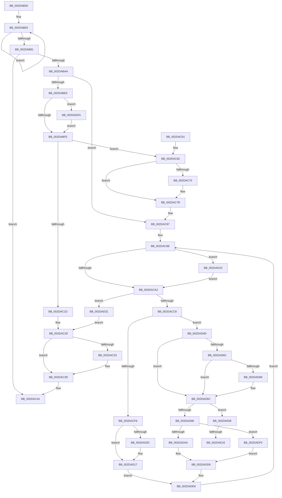

# MiEmptyDecayClusterTimers

- RVA: `0x002DAB50`–`0x002DAE3F` (길이 `751` bytes)
- VA: `0x00000001402DAB50`
- 실행 섹션: `.text`
- PDB 이름 있음: `예`; PDB Function 태그: `예`
- unwind 정보 RVA: `0x000705A0`
- 디코드: `177`개 명령, `751/751` bytes 표시
- 미해석 바이트: `0` (있으면 어셈블리에 `.byte`로 보존)

> 이 문서는 커널 이미지의 기계어와 PDB 기호를 분석해 생성했습니다. 4번과 5번은 함수 원형과 자료형을 바이너리 사용 방식에서 추정한 C 해석이며 원본 소스 복구 결과는 아닙니다.

## 1. Dependencies

- 직접 호출 지점: **23**; 고유 호출 대상: **10**
- 직접 호출자로 확인된 함수: **1**
- RIP 상대 이미지 참조: **4**

### Outgoing calls
- `0x002DAC01` → [ExAcquireSpinLockExclusiveAtDpcLevel](../24/ExAcquireSpinLockExclusiveAtDpcLevel_function_00248E80.md) (function, `0x00248E80`)
- `0x002DAC24` → [ExReleaseSpinLockExclusiveFromDpcLevel](../24/ExReleaseSpinLockExclusiveFromDpcLevel_function_002497E0.md) (function, `0x002497E0`)
- `0x002DAC38` → [KiLowerIrqlProcessIrqlFlags](../4F/KiLowerIrqlProcessIrqlFlags_function_004F5698.md) (function, `0x004F5698`)
- `0x002DAC62` → [ExReleaseSpinLockExclusiveFromDpcLevel](../24/ExReleaseSpinLockExclusiveFromDpcLevel_function_002497E0.md) (function, `0x002497E0`)
- `0x002DAC76` → [KiLowerIrqlProcessIrqlFlags](../4F/KiLowerIrqlProcessIrqlFlags_function_004F5698.md) (function, `0x004F5698`)
- `0x002DACA6` → [ExAcquireSpinLockSharedAtDpcLevel](../24/ExAcquireSpinLockSharedAtDpcLevel_function_00248E30.md) (function, `0x00248E30`)
- `0x002DACAE` → [ExAcquireSpinLockExclusiveAtDpcLevel](../24/ExAcquireSpinLockExclusiveAtDpcLevel_function_00248E80.md) (function, `0x00248E80`)
- `0x002DACF6` → [ExReleaseSpinLockExclusiveFromDpcLevel](../24/ExReleaseSpinLockExclusiveFromDpcLevel_function_002497E0.md) (function, `0x002497E0`)
- `0x002DACFE` → [ExReleaseSpinLockSharedFromDpcLevel](../24/ExReleaseSpinLockSharedFromDpcLevel_function_0024A590.md) (function, `0x0024A590`)
- `0x002DAD12` → [KiLowerIrqlProcessIrqlFlags](../4F/KiLowerIrqlProcessIrqlFlags_function_004F5698.md) (function, `0x004F5698`)
- `0x002DAD27` → [KiRaiseIrqlProcessIrqlFlags](../4F/KiRaiseIrqlProcessIrqlFlags_function_004F56FC.md) (function, `0x004F56FC`)
- `0x002DAD3B` → [ExReleaseSpinLockExclusiveFromDpcLevel](../24/ExReleaseSpinLockExclusiveFromDpcLevel_function_002497E0.md) (function, `0x002497E0`)
- `0x002DAD43` → [ExReleaseSpinLockSharedFromDpcLevel](../24/ExReleaseSpinLockSharedFromDpcLevel_function_0024A590.md) (function, `0x0024A590`)
- `0x002DAD4D` → [ExReleaseSpinLockExclusiveFromDpcLevel](../24/ExReleaseSpinLockExclusiveFromDpcLevel_function_002497E0.md) (function, `0x002497E0`)
- `0x002DADC0` → [ExReleaseSpinLockSharedFromDpcLevel](../24/ExReleaseSpinLockSharedFromDpcLevel_function_0024A590.md) (function, `0x0024A590`)
- `0x002DADD0` → [MiRelinkStandbyPage](../2B/MiRelinkStandbyPage_function_002B9D30.md) (function, `0x002B9D30`)
- `0x002DADDA` → [MiUnlockPage](../31/MiUnlockPage_function_0031A3E0.md) (function, `0x0031A3E0`)
- `0x002DADF0` → [ExReleaseSpinLockSharedFromDpcLevel](../24/ExReleaseSpinLockSharedFromDpcLevel_function_0024A590.md) (function, `0x0024A590`)
- `0x002DADFE` → [KiRaiseIrqlProcessIrqlFlags](../4F/KiRaiseIrqlProcessIrqlFlags_function_004F56FC.md) (function, `0x004F56FC`)
- `0x002DAE19` → [ExAcquireSpinLockExclusiveAtDpcLevel](../24/ExAcquireSpinLockExclusiveAtDpcLevel_function_00248E80.md) (function, `0x00248E80`)
- `0x002DAE21` → [MiUnlinkDecayClusterTimer](../45/MiUnlinkDecayClusterTimer_function_00458384.md) (function, `0x00458384`)
- `0x002DAE2C` → [MiRelinkDecayClusterTimer](../2B/MiRelinkDecayClusterTimer_function_002BC560.md) (function, `0x002BC560`)
- `0x002DAE34` → [ExReleaseSpinLockExclusiveFromDpcLevel](../24/ExReleaseSpinLockExclusiveFromDpcLevel_function_002497E0.md) (function, `0x002497E0`)

### Direct callers
- [MiWorkingSetManager](MiWorkingSetManager_function_002DA7E0.md) at `0x002DA8EB`

### Static image references
- `0x002DABB0` → RVA `0x00E35C20` (`.data`; read)
- `0x002DABF1` → RVA `0x00FC6D20` (`ALMOSTRO`; read)
- `0x002DACC8` → RVA `0x00E35C00` (`.data`; read)
- `0x002DAD52` → RVA `0x00E2DC80` (`.data`; read)

## 2. Other-region calls and transfers

- 다른 실행 섹션으로 향하는 call: **0**
- call이 아닌 외부 분기/꼬리 이동: **2**
  - `0x002DAE10` → [sub_006DDDE8](../6D/Unknown_function_006DDDE8.md) (`tail-transfer`)
  - `0x002DAE3A` → [sub_006DDDE8 + 0x8](../6D/Unknown_function_006DDDE8.md) (`tail-transfer`)

## 3. Assembly (complete function range)

```asm
002DAB50  48 89 5C 24 10                  mov qword ptr [rsp + 0x10], rbx
002DAB55  48 89 6C 24 18                  mov qword ptr [rsp + 0x18], rbp
002DAB5A  48 89 74 24 20                  mov qword ptr [rsp + 0x20], rsi
002DAB5F  57                              push rdi
002DAB60  41 54                           push r12
002DAB62  41 55                           push r13
002DAB64  41 56                           push r14
002DAB66  41 57                           push r15
002DAB68  48 83 EC 20                     sub rsp, 0x20
002DAB6C  48 8B F1                        mov rsi, rcx
002DAB6F  49 B8 B0 03 00 00 80 F7 FF FF   movabs r8, 0xfffff780000003b0
002DAB79  49 B9 08 00 00 00 80 F7 FF FF   movabs r9, 0xfffff78000000008
002DAB83  49 8B 10                        mov rdx, qword ptr [r8]
002DAB86  49 8B 09                        mov rcx, qword ptr [r9]
002DAB89  49 8B 00                        mov rax, qword ptr [r8]
002DAB8C  48 3B D0                        cmp rdx, rax
002DAB8F  75 F2                           jne 0x1402dab83
002DAB91  48 2B CA                        sub rcx, rdx
002DAB94  48 8B C1                        mov rax, rcx
002DAB97  48 2B 86 E8 3E 00 00            sub rax, qword ptr [rsi + 0x3ee8]
002DAB9E  48 3D 80 96 98 00               cmp rax, 0x989680
002DABA4  0F 82 9A 00 00 00               jb 0x1402dac44
002DABAA  8B 86 E0 3E 00 00               mov eax, dword ptr [rsi + 0x3ee0]
002DABB0  48 8D 2D 69 B0 B5 00            lea rbp, [rip + 0xb5b069]
002DABB7  83 E0 03                        and eax, 3
002DABBA  48 89 8E E8 3E 00 00            mov qword ptr [rsi + 0x3ee8], rcx
002DABC1  44 8B E8                        mov r13d, eax
002DABC4  B9 02 00 00 00                  mov ecx, 2
002DABC9  44 8D 60 01                     lea r12d, [rax + 1]
002DABCD  48 8B 84 C6 C0 3E 00 00         mov rax, qword ptr [rsi + rax*8 + 0x3ec0]
002DABD5  48 C1 E8 21                     shr rax, 0x21
002DABD9  41 83 E4 03                     and r12d, 3
002DABDD  48 3D FF FF FF 7F               cmp rax, 0x7fffffff
002DABE3  0F 85 9E 00 00 00               jne 0x1402dac87
002DABE9  44 0F 20 C3                     mov rbx, cr8
002DABED  44 0F 22 C1                     mov cr8, rcx
002DABF1  83 3D 28 C1 CE 00 00            cmp dword ptr [rip + 0xcec128], 0
002DABF8  0F 85 FC 01 00 00               jne 0x1402dadfa
002DABFE  48 8B CD                        mov rcx, rbp
002DAC01  E8 7A E2 F6 FF                  call 0x140248e80
002DAC06  4A 8B 84 EE C0 3E 00 00         mov rax, qword ptr [rsi + r13*8 + 0x3ec0]
002DAC0E  48 8B CD                        mov rcx, rbp
002DAC11  48 C1 E8 21                     shr rax, 0x21
002DAC15  48 3D FF FF FF 7F               cmp rax, 0x7fffffff
002DAC1B  75 45                           jne 0x1402dac62
002DAC1D  44 89 A6 E0 3E 00 00            mov dword ptr [rsi + 0x3ee0], r12d
002DAC24  E8 B7 EB F6 FF                  call 0x1402497e0
002DAC29  83 3D F0 C0 CE 00 00            cmp dword ptr [rip + 0xcec0f0], 0
002DAC30  74 0B                           je 0x1402dac3d
002DAC32  8A D3                           mov dl, bl
002DAC34  44 0F 20 C1                     mov rcx, cr8
002DAC38  E8 5B AA 21 00                  call 0x1404f5698
002DAC3D  0F B6 C3                        movzx eax, bl
002DAC40  44 0F 22 C0                     mov cr8, rax
002DAC44  48 8B 5C 24 58                  mov rbx, qword ptr [rsp + 0x58]
002DAC49  48 8B 6C 24 60                  mov rbp, qword ptr [rsp + 0x60]
002DAC4E  48 8B 74 24 68                  mov rsi, qword ptr [rsp + 0x68]
002DAC53  48 83 C4 20                     add rsp, 0x20
002DAC57  41 5F                           pop r15
002DAC59  41 5E                           pop r14
002DAC5B  41 5D                           pop r13
002DAC5D  41 5C                           pop r12
002DAC5F  5F                              pop rdi
002DAC60  C3                              ret
002DAC61  CC                              int3
002DAC62  E8 79 EB F6 FF                  call 0x1402497e0
002DAC67  83 3D B2 C0 CE 00 00            cmp dword ptr [rip + 0xcec0b2], 0
002DAC6E  74 0B                           je 0x1402dac7b
002DAC70  44 0F 20 C1                     mov rcx, cr8
002DAC74  8A D3                           mov dl, bl
002DAC76  E8 1D AA 21 00                  call 0x1404f5698
002DAC7B  0F B6 C3                        movzx eax, bl
002DAC7E  44 0F 22 C0                     mov cr8, rax
002DAC82  B9 02 00 00 00                  mov ecx, 2
002DAC87  4C 8D B6 98 0E 00 00            lea r14, [rsi + 0xe98]
002DAC8E  44 0F 20 C3                     mov rbx, cr8
002DAC92  44 0F 22 C1                     mov cr8, rcx
002DAC96  83 3D 83 C0 CE 00 00            cmp dword ptr [rip + 0xcec083], 0
002DAC9D  0F 85 80 00 00 00               jne 0x1402dad23
002DACA3  49 8B CE                        mov rcx, r14
002DACA6  E8 85 E1 F6 FF                  call 0x140248e30
002DACAB  48 8B CD                        mov rcx, rbp
002DACAE  E8 CD E1 F6 FF                  call 0x140248e80
002DACB3  4A 8B 8C EE C0 3E 00 00         mov rcx, qword ptr [rsi + r13*8 + 0x3ec0]
002DACBB  48 C1 E9 21                     shr rcx, 0x21
002DACBF  48 81 F9 FF FF FF 7F            cmp rcx, 0x7fffffff
002DACC6  74 69                           je 0x1402dad31
002DACC8  4C 8B 3D 31 AF B5 00            mov r15, qword ptr [rip + 0xb5af31]
002DACCF  4C 03 F9                        add r15, rcx
002DACD2  48 B8 00 00 00 00 00 DE FF FF   movabs rax, 0xffffde0000000000
002DACDC  4B 8D 3C 7F                     lea rdi, [r15 + r15*2]
002DACE0  48 C1 E7 04                     shl rdi, 4
002DACE4  48 8B C0                        mov rax, rax
002DACE7  48 03 F8                        add rdi, rax
002DACEA  48 8B CD                        mov rcx, rbp
002DACED  F0 48 0F BA 6F 18 3F            lock bts qword ptr [rdi + 0x18], 0x3f
002DACF4  73 57                           jae 0x1402dad4d
002DACF6  E8 E5 EA F6 FF                  call 0x1402497e0
002DACFB  49 8B CE                        mov rcx, r14
002DACFE  E8 8D F8 F6 FF                  call 0x14024a590
002DAD03  83 3D 16 C0 CE 00 00            cmp dword ptr [rip + 0xcec016], 0
002DAD0A  74 0B                           je 0x1402dad17
002DAD0C  44 0F 20 C1                     mov rcx, cr8
002DAD10  8A D3                           mov dl, bl
002DAD12  E8 81 A9 21 00                  call 0x1404f5698
002DAD17  0F B6 C3                        movzx eax, bl
002DAD1A  44 0F 22 C0                     mov cr8, rax
002DAD1E  E9 C3 00 00 00                  jmp 0x1402dade6
002DAD23  8A D1                           mov dl, cl
002DAD25  8A CB                           mov cl, bl
002DAD27  E8 D0 A9 21 00                  call 0x1404f56fc
002DAD2C  E9 72 FF FF FF                  jmp 0x1402daca3
002DAD31  48 8B CD                        mov rcx, rbp
002DAD34  44 89 A6 E0 3E 00 00            mov dword ptr [rsi + 0x3ee0], r12d
002DAD3B  E8 A0 EA F6 FF                  call 0x1402497e0
002DAD40  49 8B CE                        mov rcx, r14
002DAD43  E8 48 F8 F6 FF                  call 0x14024a590
002DAD48  E9 DC FE FF FF                  jmp 0x1402dac29
002DAD4D  E8 8E EA F6 FF                  call 0x1402497e0
002DAD52  48 8B 0D 27 2F B5 00            mov rcx, qword ptr [rip + 0xb52f27]
002DAD59  48 8B 47 10                     mov rax, qword ptr [rdi + 0x10]
002DAD5D  48 85 C9                        test rcx, rcx
002DAD60  74 0A                           je 0x1402dad6c
002DAD62  A8 10                           test al, 0x10
002DAD64  75 06                           jne 0x1402dad6c
002DAD66  48 F7 D1                        not rcx
002DAD69  48 23 C1                        and rax, rcx
002DAD6C  48 C1 E8 0C                     shr rax, 0xc
002DAD70  48 B9 FF FF FF FF FF 00 00 00   movabs rcx, 0xffffffffff
002DAD7A  48 23 C1                        and rax, rcx
002DAD7D  49 3B C7                        cmp rax, r15
002DAD80  0F 84 82 00 00 00               je 0x1402dae08
002DAD86  48 8D 2C 40                     lea rbp, [rax + rax*2]
002DAD8A  48 B8 00 00 00 00 00 DE FF FF   movabs rax, 0xffffde0000000000
002DAD94  48 C1 E5 04                     shl rbp, 4
002DAD98  48 8B C0                        mov rax, rax
002DAD9B  48 03 E8                        add rbp, rax
002DAD9E  49 8B CE                        mov rcx, r14
002DADA1  F0 48 0F BA 6D 18 3F            lock bts qword ptr [rbp + 0x18], 0x3f
002DADA8  72 46                           jb 0x1402dadf0
002DADAA  48 B8 FF FF FF FF FF FF FF 7F   movabs rax, 0x7fffffffffffffff
002DADB4  F0 48 21 47 18                  lock and qword ptr [rdi + 0x18], rax
002DADB9  8B 45 20                        mov eax, dword ptr [rbp + 0x20]
002DADBC  89 44 24 50                     mov dword ptr [rsp + 0x50], eax
002DADC0  E8 CB F7 F6 FF                  call 0x14024a590
002DADC5  0F B6 54 24 53                  movzx edx, byte ptr [rsp + 0x53]
002DADCA  48 8B CD                        mov rcx, rbp
002DADCD  83 E2 07                        and edx, 7
002DADD0  E8 5B EF FD FF                  call 0x1402b9d30
002DADD5  48 8B CD                        mov rcx, rbp
002DADD8  8A D3                           mov dl, bl
002DADDA  E8 01 F6 03 00                  call 0x14031a3e0
002DADDF  48 8D 2D 3A AE B5 00            lea rbp, [rip + 0xb5ae3a]
002DADE6  B9 02 00 00 00                  mov ecx, 2
002DADEB  E9 9E FE FF FF                  jmp 0x1402dac8e
002DADF0  E8 9B F7 F6 FF                  call 0x14024a590
002DADF5  48 8B CF                        mov rcx, rdi
002DADF8  EB DE                           jmp 0x1402dadd8
002DADFA  8A D1                           mov dl, cl
002DADFC  8A CB                           mov cl, bl
002DADFE  E8 F9 A8 21 00                  call 0x1404f56fc
002DAE03  E9 F6 FD FF FF                  jmp 0x1402dabfe
002DAE08  8B 47 20                        mov eax, dword ptr [rdi + 0x20]
002DAE0B  C1 E8 18                        shr eax, 0x18
002DAE0E  A8 08                           test al, 8
002DAE10  0F 84 D2 2F 40 00               je 0x1406ddde8
002DAE16  48 8B CD                        mov rcx, rbp
002DAE19  E8 62 E0 F6 FF                  call 0x140248e80
002DAE1E  48 8B CF                        mov rcx, rdi
002DAE21  E8 5E D5 17 00                  call 0x140458384
002DAE26  41 8B D4                        mov edx, r12d
002DAE29  48 8B CF                        mov rcx, rdi
002DAE2C  E8 2F 17 FE FF                  call 0x1402bc560
002DAE31  48 8B CD                        mov rcx, rbp
002DAE34  E8 A7 E9 F6 FF                  call 0x1402497e0
002DAE39  90                              nop
002DAE3A  E9 B1 2F 40 00                  jmp 0x1406dddf0
```

## 4. C-style interpretation (structured pseudocode)

```c
__int64 __fastcall MiEmptyDecayClusterTimers(__int64 a1)
{
    __int64 result;
    __int64 v_r12;
    __int64 v_r15;
    __int64 v_rbp;
    __int64 v_rdi;
    __int64 v_rsp;
    unsigned __int64 v_stack_p10;
    unsigned __int64 v_stack_p18;
    unsigned __int64 v_stack_p20;
    unsigned int v_stack_p50;
    unsigned __int8 v_stack_p53;

    v_stack_p10 = v_rbx;
    v_stack_p18 = v_rbp;
    v_stack_p20 = v_rsi;
    v_rsp = (v_rsp) - (32);
loc_002DAB83:
    if ((*(unsigned __int64 *)(a3)) != (*(unsigned __int64 *)(a3))) goto loc_002DAB83;
    a1 = (*(unsigned __int64 *)(a4)) - (*(unsigned __int64 *)(a3));
    result = (a1) - (*(unsigned __int64 *)(a1 + 16104));
    if (result < 0x989680ULL) goto loc_002DAC44;
    result = (unsigned int)(((unsigned int)(*(unsigned int *)(a1 + 16096))) & (3));
    *(unsigned __int64 *)(a1 + 16104) = a1;
    result = (*(unsigned __int64 *)(a1 + result * 8 + 16064)) >> (33);
    v_r12 = (unsigned int)((result + 1) & (3));
    if (result != 0x7FFFFFFFULL) goto loc_002DAC87;
    if ((*(unsigned int *)(v_rip + 13549864)) != 0) goto loc_002DADFA;
loc_002DABFE:
    result = ExAcquireSpinLockExclusiveAtDpcLevel(v_rip + 11907177, *(unsigned __int64 *)(a3), a3, a4);
    result = (*(unsigned __int64 *)(a1 + (unsigned int)((unsigned int)(result)) * 8 + 16064)) >> (33);
    if (result != 0x7FFFFFFFULL) goto loc_002DAC62;
    *(unsigned int *)(a1 + 16096) = (unsigned int)(v_r12);
    result = ExReleaseSpinLockExclusiveFromDpcLevel(v_rip + 11907177, *(unsigned __int64 *)(a3), a3, a4);
loc_002DAC29:
    if ((*(unsigned int *)(v_rip + 13549808)) != 0) {
        a2 = (unsigned __int8)(v_cr8);
        a1 = 2;
        result = KiLowerIrqlProcessIrqlFlags(a1, a2, a3, a4);
    }
loc_002DAC44:
    v_rsp = (v_rsp) + (32);
    return (unsigned __int8)(v_cr8);
loc_002DAC62:
    result = ExReleaseSpinLockExclusiveFromDpcLevel(a1, a2, a3, a4);
    if ((*(unsigned int *)(v_rip + 13549746)) != 0) {
        a1 = (unsigned __int8)(v_cr8);
        a2 = (unsigned __int8)(v_stack_p10);
        result = KiLowerIrqlProcessIrqlFlags(a1, a2, a3, a4);
    }
loc_002DAC87:
loc_002DAC8E:
    if ((*(unsigned int *)(v_rip + 13549699)) != 0) goto loc_002DAD23;
loc_002DACA3:
    result = ExAcquireSpinLockSharedAtDpcLevel(v_stack_p20 + 3736, a2, a3, a4);
    result = ExAcquireSpinLockExclusiveAtDpcLevel(v_stack_p18, a2, a3, a4);
    a1 = (*(unsigned __int64 *)(v_stack_p20 + (unsigned int)((unsigned int)(result)) * 8 + 16064)) >> (33);
    if (a1 == 0x7FFFFFFFULL) goto loc_002DAD31;
    v_r15 = (*(unsigned __int64 *)(v_rip + 11906865)) + (a1);
    v_rdi = (v_r15 + v_r15 * 2) << (4);
    v_rdi = (v_rdi) + (result);
    if (condition_is_above_or_equal) goto loc_002DAD4D;
    result = ExReleaseSpinLockExclusiveFromDpcLevel(v_stack_p18, a2, a3, a4);
    result = ExReleaseSpinLockSharedFromDpcLevel(v_stack_p20 + 3736, a2, a3, a4);
    if ((*(unsigned int *)(v_rip + 13549590)) != 0) {
        a1 = 2;
        a2 = (unsigned __int8)((unsigned __int8)(v_stack_p10));
        result = KiLowerIrqlProcessIrqlFlags(a1, a2, a3, a4);
    }
    goto loc_002DADE6;
loc_002DAD23:
    result = KiRaiseIrqlProcessIrqlFlags((unsigned __int8)((unsigned __int8)(v_stack_p10)), (unsigned __int8)(a1), a3, a4);
    goto loc_002DACA3;
loc_002DAD31:
    *(unsigned int *)(v_stack_p20 + 16096) = (unsigned int)(v_r12);
    result = ExReleaseSpinLockExclusiveFromDpcLevel(v_stack_p18, (unsigned __int8)(a1), a3, a4);
    result = ExReleaseSpinLockSharedFromDpcLevel(v_stack_p20 + 3736, (unsigned __int8)(a1), a3, a4);
    goto loc_002DAC29;
loc_002DAD4D:
    result = ExReleaseSpinLockExclusiveFromDpcLevel(v_stack_p20 + 3736, (unsigned __int8)(a1), a3, a4);
    if (*(unsigned __int64 *)(v_rip + 11874087) == 0) goto loc_002DAD6C;
    result = *(unsigned __int64 *)(v_rdi + 16);
    if ((((unsigned __int8)(*(unsigned __int64 *)(v_rdi + 16))) & (16)) == 0) {
        a1 = ~(*(unsigned __int64 *)(v_rip + 11874087));
        result = (*(unsigned __int64 *)(v_rdi + 16)) & (a1);
    }
    result = (result) >> (12);
    result = (result) & (a1);
    if (result == v_r15) goto loc_002DAE08;
    v_rbp = (result + result * 2) << (4);
    v_rbp = (v_rbp) + (result);
    if (condition_is_below) goto loc_002DADF0;
    v_stack_p50 = (unsigned int)((unsigned int)(*(unsigned int *)(v_rbp + 32)));
    result = ExReleaseSpinLockSharedFromDpcLevel(v_stack_p20 + 3736, (unsigned __int8)(a1), a3, a4);
    a2 = (unsigned int)((v_stack_p53) & (7));
    result = MiRelinkStandbyPage(v_rbp, a2, a3, a4);
loc_002DADD8:
    result = MiUnlockPage(v_rbp, (unsigned __int8)((unsigned __int8)(v_stack_p10)), a3, a4);
loc_002DADE6:
    goto loc_002DAC8E;
loc_002DADF0:
    result = ExReleaseSpinLockSharedFromDpcLevel(2, (unsigned __int8)((unsigned __int8)(v_stack_p10)), a3, a4);
    goto loc_002DADD8;
loc_002DADFA:
    result = KiRaiseIrqlProcessIrqlFlags((unsigned __int8)((unsigned __int8)(v_stack_p10)), (unsigned __int8)(v_rdi), a3, a4);
    goto loc_002DABFE;
loc_002DAE08:
    result = (unsigned int)(((unsigned int)(*(unsigned int *)(v_rdi + 32))) >> (24));
    result = ExAcquireSpinLockExclusiveAtDpcLevel(v_rip + 11906618, (unsigned __int8)(v_rdi), a3, a4);
    result = MiUnlinkDecayClusterTimer(v_rdi, (unsigned __int8)(v_rdi), a3, a4);
    result = MiRelinkDecayClusterTimer(v_rdi, (unsigned int)((unsigned int)(v_r12)), a3, a4);
    result = ExReleaseSpinLockExclusiveFromDpcLevel(v_rip + 11906618, (unsigned int)((unsigned int)(v_r12)), a3, a4);
}
```

## 5. (Beta) C Style

```c
int64_t MiEmptyDecayClusterTimers(void *Arg1)
{
    uint8_t *arg1 = (uint8_t *)Arg1;

    int64_t result;
    int64_t local_r12;
    int64_t local_r15;
    int64_t local_rbp;
    int64_t local_rdi;
    int64_t local_rsp;
    uint64_t v_stack_p10;
    uint64_t v_stack_p18;
    uint64_t v_stack_p20;
    uint32_t v_stack_p50;
    uint8_t v_stack_p53;

    v_stack_p10 = local_rbx;
    v_stack_p18 = local_rbp;
    v_stack_p20 = local_rsi;
    local_rsp = (local_rsp) - (32);
loc_002DAB83:
    if ((*(uint64_t *)(a3)) != (*(uint64_t *)(a3))) goto loc_002DAB83;
    Arg1 = (*(uint64_t *)(a4)) - (*(uint64_t *)(a3));
    result = (Arg1) - (*(uint64_t *)(arg1 + 0x3EE8));
    if (result < 0x989680ULL) goto loc_002DAC44;
    result = (uint32_t)(((uint32_t)(*(uint32_t *)(arg1 + 0x3EE0))) & (3));
    *(void **)(arg1 + 0x3EE8) = Arg1;
    result = (*(uint64_t *)(arg1 + result * 8 + 0x3EC0)) >> (33);
    local_r12 = (uint32_t)((result + 1) & (3));
    if (result != 0x7FFFFFFFULL) goto loc_002DAC87;
    if ((*(uint32_t *)(v_rip + 0xCEC128)) != 0) goto loc_002DADFA;
loc_002DABFE:
    result = ExAcquireSpinLockExclusiveAtDpcLevel(v_rip + 11907177, *(uint64_t *)(a3), a3, a4);
    result = (*(uint64_t *)(arg1 + (uint32_t)((uint32_t)(result)) * 8 + 0x3EC0)) >> (33);
    if (result != 0x7FFFFFFFULL) goto loc_002DAC62;
    *(uint32_t *)(arg1 + 0x3EE0) = (uint32_t)(local_r12);
    result = ExReleaseSpinLockExclusiveFromDpcLevel(v_rip + 11907177, *(uint64_t *)(a3), a3, a4);
loc_002DAC29:
    if ((*(uint32_t *)(v_rip + 0xCEC0F0)) != 0) {
        a2 = (uint8_t)(v_cr8);
        Arg1 = 2;
        result = KiLowerIrqlProcessIrqlFlags(Arg1, a2, a3, a4);
    }
loc_002DAC44:
    local_rsp = (local_rsp) + (32);
    return (uint8_t)(v_cr8);
loc_002DAC62:
    result = ExReleaseSpinLockExclusiveFromDpcLevel(Arg1, a2, a3, a4);
    if ((*(uint32_t *)(v_rip + 0xCEC0B2)) != 0) {
        Arg1 = (uint8_t)(v_cr8);
        a2 = (uint8_t)(v_stack_p10);
        result = KiLowerIrqlProcessIrqlFlags(Arg1, a2, a3, a4);
    }
loc_002DAC87:
loc_002DAC8E:
    if ((*(uint32_t *)(v_rip + 0xCEC083)) != 0) goto loc_002DAD23;
loc_002DACA3:
    result = ExAcquireSpinLockSharedAtDpcLevel(v_stack_p20 + 3736, a2, a3, a4);
    result = ExAcquireSpinLockExclusiveAtDpcLevel(v_stack_p18, a2, a3, a4);
    Arg1 = (*(uint64_t *)(v_stack_p20 + (uint32_t)((uint32_t)(result)) * 8 + 0x3EC0)) >> (33);
    if (Arg1 == 0x7FFFFFFFULL) goto loc_002DAD31;
    local_r15 = (*(uint64_t *)(v_rip + 0xB5AF31)) + (Arg1);
    local_rdi = (local_r15 + local_r15 * 2) << (4);
    local_rdi = (local_rdi) + (result);
    if (condition_is_above_or_equal) goto loc_002DAD4D;
    result = ExReleaseSpinLockExclusiveFromDpcLevel(v_stack_p18, a2, a3, a4);
    result = ExReleaseSpinLockSharedFromDpcLevel(v_stack_p20 + 3736, a2, a3, a4);
    if ((*(uint32_t *)(v_rip + 0xCEC016)) != 0) {
        Arg1 = 2;
        a2 = (uint8_t)((uint8_t)(v_stack_p10));
        result = KiLowerIrqlProcessIrqlFlags(Arg1, a2, a3, a4);
    }
    goto loc_002DADE6;
loc_002DAD23:
    result = KiRaiseIrqlProcessIrqlFlags((uint8_t)((uint8_t)(v_stack_p10)), (uint8_t)(Arg1), a3, a4);
    goto loc_002DACA3;
loc_002DAD31:
    *(uint32_t *)(v_stack_p20 + 0x3EE0) = (uint32_t)(local_r12);
    result = ExReleaseSpinLockExclusiveFromDpcLevel(v_stack_p18, (uint8_t)(Arg1), a3, a4);
    result = ExReleaseSpinLockSharedFromDpcLevel(v_stack_p20 + 3736, (uint8_t)(Arg1), a3, a4);
    goto loc_002DAC29;
loc_002DAD4D:
    result = ExReleaseSpinLockExclusiveFromDpcLevel(v_stack_p20 + 3736, (uint8_t)(Arg1), a3, a4);
    if (*(uint64_t *)(v_rip + 0xB52F27) == 0) goto loc_002DAD6C;
    result = *(uint64_t *)(local_rdi + 0x10);
    if ((((uint8_t)(*(uint64_t *)(local_rdi + 0x10))) & (16)) == 0) {
        Arg1 = ~(*(uint64_t *)(v_rip + 0xB52F27));
        result = (*(uint64_t *)(local_rdi + 0x10)) & (Arg1);
    }
    result = (result) >> (12);
    result = (result) & (Arg1);
    if (result == local_r15) goto loc_002DAE08;
    local_rbp = (result + result * 2) << (4);
    local_rbp = (local_rbp) + (result);
    if (condition_is_below) goto loc_002DADF0;
    v_stack_p50 = (uint32_t)((uint32_t)(*(uint32_t *)(local_rbp + 0x20)));
    result = ExReleaseSpinLockSharedFromDpcLevel(v_stack_p20 + 3736, (uint8_t)(Arg1), a3, a4);
    a2 = (uint32_t)((v_stack_p53) & (7));
    result = MiRelinkStandbyPage(local_rbp, a2, a3, a4);
loc_002DADD8:
    result = MiUnlockPage(local_rbp, (uint8_t)((uint8_t)(v_stack_p10)), a3, a4);
loc_002DADE6:
    goto loc_002DAC8E;
loc_002DADF0:
    result = ExReleaseSpinLockSharedFromDpcLevel(2, (uint8_t)((uint8_t)(v_stack_p10)), a3, a4);
    goto loc_002DADD8;
loc_002DADFA:
    result = KiRaiseIrqlProcessIrqlFlags((uint8_t)((uint8_t)(v_stack_p10)), (uint8_t)(local_rdi), a3, a4);
    goto loc_002DABFE;
loc_002DAE08:
    result = (uint32_t)(((uint32_t)(*(uint32_t *)(local_rdi + 0x20))) >> (24));
    result = ExAcquireSpinLockExclusiveAtDpcLevel(v_rip + 11906618, (uint8_t)(local_rdi), a3, a4);
    result = MiUnlinkDecayClusterTimer(local_rdi, (uint8_t)(local_rdi), a3, a4);
    result = MiRelinkDecayClusterTimer(local_rdi, (uint32_t)((uint32_t)(local_r12)), a3, a4);
    result = ExReleaseSpinLockExclusiveFromDpcLevel(v_rip + 11906618, (uint32_t)((uint32_t)(local_r12)), a3, a4);
}
```

### 관측된 메모리 오프셋

구조체 형식이 확인되지 않은 접근은 인자 기준의 오프셋으로만 기록했습니다.

| 기준 인자 | 오프셋 표현 | 폭 (bit) | 접근 |
|---|---:|---:|---|
| `Arg1` | `+ 0xE98` | `64` | `R` |
| `Arg1` | `+ 0x3EC0 + r13*8` | `64` | `R` |
| `Arg1` | `+ 0x3EC0 + rax*8` | `64` | `R` |
| `Arg1` | `+ 0x3EE0` | `32` | `R` |
| `Arg1` | `+ 0x3EE0` | `32` | `W` |
| `Arg1` | `+ 0x3EE8` | `64` | `R` |
| `Arg1` | `+ 0x3EE8` | `64` | `W` |

## 6. Execution-region graph

[열기: 2D/3D 그래프와 함수 탐색 컨트롤 패널](../../../control-panel.html?section=text&rva=0x002DAB50&view=graph)

- 2D 그래프는 위에서 아래로 흐르고, 3D 그래프는 빈 공간을 드래그해 회전합니다. Shift+드래그는 이동, 휠은 확대·축소, 함수 노드 선택은 대상 보고서 이동입니다.

### Static fallback


