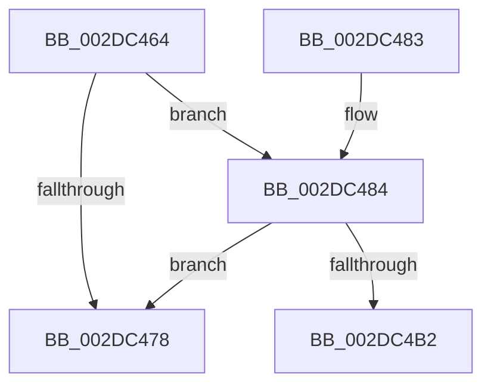

# MiFreeDeferredAcceleratorPool

- RVA: `0x002DC464`–`0x002DC4B7` (길이 `83` bytes)
- VA: `0x00000001402DC464`
- 실행 섹션: `.text`
- PDB 이름 있음: `예`; PDB Function 태그: `예`
- unwind 정보 RVA: `0x00070720`
- 디코드: `20`개 명령, `83/83` bytes 표시
- 미해석 바이트: `0` (있으면 어셈블리에 `.byte`로 보존)

> 이 문서는 커널 이미지의 기계어와 PDB 기호를 분석해 생성했습니다. 4번과 5번은 함수 원형과 자료형을 바이너리 사용 방식에서 추정한 C 해석이며 원본 소스 복구 결과는 아닙니다.

## 1. Dependencies

- 직접 호출 지점: **2**; 고유 호출 대상: **2**
- 직접 호출자로 확인된 함수: **1**
- RIP 상대 이미지 참조: **3**

### Outgoing calls
- `0x002DC48B` → [ExAcquireSpinLockExclusive](../24/ExAcquireSpinLockExclusive_function_00248690.md) (function, `0x00248690`)
- `0x002DC4A8` → [MiReleaseSpinLockExclusive](../24/MiReleaseSpinLockExclusive_function_002482C0.md) (function, `0x002482C0`)

### Direct callers
- [MiWorkingSetManager](MiWorkingSetManager_function_002DA7E0.md) at `0x002DA8C0`

### Static image references
- `0x002DC46E` → RVA `0x00E37558` (`.data`; read)
- `0x002DC484` → RVA `0x00E37568` (`.data`; read)
- `0x002DC49E` → RVA `0x00E37558` (`.data`; read/write)

## 2. Other-region calls and transfers

- 다른 실행 섹션으로 향하는 call: **0**
- call이 아닌 외부 분기/꼬리 이동: **1**
  - `0x002DC4B2` → [sub_006DDF26](../6D/Unknown_function_006DDF26.md) (`tail-transfer`)

## 3. Assembly (complete function range)

```asm
002DC464  48 89 5C 24 08                  mov qword ptr [rsp + 8], rbx
002DC469  57                              push rdi
002DC46A  48 83 EC 20                     sub rsp, 0x20
002DC46E  48 83 3D E2 B0 B5 00 00         cmp qword ptr [rip + 0xb5b0e2], 0
002DC476  75 0C                           jne 0x1402dc484
002DC478  48 8B 5C 24 30                  mov rbx, qword ptr [rsp + 0x30]
002DC47D  48 83 C4 20                     add rsp, 0x20
002DC481  5F                              pop rdi
002DC482  C3                              ret
002DC483  CC                              int3
002DC484  48 8D 0D DD B0 B5 00            lea rcx, [rip + 0xb5b0dd]
002DC48B  E8 00 C2 F6 FF                  call 0x140248690
002DC490  48 8B 3D C1 B0 B5 00            mov rdi, qword ptr [rip + 0xb5b0c1]
002DC497  48 8D 0D CA B0 B5 00            lea rcx, [rip + 0xb5b0ca]
002DC49E  48 83 25 B2 B0 B5 00 00         and qword ptr [rip + 0xb5b0b2], 0
002DC4A6  8A D0                           mov dl, al
002DC4A8  E8 13 BE F6 FF                  call 0x1402482c0
002DC4AD  48 85 FF                        test rdi, rdi
002DC4B0  74 C6                           je 0x1402dc478
002DC4B2  E9 6F 1A 40 00                  jmp 0x1406ddf26
```

## 4. C-style interpretation (structured pseudocode)

```c
__int64 __fastcall MiFreeDeferredAcceleratorPool(void)
{
    __int64 result;
    __int64 v_rsp;
    unsigned __int64 v_stack_p8;

    v_stack_p8 = v_rbx;
    v_rsp = (v_rsp) - (32);
    if ((*(unsigned __int64 *)(v_rip + 11907298)) != 0) goto loc_002DC484;
loc_002DC478:
    v_rsp = (v_rsp) + (32);
    return result;
loc_002DC484:
    result = ExAcquireSpinLockExclusive(v_rip + 11907293, a2, a3, a4);
    result = MiReleaseSpinLockExclusive(v_rip + 11907274, (unsigned __int8)(result), a3, a4);
    if (*(unsigned __int64 *)(v_rip + 11907265) == 0) goto loc_002DC478;
}
```

## 5. (Beta) C Style

```c
void MiFreeDeferredAcceleratorPool(void)
{
    int64_t result;
    int64_t local_rsp;
    uint64_t v_stack_p8;

    v_stack_p8 = local_rbx;
    local_rsp = (local_rsp) - (32);
    if ((*(uint64_t *)(v_rip + 0xB5B0E2)) != 0) goto loc_002DC484;
loc_002DC478:
    local_rsp = (local_rsp) + (32);
    return result;
loc_002DC484:
    result = ExAcquireSpinLockExclusive(v_rip + 11907293, a2, a3, a4);
    result = MiReleaseSpinLockExclusive(v_rip + 11907274, (uint8_t)(result), a3, a4);
    if (*(uint64_t *)(v_rip + 0xB5B0C1) == 0) goto loc_002DC478;
}
```

## 6. Execution-region graph

[열기: 2D/3D 그래프와 함수 탐색 컨트롤 패널](../../../control-panel.html?section=text&rva=0x002DC464&view=graph)

- 2D 그래프는 위에서 아래로 흐르고, 3D 그래프는 빈 공간을 드래그해 회전합니다. Shift+드래그는 이동, 휠은 확대·축소, 함수 노드 선택은 대상 보고서 이동입니다.

### Static fallback


