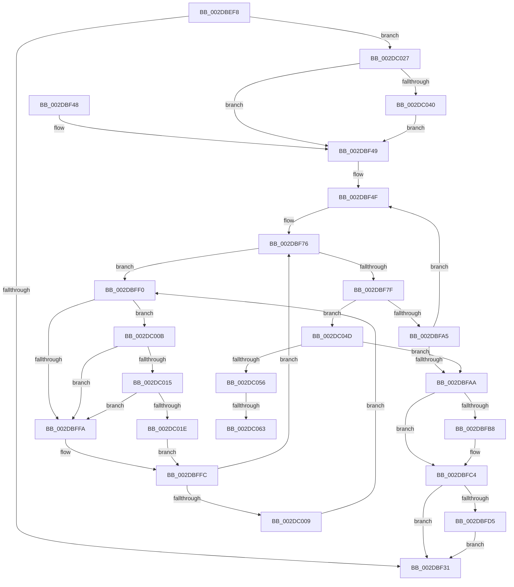

# MiFreePageFileHashPfns

- RVA: `0x002DBEF8`–`0x002DC075` (길이 `381` bytes)
- VA: `0x00000001402DBEF8`
- 실행 섹션: `.text`
- PDB 이름 있음: `예`; PDB Function 태그: `예`
- unwind 정보 RVA: `0x000706C8`
- 디코드: `97`개 명령, `381/381` bytes 표시
- 미해석 바이트: `0` (있으면 어셈블리에 `.byte`로 보존)

> 이 문서는 커널 이미지의 기계어와 PDB 기호를 분석해 생성했습니다. 4번과 5번은 함수 원형과 자료형을 바이너리 사용 방식에서 추정한 C 해석이며 원본 소스 복구 결과는 아닙니다.

## 1. Dependencies

- 직접 호출 지점: **8**; 고유 호출 대상: **7**
- 직접 호출자로 확인된 함수: **2**
- RIP 상대 이미지 참조: **4**

### Outgoing calls
- `0x002DBF20` → [ExpInterlockedFlushSList](../6B/ExpInterlockedFlushSList_function_006BA5F0.md) (function, `0x006BA5F0`)
- `0x002DBF82` → [MiFreePageFileHashPfn](../4B/MiFreePageFileHashPfn_function_004B2A78.md) (function, `0x004B2A78`)
- `0x002DBFBF` → [KiLowerIrqlProcessIrqlFlags](../4F/KiLowerIrqlProcessIrqlFlags_function_004F5698.md) (function, `0x004F5698`)
- `0x002DBFDB` → [MiReleaseNonPagedResources](../32/MiReleaseNonPagedResources_function_0032299C.md) (function, `0x0032299C`)
- `0x002DC015` → [KiCheckVpBackingLongSpinWaitHypercall](../30/KiCheckVpBackingLongSpinWaitHypercall_function_0030F490.md) (function, `0x0030F490`)
- `0x002DC020` → [HvlNotifyLongSpinWait](../30/HvlNotifyLongSpinWait_function_0030F460.md) (function, `0x0030F460`)
- `0x002DC043` → [KiRaiseIrqlProcessIrqlFlags](../4F/KiRaiseIrqlProcessIrqlFlags_function_004F56FC.md) (function, `0x004F56FC`)
- `0x002DC06A` → [KiLowerIrqlProcessIrqlFlags](../4F/KiLowerIrqlProcessIrqlFlags_function_004F5698.md) (function, `0x004F5698`)

### Direct callers
- [MiScanPagefiles](MiScanPagefiles_function_002DBE60.md) at `0x002DBE88`
- [MiDeletePagefile](../../page/7F/MiDeletePagefile_function_007FFB88.md) at `0x007FFBF2`

### Static image references
- `0x002DBFAA` → RVA `0x00FC6D20` (`ALMOSTRO`; read)
- `0x002DBFE3` → RVA `0x00E388E8` (`.data`; read/write)
- `0x002DBFF2` → RVA `0x00FC52AC` (`ALMOSTRO`; reference)
- `0x002DC00B` → RVA `0x00FC6AB8` (`ALMOSTRO`; read)

## 2. Other-region calls and transfers

- 다른 실행 섹션으로 향하는 call: **0**
- call이 아닌 외부 분기/꼬리 이동: **2**
  - `0x002DC05D` → [sub_006DDEE4](../6D/Unknown_function_006DDEE4.md) (`tail-transfer`)
  - `0x002DC070` → [sub_006DDEE4](../6D/Unknown_function_006DDEE4.md) (`tail-transfer`)

## 3. Assembly (complete function range)

```asm
002DBEF8  48 89 5C 24 10                  mov qword ptr [rsp + 0x10], rbx
002DBEFD  48 89 6C 24 18                  mov qword ptr [rsp + 0x18], rbp
002DBF02  56                              push rsi
002DBF03  57                              push rdi
002DBF04  41 54                           push r12
002DBF06  41 56                           push r14
002DBF08  41 57                           push r15
002DBF0A  48 83 EC 20                     sub rsp, 0x20
002DBF0E  4C 8B A1 D8 00 00 00            mov r12, qword ptr [rcx + 0xd8]
002DBF15  33 DB                           xor ebx, ebx
002DBF17  48 83 C1 30                     add rcx, 0x30
002DBF1B  4C 89 64 24 50                  mov qword ptr [rsp + 0x50], r12
002DBF20  E8 CB E6 3D 00                  call 0x1406ba5f0
002DBF25  48 8B F8                        mov rdi, rax
002DBF28  48 85 C0                        test rax, rax
002DBF2B  0F 85 F6 00 00 00               jne 0x1402dc027
002DBF31  48 8B 5C 24 58                  mov rbx, qword ptr [rsp + 0x58]
002DBF36  48 8B 6C 24 60                  mov rbp, qword ptr [rsp + 0x60]
002DBF3B  48 83 C4 20                     add rsp, 0x20
002DBF3F  41 5F                           pop r15
002DBF41  41 5E                           pop r14
002DBF43  41 5C                           pop r12
002DBF45  5F                              pop rdi
002DBF46  5E                              pop rsi
002DBF47  C3                              ret
002DBF48  CC                              int3
002DBF49  41 BC 02 00 00 00               mov r12d, 2
002DBF4F  4C 8B 37                        mov r14, qword ptr [rdi]
002DBF52  48 B8 00 00 00 00 00 DE FF FF   movabs rax, 0xffffde0000000000
002DBF5C  4C 8B FF                        mov r15, rdi
002DBF5F  4C 2B F8                        sub r15, rax
002DBF62  48 B8 AB AA AA AA AA AA AA AA   movabs rax, 0xaaaaaaaaaaaaaaab
002DBF6C  49 C1 FF 04                     sar r15, 4
002DBF70  4C 0F AF F8                     imul r15, rax
002DBF74  33 ED                           xor ebp, ebp
002DBF76  F0 48 0F BA 6F 18 3F            lock bts qword ptr [rdi + 0x18], 0x3f
002DBF7D  72 71                           jb 0x1402dbff0
002DBF7F  49 8B CF                        mov rcx, r15
002DBF82  E8 F1 6A 1D 00                  call 0x1404b2a78
002DBF87  48 B8 FF FF FF FF FF FF FF 7F   movabs rax, 0x7fffffffffffffff
002DBF91  F0 48 21 47 18                  lock and qword ptr [rdi + 0x18], rax
002DBF96  48 FF C3                        inc rbx
002DBF99  49 8B FE                        mov rdi, r14
002DBF9C  F6 C3 3F                        test bl, 0x3f
002DBF9F  0F 84 A8 00 00 00               je 0x1402dc04d
002DBFA5  4D 85 F6                        test r14, r14
002DBFA8  75 A5                           jne 0x1402dbf4f
002DBFAA  83 3D 6F AD CE 00 00            cmp dword ptr [rip + 0xcead6f], 0
002DBFB1  4C 8B 64 24 50                  mov r12, qword ptr [rsp + 0x50]
002DBFB6  74 0C                           je 0x1402dbfc4
002DBFB8  44 0F 20 C1                     mov rcx, cr8
002DBFBC  40 8A D6                        mov dl, sil
002DBFBF  E8 D4 96 21 00                  call 0x1404f5698
002DBFC4  40 0F B6 C6                     movzx eax, sil
002DBFC8  44 0F 22 C0                     mov cr8, rax
002DBFCC  48 85 DB                        test rbx, rbx
002DBFCF  0F 84 5C FF FF FF               je 0x1402dbf31
002DBFD5  48 8B D3                        mov rdx, rbx
002DBFD8  49 8B CC                        mov rcx, r12
002DBFDB  E8 BC 69 04 00                  call 0x14032299c
002DBFE0  48 F7 DB                        neg rbx
002DBFE3  F0 48 01 1D FD C8 B5 00         lock add qword ptr [rip + 0xb5c8fd], rbx
002DBFEB  E9 41 FF FF FF                  jmp 0x1402dbf31
002DBFF0  FF C5                           inc ebp
002DBFF2  85 2D B4 92 CE 00               test dword ptr [rip + 0xce92b4], ebp
002DBFF8  74 11                           je 0x1402dc00b
002DBFFA  F3 90                           pause
002DBFFC  48 8B 47 18                     mov rax, qword ptr [rdi + 0x18]
002DC000  48 85 C0                        test rax, rax
002DC003  0F 89 6D FF FF FF               jns 0x1402dbf76
002DC009  EB E5                           jmp 0x1402dbff0
002DC00B  8B 05 A7 AA CE 00               mov eax, dword ptr [rip + 0xceaaa7]
002DC011  A8 40                           test al, 0x40
002DC013  74 E5                           je 0x1402dbffa
002DC015  E8 76 34 03 00                  call 0x14030f490
002DC01A  84 C0                           test al, al
002DC01C  74 DC                           je 0x1402dbffa
002DC01E  8B CD                           mov ecx, ebp
002DC020  E8 3B 34 03 00                  call 0x14030f460
002DC025  EB D5                           jmp 0x1402dbffc
002DC027  44 0F 20 C6                     mov rsi, cr8
002DC02B  BA 02 00 00 00                  mov edx, 2
002DC030  44 0F 22 C2                     mov cr8, rdx
002DC034  39 1D E6 AC CE 00               cmp dword ptr [rip + 0xceace6], ebx
002DC03A  0F 84 09 FF FF FF               je 0x1402dbf49
002DC040  40 8A CE                        mov cl, sil
002DC043  E8 B4 96 21 00                  call 0x1404f56fc
002DC048  E9 FC FE FF FF                  jmp 0x1402dbf49
002DC04D  4D 85 F6                        test r14, r14
002DC050  0F 84 54 FF FF FF               je 0x1402dbfaa
002DC056  83 3D C3 AC CE 00 00            cmp dword ptr [rip + 0xceacc3], 0
002DC05D  0F 84 81 1E 40 00               je 0x1406ddee4
002DC063  44 0F 20 C1                     mov rcx, cr8
002DC067  40 8A D6                        mov dl, sil
002DC06A  E8 29 96 21 00                  call 0x1404f5698
002DC06F  90                              nop
002DC070  E9 6F 1E 40 00                  jmp 0x1406ddee4
```

## 4. C-style interpretation (structured pseudocode)

```c
__int64 __fastcall MiFreePageFileHashPfns(__int64 a1)
{
    __int64 result;
    __int64 v_r15;
    __int64 v_rbp;
    __int64 v_rbx;
    __int64 v_rsp;
    unsigned __int64 v_stack_p10;
    unsigned __int64 v_stack_p18;
    unsigned __int64 v_stack_p50;
    unsigned __int64 v_stack_p8;

    v_stack_p10 = v_rbx;
    v_stack_p18 = v_rbp;
    v_rsp = (v_rsp) - (32);
    v_rbx = 0;
    a1 = (a1) + (48);
    v_stack_p8 = *(unsigned __int64 *)(a1 + 216);
    result = ExpInterlockedFlushSList(a1, a2, a3, a4);
    if (result != 0) goto loc_002DC027;
loc_002DBF31:
    v_rsp = (v_rsp) + (32);
    return result;
loc_002DBF49:
loc_002DBF4F:
    v_r15 = (result) - (result);
    v_r15 = (v_r15) >> (4);
    v_r15 = (v_r15) * (result);
    v_rbp = 0;
loc_002DBF76:
    if (condition_is_below) goto loc_002DBFF0;
    result = MiFreePageFileHashPfn(v_r15, a2, a3, a4);
    v_rbx = (v_stack_p10) + 1;
    if ((((unsigned __int8)(v_rbx)) & (63)) == 0) goto loc_002DC04D;
    if (*(unsigned __int64 *)(result) != 0) goto loc_002DBF4F;
loc_002DBFAA:
    if ((*(unsigned int *)(v_rip + 13544815)) != 0) {
        a1 = v_cr8;
        a2 = (unsigned __int8)(v_rsi);
        result = KiLowerIrqlProcessIrqlFlags(a1, a2, a3, a4);
    }
    if (v_rbx == 0) goto loc_002DBF31;
    result = MiReleaseNonPagedResources(v_stack_p50, v_rbx, a3, a4);
    v_rbx = -(v_rbx);
    goto loc_002DBF31;
loc_002DBFF0:
    v_rbp = (unsigned int)((v_rbp) + 1);
    if (((*(unsigned int *)(v_rip + 13537972)) & ((unsigned int)(v_rbp))) == 0) goto loc_002DC00B;
loc_002DBFFA:
loc_002DBFFC:
    if (!sign_flag) goto loc_002DBF76;
    goto loc_002DBFF0;
loc_002DC00B:
    if ((((unsigned __int8)((unsigned int)(*(unsigned int *)(v_rip + 13544103)))) & (64)) == 0) goto loc_002DBFFA;
    result = KiCheckVpBackingLongSpinWaitHypercall(v_stack_p50, v_rbx, a3, a4);
    if ((unsigned __int8)(result) == 0) goto loc_002DBFFA;
    result = HvlNotifyLongSpinWait((unsigned int)((unsigned int)(v_rbp)), v_rbx, a3, a4);
    goto loc_002DBFFC;
loc_002DC027:
    if ((*(unsigned int *)(v_rip + 13544678)) == ((unsigned int)(v_rbx))) goto loc_002DBF49;
    result = KiRaiseIrqlProcessIrqlFlags((unsigned __int8)((unsigned __int8)(v_rsi)), 2, a3, a4);
    goto loc_002DBF49;
loc_002DC04D:
    if (*(unsigned __int64 *)(result) == 0) goto loc_002DBFAA;
    result = KiLowerIrqlProcessIrqlFlags(2, (unsigned __int8)((unsigned __int8)(v_rsi)), a3, a4);
}
```

## 5. (Beta) C Style

```c
int64_t MiFreePageFileHashPfns(void *Arg1)
{
    uint8_t *arg1 = (uint8_t *)Arg1;

    int64_t result;
    int64_t local_r15;
    int64_t local_rbp;
    int64_t local_rbx;
    int64_t local_rsp;
    uint64_t v_stack_p10;
    uint64_t v_stack_p18;
    uint64_t v_stack_p50;
    uint64_t v_stack_p8;

    v_stack_p10 = local_rbx;
    v_stack_p18 = local_rbp;
    local_rsp = (local_rsp) - (32);
    local_rbx = 0;
    Arg1 = (Arg1) + (48);
    v_stack_p8 = *(uint64_t *)(arg1 + 0xD8);
    result = ExpInterlockedFlushSList(Arg1, a2, a3, a4);
    if (result != 0) goto loc_002DC027;
loc_002DBF31:
    local_rsp = (local_rsp) + (32);
    return result;
loc_002DBF49:
loc_002DBF4F:
    local_r15 = (result) - (result);
    local_r15 = (local_r15) >> (4);
    local_r15 = (local_r15) * (result);
    local_rbp = 0;
loc_002DBF76:
    if (condition_is_below) goto loc_002DBFF0;
    result = MiFreePageFileHashPfn(local_r15, a2, a3, a4);
    local_rbx = (v_stack_p10) + 1;
    if ((((uint8_t)(local_rbx)) & (63)) == 0) goto loc_002DC04D;
    if (*(uint64_t *)(result) != 0) goto loc_002DBF4F;
loc_002DBFAA:
    if ((*(uint32_t *)(v_rip + 0xCEAD6F)) != 0) {
        Arg1 = v_cr8;
        a2 = (uint8_t)(local_rsi);
        result = KiLowerIrqlProcessIrqlFlags(Arg1, a2, a3, a4);
    }
    if (local_rbx == 0) goto loc_002DBF31;
    result = MiReleaseNonPagedResources(v_stack_p50, local_rbx, a3, a4);
    local_rbx = -(local_rbx);
    goto loc_002DBF31;
loc_002DBFF0:
    local_rbp = (uint32_t)((local_rbp) + 1);
    if (((*(uint32_t *)(v_rip + 0xCE92B4)) & ((uint32_t)(local_rbp))) == 0) goto loc_002DC00B;
loc_002DBFFA:
loc_002DBFFC:
    if (!sign_flag) goto loc_002DBF76;
    goto loc_002DBFF0;
loc_002DC00B:
    if ((((uint8_t)((uint32_t)(*(uint32_t *)(v_rip + 0xCEAAA7)))) & (64)) == 0) goto loc_002DBFFA;
    result = KiCheckVpBackingLongSpinWaitHypercall(v_stack_p50, local_rbx, a3, a4);
    if ((uint8_t)(result) == 0) goto loc_002DBFFA;
    result = HvlNotifyLongSpinWait((uint32_t)((uint32_t)(local_rbp)), local_rbx, a3, a4);
    goto loc_002DBFFC;
loc_002DC027:
    if ((*(uint32_t *)(v_rip + 0xCEACE6)) == ((uint32_t)(local_rbx))) goto loc_002DBF49;
    result = KiRaiseIrqlProcessIrqlFlags((uint8_t)((uint8_t)(local_rsi)), 2, a3, a4);
    goto loc_002DBF49;
loc_002DC04D:
    if (*(uint64_t *)(result) == 0) goto loc_002DBFAA;
    result = KiLowerIrqlProcessIrqlFlags(2, (uint8_t)((uint8_t)(local_rsi)), a3, a4);
}
```

### 관측된 메모리 오프셋

구조체 형식이 확인되지 않은 접근은 인자 기준의 오프셋으로만 기록했습니다.

| 기준 인자 | 오프셋 표현 | 폭 (bit) | 접근 |
|---|---:|---:|---|
| `Arg1` | `+ 0xD8` | `64` | `R` |

## 6. Execution-region graph

[열기: 2D/3D 그래프와 함수 탐색 컨트롤 패널](../../../control-panel.html?section=text&rva=0x002DBEF8&view=graph)

- 2D 그래프는 위에서 아래로 흐르고, 3D 그래프는 빈 공간을 드래그해 회전합니다. Shift+드래그는 이동, 휠은 확대·축소, 함수 노드 선택은 대상 보고서 이동입니다.

### Static fallback


