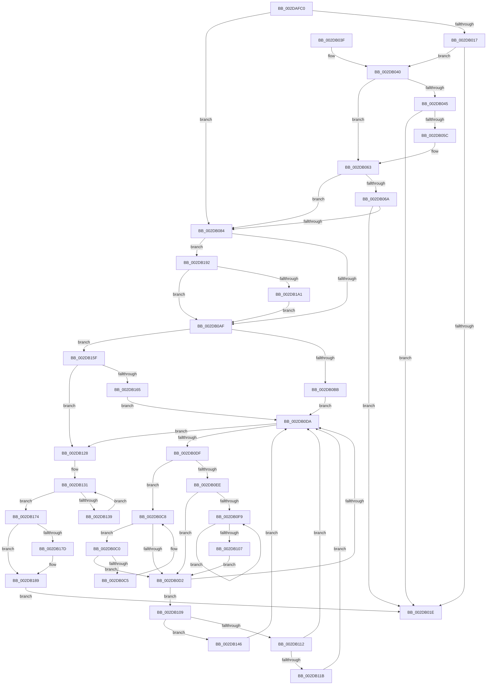

# MiFreeSlabEntries

- RVA: `0x002DAFC0`–`0x002DB1D4` (길이 `532` bytes)
- VA: `0x00000001402DAFC0`
- 실행 섹션: `.text`
- PDB 이름 있음: `예`; PDB Function 태그: `아니요`
- unwind 정보 RVA: `0x00070608`
- 디코드: `149`개 명령, `532/532` bytes 표시
- 미해석 바이트: `0` (있으면 어셈블리에 `.byte`로 보존)

> 이 문서는 커널 이미지의 기계어와 PDB 기호를 분석해 생성했습니다. 4번과 5번은 함수 원형과 자료형을 바이너리 사용 방식에서 추정한 C 해석이며 원본 소스 복구 결과는 아닙니다.

## 1. Dependencies

- 직접 호출 지점: **10**; 고유 호출 대상: **10**
- 직접 호출자로 확인된 함수: **3**
- RIP 상대 이미지 참조: **2**

### Outgoing calls
- `0x002DB009` → [MiSlabUpdateRecentFailure](MiSlabUpdateRecentFailure_function_002DC618.md) (function, `0x002DC618`)
- `0x002DB045` → [MiGetSlabCurrentTime](../3B/MiGetSlabCurrentTime_function_003BCBCC.md) (function, `0x003BCBCC`)
- `0x002DB087` → [MiPurgeSlabEntries](../48/MiPurgeSlabEntries_function_0048D258.md) (function, `0x0048D258`)
- `0x002DB092` → [ExAcquireSpinLockExclusive](../24/ExAcquireSpinLockExclusive_function_00248690.md) (function, `0x00248690`)
- `0x002DB121` → [MiSlabEntryBecameEmpty](../4B/MiSlabEntryBecameEmpty_function_004B48F4.md) (function, `0x004B48F4`)
- `0x002DB12C` → [ExReleaseSpinLockExclusiveFromDpcLevel](../24/ExReleaseSpinLockExclusiveFromDpcLevel_function_002497E0.md) (function, `0x002497E0`)
- `0x002DB13F` → [MiFreeSlabEntry](MiFreeSlabEntry_function_002DC650.md) (function, `0x002DC650`)
- `0x002DB14F` → [MiRemoveSlabEntry](../44/MiRemoveSlabEntry_function_0044CF08.md) (function, `0x0044CF08`)
- `0x002DB184` → [KiLowerIrqlProcessIrqlFlags](../4F/KiLowerIrqlProcessIrqlFlags_function_004F5698.md) (function, `0x004F5698`)
- `0x002DB1CA` → [RtlClearBits](../3E/RtlClearBits_function_003E1A90.md) (function, `0x003E1A90`)

### Direct callers
- [MiFreeUnusedSlabPages](MiFreeUnusedSlabPages_function_002DAE48.md) at `0x002DAF4E`
- [MiDefragFreeEmptySlabEntries](../68/MiDefragFreeEmptySlabEntries_function_0068D400.md) at `0x0068D417`
- [MiDeleteSlabAllocator](../68/MiDeleteSlabAllocator_function_0068DDC0.md) at `0x0068DDEA`

### Static image references
- `0x002DAFEA` → RVA `0x00011C60` (`.rdata`; read)
- `0x002DB174` → RVA `0x00FC6D20` (`ALMOSTRO`; read)

## 2. Other-region calls and transfers

- 다른 실행 섹션으로 향하는 call: **0**
- 별도 외부 분기/꼬리 이동을 확인하지 못했습니다.

## 3. Assembly (complete function range)

```asm
002DAFC0  48 8B C4                        mov rax, rsp
002DAFC3  48 89 58 08                     mov qword ptr [rax + 8], rbx
002DAFC7  48 89 68 10                     mov qword ptr [rax + 0x10], rbp
002DAFCB  48 89 70 18                     mov qword ptr [rax + 0x18], rsi
002DAFCF  48 89 78 20                     mov qword ptr [rax + 0x20], rdi
002DAFD3  41 55                           push r13
002DAFD5  41 56                           push r14
002DAFD7  41 57                           push r15
002DAFD9  48 83 EC 20                     sub rsp, 0x20
002DAFDD  4C 8D B2 88 00 00 00            lea r14, [rdx + 0x88]
002DAFE4  4C 8B E9                        mov r13, rcx
002DAFE7  41 8B 06                        mov eax, dword ptr [r14]
002DAFEA  4C 8D 3D 6F 6C D3 FF            lea r15, [rip - 0x2c9391]
002DAFF1  48 C1 E8 04                     shr rax, 4
002DAFF5  48 8D 8A B0 00 00 00            lea rcx, [rdx + 0xb0]
002DAFFC  83 E0 03                        and eax, 3
002DAFFF  4D 8B D8                        mov r11, r8
002DB002  48 8B F2                        mov rsi, rdx
002DB005  45 8B 3C C7                     mov r15d, dword ptr [r15 + rax*8]
002DB009  E8 0A 16 00 00                  call 0x1402dc618
002DB00E  49 8B FE                        mov rdi, r14
002DB011  41 83 FB 01                     cmp r11d, 1
002DB015  74 6D                           je 0x1402db084
002DB017  41 8B 06                        mov eax, dword ptr [r14]
002DB01A  A8 01                           test al, 1
002DB01C  75 22                           jne 0x1402db040
002DB01E  48 8B 5C 24 40                  mov rbx, qword ptr [rsp + 0x40]
002DB023  33 C0                           xor eax, eax
002DB025  48 8B 6C 24 48                  mov rbp, qword ptr [rsp + 0x48]
002DB02A  48 8B 74 24 50                  mov rsi, qword ptr [rsp + 0x50]
002DB02F  48 8B 7C 24 58                  mov rdi, qword ptr [rsp + 0x58]
002DB034  48 83 C4 20                     add rsp, 0x20
002DB038  41 5F                           pop r15
002DB03A  41 5E                           pop r14
002DB03C  41 5D                           pop r13
002DB03E  C3                              ret
002DB03F  CC                              int3
002DB040  45 85 DB                        test r11d, r11d
002DB043  75 1E                           jne 0x1402db063
002DB045  E8 82 1B 0E 00                  call 0x1403bcbcc
002DB04A  48 8B 8E A8 00 00 00            mov rcx, qword ptr [rsi + 0xa8]
002DB051  48 2B C1                        sub rax, rcx
002DB054  48 3D 80 F0 FA 02               cmp rax, 0x2faf080
002DB05A  72 C2                           jb 0x1402db01e
002DB05C  48 8D BE 88 00 00 00            lea rdi, [rsi + 0x88]
002DB063  48 83 7E 68 00                  cmp qword ptr [rsi + 0x68], 0
002DB068  74 1A                           je 0x1402db084
002DB06A  4C 8B 46 60                     mov r8, qword ptr [rsi + 0x60]
002DB06E  49 8B CF                        mov rcx, r15
002DB071  48 8B 46 50                     mov rax, qword ptr [rsi + 0x50]
002DB075  48 8B 00                        mov rax, qword ptr [rax]
002DB078  48 03 4E 68                     add rcx, qword ptr [rsi + 0x68]
002DB07C  49 03 C0                        add rax, r8
002DB07F  48 3B C1                        cmp rax, rcx
002DB082  72 9A                           jb 0x1402db01e
002DB084  48 8B CE                        mov rcx, rsi
002DB087  E8 CC 21 1B 00                  call 0x14048d258
002DB08C  48 8D 4E 10                     lea rcx, [rsi + 0x10]
002DB090  33 DB                           xor ebx, ebx
002DB092  E8 F9 D5 F6 FF                  call 0x140248690
002DB097  41 8B 0E                        mov ecx, dword ptr [r14]
002DB09A  83 E1 FE                        and ecx, 0xfffffffe
002DB09D  0F B6 E8                        movzx ebp, al
002DB0A0  83 BE 80 00 00 00 08            cmp dword ptr [rsi + 0x80], 8
002DB0A7  89 0F                           mov dword ptr [rdi], ecx
002DB0A9  0F 84 E3 00 00 00               je 0x1402db192
002DB0AF  48 8B 46 08                     mov rax, qword ptr [rsi + 8]
002DB0B3  A8 01                           test al, 1
002DB0B5  0F 85 A4 00 00 00               jne 0x1402db15f
002DB0BB  48 8B F8                        mov rdi, rax
002DB0BE  EB 1A                           jmp 0x1402db0da
002DB0C0  48 39 0F                        cmp qword ptr [rdi], rcx
002DB0C3  74 0D                           je 0x1402db0d2
002DB0C5  48 8B CF                        mov rcx, rdi
002DB0C8  48 8B 7F 10                     mov rdi, qword ptr [rdi + 0x10]
002DB0CC  48 83 E7 FC                     and rdi, 0xfffffffffffffffc
002DB0D0  75 EE                           jne 0x1402db0c0
002DB0D2  41 8B 46 5C                     mov eax, dword ptr [r14 + 0x5c]
002DB0D6  A8 01                           test al, 1
002DB0D8  74 2F                           je 0x1402db109
002DB0DA  48 85 FF                        test rdi, rdi
002DB0DD  74 49                           je 0x1402db128
002DB0DF  48 8B 47 08                     mov rax, qword ptr [rdi + 8]
002DB0E3  4C 8B F7                        mov r14, rdi
002DB0E6  48 8B CF                        mov rcx, rdi
002DB0E9  48 85 C0                        test rax, rax
002DB0EC  74 DA                           je 0x1402db0c8
002DB0EE  48 8B 08                        mov rcx, qword ptr [rax]
002DB0F1  48 8B F8                        mov rdi, rax
002DB0F4  48 85 C9                        test rcx, rcx
002DB0F7  74 D9                           je 0x1402db0d2
002DB0F9  48 8B 01                        mov rax, qword ptr [rcx]
002DB0FC  48 8B F9                        mov rdi, rcx
002DB0FF  48 8B C8                        mov rcx, rax
002DB102  48 85 C0                        test rax, rax
002DB105  75 F2                           jne 0x1402db0f9
002DB107  EB C9                           jmp 0x1402db0d2
002DB109  41 8B 4E 54                     mov ecx, dword ptr [r14 + 0x54]
002DB10D  41 3B CF                        cmp ecx, r15d
002DB110  74 34                           je 0x1402db146
002DB112  41 03 4E 58                     add ecx, dword ptr [r14 + 0x58]
002DB116  41 3B CF                        cmp ecx, r15d
002DB119  72 BF                           jb 0x1402db0da
002DB11B  49 8B D6                        mov rdx, r14
002DB11E  48 8B CE                        mov rcx, rsi
002DB121  E8 CE 97 1D 00                  call 0x1404b48f4
002DB126  EB B2                           jmp 0x1402db0da
002DB128  48 8D 4E 10                     lea rcx, [rsi + 0x10]
002DB12C  E8 AF E6 F6 FF                  call 0x1402497e0
002DB131  48 8B D3                        mov rdx, rbx
002DB134  48 85 DB                        test rbx, rbx
002DB137  74 3B                           je 0x1402db174
002DB139  48 8B 1B                        mov rbx, qword ptr [rbx]
002DB13C  48 8B CE                        mov rcx, rsi
002DB13F  E8 0C 15 00 00                  call 0x1402dc650
002DB144  EB EB                           jmp 0x1402db131
002DB146  4D 8B C6                        mov r8, r14
002DB149  48 8B D6                        mov rdx, rsi
002DB14C  49 8B CD                        mov rcx, r13
002DB14F  E8 B4 1D 17 00                  call 0x14044cf08
002DB154  49 89 1E                        mov qword ptr [r14], rbx
002DB157  49 8B DE                        mov rbx, r14
002DB15A  E9 7B FF FF FF                  jmp 0x1402db0da
002DB15F  48 83 F8 01                     cmp rax, 1
002DB163  74 C3                           je 0x1402db128
002DB165  48 8B FE                        mov rdi, rsi
002DB168  48 83 CF 01                     or rdi, 1
002DB16C  48 33 F8                        xor rdi, rax
002DB16F  E9 66 FF FF FF                  jmp 0x1402db0da
002DB174  83 3D A5 BB CE 00 00            cmp dword ptr [rip + 0xcebba5], 0
002DB17B  74 0C                           je 0x1402db189
002DB17D  44 0F 20 C1                     mov rcx, cr8
002DB181  40 8A D5                        mov dl, bpl
002DB184  E8 0F A5 21 00                  call 0x1404f5698
002DB189  44 0F 22 C5                     mov cr8, rbp
002DB18D  E9 8C FE FF FF                  jmp 0x1402db01e
002DB192  41 8B 8D 70 47 00 00            mov ecx, dword ptr [r13 + 0x4770]
002DB199  85 C9                           test ecx, ecx
002DB19B  0F 84 0E FF FF FF               je 0x1402db0af
002DB1A1  8B 8E 84 00 00 00               mov ecx, dword ptr [rsi + 0x84]
002DB1A7  48 69 D1 80 DF 00 00            imul rdx, rcx, 0xdf80
002DB1AE  48 8B 4E 18                     mov rcx, qword ptr [rsi + 0x18]
002DB1B2  48 8B 41 10                     mov rax, qword ptr [rcx + 0x10]
002DB1B6  48 8B 8C 02 B0 DE 00 00         mov rcx, qword ptr [rdx + rax + 0xdeb0]
002DB1BE  33 D2                           xor edx, edx
002DB1C0  48 81 C1 D0 CA 04 00            add rcx, 0x4cad0
002DB1C7  44 8B 01                        mov r8d, dword ptr [rcx]
002DB1CA  E8 C1 68 10 00                  call 0x1403e1a90
002DB1CF  E9 DB FE FF FF                  jmp 0x1402db0af
```

## 4. C-style interpretation (structured pseudocode)

```c
__int64 __fastcall MiFreeSlabEntries(__int64 a1, __int64 a2, __int64 a3)
{
    __int64 result;
    __int64 v_rbx;
    __int64 v_rdi;
    __int64 v_rsp;
    unsigned __int64 v_stack_p10;
    unsigned __int64 v_stack_p18;
    unsigned __int64 v_stack_p20;
    unsigned __int64 v_stack_p8;

    *(unsigned __int64 *)(v_rsp + 8) = v_rbx;
    *(unsigned __int64 *)(v_rsp + 16) = v_rbp;
    *(unsigned __int64 *)(v_rsp + 24) = v_rsi;
    *(unsigned __int64 *)(v_rsp + 32) = v_rdi;
    v_rsp = (v_rsp) - (32);
    result = ((unsigned int)(*(unsigned int *)(a2 + 136))) >> (4);
    result = (unsigned int)((result) & (3));
    result = MiSlabUpdateRecentFailure(a2 + 176, a2, a3, a4);
    if (((unsigned int)(a3)) == 1) goto loc_002DB084;
    if ((((unsigned __int8)((unsigned int)(*(unsigned int *)(a2 + 136)))) & (1)) != 0) goto loc_002DB040;
loc_002DB01E:
    result = 0;
    v_rsp = (v_rsp) + (32);
    return result;
loc_002DB040:
    if ((unsigned int)(a3) != 0) goto loc_002DB063;
    result = MiGetSlabCurrentTime(a2 + 176, a2, a3, a4);
    result = (result) - (*(unsigned __int64 *)(v_stack_p18 + 168));
    if (result < 0x2FAF080ULL) goto loc_002DB01E;
loc_002DB063:
    if ((*(unsigned __int64 *)(v_stack_p18 + 104)) == 0) goto loc_002DB084;
    a1 = ((unsigned int)(*(unsigned int *)(v_rip - 2921361 + result * 8))) + (*(unsigned __int64 *)(v_stack_p18 + 104));
    result = (*(unsigned __int64 *)(*(unsigned __int64 *)(v_stack_p18 + 80))) + (*(unsigned __int64 *)(v_stack_p18 + 96));
    if (result < a1) goto loc_002DB01E;
loc_002DB084:
    result = MiPurgeSlabEntries(v_stack_p18, a2, *(unsigned __int64 *)(v_stack_p18 + 96), a4);
    v_rbx = 0;
    result = ExAcquireSpinLockExclusive(v_stack_p18 + 16, a2, *(unsigned __int64 *)(v_stack_p18 + 96), a4);
    a1 = (unsigned int)(((unsigned int)(*(unsigned int *)(a2 + 136))) & (0xFFFFFFFEULL));
    *(unsigned int *)(v_stack_p18 + 136) = (unsigned int)(a1);
    if ((*(unsigned int *)(v_stack_p18 + 128)) == 8) goto loc_002DB192;
loc_002DB0AF:
    if ((((unsigned __int8)(*(unsigned __int64 *)(v_stack_p18 + 8))) & (1)) != 0) goto loc_002DB15F;
    goto loc_002DB0DA;
loc_002DB0C0:
    if ((*(unsigned __int64 *)(*(unsigned __int64 *)(v_stack_p18 + 8))) == a1) goto loc_002DB0D2;
loc_002DB0C8:
    v_rdi = (*(unsigned __int64 *)(*(unsigned __int64 *)(v_stack_p18 + 8) + 16)) & (-4);
    if (condition_is_not_equal) goto loc_002DB0C0;
loc_002DB0D2:
    if ((((unsigned __int8)((unsigned int)(*(unsigned int *)(a2 + 136 + 92)))) & (1)) == 0) goto loc_002DB109;
loc_002DB0DA:
    if (v_rdi == 0) goto loc_002DB128;
    if (*(unsigned __int64 *)(v_rdi + 8) == 0) goto loc_002DB0C8;
    if (*(unsigned __int64 *)(*(unsigned __int64 *)(v_rdi + 8)) == 0) goto loc_002DB0D2;
loc_002DB0F9:
    if (*(unsigned __int64 *)(*(unsigned __int64 *)(*(unsigned __int64 *)(v_rdi + 8))) != 0) goto loc_002DB0F9;
    goto loc_002DB0D2;
loc_002DB109:
    if (((unsigned int)((unsigned int)(*(unsigned int *)(v_rdi + 84)))) == ((unsigned int)((unsigned int)(*(unsigned int *)(v_rip - 2921361 + result * 8))))) goto loc_002DB146;
    a1 = (unsigned int)(((unsigned int)(*(unsigned int *)(v_rdi + 84))) + (*(unsigned int *)(v_rdi + 88)));
    if (((unsigned int)(a1)) < ((unsigned int)((unsigned int)(*(unsigned int *)(v_rip - 2921361 + result * 8))))) goto loc_002DB0DA;
    result = MiSlabEntryBecameEmpty(v_stack_p18, v_rdi, *(unsigned __int64 *)(v_stack_p18 + 96), a4);
    goto loc_002DB0DA;
loc_002DB128:
    result = ExReleaseSpinLockExclusiveFromDpcLevel(v_stack_p18 + 16, v_rdi, *(unsigned __int64 *)(v_stack_p18 + 96), a4);
loc_002DB131:
    if (0 == 0) goto loc_002DB174;
    result = MiFreeSlabEntry(v_stack_p18, 0, *(unsigned __int64 *)(v_stack_p18 + 96), a4);
    goto loc_002DB131;
loc_002DB146:
    result = MiRemoveSlabEntry(a1, v_stack_p18, v_rdi, a4);
    *(unsigned __int64 *)(v_rdi) = *(unsigned __int64 *)(v_rbx);
    goto loc_002DB0DA;
loc_002DB15F:
    if (result == 1) goto loc_002DB128;
    v_rdi = (v_stack_p18) | (1);
    v_rdi = (v_rdi) ^ (result);
    goto loc_002DB0DA;
loc_002DB174:
    if ((*(unsigned int *)(v_rip + 13548453)) != 0) {
        a1 = v_cr8;
        a2 = (unsigned __int8)((unsigned __int8)(result));
        result = KiLowerIrqlProcessIrqlFlags(a1, a2, v_rdi, a4);
    }
    goto loc_002DB01E;
loc_002DB192:
    if ((unsigned int)((unsigned int)(*(unsigned int *)(a1 + 18288))) == 0) goto loc_002DB0AF;
    a2 = (a2) * ((unsigned int)(*(unsigned int *)(v_stack_p18 + 132)));
    a2 = 0;
    a1 = (*(unsigned __int64 *)(a2 + *(unsigned __int64 *)(*(unsigned __int64 *)(v_stack_p18 + 24) + 16) * 1 + 57008)) + (0x4CAD0ULL);
    result = RtlClearBits(a1, a2, (unsigned int)(*(unsigned int *)(a1)), a4);
    goto loc_002DB0AF;
}
```

## 5. (Beta) C Style

```c
int64_t MiFreeSlabEntries(void *Arg1, void *Arg2, int64_t Arg3)
{
    uint8_t *arg1 = (uint8_t *)Arg1;
    uint8_t *arg2 = (uint8_t *)Arg2;

    int64_t result;
    int64_t local_rbx;
    int64_t local_rdi;
    int64_t local_rsp;
    uint64_t v_stack_p10;
    uint64_t v_stack_p18;
    uint64_t v_stack_p20;
    uint64_t v_stack_p8;

    *(uint64_t *)(local_rsp + 0x8) = local_rbx;
    *(uint64_t *)(local_rsp + 0x10) = local_rbp;
    *(uint64_t *)(local_rsp + 0x18) = local_rsi;
    *(uint64_t *)(local_rsp + 0x20) = local_rdi;
    local_rsp = (local_rsp) - (32);
    result = ((uint32_t)(*(uint32_t *)(arg2 + 0x88))) >> (4);
    result = (uint32_t)((result) & (3));
    result = MiSlabUpdateRecentFailure(Arg2 + 176, Arg2, Arg3, a4);
    if (((uint32_t)(Arg3)) == 1) goto loc_002DB084;
    if ((((uint8_t)((uint32_t)(*(uint32_t *)(arg2 + 0x88)))) & (1)) != 0) goto loc_002DB040;
loc_002DB01E:
    result = 0;
    local_rsp = (local_rsp) + (32);
    return result;
loc_002DB040:
    if ((uint32_t)(Arg3) != 0) goto loc_002DB063;
    result = MiGetSlabCurrentTime(Arg2 + 176, Arg2, Arg3, a4);
    result = (result) - (*(uint64_t *)(v_stack_p18 + 0xA8));
    if (result < 0x2FAF080ULL) goto loc_002DB01E;
loc_002DB063:
    if ((*(uint64_t *)(v_stack_p18 + 0x68)) == 0) goto loc_002DB084;
    Arg1 = ((uint32_t)(*(uint32_t *)(v_rip - 0x2C9391 + result * 8))) + (*(uint64_t *)(v_stack_p18 + 0x68));
    result = (*(uint64_t *)(*(uint64_t *)(v_stack_p18 + 0x50))) + (*(uint64_t *)(v_stack_p18 + 0x60));
    if (result < Arg1) goto loc_002DB01E;
loc_002DB084:
    result = MiPurgeSlabEntries(v_stack_p18, Arg2, *(uint64_t *)(v_stack_p18 + 0x60), a4);
    local_rbx = 0;
    result = ExAcquireSpinLockExclusive(v_stack_p18 + 16, Arg2, *(uint64_t *)(v_stack_p18 + 0x60), a4);
    Arg1 = (uint32_t)(((uint32_t)(*(uint32_t *)(arg2 + 0x88))) & (0xFFFFFFFEULL));
    *(uint32_t *)(v_stack_p18 + 0x88) = (uint32_t)(Arg1);
    if ((*(uint32_t *)(v_stack_p18 + 0x80)) == 8) goto loc_002DB192;
loc_002DB0AF:
    if ((((uint8_t)(*(uint64_t *)(v_stack_p18 + 0x8))) & (1)) != 0) goto loc_002DB15F;
    goto loc_002DB0DA;
loc_002DB0C0:
    if ((*(uint64_t *)(*(uint64_t *)(v_stack_p18 + 0x8))) == Arg1) goto loc_002DB0D2;
loc_002DB0C8:
    local_rdi = (*(uint64_t *)(*(uint64_t *)(v_stack_p18 + 0x8) + 0x10)) & (-4);
    if (condition_is_not_equal) goto loc_002DB0C0;
loc_002DB0D2:
    if ((((uint8_t)((uint32_t)(*(uint32_t *)(arg2 + 0x88 + 0x5C)))) & (1)) == 0) goto loc_002DB109;
loc_002DB0DA:
    if (local_rdi == 0) goto loc_002DB128;
    if (*(uint64_t *)(local_rdi + 0x8) == 0) goto loc_002DB0C8;
    if (*(uint64_t *)(*(uint64_t *)(local_rdi + 0x8)) == 0) goto loc_002DB0D2;
loc_002DB0F9:
    if (*(uint64_t *)(*(uint64_t *)(*(uint64_t *)(local_rdi + 0x8))) != 0) goto loc_002DB0F9;
    goto loc_002DB0D2;
loc_002DB109:
    if (((uint32_t)((uint32_t)(*(uint32_t *)(local_rdi + 0x54)))) == ((uint32_t)((uint32_t)(*(uint32_t *)(v_rip - 0x2C9391 + result * 8))))) goto loc_002DB146;
    Arg1 = (uint32_t)(((uint32_t)(*(uint32_t *)(local_rdi + 0x54))) + (*(uint32_t *)(local_rdi + 0x58)));
    if (((uint32_t)(Arg1)) < ((uint32_t)((uint32_t)(*(uint32_t *)(v_rip - 0x2C9391 + result * 8))))) goto loc_002DB0DA;
    result = MiSlabEntryBecameEmpty(v_stack_p18, local_rdi, *(uint64_t *)(v_stack_p18 + 0x60), a4);
    goto loc_002DB0DA;
loc_002DB128:
    result = ExReleaseSpinLockExclusiveFromDpcLevel(v_stack_p18 + 16, local_rdi, *(uint64_t *)(v_stack_p18 + 0x60), a4);
loc_002DB131:
    if (0 == 0) goto loc_002DB174;
    result = MiFreeSlabEntry(v_stack_p18, 0, *(uint64_t *)(v_stack_p18 + 0x60), a4);
    goto loc_002DB131;
loc_002DB146:
    result = MiRemoveSlabEntry(Arg1, v_stack_p18, local_rdi, a4);
    *(uint64_t *)(local_rdi) = *(uint64_t *)(local_rbx);
    goto loc_002DB0DA;
loc_002DB15F:
    if (result == 1) goto loc_002DB128;
    local_rdi = (v_stack_p18) | (1);
    local_rdi = (local_rdi) ^ (result);
    goto loc_002DB0DA;
loc_002DB174:
    if ((*(uint32_t *)(v_rip + 0xCEBBA5)) != 0) {
        Arg1 = v_cr8;
        Arg2 = (uint8_t)((uint8_t)(result));
        result = KiLowerIrqlProcessIrqlFlags(Arg1, Arg2, local_rdi, a4);
    }
    goto loc_002DB01E;
loc_002DB192:
    if ((uint32_t)((uint32_t)(*(uint32_t *)(arg1 + 0x4770))) == 0) goto loc_002DB0AF;
    Arg2 = (Arg2) * ((uint32_t)(*(uint32_t *)(v_stack_p18 + 0x84)));
    Arg2 = 0;
    Arg1 = (*(uint64_t *)(arg2 + *(uint64_t *)(*(uint64_t *)(v_stack_p18 + 0x18) + 0x10) * 1 + 0xDEB0)) + (0x4CAD0ULL);
    result = RtlClearBits(Arg1, Arg2, (uint32_t)(*(uint32_t *)(arg1)), a4);
    goto loc_002DB0AF;
}
```

### 관측된 메모리 오프셋

구조체 형식이 확인되지 않은 접근은 인자 기준의 오프셋으로만 기록했습니다.

| 기준 인자 | 오프셋 표현 | 폭 (bit) | 접근 |
|---|---:|---:|---|
| `Arg1` | `+ 0x4770` | `32` | `R` |
| `Arg2` | `+ 0x0` | `32` | `R` |
| `Arg2` | `+ 0x0` | `32` | `W` |
| `Arg2` | `+ 0x8` | `64` | `R` |
| `Arg2` | `+ 0x10` | `64` | `R` |
| `Arg2` | `+ 0x18` | `64` | `R` |
| `Arg2` | `+ 0x50` | `64` | `R` |
| `Arg2` | `+ 0x60` | `64` | `R` |
| `Arg2` | `+ 0x68` | `64` | `R` |
| `Arg2` | `+ 0x80` | `32` | `R` |
| `Arg2` | `+ 0x84` | `32` | `R` |
| `Arg2` | `+ 0x88` | `64` | `R` |
| `Arg2` | `+ 0xA8` | `64` | `R` |
| `Arg2` | `+ 0xB0` | `64` | `R` |

## 6. Execution-region graph

[열기: 2D/3D 그래프와 함수 탐색 컨트롤 패널](../../../control-panel.html?section=text&rva=0x002DAFC0&view=graph)

- 2D 그래프는 위에서 아래로 흐르고, 3D 그래프는 빈 공간을 드래그해 회전합니다. Shift+드래그는 이동, 휠은 확대·축소, 함수 노드 선택은 대상 보고서 이동입니다.

### Static fallback


