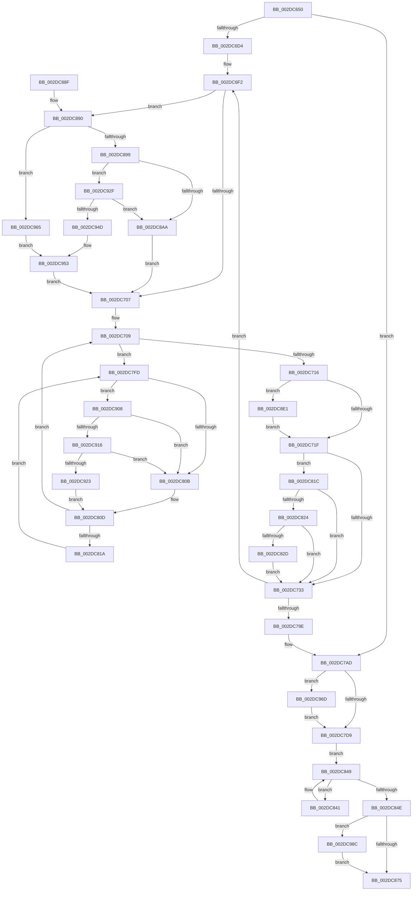

# MiFreeSlabEntry

- RVA: `0x002DC650`–`0x002DC99C` (길이 `844` bytes)
- VA: `0x00000001402DC650`
- 실행 섹션: `.text`
- PDB 이름 있음: `예`; PDB Function 태그: `아니요`
- unwind 정보 RVA: `0x00070770`
- 디코드: `199`개 명령, `844/844` bytes 표시
- 미해석 바이트: `0` (있으면 어셈블리에 `.byte`로 보존)

> 이 문서는 커널 이미지의 기계어와 PDB 기호를 분석해 생성했습니다. 4번과 5번은 함수 원형과 자료형을 바이너리 사용 방식에서 추정한 C 해석이며 원본 소스 복구 결과는 아닙니다.

## 1. Dependencies

- 직접 호출 지점: **11**; 고유 호출 대상: **11**
- 직접 호출자로 확인된 함수: **4**
- RIP 상대 이미지 참조: **7**

### Outgoing calls
- `0x002DC7C1` → [MiUpdateSlabPagePlaceholderState](../2A/MiUpdateSlabPagePlaceholderState_function_002A0FB0.md) (function, `0x002A0FB0`)
- `0x002DC832` → [MiSetPfnIdentity](../2A/MiSetPfnIdentity_function_002A2350.md) (function, `0x002A2350`)
- `0x002DC865` → [MiFreeLargePageMemory](../37/MiFreeLargePageMemory_function_00377938.md) (function, `0x00377938`)
- `0x002DC87A` → [ExFreePoolWithTag](../../poolcode/B8/ExFreePoolWithTag_function_00B82870.md) (function, `0x00B82870`)
- `0x002DC8BC` → [MiMakeLinkedListPte](../2C/MiMakeLinkedListPte_function_002C98C0.md) (function, `0x002C98C0`)
- `0x002DC916` → [KiCheckVpBackingLongSpinWaitHypercall](../30/KiCheckVpBackingLongSpinWaitHypercall_function_0030F490.md) (function, `0x0030F490`)
- `0x002DC925` → [HvlNotifyLongSpinWait](../30/HvlNotifyLongSpinWait_function_0030F460.md) (function, `0x0030F460`)
- `0x002DC940` → [MiTbFlushTimeStampMayNeedFlush](../45/MiTbFlushTimeStampMayNeedFlush_function_004584B8.md) (function, `0x004584B8`)
- `0x002DC95B` → [MiChangePageAttribute](../33/MiChangePageAttribute_function_00332ECC.md) (function, `0x00332ECC`)
- `0x002DC982` → [MiChangePageAttributeBatch](../2A/MiChangePageAttributeBatch_function_002A06E0.md) (function, `0x002A06E0`)
- `0x002DC992` → [MiReleaseNonPagedResources](../32/MiReleaseNonPagedResources_function_0032299C.md) (function, `0x0032299C`)

### Direct callers
- [MiFreeSlabEntries](MiFreeSlabEntries_function_002DAFC0.md) at `0x002DB13F`
- [MiReplenishSlabAllocator](../37/MiReplenishSlabAllocator_function_003788E4.md) at `0x00378A47`
- [MiDeleteSlabEntriesForIdentity](../68/MiDeleteSlabEntriesForIdentity_function_0068DE10.md) at `0x0068DFA3`
- [MiEstablishDefragSlabEntries](../68/MiEstablishDefragSlabEntries_function_0068E0EC.md) at `0x0068E3B5`

### Static image references
- `0x002DC66A` → RVA `0x00011C60` (`.rdata`; read)
- `0x002DC7DD` → RVA `0x00E3D240` (`.data`; read)
- `0x002DC7FF` → RVA `0x00FC52AC` (`ALMOSTRO`; reference)
- `0x002DC8EF` → RVA `0x00E30088` (`.data`; read)
- `0x002DC908` → RVA `0x00FC6AB8` (`ALMOSTRO`; read)
- `0x002DC934` → RVA `0x00FCF080` (`CACHEALI`; read)
- `0x002DC96D` → RVA `0x00010880` (`.rdata`; read)

## 2. Other-region calls and transfers

- 다른 실행 섹션으로 향하는 call: **1**
  - `0x002DC87A` → [ExFreePoolWithTag](../../poolcode/B8/ExFreePoolWithTag_function_00B82870.md) (`.text` → `POOLCODE`)
- 별도 외부 분기/꼬리 이동을 확인하지 못했습니다.

## 3. Assembly (complete function range)

```asm
002DC650  48 89 54 24 10                  mov qword ptr [rsp + 0x10], rdx
002DC655  53                              push rbx
002DC656  56                              push rsi
002DC657  57                              push rdi
002DC658  41 54                           push r12
002DC65A  41 55                           push r13
002DC65C  41 56                           push r14
002DC65E  41 57                           push r15
002DC660  48 83 EC 20                     sub rsp, 0x20
002DC664  8B 81 88 00 00 00               mov eax, dword ptr [rcx + 0x88]
002DC66A  4C 8D 2D EF 55 D3 FF            lea r13, [rip - 0x2caa11]
002DC671  48 C1 E8 04                     shr rax, 4
002DC675  4C 8B F1                        mov r14, rcx
002DC678  83 E0 03                        and eax, 3
002DC67B  48 B9 00 00 00 00 00 DE FF FF   movabs rcx, 0xffffde0000000000
002DC685  48 8B F2                        mov rsi, rdx
002DC688  45 33 FF                        xor r15d, r15d
002DC68B  45 8B 6C C5 00                  mov r13d, dword ptr [r13 + rax*8]
002DC690  48 B8 FF FF FF FF 7F 00 00 00   movabs rax, 0x7fffffffff
002DC69A  48 8B D8                        mov rbx, rax
002DC69D  48 89 44 24 78                  mov qword ptr [rsp + 0x78], rax
002DC6A2  48 8B 42 28                     mov rax, qword ptr [rdx + 0x28]
002DC6A6  44 89 6C 24 70                  mov dword ptr [rsp + 0x70], r13d
002DC6AB  48 8D 3C 40                     lea rdi, [rax + rax*2]
002DC6AF  48 C1 E7 04                     shl rdi, 4
002DC6B3  48 8B C1                        mov rax, rcx
002DC6B6  48 03 F8                        add rdi, rax
002DC6B9  48 8B 42 30                     mov rax, qword ptr [rdx + 0x30]
002DC6BD  4C 8D 24 40                     lea r12, [rax + rax*2]
002DC6C1  49 C1 E4 04                     shl r12, 4
002DC6C5  48 8B C1                        mov rax, rcx
002DC6C8  4C 03 E0                        add r12, rax
002DC6CB  49 3B FC                        cmp rdi, r12
002DC6CE  0F 87 D9 00 00 00               ja 0x1402dc7ad
002DC6D4  49 B9 10 00 00 00 00 DE FF FF   movabs r9, 0xffffde0000000010
002DC6DE  48 BE 28 00 00 00 00 DE FF FF   movabs rsi, 0xffffde0000000028
002DC6E8  49 BD 20 00 00 00 00 DE FF FF   movabs r13, 0xffffde0000000020
002DC6F2  8B 47 20                        mov eax, dword ptr [rdi + 0x20]
002DC6F5  C1 E8 10                        shr eax, 0x10
002DC6F8  0F B6 C8                        movzx ecx, al
002DC6FB  C1 E9 06                        shr ecx, 6
002DC6FE  83 F9 01                        cmp ecx, 1
002DC701  0F 85 89 01 00 00               jne 0x1402dc890
002DC707  33 DB                           xor ebx, ebx
002DC709  F0 48 0F BA 6F 18 3F            lock bts qword ptr [rdi + 0x18], 0x3f
002DC710  0F 82 E7 00 00 00               jb 0x1402dc7fd
002DC716  4D 85 FF                        test r15, r15
002DC719  0F 84 C2 01 00 00               je 0x1402dc8e1
002DC71F  41 8B 86 80 00 00 00            mov eax, dword ptr [r14 + 0x80]
002DC726  BA 02 00 00 00                  mov edx, 2
002DC72B  85 C0                           test eax, eax
002DC72D  0F 89 E9 00 00 00               jns 0x1402dc81c
002DC733  8B 47 20                        mov eax, dword ptr [rdi + 0x20]
002DC736  48 B9 01 00 00 00 00 00 00 C0   movabs rcx, 0xc000000000000001
002DC740  89 44 24 60                     mov dword ptr [rsp + 0x60], eax
002DC744  66 89 54 24 60                  mov word ptr [rsp + 0x60], dx
002DC749  8B 44 24 60                     mov eax, dword ptr [rsp + 0x60]
002DC74D  89 47 20                        mov dword ptr [rdi + 0x20], eax
002DC750  48 8B 47 18                     mov rax, qword ptr [rdi + 0x18]
002DC754  48 23 C1                        and rax, rcx
002DC757  48 83 C8 01                     or rax, 1
002DC75B  48 89 47 18                     mov qword ptr [rdi + 0x18], rax
002DC75F  8B 47 20                        mov eax, dword ptr [rdi + 0x20]
002DC762  89 44 24 60                     mov dword ptr [rsp + 0x60], eax
002DC766  C1 E8 10                        shr eax, 0x10
002DC769  24 FE                           and al, 0xfe
002DC76B  0C 06                           or al, 6
002DC76D  88 44 24 62                     mov byte ptr [rsp + 0x62], al
002DC771  8B 44 24 60                     mov eax, dword ptr [rsp + 0x60]
002DC775  89 47 20                        mov dword ptr [rdi + 0x20], eax
002DC778  48 B8 FF FF FF FF FF FF FF 7F   movabs rax, 0x7fffffffffffffff
002DC782  F0 48 21 47 18                  lock and qword ptr [rdi + 0x18], rax
002DC787  48 83 C7 30                     add rdi, 0x30
002DC78B  49 3B FC                        cmp rdi, r12
002DC78E  49 B9 10 00 00 00 00 DE FF FF   movabs r9, 0xffffde0000000010
002DC798  0F 86 54 FF FF FF               jbe 0x1402dc6f2
002DC79E  48 8B 5C 24 78                  mov rbx, qword ptr [rsp + 0x78]
002DC7A3  48 8B 74 24 68                  mov rsi, qword ptr [rsp + 0x68]
002DC7A8  44 8B 6C 24 70                  mov r13d, dword ptr [rsp + 0x70]
002DC7AD  48 8B 56 28                     mov rdx, qword ptr [rsi + 0x28]
002DC7B1  45 33 C9                        xor r9d, r9d
002DC7B4  41 8B 8E 80 00 00 00            mov ecx, dword ptr [r14 + 0x80]
002DC7BB  45 8B C5                        mov r8d, r13d
002DC7BE  41 8B FD                        mov edi, r13d
002DC7C1  E8 EA 47 FC FF                  call 0x1402a0fb0
002DC7C6  48 B8 FF FF FF FF 7F 00 00 00   movabs rax, 0x7fffffffff
002DC7D0  48 3B D8                        cmp rbx, rax
002DC7D3  0F 85 94 01 00 00               jne 0x1402dc96d
002DC7D9  48 8B 56 28                     mov rdx, qword ptr [rsi + 0x28]
002DC7DD  48 8B 0D 5C 0A B6 00            mov rcx, qword ptr [rip + 0xb60a5c]
002DC7E4  48 8D 42 FF                     lea rax, [rdx - 1]
002DC7E8  48 03 C7                        add rax, rdi
002DC7EB  48 C1 E8 09                     shr rax, 9
002DC7EF  48 C1 EA 09                     shr rdx, 9
002DC7F3  4C 8D 04 41                     lea r8, [rcx + rax*2]
002DC7F7  48 8D 04 51                     lea rax, [rcx + rdx*2]
002DC7FB  EB 4C                           jmp 0x1402dc849
002DC7FD  FF C3                           inc ebx
002DC7FF  85 1D A7 8A CE 00               test dword ptr [rip + 0xce8aa7], ebx
002DC805  0F 84 FD 00 00 00               je 0x1402dc908
002DC80B  F3 90                           pause
002DC80D  48 8B 47 18                     mov rax, qword ptr [rdi + 0x18]
002DC811  48 85 C0                        test rax, rax
002DC814  0F 89 EF FE FF FF               jns 0x1402dc709
002DC81A  EB E1                           jmp 0x1402dc7fd
002DC81C  3B C2                           cmp eax, edx
002DC81E  0F 84 0F FF FF FF               je 0x1402dc733
002DC824  83 F8 04                        cmp eax, 4
002DC827  0F 8F 06 FF FF FF               jg 0x1402dc733
002DC82D  33 D2                           xor edx, edx
002DC82F  48 8B CF                        mov rcx, rdi
002DC832  E8 19 5B FC FF                  call 0x1402a2350
002DC837  BA 02 00 00 00                  mov edx, 2
002DC83C  E9 F2 FE FF FF                  jmp 0x1402dc733
002DC841  66 83 20 00                     and word ptr [rax], 0
002DC845  48 83 C0 02                     add rax, 2
002DC849  49 3B C0                        cmp rax, r8
002DC84C  76 F3                           jbe 0x1402dc841
002DC84E  41 8B 96 88 00 00 00            mov edx, dword ptr [r14 + 0x88]
002DC855  41 B8 1E 00 00 00               mov r8d, 0x1e
002DC85B  48 8B 4E 28                     mov rcx, qword ptr [rsi + 0x28]
002DC85F  C1 EA 04                        shr edx, 4
002DC862  83 E2 03                        and edx, 3
002DC865  E8 CE B0 09 00                  call 0x140377938
002DC86A  8B 46 5C                        mov eax, dword ptr [rsi + 0x5c]
002DC86D  A8 02                           test al, 2
002DC86F  0F 85 17 01 00 00               jne 0x1402dc98c
002DC875  33 D2                           xor edx, edx
002DC877  48 8B CE                        mov rcx, rsi
002DC87A  E8 F1 5F 8A 00                  call 0x140b82870
002DC87F  48 83 C4 20                     add rsp, 0x20
002DC883  41 5F                           pop r15
002DC885  41 5E                           pop r14
002DC887  41 5D                           pop r13
002DC889  41 5C                           pop r12
002DC88B  5F                              pop rdi
002DC88C  5E                              pop rsi
002DC88D  5B                              pop rbx
002DC88E  C3                              ret
002DC88F  CC                              int3
002DC890  83 F9 03                        cmp ecx, 3
002DC893  0F 84 CC 00 00 00               je 0x1402dc965
002DC899  48 8B 4F 18                     mov rcx, qword ptr [rdi + 0x18]
002DC89D  48 C1 E9 3B                     shr rcx, 0x3b
002DC8A1  83 E1 07                        and ecx, 7
002DC8A4  0F 85 85 00 00 00               jne 0x1402dc92f
002DC8AA  49 8B C5                        mov rax, r13
002DC8AD  48 8B 4C 24 78                  mov rcx, qword ptr [rsp + 0x78]
002DC8B2  48 8B D7                        mov rdx, rdi
002DC8B5  48 2B D0                        sub rdx, rax
002DC8B8  48 83 C2 20                     add rdx, 0x20
002DC8BC  E8 FF CF FE FF                  call 0x1402c98c0
002DC8C1  4A 89 04 0A                     mov qword ptr [rdx + r9], rax
002DC8C5  48 B8 AB AA AA AA AA AA AA AA   movabs rax, 0xaaaaaaaaaaaaaaab
002DC8CF  48 C1 FA 04                     sar rdx, 4
002DC8D3  48 0F AF D0                     imul rdx, rax
002DC8D7  48 89 54 24 78                  mov qword ptr [rsp + 0x78], rdx
002DC8DC  E9 26 FE FF FF                  jmp 0x1402dc707
002DC8E1  49 8B C5                        mov rax, r13
002DC8E4  48 8B CE                        mov rcx, rsi
002DC8E7  48 2B C8                        sub rcx, rax
002DC8EA  48 8B 44 39 20                  mov rax, qword ptr [rcx + rdi + 0x20]
002DC8EF  48 8B 0D 92 37 B5 00            mov rcx, qword ptr [rip + 0xb53792]
002DC8F6  48 C1 E8 2B                     shr rax, 0x2b
002DC8FA  25 FF 03 00 00                  and eax, 0x3ff
002DC8FF  4C 8B 3C C1                     mov r15, qword ptr [rcx + rax*8]
002DC903  E9 17 FE FF FF                  jmp 0x1402dc71f
002DC908  8B 05 AA A1 CE 00               mov eax, dword ptr [rip + 0xcea1aa]
002DC90E  A8 40                           test al, 0x40
002DC910  0F 84 F5 FE FF FF               je 0x1402dc80b
002DC916  E8 75 2B 03 00                  call 0x14030f490
002DC91B  84 C0                           test al, al
002DC91D  0F 84 E8 FE FF FF               je 0x1402dc80b
002DC923  8B CB                           mov ecx, ebx
002DC925  E8 36 2B 03 00                  call 0x14030f460
002DC92A  E9 DE FE FF FF                  jmp 0x1402dc80d
002DC92F  F0 83 0C 24 00                  lock or dword ptr [rsp], 0
002DC934  8B 15 46 27 CF 00               mov edx, dword ptr [rip + 0xcf2746]
002DC93A  41 B8 07 00 00 00               mov r8d, 7
002DC940  E8 73 BB 17 00                  call 0x1404584b8
002DC945  84 C0                           test al, al
002DC947  0F 85 5D FF FF FF               jne 0x1402dc8aa
002DC94D  41 B8 14 00 00 00               mov r8d, 0x14
002DC953  BA 01 00 00 00                  mov edx, 1
002DC958  48 8B CF                        mov rcx, rdi
002DC95B  E8 6C 65 05 00                  call 0x140332ecc
002DC960  E9 A2 FD FF FF                  jmp 0x1402dc707
002DC965  41 B8 10 00 00 00               mov r8d, 0x10
002DC96B  EB E6                           jmp 0x1402dc953
002DC96D  4C 8B 05 0C 3F D3 FF            mov r8, qword ptr [rip - 0x2cc0f4]
002DC974  48 8D 4C 24 78                  lea rcx, [rsp + 0x78]
002DC979  41 B9 01 00 00 00               mov r9d, 1
002DC97F  41 8B D1                        mov edx, r9d
002DC982  E8 59 3D FC FF                  call 0x1402a06e0
002DC987  E9 4D FE FF FF                  jmp 0x1402dc7d9
002DC98C  48 8B D7                        mov rdx, rdi
002DC98F  49 8B CF                        mov rcx, r15
002DC992  E8 05 60 04 00                  call 0x14032299c
002DC997  E9 D9 FE FF FF                  jmp 0x1402dc875
```

## 4. C-style interpretation (structured pseudocode)

```c
__int64 __fastcall MiFreeSlabEntry(__int64 a1, __int64 a2)
{
    __int64 result;
    __int64 v_r12;
    __int64 v_r15;
    __int64 v_rbx;
    __int64 v_rdi;
    __int64 v_rsp;
    unsigned int v_stack_p0;
    unsigned __int64 v_stack_p10;
    unsigned int v_stack_p18;
    unsigned __int64 v_stack_p20;
    unsigned __int64 v_stack_p78;
    unsigned int v_stack_p8;
    unsigned __int8 v_stack_pA;

    v_stack_p10 = a2;
    v_rsp = (v_rsp) - (32);
    result = ((unsigned int)(*(unsigned int *)(a1 + 136))) >> (4);
    result = (unsigned int)((result) & (3));
    v_r15 = 0;
    v_stack_p20 = result;
    v_stack_p18 = (unsigned int)((unsigned int)(*(unsigned int *)(v_rip - 2927121 + result * 8)));
    v_rdi = (*(unsigned __int64 *)(a2 + 40) + *(unsigned __int64 *)(a2 + 40) * 2) << (4);
    v_rdi = (v_rdi) + (a1);
    v_r12 = (*(unsigned __int64 *)(a2 + 48) + *(unsigned __int64 *)(a2 + 48) * 2) << (4);
    v_r12 = (v_r12) + (a1);
    if (v_rdi > v_r12) goto loc_002DC7AD;
loc_002DC6F2:
    result = (unsigned int)(((unsigned int)(*(unsigned int *)(v_rdi + 32))) >> (16));
    a1 = (unsigned int)(((unsigned __int8)(result)) >> (6));
    if (((unsigned int)(a1)) != 1) goto loc_002DC890;
loc_002DC707:
    v_rbx = 0;
loc_002DC709:
    if (condition_is_below) goto loc_002DC7FD;
    if (0 == 0) goto loc_002DC8E1;
loc_002DC71F:
    if (!sign_flag) goto loc_002DC81C;
loc_002DC733:
    v_stack_p8 = (unsigned int)((unsigned int)(*(unsigned int *)(v_rdi + 32)));
    v_stack_p8 = 2;
    *(unsigned int *)(v_rdi + 32) = (unsigned int)((unsigned int)(v_stack_p8));
    result = (*(unsigned __int64 *)(v_rdi + 24)) & (a1);
    result = (result) | (1);
    *(unsigned __int64 *)(v_rdi + 24) = result;
    v_stack_p8 = (unsigned int)((unsigned int)(*(unsigned int *)(v_rdi + 32)));
    result = (unsigned int)(((unsigned int)(*(unsigned int *)(v_rdi + 32))) >> (16));
    result = (unsigned __int8)((result) & (254));
    result = (unsigned __int8)((result) | (6));
    v_stack_pA = (unsigned __int8)(result);
    *(unsigned int *)(v_rdi + 32) = (unsigned int)((unsigned int)(v_stack_p8));
    v_rdi = (v_rdi) + (48);
    if (v_rdi <= v_r12) goto loc_002DC6F2;
loc_002DC7AD:
    a4 = 0;
    result = MiUpdateSlabPagePlaceholderState((unsigned int)(*(unsigned int *)(a1 + 128)), *(unsigned __int64 *)(v_stack_p10 + 40), (unsigned int)((unsigned int)((unsigned int)(v_stack_p18))), a4);
    if (v_stack_p20 != result) goto loc_002DC96D;
loc_002DC7D9:
    result = (*(unsigned __int64 *)(v_stack_p10 + 40) - 1) + ((unsigned int)((unsigned int)((unsigned int)(v_stack_p18))));
    result = (result) >> (9);
    a2 = (*(unsigned __int64 *)(v_stack_p10 + 40)) >> (9);
    goto loc_002DC849;
loc_002DC7FD:
    v_rbx = (unsigned int)((v_stack_p20) + 1);
    if (((*(unsigned int *)(v_rip + 13535911)) & ((unsigned int)(v_rbx))) == 0) goto loc_002DC908;
loc_002DC80B:
loc_002DC80D:
    if (!sign_flag) goto loc_002DC709;
    goto loc_002DC7FD;
loc_002DC81C:
    if (((unsigned int)(*(unsigned __int64 *)((unsigned int)((unsigned int)((unsigned int)(v_stack_p18))) + 24))) == ((unsigned int)(a2))) goto loc_002DC733;
    if (((unsigned int)(*(unsigned __int64 *)((unsigned int)((unsigned int)((unsigned int)(v_stack_p18))) + 24))) > 4) goto loc_002DC733;
    a2 = 0;
    result = MiSetPfnIdentity((unsigned int)((unsigned int)((unsigned int)(v_stack_p18))), a2, *(unsigned __int64 *)(v_rip + 11930204) + result * 2, a4);
    goto loc_002DC733;
loc_002DC841:
    result = (result) + (2);
loc_002DC849:
    if (result <= (*(unsigned __int64 *)(v_rip + 11930204) + result * 2)) goto loc_002DC841;
    a2 = (unsigned int)(((unsigned int)(*(unsigned int *)(a1 + 136))) >> (4));
    a2 = (unsigned int)((a2) & (3));
    result = MiFreeLargePageMemory(*(unsigned __int64 *)(v_stack_p10 + 40), a2, 30, a4);
    if ((((unsigned __int8)((unsigned int)(*(unsigned int *)(v_stack_p10 + 92)))) & (2)) != 0) goto loc_002DC98C;
loc_002DC875:
    a2 = 0;
    result = ExFreePoolWithTag(v_stack_p10, a2, 30, a4);
    v_rsp = (v_rsp) + (32);
    return result;
loc_002DC890:
    if (((unsigned int)(v_stack_p10)) == 3) goto loc_002DC965;
    a1 = (*(unsigned __int64 *)((unsigned int)((unsigned int)((unsigned int)(v_stack_p18))) + 24)) >> (59);
    a1 = (unsigned int)((a1) & (7));
    if (condition_is_not_equal) goto loc_002DC92F;
loc_002DC8AA:
    a2 = ((unsigned int)((unsigned int)((unsigned int)(v_stack_p18)))) - ((unsigned int)(v_stack_p18));
    a2 = (a2) + (32);
    result = MiMakeLinkedListPte(v_stack_p78, a2, 30, a4);
    *(unsigned __int64 *)(a2 + a4 * 1) = result;
    a2 = (a2) >> (4);
    a2 = (a2) * (result);
    v_stack_p78 = a2;
    goto loc_002DC707;
loc_002DC8E1:
    a1 = (v_stack_p10) - ((unsigned int)(v_stack_p18));
    result = (*(unsigned __int64 *)(a1 + (unsigned int)((unsigned int)((unsigned int)(v_stack_p18))) * 1 + 32)) >> (43);
    result = (unsigned int)((result) & (0x3FFULL));
    goto loc_002DC71F;
loc_002DC908:
    if ((((unsigned __int8)((unsigned int)(*(unsigned int *)(v_rip + 13541802)))) & (64)) == 0) goto loc_002DC80B;
    result = KiCheckVpBackingLongSpinWaitHypercall(*(unsigned __int64 *)(v_rip + 11876242), a2, 30, a4);
    if ((unsigned __int8)(result) == 0) goto loc_002DC80B;
    result = HvlNotifyLongSpinWait((unsigned int)((unsigned int)(v_rbx)), a2, 30, a4);
    goto loc_002DC80D;
loc_002DC92F:
    result = MiTbFlushTimeStampMayNeedFlush((unsigned int)((unsigned int)(v_rbx)), (unsigned int)(*(unsigned int *)(v_rip + 13576006)), 7, a4);
    if ((unsigned __int8)(result) != 0) goto loc_002DC8AA;
loc_002DC953:
    result = MiChangePageAttribute((unsigned int)((unsigned int)((unsigned int)(v_stack_p18))), 1, 20, a4);
    goto loc_002DC707;
loc_002DC965:
    goto loc_002DC953;
loc_002DC96D:
    result = MiChangePageAttributeBatch(v_stack_p78, 1, *(unsigned __int64 *)(v_rip - 2932980), 1);
    goto loc_002DC7D9;
loc_002DC98C:
    result = MiReleaseNonPagedResources(*(unsigned __int64 *)(*(unsigned __int64 *)(v_rip + 11876242) + result * 8), (unsigned int)((unsigned int)((unsigned int)(v_stack_p18))), *(unsigned __int64 *)(v_rip - 2932980), 1);
    goto loc_002DC875;
}
```

## 5. (Beta) C Style

```c
int64_t MiFreeSlabEntry(void *Arg1, void *Arg2)
{
    uint8_t *arg1 = (uint8_t *)Arg1;
    uint8_t *arg2 = (uint8_t *)Arg2;

    int64_t result;
    int64_t local_r12;
    int64_t local_r15;
    int64_t local_rbx;
    int64_t local_rdi;
    int64_t local_rsp;
    uint32_t v_stack_p0;
    uint64_t v_stack_p10;
    uint32_t v_stack_p18;
    uint64_t v_stack_p20;
    uint64_t v_stack_p78;
    uint32_t v_stack_p8;
    uint8_t v_stack_pA;

    v_stack_p10 = Arg2;
    local_rsp = (local_rsp) - (32);
    result = ((uint32_t)(*(uint32_t *)(arg1 + 0x88))) >> (4);
    result = (uint32_t)((result) & (3));
    local_r15 = 0;
    v_stack_p20 = result;
    v_stack_p18 = (uint32_t)((uint32_t)(*(uint32_t *)(v_rip - 0x2CAA11 + result * 8)));
    local_rdi = (*(uint64_t *)(arg2 + 0x28) + *(uint64_t *)(arg2 + 0x28) * 2) << (4);
    local_rdi = (local_rdi) + (Arg1);
    local_r12 = (*(uint64_t *)(arg2 + 0x30) + *(uint64_t *)(arg2 + 0x30) * 2) << (4);
    local_r12 = (local_r12) + (Arg1);
    if (local_rdi > local_r12) goto loc_002DC7AD;
loc_002DC6F2:
    result = (uint32_t)(((uint32_t)(*(uint32_t *)(local_rdi + 0x20))) >> (16));
    Arg1 = (uint32_t)(((uint8_t)(result)) >> (6));
    if (((uint32_t)(Arg1)) != 1) goto loc_002DC890;
loc_002DC707:
    local_rbx = 0;
loc_002DC709:
    if (condition_is_below) goto loc_002DC7FD;
    if (0 == 0) goto loc_002DC8E1;
loc_002DC71F:
    if (!sign_flag) goto loc_002DC81C;
loc_002DC733:
    v_stack_p8 = (uint32_t)((uint32_t)(*(uint32_t *)(local_rdi + 0x20)));
    v_stack_p8 = 2;
    *(uint32_t *)(local_rdi + 0x20) = (uint32_t)((uint32_t)(v_stack_p8));
    result = (*(uint64_t *)(local_rdi + 0x18)) & (Arg1);
    result = (result) | (1);
    *(uint64_t *)(local_rdi + 0x18) = result;
    v_stack_p8 = (uint32_t)((uint32_t)(*(uint32_t *)(local_rdi + 0x20)));
    result = (uint32_t)(((uint32_t)(*(uint32_t *)(local_rdi + 0x20))) >> (16));
    result = (uint8_t)((result) & (254));
    result = (uint8_t)((result) | (6));
    v_stack_pA = (uint8_t)(result);
    *(uint32_t *)(local_rdi + 0x20) = (uint32_t)((uint32_t)(v_stack_p8));
    local_rdi = (local_rdi) + (48);
    if (local_rdi <= local_r12) goto loc_002DC6F2;
loc_002DC7AD:
    a4 = 0;
    result = MiUpdateSlabPagePlaceholderState((uint32_t)(*(uint32_t *)(arg1 + 0x80)), *(uint64_t *)(v_stack_p10 + 0x28), (uint32_t)((uint32_t)((uint32_t)(v_stack_p18))), a4);
    if (v_stack_p20 != result) goto loc_002DC96D;
loc_002DC7D9:
    result = (*(uint64_t *)(v_stack_p10 + 0x28) - 1) + ((uint32_t)((uint32_t)((uint32_t)(v_stack_p18))));
    result = (result) >> (9);
    Arg2 = (*(uint64_t *)(v_stack_p10 + 0x28)) >> (9);
    goto loc_002DC849;
loc_002DC7FD:
    local_rbx = (uint32_t)((v_stack_p20) + 1);
    if (((*(uint32_t *)(v_rip + 0xCE8AA7)) & ((uint32_t)(local_rbx))) == 0) goto loc_002DC908;
loc_002DC80B:
loc_002DC80D:
    if (!sign_flag) goto loc_002DC709;
    goto loc_002DC7FD;
loc_002DC81C:
    if (((uint32_t)(*(uint64_t *)((uint32_t)((uint32_t)((uint32_t)(v_stack_p18))) + 0x18))) == ((uint32_t)(Arg2))) goto loc_002DC733;
    if (((uint32_t)(*(uint64_t *)((uint32_t)((uint32_t)((uint32_t)(v_stack_p18))) + 0x18))) > 4) goto loc_002DC733;
    Arg2 = 0;
    result = MiSetPfnIdentity((uint32_t)((uint32_t)((uint32_t)(v_stack_p18))), Arg2, *(uint64_t *)(v_rip + 0xB60A5C) + result * 2, a4);
    goto loc_002DC733;
loc_002DC841:
    result = (result) + (2);
loc_002DC849:
    if (result <= (*(uint64_t *)(v_rip + 0xB60A5C) + result * 2)) goto loc_002DC841;
    Arg2 = (uint32_t)(((uint32_t)(*(uint32_t *)(arg1 + 0x88))) >> (4));
    Arg2 = (uint32_t)((Arg2) & (3));
    result = MiFreeLargePageMemory(*(uint64_t *)(v_stack_p10 + 0x28), Arg2, 30, a4);
    if ((((uint8_t)((uint32_t)(*(uint32_t *)(v_stack_p10 + 0x5C)))) & (2)) != 0) goto loc_002DC98C;
loc_002DC875:
    Arg2 = 0;
    result = ExFreePoolWithTag(v_stack_p10, Arg2, 30, a4);
    local_rsp = (local_rsp) + (32);
    return result;
loc_002DC890:
    if (((uint32_t)(v_stack_p10)) == 3) goto loc_002DC965;
    Arg1 = (*(uint64_t *)((uint32_t)((uint32_t)((uint32_t)(v_stack_p18))) + 0x18)) >> (59);
    Arg1 = (uint32_t)((Arg1) & (7));
    if (condition_is_not_equal) goto loc_002DC92F;
loc_002DC8AA:
    Arg2 = ((uint32_t)((uint32_t)((uint32_t)(v_stack_p18)))) - ((uint32_t)(v_stack_p18));
    Arg2 = (Arg2) + (32);
    result = MiMakeLinkedListPte(v_stack_p78, Arg2, 30, a4);
    *(uint64_t *)(arg2 + a4 * 1) = result;
    Arg2 = (Arg2) >> (4);
    Arg2 = (Arg2) * (result);
    v_stack_p78 = Arg2;
    goto loc_002DC707;
loc_002DC8E1:
    Arg1 = (v_stack_p10) - ((uint32_t)(v_stack_p18));
    result = (*(uint64_t *)(arg1 + (uint32_t)((uint32_t)((uint32_t)(v_stack_p18))) * 1 + 0x20)) >> (43);
    result = (uint32_t)((result) & (0x3FFULL));
    goto loc_002DC71F;
loc_002DC908:
    if ((((uint8_t)((uint32_t)(*(uint32_t *)(v_rip + 0xCEA1AA)))) & (64)) == 0) goto loc_002DC80B;
    result = KiCheckVpBackingLongSpinWaitHypercall(*(uint64_t *)(v_rip + 0xB53792), Arg2, 30, a4);
    if ((uint8_t)(result) == 0) goto loc_002DC80B;
    result = HvlNotifyLongSpinWait((uint32_t)((uint32_t)(local_rbx)), Arg2, 30, a4);
    goto loc_002DC80D;
loc_002DC92F:
    result = MiTbFlushTimeStampMayNeedFlush((uint32_t)((uint32_t)(local_rbx)), (uint32_t)(*(uint32_t *)(v_rip + 0xCF2746)), 7, a4);
    if ((uint8_t)(result) != 0) goto loc_002DC8AA;
loc_002DC953:
    result = MiChangePageAttribute((uint32_t)((uint32_t)((uint32_t)(v_stack_p18))), 1, 20, a4);
    goto loc_002DC707;
loc_002DC965:
    goto loc_002DC953;
loc_002DC96D:
    result = MiChangePageAttributeBatch(v_stack_p78, 1, *(uint64_t *)(v_rip - 0x2CC0F4), 1);
    goto loc_002DC7D9;
loc_002DC98C:
    result = MiReleaseNonPagedResources(*(uint64_t *)(*(uint64_t *)(v_rip + 0xB53792) + result * 8), (uint32_t)((uint32_t)((uint32_t)(v_stack_p18))), *(uint64_t *)(v_rip - 0x2CC0F4), 1);
    goto loc_002DC875;
}
```

### 관측된 메모리 오프셋

구조체 형식이 확인되지 않은 접근은 인자 기준의 오프셋으로만 기록했습니다.

| 기준 인자 | 오프셋 표현 | 폭 (bit) | 접근 |
|---|---:|---:|---|
| `Arg1` | `+ 0x80` | `32` | `R` |
| `Arg1` | `+ 0x88` | `32` | `R` |
| `Arg2` | `+ 0x28` | `64` | `R` |
| `Arg2` | `+ 0x30` | `64` | `R` |

## 6. Execution-region graph

[열기: 2D/3D 그래프와 함수 탐색 컨트롤 패널](../../../control-panel.html?section=text&rva=0x002DC650&view=graph)

- 2D 그래프는 위에서 아래로 흐르고, 3D 그래프는 빈 공간을 드래그해 회전합니다. Shift+드래그는 이동, 휠은 확대·축소, 함수 노드 선택은 대상 보고서 이동입니다.

### Static fallback


