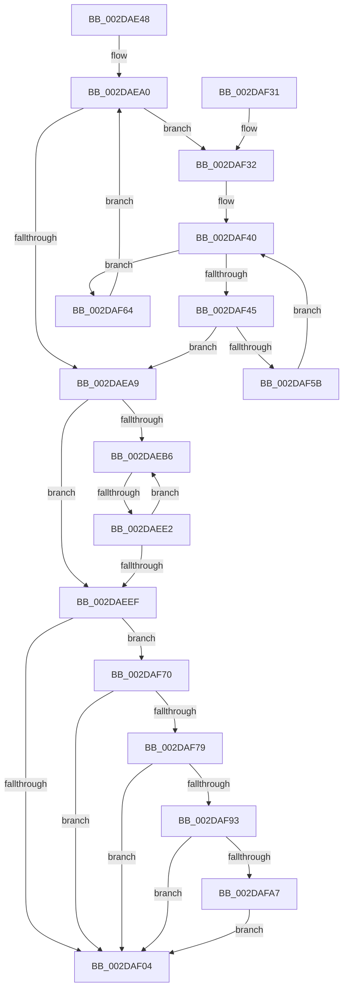

# MiFreeUnusedSlabPages

- RVA: `0x002DAE48`–`0x002DAFB9` (길이 `369` bytes)
- VA: `0x00000001402DAE48`
- 실행 섹션: `.text`
- PDB 이름 있음: `예`; PDB Function 태그: `예`
- unwind 정보 RVA: `0x000705D0`
- 디코드: `87`개 명령, `369/369` bytes 표시
- 미해석 바이트: `0` (있으면 어셈블리에 `.byte`로 보존)

> 이 문서는 커널 이미지의 기계어와 PDB 기호를 분석해 생성했습니다. 4번과 5번은 함수 원형과 자료형을 바이너리 사용 방식에서 추정한 C 해석이며 원본 소스 복구 결과는 아닙니다.

## 1. Dependencies

- 직접 호출 지점: **8**; 고유 호출 대상: **8**
- 직접 호출자로 확인된 함수: **1**
- RIP 상대 이미지 참조: **2**

### Outgoing calls
- `0x002DAE83` → [memset](../6C/memset_function_006C6C40.md) (function, `0x006C6C40`)
- `0x002DAED2` → [MiCheckMdlSlabFragmentation](../49/MiCheckMdlSlabFragmentation_function_0049FCF0.md) (function, `0x0049FCF0`)
- `0x002DAEF6` → [MiSlabUpdateRecentFailure](MiSlabUpdateRecentFailure_function_002DC618.md) (function, `0x002DC618`)
- `0x002DAF0F` → [_security_check_cookie](../6A/_security_check_cookie_function_006AC640.md) (function, `0x006AC640`)
- `0x002DAF4E` → [MiFreeSlabEntries](MiFreeSlabEntries_function_002DAFC0.md) (function, `0x002DAFC0`)
- `0x002DAF7E` → [MiSlabDemotionLowMemoryConditionUpdate](../3B/MiSlabDemotionLowMemoryConditionUpdate_function_003BB7E0.md) (function, `0x003BB7E0`)
- `0x002DAF93` → [MiGetSlabCurrentTime](../3B/MiGetSlabCurrentTime_function_003BCBCC.md) (function, `0x003BCBCC`)
- `0x002DAFAF` → [MiDemoteSlabEntries](../4D/MiDemoteSlabEntries_function_004D89A0.md) (function, `0x004D89A0`)

### Direct callers
- [MiWorkingSetManager](MiWorkingSetManager_function_002DA7E0.md) at `0x002DA8F3`

### Static image references
- `0x002DAE63` → RVA `0x00E0A740` (`.data`; read)
- `0x002DAE88` → RVA `0x00FC5000` (`ALMOSTRO`; read)

## 2. Other-region calls and transfers

- 다른 실행 섹션으로 향하는 call: **0**
- call이 아닌 외부 분기/꼬리 이동: **1**
  - `0x002DAEDC` → [sub_006DDE00](../6D/Unknown_function_006DDE00.md) (`tail-transfer`)

## 3. Assembly (complete function range)

```asm
002DAE48  48 89 5C 24 10                  mov qword ptr [rsp + 0x10], rbx
002DAE4D  48 89 6C 24 18                  mov qword ptr [rsp + 0x18], rbp
002DAE52  48 89 74 24 20                  mov qword ptr [rsp + 0x20], rsi
002DAE57  57                              push rdi
002DAE58  41 56                           push r14
002DAE5A  41 57                           push r15
002DAE5C  48 81 EC A0 00 00 00            sub rsp, 0xa0
002DAE63  48 8B 05 D6 F8 B2 00            mov rax, qword ptr [rip + 0xb2f8d6]
002DAE6A  48 33 C4                        xor rax, rsp
002DAE6D  48 89 84 24 90 00 00 00         mov qword ptr [rsp + 0x90], rax
002DAE75  33 D2                           xor edx, edx
002DAE77  48 8B F9                        mov rdi, rcx
002DAE7A  48 8D 4C 24 20                  lea rcx, [rsp + 0x20]
002DAE7F  44 8D 42 68                     lea r8d, [rdx + 0x68]
002DAE83  E8 B8 BD 3E 00                  call 0x1406c6c40
002DAE88  0F B7 05 71 A1 CE 00            movzx eax, word ptr [rip + 0xcea171]
002DAE8F  48 8B 5F 10                     mov rbx, qword ptr [rdi + 0x10]
002DAE93  48 69 E8 80 DF 00 00            imul rbp, rax, 0xdf80
002DAE9A  48 03 EB                        add rbp, rbx
002DAE9D  45 33 FF                        xor r15d, r15d
002DAEA0  48 3B DD                        cmp rbx, rbp
002DAEA3  0F 82 89 00 00 00               jb 0x1402daf32
002DAEA9  66 44 3B 3D 4F A1 CE 00         cmp r15w, word ptr [rip + 0xcea14f]
002DAEB1  41 8B DF                        mov ebx, r15d
002DAEB4  73 39                           jae 0x1402daeef
002DAEB6  48 8B 6F 10                     mov rbp, qword ptr [rdi + 0x10]
002DAEBA  33 D2                           xor edx, edx
002DAEBC  8B C3                           mov eax, ebx
002DAEBE  48 81 C5 A8 43 00 00            add rbp, 0x43a8
002DAEC5  48 69 F0 80 DF 00 00            imul rsi, rax, 0xdf80
002DAECC  48 03 EE                        add rbp, rsi
002DAECF  48 8B CD                        mov rcx, rbp
002DAED2  E8 19 4E 1C 00                  call 0x14049fcf0
002DAED7  44 8B F0                        mov r14d, eax
002DAEDA  85 C0                           test eax, eax
002DAEDC  0F 85 1E 2F 40 00               jne 0x1406dde00
002DAEE2  0F B7 05 17 A1 CE 00            movzx eax, word ptr [rip + 0xcea117]
002DAEE9  FF C3                           inc ebx
002DAEEB  3B D8                           cmp ebx, eax
002DAEED  72 C7                           jb 0x1402daeb6
002DAEEF  48 8D 8F 38 41 00 00            lea rcx, [rdi + 0x4138]
002DAEF6  E8 1D 17 00 00                  call 0x1402dc618
002DAEFB  4C 39 BF D0 47 00 00            cmp qword ptr [rdi + 0x47d0], r15
002DAF02  75 6C                           jne 0x1402daf70
002DAF04  48 8B 8C 24 90 00 00 00         mov rcx, qword ptr [rsp + 0x90]
002DAF0C  48 33 CC                        xor rcx, rsp
002DAF0F  E8 2C 17 3D 00                  call 0x1406ac640
002DAF14  4C 8D 9C 24 A0 00 00 00         lea r11, [rsp + 0xa0]
002DAF1C  49 8B 5B 28                     mov rbx, qword ptr [r11 + 0x28]
002DAF20  49 8B 6B 30                     mov rbp, qword ptr [r11 + 0x30]
002DAF24  49 8B 73 38                     mov rsi, qword ptr [r11 + 0x38]
002DAF28  49 8B E3                        mov rsp, r11
002DAF2B  41 5F                           pop r15
002DAF2D  41 5E                           pop r14
002DAF2F  5F                              pop rdi
002DAF30  C3                              ret
002DAF31  CC                              int3
002DAF32  48 8D B3 50 3D 00 00            lea rsi, [rbx + 0x3d50]
002DAF39  4C 8D B3 78 45 00 00            lea r14, [rbx + 0x4578]
002DAF40  49 3B F6                        cmp rsi, r14
002DAF43  73 1F                           jae 0x1402daf64
002DAF45  45 33 C0                        xor r8d, r8d
002DAF48  48 8B D6                        mov rdx, rsi
002DAF4B  48 8B CF                        mov rcx, rdi
002DAF4E  E8 6D 00 00 00                  call 0x1402dafc0
002DAF53  85 C0                           test eax, eax
002DAF55  0F 85 4E FF FF FF               jne 0x1402daea9
002DAF5B  48 81 C6 E8 00 00 00            add rsi, 0xe8
002DAF62  EB DC                           jmp 0x1402daf40
002DAF64  48 81 C3 80 DF 00 00            add rbx, 0xdf80
002DAF6B  E9 30 FF FF FF                  jmp 0x1402daea0
002DAF70  4C 39 BF D8 4C 00 00            cmp qword ptr [rdi + 0x4cd8], r15
002DAF77  74 8B                           je 0x1402daf04
002DAF79  33 D2                           xor edx, edx
002DAF7B  48 8B CF                        mov rcx, rdi
002DAF7E  E8 5D 08 0E 00                  call 0x1403bb7e0
002DAF83  4C 8B 97 D0 47 00 00            mov r10, qword ptr [rdi + 0x47d0]
002DAF8A  4D 85 D2                        test r10, r10
002DAF8D  0F 84 71 FF FF FF               je 0x1402daf04
002DAF93  E8 34 1C 0E 00                  call 0x1403bcbcc
002DAF98  49 2B C2                        sub rax, r10
002DAF9B  48 3D 80 C3 C9 01               cmp rax, 0x1c9c380
002DAFA1  0F 86 5D FF FF FF               jbe 0x1402daf04
002DAFA7  BA 01 00 00 00                  mov edx, 1
002DAFAC  48 8B CF                        mov rcx, rdi
002DAFAF  E8 EC D9 1F 00                  call 0x1404d89a0
002DAFB4  E9 4B FF FF FF                  jmp 0x1402daf04
```

## 4. C-style interpretation (structured pseudocode)

```c
__int64 __fastcall MiFreeUnusedSlabPages(__int64 a1, int a2)
{
    __int64 result;
    __int64 v_r15;
    __int64 v_rbp;
    __int64 v_rbx;
    __int64 v_rsi;
    __int64 v_rsp;
    unsigned __int64 v_stack_m18;
    unsigned __int64 v_stack_m28;
    unsigned __int64 v_stack_m98;
    unsigned __int64 v_stack_p10;
    unsigned __int64 v_stack_p18;
    unsigned __int64 v_stack_p20;

    v_stack_p10 = v_rbx;
    v_stack_p18 = v_rbp;
    v_stack_p20 = v_rsi;
    v_rsp = (v_rsp) - (160);
    result = (*(unsigned __int64 *)(v_rip + 11729110)) ^ (v_rsp);
    v_stack_m28 = result;
    a2 = 0;
    result = memset(v_stack_m98, a2, a2 + 104, a4);
    v_rbp = (v_rbp) * (*(unsigned __int16 *)(v_rip + 13541745));
    v_rbp = (v_rbp) + (*(unsigned __int64 *)(a1 + 16));
    v_r15 = 0;
loc_002DAEA0:
    if ((*(unsigned __int64 *)(a1 + 16)) < v_rbp) goto loc_002DAF32;
loc_002DAEA9:
    if (0 >= (*(unsigned __int16 *)(v_rip + 13541711))) goto loc_002DAEEF;
loc_002DAEB6:
    a2 = 0;
    v_rbp = (*(unsigned __int64 *)(a1 + 16)) + (0x43A8ULL);
    v_rsi = (v_rsi) * (0);
    v_rbp = (v_rbp) + (v_rsi);
    result = MiCheckMdlSlabFragmentation(v_rbp, a2, a2 + 104, a4);
    v_rbx = (unsigned int)((0) + 1);
    if (((unsigned int)(v_rbx)) < ((unsigned int)(*(unsigned __int16 *)(v_rip + 13541655)))) goto loc_002DAEB6;
loc_002DAEEF:
    result = MiSlabUpdateRecentFailure(a1 + 16696, a2, a2 + 104, a4);
    if ((*(unsigned __int64 *)(a1 + 18384)) != 0) goto loc_002DAF70;
loc_002DAF04:
    a1 = (v_stack_m28) ^ (v_rsp);
    result = _security_check_cookie(a1, a2, a2 + 104, a4);
    return result;
loc_002DAF32:
loc_002DAF40:
    if ((*(unsigned __int64 *)(v_stack_m18 + 40) + 15696) >= (*(unsigned __int64 *)(v_stack_m18 + 40) + 17784)) goto loc_002DAF64;
    a3 = 0;
    result = MiFreeSlabEntries(a1, *(unsigned __int64 *)(v_stack_m18 + 40) + 15696, a3, a4);
    if ((unsigned int)(result) != 0) goto loc_002DAEA9;
    v_rsi = (*(unsigned __int64 *)(v_stack_m18 + 40) + 15696) + (232);
    goto loc_002DAF40;
loc_002DAF64:
    v_rbx = (*(unsigned __int64 *)(v_stack_m18 + 40)) + (0xDF80ULL);
    goto loc_002DAEA0;
loc_002DAF70:
    if ((*(unsigned __int64 *)(a1 + 19672)) == 0) goto loc_002DAF04;
    a2 = 0;
    result = MiSlabDemotionLowMemoryConditionUpdate(a1, a2, a3, a4);
    if (*(unsigned __int64 *)(a1 + 18384) == 0) goto loc_002DAF04;
    result = MiGetSlabCurrentTime(a1, a2, a3, a4);
    result = (result) - (*(unsigned __int64 *)(a1 + 18384));
    if (result <= 0x1C9C380ULL) goto loc_002DAF04;
    result = MiDemoteSlabEntries(a1, 1, a3, a4);
    goto loc_002DAF04;
}
```

## 5. (Beta) C Style

```c
int64_t MiFreeUnusedSlabPages(void *Arg1, int32_t Arg2)
{
    uint8_t *arg1 = (uint8_t *)Arg1;

    int64_t result;
    int64_t local_r15;
    int64_t local_rbp;
    int64_t local_rbx;
    int64_t local_rsi;
    int64_t local_rsp;
    uint64_t v_stack_m18;
    uint64_t v_stack_m28;
    uint64_t v_stack_m98;
    uint64_t v_stack_p10;
    uint64_t v_stack_p18;
    uint64_t v_stack_p20;

    v_stack_p10 = local_rbx;
    v_stack_p18 = local_rbp;
    v_stack_p20 = local_rsi;
    local_rsp = (local_rsp) - (160);
    result = (*(uint64_t *)(v_rip + 0xB2F8D6)) ^ (local_rsp);
    v_stack_m28 = result;
    Arg2 = 0;
    result = memset(v_stack_m98, Arg2, Arg2 + 104, a4);
    local_rbp = (local_rbp) * (*(uint16_t *)(v_rip + 0xCEA171));
    local_rbp = (local_rbp) + (*(uint64_t *)(arg1 + 0x10));
    local_r15 = 0;
loc_002DAEA0:
    if ((*(uint64_t *)(arg1 + 0x10)) < local_rbp) goto loc_002DAF32;
loc_002DAEA9:
    if (0 >= (*(uint16_t *)(v_rip + 0xCEA14F))) goto loc_002DAEEF;
loc_002DAEB6:
    Arg2 = 0;
    local_rbp = (*(uint64_t *)(arg1 + 0x10)) + (0x43A8ULL);
    local_rsi = (local_rsi) * (0);
    local_rbp = (local_rbp) + (local_rsi);
    result = MiCheckMdlSlabFragmentation(local_rbp, Arg2, Arg2 + 104, a4);
    local_rbx = (uint32_t)((0) + 1);
    if (((uint32_t)(local_rbx)) < ((uint32_t)(*(uint16_t *)(v_rip + 0xCEA117)))) goto loc_002DAEB6;
loc_002DAEEF:
    result = MiSlabUpdateRecentFailure(Arg1 + 16696, Arg2, Arg2 + 104, a4);
    if ((*(uint64_t *)(arg1 + 0x47D0)) != 0) goto loc_002DAF70;
loc_002DAF04:
    Arg1 = (v_stack_m28) ^ (local_rsp);
    result = _security_check_cookie(Arg1, Arg2, Arg2 + 104, a4);
    return result;
loc_002DAF32:
loc_002DAF40:
    if ((*(uint64_t *)(v_stack_m18 + 0x28) + 15696) >= (*(uint64_t *)(v_stack_m18 + 0x28) + 17784)) goto loc_002DAF64;
    a3 = 0;
    result = MiFreeSlabEntries(Arg1, *(uint64_t *)(v_stack_m18 + 0x28) + 15696, a3, a4);
    if ((uint32_t)(result) != 0) goto loc_002DAEA9;
    local_rsi = (*(uint64_t *)(v_stack_m18 + 0x28) + 15696) + (232);
    goto loc_002DAF40;
loc_002DAF64:
    local_rbx = (*(uint64_t *)(v_stack_m18 + 0x28)) + (0xDF80ULL);
    goto loc_002DAEA0;
loc_002DAF70:
    if ((*(uint64_t *)(arg1 + 0x4CD8)) == 0) goto loc_002DAF04;
    Arg2 = 0;
    result = MiSlabDemotionLowMemoryConditionUpdate(Arg1, Arg2, a3, a4);
    if (*(uint64_t *)(arg1 + 0x47D0) == 0) goto loc_002DAF04;
    result = MiGetSlabCurrentTime(Arg1, Arg2, a3, a4);
    result = (result) - (*(uint64_t *)(arg1 + 0x47D0));
    if (result <= 0x1C9C380ULL) goto loc_002DAF04;
    result = MiDemoteSlabEntries(Arg1, 1, a3, a4);
    goto loc_002DAF04;
}
```

### 관측된 메모리 오프셋

구조체 형식이 확인되지 않은 접근은 인자 기준의 오프셋으로만 기록했습니다.

| 기준 인자 | 오프셋 표현 | 폭 (bit) | 접근 |
|---|---:|---:|---|
| `Arg1` | `+ 0x10` | `64` | `R` |
| `Arg1` | `+ 0x4138` | `64` | `R` |
| `Arg1` | `+ 0x47D0` | `64` | `R` |
| `Arg1` | `+ 0x4CD8` | `64` | `R` |

## 6. Execution-region graph

[열기: 2D/3D 그래프와 함수 탐색 컨트롤 패널](../../../control-panel.html?section=text&rva=0x002DAE48&view=graph)

- 2D 그래프는 위에서 아래로 흐르고, 3D 그래프는 빈 공간을 드래그해 회전합니다. Shift+드래그는 이동, 휠은 확대·축소, 함수 노드 선택은 대상 보고서 이동입니다.

### Static fallback


