# MiLogPeriodicTelemetry

- RVA: `0x002DB750`–`0x002DBD59` (길이 `1,545` bytes)
- VA: `0x00000001402DB750`
- 실행 섹션: `.text`
- PDB 이름 있음: `예`; PDB Function 태그: `아니요`
- unwind 정보 RVA: `0x00070670`
- 디코드: `315`개 명령, `1,545/1,545` bytes 표시
- 미해석 바이트: `0` (있으면 어셈블리에 `.byte`로 보존)

> 이 문서는 커널 이미지의 기계어와 PDB 기호를 분석해 생성했습니다. 4번과 5번은 함수 원형과 자료형을 바이너리 사용 방식에서 추정한 C 해석이며 원본 소스 복구 결과는 아닙니다.

## 1. Dependencies

- 직접 호출 지점: **14**; 고유 호출 대상: **7**
- 직접 호출자로 확인된 함수: **1**
- RIP 상대 이미지 참조: **11**

### Outgoing calls
- `0x002DB80A` → [KiRaiseIrqlProcessIrqlFlags](../4F/KiRaiseIrqlProcessIrqlFlags_function_004F56FC.md) (function, `0x004F56FC`)
- `0x002DB83C` → [tlgKeywordOn](../42/tlgKeywordOn_function_0042EAA0.md) (function, `0x0042EAA0`)
- `0x002DB8A6` → [tlgWriteAgg](../2F/tlgWriteAgg_function_002F0F7C.md) (function, `0x002F0F7C`)
- `0x002DB8CE` → [tlgKeywordOn](../42/tlgKeywordOn_function_0042EAA0.md) (function, `0x0042EAA0`)
- `0x002DB938` → [tlgWriteAgg](../2F/tlgWriteAgg_function_002F0F7C.md) (function, `0x002F0F7C`)
- `0x002DB954` → [tlgKeywordOn](../42/tlgKeywordOn_function_0042EAA0.md) (function, `0x0042EAA0`)
- `0x002DBAE9` → [tlgWriteAgg](../2F/tlgWriteAgg_function_002F0F7C.md) (function, `0x002F0F7C`)
- `0x002DBB07` → [MiEnumerateSlabAllocatorsEx](../47/MiEnumerateSlabAllocatorsEx_function_004746F8.md) (function, `0x004746F8`)
- `0x002DBB82` → [tlgKeywordOn](../42/tlgKeywordOn_function_0042EAA0.md) (function, `0x0042EAA0`)
- `0x002DBC48` → [tlgWriteAgg](../2F/tlgWriteAgg_function_002F0F7C.md) (function, `0x002F0F7C`)
- `0x002DBCA4` → [tlgKeywordOn](../42/tlgKeywordOn_function_0042EAA0.md) (function, `0x0042EAA0`)
- `0x002DBCFF` → [tlgWriteEx_EtwWriteEx](../4A/tlgWriteEx_EtwWriteEx_function_004AA348.md) (function, `0x004AA348`)
- `0x002DBD14` → [KiLowerIrqlProcessIrqlFlags](../4F/KiLowerIrqlProcessIrqlFlags_function_004F5698.md) (function, `0x004F5698`)
- `0x002DBD32` → [_security_check_cookie](../6A/_security_check_cookie_function_006AC640.md) (function, `0x006AC640`)

### Direct callers
- [MiWorkingSetManager](MiWorkingSetManager_function_002DA7E0.md) at `0x002DA92C`

### Static image references
- `0x002DB776` → RVA `0x00E0A740` (`.data`; read)
- `0x002DB78D` → RVA `0x00E37618` (`.data`; read)
- `0x002DB7BF` → RVA `0x00E38D00` (`.data`; read)
- `0x002DB7FE` → RVA `0x00FC6D20` (`ALMOSTRO`; read)
- `0x002DB853` → RVA `0x0005A107` (`.rdata`; read)
- `0x002DB8E5` → RVA `0x0005A538` (`.rdata`; read)
- `0x002DB968` → RVA `0x0005A36D` (`.rdata`; read)
- `0x002DBAFD` → RVA `0x004B4AC0` (`MiLogPeriodicTelemetryForSlabAllocator`; read)
- `0x002DBB9D` → RVA `0x0005A5DB` (`.rdata`; read)
- `0x002DBC7B` → RVA `0x00FC6A88` (`ALMOSTRO`; read)
- `0x002DBCBB` → RVA `0x0005A59B` (`.rdata`; read)

## 2. Other-region calls and transfers

- 다른 실행 섹션으로 향하는 call: **0**
- 별도 외부 분기/꼬리 이동을 확인하지 못했습니다.

## 3. Assembly (complete function range)

```asm
002DB750  48 8B C4                        mov rax, rsp
002DB753  48 89 58 10                     mov qword ptr [rax + 0x10], rbx
002DB757  48 89 70 18                     mov qword ptr [rax + 0x18], rsi
002DB75B  48 89 78 20                     mov qword ptr [rax + 0x20], rdi
002DB75F  55                              push rbp
002DB760  41 54                           push r12
002DB762  41 55                           push r13
002DB764  41 56                           push r14
002DB766  41 57                           push r15
002DB768  48 8D A8 28 FF FF FF            lea rbp, [rax - 0xd8]
002DB76F  48 81 EC B0 01 00 00            sub rsp, 0x1b0
002DB776  48 8B 05 C3 EF B2 00            mov rax, qword ptr [rip + 0xb2efc3]
002DB77D  48 33 C4                        xor rax, rsp
002DB780  48 89 85 A0 00 00 00            mov qword ptr [rbp + 0xa0], rax
002DB787  45 33 ED                        xor r13d, r13d
002DB78A  48 8B D9                        mov rbx, rcx
002DB78D  4C 39 2D 84 BE B5 00            cmp qword ptr [rip + 0xb5be84], r13
002DB794  0F 84 8E 05 00 00               je 0x1402dbd28
002DB79A  48 BA B0 03 00 00 80 F7 FF FF   movabs rdx, 0xfffff780000003b0
002DB7A4  49 B8 08 00 00 00 80 F7 FF FF   movabs r8, 0xfffff78000000008
002DB7AE  48 8B 0A                        mov rcx, qword ptr [rdx]
002DB7B1  49 8B 30                        mov rsi, qword ptr [r8]
002DB7B4  48 8B 02                        mov rax, qword ptr [rdx]
002DB7B7  48 3B C8                        cmp rcx, rax
002DB7BA  75 F2                           jne 0x1402db7ae
002DB7BC  48 2B F1                        sub rsi, rcx
002DB7BF  48 8D 05 3A D5 B5 00            lea rax, [rip + 0xb5d53a]
002DB7C6  48 3B D8                        cmp rbx, rax
002DB7C9  75 09                           jne 0x1402db7d4
002DB7CB  4C 39 AB 00 48 00 00            cmp qword ptr [rbx + 0x4800], r13
002DB7D2  74 1D                           je 0x1402db7f1
002DB7D4  48 8B C6                        mov rax, rsi
002DB7D7  48 B9 00 BC A0 65 01 00 00 00   movabs rcx, 0x165a0bc00
002DB7E1  48 2B 83 00 48 00 00            sub rax, qword ptr [rbx + 0x4800]
002DB7E8  48 3B C1                        cmp rax, rcx
002DB7EB  0F 82 37 05 00 00               jb 0x1402dbd28
002DB7F1  45 0F 20 C7                     mov r15, cr8
002DB7F5  BA 02 00 00 00                  mov edx, 2
002DB7FA  44 0F 22 C2                     mov cr8, rdx
002DB7FE  44 39 2D 1B B5 CE 00            cmp dword ptr [rip + 0xceb51b], r13d
002DB805  74 08                           je 0x1402db80f
002DB807  41 8A CF                        mov cl, r15b
002DB80A  E8 ED 9E 21 00                  call 0x1404f56fc
002DB80F  44 8B 8B E4 43 00 00            mov r9d, dword ptr [rbx + 0x43e4]
002DB816  49 BE 00 04 00 00 00 40 00 00   movabs r14, 0x400000000400
002DB820  45 85 C9                        test r9d, r9d
002DB823  0F 84 82 00 00 00               je 0x1402db8ab
002DB829  4C 8B 05 E8 BD B5 00            mov r8, qword ptr [rip + 0xb5bde8]
002DB830  41 83 38 05                     cmp dword ptr [r8], 5
002DB834  76 75                           jbe 0x1402db8ab
002DB836  49 8B D6                        mov rdx, r14
002DB839  49 8B C8                        mov rcx, r8
002DB83C  E8 5F 32 15 00                  call 0x14042eaa0
002DB841  84 C0                           test al, al
002DB843  74 66                           je 0x1402db8ab
002DB845  48 8D 44 24 48                  lea rax, [rsp + 0x48]
002DB84A  4C 89 4C 24 48                  mov qword ptr [rsp + 0x48], r9
002DB84F  48 89 45 D0                     mov qword ptr [rbp - 0x30], rax
002DB853  48 8D 15 AD E8 D7 FF            lea rdx, [rip - 0x281753]
002DB85A  0F B7 03                        movzx eax, word ptr [rbx]
002DB85D  41 B9 05 00 00 00               mov r9d, 5
002DB863  89 44 24 40                     mov dword ptr [rsp + 0x40], eax
002DB867  49 8B C8                        mov rcx, r8
002DB86A  48 8D 44 24 40                  lea rax, [rsp + 0x40]
002DB86F  48 C7 45 D8 08 00 00 00         mov qword ptr [rbp - 0x28], 8
002DB877  48 89 45 E0                     mov qword ptr [rbp - 0x20], rax
002DB87B  48 8D 44 24 50                  lea rax, [rsp + 0x50]
002DB880  48 89 45 F0                     mov qword ptr [rbp - 0x10], rax
002DB884  48 8D 45 B0                     lea rax, [rbp - 0x50]
002DB888  48 89 44 24 20                  mov qword ptr [rsp + 0x20], rax
002DB88D  48 C7 45 E8 04 00 00 00         mov qword ptr [rbp - 0x18], 4
002DB895  48 C7 44 24 50 00 00 00 01      mov qword ptr [rsp + 0x50], 0x1000000
002DB89E  48 C7 45 F8 08 00 00 00         mov qword ptr [rbp - 8], 8
002DB8A6  E8 D1 56 01 00                  call 0x1402f0f7c
002DB8AB  4C 8B 8B 30 41 00 00            mov r9, qword ptr [rbx + 0x4130]
002DB8B2  4D 85 C9                        test r9, r9
002DB8B5  0F 84 82 00 00 00               je 0x1402db93d
002DB8BB  4C 8B 05 56 BD B5 00            mov r8, qword ptr [rip + 0xb5bd56]
002DB8C2  41 83 38 05                     cmp dword ptr [r8], 5
002DB8C6  76 75                           jbe 0x1402db93d
002DB8C8  49 8B D6                        mov rdx, r14
002DB8CB  49 8B C8                        mov rcx, r8
002DB8CE  E8 CD 31 15 00                  call 0x14042eaa0
002DB8D3  84 C0                           test al, al
002DB8D5  74 66                           je 0x1402db93d
002DB8D7  48 8D 44 24 50                  lea rax, [rsp + 0x50]
002DB8DC  4C 89 4C 24 50                  mov qword ptr [rsp + 0x50], r9
002DB8E1  48 89 45 D0                     mov qword ptr [rbp - 0x30], rax
002DB8E5  48 8D 15 4C EC D7 FF            lea rdx, [rip - 0x2813b4]
002DB8EC  0F B7 03                        movzx eax, word ptr [rbx]
002DB8EF  41 B9 05 00 00 00               mov r9d, 5
002DB8F5  89 44 24 40                     mov dword ptr [rsp + 0x40], eax
002DB8F9  49 8B C8                        mov rcx, r8
002DB8FC  48 8D 44 24 40                  lea rax, [rsp + 0x40]
002DB901  48 C7 45 D8 08 00 00 00         mov qword ptr [rbp - 0x28], 8
002DB909  48 89 45 E0                     mov qword ptr [rbp - 0x20], rax
002DB90D  48 8D 44 24 48                  lea rax, [rsp + 0x48]
002DB912  48 89 45 F0                     mov qword ptr [rbp - 0x10], rax
002DB916  48 8D 45 B0                     lea rax, [rbp - 0x50]
002DB91A  48 89 44 24 20                  mov qword ptr [rsp + 0x20], rax
002DB91F  48 C7 45 E8 04 00 00 00         mov qword ptr [rbp - 0x18], 4
002DB927  48 C7 44 24 48 00 00 00 01      mov qword ptr [rsp + 0x48], 0x1000000
002DB930  48 C7 45 F8 08 00 00 00         mov qword ptr [rbp - 8], 8
002DB938  E8 3F 56 01 00                  call 0x1402f0f7c
002DB93D  4C 8B 05 D4 BC B5 00            mov r8, qword ptr [rip + 0xb5bcd4]
002DB944  41 83 38 05                     cmp dword ptr [r8], 5
002DB948  0F 86 A0 01 00 00               jbe 0x1402dbaee
002DB94E  49 8B D6                        mov rdx, r14
002DB951  49 8B C8                        mov rcx, r8
002DB954  E8 47 31 15 00                  call 0x14042eaa0
002DB959  84 C0                           test al, al
002DB95B  0F 84 8D 01 00 00               je 0x1402dbaee
002DB961  48 8B 83 40 41 00 00            mov rax, qword ptr [rbx + 0x4140]
002DB968  48 8D 15 FE E9 D7 FF            lea rdx, [rip - 0x281602]
002DB96F  48 89 44 24 50                  mov qword ptr [rsp + 0x50], rax
002DB974  41 B9 0F 00 00 00               mov r9d, 0xf
002DB97A  48 8D 44 24 50                  lea rax, [rsp + 0x50]
002DB97F  48 C7 45 D8 08 00 00 00         mov qword ptr [rbp - 0x28], 8
002DB987  48 89 45 D0                     mov qword ptr [rbp - 0x30], rax
002DB98B  49 8B C8                        mov rcx, r8
002DB98E  48 8B 83 48 41 00 00            mov rax, qword ptr [rbx + 0x4148]
002DB995  48 89 44 24 48                  mov qword ptr [rsp + 0x48], rax
002DB99A  48 8D 44 24 48                  lea rax, [rsp + 0x48]
002DB99F  48 89 45 E0                     mov qword ptr [rbp - 0x20], rax
002DB9A3  48 8B 83 50 41 00 00            mov rax, qword ptr [rbx + 0x4150]
002DB9AA  48 89 45 80                     mov qword ptr [rbp - 0x80], rax
002DB9AE  48 8D 45 80                     lea rax, [rbp - 0x80]
002DB9B2  48 89 45 F0                     mov qword ptr [rbp - 0x10], rax
002DB9B6  48 8B 83 58 41 00 00            mov rax, qword ptr [rbx + 0x4158]
002DB9BD  48 89 45 88                     mov qword ptr [rbp - 0x78], rax
002DB9C1  48 8D 45 88                     lea rax, [rbp - 0x78]
002DB9C5  48 89 45 00                     mov qword ptr [rbp], rax
002DB9C9  48 8B 83 60 41 00 00            mov rax, qword ptr [rbx + 0x4160]
002DB9D0  48 89 45 90                     mov qword ptr [rbp - 0x70], rax
002DB9D4  48 8D 45 90                     lea rax, [rbp - 0x70]
002DB9D8  48 89 45 10                     mov qword ptr [rbp + 0x10], rax
002DB9DC  48 8B 83 68 41 00 00            mov rax, qword ptr [rbx + 0x4168]
002DB9E3  48 89 45 98                     mov qword ptr [rbp - 0x68], rax
002DB9E7  48 8D 45 98                     lea rax, [rbp - 0x68]
002DB9EB  48 89 45 20                     mov qword ptr [rbp + 0x20], rax
002DB9EF  8B 83 70 41 00 00               mov eax, dword ptr [rbx + 0x4170]
002DB9F5  48 89 45 A0                     mov qword ptr [rbp - 0x60], rax
002DB9F9  48 8D 45 A0                     lea rax, [rbp - 0x60]
002DB9FD  48 89 45 30                     mov qword ptr [rbp + 0x30], rax
002DBA01  8B 83 74 41 00 00               mov eax, dword ptr [rbx + 0x4174]
002DBA07  48 89 44 24 68                  mov qword ptr [rsp + 0x68], rax
002DBA0C  48 8D 44 24 68                  lea rax, [rsp + 0x68]
002DBA11  48 89 45 40                     mov qword ptr [rbp + 0x40], rax
002DBA15  8B 83 78 41 00 00               mov eax, dword ptr [rbx + 0x4178]
002DBA1B  48 89 44 24 70                  mov qword ptr [rsp + 0x70], rax
002DBA20  48 8D 44 24 70                  lea rax, [rsp + 0x70]
002DBA25  48 89 45 50                     mov qword ptr [rbp + 0x50], rax
002DBA29  8B 83 7C 41 00 00               mov eax, dword ptr [rbx + 0x417c]
002DBA2F  48 89 44 24 78                  mov qword ptr [rsp + 0x78], rax
002DBA34  48 8D 44 24 78                  lea rax, [rsp + 0x78]
002DBA39  48 89 45 60                     mov qword ptr [rbp + 0x60], rax
002DBA3D  48 8B 83 80 41 00 00            mov rax, qword ptr [rbx + 0x4180]
002DBA44  48 89 44 24 58                  mov qword ptr [rsp + 0x58], rax
002DBA49  48 8D 44 24 58                  lea rax, [rsp + 0x58]
002DBA4E  48 89 45 70                     mov qword ptr [rbp + 0x70], rax
002DBA52  0F B7 03                        movzx eax, word ptr [rbx]
002DBA55  89 44 24 40                     mov dword ptr [rsp + 0x40], eax
002DBA59  48 8D 44 24 40                  lea rax, [rsp + 0x40]
002DBA5E  48 89 85 80 00 00 00            mov qword ptr [rbp + 0x80], rax
002DBA65  48 8D 44 24 60                  lea rax, [rsp + 0x60]
002DBA6A  48 89 85 90 00 00 00            mov qword ptr [rbp + 0x90], rax
002DBA71  48 8D 45 B0                     lea rax, [rbp - 0x50]
002DBA75  48 89 44 24 20                  mov qword ptr [rsp + 0x20], rax
002DBA7A  48 C7 45 E8 08 00 00 00         mov qword ptr [rbp - 0x18], 8
002DBA82  48 C7 45 F8 08 00 00 00         mov qword ptr [rbp - 8], 8
002DBA8A  48 C7 45 08 08 00 00 00         mov qword ptr [rbp + 8], 8
002DBA92  48 C7 45 18 08 00 00 00         mov qword ptr [rbp + 0x18], 8
002DBA9A  48 C7 45 28 08 00 00 00         mov qword ptr [rbp + 0x28], 8
002DBAA2  48 C7 45 38 08 00 00 00         mov qword ptr [rbp + 0x38], 8
002DBAAA  48 C7 45 48 08 00 00 00         mov qword ptr [rbp + 0x48], 8
002DBAB2  48 C7 45 58 08 00 00 00         mov qword ptr [rbp + 0x58], 8
002DBABA  48 C7 45 68 08 00 00 00         mov qword ptr [rbp + 0x68], 8
002DBAC2  48 C7 45 78 08 00 00 00         mov qword ptr [rbp + 0x78], 8
002DBACA  48 C7 85 88 00 00 00 04 00 00 00  mov qword ptr [rbp + 0x88], 4
002DBAD5  48 C7 44 24 60 00 00 00 01      mov qword ptr [rsp + 0x60], 0x1000000
002DBADE  48 C7 85 98 00 00 00 08 00 00 00  mov qword ptr [rbp + 0x98], 8
002DBAE9  E8 8E 54 01 00                  call 0x1402f0f7c
002DBAEE  41 83 C9 FF                     or r9d, 0xffffffff
002DBAF2  C7 44 24 20 09 00 00 00         mov dword ptr [rsp + 0x20], 9
002DBAFA  45 33 C0                        xor r8d, r8d
002DBAFD  48 8D 15 BC 8F 1D 00            lea rdx, [rip + 0x1d8fbc]
002DBB04  48 8B CB                        mov rcx, rbx
002DBB07  E8 EC 8B 19 00                  call 0x1404746f8
002DBB0C  45 8B F5                        mov r14d, r13d
002DBB0F  48 8D BB 84 40 00 00            lea rdi, [rbx + 0x4084]
002DBB16  4C 63 67 FC                     movsxd r12, dword ptr [rdi - 4]
002DBB1A  41 8B C5                        mov eax, r13d
002DBB1D  45 85 E4                        test r12d, r12d
002DBB20  74 09                           je 0x1402dbb2b
002DBB22  B8 01 00 00 00                  mov eax, 1
002DBB27  44 89 6F FC                     mov dword ptr [rdi - 4], r13d
002DBB2B  4C 63 0F                        movsxd r9, dword ptr [rdi]
002DBB2E  45 85 C9                        test r9d, r9d
002DBB31  74 08                           je 0x1402dbb3b
002DBB33  B8 01 00 00 00                  mov eax, 1
002DBB38  44 89 2F                        mov dword ptr [rdi], r13d
002DBB3B  4C 63 57 04                     movsxd r10, dword ptr [rdi + 4]
002DBB3F  45 85 D2                        test r10d, r10d
002DBB42  74 09                           je 0x1402dbb4d
002DBB44  B8 01 00 00 00                  mov eax, 1
002DBB49  44 89 6F 04                     mov dword ptr [rdi + 4], r13d
002DBB4D  4C 63 5F 08                     movsxd r11, dword ptr [rdi + 8]
002DBB51  45 85 DB                        test r11d, r11d
002DBB54  74 06                           je 0x1402dbb5c
002DBB56  44 89 6F 08                     mov dword ptr [rdi + 8], r13d
002DBB5A  EB 08                           jmp 0x1402dbb64
002DBB5C  85 C0                           test eax, eax
002DBB5E  0F 84 E9 00 00 00               je 0x1402dbc4d
002DBB64  4C 8B 05 AD BA B5 00            mov r8, qword ptr [rip + 0xb5baad]
002DBB6B  41 83 38 05                     cmp dword ptr [r8], 5
002DBB6F  0F 86 D8 00 00 00               jbe 0x1402dbc4d
002DBB75  48 BA 00 08 00 00 00 40 00 00   movabs rdx, 0x400000000800
002DBB7F  49 8B C8                        mov rcx, r8
002DBB82  E8 19 2F 15 00                  call 0x14042eaa0
002DBB87  84 C0                           test al, al
002DBB89  0F 84 BE 00 00 00               je 0x1402dbc4d
002DBB8F  48 8D 44 24 60                  lea rax, [rsp + 0x60]
002DBB94  4C 89 4C 24 78                  mov qword ptr [rsp + 0x78], r9
002DBB99  48 89 45 D0                     mov qword ptr [rbp - 0x30], rax
002DBB9D  48 8D 15 37 EA D7 FF            lea rdx, [rip - 0x2815c9]
002DBBA4  48 8D 44 24 58                  lea rax, [rsp + 0x58]
002DBBA9  4C 89 64 24 60                  mov qword ptr [rsp + 0x60], r12
002DBBAE  48 89 45 E0                     mov qword ptr [rbp - 0x20], rax
002DBBB2  41 B9 09 00 00 00               mov r9d, 9
002DBBB8  48 8D 44 24 78                  lea rax, [rsp + 0x78]
002DBBBD  48 C7 45 D8 08 00 00 00         mov qword ptr [rbp - 0x28], 8
002DBBC5  48 89 45 F0                     mov qword ptr [rbp - 0x10], rax
002DBBC9  49 8B C8                        mov rcx, r8
002DBBCC  48 8D 44 24 70                  lea rax, [rsp + 0x70]
002DBBD1  4C 89 5C 24 58                  mov qword ptr [rsp + 0x58], r11
002DBBD6  48 89 45 00                     mov qword ptr [rbp], rax
002DBBDA  48 8D 44 24 40                  lea rax, [rsp + 0x40]
002DBBDF  48 89 45 10                     mov qword ptr [rbp + 0x10], rax
002DBBE3  0F B7 03                        movzx eax, word ptr [rbx]
002DBBE6  89 44 24 48                     mov dword ptr [rsp + 0x48], eax
002DBBEA  48 8D 44 24 48                  lea rax, [rsp + 0x48]
002DBBEF  48 89 45 20                     mov qword ptr [rbp + 0x20], rax
002DBBF3  48 8D 44 24 68                  lea rax, [rsp + 0x68]
002DBBF8  48 89 45 30                     mov qword ptr [rbp + 0x30], rax
002DBBFC  48 8D 45 B0                     lea rax, [rbp - 0x50]
002DBC00  48 89 44 24 20                  mov qword ptr [rsp + 0x20], rax
002DBC05  48 C7 45 E8 08 00 00 00         mov qword ptr [rbp - 0x18], 8
002DBC0D  48 C7 45 F8 08 00 00 00         mov qword ptr [rbp - 8], 8
002DBC15  4C 89 54 24 70                  mov qword ptr [rsp + 0x70], r10
002DBC1A  48 C7 45 08 08 00 00 00         mov qword ptr [rbp + 8], 8
002DBC22  44 89 74 24 40                  mov dword ptr [rsp + 0x40], r14d
002DBC27  48 C7 45 18 04 00 00 00         mov qword ptr [rbp + 0x18], 4
002DBC2F  48 C7 45 28 04 00 00 00         mov qword ptr [rbp + 0x28], 4
002DBC37  48 C7 44 24 68 00 00 00 01      mov qword ptr [rsp + 0x68], 0x1000000
002DBC40  48 C7 45 38 08 00 00 00         mov qword ptr [rbp + 0x38], 8
002DBC48  E8 2F 53 01 00                  call 0x1402f0f7c
002DBC4D  41 FF C6                        inc r14d
002DBC50  48 83 C7 30                     add rdi, 0x30
002DBC54  41 83 FE 03                     cmp r14d, 3
002DBC58  0F 82 B8 FE FF FF               jb 0x1402dbb16
002DBC5E  48 8D 05 9B D0 B5 00            lea rax, [rip + 0xb5d09b]
002DBC65  48 3B D8                        cmp rbx, rax
002DBC68  0F 85 96 00 00 00               jne 0x1402dbd04
002DBC6E  4C 39 AB 00 48 00 00            cmp qword ptr [rbx + 0x4800], r13
002DBC75  0F 85 89 00 00 00               jne 0x1402dbd04
002DBC7B  4C 8B 05 06 AE CE 00            mov r8, qword ptr [rip + 0xceae06]
002DBC82  4C 8B 15 8F B9 B5 00            mov r10, qword ptr [rip + 0xb5b98f]
002DBC89  49 C1 E8 24                     shr r8, 0x24
002DBC8D  41 83 E0 01                     and r8d, 1
002DBC91  41 83 3A 05                     cmp dword ptr [r10], 5
002DBC95  76 6D                           jbe 0x1402dbd04
002DBC97  48 BA 00 00 00 00 00 40 00 00   movabs rdx, 0x400000000000
002DBCA1  49 8B CA                        mov rcx, r10
002DBCA4  E8 F7 2D 15 00                  call 0x14042eaa0
002DBCA9  84 C0                           test al, al
002DBCAB  74 57                           je 0x1402dbd04
002DBCAD  48 8D 44 24 60                  lea rax, [rsp + 0x60]
002DBCB2  4C 89 44 24 60                  mov qword ptr [rsp + 0x60], r8
002DBCB7  48 89 45 D0                     mov qword ptr [rbp - 0x30], rax
002DBCBB  48 8D 15 D9 E8 D7 FF            lea rdx, [rip - 0x281727]
002DBCC2  B8 00 00 00 80                  mov eax, 0x80000000
002DBCC7  48 C7 45 D8 08 00 00 00         mov qword ptr [rbp - 0x28], 8
002DBCCF  48 89 44 24 58                  mov qword ptr [rsp + 0x58], rax
002DBCD4  41 B9 01 00 00 00               mov r9d, 1
002DBCDA  48 8D 44 24 58                  lea rax, [rsp + 0x58]
002DBCDF  48 C7 45 E8 08 00 00 00         mov qword ptr [rbp - 0x18], 8
002DBCE7  48 89 45 E0                     mov qword ptr [rbp - 0x20], rax
002DBCEB  49 8B CA                        mov rcx, r10
002DBCEE  48 8D 45 B0                     lea rax, [rbp - 0x50]
002DBCF2  48 89 44 24 38                  mov qword ptr [rsp + 0x38], rax
002DBCF7  C7 44 24 30 04 00 00 00         mov dword ptr [rsp + 0x30], 4
002DBCFF  E8 44 E6 1C 00                  call 0x1404aa348
002DBD04  44 39 2D 15 B0 CE 00            cmp dword ptr [rip + 0xceb015], r13d
002DBD0B  74 0C                           je 0x1402dbd19
002DBD0D  44 0F 20 C1                     mov rcx, cr8
002DBD11  41 8A D7                        mov dl, r15b
002DBD14  E8 7F 99 21 00                  call 0x1404f5698
002DBD19  41 0F B6 C7                     movzx eax, r15b
002DBD1D  44 0F 22 C0                     mov cr8, rax
002DBD21  48 89 B3 00 48 00 00            mov qword ptr [rbx + 0x4800], rsi
002DBD28  48 8B 8D A0 00 00 00            mov rcx, qword ptr [rbp + 0xa0]
002DBD2F  48 33 CC                        xor rcx, rsp
002DBD32  E8 09 09 3D 00                  call 0x1406ac640
002DBD37  4C 8D 9C 24 B0 01 00 00         lea r11, [rsp + 0x1b0]
002DBD3F  49 8B 5B 38                     mov rbx, qword ptr [r11 + 0x38]
002DBD43  49 8B 73 40                     mov rsi, qword ptr [r11 + 0x40]
002DBD47  49 8B 7B 48                     mov rdi, qword ptr [r11 + 0x48]
002DBD4B  49 8B E3                        mov rsp, r11
002DBD4E  41 5F                           pop r15
002DBD50  41 5E                           pop r14
002DBD52  41 5D                           pop r13
002DBD54  41 5C                           pop r12
002DBD56  5D                              pop rbp
002DBD57  C3                              ret
002DBD58  CC                              int3
```

## 4. C-style interpretation (structured pseudocode)

```c
__int64 __fastcall MiLogPeriodicTelemetry(__int64 a1)
{
    __int64 result;
    __int64 v_r13;
    __int64 v_r14;
    __int64 v_rdi;
    __int64 v_rsi;
    __int64 v_rsp;
    unsigned __int64 v_stack_m160;
    unsigned __int64 v_stack_m168;
    unsigned __int64 v_stack_m170;
    unsigned __int64 v_stack_m178;
    unsigned __int64 v_stack_m180;
    unsigned __int64 v_stack_m188;
    unsigned __int64 v_stack_m190;
    unsigned int v_stack_m198;
    unsigned __int64 v_stack_m1A0;
    unsigned int v_stack_m1A8;
    unsigned __int64 v_stack_m1B8;
    unsigned __int64 v_stack_m28;

    *(unsigned __int64 *)(v_rsp + 16) = v_rbx;
    *(unsigned __int64 *)(v_rsp + 24) = v_rsi;
    *(unsigned __int64 *)(v_rsp + 32) = v_rdi;
    v_rsp = (v_rsp) - (432);
    result = (*(unsigned __int64 *)(v_rip + 11726787)) ^ (v_rsp);
    *(unsigned __int64 *)(v_rsp - 216 + 160) = result;
    v_r13 = 0;
    if ((*(unsigned __int64 *)(v_rip + 11910788)) == 0) goto loc_002DBD28;
loc_002DB7AE:
    if ((*(unsigned __int64 *)(a2)) != (*(unsigned __int64 *)(a2))) goto loc_002DB7AE;
    v_rsi = (*(unsigned __int64 *)(a3)) - (*(unsigned __int64 *)(a2));
    if (a1 != (v_rip + 11916602)) goto loc_002DB7D4;
    if ((*(unsigned __int64 *)(a1 + 18432)) == 0) goto loc_002DB7F1;
loc_002DB7D4:
    result = (v_rsi) - (*(unsigned __int64 *)(a1 + 18432));
    if (result < (*(unsigned __int64 *)(a2))) goto loc_002DBD28;
loc_002DB7F1:
    if ((*(unsigned int *)(v_rip + 13546779)) != 0) {
        a1 = (unsigned __int8)(v_cr8);
        result = KiRaiseIrqlProcessIrqlFlags(a1, 2, a3, a4);
    }
    if ((unsigned int)((unsigned int)(*(unsigned int *)(a1 + 17380))) == 0) goto loc_002DB8AB;
    if ((*(unsigned int *)(*(unsigned __int64 *)(v_rip + 11910632))) <= 5) goto loc_002DB8AB;
    result = tlgKeywordOn(*(unsigned __int64 *)(v_rip + 11910632), v_r14, *(unsigned __int64 *)(v_rip + 11910632), (unsigned int)(*(unsigned int *)(a1 + 17380)));
    if ((unsigned __int8)(result) != 0) {
        result = v_stack_m190;
        v_stack_m190 = (unsigned int)(*(unsigned int *)(a1 + 17380));
        *(unsigned __int64 *)(v_rsp - 216 - 48) = result;
        a2 = v_rip - 2627411;
        result = *(unsigned __int16 *)(a1);
        a4 = 5;
        v_stack_m198 = (unsigned int)(result);
        a1 = *(unsigned __int64 *)(v_rip + 11910632);
        result = v_stack_m198;
        *(unsigned __int64 *)(v_rsp - 216 - 40) = 8;
        *(unsigned __int64 *)(v_rsp - 216 - 32) = result;
        result = v_stack_m188;
        *(unsigned __int64 *)(v_rsp - 216 - 16) = result;
        result = v_rsp - 216 - 80;
        v_stack_m1B8 = result;
        *(unsigned __int64 *)(v_rsp - 216 - 24) = 4;
        v_stack_m188 = 0x1000000ULL;
        *(unsigned __int64 *)(v_rsp - 216 - 8) = 8;
        result = tlgWriteAgg(a1, a2, *(unsigned __int64 *)(v_rip + 11910632), a4);
    }
    if (*(unsigned __int64 *)(a1 + 16688) == 0) goto loc_002DB93D;
    if ((*(unsigned int *)(*(unsigned __int64 *)(v_rip + 11910486))) <= 5) goto loc_002DB93D;
    result = tlgKeywordOn(*(unsigned __int64 *)(v_rip + 11910486), v_r14, *(unsigned __int64 *)(v_rip + 11910486), *(unsigned __int64 *)(a1 + 16688));
    if ((unsigned __int8)(result) != 0) {
        result = v_stack_m188;
        v_stack_m188 = *(unsigned __int64 *)(a1 + 16688);
        *(unsigned __int64 *)(v_rsp - 216 - 48) = result;
        a2 = v_rip - 2626484;
        result = *(unsigned __int16 *)(a1);
        a4 = 5;
        v_stack_m198 = (unsigned int)(result);
        a1 = *(unsigned __int64 *)(v_rip + 11910486);
        result = v_stack_m198;
        *(unsigned __int64 *)(v_rsp - 216 - 40) = 8;
        *(unsigned __int64 *)(v_rsp - 216 - 32) = result;
        result = v_stack_m190;
        *(unsigned __int64 *)(v_rsp - 216 - 16) = result;
        result = v_rsp - 216 - 80;
        v_stack_m1B8 = result;
        *(unsigned __int64 *)(v_rsp - 216 - 24) = 4;
        v_stack_m190 = 0x1000000ULL;
        *(unsigned __int64 *)(v_rsp - 216 - 8) = 8;
        result = tlgWriteAgg(a1, a2, *(unsigned __int64 *)(v_rip + 11910486), a4);
    }
    if ((*(unsigned int *)(*(unsigned __int64 *)(v_rip + 11910356))) <= 5) goto loc_002DBAEE;
    result = tlgKeywordOn(*(unsigned __int64 *)(v_rip + 11910356), v_r14, *(unsigned __int64 *)(v_rip + 11910356), a4);
    if ((unsigned __int8)(result) != 0) {
        result = *(unsigned __int64 *)(a1 + 16704);
        a2 = v_rip - 2627074;
        v_stack_m188 = result;
        a4 = 15;
        result = v_stack_m188;
        *(unsigned __int64 *)(v_rsp - 216 - 40) = 8;
        *(unsigned __int64 *)(v_rsp - 216 - 48) = result;
        a1 = *(unsigned __int64 *)(v_rip + 11910356);
        result = *(unsigned __int64 *)(a1 + 16712);
        v_stack_m190 = result;
        result = v_stack_m190;
        *(unsigned __int64 *)(v_rsp - 216 - 32) = result;
        result = *(unsigned __int64 *)(a1 + 16720);
        *(unsigned __int64 *)(v_rsp - 216 - 128) = result;
        result = v_rsp - 216 - 128;
        *(unsigned __int64 *)(v_rsp - 216 - 16) = result;
        result = *(unsigned __int64 *)(a1 + 16728);
        *(unsigned __int64 *)(v_rsp - 216 - 120) = result;
        result = v_rsp - 216 - 120;
        *(unsigned __int64 *)(v_rsp - 216) = result;
        result = *(unsigned __int64 *)(a1 + 16736);
        *(unsigned __int64 *)(v_rsp - 216 - 112) = result;
        result = v_rsp - 216 - 112;
        *(unsigned __int64 *)(v_rsp - 216 + 16) = result;
        result = *(unsigned __int64 *)(a1 + 16744);
        *(unsigned __int64 *)(v_rsp - 216 - 104) = result;
        result = v_rsp - 216 - 104;
        *(unsigned __int64 *)(v_rsp - 216 + 32) = result;
        result = *(unsigned int *)(a1 + 16752);
        *(unsigned __int64 *)(v_rsp - 216 - 96) = result;
        result = v_rsp - 216 - 96;
        *(unsigned __int64 *)(v_rsp - 216 + 48) = result;
        result = *(unsigned int *)(a1 + 16756);
        v_stack_m170 = result;
        result = v_stack_m170;
        *(unsigned __int64 *)(v_rsp - 216 + 64) = result;
        result = *(unsigned int *)(a1 + 16760);
        v_stack_m168 = result;
        result = v_stack_m168;
        *(unsigned __int64 *)(v_rsp - 216 + 80) = result;
        result = *(unsigned int *)(a1 + 16764);
        v_stack_m160 = result;
        result = v_stack_m160;
        *(unsigned __int64 *)(v_rsp - 216 + 96) = result;
        result = *(unsigned __int64 *)(a1 + 16768);
        v_stack_m180 = result;
        result = v_stack_m180;
        *(unsigned __int64 *)(v_rsp - 216 + 112) = result;
        result = *(unsigned __int16 *)(a1);
        v_stack_m198 = (unsigned int)(result);
        result = v_stack_m198;
        *(unsigned __int64 *)(v_rsp - 216 + 128) = result;
        result = v_stack_m178;
        *(unsigned __int64 *)(v_rsp - 216 + 144) = result;
        result = v_rsp - 216 - 80;
        v_stack_m1B8 = result;
        *(unsigned __int64 *)(v_rsp - 216 - 24) = 8;
        *(unsigned __int64 *)(v_rsp - 216 - 8) = 8;
        *(unsigned __int64 *)(v_rsp - 216 + 8) = 8;
        *(unsigned __int64 *)(v_rsp - 216 + 24) = 8;
        *(unsigned __int64 *)(v_rsp - 216 + 40) = 8;
        *(unsigned __int64 *)(v_rsp - 216 + 56) = 8;
        *(unsigned __int64 *)(v_rsp - 216 + 72) = 8;
        *(unsigned __int64 *)(v_rsp - 216 + 88) = 8;
        *(unsigned __int64 *)(v_rsp - 216 + 104) = 8;
        *(unsigned __int64 *)(v_rsp - 216 + 120) = 8;
        *(unsigned __int64 *)(v_rsp - 216 + 136) = 4;
        v_stack_m178 = 0x1000000ULL;
        *(unsigned __int64 *)(v_rsp - 216 + 152) = 8;
        result = tlgWriteAgg(a1, a2, *(unsigned __int64 *)(v_rip + 11910356), a4);
    }
    a4 = (unsigned int)((a4) | (0xFFFFFFFFULL));
    v_stack_m1B8 = 9;
    a3 = 0;
    result = MiEnumerateSlabAllocatorsEx(a1, v_rip + 1937340, a3, a4);
loc_002DBB16:
    result = 0;
    if ((unsigned int)((int)(*(unsigned int *)(a1 + 16516 - 4))) != 0) {
        result = 1;
        *(unsigned int *)(a1 + 16516 - 4) = 0;
    }
    if ((unsigned int)((int)(*(unsigned int *)(a1 + 16516))) != 0) {
        result = 1;
        *(unsigned int *)(a1 + 16516) = 0;
    }
    if ((unsigned int)((int)(*(unsigned int *)(a1 + 16516 + 4))) != 0) {
        result = 1;
        *(unsigned int *)(a1 + 16516 + 4) = 0;
    }
    if ((unsigned int)((int)(*(unsigned int *)(a1 + 16516 + 8))) == 0) goto loc_002DBB5C;
    *(unsigned int *)(a1 + 16516 + 8) = 0;
    goto loc_002DBB64;
loc_002DBB5C:
    if ((unsigned int)(result) == 0) goto loc_002DBC4D;
loc_002DBB64:
    if ((*(unsigned int *)(*(unsigned __int64 *)(v_rip + 11909805))) <= 5) goto loc_002DBC4D;
    result = tlgKeywordOn(*(unsigned __int64 *)(v_rip + 11909805), v_rip + 1937340, *(unsigned __int64 *)(v_rip + 11909805), (int)(*(unsigned int *)(a1 + 16516)));
    if ((unsigned __int8)(result) != 0) {
        result = v_stack_m178;
        v_stack_m160 = (int)(*(unsigned int *)(a1 + 16516));
        *(unsigned __int64 *)(v_rsp - 216 - 48) = result;
        a2 = v_rip - 2627017;
        result = v_stack_m180;
        v_stack_m178 = (int)(*(unsigned int *)(a1 + 16516 - 4));
        *(unsigned __int64 *)(v_rsp - 216 - 32) = result;
        a4 = 9;
        result = v_stack_m160;
        *(unsigned __int64 *)(v_rsp - 216 - 40) = 8;
        *(unsigned __int64 *)(v_rsp - 216 - 16) = result;
        a1 = *(unsigned __int64 *)(v_rip + 11909805);
        result = v_stack_m168;
        v_stack_m180 = (int)(*(unsigned int *)(a1 + 16516 + 8));
        *(unsigned __int64 *)(v_rsp - 216) = result;
        result = v_stack_m198;
        *(unsigned __int64 *)(v_rsp - 216 + 16) = result;
        result = *(unsigned __int16 *)(a1);
        v_stack_m190 = (unsigned int)(result);
        result = v_stack_m190;
        *(unsigned __int64 *)(v_rsp - 216 + 32) = result;
        result = v_stack_m170;
        *(unsigned __int64 *)(v_rsp - 216 + 48) = result;
        result = v_rsp - 216 - 80;
        v_stack_m1B8 = result;
        *(unsigned __int64 *)(v_rsp - 216 - 24) = 8;
        *(unsigned __int64 *)(v_rsp - 216 - 8) = 8;
        v_stack_m168 = (int)(*(unsigned int *)(a1 + 16516 + 4));
        *(unsigned __int64 *)(v_rsp - 216 + 8) = 8;
        v_stack_m198 = 0;
        *(unsigned __int64 *)(v_rsp - 216 + 24) = 4;
        *(unsigned __int64 *)(v_rsp - 216 + 40) = 4;
        v_stack_m170 = 0x1000000ULL;
        *(unsigned __int64 *)(v_rsp - 216 + 56) = 8;
        result = tlgWriteAgg(a1, a2, *(unsigned __int64 *)(v_rip + 11909805), a4);
    }
    v_r14 = (unsigned int)((0) + 1);
    v_rdi = (a1 + 16516) + (48);
    if (((unsigned int)(v_r14)) < 3) goto loc_002DBB16;
    if (a1 != (v_rip + 11915419)) goto loc_002DBD04;
    if ((*(unsigned __int64 *)(a1 + 18432)) != 0) goto loc_002DBD04;
    a3 = (*(unsigned __int64 *)(v_rip + 13544966)) >> (36);
    a3 = (unsigned int)((a3) & (1));
    if ((*(unsigned int *)(*(unsigned __int64 *)(v_rip + 11909519))) <= 5) goto loc_002DBD04;
    result = tlgKeywordOn(*(unsigned __int64 *)(v_rip + 11909519), a2, a3, a4);
    if ((unsigned __int8)(result) != 0) {
        result = v_stack_m178;
        v_stack_m178 = a3;
        *(unsigned __int64 *)(v_rsp - 216 - 48) = result;
        a2 = v_rip - 2627367;
        result = 0x80000000ULL;
        *(unsigned __int64 *)(v_rsp - 216 - 40) = 8;
        v_stack_m180 = result;
        a4 = 1;
        result = v_stack_m180;
        *(unsigned __int64 *)(v_rsp - 216 - 24) = 8;
        *(unsigned __int64 *)(v_rsp - 216 - 32) = result;
        a1 = *(unsigned __int64 *)(v_rip + 11909519);
        result = v_rsp - 216 - 80;
        v_stack_m1A0 = result;
        v_stack_m1A8 = 4;
        result = tlgWriteEx_EtwWriteEx(a1, a2, a3, a4);
    }
    if ((*(unsigned int *)(v_rip + 13545493)) != 0) {
        a1 = 2;
        a2 = (unsigned __int8)(v_cr8);
        result = KiLowerIrqlProcessIrqlFlags(a1, a2, a3, a4);
    }
    *(unsigned __int64 *)(a1 + 18432) = v_rsi;
loc_002DBD28:
    a1 = (*(unsigned __int64 *)(v_rsp - 216 + 160)) ^ (v_rsp);
    result = _security_check_cookie(a1, a2, a3, a4);
    return result;
}
```

## 5. (Beta) C Style

```c
int64_t MiLogPeriodicTelemetry(int64_t Arg1)
{
    int64_t result;
    int64_t local_r13;
    int64_t local_r14;
    int64_t local_rdi;
    int64_t local_rsi;
    int64_t local_rsp;
    uint64_t v_stack_m160;
    uint64_t v_stack_m168;
    uint64_t v_stack_m170;
    uint64_t v_stack_m178;
    uint64_t v_stack_m180;
    uint64_t v_stack_m188;
    uint64_t v_stack_m190;
    uint32_t v_stack_m198;
    uint64_t v_stack_m1A0;
    uint32_t v_stack_m1A8;
    uint64_t v_stack_m1B8;
    uint64_t v_stack_m28;

    *(uint64_t *)(local_rsp + 0x10) = local_rbx;
    *(uint64_t *)(local_rsp + 0x18) = local_rsi;
    *(uint64_t *)(local_rsp + 0x20) = local_rdi;
    local_rsp = (local_rsp) - (432);
    result = (*(uint64_t *)(v_rip + 0xB2EFC3)) ^ (local_rsp);
    *(uint64_t *)(local_rsp - 0xD8 + 0xA0) = result;
    local_r13 = 0;
    if ((*(uint64_t *)(v_rip + 0xB5BE84)) == 0) goto loc_002DBD28;
loc_002DB7AE:
    if ((*(uint64_t *)(a2)) != (*(uint64_t *)(a2))) goto loc_002DB7AE;
    local_rsi = (*(uint64_t *)(a3)) - (*(uint64_t *)(a2));
    if (Arg1 != (v_rip + 11916602)) goto loc_002DB7D4;
    if ((*(uint64_t *)(Arg1 + 0x4800)) == 0) goto loc_002DB7F1;
loc_002DB7D4:
    result = (local_rsi) - (*(uint64_t *)(Arg1 + 0x4800));
    if (result < (*(uint64_t *)(a2))) goto loc_002DBD28;
loc_002DB7F1:
    if ((*(uint32_t *)(v_rip + 0xCEB51B)) != 0) {
        Arg1 = (uint8_t)(v_cr8);
        result = KiRaiseIrqlProcessIrqlFlags(Arg1, 2, a3, a4);
    }
    if ((uint32_t)((uint32_t)(*(uint32_t *)(Arg1 + 0x43E4))) == 0) goto loc_002DB8AB;
    if ((*(uint32_t *)(*(uint64_t *)(v_rip + 0xB5BDE8))) <= 5) goto loc_002DB8AB;
    result = tlgKeywordOn(*(uint64_t *)(v_rip + 0xB5BDE8), local_r14, *(uint64_t *)(v_rip + 0xB5BDE8), (uint32_t)(*(uint32_t *)(Arg1 + 0x43E4)));
    if ((uint8_t)(result) != 0) {
        result = v_stack_m190;
        v_stack_m190 = (uint32_t)(*(uint32_t *)(Arg1 + 0x43E4));
        *(uint64_t *)(local_rsp - 0xD8 - 0x30) = result;
        a2 = v_rip - 2627411;
        result = *(uint16_t *)(Arg1);
        a4 = 5;
        v_stack_m198 = (uint32_t)(result);
        Arg1 = *(uint64_t *)(v_rip + 0xB5BDE8);
        result = v_stack_m198;
        *(uint64_t *)(local_rsp - 0xD8 - 0x28) = 8;
        *(uint64_t *)(local_rsp - 0xD8 - 0x20) = result;
        result = v_stack_m188;
        *(uint64_t *)(local_rsp - 0xD8 - 0x10) = result;
        result = local_rsp - 216 - 80;
        v_stack_m1B8 = result;
        *(uint64_t *)(local_rsp - 0xD8 - 0x18) = 4;
        v_stack_m188 = 0x1000000ULL;
        *(uint64_t *)(local_rsp - 0xD8 - 0x8) = 8;
        result = tlgWriteAgg(Arg1, a2, *(uint64_t *)(v_rip + 0xB5BDE8), a4);
    }
    if (*(uint64_t *)(Arg1 + 0x4130) == 0) goto loc_002DB93D;
    if ((*(uint32_t *)(*(uint64_t *)(v_rip + 0xB5BD56))) <= 5) goto loc_002DB93D;
    result = tlgKeywordOn(*(uint64_t *)(v_rip + 0xB5BD56), local_r14, *(uint64_t *)(v_rip + 0xB5BD56), *(uint64_t *)(Arg1 + 0x4130));
    if ((uint8_t)(result) != 0) {
        result = v_stack_m188;
        v_stack_m188 = *(uint64_t *)(Arg1 + 0x4130);
        *(uint64_t *)(local_rsp - 0xD8 - 0x30) = result;
        a2 = v_rip - 2626484;
        result = *(uint16_t *)(Arg1);
        a4 = 5;
        v_stack_m198 = (uint32_t)(result);
        Arg1 = *(uint64_t *)(v_rip + 0xB5BD56);
        result = v_stack_m198;
        *(uint64_t *)(local_rsp - 0xD8 - 0x28) = 8;
        *(uint64_t *)(local_rsp - 0xD8 - 0x20) = result;
        result = v_stack_m190;
        *(uint64_t *)(local_rsp - 0xD8 - 0x10) = result;
        result = local_rsp - 216 - 80;
        v_stack_m1B8 = result;
        *(uint64_t *)(local_rsp - 0xD8 - 0x18) = 4;
        v_stack_m190 = 0x1000000ULL;
        *(uint64_t *)(local_rsp - 0xD8 - 0x8) = 8;
        result = tlgWriteAgg(Arg1, a2, *(uint64_t *)(v_rip + 0xB5BD56), a4);
    }
    if ((*(uint32_t *)(*(uint64_t *)(v_rip + 0xB5BCD4))) <= 5) goto loc_002DBAEE;
    result = tlgKeywordOn(*(uint64_t *)(v_rip + 0xB5BCD4), local_r14, *(uint64_t *)(v_rip + 0xB5BCD4), a4);
    if ((uint8_t)(result) != 0) {
        result = *(uint64_t *)(Arg1 + 0x4140);
        a2 = v_rip - 2627074;
        v_stack_m188 = result;
        a4 = 15;
        result = v_stack_m188;
        *(uint64_t *)(local_rsp - 0xD8 - 0x28) = 8;
        *(uint64_t *)(local_rsp - 0xD8 - 0x30) = result;
        Arg1 = *(uint64_t *)(v_rip + 0xB5BCD4);
        result = *(uint64_t *)(Arg1 + 0x4148);
        v_stack_m190 = result;
        result = v_stack_m190;
        *(uint64_t *)(local_rsp - 0xD8 - 0x20) = result;
        result = *(uint64_t *)(Arg1 + 0x4150);
        *(uint64_t *)(local_rsp - 0xD8 - 0x80) = result;
        result = local_rsp - 216 - 128;
        *(uint64_t *)(local_rsp - 0xD8 - 0x10) = result;
        result = *(uint64_t *)(Arg1 + 0x4158);
        *(uint64_t *)(local_rsp - 0xD8 - 0x78) = result;
        result = local_rsp - 216 - 120;
        *(uint64_t *)(local_rsp - 0xD8) = result;
        result = *(uint64_t *)(Arg1 + 0x4160);
        *(uint64_t *)(local_rsp - 0xD8 - 0x70) = result;
        result = local_rsp - 216 - 112;
        *(uint64_t *)(local_rsp - 0xD8 + 0x10) = result;
        result = *(uint64_t *)(Arg1 + 0x4168);
        *(uint64_t *)(local_rsp - 0xD8 - 0x68) = result;
        result = local_rsp - 216 - 104;
        *(uint64_t *)(local_rsp - 0xD8 + 0x20) = result;
        result = *(uint32_t *)(Arg1 + 0x4170);
        *(uint64_t *)(local_rsp - 0xD8 - 0x60) = result;
        result = local_rsp - 216 - 96;
        *(uint64_t *)(local_rsp - 0xD8 + 0x30) = result;
        result = *(uint32_t *)(Arg1 + 0x4174);
        v_stack_m170 = result;
        result = v_stack_m170;
        *(uint64_t *)(local_rsp - 0xD8 + 0x40) = result;
        result = *(uint32_t *)(Arg1 + 0x4178);
        v_stack_m168 = result;
        result = v_stack_m168;
        *(uint64_t *)(local_rsp - 0xD8 + 0x50) = result;
        result = *(uint32_t *)(Arg1 + 0x417C);
        v_stack_m160 = result;
        result = v_stack_m160;
        *(uint64_t *)(local_rsp - 0xD8 + 0x60) = result;
        result = *(uint64_t *)(Arg1 + 0x4180);
        v_stack_m180 = result;
        result = v_stack_m180;
        *(uint64_t *)(local_rsp - 0xD8 + 0x70) = result;
        result = *(uint16_t *)(Arg1);
        v_stack_m198 = (uint32_t)(result);
        result = v_stack_m198;
        *(uint64_t *)(local_rsp - 0xD8 + 0x80) = result;
        result = v_stack_m178;
        *(uint64_t *)(local_rsp - 0xD8 + 0x90) = result;
        result = local_rsp - 216 - 80;
        v_stack_m1B8 = result;
        *(uint64_t *)(local_rsp - 0xD8 - 0x18) = 8;
        *(uint64_t *)(local_rsp - 0xD8 - 0x8) = 8;
        *(uint64_t *)(local_rsp - 0xD8 + 0x8) = 8;
        *(uint64_t *)(local_rsp - 0xD8 + 0x18) = 8;
        *(uint64_t *)(local_rsp - 0xD8 + 0x28) = 8;
        *(uint64_t *)(local_rsp - 0xD8 + 0x38) = 8;
        *(uint64_t *)(local_rsp - 0xD8 + 0x48) = 8;
        *(uint64_t *)(local_rsp - 0xD8 + 0x58) = 8;
        *(uint64_t *)(local_rsp - 0xD8 + 0x68) = 8;
        *(uint64_t *)(local_rsp - 0xD8 + 0x78) = 8;
        *(uint64_t *)(local_rsp - 0xD8 + 0x88) = 4;
        v_stack_m178 = 0x1000000ULL;
        *(uint64_t *)(local_rsp - 0xD8 + 0x98) = 8;
        result = tlgWriteAgg(Arg1, a2, *(uint64_t *)(v_rip + 0xB5BCD4), a4);
    }
    a4 = (uint32_t)((a4) | (0xFFFFFFFFULL));
    v_stack_m1B8 = 9;
    a3 = 0;
    result = MiEnumerateSlabAllocatorsEx(Arg1, v_rip + 1937340, a3, a4);
loc_002DBB16:
    result = 0;
    if ((uint32_t)((int32_t)(*(uint32_t *)(Arg1 + 0x4084 - 0x4))) != 0) {
        result = 1;
        *(uint32_t *)(Arg1 + 0x4084 - 0x4) = 0;
    }
    if ((uint32_t)((int32_t)(*(uint32_t *)(Arg1 + 0x4084))) != 0) {
        result = 1;
        *(uint32_t *)(Arg1 + 0x4084) = 0;
    }
    if ((uint32_t)((int32_t)(*(uint32_t *)(Arg1 + 0x4084 + 0x4))) != 0) {
        result = 1;
        *(uint32_t *)(Arg1 + 0x4084 + 0x4) = 0;
    }
    if ((uint32_t)((int32_t)(*(uint32_t *)(Arg1 + 0x4084 + 0x8))) == 0) goto loc_002DBB5C;
    *(uint32_t *)(Arg1 + 0x4084 + 0x8) = 0;
    goto loc_002DBB64;
loc_002DBB5C:
    if ((uint32_t)(result) == 0) goto loc_002DBC4D;
loc_002DBB64:
    if ((*(uint32_t *)(*(uint64_t *)(v_rip + 0xB5BAAD))) <= 5) goto loc_002DBC4D;
    result = tlgKeywordOn(*(uint64_t *)(v_rip + 0xB5BAAD), v_rip + 1937340, *(uint64_t *)(v_rip + 0xB5BAAD), (int32_t)(*(uint32_t *)(Arg1 + 0x4084)));
    if ((uint8_t)(result) != 0) {
        result = v_stack_m178;
        v_stack_m160 = (int32_t)(*(uint32_t *)(Arg1 + 0x4084));
        *(uint64_t *)(local_rsp - 0xD8 - 0x30) = result;
        a2 = v_rip - 2627017;
        result = v_stack_m180;
        v_stack_m178 = (int32_t)(*(uint32_t *)(Arg1 + 0x4084 - 0x4));
        *(uint64_t *)(local_rsp - 0xD8 - 0x20) = result;
        a4 = 9;
        result = v_stack_m160;
        *(uint64_t *)(local_rsp - 0xD8 - 0x28) = 8;
        *(uint64_t *)(local_rsp - 0xD8 - 0x10) = result;
        Arg1 = *(uint64_t *)(v_rip + 0xB5BAAD);
        result = v_stack_m168;
        v_stack_m180 = (int32_t)(*(uint32_t *)(Arg1 + 0x4084 + 0x8));
        *(uint64_t *)(local_rsp - 0xD8) = result;
        result = v_stack_m198;
        *(uint64_t *)(local_rsp - 0xD8 + 0x10) = result;
        result = *(uint16_t *)(Arg1);
        v_stack_m190 = (uint32_t)(result);
        result = v_stack_m190;
        *(uint64_t *)(local_rsp - 0xD8 + 0x20) = result;
        result = v_stack_m170;
        *(uint64_t *)(local_rsp - 0xD8 + 0x30) = result;
        result = local_rsp - 216 - 80;
        v_stack_m1B8 = result;
        *(uint64_t *)(local_rsp - 0xD8 - 0x18) = 8;
        *(uint64_t *)(local_rsp - 0xD8 - 0x8) = 8;
        v_stack_m168 = (int32_t)(*(uint32_t *)(Arg1 + 0x4084 + 0x4));
        *(uint64_t *)(local_rsp - 0xD8 + 0x8) = 8;
        v_stack_m198 = 0;
        *(uint64_t *)(local_rsp - 0xD8 + 0x18) = 4;
        *(uint64_t *)(local_rsp - 0xD8 + 0x28) = 4;
        v_stack_m170 = 0x1000000ULL;
        *(uint64_t *)(local_rsp - 0xD8 + 0x38) = 8;
        result = tlgWriteAgg(Arg1, a2, *(uint64_t *)(v_rip + 0xB5BAAD), a4);
    }
    local_r14 = (uint32_t)((0) + 1);
    local_rdi = (Arg1 + 16516) + (48);
    if (((uint32_t)(local_r14)) < 3) goto loc_002DBB16;
    if (Arg1 != (v_rip + 11915419)) goto loc_002DBD04;
    if ((*(uint64_t *)(Arg1 + 0x4800)) != 0) goto loc_002DBD04;
    a3 = (*(uint64_t *)(v_rip + 0xCEAE06)) >> (36);
    a3 = (uint32_t)((a3) & (1));
    if ((*(uint32_t *)(*(uint64_t *)(v_rip + 0xB5B98F))) <= 5) goto loc_002DBD04;
    result = tlgKeywordOn(*(uint64_t *)(v_rip + 0xB5B98F), a2, a3, a4);
    if ((uint8_t)(result) != 0) {
        result = v_stack_m178;
        v_stack_m178 = a3;
        *(uint64_t *)(local_rsp - 0xD8 - 0x30) = result;
        a2 = v_rip - 2627367;
        result = 0x80000000ULL;
        *(uint64_t *)(local_rsp - 0xD8 - 0x28) = 8;
        v_stack_m180 = result;
        a4 = 1;
        result = v_stack_m180;
        *(uint64_t *)(local_rsp - 0xD8 - 0x18) = 8;
        *(uint64_t *)(local_rsp - 0xD8 - 0x20) = result;
        Arg1 = *(uint64_t *)(v_rip + 0xB5B98F);
        result = local_rsp - 216 - 80;
        v_stack_m1A0 = result;
        v_stack_m1A8 = 4;
        result = tlgWriteEx_EtwWriteEx(Arg1, a2, a3, a4);
    }
    if ((*(uint32_t *)(v_rip + 0xCEB015)) != 0) {
        Arg1 = 2;
        a2 = (uint8_t)(v_cr8);
        result = KiLowerIrqlProcessIrqlFlags(Arg1, a2, a3, a4);
    }
    *(uint64_t *)(Arg1 + 0x4800) = local_rsi;
loc_002DBD28:
    Arg1 = (*(uint64_t *)(local_rsp - 0xD8 + 0xA0)) ^ (local_rsp);
    result = _security_check_cookie(Arg1, a2, a3, a4);
    return result;
}
```

## 6. Execution-region graph

[열기: 2D/3D 그래프와 함수 탐색 컨트롤 패널](../../../control-panel.html?section=text&rva=0x002DB750&view=graph)

- 2D 그래프는 위에서 아래로 흐르고, 3D 그래프는 빈 공간을 드래그해 회전합니다. Shift+드래그는 이동, 휠은 확대·축소, 함수 노드 선택은 대상 보고서 이동입니다.

### Static fallback

```mermaid
flowchart TD
  bb_002DB750[BB_002DB750]
  bb_002DB79A[BB_002DB79A]
  bb_002DB7AE[BB_002DB7AE]
  bb_002DB7BC[BB_002DB7BC]
  bb_002DB7CB[BB_002DB7CB]
  bb_002DB7D4[BB_002DB7D4]
  bb_002DB7F1[BB_002DB7F1]
  bb_002DB807[BB_002DB807]
  bb_002DB80F[BB_002DB80F]
  bb_002DB829[BB_002DB829]
  bb_002DB836[BB_002DB836]
  bb_002DB845[BB_002DB845]
  bb_002DB8AB[BB_002DB8AB]
  bb_002DB8BB[BB_002DB8BB]
  bb_002DB8C8[BB_002DB8C8]
  bb_002DB8D7[BB_002DB8D7]
  bb_002DB93D[BB_002DB93D]
  bb_002DB94E[BB_002DB94E]
  bb_002DB961[BB_002DB961]
  bb_002DBAEE[BB_002DBAEE]
  bb_002DBB16[BB_002DBB16]
  bb_002DBB22[BB_002DBB22]
  bb_002DBB2B[BB_002DBB2B]
  bb_002DBB33[BB_002DBB33]
  bb_002DBB3B[BB_002DBB3B]
  bb_002DBB44[BB_002DBB44]
  bb_002DBB4D[BB_002DBB4D]
  bb_002DBB56[BB_002DBB56]
  bb_002DBB5C[BB_002DBB5C]
  bb_002DBB64[BB_002DBB64]
  bb_002DBB75[BB_002DBB75]
  bb_002DBB8F[BB_002DBB8F]
  bb_002DBC4D[BB_002DBC4D]
  bb_002DBC5E[BB_002DBC5E]
  bb_002DBC6E[BB_002DBC6E]
  bb_002DBC7B[BB_002DBC7B]
  bb_002DBC97[BB_002DBC97]
  bb_002DBCAD[BB_002DBCAD]
  bb_002DBD04[BB_002DBD04]
  bb_002DBD0D[BB_002DBD0D]
  bb_002DBD19[BB_002DBD19]
  bb_002DBD28[BB_002DBD28]
  bb_002DBD58[BB_002DBD58]
  bb_002DB750 -->|branch| bb_002DBD28
  bb_002DB750 -->|fallthrough| bb_002DB79A
  bb_002DB79A -->|flow| bb_002DB7AE
  bb_002DB7AE -->|branch| bb_002DB7AE
  bb_002DB7AE -->|fallthrough| bb_002DB7BC
  bb_002DB7BC -->|branch| bb_002DB7D4
  bb_002DB7BC -->|fallthrough| bb_002DB7CB
  bb_002DB7CB -->|branch| bb_002DB7F1
  bb_002DB7CB -->|fallthrough| bb_002DB7D4
  bb_002DB7D4 -->|branch| bb_002DBD28
  bb_002DB7D4 -->|fallthrough| bb_002DB7F1
  bb_002DB7F1 -->|branch| bb_002DB80F
  bb_002DB7F1 -->|fallthrough| bb_002DB807
  bb_002DB807 -->|flow| bb_002DB80F
  bb_002DB80F -->|branch| bb_002DB8AB
  bb_002DB80F -->|fallthrough| bb_002DB829
  bb_002DB829 -->|branch| bb_002DB8AB
  bb_002DB829 -->|fallthrough| bb_002DB836
  bb_002DB836 -->|branch| bb_002DB8AB
  bb_002DB836 -->|fallthrough| bb_002DB845
  bb_002DB845 -->|flow| bb_002DB8AB
  bb_002DB8AB -->|branch| bb_002DB93D
  bb_002DB8AB -->|fallthrough| bb_002DB8BB
  bb_002DB8BB -->|branch| bb_002DB93D
  bb_002DB8BB -->|fallthrough| bb_002DB8C8
  bb_002DB8C8 -->|branch| bb_002DB93D
  bb_002DB8C8 -->|fallthrough| bb_002DB8D7
  bb_002DB8D7 -->|flow| bb_002DB93D
  bb_002DB93D -->|branch| bb_002DBAEE
  bb_002DB93D -->|fallthrough| bb_002DB94E
  bb_002DB94E -->|branch| bb_002DBAEE
  bb_002DB94E -->|fallthrough| bb_002DB961
  bb_002DB961 -->|flow| bb_002DBAEE
  bb_002DBAEE -->|flow| bb_002DBB16
  bb_002DBB16 -->|branch| bb_002DBB2B
  bb_002DBB16 -->|fallthrough| bb_002DBB22
  bb_002DBB22 -->|flow| bb_002DBB2B
  bb_002DBB2B -->|branch| bb_002DBB3B
  bb_002DBB2B -->|fallthrough| bb_002DBB33
  bb_002DBB33 -->|flow| bb_002DBB3B
  bb_002DBB3B -->|branch| bb_002DBB4D
  bb_002DBB3B -->|fallthrough| bb_002DBB44
  bb_002DBB44 -->|flow| bb_002DBB4D
  bb_002DBB4D -->|branch| bb_002DBB5C
  bb_002DBB4D -->|fallthrough| bb_002DBB56
  bb_002DBB56 -->|branch| bb_002DBB64
  bb_002DBB5C -->|branch| bb_002DBC4D
  bb_002DBB5C -->|fallthrough| bb_002DBB64
  bb_002DBB64 -->|branch| bb_002DBC4D
  bb_002DBB64 -->|fallthrough| bb_002DBB75
  bb_002DBB75 -->|branch| bb_002DBC4D
  bb_002DBB75 -->|fallthrough| bb_002DBB8F
  bb_002DBB8F -->|flow| bb_002DBC4D
  bb_002DBC4D -->|branch| bb_002DBB16
  bb_002DBC4D -->|fallthrough| bb_002DBC5E
  bb_002DBC5E -->|branch| bb_002DBD04
  bb_002DBC5E -->|fallthrough| bb_002DBC6E
  bb_002DBC6E -->|branch| bb_002DBD04
  bb_002DBC6E -->|fallthrough| bb_002DBC7B
  bb_002DBC7B -->|branch| bb_002DBD04
  bb_002DBC7B -->|fallthrough| bb_002DBC97
  bb_002DBC97 -->|branch| bb_002DBD04
  bb_002DBC97 -->|fallthrough| bb_002DBCAD
  bb_002DBCAD -->|flow| bb_002DBD04
  bb_002DBD04 -->|branch| bb_002DBD19
  bb_002DBD04 -->|fallthrough| bb_002DBD0D
  bb_002DBD0D -->|flow| bb_002DBD19
  bb_002DBD19 -->|flow| bb_002DBD28
```


