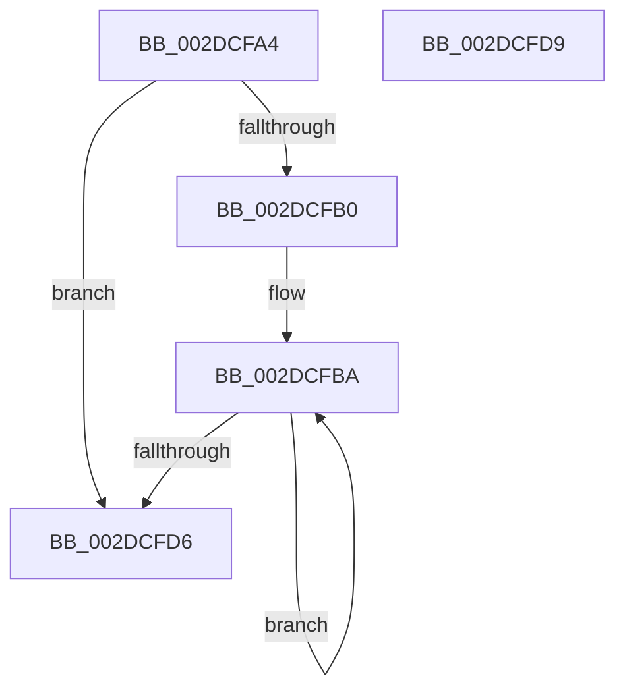

# MiNumberWsSwapPagefiles

- RVA: `0x002DCFA4`–`0x002DCFDA` (길이 `54` bytes)
- VA: `0x00000001402DCFA4`
- 실행 섹션: `.text`
- PDB 이름 있음: `예`; PDB Function 태그: `아니요`
- unwind 정보 RVA: `0x000DB714`
- 디코드: `17`개 명령, `54/54` bytes 표시
- 미해석 바이트: `0` (있으면 어셈블리에 `.byte`로 보존)

> 이 문서는 커널 이미지의 기계어와 PDB 기호를 분석해 생성했습니다. 4번과 5번은 함수 원형과 자료형을 바이너리 사용 방식에서 추정한 C 해석이며 원본 소스 복구 결과는 아닙니다.

## 1. Dependencies

- 직접 호출 지점: **0**; 고유 호출 대상: **0**
- 직접 호출자로 확인된 함수: **3**
- RIP 상대 이미지 참조: **0**

### Outgoing calls
- 직접 디코드된 call 명령이 없습니다.

### Direct callers
- [MiCheckTrimUnusedPageFileRegions](MiCheckTrimUnusedPageFileRegions_function_002DB684.md) at `0x002DB68B`
- [MiInsertPageFileInList](../../page/7F/MiInsertPageFileInList_function_007FFF80.md) at `0x00800351`
- [MiContractWsSwapPageFile](../../page/A1/MiContractWsSwapPageFile_function_00A182C4.md) at `0x00A182CD`

### Static image references
- 디코드된 RIP-relative 메모리 참조가 없습니다.

## 2. Other-region calls and transfers

- 다른 실행 섹션으로 향하는 call: **0**
- 별도 외부 분기/꼬리 이동을 확인하지 못했습니다.

## 3. Assembly (complete function range)

```asm
002DCFA4  8B 81 58 48 00 00               mov eax, dword ptr [rcx + 0x4858]
002DCFAA  33 D2                           xor edx, edx
002DCFAC  85 C0                           test eax, eax
002DCFAE  74 26                           je 0x1402dcfd6
002DCFB0  4C 8D 81 60 48 00 00            lea r8, [rcx + 0x4860]
002DCFB7  44 8B C8                        mov r9d, eax
002DCFBA  49 8B 00                        mov rax, qword ptr [r8]
002DCFBD  8D 4A 01                        lea ecx, [rdx + 1]
002DCFC0  4D 8D 40 08                     lea r8, [r8 + 8]
002DCFC4  F6 80 AC 00 00 00 10            test byte ptr [rax + 0xac], 0x10
002DCFCB  0F 44 CA                        cmove ecx, edx
002DCFCE  8B D1                           mov edx, ecx
002DCFD0  49 83 E9 01                     sub r9, 1
002DCFD4  75 E4                           jne 0x1402dcfba
002DCFD6  8B C2                           mov eax, edx
002DCFD8  C3                              ret
002DCFD9  CC                              int3
```

## 4. C-style interpretation (structured pseudocode)

```c
__int64 __fastcall MiNumberWsSwapPagefiles(__int64 a1, int a2)
{
    a2 = 0;
    if ((unsigned int)((unsigned int)(*(unsigned int *)(a1 + 18520))) == 0) goto loc_002DCFD6;
loc_002DCFBA:
    a1 = a2 + 1;
    if (((*(unsigned __int8 *)(*(unsigned __int64 *)(a1 + 18528) + 172)) & (16)) == 0) { a1 = 0; }
    a4 = ((unsigned int)((unsigned int)((unsigned int)(*(unsigned int *)(a1 + 18520))))) - (1);
    if (condition_is_not_equal) goto loc_002DCFBA;
loc_002DCFD6:
    return (unsigned int)((unsigned int)((unsigned int)((unsigned int)(a1))));
}
```

## 5. (Beta) C Style

```c
int64_t MiNumberWsSwapPagefiles(void *Arg1, int32_t Arg2)
{
    uint8_t *arg1 = (uint8_t *)Arg1;

    Arg2 = 0;
    if ((uint32_t)((uint32_t)(*(uint32_t *)(arg1 + 0x4858))) == 0) goto loc_002DCFD6;
loc_002DCFBA:
    Arg1 = Arg2 + 1;
    if (((*(uint8_t *)(*(uint64_t *)(arg1 + 0x4860) + 0xAC)) & (16)) == 0) { Arg1 = 0; }
    a4 = ((uint32_t)((uint32_t)((uint32_t)(*(uint32_t *)(arg1 + 0x4858))))) - (1);
    if (condition_is_not_equal) goto loc_002DCFBA;
loc_002DCFD6:
    return (uint32_t)((uint32_t)((uint32_t)((uint32_t)(Arg1))));
}
```

### 관측된 메모리 오프셋

구조체 형식이 확인되지 않은 접근은 인자 기준의 오프셋으로만 기록했습니다.

| 기준 인자 | 오프셋 표현 | 폭 (bit) | 접근 |
|---|---:|---:|---|
| `Arg1` | `+ 0x0` | `64` | `R` |
| `Arg1` | `+ 0x8` | `64` | `R` |
| `Arg1` | `+ 0x4858` | `32` | `R` |
| `Arg1` | `+ 0x4860` | `64` | `R` |

## 6. Execution-region graph

[열기: 2D/3D 그래프와 함수 탐색 컨트롤 패널](../../../control-panel.html?section=text&rva=0x002DCFA4&view=graph)

- 2D 그래프는 위에서 아래로 흐르고, 3D 그래프는 빈 공간을 드래그해 회전합니다. Shift+드래그는 이동, 휠은 확대·축소, 함수 노드 선택은 대상 보고서 이동입니다.

### Static fallback


