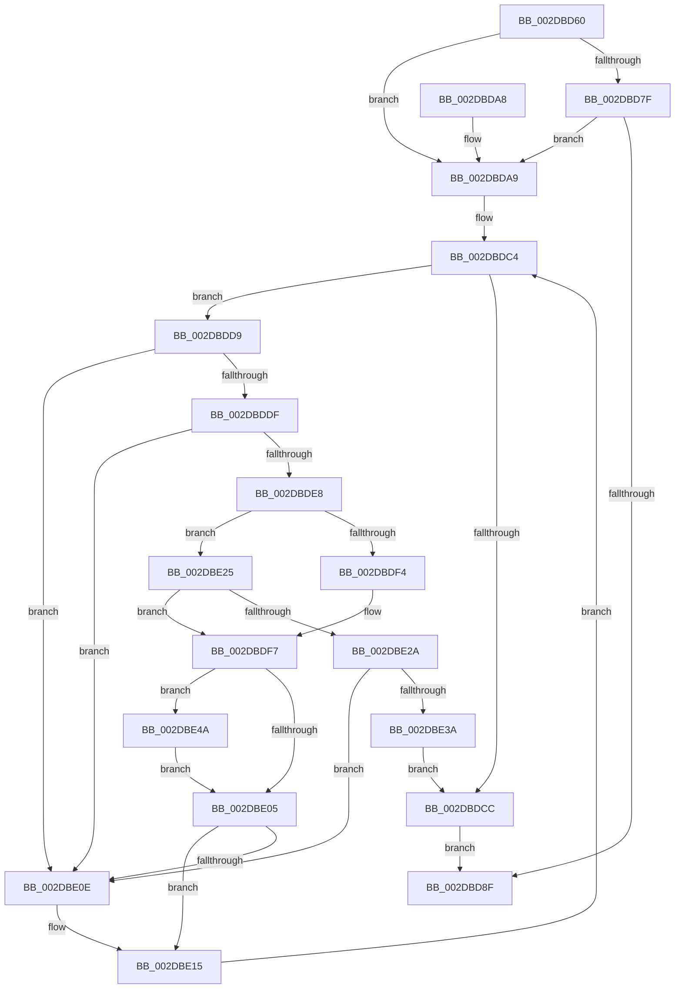

# MiPruneProcessLargePageCaches

- RVA: `0x002DBD60`–`0x002DBE57` (길이 `247` bytes)
- VA: `0x00000001402DBD60`
- 실행 섹션: `.text`
- PDB 이름 있음: `예`; PDB Function 태그: `아니요`
- unwind 정보 RVA: `0x0007069C`
- 디코드: `75`개 명령, `247/247` bytes 표시
- 미해석 바이트: `0` (있으면 어셈블리에 `.byte`로 보존)

> 이 문서는 커널 이미지의 기계어와 PDB 기호를 분석해 생성했습니다. 4번과 5번은 함수 원형과 자료형을 바이너리 사용 방식에서 추정한 C 해석이며 원본 소스 복구 결과는 아닙니다.

## 1. Dependencies

- 직접 호출 지점: **3**; 고유 호출 대상: **3**
- 직접 호출자로 확인된 함수: **3**
- RIP 상대 이미지 참조: **0**

### Outgoing calls
- `0x002DBDB5` → [ExAcquireSpinLockExclusive](../24/ExAcquireSpinLockExclusive_function_00248690.md) (function, `0x00248690`)
- `0x002DBDD2` → [MiReleaseSpinLockExclusive](../24/MiReleaseSpinLockExclusive_function_002482C0.md) (function, `0x002482C0`)
- `0x002DBE50` → [MiFreeProcessLargePageCache](../69/MiFreeProcessLargePageCache_function_00699204.md) (function, `0x00699204`)

### Direct callers
- [MiWorkingSetManager](MiWorkingSetManager_function_002DA7E0.md) at `0x002DA900`
- [MiComputeSystemTrimCriteria](../34/MiComputeSystemTrimCriteria_function_0034E184.md) at `0x0034E6F4`
- [sub_006F64F4](../6F/Unknown_function_006F64F4.md) at `0x006F6548`

### Static image references
- 디코드된 RIP-relative 메모리 참조가 없습니다.

## 2. Other-region calls and transfers

- 다른 실행 섹션으로 향하는 call: **0**
- 별도 외부 분기/꼬리 이동을 확인하지 못했습니다.

## 3. Assembly (complete function range)

```asm
002DBD60  48 89 5C 24 08                  mov qword ptr [rsp + 8], rbx
002DBD65  48 89 6C 24 10                  mov qword ptr [rsp + 0x10], rbp
002DBD6A  48 89 74 24 18                  mov qword ptr [rsp + 0x18], rsi
002DBD6F  57                              push rdi
002DBD70  41 56                           push r14
002DBD72  41 57                           push r15
002DBD74  48 83 EC 20                     sub rsp, 0x20
002DBD78  48 8B F9                        mov rdi, rcx
002DBD7B  85 D2                           test edx, edx
002DBD7D  74 2A                           je 0x1402dbda9
002DBD7F  FF 81 58 40 00 00               inc dword ptr [rcx + 0x4058]
002DBD85  8B 81 58 40 00 00               mov eax, dword ptr [rcx + 0x4058]
002DBD8B  A8 07                           test al, 7
002DBD8D  74 1A                           je 0x1402dbda9
002DBD8F  48 8B 5C 24 40                  mov rbx, qword ptr [rsp + 0x40]
002DBD94  48 8B 6C 24 48                  mov rbp, qword ptr [rsp + 0x48]
002DBD99  48 8B 74 24 50                  mov rsi, qword ptr [rsp + 0x50]
002DBD9E  48 83 C4 20                     add rsp, 0x20
002DBDA2  41 5F                           pop r15
002DBDA4  41 5E                           pop r14
002DBDA6  5F                              pop rdi
002DBDA7  C3                              ret
002DBDA8  CC                              int3
002DBDA9  4C 8D B1 40 40 00 00            lea r14, [rcx + 0x4040]
002DBDB0  33 ED                           xor ebp, ebp
002DBDB2  49 8B CE                        mov rcx, r14
002DBDB5  E8 D6 C8 F6 FF                  call 0x140248690
002DBDBA  44 8A F8                        mov r15b, al
002DBDBD  48 8D B7 48 40 00 00            lea rsi, [rdi + 0x4048]
002DBDC4  48 8B 1E                        mov rbx, qword ptr [rsi]
002DBDC7  48 3B DE                        cmp rbx, rsi
002DBDCA  75 0D                           jne 0x1402dbdd9
002DBDCC  41 8A D7                        mov dl, r15b
002DBDCF  49 8B CE                        mov rcx, r14
002DBDD2  E8 E9 C4 F6 FF                  call 0x1402482c0
002DBDD7  EB B6                           jmp 0x1402dbd8f
002DBDD9  48 39 73 08                     cmp qword ptr [rbx + 8], rsi
002DBDDD  75 2F                           jne 0x1402dbe0e
002DBDDF  48 8B 03                        mov rax, qword ptr [rbx]
002DBDE2  48 39 58 08                     cmp qword ptr [rax + 8], rbx
002DBDE6  75 26                           jne 0x1402dbe0e
002DBDE8  48 89 06                        mov qword ptr [rsi], rax
002DBDEB  48 89 70 08                     mov qword ptr [rax + 8], rsi
002DBDEF  48 85 ED                        test rbp, rbp
002DBDF2  75 31                           jne 0x1402dbe25
002DBDF4  48 8B EB                        mov rbp, rbx
002DBDF7  8B 8F 58 40 00 00               mov ecx, dword ptr [rdi + 0x4058]
002DBDFD  2B 4B 18                        sub ecx, dword ptr [rbx + 0x18]
002DBE00  83 F9 08                        cmp ecx, 8
002DBE03  73 45                           jae 0x1402dbe4a
002DBE05  48 8B 46 08                     mov rax, qword ptr [rsi + 8]
002DBE09  48 39 30                        cmp qword ptr [rax], rsi
002DBE0C  74 07                           je 0x1402dbe15
002DBE0E  B9 03 00 00 00                  mov ecx, 3
002DBE13  CD 29                           int 0x29
002DBE15  48 89 33                        mov qword ptr [rbx], rsi
002DBE18  48 89 43 08                     mov qword ptr [rbx + 8], rax
002DBE1C  48 89 18                        mov qword ptr [rax], rbx
002DBE1F  48 89 5E 08                     mov qword ptr [rsi + 8], rbx
002DBE23  EB 9F                           jmp 0x1402dbdc4
002DBE25  48 3B DD                        cmp rbx, rbp
002DBE28  75 CD                           jne 0x1402dbdf7
002DBE2A  48 81 C7 48 40 00 00            add rdi, 0x4048
002DBE31  48 8B 07                        mov rax, qword ptr [rdi]
002DBE34  48 39 78 08                     cmp qword ptr [rax + 8], rdi
002DBE38  75 D4                           jne 0x1402dbe0e
002DBE3A  48 89 03                        mov qword ptr [rbx], rax
002DBE3D  48 89 7B 08                     mov qword ptr [rbx + 8], rdi
002DBE41  48 89 58 08                     mov qword ptr [rax + 8], rbx
002DBE45  48 89 1F                        mov qword ptr [rdi], rbx
002DBE48  EB 82                           jmp 0x1402dbdcc
002DBE4A  48 8B D3                        mov rdx, rbx
002DBE4D  48 8B CF                        mov rcx, rdi
002DBE50  E8 AF D3 3B 00                  call 0x140699204
002DBE55  EB AE                           jmp 0x1402dbe05
```

## 4. C-style interpretation (structured pseudocode)

```c
__int64 __fastcall MiPruneProcessLargePageCaches(__int64 a1, int a2)
{
    __int64 result;
    __int64 v_rbp;
    __int64 v_rdi;
    __int64 v_rsp;
    unsigned __int64 v_stack_p10;
    unsigned __int64 v_stack_p18;
    unsigned __int64 v_stack_p8;

    v_stack_p8 = v_rbx;
    v_stack_p10 = v_rbp;
    v_stack_p18 = v_rsi;
    v_rsp = (v_rsp) - (32);
    if (a2 == 0) goto loc_002DBDA9;
    if ((((unsigned __int8)((unsigned int)(*(unsigned int *)(a1 + 16472)))) & (7)) == 0) goto loc_002DBDA9;
loc_002DBD8F:
    v_rsp = (v_rsp) + (32);
    return (unsigned int)(*(unsigned int *)(a1 + 16472));
loc_002DBDA9:
    v_rbp = 0;
    result = ExAcquireSpinLockExclusive(a1 + 16448, a2, a3, a4);
loc_002DBDC4:
    if ((*(unsigned __int64 *)(a1 + 16456)) != (a1 + 16456)) goto loc_002DBDD9;
loc_002DBDCC:
    result = MiReleaseSpinLockExclusive(a1 + 16448, (unsigned __int8)((unsigned __int8)(result)), a3, a4);
    goto loc_002DBD8F;
loc_002DBDD9:
    if ((*(unsigned __int64 *)(*(unsigned __int64 *)(a1 + 16456) + 8)) != (a1 + 16456)) goto loc_002DBE0E;
    if ((*(unsigned __int64 *)(*(unsigned __int64 *)(*(unsigned __int64 *)(a1 + 16456)) + 8)) != (*(unsigned __int64 *)(a1 + 16456))) goto loc_002DBE0E;
    *(unsigned __int64 *)(a1 + 16456) = *(unsigned __int64 *)(*(unsigned __int64 *)(a1 + 16456));
    *(unsigned __int64 *)(*(unsigned __int64 *)(*(unsigned __int64 *)(a1 + 16456)) + 8) = a1 + 16456;
    if (0 != 0) goto loc_002DBE25;
loc_002DBDF7:
    a1 = (unsigned int)(((unsigned int)(*(unsigned int *)(a1 + 16472))) - (*(unsigned int *)(*(unsigned __int64 *)(a1 + 16456) + 24)));
    if (((unsigned int)(a1)) >= 8) goto loc_002DBE4A;
loc_002DBE05:
    if ((*(unsigned __int64 *)(*(unsigned __int64 *)(a1 + 16456 + 8))) != (a1 + 16456)) {
        a1 = 3;
    }
    *(unsigned __int64 *)(*(unsigned __int64 *)(a1 + 16456)) = a1 + 16456;
    *(unsigned __int64 *)(*(unsigned __int64 *)(a1 + 16456) + 8) = *(unsigned __int64 *)(a1 + 16456 + 8);
    *(unsigned __int64 *)(*(unsigned __int64 *)(a1 + 16456 + 8)) = *(unsigned __int64 *)(a1 + 16456);
    *(unsigned __int64 *)(a1 + 16456 + 8) = *(unsigned __int64 *)(a1 + 16456);
    goto loc_002DBDC4;
loc_002DBE25:
    if ((*(unsigned __int64 *)(a1 + 16456)) != (*(unsigned __int64 *)(a1 + 16456))) goto loc_002DBDF7;
    v_rdi = (a1) + (0x4048ULL);
    if ((*(unsigned __int64 *)(*(unsigned __int64 *)(v_rdi) + 8)) != v_rdi) goto loc_002DBE0E;
    *(unsigned __int64 *)(*(unsigned __int64 *)(a1 + 16456)) = *(unsigned __int64 *)(v_rdi);
    *(unsigned __int64 *)(*(unsigned __int64 *)(a1 + 16456) + 8) = v_rdi;
    *(unsigned __int64 *)(*(unsigned __int64 *)(v_rdi) + 8) = *(unsigned __int64 *)(a1 + 16456);
    *(unsigned __int64 *)(v_rdi) = *(unsigned __int64 *)(a1 + 16456);
    goto loc_002DBDCC;
loc_002DBE4A:
    result = MiFreeProcessLargePageCache(v_rdi, *(unsigned __int64 *)(a1 + 16456), a3, a4);
    goto loc_002DBE05;
}
```

## 5. (Beta) C Style

```c
int64_t MiPruneProcessLargePageCaches(void *Arg1, int32_t Arg2)
{
    uint8_t *arg1 = (uint8_t *)Arg1;

    int64_t result;
    int64_t local_rbp;
    int64_t local_rdi;
    int64_t local_rsp;
    uint64_t v_stack_p10;
    uint64_t v_stack_p18;
    uint64_t v_stack_p8;

    v_stack_p8 = local_rbx;
    v_stack_p10 = local_rbp;
    v_stack_p18 = local_rsi;
    local_rsp = (local_rsp) - (32);
    if (Arg2 == 0) goto loc_002DBDA9;
    if ((((uint8_t)((uint32_t)(*(uint32_t *)(arg1 + 0x4058)))) & (7)) == 0) goto loc_002DBDA9;
loc_002DBD8F:
    local_rsp = (local_rsp) + (32);
    return (uint32_t)(*(uint32_t *)(arg1 + 0x4058));
loc_002DBDA9:
    local_rbp = 0;
    result = ExAcquireSpinLockExclusive(Arg1 + 16448, Arg2, a3, a4);
loc_002DBDC4:
    if ((*(uint64_t *)(arg1 + 0x4048)) != (Arg1 + 16456)) goto loc_002DBDD9;
loc_002DBDCC:
    result = MiReleaseSpinLockExclusive(Arg1 + 16448, (uint8_t)((uint8_t)(result)), a3, a4);
    goto loc_002DBD8F;
loc_002DBDD9:
    if ((*(uint64_t *)(*(uint64_t *)(arg1 + 0x4048) + 0x8)) != (Arg1 + 16456)) goto loc_002DBE0E;
    if ((*(uint64_t *)(*(uint64_t *)(*(uint64_t *)(arg1 + 0x4048)) + 0x8)) != (*(uint64_t *)(arg1 + 0x4048))) goto loc_002DBE0E;
    *(uint64_t *)(arg1 + 0x4048) = *(uint64_t *)(*(uint64_t *)(arg1 + 0x4048));
    *(void **)(*(uint64_t *)(*(uint64_t *)(arg1 + 0x4048)) + 0x8) = Arg1 + 16456;
    if (0 != 0) goto loc_002DBE25;
loc_002DBDF7:
    Arg1 = (uint32_t)(((uint32_t)(*(uint32_t *)(arg1 + 0x4058))) - (*(uint32_t *)(*(uint64_t *)(arg1 + 0x4048) + 0x18)));
    if (((uint32_t)(Arg1)) >= 8) goto loc_002DBE4A;
loc_002DBE05:
    if ((*(uint64_t *)(*(uint64_t *)(arg1 + 0x4048 + 0x8))) != (Arg1 + 16456)) {
        Arg1 = 3;
    }
    *(void **)(*(uint64_t *)(arg1 + 0x4048)) = Arg1 + 16456;
    *(uint64_t *)(*(uint64_t *)(arg1 + 0x4048) + 0x8) = *(uint64_t *)(arg1 + 0x4048 + 0x8);
    *(uint64_t *)(*(uint64_t *)(arg1 + 0x4048 + 0x8)) = *(uint64_t *)(arg1 + 0x4048);
    *(uint64_t *)(arg1 + 0x4048 + 0x8) = *(uint64_t *)(arg1 + 0x4048);
    goto loc_002DBDC4;
loc_002DBE25:
    if ((*(uint64_t *)(arg1 + 0x4048)) != (*(uint64_t *)(arg1 + 0x4048))) goto loc_002DBDF7;
    local_rdi = (Arg1) + (0x4048ULL);
    if ((*(uint64_t *)(*(uint64_t *)(local_rdi) + 0x8)) != local_rdi) goto loc_002DBE0E;
    *(uint64_t *)(*(uint64_t *)(arg1 + 0x4048)) = *(uint64_t *)(local_rdi);
    *(uint64_t *)(*(uint64_t *)(arg1 + 0x4048) + 0x8) = local_rdi;
    *(uint64_t *)(*(uint64_t *)(local_rdi) + 0x8) = *(uint64_t *)(arg1 + 0x4048);
    *(uint64_t *)(local_rdi) = *(uint64_t *)(arg1 + 0x4048);
    goto loc_002DBDCC;
loc_002DBE4A:
    result = MiFreeProcessLargePageCache(local_rdi, *(uint64_t *)(arg1 + 0x4048), a3, a4);
    goto loc_002DBE05;
}
```

### 관측된 메모리 오프셋

구조체 형식이 확인되지 않은 접근은 인자 기준의 오프셋으로만 기록했습니다.

| 기준 인자 | 오프셋 표현 | 폭 (bit) | 접근 |
|---|---:|---:|---|
| `Arg1` | `+ 0x0` | `64` | `R` |
| `Arg1` | `+ 0x0` | `64` | `W` |
| `Arg1` | `+ 0x8` | `64` | `R` |
| `Arg1` | `+ 0x8` | `64` | `W` |
| `Arg1` | `+ 0x4040` | `64` | `R` |
| `Arg1` | `+ 0x4048` | `64` | `R` |
| `Arg1` | `+ 0x4058` | `32` | `R` |
| `Arg1` | `+ 0x4058` | `32` | `R/W` |

## 6. Execution-region graph

[열기: 2D/3D 그래프와 함수 탐색 컨트롤 패널](../../../control-panel.html?section=text&rva=0x002DBD60&view=graph)

- 2D 그래프는 위에서 아래로 흐르고, 3D 그래프는 빈 공간을 드래그해 회전합니다. Shift+드래그는 이동, 휠은 확대·축소, 함수 노드 선택은 대상 보고서 이동입니다.

### Static fallback


