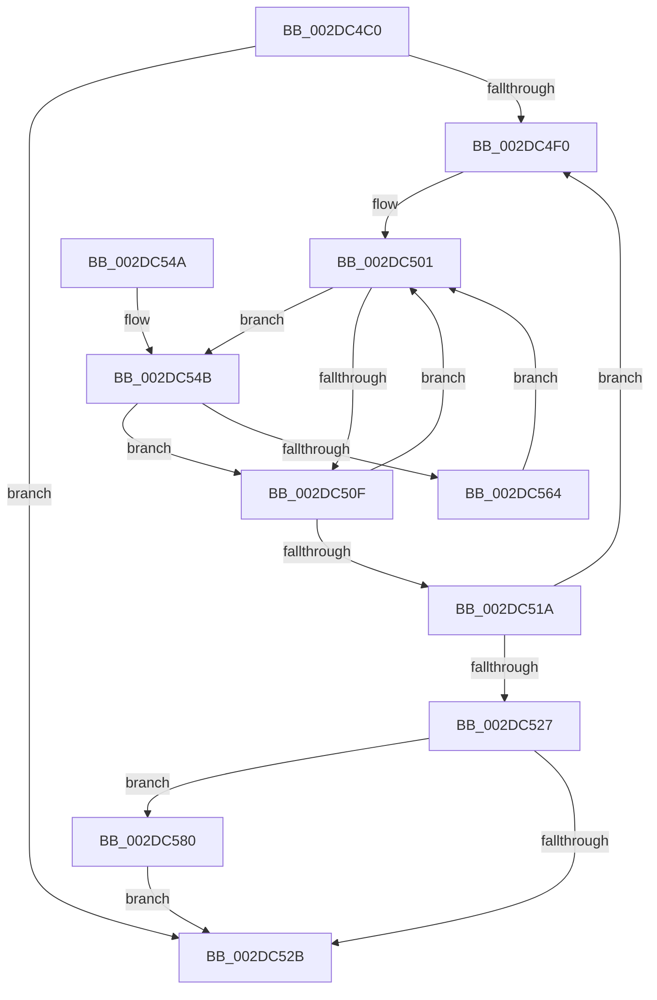

# MiReclaimUnusedUltraMdlMaps

- RVA: `0x002DC4C0`–`0x002DC5A2` (길이 `226` bytes)
- VA: `0x00000001402DC4C0`
- 실행 섹션: `.text`
- PDB 이름 있음: `예`; PDB Function 태그: `아니요`
- unwind 정보 RVA: `0x00070740`
- 디코드: `65`개 명령, `226/226` bytes 표시
- 미해석 바이트: `0` (있으면 어셈블리에 `.byte`로 보존)

> 이 문서는 커널 이미지의 기계어와 PDB 기호를 분석해 생성했습니다. 4번과 5번은 함수 원형과 자료형을 바이너리 사용 방식에서 추정한 C 해석이며 원본 소스 복구 결과는 아닙니다.

## 1. Dependencies

- 직접 호출 지점: **5**; 고유 호출 대상: **5**
- 직접 호출자로 확인된 함수: **1**
- RIP 상대 이미지 참조: **4**

### Outgoing calls
- `0x002DC557` → [ExpInterlockedPopEntrySList](../6B/ExpInterlockedPopEntrySList_function_006BA570.md) (function, `0x006BA570`)
- `0x002DC56F` → [MiDeleteUltraMapContext](MiDeleteUltraMapContext_function_002DC9A4.md) (function, `0x002DC9A4`)
- `0x002DC579` → [ExFreePoolWithTag](../../poolcode/B8/ExFreePoolWithTag_function_00B82870.md) (function, `0x00B82870`)
- `0x002DC587` → [ExAcquireSpinLockExclusive](../24/ExAcquireSpinLockExclusive_function_00248690.md) (function, `0x00248690`)
- `0x002DC59B` → [MiReleaseSpinLockExclusive](../24/MiReleaseSpinLockExclusive_function_002482C0.md) (function, `0x002482C0`)

### Direct callers
- [MiWorkingSetManager](MiWorkingSetManager_function_002DA7E0.md) at `0x002DA8BB`

### Static image references
- `0x002DC4E0` → RVA `0x00FC5000` (`ALMOSTRO`; read)
- `0x002DC501` → RVA `0x00E36028` (`.data`; read)
- `0x002DC580` → RVA `0x00E35FE0` (`.data`; read)
- `0x002DC58C` → RVA `0x00E36020` (`.data`; read/write)

## 2. Other-region calls and transfers

- 다른 실행 섹션으로 향하는 call: **1**
  - `0x002DC579` → [ExFreePoolWithTag](../../poolcode/B8/ExFreePoolWithTag_function_00B82870.md) (`.text` → `POOLCODE`)
- 별도 외부 분기/꼬리 이동을 확인하지 못했습니다.

## 3. Assembly (complete function range)

```asm
002DC4C0  48 8B C4                        mov rax, rsp
002DC4C3  48 89 58 08                     mov qword ptr [rax + 8], rbx
002DC4C7  48 89 68 10                     mov qword ptr [rax + 0x10], rbp
002DC4CB  48 89 70 18                     mov qword ptr [rax + 0x18], rsi
002DC4CF  48 89 78 20                     mov qword ptr [rax + 0x20], rdi
002DC4D3  41 54                           push r12
002DC4D5  41 56                           push r14
002DC4D7  41 57                           push r15
002DC4D9  48 83 EC 20                     sub rsp, 0x20
002DC4DD  45 33 E4                        xor r12d, r12d
002DC4E0  66 44 3B 25 18 8B CE 00         cmp r12w, word ptr [rip + 0xce8b18]
002DC4E8  41 8B F4                        mov esi, r12d
002DC4EB  41 8B DC                        mov ebx, r12d
002DC4EE  73 3B                           jae 0x1402dc52b
002DC4F0  44 8B F3                        mov r14d, ebx
002DC4F3  41 8B EC                        mov ebp, r12d
002DC4F6  49 C1 E6 03                     shl r14, 3
002DC4FA  49 8B FE                        mov rdi, r14
002DC4FD  48 C1 E7 06                     shl rdi, 6
002DC501  48 8B 05 20 9B B5 00            mov rax, qword ptr [rip + 0xb59b20]
002DC508  66 83 3C 07 02                  cmp word ptr [rdi + rax], 2
002DC50D  77 3C                           ja 0x1402dc54b
002DC50F  FF C5                           inc ebp
002DC511  48 83 C7 40                     add rdi, 0x40
002DC515  83 FD 08                        cmp ebp, 8
002DC518  72 E7                           jb 0x1402dc501
002DC51A  0F B7 05 DF 8A CE 00            movzx eax, word ptr [rip + 0xce8adf]
002DC521  FF C3                           inc ebx
002DC523  3B D8                           cmp ebx, eax
002DC525  72 C9                           jb 0x1402dc4f0
002DC527  85 F6                           test esi, esi
002DC529  75 55                           jne 0x1402dc580
002DC52B  48 8B 5C 24 40                  mov rbx, qword ptr [rsp + 0x40]
002DC530  48 8B 6C 24 48                  mov rbp, qword ptr [rsp + 0x48]
002DC535  48 8B 74 24 50                  mov rsi, qword ptr [rsp + 0x50]
002DC53A  48 8B 7C 24 58                  mov rdi, qword ptr [rsp + 0x58]
002DC53F  48 83 C4 20                     add rsp, 0x20
002DC543  41 5F                           pop r15
002DC545  41 5E                           pop r14
002DC547  41 5C                           pop r12
002DC549  C3                              ret
002DC54A  CC                              int3
002DC54B  8B CD                           mov ecx, ebp
002DC54D  49 03 CE                        add rcx, r14
002DC550  48 C1 E1 06                     shl rcx, 6
002DC554  48 03 C8                        add rcx, rax
002DC557  E8 14 E0 3D 00                  call 0x1406ba570
002DC55C  4C 8B F8                        mov r15, rax
002DC55F  48 85 C0                        test rax, rax
002DC562  74 AB                           je 0x1402dc50f
002DC564  48 8D 48 08                     lea rcx, [rax + 8]
002DC568  BA 03 00 00 00                  mov edx, 3
002DC56D  FF C6                           inc esi
002DC56F  E8 30 04 00 00                  call 0x1402dc9a4
002DC574  33 D2                           xor edx, edx
002DC576  49 8B CF                        mov rcx, r15
002DC579  E8 F2 62 8A 00                  call 0x140b82870
002DC57E  EB 81                           jmp 0x1402dc501
002DC580  48 8D 0D 59 9A B5 00            lea rcx, [rip + 0xb59a59]
002DC587  E8 04 C1 F6 FF                  call 0x140248690
002DC58C  29 35 8E 9A B5 00               sub dword ptr [rip + 0xb59a8e], esi
002DC592  48 8D 0D 47 9A B5 00            lea rcx, [rip + 0xb59a47]
002DC599  8A D0                           mov dl, al
002DC59B  E8 20 BD F6 FF                  call 0x1402482c0
002DC5A0  EB 89                           jmp 0x1402dc52b
```

## 4. C-style interpretation (structured pseudocode)

```c
__int64 __fastcall MiReclaimUnusedUltraMdlMaps(void)
{
    __int64 result;
    __int64 v_r12;
    __int64 v_r14;
    __int64 v_rbp;
    __int64 v_rbx;
    __int64 v_rdi;
    __int64 v_rsi;
    __int64 v_rsp;
    unsigned __int64 v_stack_p10;
    unsigned __int64 v_stack_p18;
    unsigned __int64 v_stack_p20;
    unsigned __int64 v_stack_p8;

    *(unsigned __int64 *)(v_rsp + 8) = v_rbx;
    *(unsigned __int64 *)(v_rsp + 16) = v_rbp;
    *(unsigned __int64 *)(v_rsp + 24) = v_rsi;
    *(unsigned __int64 *)(v_rsp + 32) = v_rdi;
    v_rsp = (v_rsp) - (32);
    v_r12 = 0;
    if (0 >= (*(unsigned __int16 *)(v_rip + 13536024))) goto loc_002DC52B;
loc_002DC4F0:
    v_r14 = (0) << (3);
    v_rdi = (v_r14) << (6);
loc_002DC501:
    if ((*(unsigned __int16 *)(v_rdi + *(unsigned __int64 *)(v_rip + 11901728) * 1)) > 2) goto loc_002DC54B;
loc_002DC50F:
    v_rbp = (unsigned int)((0) + 1);
    v_rdi = (v_rdi) + (64);
    if (((unsigned int)(v_rbp)) < 8) goto loc_002DC501;
    v_rbx = (unsigned int)((0) + 1);
    if (((unsigned int)(v_rbx)) < ((unsigned int)(*(unsigned __int16 *)(v_rip + 13535967)))) goto loc_002DC4F0;
    if (0 != 0) goto loc_002DC580;
loc_002DC52B:
    v_rsp = (v_rsp) + (32);
    return *(unsigned __int16 *)(v_rip + 13535967);
loc_002DC54B:
    a1 = ((unsigned int)((unsigned int)(v_stack_p10))) + (v_r14);
    a1 = (a1) << (6);
    a1 = (a1) + (*(unsigned __int16 *)(v_rip + 13535967));
    result = ExpInterlockedPopEntrySList(a1, a2, a3, a4);
    if (result == 0) goto loc_002DC50F;
    v_rsi = (unsigned int)((v_stack_p18) + 1);
    result = MiDeleteUltraMapContext(result + 8, 3, a3, a4);
    a2 = 0;
    result = ExFreePoolWithTag(result, a2, a3, a4);
    goto loc_002DC501;
loc_002DC580:
    result = ExAcquireSpinLockExclusive(v_rip + 11901529, a2, a3, a4);
    result = MiReleaseSpinLockExclusive(v_rip + 11901511, (unsigned __int8)(result), a3, a4);
    goto loc_002DC52B;
}
```

## 5. (Beta) C Style

```c
void MiReclaimUnusedUltraMdlMaps(void)
{
    int64_t result;
    int64_t local_r12;
    int64_t local_r14;
    int64_t local_rbp;
    int64_t local_rbx;
    int64_t local_rdi;
    int64_t local_rsi;
    int64_t local_rsp;
    uint64_t v_stack_p10;
    uint64_t v_stack_p18;
    uint64_t v_stack_p20;
    uint64_t v_stack_p8;

    *(uint64_t *)(local_rsp + 0x8) = local_rbx;
    *(uint64_t *)(local_rsp + 0x10) = local_rbp;
    *(uint64_t *)(local_rsp + 0x18) = local_rsi;
    *(uint64_t *)(local_rsp + 0x20) = local_rdi;
    local_rsp = (local_rsp) - (32);
    local_r12 = 0;
    if (0 >= (*(uint16_t *)(v_rip + 0xCE8B18))) goto loc_002DC52B;
loc_002DC4F0:
    local_r14 = (0) << (3);
    local_rdi = (local_r14) << (6);
loc_002DC501:
    if ((*(uint16_t *)(local_rdi + *(uint64_t *)(v_rip + 0xB59B20) * 1)) > 2) goto loc_002DC54B;
loc_002DC50F:
    local_rbp = (uint32_t)((0) + 1);
    local_rdi = (local_rdi) + (64);
    if (((uint32_t)(local_rbp)) < 8) goto loc_002DC501;
    local_rbx = (uint32_t)((0) + 1);
    if (((uint32_t)(local_rbx)) < ((uint32_t)(*(uint16_t *)(v_rip + 0xCE8ADF)))) goto loc_002DC4F0;
    if (0 != 0) goto loc_002DC580;
loc_002DC52B:
    local_rsp = (local_rsp) + (32);
    return *(uint16_t *)(v_rip + 0xCE8ADF);
loc_002DC54B:
    a1 = ((uint32_t)((uint32_t)(v_stack_p10))) + (local_r14);
    a1 = (a1) << (6);
    a1 = (a1) + (*(uint16_t *)(v_rip + 0xCE8ADF));
    result = ExpInterlockedPopEntrySList(a1, a2, a3, a4);
    if (result == 0) goto loc_002DC50F;
    local_rsi = (uint32_t)((v_stack_p18) + 1);
    result = MiDeleteUltraMapContext(result + 8, 3, a3, a4);
    a2 = 0;
    result = ExFreePoolWithTag(result, a2, a3, a4);
    goto loc_002DC501;
loc_002DC580:
    result = ExAcquireSpinLockExclusive(v_rip + 11901529, a2, a3, a4);
    result = MiReleaseSpinLockExclusive(v_rip + 11901511, (uint8_t)(result), a3, a4);
    goto loc_002DC52B;
}
```

## 6. Execution-region graph

[열기: 2D/3D 그래프와 함수 탐색 컨트롤 패널](../../../control-panel.html?section=text&rva=0x002DC4C0&view=graph)

- 2D 그래프는 위에서 아래로 흐르고, 3D 그래프는 빈 공간을 드래그해 회전합니다. Shift+드래그는 이동, 휠은 확대·축소, 함수 노드 선택은 대상 보고서 이동입니다.

### Static fallback


