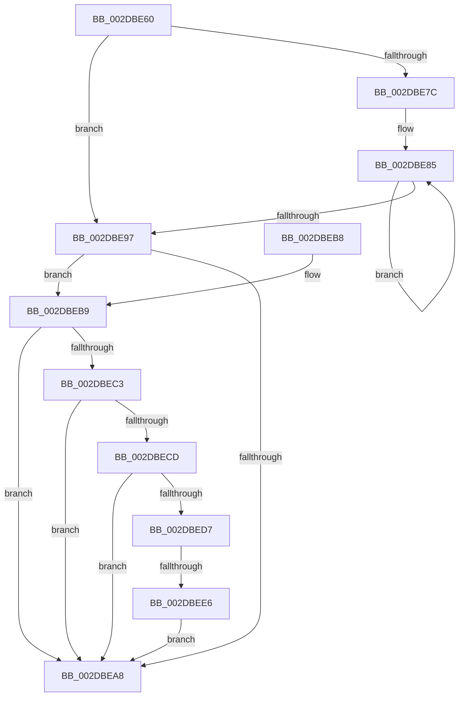

# MiScanPagefiles

- RVA: `0x002DBE60`–`0x002DBEF0` (길이 `144` bytes)
- VA: `0x00000001402DBE60`
- 실행 섹션: `.text`
- PDB 이름 있음: `예`; PDB Function 태그: `예`
- unwind 정보 RVA: `0x00064CD0`
- 디코드: `39`개 명령, `144/144` bytes 표시
- 미해석 바이트: `0` (있으면 어셈블리에 `.byte`로 보존)

> 이 문서는 커널 이미지의 기계어와 PDB 기호를 분석해 생성했습니다. 4번과 5번은 함수 원형과 자료형을 바이너리 사용 방식에서 추정한 C 해석이며 원본 소스 복구 결과는 아닙니다.

## 1. Dependencies

- 직접 호출 지점: **2**; 고유 호출 대상: **2**
- 직접 호출자로 확인된 함수: **1**
- RIP 상대 이미지 참조: **0**

### Outgoing calls
- `0x002DBE88` → [MiFreePageFileHashPfns](MiFreePageFileHashPfns_function_002DBEF8.md) (function, `0x002DBEF8`)
- `0x002DBE9F` → [MiSufficientAvailablePages](../36/MiSufficientAvailablePages_function_0036D0B0.md) (function, `0x0036D0B0`)

### Direct callers
- [MiWorkingSetManager](MiWorkingSetManager_function_002DA7E0.md) at `0x002DA98C`
- [MiWorkingSetManager](MiWorkingSetManager_function_002DA7E0.md) at `0x002DAB16`

### Static image references
- 디코드된 RIP-relative 메모리 참조가 없습니다.

## 2. Other-region calls and transfers

- 다른 실행 섹션으로 향하는 call: **0**
- call이 아닌 외부 분기/꼬리 이동: **1**
  - `0x002DBEE0` → [sub_006DDE58](../6D/Unknown_function_006DDE58.md) (`tail-transfer`)

## 3. Assembly (complete function range)

```asm
002DBE60  48 89 5C 24 08                  mov qword ptr [rsp + 8], rbx
002DBE65  48 89 74 24 10                  mov qword ptr [rsp + 0x10], rsi
002DBE6A  57                              push rdi
002DBE6B  48 83 EC 20                     sub rsp, 0x20
002DBE6F  8B 81 58 48 00 00               mov eax, dword ptr [rcx + 0x4858]
002DBE75  48 8B D9                        mov rbx, rcx
002DBE78  85 C0                           test eax, eax
002DBE7A  74 1B                           je 0x1402dbe97
002DBE7C  48 8D B9 60 48 00 00            lea rdi, [rcx + 0x4860]
002DBE83  8B F0                           mov esi, eax
002DBE85  48 8B 0F                        mov rcx, qword ptr [rdi]
002DBE88  E8 6B 00 00 00                  call 0x1402dbef8
002DBE8D  48 8D 7F 08                     lea rdi, [rdi + 8]
002DBE91  48 83 EE 01                     sub rsi, 1
002DBE95  75 EE                           jne 0x1402dbe85
002DBE97  BA 20 04 00 00                  mov edx, 0x420
002DBE9C  48 8B CB                        mov rcx, rbx
002DBE9F  E8 0C 12 09 00                  call 0x14036d0b0
002DBEA4  85 C0                           test eax, eax
002DBEA6  74 11                           je 0x1402dbeb9
002DBEA8  48 8B 5C 24 30                  mov rbx, qword ptr [rsp + 0x30]
002DBEAD  48 8B 74 24 38                  mov rsi, qword ptr [rsp + 0x38]
002DBEB2  48 83 C4 20                     add rsp, 0x20
002DBEB6  5F                              pop rdi
002DBEB7  C3                              ret
002DBEB8  CC                              int3
002DBEB9  8B 93 58 48 00 00               mov edx, dword ptr [rbx + 0x4858]
002DBEBF  85 D2                           test edx, edx
002DBEC1  74 E5                           je 0x1402dbea8
002DBEC3  48 83 BB A0 4C 00 00 00         cmp qword ptr [rbx + 0x4ca0], 0
002DBECB  74 DB                           je 0x1402dbea8
002DBECD  48 83 BB 08 04 00 00 00         cmp qword ptr [rbx + 0x408], 0
002DBED5  75 D1                           jne 0x1402dbea8
002DBED7  8B 83 10 04 00 00               mov eax, dword ptr [rbx + 0x410]
002DBEDD  83 F8 1E                        cmp eax, 0x1e
002DBEE0  0F 83 72 1F 40 00               jae 0x1406dde58
002DBEE6  FF C0                           inc eax
002DBEE8  89 83 10 04 00 00               mov dword ptr [rbx + 0x410], eax
002DBEEE  EB B8                           jmp 0x1402dbea8
```

## 4. C-style interpretation (structured pseudocode)

```c
__int64 __fastcall MiScanPagefiles(__int64 a1)
{
    __int64 result;
    __int64 v_rsi;
    __int64 v_rsp;
    unsigned __int64 v_stack_p10;
    unsigned __int64 v_stack_p8;

    v_stack_p8 = v_rbx;
    v_stack_p10 = v_rsi;
    v_rsp = (v_rsp) - (32);
    if ((unsigned int)((unsigned int)(*(unsigned int *)(a1 + 18520))) == 0) goto loc_002DBE97;
loc_002DBE85:
    result = MiFreePageFileHashPfns(*(unsigned __int64 *)(a1 + 18528), a2, a3, a4);
    v_rsi = ((unsigned int)((unsigned int)((unsigned int)(*(unsigned int *)(a1 + 18520))))) - (1);
    if (condition_is_not_equal) goto loc_002DBE85;
loc_002DBE97:
    result = MiSufficientAvailablePages(a1, (unsigned int)(0x420ULL), a3, a4);
    if ((unsigned int)(result) == 0) goto loc_002DBEB9;
loc_002DBEA8:
    v_rsp = (v_rsp) + (32);
    return result;
loc_002DBEB9:
    if ((unsigned int)((unsigned int)(*(unsigned int *)(v_stack_p8 + 18520))) == 0) goto loc_002DBEA8;
    if ((*(unsigned __int64 *)(v_stack_p8 + 19616)) == 0) goto loc_002DBEA8;
    if ((*(unsigned __int64 *)(v_stack_p8 + 1032)) != 0) goto loc_002DBEA8;
    result = (unsigned int)(((unsigned int)(*(unsigned int *)(v_stack_p8 + 1040))) + 1);
    *(unsigned int *)(v_stack_p8 + 1040) = (unsigned int)(result);
    goto loc_002DBEA8;
}
```

## 5. (Beta) C Style

```c
int64_t MiScanPagefiles(void *Arg1)
{
    uint8_t *arg1 = (uint8_t *)Arg1;

    int64_t result;
    int64_t local_rsi;
    int64_t local_rsp;
    uint64_t v_stack_p10;
    uint64_t v_stack_p8;

    v_stack_p8 = local_rbx;
    v_stack_p10 = local_rsi;
    local_rsp = (local_rsp) - (32);
    if ((uint32_t)((uint32_t)(*(uint32_t *)(arg1 + 0x4858))) == 0) goto loc_002DBE97;
loc_002DBE85:
    result = MiFreePageFileHashPfns(*(uint64_t *)(arg1 + 0x4860), a2, a3, a4);
    local_rsi = ((uint32_t)((uint32_t)((uint32_t)(*(uint32_t *)(arg1 + 0x4858))))) - (1);
    if (condition_is_not_equal) goto loc_002DBE85;
loc_002DBE97:
    result = MiSufficientAvailablePages(Arg1, (uint32_t)(0x420ULL), a3, a4);
    if ((uint32_t)(result) == 0) goto loc_002DBEB9;
loc_002DBEA8:
    local_rsp = (local_rsp) + (32);
    return result;
loc_002DBEB9:
    if ((uint32_t)((uint32_t)(*(uint32_t *)(v_stack_p8 + 0x4858))) == 0) goto loc_002DBEA8;
    if ((*(uint64_t *)(v_stack_p8 + 0x4CA0)) == 0) goto loc_002DBEA8;
    if ((*(uint64_t *)(v_stack_p8 + 0x408)) != 0) goto loc_002DBEA8;
    result = (uint32_t)(((uint32_t)(*(uint32_t *)(v_stack_p8 + 0x410))) + 1);
    *(uint32_t *)(v_stack_p8 + 0x410) = (uint32_t)(result);
    goto loc_002DBEA8;
}
```

### 관측된 메모리 오프셋

구조체 형식이 확인되지 않은 접근은 인자 기준의 오프셋으로만 기록했습니다.

| 기준 인자 | 오프셋 표현 | 폭 (bit) | 접근 |
|---|---:|---:|---|
| `Arg1` | `+ 0x0` | `64` | `R` |
| `Arg1` | `+ 0x8` | `64` | `R` |
| `Arg1` | `+ 0x408` | `64` | `R` |
| `Arg1` | `+ 0x410` | `32` | `R` |
| `Arg1` | `+ 0x410` | `32` | `W` |
| `Arg1` | `+ 0x4858` | `32` | `R` |
| `Arg1` | `+ 0x4860` | `64` | `R` |
| `Arg1` | `+ 0x4CA0` | `64` | `R` |

## 6. Execution-region graph

[열기: 2D/3D 그래프와 함수 탐색 컨트롤 패널](../../../control-panel.html?section=text&rva=0x002DBE60&view=graph)

- 2D 그래프는 위에서 아래로 흐르고, 3D 그래프는 빈 공간을 드래그해 회전합니다. Shift+드래그는 이동, 휠은 확대·축소, 함수 노드 선택은 대상 보고서 이동입니다.

### Static fallback


