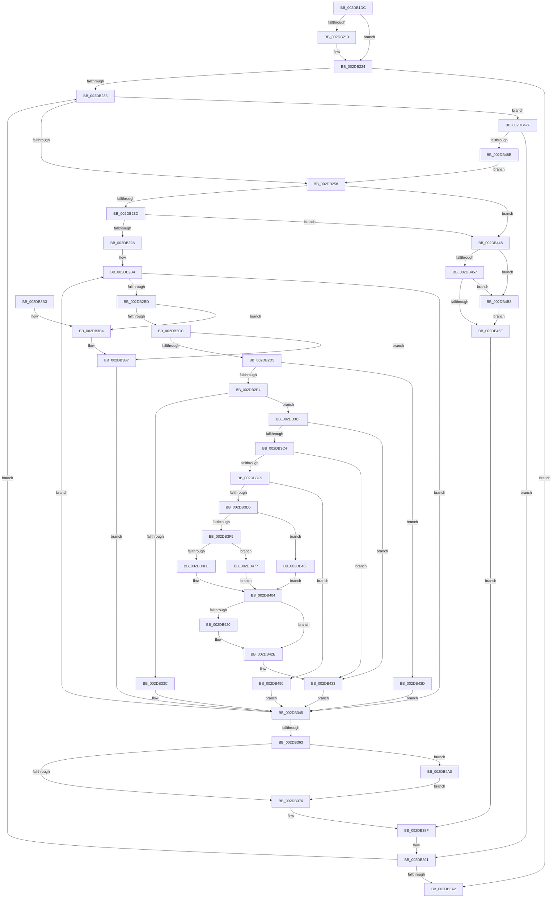

# MiScheduleZeroPageThreads

- RVA: `0x002DB1DC`–`0x002DB4C2` (길이 `742` bytes)
- VA: `0x00000001402DB1DC`
- 실행 섹션: `.text`
- PDB 이름 있음: `예`; PDB Function 태그: `아니요`
- unwind 정보 RVA: `0x00070628`
- 디코드: `178`개 명령, `742/742` bytes 표시
- 미해석 바이트: `0` (있으면 어셈블리에 `.byte`로 보존)

> 이 문서는 커널 이미지의 기계어와 PDB 기호를 분석해 생성했습니다. 4번과 5번은 함수 원형과 자료형을 바이너리 사용 방식에서 추정한 C 해석이며 원본 소스 복구 결과는 아닙니다.

## 1. Dependencies

- 직접 호출 지점: **9**; 고유 호출 대상: **6**
- 직접 호출자로 확인된 함수: **1**
- RIP 상대 이미지 참조: **9**

### Outgoing calls
- `0x002DB200` → [KeQueryPerformanceCounter](../37/KeQueryPerformanceCounter_function_0037E7E0.md) (function, `0x0037E7E0`)
- `0x002DB267` → [ExAcquireSpinLockExclusive](../24/ExAcquireSpinLockExclusive_function_00248690.md) (function, `0x00248690`)
- `0x002DB311` → [MiIsCalibrationWorthwhile](../4A/MiIsCalibrationWorthwhile_function_004A0770.md) (function, `0x004A0770`)
- `0x002DB382` → [MiReleaseSpinLockExclusive](../24/MiReleaseSpinLockExclusive_function_002482C0.md) (function, `0x002482C0`)
- `0x002DB3EF` → [MiReduceZeroingThreads](../2C/MiReduceZeroingThreads_function_002CACF8.md) (function, `0x002CACF8`)
- `0x002DB410` → [KeQueryPerformanceCounter](../37/KeQueryPerformanceCounter_function_0037E7E0.md) (function, `0x0037E7E0`)
- `0x002DB465` → [MiReleaseSpinLockExclusive](../24/MiReleaseSpinLockExclusive_function_002482C0.md) (function, `0x002482C0`)
- `0x002DB4A9` → [KeSetEvent](../33/KeSetEvent_function_0033F310.md) (function, `0x0033F310`)
- `0x002DB4BB` → [KeSetEvent](../33/KeSetEvent_function_0033F310.md) (function, `0x0033F310`)

### Direct callers
- [MiWorkingSetManager](MiWorkingSetManager_function_002DA7E0.md) at `0x002DA9BB`

### Static image references
- `0x002DB224` → RVA `0x00FC5000` (`ALMOSTRO`; read)
- `0x002DB2E4` → RVA `0x00E2DBF8` (`.data`; read)
- `0x002DB33F` → RVA `0x00EF5034` (`.data`; read/write)
- `0x002DB3B7` → RVA `0x00EF5038` (`.data`; read/write)
- `0x002DB3FE` → RVA `0x00EF504C` (`.data`; read/write)
- `0x002DB43D` → RVA `0x00EF503C` (`.data`; read/write)
- `0x002DB46F` → RVA `0x00EF5048` (`.data`; read/write)
- `0x002DB477` → RVA `0x00EF5044` (`.data`; read/write)
- `0x002DB495` → RVA `0x00EF5040` (`.data`; read/write)

## 2. Other-region calls and transfers

- 다른 실행 섹션으로 향하는 call: **0**
- 별도 외부 분기/꼬리 이동을 확인하지 못했습니다.

## 3. Assembly (complete function range)

```asm
002DB1DC  48 89 4C 24 08                  mov qword ptr [rsp + 8], rcx
002DB1E1  53                              push rbx
002DB1E2  55                              push rbp
002DB1E3  56                              push rsi
002DB1E4  57                              push rdi
002DB1E5  41 54                           push r12
002DB1E7  41 55                           push r13
002DB1E9  41 56                           push r14
002DB1EB  41 57                           push r15
002DB1ED  48 83 EC 48                     sub rsp, 0x48
002DB1F1  4C 8B E1                        mov r12, rcx
002DB1F4  33 ED                           xor ebp, ebp
002DB1F6  48 8D 4C 24 20                  lea rcx, [rsp + 0x20]
002DB1FB  48 89 6C 24 20                  mov qword ptr [rsp + 0x20], rbp
002DB200  E8 DB 35 0A 00                  call 0x14037e7e0
002DB205  48 81 7C 24 20 80 96 98 00      cmp qword ptr [rsp + 0x20], 0x989680
002DB20E  4C 8B F0                        mov r14, rax
002DB211  74 11                           je 0x1402db224
002DB213  49 69 C6 80 96 98 00            imul rax, r14, 0x989680
002DB21A  48 99                           cqo
002DB21C  48 F7 7C 24 20                  idiv qword ptr [rsp + 0x20]
002DB221  4C 8B F0                        mov r14, rax
002DB224  66 3B 2D D5 9D CE 00            cmp bp, word ptr [rip + 0xce9dd5]
002DB22B  8B DD                           mov ebx, ebp
002DB22D  0F 83 6F 01 00 00               jae 0x1402db3a2
002DB233  8B C3                           mov eax, ebx
002DB235  48 69 F8 80 DF 00 00            imul rdi, rax, 0xdf80
002DB23C  49 03 7C 24 10                  add rdi, qword ptr [r12 + 0x10]
002DB241  48 8B 87 80 3A 00 00            mov rax, qword ptr [rdi + 0x3a80]
002DB248  48 8D B7 90 3A 00 00            lea rsi, [rdi + 0x3a90]
002DB24F  48 85 C0                        test rax, rax
002DB252  0F 84 27 02 00 00               je 0x1402db47f
002DB258  48 8D AF B0 3B 00 00            lea rbp, [rdi + 0x3bb0]
002DB25F  48 8B CD                        mov rcx, rbp
002DB262  48 89 6C 24 38                  mov qword ptr [rsp + 0x38], rbp
002DB267  E8 24 D4 F6 FF                  call 0x140248690
002DB26C  4C 8B AF A8 3B 00 00            mov r13, qword ptr [rdi + 0x3ba8]
002DB273  33 D2                           xor edx, edx
002DB275  88 84 24 98 00 00 00            mov byte ptr [rsp + 0x98], al
002DB27C  44 8A F8                        mov r15b, al
002DB27F  4C 89 6C 24 30                  mov qword ptr [rsp + 0x30], r13
002DB284  4D 85 ED                        test r13, r13
002DB287  0F 84 BB 01 00 00               je 0x1402db448
002DB28D  48 39 97 B8 3B 00 00            cmp qword ptr [rdi + 0x3bb8], rdx
002DB294  0F 84 AE 01 00 00               je 0x1402db448
002DB29A  49 8D B5 F0 00 00 00            lea rsi, [r13 + 0xf0]
002DB2A1  89 94 24 A0 00 00 00            mov dword ptr [rsp + 0xa0], edx
002DB2A8  44 8B EB                        mov r13d, ebx
002DB2AB  8D 4A 01                        lea ecx, [rdx + 1]
002DB2AE  44 8B E2                        mov r12d, edx
002DB2B1  44 8B FA                        mov r15d, edx
002DB2B4  39 56 44                        cmp dword ptr [rsi + 0x44], edx
002DB2B7  0F 84 88 00 00 00               je 0x1402db345
002DB2BD  48 8B 2E                        mov rbp, qword ptr [rsi]
002DB2C0  49 8B C6                        mov rax, r14
002DB2C3  4C 3B F5                        cmp r14, rbp
002DB2C6  0F 82 E8 00 00 00               jb 0x1402db3b4
002DB2CC  48 3B C5                        cmp rax, rbp
002DB2CF  0F 86 E2 00 00 00               jbe 0x1402db3b7
002DB2D5  48 2B C5                        sub rax, rbp
002DB2D8  48 3D 00 C4 09 00               cmp rax, 0x9c400
002DB2DE  0F 82 59 01 00 00               jb 0x1402db43d
002DB2E4  48 8B 05 0D 29 B5 00            mov rax, qword ptr [rip + 0xb5290d]
002DB2EB  4A 8D 0C 6D 00 00 00 00         lea rcx, [r13*2]
002DB2F3  49 03 CD                        add rcx, r13
002DB2F6  45 33 C9                        xor r9d, r9d
002DB2F9  48 C1 E1 07                     shl rcx, 7
002DB2FD  44 8B C3                        mov r8d, ebx
002DB300  48 8B 8C 01 78 01 00 00         mov rcx, qword ptr [rcx + rax + 0x178]
002DB308  48 83 E9 80                     sub rcx, -0x80
002DB30C  49 03 CF                        add rcx, r15
002DB30F  8B 11                           mov edx, dword ptr [rcx]
002DB311  E8 5A 54 1C 00                  call 0x1404a0770
002DB316  8B 8C 24 A0 00 00 00            mov ecx, dword ptr [rsp + 0xa0]
002DB31D  33 D2                           xor edx, edx
002DB31F  85 C0                           test eax, eax
002DB321  8D 42 01                        lea eax, [rdx + 1]
002DB324  0F 45 C8                        cmovne ecx, eax
002DB327  8A 87 C0 3B 00 00               mov al, byte ptr [rdi + 0x3bc0]
002DB32D  89 8C 24 A0 00 00 00            mov dword ptr [rsp + 0xa0], ecx
002DB334  84 C0                           test al, al
002DB336  0F 85 83 00 00 00               jne 0x1402db3bf
002DB33C  8D 4A 01                        lea ecx, [rdx + 1]
002DB33F  01 0D EF 9C C1 00               add dword ptr [rip + 0xc19cef], ecx
002DB345  4C 03 E1                        add r12, rcx
002DB348  48 81 C6 30 01 00 00            add rsi, 0x130
002DB34F  49 81 C7 A8 00 00 00            add r15, 0xa8
002DB356  49 81 FF F8 01 00 00            cmp r15, 0x1f8
002DB35D  0F 8C 51 FF FF FF               jl 0x1402db2b4
002DB363  83 BC 24 A0 00 00 00 00         cmp dword ptr [rsp + 0xa0], 0
002DB36B  4C 8B 6C 24 30                  mov r13, qword ptr [rsp + 0x30]
002DB370  0F 85 2A 01 00 00               jne 0x1402db4a0
002DB376  8A 94 24 98 00 00 00            mov dl, byte ptr [rsp + 0x98]
002DB37D  48 8B 4C 24 38                  mov rcx, qword ptr [rsp + 0x38]
002DB382  E8 39 CF F6 FF                  call 0x1402482c0
002DB387  4C 8B A4 24 90 00 00 00         mov r12, qword ptr [rsp + 0x90]
002DB38F  33 ED                           xor ebp, ebp
002DB391  0F B7 05 68 9C CE 00            movzx eax, word ptr [rip + 0xce9c68]
002DB398  FF C3                           inc ebx
002DB39A  3B D8                           cmp ebx, eax
002DB39C  0F 82 91 FE FF FF               jb 0x1402db233
002DB3A2  48 83 C4 48                     add rsp, 0x48
002DB3A6  41 5F                           pop r15
002DB3A8  41 5E                           pop r14
002DB3AA  41 5D                           pop r13
002DB3AC  41 5C                           pop r12
002DB3AE  5F                              pop rdi
002DB3AF  5E                              pop rsi
002DB3B0  5D                              pop rbp
002DB3B1  5B                              pop rbx
002DB3B2  C3                              ret
002DB3B3  CC                              int3
002DB3B4  4C 8B F5                        mov r14, rbp
002DB3B7  01 0D 7B 9C C1 00               add dword ptr [rip + 0xc19c7b], ecx
002DB3BD  EB 86                           jmp 0x1402db345
002DB3BF  38 56 B4                        cmp byte ptr [rsi - 0x4c], dl
002DB3C2  74 6F                           je 0x1402db433
002DB3C4  4D 85 E4                        test r12, r12
002DB3C7  74 6A                           je 0x1402db433
002DB3C9  48 8B 06                        mov rax, qword ptr [rsi]
002DB3CC  48 3B E8                        cmp rbp, rax
002DB3CF  0F 85 BB 00 00 00               jne 0x1402db490
002DB3D5  89 94 24 A8 00 00 00            mov dword ptr [rsp + 0xa8], edx
002DB3DC  48 8D 4E 98                     lea rcx, [rsi - 0x68]
002DB3E0  BD 01 00 00 00                  mov ebp, 1
002DB3E5  4C 8D 84 24 A8 00 00 00         lea r8, [rsp + 0xa8]
002DB3ED  8B D5                           mov edx, ebp
002DB3EF  E8 04 F9 FE FF                  call 0x1402cacf8
002DB3F4  83 F8 07                        cmp eax, 7
002DB3F7  74 76                           je 0x1402db46f
002DB3F9  83 F8 05                        cmp eax, 5
002DB3FC  74 79                           je 0x1402db477
002DB3FE  01 2D 48 9C C1 00               add dword ptr [rip + 0xc19c48], ebp
002DB404  33 ED                           xor ebp, ebp
002DB406  48 8D 4C 24 28                  lea rcx, [rsp + 0x28]
002DB40B  48 89 6C 24 28                  mov qword ptr [rsp + 0x28], rbp
002DB410  E8 CB 33 0A 00                  call 0x14037e7e0
002DB415  48 81 7C 24 28 80 96 98 00      cmp qword ptr [rsp + 0x28], 0x989680
002DB41E  74 0E                           je 0x1402db42e
002DB420  48 69 C0 80 96 98 00            imul rax, rax, 0x989680
002DB427  48 99                           cqo
002DB429  48 F7 7C 24 28                  idiv qword ptr [rsp + 0x28]
002DB42E  48 89 06                        mov qword ptr [rsi], rax
002DB431  33 D2                           xor edx, edx
002DB433  B9 01 00 00 00                  mov ecx, 1
002DB438  E9 08 FF FF FF                  jmp 0x1402db345
002DB43D  01 0D F9 9B C1 00               add dword ptr [rip + 0xc19bf9], ecx
002DB443  E9 FD FE FF FF                  jmp 0x1402db345
002DB448  48 8B 87 80 3A 00 00            mov rax, qword ptr [rdi + 0x3a80]
002DB44F  48 3D 00 20 00 00               cmp rax, 0x2000
002DB455  73 5C                           jae 0x1402db4b3
002DB457  48 8B 06                        mov rax, qword ptr [rsi]
002DB45A  48 85 C0                        test rax, rax
002DB45D  75 54                           jne 0x1402db4b3
002DB45F  41 8A D7                        mov dl, r15b
002DB462  48 8B CD                        mov rcx, rbp
002DB465  E8 56 CE F6 FF                  call 0x1402482c0
002DB46A  E9 20 FF FF FF                  jmp 0x1402db38f
002DB46F  01 2D D3 9B C1 00               add dword ptr [rip + 0xc19bd3], ebp
002DB475  EB 8D                           jmp 0x1402db404
002DB477  01 2D C7 9B C1 00               add dword ptr [rip + 0xc19bc7], ebp
002DB47D  EB 85                           jmp 0x1402db404
002DB47F  48 8B 06                        mov rax, qword ptr [rsi]
002DB482  48 85 C0                        test rax, rax
002DB485  0F 84 06 FF FF FF               je 0x1402db391
002DB48B  E9 C8 FD FF FF                  jmp 0x1402db258
002DB490  B9 01 00 00 00                  mov ecx, 1
002DB495  01 0D A5 9B C1 00               add dword ptr [rip + 0xc19ba5], ecx
002DB49B  E9 A5 FE FF FF                  jmp 0x1402db345
002DB4A0  49 8D 4D 58                     lea rcx, [r13 + 0x58]
002DB4A4  45 33 C0                        xor r8d, r8d
002DB4A7  33 D2                           xor edx, edx
002DB4A9  E8 62 3E 06 00                  call 0x14033f310
002DB4AE  E9 C3 FE FF FF                  jmp 0x1402db376
002DB4B3  49 8D 4C 24 70                  lea rcx, [r12 + 0x70]
002DB4B8  45 33 C0                        xor r8d, r8d
002DB4BB  E8 50 3E 06 00                  call 0x14033f310
002DB4C0  EB 9D                           jmp 0x1402db45f
```

## 4. C-style interpretation (structured pseudocode)

```c
__int64 __fastcall MiScheduleZeroPageThreads(__int64 a1, int a2, __int64 a3, int a4)
{
    __int64 result;
    __int64 v_r12;
    __int64 v_r14;
    __int64 v_r15;
    __int64 v_rbp;
    __int64 v_rbx;
    __int64 v_rdi;
    __int64 v_rsi;
    __int64 v_rsp;
    unsigned __int64 v_stack_m50;
    unsigned __int64 v_stack_m58;
    unsigned __int64 v_stack_m68;
    unsigned __int8 v_stack_p10;
    unsigned int v_stack_p18;
    unsigned __int64 v_stack_p28;
    unsigned __int64 v_stack_p8;
    unsigned int v_stack_pA8;

    v_stack_p8 = a1;
    v_rsp = (v_rsp) - (72);
    v_rbp = 0;
    v_stack_m68 = 0;
    result = KeQueryPerformanceCounter(v_stack_m68, a2, a3, a4);
    v_r14 = result;
    if (v_stack_m68 != 0x989680ULL) {
        result = (result) * (result);
        v_r14 = result;
    }
    if (0 >= (*(unsigned __int16 *)(v_rip + 13540821))) goto loc_002DB3A2;
loc_002DB233:
    v_rdi = (v_rdi) * (0);
    v_rdi = (v_rdi) + (*(unsigned __int64 *)(a1 + 16));
    if (*(unsigned __int64 *)(v_rdi + 14976) == 0) goto loc_002DB47F;
loc_002DB258:
    v_stack_m50 = v_rdi + 15280;
    result = ExAcquireSpinLockExclusive(v_rdi + 15280, a2, a3, a4);
    a2 = 0;
    v_stack_p10 = (unsigned __int8)(result);
    v_stack_m58 = *(unsigned __int64 *)(v_rdi + 15272);
    if (*(unsigned __int64 *)(v_rdi + 15272) == 0) goto loc_002DB448;
    if ((*(unsigned __int64 *)(v_rdi + 15288)) == 0) goto loc_002DB448;
    v_stack_p18 = 0;
loc_002DB2B4:
    if ((*(unsigned int *)(*(unsigned __int64 *)(v_rdi + 15272) + 240 + 68)) == 0) goto loc_002DB345;
    if (v_r14 < (*(unsigned __int64 *)(*(unsigned __int64 *)(v_rdi + 15272) + 240))) goto loc_002DB3B4;
    if (v_r14 <= (*(unsigned __int64 *)(*(unsigned __int64 *)(v_rdi + 15272) + 240))) goto loc_002DB3B7;
    result = (v_r14) - (*(unsigned __int64 *)(*(unsigned __int64 *)(v_rdi + 15272) + 240));
    if (result < 0x9C400ULL) goto loc_002DB43D;
    a1 = (0 * 2) + (0);
    a4 = 0;
    a1 = (a1) << (7);
    a1 = (*(unsigned __int64 *)(a1 + *(unsigned __int64 *)(v_rip + 11872525) * 1 + 376)) - (-128);
    a1 = (a1) + (0);
    result = MiIsCalibrationWorthwhile(a1, (unsigned int)(*(unsigned int *)(a1)), 0, a4);
    a2 = 0;
    a1 = (unsigned int)(v_stack_p18);
    if ((unsigned int)(result) != 0) { a1 = (unsigned int)(a2 + 1); }
    v_stack_p18 = (unsigned int)(a1);
    if ((unsigned __int8)(*(unsigned __int8 *)(v_rdi + 15296)) != 0) goto loc_002DB3BF;
loc_002DB345:
    v_r12 = (0) + (a2 + 1);
    v_rsi = (*(unsigned __int64 *)(v_rdi + 15272) + 240) + (304);
    v_r15 = (0) + (168);
    if (v_r15 < 504) goto loc_002DB2B4;
    if (v_stack_p18 != 0) goto loc_002DB4A0;
loc_002DB376:
    result = MiReleaseSpinLockExclusive(v_stack_m50, v_stack_p10, 0, a4);
loc_002DB38F:
    v_rbp = 0;
loc_002DB391:
    v_rbx = (unsigned int)((0) + 1);
    if (((unsigned int)(v_rbx)) < ((unsigned int)(*(unsigned __int16 *)(v_rip + 13540456)))) goto loc_002DB233;
loc_002DB3A2:
    v_rsp = (v_rsp) + (72);
    return *(unsigned __int16 *)(v_rip + 13540456);
loc_002DB3B4:
loc_002DB3B7:
    goto loc_002DB345;
loc_002DB3BF:
    if ((*(unsigned __int8 *)(v_rsi - 76)) == ((unsigned __int8)(v_stack_p10))) goto loc_002DB433;
    if (v_stack_p8 == 0) goto loc_002DB433;
    if (0 != (*(unsigned __int64 *)(v_rsi))) goto loc_002DB490;
    v_stack_pA8 = (unsigned int)(v_stack_p10);
    result = MiReduceZeroingThreads(v_rsi - 104, 1, v_stack_pA8, a4);
    if (((unsigned int)(result)) == 7) goto loc_002DB46F;
    if (((unsigned int)(result)) == 5) goto loc_002DB477;
loc_002DB404:
    v_rbp = 0;
    v_stack_p28 = 0;
    result = KeQueryPerformanceCounter(v_stack_p28, 1, v_stack_pA8, a4);
    if (v_stack_p28 != 0x989680ULL) {
        result = (result) * (result);
    }
    *(unsigned __int64 *)(v_rsi) = result;
    a2 = 0;
loc_002DB433:
    goto loc_002DB345;
loc_002DB43D:
    goto loc_002DB345;
loc_002DB448:
    if ((*(unsigned __int64 *)(v_rdi + 14976)) >= 0x2000ULL) goto loc_002DB4B3;
    if (*(unsigned __int64 *)(v_rsi) != 0) goto loc_002DB4B3;
loc_002DB45F:
    result = MiReleaseSpinLockExclusive(0, (unsigned __int8)(v_r15), v_stack_pA8, a4);
    goto loc_002DB38F;
loc_002DB46F:
    goto loc_002DB404;
loc_002DB477:
    goto loc_002DB404;
loc_002DB47F:
    if (*(unsigned __int64 *)(v_rsi) == 0) goto loc_002DB391;
    goto loc_002DB258;
loc_002DB490:
    goto loc_002DB345;
loc_002DB4A0:
    a3 = 0;
    a2 = 0;
    result = KeSetEvent(v_stack_m58 + 88, a2, a3, a4);
    goto loc_002DB376;
loc_002DB4B3:
    a3 = 0;
    result = KeSetEvent(v_stack_p8 + 112, a2, a3, a4);
    goto loc_002DB45F;
}
```

## 5. (Beta) C Style

```c
int64_t MiScheduleZeroPageThreads(int64_t Arg1, int32_t Arg2, int64_t Arg3, int32_t Arg4)
{
    int64_t result;
    int64_t local_r12;
    int64_t local_r14;
    int64_t local_r15;
    int64_t local_rbp;
    int64_t local_rbx;
    int64_t local_rdi;
    int64_t local_rsi;
    int64_t local_rsp;
    uint64_t v_stack_m50;
    uint64_t v_stack_m58;
    uint64_t v_stack_m68;
    uint8_t v_stack_p10;
    uint32_t v_stack_p18;
    uint64_t v_stack_p28;
    uint64_t v_stack_p8;
    uint32_t v_stack_pA8;

    v_stack_p8 = Arg1;
    local_rsp = (local_rsp) - (72);
    local_rbp = 0;
    v_stack_m68 = 0;
    result = KeQueryPerformanceCounter(v_stack_m68, Arg2, Arg3, Arg4);
    local_r14 = result;
    if (v_stack_m68 != 0x989680ULL) {
        result = (result) * (result);
        local_r14 = result;
    }
    if (0 >= (*(uint16_t *)(v_rip + 0xCE9DD5))) goto loc_002DB3A2;
loc_002DB233:
    local_rdi = (local_rdi) * (0);
    local_rdi = (local_rdi) + (*(uint64_t *)(Arg1 + 0x10));
    if (*(uint64_t *)(local_rdi + 0x3A80) == 0) goto loc_002DB47F;
loc_002DB258:
    v_stack_m50 = local_rdi + 15280;
    result = ExAcquireSpinLockExclusive(local_rdi + 15280, Arg2, Arg3, Arg4);
    Arg2 = 0;
    v_stack_p10 = (uint8_t)(result);
    v_stack_m58 = *(uint64_t *)(local_rdi + 0x3BA8);
    if (*(uint64_t *)(local_rdi + 0x3BA8) == 0) goto loc_002DB448;
    if ((*(uint64_t *)(local_rdi + 0x3BB8)) == 0) goto loc_002DB448;
    v_stack_p18 = 0;
loc_002DB2B4:
    if ((*(uint32_t *)(*(uint64_t *)(local_rdi + 0x3BA8) + 0xF0 + 0x44)) == 0) goto loc_002DB345;
    if (local_r14 < (*(uint64_t *)(*(uint64_t *)(local_rdi + 0x3BA8) + 0xF0))) goto loc_002DB3B4;
    if (local_r14 <= (*(uint64_t *)(*(uint64_t *)(local_rdi + 0x3BA8) + 0xF0))) goto loc_002DB3B7;
    result = (local_r14) - (*(uint64_t *)(*(uint64_t *)(local_rdi + 0x3BA8) + 0xF0));
    if (result < 0x9C400ULL) goto loc_002DB43D;
    Arg1 = (0 * 2) + (0);
    Arg4 = 0;
    Arg1 = (Arg1) << (7);
    Arg1 = (*(uint64_t *)(Arg1 + *(uint64_t *)(v_rip + 0xB5290D) * 1 + 0x178)) - (-128);
    Arg1 = (Arg1) + (0);
    result = MiIsCalibrationWorthwhile(Arg1, (uint32_t)(*(uint32_t *)(Arg1)), 0, Arg4);
    Arg2 = 0;
    Arg1 = (uint32_t)(v_stack_p18);
    if ((uint32_t)(result) != 0) { Arg1 = (uint32_t)(Arg2 + 1); }
    v_stack_p18 = (uint32_t)(Arg1);
    if ((uint8_t)(*(uint8_t *)(local_rdi + 0x3BC0)) != 0) goto loc_002DB3BF;
loc_002DB345:
    local_r12 = (0) + (Arg2 + 1);
    local_rsi = (*(uint64_t *)(local_rdi + 0x3BA8) + 240) + (304);
    local_r15 = (0) + (168);
    if (local_r15 < 504) goto loc_002DB2B4;
    if (v_stack_p18 != 0) goto loc_002DB4A0;
loc_002DB376:
    result = MiReleaseSpinLockExclusive(v_stack_m50, v_stack_p10, 0, Arg4);
loc_002DB38F:
    local_rbp = 0;
loc_002DB391:
    local_rbx = (uint32_t)((0) + 1);
    if (((uint32_t)(local_rbx)) < ((uint32_t)(*(uint16_t *)(v_rip + 0xCE9C68)))) goto loc_002DB233;
loc_002DB3A2:
    local_rsp = (local_rsp) + (72);
    return *(uint16_t *)(v_rip + 0xCE9C68);
loc_002DB3B4:
loc_002DB3B7:
    goto loc_002DB345;
loc_002DB3BF:
    if ((*(uint8_t *)(local_rsi - 0x4C)) == ((uint8_t)(v_stack_p10))) goto loc_002DB433;
    if (v_stack_p8 == 0) goto loc_002DB433;
    if (0 != (*(uint64_t *)(local_rsi))) goto loc_002DB490;
    v_stack_pA8 = (uint32_t)(v_stack_p10);
    result = MiReduceZeroingThreads(local_rsi - 104, 1, v_stack_pA8, Arg4);
    if (((uint32_t)(result)) == 7) goto loc_002DB46F;
    if (((uint32_t)(result)) == 5) goto loc_002DB477;
loc_002DB404:
    local_rbp = 0;
    v_stack_p28 = 0;
    result = KeQueryPerformanceCounter(v_stack_p28, 1, v_stack_pA8, Arg4);
    if (v_stack_p28 != 0x989680ULL) {
        result = (result) * (result);
    }
    *(uint64_t *)(local_rsi) = result;
    Arg2 = 0;
loc_002DB433:
    goto loc_002DB345;
loc_002DB43D:
    goto loc_002DB345;
loc_002DB448:
    if ((*(uint64_t *)(local_rdi + 0x3A80)) >= 0x2000ULL) goto loc_002DB4B3;
    if (*(uint64_t *)(local_rsi) != 0) goto loc_002DB4B3;
loc_002DB45F:
    result = MiReleaseSpinLockExclusive(0, (uint8_t)(local_r15), v_stack_pA8, Arg4);
    goto loc_002DB38F;
loc_002DB46F:
    goto loc_002DB404;
loc_002DB477:
    goto loc_002DB404;
loc_002DB47F:
    if (*(uint64_t *)(local_rsi) == 0) goto loc_002DB391;
    goto loc_002DB258;
loc_002DB490:
    goto loc_002DB345;
loc_002DB4A0:
    Arg3 = 0;
    Arg2 = 0;
    result = KeSetEvent(v_stack_m58 + 88, Arg2, Arg3, Arg4);
    goto loc_002DB376;
loc_002DB4B3:
    Arg3 = 0;
    result = KeSetEvent(v_stack_p8 + 112, Arg2, Arg3, Arg4);
    goto loc_002DB45F;
}
```

## 6. Execution-region graph

[열기: 2D/3D 그래프와 함수 탐색 컨트롤 패널](../../../control-panel.html?section=text&rva=0x002DB1DC&view=graph)

- 2D 그래프는 위에서 아래로 흐르고, 3D 그래프는 빈 공간을 드래그해 회전합니다. Shift+드래그는 이동, 휠은 확대·축소, 함수 노드 선택은 대상 보고서 이동입니다.

### Static fallback


