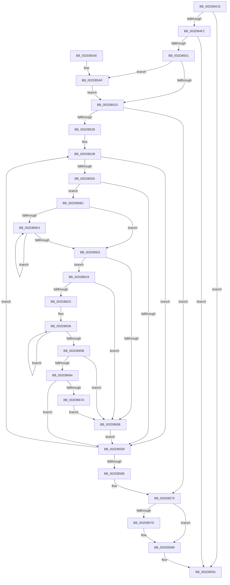

# MiSignalLargePageRebuild

- RVA: `0x002DB4C8`–`0x002DB67C` (길이 `436` bytes)
- VA: `0x00000001402DB4C8`
- 실행 섹션: `.text`
- PDB 이름 있음: `예`; PDB Function 태그: `아니요`
- unwind 정보 RVA: `0x00070644`
- 디코드: `114`개 명령, `436/436` bytes 표시
- 미해석 바이트: `0` (있으면 어셈블리에 `.byte`로 보존)

> 이 문서는 커널 이미지의 기계어와 PDB 기호를 분석해 생성했습니다. 4번과 5번은 함수 원형과 자료형을 바이너리 사용 방식에서 추정한 C 해석이며 원본 소스 복구 결과는 아닙니다.

## 1. Dependencies

- 직접 호출 지점: **7**; 고유 호출 대상: **7**
- 직접 호출자로 확인된 함수: **1**
- RIP 상대 이미지 참조: **5**

### Outgoing calls
- `0x002DB4F2` → [MiPageCombiningActive](../46/MiPageCombiningActive_function_00462348.md) (function, `0x00462348`)
- `0x002DB542` → [ExAcquireSpinLockExclusiveAtDpcLevel](../24/ExAcquireSpinLockExclusiveAtDpcLevel_function_00248E80.md) (function, `0x00248E80`)
- `0x002DB55C` → [ExReleaseSpinLockExclusiveFromDpcLevel](../24/ExReleaseSpinLockExclusiveFromDpcLevel_function_002497E0.md) (function, `0x002497E0`)
- `0x002DB584` → [KiLowerIrqlProcessIrqlFlags](../4F/KiLowerIrqlProcessIrqlFlags_function_004F5698.md) (function, `0x004F5698`)
- `0x002DB5B2` → [KiRaiseIrqlProcessIrqlFlags](../4F/KiRaiseIrqlProcessIrqlFlags_function_004F56FC.md) (function, `0x004F56FC`)
- `0x002DB5ED` → [MiNodeFreeZeroPages](../3B/MiNodeFreeZeroPages_function_003BBF60.md) (function, `0x003BBF60`)
- `0x002DB66D` → [MiWakeLargePageRebuild](../3B/MiWakeLargePageRebuild_function_003BA2C8.md) (function, `0x003BA2C8`)

### Direct callers
- [MiWorkingSetManager](MiWorkingSetManager_function_002DA7E0.md) at `0x002DA9B3`

### Static image references
- `0x002DB511` → RVA `0x00FC6D20` (`ALMOSTRO`; read)
- `0x002DB51D` → RVA `0x00FC5000` (`ALMOSTRO`; read)
- `0x002DB5DB` → RVA `0x00FC5002` (`ALMOSTRO`; read)
- `0x002DB619` → RVA `0x00FC6A88` (`ALMOSTRO`; read)
- `0x002DB625` → RVA `0x00011C60` (`.rdata`; read)

## 2. Other-region calls and transfers

- 다른 실행 섹션으로 향하는 call: **0**
- 별도 외부 분기/꼬리 이동을 확인하지 못했습니다.

## 3. Assembly (complete function range)

```asm
002DB4C8  48 89 5C 24 10                  mov qword ptr [rsp + 0x10], rbx
002DB4CD  48 89 6C 24 18                  mov qword ptr [rsp + 0x18], rbp
002DB4D2  48 89 74 24 20                  mov qword ptr [rsp + 0x20], rsi
002DB4D7  57                              push rdi
002DB4D8  41 54                           push r12
002DB4DA  41 55                           push r13
002DB4DC  41 56                           push r14
002DB4DE  41 57                           push r15
002DB4E0  48 83 EC 20                     sub rsp, 0x20
002DB4E4  8B 41 04                        mov eax, dword ptr [rcx + 4]
002DB4E7  48 8B E9                        mov rbp, rcx
002DB4EA  A8 10                           test al, 0x10
002DB4EC  0F 85 9F 00 00 00               jne 0x1402db591
002DB4F2  E8 51 6E 18 00                  call 0x140462348
002DB4F7  33 FF                           xor edi, edi
002DB4F9  85 C0                           test eax, eax
002DB4FB  0F 85 90 00 00 00               jne 0x1402db591
002DB501  45 0F 20 C6                     mov r14, cr8
002DB505  4C 89 74 24 50                  mov qword ptr [rsp + 0x50], r14
002DB50A  8D 57 02                        lea edx, [rdi + 2]
002DB50D  44 0F 22 C2                     mov cr8, rdx
002DB511  39 3D 09 B8 CE 00               cmp dword ptr [rip + 0xceb809], edi
002DB517  0F 85 92 00 00 00               jne 0x1402db5af
002DB51D  66 3B 3D DC 9A CE 00            cmp di, word ptr [rip + 0xce9adc]
002DB524  8B DF                           mov ebx, edi
002DB526  73 4D                           jae 0x1402db575
002DB528  45 33 F6                        xor r14d, r14d
002DB52B  8B C3                           mov eax, ebx
002DB52D  48 69 F8 80 DF 00 00            imul rdi, rax, 0xdf80
002DB534  48 03 7D 10                     add rdi, qword ptr [rbp + 0x10]
002DB538  4C 8D AF 7C 3B 00 00            lea r13, [rdi + 0x3b7c]
002DB53F  49 8B CD                        mov rcx, r13
002DB542  E8 39 D9 F6 FF                  call 0x140248e80
002DB547  44 38 B7 41 14 00 00            cmp byte ptr [rdi + 0x1441], r14b
002DB54E  75 09                           jne 0x1402db559
002DB550  80 AF 40 14 00 00 01            sub byte ptr [rdi + 0x1440], 1
002DB557  74 63                           je 0x1402db5bc
002DB559  49 8B CD                        mov rcx, r13
002DB55C  E8 7F E2 F6 FF                  call 0x1402497e0
002DB561  0F B7 05 98 9A CE 00            movzx eax, word ptr [rip + 0xce9a98]
002DB568  FF C3                           inc ebx
002DB56A  3B D8                           cmp ebx, eax
002DB56C  72 BD                           jb 0x1402db52b
002DB56E  4C 8B 74 24 50                  mov r14, qword ptr [rsp + 0x50]
002DB573  33 FF                           xor edi, edi
002DB575  39 3D A5 B7 CE 00               cmp dword ptr [rip + 0xceb7a5], edi
002DB57B  74 0C                           je 0x1402db589
002DB57D  44 0F 20 C1                     mov rcx, cr8
002DB581  41 8A D6                        mov dl, r14b
002DB584  E8 0F A1 21 00                  call 0x1404f5698
002DB589  41 0F B6 C6                     movzx eax, r14b
002DB58D  44 0F 22 C0                     mov cr8, rax
002DB591  48 8B 5C 24 58                  mov rbx, qword ptr [rsp + 0x58]
002DB596  48 8B 6C 24 60                  mov rbp, qword ptr [rsp + 0x60]
002DB59B  48 8B 74 24 68                  mov rsi, qword ptr [rsp + 0x68]
002DB5A0  48 83 C4 20                     add rsp, 0x20
002DB5A4  41 5F                           pop r15
002DB5A6  41 5E                           pop r14
002DB5A8  41 5D                           pop r13
002DB5AA  41 5C                           pop r12
002DB5AC  5F                              pop rdi
002DB5AD  C3                              ret
002DB5AE  CC                              int3
002DB5AF  41 8A CE                        mov cl, r14b
002DB5B2  E8 45 A1 21 00                  call 0x1404f56fc
002DB5B7  E9 61 FF FF FF                  jmp 0x1402db51d
002DB5BC  8A 87 43 14 00 00               mov al, byte ptr [rdi + 0x1443]
002DB5C2  4D 8B E6                        mov r12, r14
002DB5C5  F6 D8                           neg al
002DB5C7  45 8A FE                        mov r15b, r14b
002DB5CA  48 1B F6                        sbb rsi, rsi
002DB5CD  48 81 E6 00 E1 FF FF            and rsi, 0xffffffffffffe100
002DB5D4  48 81 C6 00 20 00 00            add rsi, 0x2000
002DB5DB  44 38 35 20 9A CE 00            cmp byte ptr [rip + 0xce9a20], r14b
002DB5E2  76 1D                           jbe 0x1402db601
002DB5E4  45 8B C6                        mov r8d, r14d
002DB5E7  41 8A D7                        mov dl, r15b
002DB5EA  48 8B CF                        mov rcx, rdi
002DB5ED  E8 6E 09 0E 00                  call 0x1403bbf60
002DB5F2  4C 03 E0                        add r12, rax
002DB5F5  41 FE C7                        inc r15b
002DB5F8  44 3A 3D 03 9A CE 00            cmp r15b, byte ptr [rip + 0xce9a03]
002DB5FF  72 E3                           jb 0x1402db5e4
002DB601  4C 3B E6                        cmp r12, rsi
002DB604  73 13                           jae 0x1402db619
002DB606  C6 87 42 14 00 00 08            mov byte ptr [rdi + 0x1442], 8
002DB60D  C6 87 40 14 00 00 08            mov byte ptr [rdi + 0x1440], 8
002DB614  E9 40 FF FF FF                  jmp 0x1402db559
002DB619  F6 05 68 B4 CE 00 30            test byte ptr [rip + 0xceb468], 0x30
002DB620  74 E4                           je 0x1402db606
002DB622  4D 8B C6                        mov r8, r14
002DB625  4C 8D 15 34 66 D3 FF            lea r10, [rip - 0x2c99cc]
002DB62C  4C 8D 4F 10                     lea r9, [rdi + 0x10]
002DB630  41 BB 03 00 00 00               mov r11d, 3
002DB636  49 8B 49 F8                     mov rcx, qword ptr [r9 - 8]
002DB63A  49 8B 01                        mov rax, qword ptr [r9]
002DB63D  4D 8D 89 00 05 00 00            lea r9, [r9 + 0x500]
002DB644  49 8B 12                        mov rdx, qword ptr [r10]
002DB647  48 03 C8                        add rcx, rax
002DB64A  48 0F AF D1                     imul rdx, rcx
002DB64E  4D 8D 52 08                     lea r10, [r10 + 8]
002DB652  4C 03 C2                        add r8, rdx
002DB655  49 83 EB 01                     sub r11, 1
002DB659  75 DB                           jne 0x1402db636
002DB65B  49 C1 E8 03                     shr r8, 3
002DB65F  4D 3B C4                        cmp r8, r12
002DB662  73 A2                           jae 0x1402db606
002DB664  45 8D 43 01                     lea r8d, [r11 + 1]
002DB668  8B D3                           mov edx, ebx
002DB66A  48 8B CD                        mov rcx, rbp
002DB66D  E8 56 EC 0D 00                  call 0x1403ba2c8
002DB672  85 C0                           test eax, eax
002DB674  0F 85 DF FE FF FF               jne 0x1402db559
002DB67A  EB 8A                           jmp 0x1402db606
```

## 4. C-style interpretation (structured pseudocode)

```c
__int64 __fastcall MiSignalLargePageRebuild(__int64 a1)
{
    __int64 result;
    __int64 v_r11;
    __int64 v_r12;
    __int64 v_r14;
    __int64 v_r15;
    __int64 v_rbx;
    __int64 v_rdi;
    __int64 v_rsi;
    __int64 v_rsp;
    unsigned __int64 v_stack_p10;
    unsigned __int64 v_stack_p18;
    unsigned __int64 v_stack_p20;
    unsigned __int64 v_stack_p8;

    v_stack_p10 = v_rbx;
    v_stack_p18 = v_rbp;
    v_stack_p20 = v_rsi;
    v_rsp = (v_rsp) - (32);
    if ((((unsigned __int8)((unsigned int)(*(unsigned int *)(a1 + 4)))) & (16)) != 0) goto loc_002DB591;
    result = MiPageCombiningActive(a1, a2, a3, a4);
    v_rdi = 0;
    if ((unsigned int)(result) != 0) goto loc_002DB591;
    v_stack_p8 = v_cr8;
    if ((*(unsigned int *)(v_rip + 13547529)) != 0) goto loc_002DB5AF;
loc_002DB51D:
    if (0 >= (*(unsigned __int16 *)(v_rip + 13540060))) goto loc_002DB575;
    v_r14 = 0;
loc_002DB52B:
    v_rdi = (v_rdi) * (0);
    v_rdi = (v_rdi) + (*(unsigned __int64 *)(a1 + 16));
    result = ExAcquireSpinLockExclusiveAtDpcLevel(v_rdi + 15228, v_rdi + 2, a3, a4);
    if ((*(unsigned __int8 *)(v_rdi + 5185)) != 0) goto loc_002DB559;
    if ((*(unsigned __int8 *)(v_rdi + 5185)) == 0) goto loc_002DB5BC;
loc_002DB559:
    result = ExReleaseSpinLockExclusiveFromDpcLevel(v_rdi + 15228, v_rdi + 2, a3, a4);
    v_rbx = (unsigned int)((0) + 1);
    if (((unsigned int)(v_rbx)) < ((unsigned int)(*(unsigned __int16 *)(v_rip + 13539992)))) goto loc_002DB52B;
    v_rdi = 0;
loc_002DB575:
    result = *(unsigned __int16 *)(v_rip + 13539992);
    if ((*(unsigned int *)(v_rip + 13547429)) != 0) {
        a1 = v_rdi + 2;
        a2 = (unsigned __int8)(v_stack_p8);
        result = KiLowerIrqlProcessIrqlFlags(a1, a2, a3, a4);
    }
loc_002DB591:
    v_rsp = (v_rsp) + (32);
    return (unsigned __int8)(v_stack_p8);
loc_002DB5AF:
    result = KiRaiseIrqlProcessIrqlFlags((unsigned __int8)(v_stack_p8), a2, a3, a4);
    goto loc_002DB51D;
loc_002DB5BC:
    result = (unsigned __int8)(-(*(unsigned __int8 *)(v_rdi + 5187)));
    v_rsi = (v_stack_p20) & (0xFFFFFFFFFFFFE100ULL);
    v_rsi = (v_rsi) + (0x2000ULL);
    if ((*(unsigned __int8 *)(v_rip + 13539872)) <= ((unsigned __int8)(v_stack_p8))) goto loc_002DB601;
loc_002DB5E4:
    result = MiNodeFreeZeroPages(0, (unsigned __int8)((unsigned __int8)(v_stack_p8)), (unsigned int)((unsigned int)(v_stack_p8)), a4);
    v_r12 = (v_stack_p8) + (result);
    v_r15 = (unsigned __int8)(((unsigned __int8)(v_stack_p8)) + 1);
    if (((unsigned __int8)(v_r15)) < (*(unsigned __int8 *)(v_rip + 13539843))) goto loc_002DB5E4;
loc_002DB601:
    if (v_r12 >= v_rsi) goto loc_002DB619;
loc_002DB606:
    *(unsigned __int8 *)(v_rdi + 5186) = 8;
    *(unsigned __int8 *)(v_rdi + 5184) = 8;
    goto loc_002DB559;
loc_002DB619:
    if (((*(unsigned __int8 *)(v_rip + 13546600)) & (48)) == 0) goto loc_002DB606;
loc_002DB636:
    a1 = (*(unsigned __int64 *)(v_rdi + 16 - 8)) + (*(unsigned __int64 *)(v_rdi + 16));
    a2 = (*(unsigned __int64 *)(v_rip - 2922956)) * (a1);
    a3 = (v_stack_p8) + (a2);
    v_r11 = (3) - (1);
    if (condition_is_not_equal) goto loc_002DB636;
    a3 = (a3) >> (3);
    if (a3 >= v_r12) goto loc_002DB606;
    result = MiWakeLargePageRebuild(v_stack_p18, (unsigned int)((unsigned int)(v_stack_p10)), v_r11 + 1, v_rdi + 16 + 1280);
    if ((unsigned int)(result) != 0) goto loc_002DB559;
    goto loc_002DB606;
}
```

## 5. (Beta) C Style

```c
int64_t MiSignalLargePageRebuild(void *Arg1)
{
    uint8_t *arg1 = (uint8_t *)Arg1;

    int64_t result;
    int64_t local_r11;
    int64_t local_r12;
    int64_t local_r14;
    int64_t local_r15;
    int64_t local_rbx;
    int64_t local_rdi;
    int64_t local_rsi;
    int64_t local_rsp;
    uint64_t v_stack_p10;
    uint64_t v_stack_p18;
    uint64_t v_stack_p20;
    uint64_t v_stack_p8;

    v_stack_p10 = local_rbx;
    v_stack_p18 = local_rbp;
    v_stack_p20 = local_rsi;
    local_rsp = (local_rsp) - (32);
    if ((((uint8_t)((uint32_t)(*(uint32_t *)(arg1 + 0x4)))) & (16)) != 0) goto loc_002DB591;
    result = MiPageCombiningActive(Arg1, a2, a3, a4);
    local_rdi = 0;
    if ((uint32_t)(result) != 0) goto loc_002DB591;
    v_stack_p8 = v_cr8;
    if ((*(uint32_t *)(v_rip + 0xCEB809)) != 0) goto loc_002DB5AF;
loc_002DB51D:
    if (0 >= (*(uint16_t *)(v_rip + 0xCE9ADC))) goto loc_002DB575;
    local_r14 = 0;
loc_002DB52B:
    local_rdi = (local_rdi) * (0);
    local_rdi = (local_rdi) + (*(uint64_t *)(arg1 + 0x10));
    result = ExAcquireSpinLockExclusiveAtDpcLevel(local_rdi + 15228, local_rdi + 2, a3, a4);
    if ((*(uint8_t *)(local_rdi + 0x1441)) != 0) goto loc_002DB559;
    if ((*(uint8_t *)(local_rdi + 0x1441)) == 0) goto loc_002DB5BC;
loc_002DB559:
    result = ExReleaseSpinLockExclusiveFromDpcLevel(local_rdi + 15228, local_rdi + 2, a3, a4);
    local_rbx = (uint32_t)((0) + 1);
    if (((uint32_t)(local_rbx)) < ((uint32_t)(*(uint16_t *)(v_rip + 0xCE9A98)))) goto loc_002DB52B;
    local_rdi = 0;
loc_002DB575:
    result = *(uint16_t *)(v_rip + 0xCE9A98);
    if ((*(uint32_t *)(v_rip + 0xCEB7A5)) != 0) {
        Arg1 = local_rdi + 2;
        a2 = (uint8_t)(v_stack_p8);
        result = KiLowerIrqlProcessIrqlFlags(Arg1, a2, a3, a4);
    }
loc_002DB591:
    local_rsp = (local_rsp) + (32);
    return (uint8_t)(v_stack_p8);
loc_002DB5AF:
    result = KiRaiseIrqlProcessIrqlFlags((uint8_t)(v_stack_p8), a2, a3, a4);
    goto loc_002DB51D;
loc_002DB5BC:
    result = (uint8_t)(-(*(uint8_t *)(local_rdi + 0x1443)));
    local_rsi = (v_stack_p20) & (0xFFFFFFFFFFFFE100ULL);
    local_rsi = (local_rsi) + (0x2000ULL);
    if ((*(uint8_t *)(v_rip + 0xCE9A20)) <= ((uint8_t)(v_stack_p8))) goto loc_002DB601;
loc_002DB5E4:
    result = MiNodeFreeZeroPages(0, (uint8_t)((uint8_t)(v_stack_p8)), (uint32_t)((uint32_t)(v_stack_p8)), a4);
    local_r12 = (v_stack_p8) + (result);
    local_r15 = (uint8_t)(((uint8_t)(v_stack_p8)) + 1);
    if (((uint8_t)(local_r15)) < (*(uint8_t *)(v_rip + 0xCE9A03))) goto loc_002DB5E4;
loc_002DB601:
    if (local_r12 >= local_rsi) goto loc_002DB619;
loc_002DB606:
    *(uint8_t *)(local_rdi + 0x1442) = 8;
    *(uint8_t *)(local_rdi + 0x1440) = 8;
    goto loc_002DB559;
loc_002DB619:
    if (((*(uint8_t *)(v_rip + 0xCEB468)) & (48)) == 0) goto loc_002DB606;
loc_002DB636:
    Arg1 = (*(uint64_t *)(local_rdi + 0x10 - 0x8)) + (*(uint64_t *)(local_rdi + 0x10));
    a2 = (*(uint64_t *)(v_rip - 0x2C99CC)) * (Arg1);
    a3 = (v_stack_p8) + (a2);
    local_r11 = (3) - (1);
    if (condition_is_not_equal) goto loc_002DB636;
    a3 = (a3) >> (3);
    if (a3 >= local_r12) goto loc_002DB606;
    result = MiWakeLargePageRebuild(v_stack_p18, (uint32_t)((uint32_t)(v_stack_p10)), local_r11 + 1, local_rdi + 16 + 1280);
    if ((uint32_t)(result) != 0) goto loc_002DB559;
    goto loc_002DB606;
}
```

### 관측된 메모리 오프셋

구조체 형식이 확인되지 않은 접근은 인자 기준의 오프셋으로만 기록했습니다.

| 기준 인자 | 오프셋 표현 | 폭 (bit) | 접근 |
|---|---:|---:|---|
| `Arg1` | `+ 0x4` | `32` | `R` |
| `Arg1` | `+ 0x10` | `64` | `R` |

## 6. Execution-region graph

[열기: 2D/3D 그래프와 함수 탐색 컨트롤 패널](../../../control-panel.html?section=text&rva=0x002DB4C8&view=graph)

- 2D 그래프는 위에서 아래로 흐르고, 3D 그래프는 빈 공간을 드래그해 회전합니다. Shift+드래그는 이동, 휠은 확대·축소, 함수 노드 선택은 대상 보고서 이동입니다.

### Static fallback


