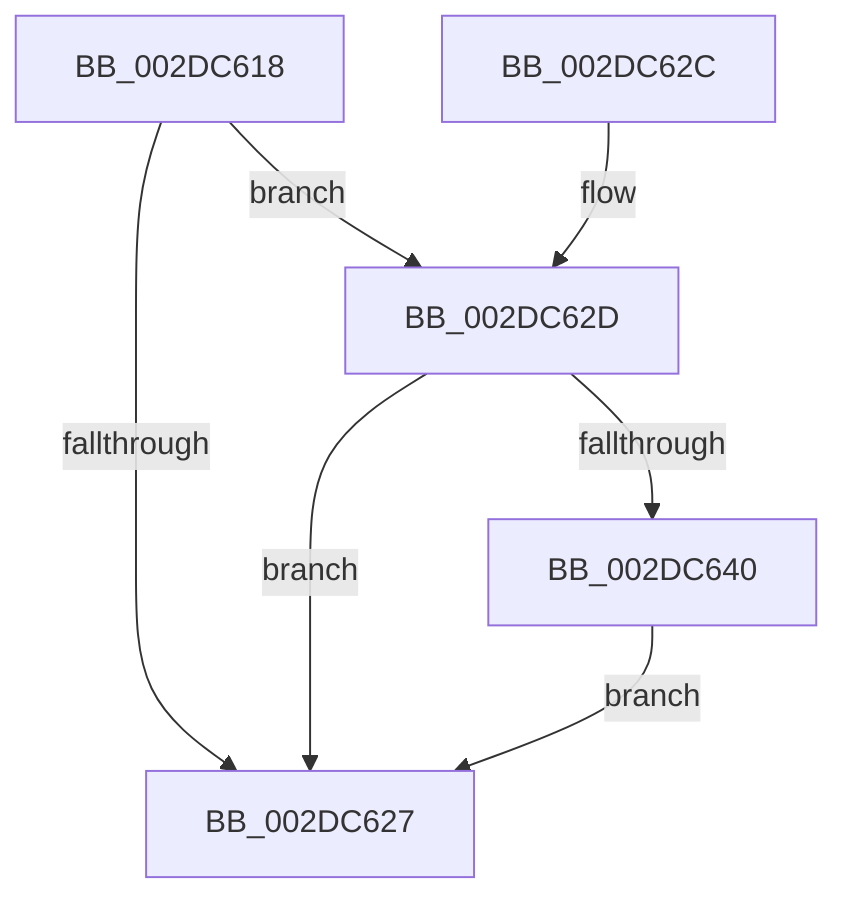

# MiSlabUpdateRecentFailure

- RVA: `0x002DC618`–`0x002DC649` (길이 `49` bytes)
- VA: `0x00000001402DC618`
- 실행 섹션: `.text`
- PDB 이름 있음: `예`; PDB Function 태그: `아니요`
- unwind 정보 RVA: `0x0005FC2C`
- 디코드: `15`개 명령, `49/49` bytes 표시
- 미해석 바이트: `0` (있으면 어셈블리에 `.byte`로 보존)

> 이 문서는 커널 이미지의 기계어와 PDB 기호를 분석해 생성했습니다. 4번과 5번은 함수 원형과 자료형을 바이너리 사용 방식에서 추정한 C 해석이며 원본 소스 복구 결과는 아닙니다.

## 1. Dependencies

- 직접 호출 지점: **1**; 고유 호출 대상: **1**
- 직접 호출자로 확인된 함수: **2**
- RIP 상대 이미지 참조: **0**

### Outgoing calls
- `0x002DC62D` → [MiGetSlabCurrentTime](../3B/MiGetSlabCurrentTime_function_003BCBCC.md) (function, `0x003BCBCC`)

### Direct callers
- [MiFreeUnusedSlabPages](MiFreeUnusedSlabPages_function_002DAE48.md) at `0x002DAEF6`
- [MiFreeSlabEntries](MiFreeSlabEntries_function_002DAFC0.md) at `0x002DB009`

### Static image references
- 디코드된 RIP-relative 메모리 참조가 없습니다.

## 2. Other-region calls and transfers

- 다른 실행 섹션으로 향하는 call: **0**
- 별도 외부 분기/꼬리 이동을 확인하지 못했습니다.

## 3. Assembly (complete function range)

```asm
002DC618  48 83 EC 28                     sub rsp, 0x28
002DC61C  48 8B 01                        mov rax, qword ptr [rcx]
002DC61F  4C 8B D1                        mov r10, rcx
002DC622  48 85 C0                        test rax, rax
002DC625  75 06                           jne 0x1402dc62d
002DC627  48 83 C4 28                     add rsp, 0x28
002DC62B  C3                              ret
002DC62C  CC                              int3
002DC62D  E8 9A 05 0E 00                  call 0x1403bcbcc
002DC632  49 8B 12                        mov rdx, qword ptr [r10]
002DC635  48 2B C2                        sub rax, rdx
002DC638  48 3D 00 A3 E1 11               cmp rax, 0x11e1a300
002DC63E  72 E7                           jb 0x1402dc627
002DC640  49 C7 02 00 00 00 00            mov qword ptr [r10], 0
002DC647  EB DE                           jmp 0x1402dc627
```

## 4. C-style interpretation (structured pseudocode)

```c
__int64 __fastcall MiSlabUpdateRecentFailure(__int64 a1)
{
    __int64 result;
    __int64 v_rsp;

    v_rsp = (v_rsp) - (40);
    if (*(unsigned __int64 *)(a1) != 0) goto loc_002DC62D;
loc_002DC627:
    v_rsp = (v_rsp) + (40);
    return *(unsigned __int64 *)(a1);
loc_002DC62D:
    result = MiGetSlabCurrentTime(a1, a2, a3, a4);
    result = (result) - (*(unsigned __int64 *)(a1));
    if (result < 0x11E1A300ULL) goto loc_002DC627;
    *(unsigned __int64 *)(a1) = 0;
    goto loc_002DC627;
}
```

## 5. (Beta) C Style

```c
int64_t MiSlabUpdateRecentFailure(void *Arg1)
{
    uint8_t *arg1 = (uint8_t *)Arg1;

    int64_t result;
    int64_t local_rsp;

    local_rsp = (local_rsp) - (40);
    if (*(uint64_t *)(arg1) != 0) goto loc_002DC62D;
loc_002DC627:
    local_rsp = (local_rsp) + (40);
    return *(uint64_t *)(arg1);
loc_002DC62D:
    result = MiGetSlabCurrentTime(Arg1, a2, a3, a4);
    result = (result) - (*(uint64_t *)(arg1));
    if (result < 0x11E1A300ULL) goto loc_002DC627;
    *(uint64_t *)(arg1) = 0;
    goto loc_002DC627;
}
```

### 관측된 메모리 오프셋

구조체 형식이 확인되지 않은 접근은 인자 기준의 오프셋으로만 기록했습니다.

| 기준 인자 | 오프셋 표현 | 폭 (bit) | 접근 |
|---|---:|---:|---|
| `Arg1` | `+ 0x0` | `64` | `R` |

## 6. Execution-region graph

[열기: 2D/3D 그래프와 함수 탐색 컨트롤 패널](../../../control-panel.html?section=text&rva=0x002DC618&view=graph)

- 2D 그래프는 위에서 아래로 흐르고, 3D 그래프는 빈 공간을 드래그해 회전합니다. Shift+드래그는 이동, 휠은 확대·축소, 함수 노드 선택은 대상 보고서 이동입니다.

### Static fallback


