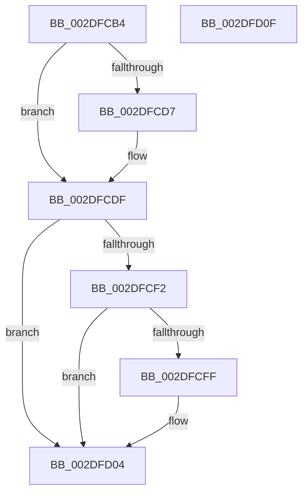

# MiUnlockControlAreaFileObjectShared

- RVA: `0x002DFCB4`–`0x002DFD10` (길이 `92` bytes)
- VA: `0x00000001402DFCB4`
- 실행 섹션: `.text`
- PDB 이름 있음: `예`; PDB Function 태그: `아니요`
- unwind 정보 RVA: `0x00068D5C`
- 디코드: `26`개 명령, `92/92` bytes 표시
- 미해석 바이트: `0` (있으면 어셈블리에 `.byte`로 보존)

> 이 문서는 커널 이미지의 기계어와 PDB 기호를 분석해 생성했습니다. 4번과 5번은 함수 원형과 자료형을 바이너리 사용 방식에서 추정한 C 해석이며 원본 소스 복구 결과는 아닙니다.

## 1. Dependencies

- 직접 호출 지점: **3**; 고유 호출 대상: **3**
- 직접 호출자로 확인된 함수: **1**
- RIP 상대 이미지 참조: **0**

### Outgoing calls
- `0x002DFCDA` → [ExfReleasePushLockShared](../26/ExfReleasePushLockShared_function_00263440.md) (function, `0x00263440`)
- `0x002DFCE2` → [KeAbPostRelease](../2E/KeAbPostRelease_function_002E1600.md) (function, `0x002E1600`)
- `0x002DFCFF` → [KiCheckForKernelApcDelivery](../2E/KiCheckForKernelApcDelivery_function_002E2C80.md) (function, `0x002E2C80`)

### Direct callers
- [sub_002E0B15](../2E/Unknown_function_002E0B15.md) at `0x002E101D`

### Static image references
- 디코드된 RIP-relative 메모리 참조가 없습니다.

## 2. Other-region calls and transfers

- 다른 실행 섹션으로 향하는 call: **0**
- 별도 외부 분기/꼬리 이동을 확인하지 못했습니다.

## 3. Assembly (complete function range)

```asm
002DFCB4  48 89 5C 24 10                  mov qword ptr [rsp + 0x10], rbx
002DFCB9  57                              push rdi
002DFCBA  48 83 EC 20                     sub rsp, 0x20
002DFCBE  65 48 8B 3C 25 88 01 00 00      mov rdi, qword ptr gs:[0x188]
002DFCC7  48 8D 59 68                     lea rbx, [rcx + 0x68]
002DFCCB  33 C9                           xor ecx, ecx
002DFCCD  8D 41 11                        lea eax, [rcx + 0x11]
002DFCD0  F0 48 0F B1 0B                  lock cmpxchg qword ptr [rbx], rcx
002DFCD5  74 08                           je 0x1402dfcdf
002DFCD7  48 8B CB                        mov rcx, rbx
002DFCDA  E8 61 37 F8 FF                  call 0x140263440
002DFCDF  48 8B CB                        mov rcx, rbx
002DFCE2  E8 19 19 00 00                  call 0x1402e1600
002DFCE7  90                              nop
002DFCE8  66 83 87 E6 01 00 00 01         add word ptr [rdi + 0x1e6], 1
002DFCF0  75 12                           jne 0x1402dfd04
002DFCF2  48 8D 87 98 00 00 00            lea rax, [rdi + 0x98]
002DFCF9  90                              nop
002DFCFA  48 39 00                        cmp qword ptr [rax], rax
002DFCFD  74 05                           je 0x1402dfd04
002DFCFF  E8 7C 2F 00 00                  call 0x1402e2c80
002DFD04  48 8B 5C 24 38                  mov rbx, qword ptr [rsp + 0x38]
002DFD09  48 83 C4 20                     add rsp, 0x20
002DFD0D  5F                              pop rdi
002DFD0E  C3                              ret
002DFD0F  CC                              int3
```

## 4. C-style interpretation (structured pseudocode)

```c
__int64 __fastcall MiUnlockControlAreaFileObjectShared(__int64 a1)
{
    __int64 result;
    __int64 v_rsp;
    unsigned __int64 v_stack_p10;

    v_stack_p10 = v_rbx;
    v_rsp = (v_rsp) - (32);
    a1 = 0;
    result = a1 + 17;
    if (!(condition_is_equal)) {
        a1 = a1 + 104;
        result = ExfReleasePushLockShared(a1, a2, a3, a4);
    }
    result = KeAbPostRelease(a1 + 104, a2, a3, a4);
    if (condition_is_not_equal) goto loc_002DFD04;
    result = *(unsigned __int64 *)(gs_base + (0 + 392)) + 152;
    if ((*(unsigned __int64 *)(*(unsigned __int64 *)(gs_base + (0 + 392)) + 152)) != (*(unsigned __int64 *)(gs_base + (0 + 392)) + 152)) {
        result = KiCheckForKernelApcDelivery(a1 + 104, a2, a3, a4);
    }
    v_rsp = (v_rsp) + (32);
    return result;
}
```

## 5. (Beta) C Style

```c
int64_t MiUnlockControlAreaFileObjectShared(void *Arg1)
{
    uint8_t *arg1 = (uint8_t *)Arg1;

    int64_t result;
    int64_t local_rsp;
    uint64_t v_stack_p10;

    v_stack_p10 = local_rbx;
    local_rsp = (local_rsp) - (32);
    Arg1 = 0;
    result = Arg1 + 17;
    if (!(condition_is_equal)) {
        Arg1 = Arg1 + 104;
        result = ExfReleasePushLockShared(Arg1, a2, a3, a4);
    }
    result = KeAbPostRelease(Arg1 + 104, a2, a3, a4);
    if (condition_is_not_equal) goto loc_002DFD04;
    result = *(uint64_t *)(gs_base + (0 + 0x188)) + 152;
    if ((*(uint64_t *)(*(uint64_t *)(gs_base + (0 + 0x188)) + 0x98)) != (*(uint64_t *)(gs_base + (0 + 0x188)) + 152)) {
        result = KiCheckForKernelApcDelivery(Arg1 + 104, a2, a3, a4);
    }
    local_rsp = (local_rsp) + (32);
    return result;
}
```

### 관측된 메모리 오프셋

구조체 형식이 확인되지 않은 접근은 인자 기준의 오프셋으로만 기록했습니다.

| 기준 인자 | 오프셋 표현 | 폭 (bit) | 접근 |
|---|---:|---:|---|
| `Arg1` | `+ 0x0` | `64` | `R` |
| `Arg1` | `+ 0x68` | `64` | `R` |

## 6. Execution-region graph

[열기: 2D/3D 그래프와 함수 탐색 컨트롤 패널](../../../control-panel.html?section=text&rva=0x002DFCB4&view=graph)

- 2D 그래프는 위에서 아래로 흐르고, 3D 그래프는 빈 공간을 드래그해 회전합니다. Shift+드래그는 이동, 휠은 확대·축소, 함수 노드 선택은 대상 보고서 이동입니다.

### Static fallback


