# MiWorkingSetManager

- RVA: `0x002DA7E0`–`0x002DAB48` (길이 `872` bytes)
- VA: `0x00000001402DA7E0`
- 실행 섹션: `.text`
- PDB 이름 있음: `예`; PDB Function 태그: `예`
- unwind 정보 RVA: `0x00070568`
- 디코드: `212`개 명령, `872/872` bytes 표시
- 미해석 바이트: `0` (있으면 어셈블리에 `.byte`로 보존)

> 이 문서는 커널 이미지의 기계어와 PDB 기호를 분석해 생성했습니다. 4번과 5번은 함수 원형과 자료형을 바이너리 사용 방식에서 추정한 C 해석이며 원본 소스 복구 결과는 아닙니다.

## 1. Dependencies

- 직접 호출 지점: **28**; 고유 호출 대상: **24**
- 직접 호출자로 확인된 함수: **2**
- RIP 상대 이미지 참조: **9**

### Outgoing calls
- `0x002DA81C` → [memset](../6C/memset_function_006C6C40.md) (function, `0x006C6C40`)
- `0x002DA8BB` → [MiReclaimUnusedUltraMdlMaps](MiReclaimUnusedUltraMdlMaps_function_002DC4C0.md) (function, `0x002DC4C0`)
- `0x002DA8C0` → [MiFreeDeferredAcceleratorPool](MiFreeDeferredAcceleratorPool_function_002DC464.md) (function, `0x002DC464`)
- `0x002DA8C5` → [MiCheckLogPinDriverAddresses](MiCheckLogPinDriverAddresses_function_002DC318.md) (function, `0x002DC318`)
- `0x002DA8EB` → [MiEmptyDecayClusterTimers](MiEmptyDecayClusterTimers_function_002DAB50.md) (function, `0x002DAB50`)
- `0x002DA8F3` → [MiFreeUnusedSlabPages](MiFreeUnusedSlabPages_function_002DAE48.md) (function, `0x002DAE48`)
- `0x002DA900` → [MiPruneProcessLargePageCaches](MiPruneProcessLargePageCaches_function_002DBD60.md) (function, `0x002DBD60`)
- `0x002DA90A` → [MiReleaseSystemCacheView](../29/MiReleaseSystemCacheView_function_00294CE0.md) (function, `0x00294CE0`)
- `0x002DA92C` → [MiLogPeriodicTelemetry](MiLogPeriodicTelemetry_function_002DB750.md) (function, `0x002DB750`)
- `0x002DA940` → [MiProcessWorkingSets](../34/MiProcessWorkingSets_function_0034E710.md) (function, `0x0034E710`)
- `0x002DA956` → [MiAdjustPteBins](../46/MiAdjustPteBins_function_0046410C.md) (function, `0x0046410C`)
- `0x002DA96D` → [MiAdjustCachedStacks](MiAdjustCachedStacks_function_002D8AAC.md) (function, `0x002D8AAC`)
- `0x002DA984` → [MiAdjustModifiedPageLoad](MiAdjustModifiedPageLoad_function_002DC07C.md) (function, `0x002DC07C`)
- `0x002DA98C` → [MiScanPagefiles](MiScanPagefiles_function_002DBE60.md) (function, `0x002DBE60`)
- `0x002DA994` → [MiCheckTrimUnusedPageFileRegions](MiCheckTrimUnusedPageFileRegions_function_002DB684.md) (function, `0x002DB684`)
- `0x002DA9B3` → [MiSignalLargePageRebuild](MiSignalLargePageRebuild_function_002DB4C8.md) (function, `0x002DB4C8`)
- `0x002DA9BB` → [MiScheduleZeroPageThreads](MiScheduleZeroPageThreads_function_002DB1DC.md) (function, `0x002DB1DC`)
- `0x002DA9CB` → [_security_check_cookie](../6A/_security_check_cookie_function_006AC640.md) (function, `0x006AC640`)
- `0x002DA9F7` → [ExAcquireSpinLockExclusive](../24/ExAcquireSpinLockExclusive_function_00248690.md) (function, `0x00248690`)
- `0x002DAA1F` → [MiWakeZeroingThreads](../2C/MiWakeZeroingThreads_function_002CBEC0.md) (function, `0x002CBEC0`)
- `0x002DAA2A` → [MiReleaseSpinLockExclusive](../24/MiReleaseSpinLockExclusive_function_002482C0.md) (function, `0x002482C0`)
- `0x002DAA4F` → [KeSetEvent](../33/KeSetEvent_function_0033F310.md) (function, `0x0033F310`)
- `0x002DAA6E` → [KePulseEvent](../35/KePulseEvent_function_00351EF0.md) (function, `0x00351EF0`)
- `0x002DAAB6` → [KeSetEvent](../33/KeSetEvent_function_0033F310.md) (function, `0x0033F310`)
- `0x002DAAE8` → [MiProcessWorkingSets](../34/MiProcessWorkingSets_function_0034E710.md) (function, `0x0034E710`)
- `0x002DAB08` → [MiAdjustModifiedPageLoad](MiAdjustModifiedPageLoad_function_002DC07C.md) (function, `0x002DC07C`)
- `0x002DAB16` → [MiScanPagefiles](MiScanPagefiles_function_002DBE60.md) (function, `0x002DBE60`)
- `0x002DAB3E` → [MiQueueExtentPfnDeletion](../4D/MiQueueExtentPfnDeletion_function_004D1C80.md) (function, `0x004D1C80`)

### Direct callers
- [KeBalanceSetManager](../5C/KeBalanceSetManager_function_005C5B30.md) at `0x005C5BE7`
- [KeBalanceSetManager](../5C/KeBalanceSetManager_function_005C5B30.md) at `0x005C5D14`
- [MiPartitionWorkingSetManager](../67/MiPartitionWorkingSetManager_function_006791E0.md) at `0x00679281`

### Static image references
- `0x002DA7F9` → RVA `0x00E0A740` (`.data`; read)
- `0x002DA83D` → RVA `0x00FC5000` (`ALMOSTRO`; read)
- `0x002DA89E` → RVA `0x00011C60` (`.rdata`; read)
- `0x002DA8AF` → RVA `0x00E38D00` (`.data`; read)
- `0x002DA8CA` → RVA `0x00E2FFAC` (`.data`; read)
- `0x002DA8D3` → RVA `0x00FC6A88` (`ALMOSTRO`; read)
- `0x002DA8DB` → RVA `0x00E30252` (`.data`; read)
- `0x002DA95B` → RVA `0x00E2D702` (`.data`; read)
- `0x002DAA65` → RVA `0x00E374C8` (`.data`; read)

## 2. Other-region calls and transfers

- 다른 실행 섹션으로 향하는 call: **0**
- call이 아닌 외부 분기/꼬리 이동: **1**
  - `0x002DA8E2` → [sub_006DDD7C](../6D/Unknown_function_006DDD7C.md) (`tail-transfer`)

## 3. Assembly (complete function range)

```asm
002DA7E0  48 89 5C 24 10                  mov qword ptr [rsp + 0x10], rbx
002DA7E5  48 89 6C 24 18                  mov qword ptr [rsp + 0x18], rbp
002DA7EA  56                              push rsi
002DA7EB  57                              push rdi
002DA7EC  41 54                           push r12
002DA7EE  41 56                           push r14
002DA7F0  41 57                           push r15
002DA7F2  48 81 EC A0 00 00 00            sub rsp, 0xa0
002DA7F9  48 8B 05 40 FF B2 00            mov rax, qword ptr [rip + 0xb2ff40]
002DA800  48 33 C4                        xor rax, rsp
002DA803  48 89 84 24 90 00 00 00         mov qword ptr [rsp + 0x90], rax
002DA80B  44 8B E2                        mov r12d, edx
002DA80E  48 8B D9                        mov rbx, rcx
002DA811  33 D2                           xor edx, edx
002DA813  48 8D 4C 24 20                  lea rcx, [rsp + 0x20]
002DA818  44 8D 42 70                     lea r8d, [rdx + 0x70]
002DA81C  E8 1F C4 3E 00                  call 0x1406c6c40
002DA821  48 8B B3 C0 44 00 00            mov rsi, qword ptr [rbx + 0x44c0]
002DA828  48 83 7E 58 00                  cmp qword ptr [rsi + 0x58], 0
002DA82D  0F 84 EF 02 00 00               je 0x1402dab22
002DA833  8B 83 30 42 00 00               mov eax, dword ptr [rbx + 0x4230]
002DA839  85 C0                           test eax, eax
002DA83B  75 72                           jne 0x1402da8af
002DA83D  0F B7 05 BC A7 CE 00            movzx eax, word ptr [rip + 0xcea7bc]
002DA844  48 8B 7B 10                     mov rdi, qword ptr [rbx + 0x10]
002DA848  48 69 E8 80 DF 00 00            imul rbp, rax, 0xdf80
002DA84F  48 03 EF                        add rbp, rdi
002DA852  EB 39                           jmp 0x1402da88d
002DA854  49 8B 00                        mov rax, qword ptr [r8]
002DA857  4D 8D 40 08                     lea r8, [r8 + 8]
002DA85B  49 8B 09                        mov rcx, qword ptr [r9]
002DA85E  4D 8D 89 00 05 00 00            lea r9, [r9 + 0x500]
002DA865  48 0F AF C8                     imul rcx, rax
002DA869  48 03 D1                        add rdx, rcx
002DA86C  49 83 EA 01                     sub r10, 1
002DA870  75 E2                           jne 0x1402da854
002DA872  48 8B 8F 10 0F 00 00            mov rcx, qword ptr [rdi + 0xf10]
002DA879  48 03 CA                        add rcx, rdx
002DA87C  48 83 F9 40                     cmp rcx, 0x40
002DA880  0F 83 67 01 00 00               jae 0x1402da9ed
002DA886  48 81 C7 80 DF 00 00            add rdi, 0xdf80
002DA88D  48 3B FD                        cmp rdi, rbp
002DA890  73 1D                           jae 0x1402da8af
002DA892  8A 87 C0 3B 00 00               mov al, byte ptr [rdi + 0x3bc0]
002DA898  84 C0                           test al, al
002DA89A  75 EA                           jne 0x1402da886
002DA89C  33 D2                           xor edx, edx
002DA89E  4C 8D 05 BB 73 D3 FF            lea r8, [rip - 0x2c8c45]
002DA8A5  4C 8D 4F 10                     lea r9, [rdi + 0x10]
002DA8A9  44 8D 52 03                     lea r10d, [rdx + 3]
002DA8AD  EB A5                           jmp 0x1402da854
002DA8AF  4C 8D 35 4A E4 B5 00            lea r14, [rip + 0xb5e44a]
002DA8B6  49 3B DE                        cmp rbx, r14
002DA8B9  75 2D                           jne 0x1402da8e8
002DA8BB  E8 00 1C 00 00                  call 0x1402dc4c0
002DA8C0  E8 9F 1B 00 00                  call 0x1402dc464
002DA8C5  E8 4E 1A 00 00                  call 0x1402dc318
002DA8CA  83 3D DB 56 B5 00 00            cmp dword ptr [rip + 0xb556db], 0
002DA8D1  74 15                           je 0x1402da8e8
002DA8D3  8A 05 AF C1 CE 00               mov al, byte ptr [rip + 0xcec1af]
002DA8D9  24 30                           and al, 0x30
002DA8DB  80 3D 70 59 B5 00 01            cmp byte ptr [rip + 0xb55970], 1
002DA8E2  0F 84 94 34 40 00               je 0x1406ddd7c
002DA8E8  48 8B CB                        mov rcx, rbx
002DA8EB  E8 60 02 00 00                  call 0x1402dab50
002DA8F0  48 8B CB                        mov rcx, rbx
002DA8F3  E8 50 05 00 00                  call 0x1402dae48
002DA8F8  BA 01 00 00 00                  mov edx, 1
002DA8FD  48 8B CB                        mov rcx, rbx
002DA900  E8 5B 14 00 00                  call 0x1402dbd60
002DA905  33 D2                           xor edx, edx
002DA907  48 8B CB                        mov rcx, rbx
002DA90A  E8 D1 A3 FB FF                  call 0x140294ce0
002DA90F  8B 46 20                        mov eax, dword ptr [rsi + 0x20]
002DA912  FF C0                           inc eax
002DA914  89 46 20                        mov dword ptr [rsi + 0x20], eax
002DA917  3B 46 24                        cmp eax, dword ptr [rsi + 0x24]
002DA91A  0F 84 58 01 00 00               je 0x1402daa78
002DA920  49 3B DE                        cmp rbx, r14
002DA923  0F 84 30 01 00 00               je 0x1402daa59
002DA929  48 8B CB                        mov rcx, rbx
002DA92C  E8 1F 0E 00 00                  call 0x1402db750
002DA931  48 8D 54 24 20                  lea rdx, [rsp + 0x20]
002DA936  C6 44 24 24 01                  mov byte ptr [rsp + 0x24], 1
002DA93B  48 8B CB                        mov rcx, rbx
002DA93E  33 ED                           xor ebp, ebp
002DA940  E8 CB 3D 07 00                  call 0x14034e710
002DA945  8A 44 24 24                     mov al, byte ptr [rsp + 0x24]
002DA949  3C 01                           cmp al, 1
002DA94B  0F 85 6F 01 00 00               jne 0x1402daac0
002DA951  49 3B DE                        cmp rbx, r14
002DA954  75 12                           jne 0x1402da968
002DA956  E8 B1 97 18 00                  call 0x14046410c
002DA95B  80 3D A0 2D B5 00 00            cmp byte ptr [rip + 0xb52da0], 0
002DA962  0F 85 D4 01 00 00               jne 0x1402dab3c
002DA968  33 D2                           xor edx, edx
002DA96A  48 8B CB                        mov rcx, rbx
002DA96D  E8 3A E1 FF FF                  call 0x1402d8aac
002DA972  85 ED                           test ebp, ebp
002DA974  75 1B                           jne 0x1402da991
002DA976  44 8B 46 78                     mov r8d, dword ptr [rsi + 0x78]
002DA97A  48 8B CB                        mov rcx, rbx
002DA97D  48 8B 96 08 01 00 00            mov rdx, qword ptr [rsi + 0x108]
002DA984  E8 F3 16 00 00                  call 0x1402dc07c
002DA989  48 8B CB                        mov rcx, rbx
002DA98C  E8 CF 14 00 00                  call 0x1402dbe60
002DA991  48 8B CB                        mov rcx, rbx
002DA994  E8 EB 0C 00 00                  call 0x1402db684
002DA999  48 8B 83 C0 4B 00 00            mov rax, qword ptr [rbx + 0x4bc0]
002DA9A0  48 8B 93 A0 4C 00 00            mov rdx, qword ptr [rbx + 0x4ca0]
002DA9A7  48 3B C2                        cmp rax, rdx
002DA9AA  0F 87 84 00 00 00               ja 0x1402daa34
002DA9B0  48 8B CB                        mov rcx, rbx
002DA9B3  E8 10 0B 00 00                  call 0x1402db4c8
002DA9B8  48 8B CB                        mov rcx, rbx
002DA9BB  E8 1C 08 00 00                  call 0x1402db1dc
002DA9C0  48 8B 8C 24 90 00 00 00         mov rcx, qword ptr [rsp + 0x90]
002DA9C8  48 33 CC                        xor rcx, rsp
002DA9CB  E8 70 1C 3D 00                  call 0x1406ac640
002DA9D0  4C 8D 9C 24 A0 00 00 00         lea r11, [rsp + 0xa0]
002DA9D8  49 8B 5B 38                     mov rbx, qword ptr [r11 + 0x38]
002DA9DC  49 8B 6B 40                     mov rbp, qword ptr [r11 + 0x40]
002DA9E0  49 8B E3                        mov rsp, r11
002DA9E3  41 5F                           pop r15
002DA9E5  41 5E                           pop r14
002DA9E7  41 5C                           pop r12
002DA9E9  5F                              pop rdi
002DA9EA  5E                              pop rsi
002DA9EB  C3                              ret
002DA9EC  CC                              int3
002DA9ED  4C 8D B7 B0 3B 00 00            lea r14, [rdi + 0x3bb0]
002DA9F4  49 8B CE                        mov rcx, r14
002DA9F7  E8 94 DC F6 FF                  call 0x140248690
002DA9FC  48 8B 97 A8 3B 00 00            mov rdx, qword ptr [rdi + 0x3ba8]
002DAA03  44 8A F8                        mov r15b, al
002DAA06  48 85 D2                        test rdx, rdx
002DAA09  74 19                           je 0x1402daa24
002DAA0B  8A 8F C0 3B 00 00               mov cl, byte ptr [rdi + 0x3bc0]
002DAA11  84 C9                           test cl, cl
002DAA13  75 0F                           jne 0x1402daa24
002DAA15  48 8B CA                        mov rcx, rdx
002DAA18  C6 87 C0 3B 00 00 01            mov byte ptr [rdi + 0x3bc0], 1
002DAA1F  E8 9C 14 FF FF                  call 0x1402cbec0
002DAA24  41 8A D7                        mov dl, r15b
002DAA27  49 8B CE                        mov rcx, r14
002DAA2A  E8 91 D8 F6 FF                  call 0x1402482c0
002DAA2F  E9 52 FE FF FF                  jmp 0x1402da886
002DAA34  48 2B C2                        sub rax, rdx
002DAA37  48 3D 20 03 00 00               cmp rax, 0x320
002DAA3D  0F 82 6D FF FF FF               jb 0x1402da9b0
002DAA43  48 8D 8B 48 03 00 00            lea rcx, [rbx + 0x348]
002DAA4A  45 33 C0                        xor r8d, r8d
002DAA4D  33 D2                           xor edx, edx
002DAA4F  E8 BC 48 06 00                  call 0x14033f310
002DAA54  E9 57 FF FF FF                  jmp 0x1402da9b0
002DAA59  45 85 E4                        test r12d, r12d
002DAA5C  0F 85 C7 FE FF FF               jne 0x1402da929
002DAA62  45 33 C0                        xor r8d, r8d
002DAA65  48 8D 0D 5C CA B5 00            lea rcx, [rip + 0xb5ca5c]
002DAA6C  33 D2                           xor edx, edx
002DAA6E  E8 7D 74 07 00                  call 0x140351ef0
002DAA73  E9 B1 FE FF FF                  jmp 0x1402da929
002DAA78  8B 46 18                        mov eax, dword ptr [rsi + 0x18]
002DAA7B  83 66 20 00                     and dword ptr [rsi + 0x20], 0
002DAA7F  FF C0                           inc eax
002DAA81  83 E0 0F                        and eax, 0xf
002DAA84  89 46 18                        mov dword ptr [rsi + 0x18], eax
002DAA87  8D 48 F8                        lea ecx, [rax - 8]
002DAA8A  83 E1 0F                        and ecx, 0xf
002DAA8D  48 8D 41 40                     lea rax, [rcx + 0x40]
002DAA91  48 6B C0 58                     imul rax, rax, 0x58
002DAA95  48 8B 04 18                     mov rax, qword ptr [rax + rbx]
002DAA99  48 85 C0                        test rax, rax
002DAA9C  0F 84 7E FE FF FF               je 0x1402da920
002DAAA2  48 8D 81 C9 01 00 00            lea rax, [rcx + 0x1c9]
002DAAA9  45 33 C0                        xor r8d, r8d
002DAAAC  48 8D 04 41                     lea rax, [rcx + rax*2]
002DAAB0  33 D2                           xor edx, edx
002DAAB2  48 8D 0C C3                     lea rcx, [rbx + rax*8]
002DAAB6  E8 55 48 06 00                  call 0x14033f310
002DAABB  E9 60 FE FF FF                  jmp 0x1402da920
002DAAC0  40 B7 01                        mov dil, 1
002DAAC3  3C 03                           cmp al, 3
002DAAC5  0F 84 86 FE FF FF               je 0x1402da951
002DAACB  40 3A F8                        cmp dil, al
002DAACE  75 2A                           jne 0x1402daafa
002DAAD0  C6 44 24 24 03                  mov byte ptr [rsp + 0x24], 3
002DAAD5  FF 86 F8 01 00 00               inc dword ptr [rsi + 0x1f8]
002DAADB  40 8A 7C 24 24                  mov dil, byte ptr [rsp + 0x24]
002DAAE0  48 8D 54 24 20                  lea rdx, [rsp + 0x20]
002DAAE5  48 8B CB                        mov rcx, rbx
002DAAE8  E8 23 3C 07 00                  call 0x14034e710
002DAAED  8A 44 24 24                     mov al, byte ptr [rsp + 0x24]
002DAAF1  3C 01                           cmp al, 1
002DAAF3  75 CE                           jne 0x1402daac3
002DAAF5  E9 57 FE FF FF                  jmp 0x1402da951
002DAAFA  44 8B 46 78                     mov r8d, dword ptr [rsi + 0x78]
002DAAFE  48 8B CB                        mov rcx, rbx
002DAB01  48 8B 96 08 01 00 00            mov rdx, qword ptr [rsi + 0x108]
002DAB08  E8 6F 15 00 00                  call 0x1402dc07c
002DAB0D  FF 86 F4 01 00 00               inc dword ptr [rsi + 0x1f4]
002DAB13  48 8B CB                        mov rcx, rbx
002DAB16  E8 45 13 00 00                  call 0x1402dbe60
002DAB1B  BD 01 00 00 00                  mov ebp, 1
002DAB20  EB B9                           jmp 0x1402daadb
002DAB22  65 48 8B 04 25 88 01 00 00      mov rax, qword ptr gs:[0x188]
002DAB2B  48 89 46 58                     mov qword ptr [rsi + 0x58], rax
002DAB2F  0F BA A8 A4 05 00 00 0D         bts dword ptr [rax + 0x5a4], 0xd
002DAB37  E9 F7 FC FF FF                  jmp 0x1402da833
002DAB3C  33 C9                           xor ecx, ecx
002DAB3E  E8 3D 71 1F 00                  call 0x1404d1c80
002DAB43  E9 20 FE FF FF                  jmp 0x1402da968
```

## 4. C-style interpretation (structured pseudocode)

```c
__int64 __fastcall MiWorkingSetManager(__int64 a1, int a2, __int64 a3, __int64 a4)
{
    __int64 result;
    __int64 v_r10;
    __int64 v_rbp;
    __int64 v_rdi;
    __int64 v_rsp;
    unsigned __int64 v_stack_m28;
    unsigned __int64 v_stack_m38;
    unsigned __int8 v_stack_m7C;
    unsigned __int64 v_stack_m80;
    unsigned __int8 v_stack_mA4;
    unsigned __int64 v_stack_mA8;
    unsigned __int64 v_stack_p10;
    unsigned __int64 v_stack_p18;

    v_stack_p10 = v_rbx;
    v_stack_p18 = v_rbp;
    v_rsp = (v_rsp) - (160);
    result = (*(unsigned __int64 *)(v_rip + 11730752)) ^ (v_rsp);
    v_stack_m38 = result;
    a2 = 0;
    result = memset(v_stack_mA8, a2, a2 + 112, a4);
    if ((*(unsigned __int64 *)(*(unsigned __int64 *)(a1 + 17600) + 88)) == 0) goto loc_002DAB22;
loc_002DA833:
    if ((unsigned int)((unsigned int)(*(unsigned int *)(a1 + 16944))) != 0) goto loc_002DA8AF;
    v_rbp = (v_rbp) * (*(unsigned __int16 *)(v_rip + 13543356));
    v_rbp = (v_rbp) + (*(unsigned __int64 *)(a1 + 16));
    goto loc_002DA88D;
loc_002DA854:
    a1 = (*(unsigned __int64 *)(a4)) * (*(unsigned __int64 *)(a2 + 112));
    a2 = (a2) + (a1);
    v_r10 = (v_r10) - (1);
    if (condition_is_not_equal) goto loc_002DA854;
    a1 = (*(unsigned __int64 *)(*(unsigned __int64 *)(a1 + 16) + 3856)) + (a2);
    if (a1 >= 64) goto loc_002DA9ED;
loc_002DA886:
    v_rdi = (*(unsigned __int64 *)(a1 + 16)) + (0xDF80ULL);
loc_002DA88D:
    if (v_rdi >= v_rbp) goto loc_002DA8AF;
    if ((unsigned __int8)(*(unsigned __int8 *)(v_rdi + 15296)) != 0) goto loc_002DA886;
    a2 = 0;
    goto loc_002DA854;
loc_002DA8AF:
    if (a1 != (v_rip + 11920458)) goto loc_002DA8E8;
    result = MiReclaimUnusedUltraMdlMaps(a1, a2, v_rip - 2919493, v_rdi + 16);
    result = MiFreeDeferredAcceleratorPool(a1, a2, v_rip - 2919493, v_rdi + 16);
    result = MiCheckLogPinDriverAddresses(a1, a2, v_rip - 2919493, v_rdi + 16);
    if ((*(unsigned int *)(v_rip + 11884251)) == 0) goto loc_002DA8E8;
    result = (unsigned __int8)((*(unsigned __int8 *)(v_rip + 13549999)) & (48));
loc_002DA8E8:
    result = MiEmptyDecayClusterTimers(a1, a2, v_rip - 2919493, v_rdi + 16);
    result = MiFreeUnusedSlabPages(a1, a2, v_rip - 2919493, v_rdi + 16);
    result = MiPruneProcessLargePageCaches(a1, 1, v_rip - 2919493, v_rdi + 16);
    a2 = 0;
    result = MiReleaseSystemCacheView(a1, a2, v_rip - 2919493, v_rdi + 16);
    result = (unsigned int)(((unsigned int)(*(unsigned int *)(*(unsigned __int64 *)(a1 + 17600) + 32))) + 1);
    *(unsigned int *)(*(unsigned __int64 *)(a1 + 17600) + 32) = (unsigned int)(result);
    if (((unsigned int)(result)) == (*(unsigned int *)(*(unsigned __int64 *)(a1 + 17600) + 36))) goto loc_002DAA78;
loc_002DA920:
    if (a1 == (v_rip + 11920458)) goto loc_002DAA59;
loc_002DA929:
    result = MiLogPeriodicTelemetry(a1, a2, v_rip - 2919493, v_rdi + 16);
    v_stack_mA4 = 1;
    v_rbp = 0;
    result = MiProcessWorkingSets(a1, v_stack_mA8, v_rip - 2919493, v_rdi + 16);
    if (((unsigned __int8)(v_stack_mA4)) != 1) goto loc_002DAAC0;
loc_002DA951:
    if (a1 != (v_rip + 11920458)) goto loc_002DA968;
    result = MiAdjustPteBins(a1, v_stack_mA8, v_rip - 2919493, v_rdi + 16);
    if ((*(unsigned __int8 *)(v_rip + 11873696)) != 0) goto loc_002DAB3C;
loc_002DA968:
    a2 = 0;
    result = MiAdjustCachedStacks(a1, a2, v_rip - 2919493, v_rdi + 16);
    if (0 == 0) {
        a3 = *(unsigned int *)(*(unsigned __int64 *)(a1 + 17600) + 120);
        a1 = a1;
        a2 = *(unsigned __int64 *)(*(unsigned __int64 *)(a1 + 17600) + 264);
        result = MiAdjustModifiedPageLoad(a1, a2, a3, v_rdi + 16);
        a1 = a1;
        result = MiScanPagefiles(a1, a2, a3, v_rdi + 16);
    }
    result = MiCheckTrimUnusedPageFileRegions(a1, a2, a3, v_rdi + 16);
    if ((*(unsigned __int64 *)(a1 + 19392)) > (*(unsigned __int64 *)(a1 + 19616))) goto loc_002DAA34;
loc_002DA9B0:
    result = MiSignalLargePageRebuild(a1, *(unsigned __int64 *)(a1 + 19616), a3, v_rdi + 16);
    result = MiScheduleZeroPageThreads(a1, *(unsigned __int64 *)(a1 + 19616), a3, v_rdi + 16);
    a1 = (v_stack_m38) ^ (v_rsp);
    result = _security_check_cookie(a1, *(unsigned __int64 *)(a1 + 19616), a3, v_rdi + 16);
    return result;
loc_002DA9ED:
    result = ExAcquireSpinLockExclusive(v_rdi + 15280, *(unsigned __int64 *)(a1 + 19616), a3, v_rdi + 16);
    if (*(unsigned __int64 *)(v_rdi + 15272) == 0) goto loc_002DAA24;
    if ((unsigned __int8)(*(unsigned __int8 *)(v_rdi + 15296)) == 0) {
        a1 = *(unsigned __int64 *)(v_rdi + 15272);
        *(unsigned __int8 *)(v_rdi + 15296) = 1;
        result = MiWakeZeroingThreads(a1, *(unsigned __int64 *)(v_rdi + 15272), a3, v_rdi + 16);
    }
    result = MiReleaseSpinLockExclusive(v_rdi + 15280, (unsigned __int8)((unsigned __int8)(result)), a3, v_rdi + 16);
    goto loc_002DA886;
loc_002DAA34:
    result = (result) - ((unsigned __int8)((unsigned __int8)(result)));
    if (result < 800) goto loc_002DA9B0;
    a3 = 0;
    a2 = 0;
    result = KeSetEvent(*(unsigned __int64 *)(v_stack_m28 + 56) + 840, a2, a3, v_rdi + 16);
    goto loc_002DA9B0;
loc_002DAA59:
    if ((unsigned int)((unsigned int)(a2)) != 0) goto loc_002DA929;
    a3 = 0;
    a2 = 0;
    result = KePulseEvent(v_rip + 11913820, a2, a3, v_rdi + 16);
    goto loc_002DA929;
loc_002DAA78:
    result = (unsigned int)(((unsigned int)(*(unsigned int *)(*(unsigned __int64 *)(a1 + 17600) + 24))) + 1);
    result = (unsigned int)((result) & (15));
    *(unsigned int *)(*(unsigned __int64 *)(a1 + 17600) + 24) = (unsigned int)(result);
    a1 = (unsigned int)((result - 8) & (15));
    result = (a1 + 64) * (a1 + 64);
    if (*(unsigned __int64 *)(result + *(unsigned __int64 *)(v_stack_m28 + 56) * 1) == 0) goto loc_002DA920;
    a3 = 0;
    a2 = 0;
    result = KeSetEvent(*(unsigned __int64 *)(v_stack_m28 + 56) + a1 + a1 + 457 * 2 * 8, a2, a3, v_rdi + 16);
    goto loc_002DA920;
loc_002DAAC0:
loc_002DAAC3:
    if (((unsigned __int8)(result)) == 3) goto loc_002DA951;
    if (1 != ((unsigned __int8)(result))) goto loc_002DAAFA;
    v_stack_m7C = 3;
loc_002DAADB:
    result = MiProcessWorkingSets(*(unsigned __int64 *)(v_stack_m28 + 56), v_stack_m80, a3, v_rdi + 16);
    if (((unsigned __int8)(v_stack_m7C)) != 1) goto loc_002DAAC3;
    goto loc_002DA951;
loc_002DAAFA:
    result = MiAdjustModifiedPageLoad(*(unsigned __int64 *)(v_stack_m28 + 56), *(unsigned __int64 *)(*(unsigned __int64 *)(a1 + 17600) + 264), (unsigned int)(*(unsigned int *)(*(unsigned __int64 *)(a1 + 17600) + 120)), v_rdi + 16);
    result = MiScanPagefiles(*(unsigned __int64 *)(v_stack_m28 + 56), *(unsigned __int64 *)(*(unsigned __int64 *)(a1 + 17600) + 264), (unsigned int)(*(unsigned int *)(*(unsigned __int64 *)(a1 + 17600) + 120)), v_rdi + 16);
    goto loc_002DAADB;
loc_002DAB22:
    *(unsigned __int64 *)(*(unsigned __int64 *)(a1 + 17600) + 88) = *(unsigned __int64 *)(gs_base + (0 + 392));
    goto loc_002DA833;
loc_002DAB3C:
    a1 = 0;
    result = MiQueueExtentPfnDeletion(a1, *(unsigned __int64 *)(*(unsigned __int64 *)(a1 + 17600) + 264), (unsigned int)(*(unsigned int *)(*(unsigned __int64 *)(a1 + 17600) + 120)), v_rdi + 16);
    goto loc_002DA968;
}
```

## 5. (Beta) C Style

```c
int64_t MiWorkingSetManager(void *Arg1, int32_t Arg2, int64_t Arg3, int64_t Arg4)
{
    uint8_t *arg1 = (uint8_t *)Arg1;

    int64_t result;
    int64_t local_r10;
    int64_t local_rbp;
    int64_t local_rdi;
    int64_t local_rsp;
    uint64_t v_stack_m28;
    uint64_t v_stack_m38;
    uint8_t v_stack_m7C;
    uint64_t v_stack_m80;
    uint8_t v_stack_mA4;
    uint64_t v_stack_mA8;
    uint64_t v_stack_p10;
    uint64_t v_stack_p18;

    v_stack_p10 = local_rbx;
    v_stack_p18 = local_rbp;
    local_rsp = (local_rsp) - (160);
    result = (*(uint64_t *)(v_rip + 0xB2FF40)) ^ (local_rsp);
    v_stack_m38 = result;
    Arg2 = 0;
    result = memset(v_stack_mA8, Arg2, Arg2 + 112, Arg4);
    if ((*(uint64_t *)(*(uint64_t *)(arg1 + 0x44C0) + 0x58)) == 0) goto loc_002DAB22;
loc_002DA833:
    if ((uint32_t)((uint32_t)(*(uint32_t *)(arg1 + 0x4230))) != 0) goto loc_002DA8AF;
    local_rbp = (local_rbp) * (*(uint16_t *)(v_rip + 0xCEA7BC));
    local_rbp = (local_rbp) + (*(uint64_t *)(arg1 + 0x10));
    goto loc_002DA88D;
loc_002DA854:
    Arg1 = (*(uint64_t *)(Arg4)) * (*(uint64_t *)(Arg2 + 0x70));
    Arg2 = (Arg2) + (Arg1);
    local_r10 = (local_r10) - (1);
    if (condition_is_not_equal) goto loc_002DA854;
    Arg1 = (*(uint64_t *)(*(uint64_t *)(arg1 + 0x10) + 0xF10)) + (Arg2);
    if (Arg1 >= 64) goto loc_002DA9ED;
loc_002DA886:
    local_rdi = (*(uint64_t *)(arg1 + 0x10)) + (0xDF80ULL);
loc_002DA88D:
    if (local_rdi >= local_rbp) goto loc_002DA8AF;
    if ((uint8_t)(*(uint8_t *)(local_rdi + 0x3BC0)) != 0) goto loc_002DA886;
    Arg2 = 0;
    goto loc_002DA854;
loc_002DA8AF:
    if (Arg1 != (v_rip + 11920458)) goto loc_002DA8E8;
    result = MiReclaimUnusedUltraMdlMaps(Arg1, Arg2, v_rip - 2919493, local_rdi + 16);
    result = MiFreeDeferredAcceleratorPool(Arg1, Arg2, v_rip - 2919493, local_rdi + 16);
    result = MiCheckLogPinDriverAddresses(Arg1, Arg2, v_rip - 2919493, local_rdi + 16);
    if ((*(uint32_t *)(v_rip + 0xB556DB)) == 0) goto loc_002DA8E8;
    result = (uint8_t)((*(uint8_t *)(v_rip + 0xCEC1AF)) & (48));
loc_002DA8E8:
    result = MiEmptyDecayClusterTimers(Arg1, Arg2, v_rip - 2919493, local_rdi + 16);
    result = MiFreeUnusedSlabPages(Arg1, Arg2, v_rip - 2919493, local_rdi + 16);
    result = MiPruneProcessLargePageCaches(Arg1, 1, v_rip - 2919493, local_rdi + 16);
    Arg2 = 0;
    result = MiReleaseSystemCacheView(Arg1, Arg2, v_rip - 2919493, local_rdi + 16);
    result = (uint32_t)(((uint32_t)(*(uint32_t *)(*(uint64_t *)(arg1 + 0x44C0) + 0x20))) + 1);
    *(uint32_t *)(*(uint64_t *)(arg1 + 0x44C0) + 0x20) = (uint32_t)(result);
    if (((uint32_t)(result)) == (*(uint32_t *)(*(uint64_t *)(arg1 + 0x44C0) + 0x24))) goto loc_002DAA78;
loc_002DA920:
    if (Arg1 == (v_rip + 11920458)) goto loc_002DAA59;
loc_002DA929:
    result = MiLogPeriodicTelemetry(Arg1, Arg2, v_rip - 2919493, local_rdi + 16);
    v_stack_mA4 = 1;
    local_rbp = 0;
    result = MiProcessWorkingSets(Arg1, v_stack_mA8, v_rip - 2919493, local_rdi + 16);
    if (((uint8_t)(v_stack_mA4)) != 1) goto loc_002DAAC0;
loc_002DA951:
    if (Arg1 != (v_rip + 11920458)) goto loc_002DA968;
    result = MiAdjustPteBins(Arg1, v_stack_mA8, v_rip - 2919493, local_rdi + 16);
    if ((*(uint8_t *)(v_rip + 0xB52DA0)) != 0) goto loc_002DAB3C;
loc_002DA968:
    Arg2 = 0;
    result = MiAdjustCachedStacks(Arg1, Arg2, v_rip - 2919493, local_rdi + 16);
    if (0 == 0) {
        Arg3 = *(uint32_t *)(*(uint64_t *)(arg1 + 0x44C0) + 0x78);
        Arg1 = Arg1;
        Arg2 = *(uint64_t *)(*(uint64_t *)(arg1 + 0x44C0) + 0x108);
        result = MiAdjustModifiedPageLoad(Arg1, Arg2, Arg3, local_rdi + 16);
        Arg1 = Arg1;
        result = MiScanPagefiles(Arg1, Arg2, Arg3, local_rdi + 16);
    }
    result = MiCheckTrimUnusedPageFileRegions(Arg1, Arg2, Arg3, local_rdi + 16);
    if ((*(uint64_t *)(arg1 + 0x4BC0)) > (*(uint64_t *)(arg1 + 0x4CA0))) goto loc_002DAA34;
loc_002DA9B0:
    result = MiSignalLargePageRebuild(Arg1, *(uint64_t *)(arg1 + 0x4CA0), Arg3, local_rdi + 16);
    result = MiScheduleZeroPageThreads(Arg1, *(uint64_t *)(arg1 + 0x4CA0), Arg3, local_rdi + 16);
    Arg1 = (v_stack_m38) ^ (local_rsp);
    result = _security_check_cookie(Arg1, *(uint64_t *)(arg1 + 0x4CA0), Arg3, local_rdi + 16);
    return result;
loc_002DA9ED:
    result = ExAcquireSpinLockExclusive(local_rdi + 15280, *(uint64_t *)(arg1 + 0x4CA0), Arg3, local_rdi + 16);
    if (*(uint64_t *)(local_rdi + 0x3BA8) == 0) goto loc_002DAA24;
    if ((uint8_t)(*(uint8_t *)(local_rdi + 0x3BC0)) == 0) {
        Arg1 = *(uint64_t *)(local_rdi + 0x3BA8);
        *(uint8_t *)(local_rdi + 0x3BC0) = 1;
        result = MiWakeZeroingThreads(Arg1, *(uint64_t *)(local_rdi + 0x3BA8), Arg3, local_rdi + 16);
    }
    result = MiReleaseSpinLockExclusive(local_rdi + 15280, (uint8_t)((uint8_t)(result)), Arg3, local_rdi + 16);
    goto loc_002DA886;
loc_002DAA34:
    result = (result) - ((uint8_t)((uint8_t)(result)));
    if (result < 800) goto loc_002DA9B0;
    Arg3 = 0;
    Arg2 = 0;
    result = KeSetEvent(*(uint64_t *)(v_stack_m28 + 0x38) + 840, Arg2, Arg3, local_rdi + 16);
    goto loc_002DA9B0;
loc_002DAA59:
    if ((uint32_t)((uint32_t)(Arg2)) != 0) goto loc_002DA929;
    Arg3 = 0;
    Arg2 = 0;
    result = KePulseEvent(v_rip + 11913820, Arg2, Arg3, local_rdi + 16);
    goto loc_002DA929;
loc_002DAA78:
    result = (uint32_t)(((uint32_t)(*(uint32_t *)(*(uint64_t *)(arg1 + 0x44C0) + 0x18))) + 1);
    result = (uint32_t)((result) & (15));
    *(uint32_t *)(*(uint64_t *)(arg1 + 0x44C0) + 0x18) = (uint32_t)(result);
    Arg1 = (uint32_t)((result - 8) & (15));
    result = (Arg1 + 64) * (Arg1 + 64);
    if (*(uint64_t *)(result + *(uint64_t *)(v_stack_m28 + 0x38) * 1) == 0) goto loc_002DA920;
    Arg3 = 0;
    Arg2 = 0;
    result = KeSetEvent(*(uint64_t *)(v_stack_m28 + 0x38) + Arg1 + Arg1 + 457 * 2 * 8, Arg2, Arg3, local_rdi + 16);
    goto loc_002DA920;
loc_002DAAC0:
loc_002DAAC3:
    if (((uint8_t)(result)) == 3) goto loc_002DA951;
    if (1 != ((uint8_t)(result))) goto loc_002DAAFA;
    v_stack_m7C = 3;
loc_002DAADB:
    result = MiProcessWorkingSets(*(uint64_t *)(v_stack_m28 + 0x38), v_stack_m80, Arg3, local_rdi + 16);
    if (((uint8_t)(v_stack_m7C)) != 1) goto loc_002DAAC3;
    goto loc_002DA951;
loc_002DAAFA:
    result = MiAdjustModifiedPageLoad(*(uint64_t *)(v_stack_m28 + 0x38), *(uint64_t *)(*(uint64_t *)(arg1 + 0x44C0) + 0x108), (uint32_t)(*(uint32_t *)(*(uint64_t *)(arg1 + 0x44C0) + 0x78)), local_rdi + 16);
    result = MiScanPagefiles(*(uint64_t *)(v_stack_m28 + 0x38), *(uint64_t *)(*(uint64_t *)(arg1 + 0x44C0) + 0x108), (uint32_t)(*(uint32_t *)(*(uint64_t *)(arg1 + 0x44C0) + 0x78)), local_rdi + 16);
    goto loc_002DAADB;
loc_002DAB22:
    *(uint64_t *)(*(uint64_t *)(arg1 + 0x44C0) + 0x58) = *(uint64_t *)(gs_base + (0 + 0x188));
    goto loc_002DA833;
loc_002DAB3C:
    Arg1 = 0;
    result = MiQueueExtentPfnDeletion(Arg1, *(uint64_t *)(*(uint64_t *)(arg1 + 0x44C0) + 0x108), (uint32_t)(*(uint32_t *)(*(uint64_t *)(arg1 + 0x44C0) + 0x78)), local_rdi + 16);
    goto loc_002DA968;
}
```

### 관측된 메모리 오프셋

구조체 형식이 확인되지 않은 접근은 인자 기준의 오프셋으로만 기록했습니다.

| 기준 인자 | 오프셋 표현 | 폭 (bit) | 접근 |
|---|---:|---:|---|
| `Arg1` | `+ 0x10` | `64` | `R` |
| `Arg1` | `+ 0x4230` | `32` | `R` |
| `Arg1` | `+ 0x44C0` | `64` | `R` |

## 6. Execution-region graph

[열기: 2D/3D 그래프와 함수 탐색 컨트롤 패널](../../../control-panel.html?section=text&rva=0x002DA7E0&view=graph)

- 2D 그래프는 위에서 아래로 흐르고, 3D 그래프는 빈 공간을 드래그해 회전합니다. Shift+드래그는 이동, 휠은 확대·축소, 함수 노드 선택은 대상 보고서 이동입니다.

### Static fallback

```mermaid
flowchart TD
  bb_002DA7E0[BB_002DA7E0]
  bb_002DA833[BB_002DA833]
  bb_002DA83D[BB_002DA83D]
  bb_002DA854[BB_002DA854]
  bb_002DA872[BB_002DA872]
  bb_002DA886[BB_002DA886]
  bb_002DA88D[BB_002DA88D]
  bb_002DA892[BB_002DA892]
  bb_002DA89C[BB_002DA89C]
  bb_002DA8AF[BB_002DA8AF]
  bb_002DA8BB[BB_002DA8BB]
  bb_002DA8D3[BB_002DA8D3]
  bb_002DA8E8[BB_002DA8E8]
  bb_002DA920[BB_002DA920]
  bb_002DA929[BB_002DA929]
  bb_002DA951[BB_002DA951]
  bb_002DA956[BB_002DA956]
  bb_002DA968[BB_002DA968]
  bb_002DA976[BB_002DA976]
  bb_002DA991[BB_002DA991]
  bb_002DA9B0[BB_002DA9B0]
  bb_002DA9EC[BB_002DA9EC]
  bb_002DA9ED[BB_002DA9ED]
  bb_002DAA0B[BB_002DAA0B]
  bb_002DAA15[BB_002DAA15]
  bb_002DAA24[BB_002DAA24]
  bb_002DAA34[BB_002DAA34]
  bb_002DAA43[BB_002DAA43]
  bb_002DAA59[BB_002DAA59]
  bb_002DAA62[BB_002DAA62]
  bb_002DAA78[BB_002DAA78]
  bb_002DAAA2[BB_002DAAA2]
  bb_002DAAC0[BB_002DAAC0]
  bb_002DAAC3[BB_002DAAC3]
  bb_002DAACB[BB_002DAACB]
  bb_002DAAD0[BB_002DAAD0]
  bb_002DAADB[BB_002DAADB]
  bb_002DAAF5[BB_002DAAF5]
  bb_002DAAFA[BB_002DAAFA]
  bb_002DAB22[BB_002DAB22]
  bb_002DAB3C[BB_002DAB3C]
  bb_002DA7E0 -->|branch| bb_002DAB22
  bb_002DA7E0 -->|fallthrough| bb_002DA833
  bb_002DA833 -->|branch| bb_002DA8AF
  bb_002DA833 -->|fallthrough| bb_002DA83D
  bb_002DA83D -->|branch| bb_002DA88D
  bb_002DA854 -->|branch| bb_002DA854
  bb_002DA854 -->|fallthrough| bb_002DA872
  bb_002DA872 -->|branch| bb_002DA9ED
  bb_002DA872 -->|fallthrough| bb_002DA886
  bb_002DA886 -->|flow| bb_002DA88D
  bb_002DA88D -->|branch| bb_002DA8AF
  bb_002DA88D -->|fallthrough| bb_002DA892
  bb_002DA892 -->|branch| bb_002DA886
  bb_002DA892 -->|fallthrough| bb_002DA89C
  bb_002DA89C -->|branch| bb_002DA854
  bb_002DA8AF -->|branch| bb_002DA8E8
  bb_002DA8AF -->|fallthrough| bb_002DA8BB
  bb_002DA8BB -->|branch| bb_002DA8E8
  bb_002DA8BB -->|fallthrough| bb_002DA8D3
  bb_002DA8D3 -->|fallthrough| bb_002DA8E8
  bb_002DA8E8 -->|branch| bb_002DAA78
  bb_002DA8E8 -->|fallthrough| bb_002DA920
  bb_002DA920 -->|branch| bb_002DAA59
  bb_002DA920 -->|fallthrough| bb_002DA929
  bb_002DA929 -->|branch| bb_002DAAC0
  bb_002DA929 -->|fallthrough| bb_002DA951
  bb_002DA951 -->|branch| bb_002DA968
  bb_002DA951 -->|fallthrough| bb_002DA956
  bb_002DA956 -->|branch| bb_002DAB3C
  bb_002DA956 -->|fallthrough| bb_002DA968
  bb_002DA968 -->|branch| bb_002DA991
  bb_002DA968 -->|fallthrough| bb_002DA976
  bb_002DA976 -->|flow| bb_002DA991
  bb_002DA991 -->|branch| bb_002DAA34
  bb_002DA991 -->|fallthrough| bb_002DA9B0
  bb_002DA9EC -->|flow| bb_002DA9ED
  bb_002DA9ED -->|branch| bb_002DAA24
  bb_002DA9ED -->|fallthrough| bb_002DAA0B
  bb_002DAA0B -->|branch| bb_002DAA24
  bb_002DAA0B -->|fallthrough| bb_002DAA15
  bb_002DAA15 -->|flow| bb_002DAA24
  bb_002DAA24 -->|branch| bb_002DA886
  bb_002DAA34 -->|branch| bb_002DA9B0
  bb_002DAA34 -->|fallthrough| bb_002DAA43
  bb_002DAA43 -->|branch| bb_002DA9B0
  bb_002DAA59 -->|branch| bb_002DA929
  bb_002DAA59 -->|fallthrough| bb_002DAA62
  bb_002DAA62 -->|branch| bb_002DA929
  bb_002DAA78 -->|branch| bb_002DA920
  bb_002DAA78 -->|fallthrough| bb_002DAAA2
  bb_002DAAA2 -->|branch| bb_002DA920
  bb_002DAAC0 -->|flow| bb_002DAAC3
  bb_002DAAC3 -->|branch| bb_002DA951
  bb_002DAAC3 -->|fallthrough| bb_002DAACB
  bb_002DAACB -->|branch| bb_002DAAFA
  bb_002DAACB -->|fallthrough| bb_002DAAD0
  bb_002DAAD0 -->|flow| bb_002DAADB
  bb_002DAADB -->|branch| bb_002DAAC3
  bb_002DAADB -->|fallthrough| bb_002DAAF5
  bb_002DAAF5 -->|branch| bb_002DA951
  bb_002DAAFA -->|branch| bb_002DAADB
  bb_002DAB22 -->|branch| bb_002DA833
  bb_002DAB3C -->|branch| bb_002DA968
```


