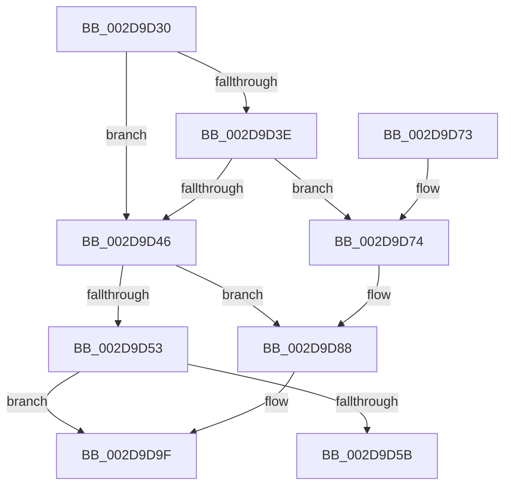

# PoFxActivateComponent

- RVA: `0x002D9D30`–`0x002D9DB6` (길이 `134` bytes)
- VA: `0x00000001402D9D30`
- 실행 섹션: `.text`
- PDB 이름 있음: `예`; PDB Function 태그: `아니요`
- unwind 정보 RVA: `0x00067BB4`
- 디코드: `39`개 명령, `134/134` bytes 표시
- 미해석 바이트: `0` (있으면 어셈블리에 `.byte`로 보존)

> 이 문서는 커널 이미지의 기계어와 PDB 기호를 분석해 생성했습니다. 4번과 5번은 함수 원형과 자료형을 바이너리 사용 방식에서 추정한 C 해석이며 원본 소스 복구 결과는 아닙니다.

## 1. Dependencies

- 직접 호출 지점: **4**; 고유 호출 대상: **2**
- 직접 호출자로 확인된 함수: **8**
- RIP 상대 이미지 참조: **0**

### Outgoing calls
- `0x002D9D69` → [PopFxActivateComponent](PopFxActivateComponent_function_002D9DBC.md) (function, `0x002D9DBC`)
- `0x002D9D82` → [PopFxBugCheck](../2B/PopFxBugCheck_function_002BFC6C.md) (function, `0x002BFC6C`)
- `0x002D9D99` → [PopFxBugCheck](../2B/PopFxBugCheck_function_002BFC6C.md) (function, `0x002BFC6C`)
- `0x002D9DB0` → [PopFxBugCheck](../2B/PopFxBugCheck_function_002BFC6C.md) (function, `0x002BFC6C`)

### Direct callers
- [PopFxActivateDevice](../4A/PopFxActivateDevice_function_004A0DC8.md) at `0x004A0E99`
- [HalpTimerInitPowerManagement](../54/HalpTimerInitPowerManagement_function_00549298.md) at `0x00549375`
- [HalpDmaInitPowerManagement](../55/HalpDmaInitPowerManagement_function_005530E0.md) at `0x00553197`
- [HalpInterruptInitPowerManagement](../55/HalpInterruptInitPowerManagement_function_005577F8.md) at `0x005578C6`
- [DifPoFxActivateComponentWrapper](../63/DifPoFxActivateComponentWrapper_function_00638E10.md) at `0x00638EF7`
- [sub_006FBB10](../6F/Unknown_function_006FBB10.md) at `0x006FBB93`
- [PopFxUnregisterDevice](../../page/A8/PopFxUnregisterDevice_function_00A8AE84.md) at `0x00A8AEBE`
- [PoFxRegisterDebugger](../../init/C4/PoFxRegisterDebugger_function_00C434E0.md) at `0x00C43731`

### Static image references
- 디코드된 RIP-relative 메모리 참조가 없습니다.

## 2. Other-region calls and transfers

- 다른 실행 섹션으로 향하는 call: **0**
- 별도 외부 분기/꼬리 이동을 확인하지 못했습니다.

## 3. Assembly (complete function range)

```asm
002D9D30  48 83 EC 28                     sub rsp, 0x28
002D9D34  41 83 E0 F7                     and r8d, 0xfffffff7
002D9D38  41 F6 C0 01                     test r8b, 1
002D9D3C  74 08                           je 0x1402d9d46
002D9D3E  44 0F 20 C0                     mov rax, cr8
002D9D42  3C 02                           cmp al, 2
002D9D44  73 2E                           jae 0x1402d9d74
002D9D46  41 8B C0                        mov eax, r8d
002D9D49  44 8B D2                        mov r10d, edx
002D9D4C  83 E0 03                        and eax, 3
002D9D4F  3C 03                           cmp al, 3
002D9D51  74 35                           je 0x1402d9d88
002D9D53  3B 91 64 03 00 00               cmp edx, dword ptr [rcx + 0x364]
002D9D59  73 44                           jae 0x1402d9d9f
002D9D5B  48 8B 91 68 03 00 00            mov rdx, qword ptr [rcx + 0x368]
002D9D62  45 33 C9                        xor r9d, r9d
002D9D65  4A 8B 14 D2                     mov rdx, qword ptr [rdx + r10*8]
002D9D69  E8 4E 00 00 00                  call 0x1402d9dbc
002D9D6E  48 83 C4 28                     add rsp, 0x28
002D9D72  C3                              ret
002D9D73  CC                              int3
002D9D74  44 8B C2                        mov r8d, edx
002D9D77  45 33 C9                        xor r9d, r9d
002D9D7A  48 8B D1                        mov rdx, rcx
002D9D7D  B9 14 06 00 00                  mov ecx, 0x614
002D9D82  E8 E5 5E FE FF                  call 0x1402bfc6c
002D9D87  CC                              int3
002D9D88  48 8B D1                        mov rdx, rcx
002D9D8B  41 B9 01 00 00 00               mov r9d, 1
002D9D91  B9 14 06 00 00                  mov ecx, 0x614
002D9D96  4D 8B C2                        mov r8, r10
002D9D99  E8 CE 5E FE FF                  call 0x1402bfc6c
002D9D9E  CC                              int3
002D9D9F  48 8B D1                        mov rdx, rcx
002D9DA2  41 B9 02 00 00 00               mov r9d, 2
002D9DA8  B9 14 06 00 00                  mov ecx, 0x614
002D9DAD  4D 8B C2                        mov r8, r10
002D9DB0  E8 B7 5E FE FF                  call 0x1402bfc6c
002D9DB5  CC                              int3
```

## 4. C-style interpretation (structured pseudocode)

```c
__int64 __fastcall PoFxActivateComponent(__int64 a1, int a2, int a3, int a4)
{
    __int64 result;
    __int64 v_rsp;

    v_rsp = (v_rsp) - (40);
    a3 = (unsigned int)((a3) & (0xFFFFFFF7ULL));
    if ((((unsigned __int8)(a3)) & (1)) == 0) goto loc_002D9D46;
    if (((unsigned __int8)(v_cr8)) >= 2) goto loc_002D9D74;
loc_002D9D46:
    result = (unsigned int)(((unsigned int)(a3)) & (3));
    if (((unsigned __int8)(result)) == 3) goto loc_002D9D88;
    if (a2 >= (*(unsigned int *)(a1 + 868))) goto loc_002D9D9F;
    a4 = 0;
    result = PopFxActivateComponent(a1, *(unsigned __int64 *)(*(unsigned __int64 *)(a1 + 872) + (unsigned int)(a2) * 8), a3, a4);
    v_rsp = (v_rsp) + (40);
    return result;
loc_002D9D74:
    a4 = 0;
    result = PopFxBugCheck((unsigned int)(0x614ULL), a1, (unsigned int)((unsigned int)(*(unsigned __int64 *)(*(unsigned __int64 *)(a1 + 872) + (unsigned int)(a2) * 8))), a4);
loc_002D9D88:
    result = PopFxBugCheck((unsigned int)(0x614ULL), (unsigned int)(0x614ULL), (unsigned int)(a2), 1);
loc_002D9D9F:
    result = PopFxBugCheck((unsigned int)(0x614ULL), (unsigned int)(0x614ULL), (unsigned int)(a2), 2);
    return result;
}
```

## 5. (Beta) C Style

```c
int64_t PoFxActivateComponent(void *Arg1, int32_t Arg2, int32_t Arg3, int32_t Arg4)
{
    uint8_t *arg1 = (uint8_t *)Arg1;

    int64_t result;
    int64_t local_rsp;

    local_rsp = (local_rsp) - (40);
    Arg3 = (uint32_t)((Arg3) & (0xFFFFFFF7ULL));
    if ((((uint8_t)(Arg3)) & (1)) == 0) goto loc_002D9D46;
    if (((uint8_t)(v_cr8)) >= 2) goto loc_002D9D74;
loc_002D9D46:
    result = (uint32_t)(((uint32_t)(Arg3)) & (3));
    if (((uint8_t)(result)) == 3) goto loc_002D9D88;
    if (Arg2 >= (*(uint32_t *)(arg1 + 0x364))) goto loc_002D9D9F;
    Arg4 = 0;
    result = PopFxActivateComponent(Arg1, *(uint64_t *)(*(uint64_t *)(arg1 + 0x368) + (uint32_t)(Arg2) * 8), Arg3, Arg4);
    local_rsp = (local_rsp) + (40);
    return result;
loc_002D9D74:
    Arg4 = 0;
    result = PopFxBugCheck((uint32_t)(0x614ULL), Arg1, (uint32_t)((uint32_t)(*(uint64_t *)(*(uint64_t *)(arg1 + 0x368) + (uint32_t)(Arg2) * 8))), Arg4);
loc_002D9D88:
    result = PopFxBugCheck((uint32_t)(0x614ULL), (uint32_t)(0x614ULL), (uint32_t)(Arg2), 1);
loc_002D9D9F:
    result = PopFxBugCheck((uint32_t)(0x614ULL), (uint32_t)(0x614ULL), (uint32_t)(Arg2), 2);
    return result;
}
```

### 관측된 메모리 오프셋

구조체 형식이 확인되지 않은 접근은 인자 기준의 오프셋으로만 기록했습니다.

| 기준 인자 | 오프셋 표현 | 폭 (bit) | 접근 |
|---|---:|---:|---|
| `Arg1` | `+ 0x364` | `32` | `R` |
| `Arg1` | `+ 0x368` | `64` | `R` |

## 6. Execution-region graph

[열기: 2D/3D 그래프와 함수 탐색 컨트롤 패널](../../../control-panel.html?section=text&rva=0x002D9D30&view=graph)

- 2D 그래프는 위에서 아래로 흐르고, 3D 그래프는 빈 공간을 드래그해 회전합니다. Shift+드래그는 이동, 휠은 확대·축소, 함수 노드 선택은 대상 보고서 이동입니다.

### Static fallback


