# PoGetIdleTimes

- RVA: `0x002DF570`–`0x002DF8BA` (길이 `842` bytes)
- VA: `0x00000001402DF570`
- 실행 섹션: `.text`
- PDB 이름 있음: `예`; PDB Function 태그: `아니요`
- unwind 정보 RVA: `0x00070A24`
- 디코드: `198`개 명령, `842/842` bytes 표시
- 미해석 바이트: `0` (있으면 어셈블리에 `.byte`로 보존)

> 이 문서는 커널 이미지의 기계어와 PDB 기호를 분석해 생성했습니다. 4번과 5번은 함수 원형과 자료형을 바이너리 사용 방식에서 추정한 C 해석이며 원본 소스 복구 결과는 아닙니다.

## 1. Dependencies

- 직접 호출 지점: **14**; 고유 호출 대상: **13**
- 직접 호출자로 확인된 함수: **2**
- RIP 상대 이미지 참조: **11**

### Outgoing calls
- `0x002DF5B0` → [memset](../6C/memset_function_006C6C40.md) (function, `0x006C6C40`)
- `0x002DF646` → [KeAbPreAcquire](../21/KeAbPreAcquire_function_00210230.md) (function, `0x00210230`)
- `0x002DF673` → [ExfAcquirePushLockSharedEx](../21/ExfAcquirePushLockSharedEx_function_0021044C.md) (function, `0x0021044C`)
- `0x002DF6A4` → [PopGetIdleTimesCallback](PopGetIdleTimesCallback_function_002DEFD0.md) (function, `0x002DEFD0`)
- `0x002DF6BC` → [KiLowerIrqlProcessIrqlFlags](../4F/KiLowerIrqlProcessIrqlFlags_function_004F5698.md) (function, `0x004F5698`)
- `0x002DF719` → [KeAbPostRelease](../2E/KeAbPostRelease_function_002E1600.md) (function, `0x002E1600`)
- `0x002DF727` → [KeLeaveCriticalRegionThread](../25/KeLeaveCriticalRegionThread_function_0025EFF0.md) (function, `0x0025EFF0`)
- `0x002DF736` → [_security_check_cookie](../6A/_security_check_cookie_function_006AC640.md) (function, `0x006AC640`)
- `0x002DF778` → [memset](../6C/memset_function_006C6C40.md) (function, `0x006C6C40`)
- `0x002DF780` → [KeGetProcessorIndexFromNumber](KeGetProcessorIndexFromNumber_function_002DD2D0.md) (function, `0x002DD2D0`)
- `0x002DF84F` → [PopQueueTargetDpc](PopQueueTargetDpc_function_002DD8F0.md) (function, `0x002DD8F0`)
- `0x002DF866` → [KeWaitForSingleObject](../20/KeWaitForSingleObject_function_0020E6B0.md) (function, `0x0020E6B0`)
- `0x002DF877` → [KiRaiseIrqlProcessIrqlFlags](../4F/KiRaiseIrqlProcessIrqlFlags_function_004F56FC.md) (function, `0x004F56FC`)
- `0x002DF890` → [ExfReleasePushLock](../26/ExfReleasePushLock_function_002638D0.md) (function, `0x002638D0`)

### Direct callers
- [ExpQueryProcessorInformationCounters](../../page/9E/ExpQueryProcessorInformationCounters_function_009E52B0.md) at `0x009E54B8`
- [ExpQuerySystemInformation](../../page/A5/ExpQuerySystemInformation_function_00A57858.md) at `0x00A58733`
- [ExpQuerySystemInformation](../../page/A5/ExpQuerySystemInformation_function_00A57858.md) at `0x00A59E0A`

### Static image references
- `0x002DF58A` → RVA `0x00E0A740` (`.data`; read)
- `0x002DF5D4` → RVA `0x00FC5018` (`ALMOSTRO`; read)
- `0x002DF5F1` → RVA `0x00F231B8` (`.data`; read)
- `0x002DF60E` → RVA `0x00FC6A80` (`ALMOSTRO`; read)
- `0x002DF61E` → RVA `0x00FC8C40` (`ALMOSTRO`; read)
- `0x002DF632` → RVA `0x00F0CA70` (`.data`; read)
- `0x002DF68E` → RVA `0x00FC6D20` (`ALMOSTRO`; read)
- `0x002DF6D1` → RVA `0x00F0CA78` (`.data`; read)
- `0x002DF758` → RVA `0x00F0CA78` (`.data`; write)
- `0x002DF787` → RVA `0x00F231B0` (`.data`; read)
- `0x002DF807` → RVA `0x002DEFD0` (`PopGetIdleTimesCallback`; read)

## 2. Other-region calls and transfers

- 다른 실행 섹션으로 향하는 call: **0**
- 별도 외부 분기/꼬리 이동을 확인하지 못했습니다.

## 3. Assembly (complete function range)

```asm
002DF570  40 55                           push rbp
002DF572  53                              push rbx
002DF573  56                              push rsi
002DF574  57                              push rdi
002DF575  41 54                           push r12
002DF577  41 56                           push r14
002DF579  41 57                           push r15
002DF57B  48 8D AC 24 00 FF FF FF         lea rbp, [rsp - 0x100]
002DF583  48 81 EC 00 02 00 00            sub rsp, 0x200
002DF58A  48 8B 05 AF B1 B2 00            mov rax, qword ptr [rip + 0xb2b1af]
002DF591  48 33 C4                        xor rax, rsp
002DF594  48 89 85 F0 00 00 00            mov qword ptr [rbp + 0xf0], rax
002DF59B  4D 8B F8                        mov r15, r8
002DF59E  4C 8B F2                        mov r14, rdx
002DF5A1  48 8B D9                        mov rbx, rcx
002DF5A4  33 D2                           xor edx, edx
002DF5A6  41 B8 08 01 00 00               mov r8d, 0x108
002DF5AC  48 8D 4D E0                     lea rcx, [rbp - 0x20]
002DF5B0  E8 8B 76 3E 00                  call 0x1406c6c40
002DF5B5  45 33 E4                        xor r12d, r12d
002DF5B8  44 38 63 03                     cmp byte ptr [rbx + 3], r12b
002DF5BC  0F 85 8C 01 00 00               jne 0x1402df74e
002DF5C2  0F B7 03                        movzx eax, word ptr [rbx]
002DF5C5  66 85 C0                        test ax, ax
002DF5C8  75 0A                           jne 0x1402df5d4
002DF5CA  44 38 63 02                     cmp byte ptr [rbx + 2], r12b
002DF5CE  0F 84 AD 02 00 00               je 0x1402df881
002DF5D4  66 3B 05 3D 5A CE 00            cmp ax, word ptr [rip + 0xce5a3d]
002DF5DB  0F 83 6D 01 00 00               jae 0x1402df74e
002DF5E1  0F B6 53 02                     movzx edx, byte ptr [rbx + 2]
002DF5E5  80 FA 40                        cmp dl, 0x40
002DF5E8  0F 83 60 01 00 00               jae 0x1402df74e
002DF5EE  48 8B C8                        mov rcx, rax
002DF5F1  48 8B 05 C0 3B C4 00            mov rax, qword ptr [rip + 0xc43bc0]
002DF5F8  48 C1 E1 06                     shl rcx, 6
002DF5FC  48 03 CA                        add rcx, rdx
002DF5FF  8B 14 88                        mov edx, dword ptr [rax + rcx*4]
002DF602  B8 FF FF FF FF                  mov eax, 0xffffffff
002DF607  85 D2                           test edx, edx
002DF609  0F 44 D0                        cmove edx, eax
002DF60C  8B C2                           mov eax, edx
002DF60E  8B 0D 6C 74 CE 00               mov ecx, dword ptr [rip + 0xce746c]
002DF614  3B C1                           cmp eax, ecx
002DF616  0F 83 96 02 00 00               jae 0x1402df8b2
002DF61C  8B C8                           mov ecx, eax
002DF61E  48 8D 35 1B 96 CE 00            lea rsi, [rip + 0xce961b]
002DF625  48 8B 34 CE                     mov rsi, qword ptr [rsi + rcx*8]
002DF629  65 48 8B 04 25 88 01 00 00      mov rax, qword ptr gs:[0x188]
002DF632  48 8D 0D 37 D4 C2 00            lea rcx, [rip + 0xc2d437]
002DF639  45 33 C0                        xor r8d, r8d
002DF63C  33 D2                           xor edx, edx
002DF63E  66 FF 88 E4 01 00 00            dec word ptr [rax + 0x1e4]
002DF645  90                              nop
002DF646  E8 E5 0B F3 FF                  call 0x140210230
002DF64B  48 8B F8                        mov rdi, rax
002DF64E  B9 11 00 00 00                  mov ecx, 0x11
002DF653  33 C0                           xor eax, eax
002DF655  F0 48 0F B1 0D 12 D4 C2 00      lock cmpxchg qword ptr [rip + 0xc2d412], rcx
002DF65E  74 18                           je 0x1402df678
002DF660  4C 8D 0D 09 D4 C2 00            lea r9, [rip + 0xc2d409]
002DF667  4C 8B C7                        mov r8, rdi
002DF66A  33 D2                           xor edx, edx
002DF66C  48 8D 0D FD D3 C2 00            lea rcx, [rip + 0xc2d3fd]
002DF673  E8 D4 0D F3 FF                  call 0x14021044c
002DF678  48 85 FF                        test rdi, rdi
002DF67B  74 04                           je 0x1402df681
002DF67D  C6 47 0A 01                     mov byte ptr [rdi + 0xa], 1
002DF681  44 0F 20 C7                     mov rdi, cr8
002DF685  B8 02 00 00 00                  mov eax, 2
002DF68A  44 0F 22 C0                     mov cr8, rax
002DF68E  44 39 25 8B 76 CE 00            cmp dword ptr [rip + 0xce768b], r12d
002DF695  0F 85 D5 01 00 00               jne 0x1402df870
002DF69B  4D 8B C7                        mov r8, r15
002DF69E  49 8B D6                        mov rdx, r14
002DF6A1  48 8B CE                        mov rcx, rsi
002DF6A4  E8 27 F9 FF FF                  call 0x1402defd0
002DF6A9  44 39 25 70 76 CE 00            cmp dword ptr [rip + 0xce7670], r12d
002DF6B0  8B F0                           mov esi, eax
002DF6B2  74 0D                           je 0x1402df6c1
002DF6B4  44 0F 20 C1                     mov rcx, cr8
002DF6B8  40 0F B6 D7                     movzx edx, dil
002DF6BC  E8 D7 5F 21 00                  call 0x1404f5698
002DF6C1  40 0F B6 D7                     movzx edx, dil
002DF6C5  44 0F 22 C2                     mov cr8, rdx
002DF6C9  85 F6                           test esi, esi
002DF6CB  0F 88 93 00 00 00               js 0x1402df764
002DF6D1  4C 39 25 A0 D3 C2 00            cmp qword ptr [rip + 0xc2d3a0], r12
002DF6D8  75 7E                           jne 0x1402df758
002DF6DA  0F 0D 0D 8F D3 C2 00            prefetchw byte ptr [rip + 0xc2d38f]
002DF6E1  48 8B 05 88 D3 C2 00            mov rax, qword ptr [rip + 0xc2d388]
002DF6E8  48 8B C8                        mov rcx, rax
002DF6EB  48 83 E1 F0                     and rcx, 0xfffffffffffffff0
002DF6EF  48 83 F9 10                     cmp rcx, 0x10
002DF6F3  48 8D 50 F0                     lea rdx, [rax - 0x10]
002DF6F7  49 0F 46 D4                     cmovbe rdx, r12
002DF6FB  A8 02                           test al, 2
002DF6FD  0F 85 86 01 00 00               jne 0x1402df889
002DF703  F0 48 0F B1 15 64 D3 C2 00      lock cmpxchg qword ptr [rip + 0xc2d364], rdx
002DF70C  0F 85 77 01 00 00               jne 0x1402df889
002DF712  48 8D 0D 57 D3 C2 00            lea rcx, [rip + 0xc2d357]
002DF719  E8 E2 1E 00 00                  call 0x1402e1600
002DF71E  65 48 8B 0C 25 88 01 00 00      mov rcx, qword ptr gs:[0x188]
002DF727  E8 C4 F8 F7 FF                  call 0x14025eff0
002DF72C  48 8B 8D F0 00 00 00            mov rcx, qword ptr [rbp + 0xf0]
002DF733  48 33 CC                        xor rcx, rsp
002DF736  E8 05 CF 3C 00                  call 0x1406ac640
002DF73B  48 81 C4 00 02 00 00            add rsp, 0x200
002DF742  41 5F                           pop r15
002DF744  41 5E                           pop r14
002DF746  41 5C                           pop r12
002DF748  5F                              pop rdi
002DF749  5E                              pop rsi
002DF74A  5B                              pop rbx
002DF74B  5D                              pop rbp
002DF74C  C3                              ret
002DF74D  CC                              int3
002DF74E  B8 FF FF FF FF                  mov eax, 0xffffffff
002DF753  E9 B6 FE FF FF                  jmp 0x1402df60e
002DF758  4C 89 25 19 D3 C2 00            mov qword ptr [rip + 0xc2d319], r12
002DF75F  E9 76 FF FF FF                  jmp 0x1402df6da
002DF764  33 D2                           xor edx, edx
002DF766  48 C7 45 E0 01 00 20 00         mov qword ptr [rbp - 0x20], 0x200001
002DF76E  41 B8 00 01 00 00               mov r8d, 0x100
002DF774  48 8D 4D E8                     lea rcx, [rbp - 0x18]
002DF778  E8 C3 74 3E 00                  call 0x1406c6c40
002DF77D  48 8B CB                        mov rcx, rbx
002DF780  E8 4B DB FF FF                  call 0x1402dd2d0
002DF785  8B C8                           mov ecx, eax
002DF787  48 8B 05 22 3A C4 00            mov rax, qword ptr [rip + 0xc43a22]
002DF78E  44 8B 04 88                     mov r8d, dword ptr [rax + rcx*4]
002DF792  41 8B C8                        mov ecx, r8d
002DF795  0F B7 45 E0                     movzx eax, word ptr [rbp - 0x20]
002DF799  41 83 E0 3F                     and r8d, 0x3f
002DF79D  C1 E9 06                        shr ecx, 6
002DF7A0  3B C1                           cmp eax, ecx
002DF7A2  0F 86 F2 00 00 00               jbe 0x1402df89a
002DF7A8  48 8D 55 E8                     lea rdx, [rbp - 0x18]
002DF7AC  41 8B C0                        mov eax, r8d
002DF7AF  48 8D 14 CA                     lea rdx, [rdx + rcx*8]
002DF7B3  48 8B 0A                        mov rcx, qword ptr [rdx]
002DF7B6  48 0F AB C1                     bts rcx, rax
002DF7BA  48 89 0A                        mov qword ptr [rdx], rcx
002DF7BD  33 C0                           xor eax, eax
002DF7BF  44 89 65 8C                     mov dword ptr [rbp - 0x74], r12d
002DF7C3  48 89 45 D0                     mov qword ptr [rbp - 0x30], rax
002DF7C7  48 8D 54 24 60                  lea rdx, [rsp + 0x60]
002DF7CC  89 45 D8                        mov dword ptr [rbp - 0x28], eax
002DF7CF  48 8D 4D A0                     lea rcx, [rbp - 0x60]
002DF7D3  0F 57 C0                        xorps xmm0, xmm0
002DF7D6  44 89 64 24 5A                  mov dword ptr [rsp + 0x5a], r12d
002DF7DB  48 8D 44 24 38                  lea rax, [rsp + 0x38]
002DF7E0  66 44 89 64 24 5E               mov word ptr [rsp + 0x5e], r12w
002DF7E6  48 89 44 24 40                  mov qword ptr [rsp + 0x40], rax
002DF7EB  48 8D 44 24 38                  lea rax, [rsp + 0x38]
002DF7F0  48 89 44 24 38                  mov qword ptr [rsp + 0x38], rax
002DF7F5  48 8B 45 E8                     mov rax, qword ptr [rbp - 0x18]
002DF7F9  48 89 44 24 50                  mov qword ptr [rsp + 0x50], rax
002DF7FE  48 8D 45 E0                     lea rax, [rbp - 0x20]
002DF802  48 89 44 24 48                  mov qword ptr [rsp + 0x48], rax
002DF807  48 8D 05 C2 F7 FF FF            lea rax, [rip - 0x83e]
002DF80E  48 89 44 24 60                  mov qword ptr [rsp + 0x60], rax
002DF813  48 8D 44 24 48                  lea rax, [rsp + 0x48]
002DF818  48 89 45 80                     mov qword ptr [rbp - 0x80], rax
002DF81C  48 8D 44 24 30                  lea rax, [rsp + 0x30]
002DF821  48 89 44 24 78                  mov qword ptr [rsp + 0x78], rax
002DF826  0F 11 45 A0                     movups xmmword ptr [rbp - 0x60], xmm0
002DF82A  48 C7 44 24 30 01 00 06 00      mov qword ptr [rsp + 0x30], 0x60001
002DF833  0F 11 45 B0                     movups xmmword ptr [rbp - 0x50], xmm0
002DF837  66 44 89 64 24 58               mov word ptr [rsp + 0x58], r12w
002DF83D  0F 11 45 C0                     movups xmmword ptr [rbp - 0x40], xmm0
002DF841  4C 89 74 24 68                  mov qword ptr [rsp + 0x68], r14
002DF846  4C 89 7C 24 70                  mov qword ptr [rsp + 0x70], r15
002DF84B  44 89 65 88                     mov dword ptr [rbp - 0x78], r12d
002DF84F  E8 9C E0 FF FF                  call 0x1402dd8f0
002DF854  45 33 C9                        xor r9d, r9d
002DF857  4C 89 64 24 20                  mov qword ptr [rsp + 0x20], r12
002DF85C  45 33 C0                        xor r8d, r8d
002DF85F  48 8D 4C 24 30                  lea rcx, [rsp + 0x30]
002DF864  33 D2                           xor edx, edx
002DF866  E8 45 EE F2 FF                  call 0x14020e6b0
002DF86B  E9 61 FE FF FF                  jmp 0x1402df6d1
002DF870  0F B6 D0                        movzx edx, al
002DF873  40 0F B6 CF                     movzx ecx, dil
002DF877  E8 80 5E 21 00                  call 0x1404f56fc
002DF87C  E9 1A FE FF FF                  jmp 0x1402df69b
002DF881  41 8B C4                        mov eax, r12d
002DF884  E9 85 FD FF FF                  jmp 0x1402df60e
002DF889  48 8D 0D E0 D1 C2 00            lea rcx, [rip + 0xc2d1e0]
002DF890  E8 3B 40 F8 FF                  call 0x1402638d0
002DF895  E9 78 FE FF FF                  jmp 0x1402df712
002DF89A  0F B7 45 E2                     movzx eax, word ptr [rbp - 0x1e]
002DF89E  3B C1                           cmp eax, ecx
002DF8A0  0F 86 17 FF FF FF               jbe 0x1402df7bd
002DF8A6  8D 41 01                        lea eax, [rcx + 1]
002DF8A9  66 89 45 E0                     mov word ptr [rbp - 0x20], ax
002DF8AD  E9 F6 FE FF FF                  jmp 0x1402df7a8
002DF8B2  49 8B F4                        mov rsi, r12
002DF8B5  E9 6F FD FF FF                  jmp 0x1402df629
```

## 4. C-style interpretation (structured pseudocode)

```c
__int64 __fastcall PoGetIdleTimes(__int64 a1, __int64 a2, __int64 a3)
{
    __int64 result;
    __int64 v_r12;
    __int64 v_rsp;
    unsigned __int64 v_stack_m138;
    unsigned __int64 v_stack_m150;
    unsigned __int16 v_stack_m156;
    unsigned __int64 v_stack_m158;
    unsigned int v_stack_m160;
    unsigned __int64 v_stack_m168;
    unsigned __int64 v_stack_m178;
    unsigned __int64 v_stack_m188;
    unsigned __int64 v_stack_m198;
    unsigned int v_stack_m1AC;
    unsigned int v_stack_m1B0;
    unsigned __int64 v_stack_m1B8;
    unsigned __int64 v_stack_m48;
    unsigned __int64 v_stack_p20;
    unsigned __int64 v_stack_p30;
    unsigned __int64 v_stack_p38;
    unsigned __int64 v_stack_p40;
    unsigned __int64 v_stack_p48;
    unsigned __int64 v_stack_p50;
    unsigned __int16 v_stack_p58;
    unsigned int v_stack_p5A;
    unsigned __int16 v_stack_p5E;
    unsigned __int64 v_stack_p60;
    unsigned __int64 v_stack_p68;
    unsigned __int64 v_stack_p70;
    unsigned __int64 v_stack_p78;

    v_rsp = (v_rsp) - (512);
    result = (*(unsigned __int64 *)(v_rip + 11710895)) ^ (v_rsp);
    v_stack_m48 = result;
    a2 = 0;
    result = memset(v_stack_m158, a2, 264, a4);
    v_r12 = 0;
    if ((*(unsigned __int8 *)(a1 + 3)) != 0) goto loc_002DF74E;
    if ((unsigned __int16)(*(unsigned __int16 *)(a1)) != 0) goto loc_002DF5D4;
    if ((*(unsigned __int8 *)(a1 + 2)) == 0) goto loc_002DF881;
loc_002DF5D4:
    if (((unsigned __int16)(*(unsigned __int16 *)(a1))) >= (*(unsigned __int16 *)(v_rip + 13523517))) goto loc_002DF74E;
    if (((unsigned __int8)(*(unsigned __int8 *)(a1 + 2))) >= 64) goto loc_002DF74E;
    a1 = (*(unsigned __int16 *)(a1)) << (6);
    a1 = (a1) + (*(unsigned __int8 *)(a1 + 2));
    a2 = (unsigned int)(*(unsigned int *)(*(unsigned __int64 *)(v_rip + 12860352) + a1 * 4));
    if ((unsigned int)((unsigned int)(*(unsigned int *)(*(unsigned __int64 *)(v_rip + 12860352) + a1 * 4))) == 0) { a2 = (unsigned int)((unsigned int)(0xFFFFFFFFULL)); }
loc_002DF60E:
    if (((unsigned int)((unsigned int)((unsigned int)(a2)))) >= ((unsigned int)((unsigned int)(*(unsigned int *)(v_rip + 13530220))))) goto loc_002DF8B2;
loc_002DF629:
    a3 = 0;
    a2 = 0;
    result = KeAbPreAcquire(v_rip + 12768311, a2, a3, a4);
    result = 0;
    if (!(condition_is_equal)) {
        a4 = v_rip + 12768265;
        a3 = 0;
        a2 = 0;
        a1 = v_rip + 12768253;
        result = ExfAcquirePushLockSharedEx(a1, a2, a3, a4);
    }
    if (result != 0) {
        *(unsigned __int8 *)(result + 10) = 1;
    }
    if ((*(unsigned int *)(v_rip + 13530763)) != 0) goto loc_002DF870;
loc_002DF69B:
    result = PopGetIdleTimesCallback(*(unsigned __int64 *)(v_rip + 13538843 + (unsigned int)((unsigned int)((unsigned int)((unsigned int)(a2)))) * 8), 0, a3, a4);
    if ((*(unsigned int *)(v_rip + 13530736)) != 0) {
        a1 = 2;
        a2 = (unsigned __int8)(v_cr8);
        result = KiLowerIrqlProcessIrqlFlags(a1, a2, a3, a4);
    }
    if (sign_flag) goto loc_002DF764;
loc_002DF6D1:
    if ((*(unsigned __int64 *)(v_rip + 12768160)) != 0) goto loc_002DF758;
loc_002DF6DA:
    a1 = (*(unsigned __int64 *)(v_rip + 12768136)) & (-16);
    a2 = *(unsigned __int64 *)(v_rip + 12768136) - 16;
    if (a1 <= 16) { a2 = 0; }
    if ((((unsigned __int8)(*(unsigned __int64 *)(v_rip + 12768136))) & (2)) != 0) goto loc_002DF889;
    if ((((unsigned __int8)(*(unsigned __int64 *)(v_rip + 12768136))) & (2)) != 0) goto loc_002DF889;
loc_002DF712:
    result = KeAbPostRelease(v_rip + 12768087, a2, a3, a4);
    result = KeLeaveCriticalRegionThread(*(unsigned __int64 *)(gs_base + (0 + 392)), a2, a3, a4);
    a1 = (v_stack_m48) ^ (v_rsp);
    result = _security_check_cookie(a1, a2, a3, a4);
    v_rsp = (v_rsp) + (512);
    return result;
loc_002DF74E:
    goto loc_002DF60E;
loc_002DF758:
    *(unsigned __int64 *)(v_rip + 12768025) = 0;
    goto loc_002DF6DA;
loc_002DF764:
    a2 = 0;
    v_stack_m158 = 0x200001ULL;
    result = memset(v_stack_m150, a2, 256, a4);
    result = KeGetProcessorIndexFromNumber(a1, a2, 256, a4);
    a3 = (unsigned int)(((unsigned int)(*(unsigned int *)(*(unsigned __int64 *)(v_rip + 12859938) + (unsigned int)((unsigned int)(result)) * 4))) & (63));
    a1 = (unsigned int)(((unsigned int)((unsigned int)((unsigned int)(*(unsigned int *)(*(unsigned __int64 *)(v_rip + 12859938) + (unsigned int)((unsigned int)(result)) * 4))))) >> (6));
    if (((unsigned int)(v_stack_m158)) <= ((unsigned int)(a1))) goto loc_002DF89A;
loc_002DF7A8:
    *(unsigned __int64 *)(v_stack_m150 + a1 * 8) = *(unsigned __int64 *)(v_stack_m150 + a1 * 8);
loc_002DF7BD:
    result = 0;
    v_stack_m1AC = 0;
    v_stack_m168 = 0;
    v_stack_m160 = 0;
    v_stack_p5A = 0;
    v_stack_p5E = 0;
    v_stack_p40 = v_stack_p38;
    v_stack_p38 = v_stack_p38;
    v_stack_p50 = v_stack_m150;
    v_stack_p48 = v_stack_m158;
    v_stack_p60 = v_rip - 2110;
    v_stack_m1B8 = v_stack_p48;
    v_stack_p78 = v_stack_p30;
    v_stack_m198 = v_xmm0;
    v_stack_p30 = 0x60001ULL;
    v_stack_m188 = v_xmm0;
    v_stack_p58 = 0;
    v_stack_m178 = v_xmm0;
    v_stack_p68 = 0;
    v_stack_p70 = a3;
    v_stack_m1B0 = 0;
    result = PopQueueTargetDpc(v_stack_m198, v_stack_p60, a3, a4);
    a4 = 0;
    v_stack_p20 = 0;
    a3 = 0;
    a2 = 0;
    result = KeWaitForSingleObject(v_stack_p30, a2, a3, a4);
    goto loc_002DF6D1;
loc_002DF870:
    result = KiRaiseIrqlProcessIrqlFlags((unsigned __int8)(v_cr8), (unsigned __int8)(result), a3, a4);
    goto loc_002DF69B;
loc_002DF881:
    goto loc_002DF60E;
loc_002DF889:
    result = ExfReleasePushLock(v_rip + 12767712, (unsigned __int8)(result), a3, a4);
    goto loc_002DF712;
loc_002DF89A:
    if (((unsigned int)(v_stack_m156)) <= ((unsigned int)(v_rip + 12767712))) goto loc_002DF7BD;
    v_stack_m158 = (unsigned __int16)(v_rip + 12767712 + 1);
    goto loc_002DF7A8;
loc_002DF8B2:
    goto loc_002DF629;
}
```

## 5. (Beta) C Style

```c
int64_t PoGetIdleTimes(void *Arg1, int64_t Arg2, int64_t Arg3)
{
    uint8_t *arg1 = (uint8_t *)Arg1;

    int64_t result;
    int64_t local_r12;
    int64_t local_rsp;
    uint64_t v_stack_m138;
    uint64_t v_stack_m150;
    uint16_t v_stack_m156;
    uint64_t v_stack_m158;
    uint32_t v_stack_m160;
    uint64_t v_stack_m168;
    uint64_t v_stack_m178;
    uint64_t v_stack_m188;
    uint64_t v_stack_m198;
    uint32_t v_stack_m1AC;
    uint32_t v_stack_m1B0;
    uint64_t v_stack_m1B8;
    uint64_t v_stack_m48;
    uint64_t v_stack_p20;
    uint64_t v_stack_p30;
    uint64_t v_stack_p38;
    uint64_t v_stack_p40;
    uint64_t v_stack_p48;
    uint64_t v_stack_p50;
    uint16_t v_stack_p58;
    uint32_t v_stack_p5A;
    uint16_t v_stack_p5E;
    uint64_t v_stack_p60;
    uint64_t v_stack_p68;
    uint64_t v_stack_p70;
    uint64_t v_stack_p78;

    local_rsp = (local_rsp) - (512);
    result = (*(uint64_t *)(v_rip + 0xB2B1AF)) ^ (local_rsp);
    v_stack_m48 = result;
    Arg2 = 0;
    result = memset(v_stack_m158, Arg2, 264, a4);
    local_r12 = 0;
    if ((*(uint8_t *)(arg1 + 0x3)) != 0) goto loc_002DF74E;
    if ((uint16_t)(*(uint16_t *)(arg1)) != 0) goto loc_002DF5D4;
    if ((*(uint8_t *)(arg1 + 0x2)) == 0) goto loc_002DF881;
loc_002DF5D4:
    if (((uint16_t)(*(uint16_t *)(arg1))) >= (*(uint16_t *)(v_rip + 0xCE5A3D))) goto loc_002DF74E;
    if (((uint8_t)(*(uint8_t *)(arg1 + 0x2))) >= 64) goto loc_002DF74E;
    Arg1 = (*(uint16_t *)(arg1)) << (6);
    Arg1 = (Arg1) + (*(uint8_t *)(arg1 + 0x2));
    Arg2 = (uint32_t)(*(uint32_t *)(*(uint64_t *)(v_rip + 0xC43BC0) + arg1 * 4));
    if ((uint32_t)((uint32_t)(*(uint32_t *)(*(uint64_t *)(v_rip + 0xC43BC0) + arg1 * 4))) == 0) { Arg2 = (uint32_t)((uint32_t)(0xFFFFFFFFULL)); }
loc_002DF60E:
    if (((uint32_t)((uint32_t)((uint32_t)(Arg2)))) >= ((uint32_t)((uint32_t)(*(uint32_t *)(v_rip + 0xCE746C))))) goto loc_002DF8B2;
loc_002DF629:
    Arg3 = 0;
    Arg2 = 0;
    result = KeAbPreAcquire(v_rip + 12768311, Arg2, Arg3, a4);
    result = 0;
    if (!(condition_is_equal)) {
        a4 = v_rip + 12768265;
        Arg3 = 0;
        Arg2 = 0;
        Arg1 = v_rip + 12768253;
        result = ExfAcquirePushLockSharedEx(Arg1, Arg2, Arg3, a4);
    }
    if (result != 0) {
        *(uint8_t *)(result + 0xA) = 1;
    }
    if ((*(uint32_t *)(v_rip + 0xCE768B)) != 0) goto loc_002DF870;
loc_002DF69B:
    result = PopGetIdleTimesCallback(*(uint64_t *)(v_rip + 0xCE961B + (uint32_t)((uint32_t)((uint32_t)((uint32_t)(Arg2)))) * 8), 0, Arg3, a4);
    if ((*(uint32_t *)(v_rip + 0xCE7670)) != 0) {
        Arg1 = 2;
        Arg2 = (uint8_t)(v_cr8);
        result = KiLowerIrqlProcessIrqlFlags(Arg1, Arg2, Arg3, a4);
    }
    if (sign_flag) goto loc_002DF764;
loc_002DF6D1:
    if ((*(uint64_t *)(v_rip + 0xC2D3A0)) != 0) goto loc_002DF758;
loc_002DF6DA:
    Arg1 = (*(uint64_t *)(v_rip + 0xC2D388)) & (-16);
    Arg2 = *(uint64_t *)(v_rip + 0xC2D388) - 16;
    if (Arg1 <= 16) { Arg2 = 0; }
    if ((((uint8_t)(*(uint64_t *)(v_rip + 0xC2D388))) & (2)) != 0) goto loc_002DF889;
    if ((((uint8_t)(*(uint64_t *)(v_rip + 0xC2D388))) & (2)) != 0) goto loc_002DF889;
loc_002DF712:
    result = KeAbPostRelease(v_rip + 12768087, Arg2, Arg3, a4);
    result = KeLeaveCriticalRegionThread(*(uint64_t *)(gs_base + (0 + 0x188)), Arg2, Arg3, a4);
    Arg1 = (v_stack_m48) ^ (local_rsp);
    result = _security_check_cookie(Arg1, Arg2, Arg3, a4);
    local_rsp = (local_rsp) + (512);
    return result;
loc_002DF74E:
    goto loc_002DF60E;
loc_002DF758:
    *(uint64_t *)(v_rip + 0xC2D319) = 0;
    goto loc_002DF6DA;
loc_002DF764:
    Arg2 = 0;
    v_stack_m158 = 0x200001ULL;
    result = memset(v_stack_m150, Arg2, 256, a4);
    result = KeGetProcessorIndexFromNumber(Arg1, Arg2, 256, a4);
    Arg3 = (uint32_t)(((uint32_t)(*(uint32_t *)(*(uint64_t *)(v_rip + 0xC43A22) + (uint32_t)((uint32_t)(result)) * 4))) & (63));
    Arg1 = (uint32_t)(((uint32_t)((uint32_t)((uint32_t)(*(uint32_t *)(*(uint64_t *)(v_rip + 0xC43A22) + (uint32_t)((uint32_t)(result)) * 4))))) >> (6));
    if (((uint32_t)(v_stack_m158)) <= ((uint32_t)(Arg1))) goto loc_002DF89A;
loc_002DF7A8:
    *(uint64_t *)(v_stack_m150 + arg1 * 8) = *(uint64_t *)(v_stack_m150 + arg1 * 8);
loc_002DF7BD:
    result = 0;
    v_stack_m1AC = 0;
    v_stack_m168 = 0;
    v_stack_m160 = 0;
    v_stack_p5A = 0;
    v_stack_p5E = 0;
    v_stack_p40 = v_stack_p38;
    v_stack_p38 = v_stack_p38;
    v_stack_p50 = v_stack_m150;
    v_stack_p48 = v_stack_m158;
    v_stack_p60 = v_rip - 2110;
    v_stack_m1B8 = v_stack_p48;
    v_stack_p78 = v_stack_p30;
    v_stack_m198 = v_xmm0;
    v_stack_p30 = 0x60001ULL;
    v_stack_m188 = v_xmm0;
    v_stack_p58 = 0;
    v_stack_m178 = v_xmm0;
    v_stack_p68 = 0;
    v_stack_p70 = Arg3;
    v_stack_m1B0 = 0;
    result = PopQueueTargetDpc(v_stack_m198, v_stack_p60, Arg3, a4);
    a4 = 0;
    v_stack_p20 = 0;
    Arg3 = 0;
    Arg2 = 0;
    result = KeWaitForSingleObject(v_stack_p30, Arg2, Arg3, a4);
    goto loc_002DF6D1;
loc_002DF870:
    result = KiRaiseIrqlProcessIrqlFlags((uint8_t)(v_cr8), (uint8_t)(result), Arg3, a4);
    goto loc_002DF69B;
loc_002DF881:
    goto loc_002DF60E;
loc_002DF889:
    result = ExfReleasePushLock(v_rip + 12767712, (uint8_t)(result), Arg3, a4);
    goto loc_002DF712;
loc_002DF89A:
    if (((uint32_t)(v_stack_m156)) <= ((uint32_t)(v_rip + 12767712))) goto loc_002DF7BD;
    v_stack_m158 = (uint16_t)(v_rip + 12767712 + 1);
    goto loc_002DF7A8;
loc_002DF8B2:
    goto loc_002DF629;
}
```

### 관측된 메모리 오프셋

구조체 형식이 확인되지 않은 접근은 인자 기준의 오프셋으로만 기록했습니다.

| 기준 인자 | 오프셋 표현 | 폭 (bit) | 접근 |
|---|---:|---:|---|
| `Arg1` | `+ 0x0` | `16` | `R` |
| `Arg1` | `+ 0x2` | `8` | `R` |
| `Arg1` | `+ 0x3` | `8` | `R` |

## 6. Execution-region graph

[열기: 2D/3D 그래프와 함수 탐색 컨트롤 패널](../../../control-panel.html?section=text&rva=0x002DF570&view=graph)

- 2D 그래프는 위에서 아래로 흐르고, 3D 그래프는 빈 공간을 드래그해 회전합니다. Shift+드래그는 이동, 휠은 확대·축소, 함수 노드 선택은 대상 보고서 이동입니다.

### Static fallback

```mermaid
flowchart TD
  bb_002DF570[BB_002DF570]
  bb_002DF5C2[BB_002DF5C2]
  bb_002DF5CA[BB_002DF5CA]
  bb_002DF5D4[BB_002DF5D4]
  bb_002DF5E1[BB_002DF5E1]
  bb_002DF5EE[BB_002DF5EE]
  bb_002DF60E[BB_002DF60E]
  bb_002DF61C[BB_002DF61C]
  bb_002DF629[BB_002DF629]
  bb_002DF660[BB_002DF660]
  bb_002DF678[BB_002DF678]
  bb_002DF67D[BB_002DF67D]
  bb_002DF681[BB_002DF681]
  bb_002DF69B[BB_002DF69B]
  bb_002DF6B4[BB_002DF6B4]
  bb_002DF6C1[BB_002DF6C1]
  bb_002DF6D1[BB_002DF6D1]
  bb_002DF6DA[BB_002DF6DA]
  bb_002DF703[BB_002DF703]
  bb_002DF712[BB_002DF712]
  bb_002DF74D[BB_002DF74D]
  bb_002DF74E[BB_002DF74E]
  bb_002DF758[BB_002DF758]
  bb_002DF764[BB_002DF764]
  bb_002DF7A8[BB_002DF7A8]
  bb_002DF7BD[BB_002DF7BD]
  bb_002DF870[BB_002DF870]
  bb_002DF881[BB_002DF881]
  bb_002DF889[BB_002DF889]
  bb_002DF89A[BB_002DF89A]
  bb_002DF8A6[BB_002DF8A6]
  bb_002DF8B2[BB_002DF8B2]
  bb_002DF570 -->|branch| bb_002DF74E
  bb_002DF570 -->|fallthrough| bb_002DF5C2
  bb_002DF5C2 -->|branch| bb_002DF5D4
  bb_002DF5C2 -->|fallthrough| bb_002DF5CA
  bb_002DF5CA -->|branch| bb_002DF881
  bb_002DF5CA -->|fallthrough| bb_002DF5D4
  bb_002DF5D4 -->|branch| bb_002DF74E
  bb_002DF5D4 -->|fallthrough| bb_002DF5E1
  bb_002DF5E1 -->|branch| bb_002DF74E
  bb_002DF5E1 -->|fallthrough| bb_002DF5EE
  bb_002DF5EE -->|flow| bb_002DF60E
  bb_002DF60E -->|branch| bb_002DF8B2
  bb_002DF60E -->|fallthrough| bb_002DF61C
  bb_002DF61C -->|flow| bb_002DF629
  bb_002DF629 -->|branch| bb_002DF678
  bb_002DF629 -->|fallthrough| bb_002DF660
  bb_002DF660 -->|flow| bb_002DF678
  bb_002DF678 -->|branch| bb_002DF681
  bb_002DF678 -->|fallthrough| bb_002DF67D
  bb_002DF67D -->|flow| bb_002DF681
  bb_002DF681 -->|branch| bb_002DF870
  bb_002DF681 -->|fallthrough| bb_002DF69B
  bb_002DF69B -->|branch| bb_002DF6C1
  bb_002DF69B -->|fallthrough| bb_002DF6B4
  bb_002DF6B4 -->|flow| bb_002DF6C1
  bb_002DF6C1 -->|branch| bb_002DF764
  bb_002DF6C1 -->|fallthrough| bb_002DF6D1
  bb_002DF6D1 -->|branch| bb_002DF758
  bb_002DF6D1 -->|fallthrough| bb_002DF6DA
  bb_002DF6DA -->|branch| bb_002DF889
  bb_002DF6DA -->|fallthrough| bb_002DF703
  bb_002DF703 -->|branch| bb_002DF889
  bb_002DF703 -->|fallthrough| bb_002DF712
  bb_002DF74D -->|flow| bb_002DF74E
  bb_002DF74E -->|branch| bb_002DF60E
  bb_002DF758 -->|branch| bb_002DF6DA
  bb_002DF764 -->|branch| bb_002DF89A
  bb_002DF764 -->|fallthrough| bb_002DF7A8
  bb_002DF7A8 -->|flow| bb_002DF7BD
  bb_002DF7BD -->|branch| bb_002DF6D1
  bb_002DF870 -->|branch| bb_002DF69B
  bb_002DF881 -->|branch| bb_002DF60E
  bb_002DF889 -->|branch| bb_002DF712
  bb_002DF89A -->|branch| bb_002DF7BD
  bb_002DF89A -->|fallthrough| bb_002DF8A6
  bb_002DF8A6 -->|branch| bb_002DF7A8
  bb_002DF8B2 -->|branch| bb_002DF629
```


