# PoGetPerfStateAndParkingInfo

- RVA: `0x002DD484`–`0x002DD7C7` (길이 `835` bytes)
- VA: `0x00000001402DD484`
- 실행 섹션: `.text`
- PDB 이름 있음: `예`; PDB Function 태그: `아니요`
- unwind 정보 RVA: `0x0007080C`
- 디코드: `215`개 명령, `835/835` bytes 표시
- 미해석 바이트: `0` (있으면 어셈블리에 `.byte`로 보존)

> 이 문서는 커널 이미지의 기계어와 PDB 기호를 분석해 생성했습니다. 4번과 5번은 함수 원형과 자료형을 바이너리 사용 방식에서 추정한 C 해석이며 원본 소스 복구 결과는 아닙니다.

## 1. Dependencies

- 직접 호출 지점: **10**; 고유 호출 대상: **8**
- 직접 호출자로 확인된 함수: **2**
- RIP 상대 이미지 참조: **5**

### Outgoing calls
- `0x002DD4C3` → [memset](../6C/memset_function_006C6C40.md) (function, `0x006C6C40`)
- `0x002DD4D5` → [KeGetProcessorIndexFromNumber](KeGetProcessorIndexFromNumber_function_002DD2D0.md) (function, `0x002DD2D0`)
- `0x002DD4E1` → [KeQueryActiveProcessorCountEx](../24/KeQueryActiveProcessorCountEx_function_00249EF0.md) (function, `0x00249EF0`)
- `0x002DD677` → [PpmGetThroughputInfoCallback](PpmGetThroughputInfoCallback_function_002DDC70.md) (function, `0x002DDC70`)
- `0x002DD68C` → [KiLowerIrqlProcessIrqlFlags](../4F/KiLowerIrqlProcessIrqlFlags_function_004F5698.md) (function, `0x004F5698`)
- `0x002DD6AB` → [_security_check_cookie](../6A/_security_check_cookie_function_006AC640.md) (function, `0x006AC640`)
- `0x002DD711` → [KiRaiseIrqlProcessIrqlFlags](../4F/KiRaiseIrqlProcessIrqlFlags_function_004F56FC.md) (function, `0x004F56FC`)
- `0x002DD73E` → [memset](../6C/memset_function_006C6C40.md) (function, `0x006C6C40`)
- `0x002DD746` → [KeGetProcessorIndexFromNumber](KeGetProcessorIndexFromNumber_function_002DD2D0.md) (function, `0x002DD2D0`)
- `0x002DD790` → [PopExecuteOnTargetProcessors](PopExecuteOnTargetProcessors_function_002DD834.md) (function, `0x002DD834`)

### Direct callers
- [ExpQueryProcessorInformationCounters](../../page/9E/ExpQueryProcessorInformationCounters_function_009E52B0.md) at `0x009E540F`
- [ExpQuerySystemInformation](../../page/A5/ExpQuerySystemInformation_function_00A57858.md) at `0x00A58A2D`

### Static image references
- `0x002DD498` → RVA `0x00E0A740` (`.data`; read)
- `0x002DD4F3` → RVA `0x00FC8C40` (`ALMOSTRO`; read)
- `0x002DD662` → RVA `0x00FC6D20` (`ALMOSTRO`; read)
- `0x002DD74D` → RVA `0x00F231B0` (`.data`; read)
- `0x002DD781` → RVA `0x002DDC70` (`PpmGetThroughputInfoCallback`; read)

## 2. Other-region calls and transfers

- 다른 실행 섹션으로 향하는 call: **0**
- 별도 외부 분기/꼬리 이동을 확인하지 못했습니다.

## 3. Assembly (complete function range)

```asm
002DD484  40 53                           push rbx
002DD486  55                              push rbp
002DD487  56                              push rsi
002DD488  57                              push rdi
002DD489  41 54                           push r12
002DD48B  41 55                           push r13
002DD48D  41 56                           push r14
002DD48F  41 57                           push r15
002DD491  48 81 EC 48 01 00 00            sub rsp, 0x148
002DD498  48 8B 05 A1 D2 B2 00            mov rax, qword ptr [rip + 0xb2d2a1]
002DD49F  48 33 C4                        xor rax, rsp
002DD4A2  48 89 84 24 30 01 00 00         mov qword ptr [rsp + 0x130], rax
002DD4AA  4D 8B F8                        mov r15, r8
002DD4AD  48 8B DA                        mov rbx, rdx
002DD4B0  4C 8B E9                        mov r13, rcx
002DD4B3  33 D2                           xor edx, edx
002DD4B5  41 B8 00 01 00 00               mov r8d, 0x100
002DD4BB  48 8D 4C 24 28                  lea rcx, [rsp + 0x28]
002DD4C0  4D 8B E1                        mov r12, r9
002DD4C3  E8 78 97 3E 00                  call 0x1406c6c40
002DD4C8  0F 57 C0                        xorps xmm0, xmm0
002DD4CB  49 8B CD                        mov rcx, r13
002DD4CE  0F 11 03                        movups xmmword ptr [rbx], xmm0
002DD4D1  0F 11 43 10                     movups xmmword ptr [rbx + 0x10], xmm0
002DD4D5  E8 F6 FD FF FF                  call 0x1402dd2d0
002DD4DA  B9 FF FF 00 00                  mov ecx, 0xffff
002DD4DF  8B F8                           mov edi, eax
002DD4E1  E8 0A CA F6 FF                  call 0x140249ef0
002DD4E6  3B F8                           cmp edi, eax
002DD4E8  0F 83 BF 02 00 00               jae 0x1402dd7ad
002DD4EE  0F AE E8                        lfence
002DD4F1  8B C7                           mov eax, edi
002DD4F3  48 8D 3D 46 B7 CE 00            lea rdi, [rip + 0xceb746]
002DD4FA  48 8B 3C C7                     mov rdi, qword ptr [rdi + rax*8]
002DD4FE  4C 8B 87 B0 89 00 00            mov r8, qword ptr [rdi + 0x89b0]
002DD505  4C 8D 4B 18                     lea r9, [rbx + 0x18]
002DD509  4C 8B 97 B8 89 00 00            mov r10, qword ptr [rdi + 0x89b8]
002DD510  4C 8D 73 08                     lea r14, [rbx + 8]
002DD514  48 8D 4B 04                     lea rcx, [rbx + 4]
002DD518  41 BB 64 00 00 00               mov r11d, 0x64
002DD51E  4D 85 C0                        test r8, r8
002DD521  0F 84 C1 01 00 00               je 0x1402dd6e8
002DD527  4D 85 D2                        test r10, r10
002DD52A  0F 84 B8 01 00 00               je 0x1402dd6e8
002DD530  41 8B 72 50                     mov esi, dword ptr [r10 + 0x50]
002DD534  41 8B 80 10 02 00 00            mov eax, dword ptr [r8 + 0x210]
002DD53B  3B F0                           cmp esi, eax
002DD53D  0F 43 F0                        cmovae esi, eax
002DD540  48 85 C9                        test rcx, rcx
002DD543  74 06                           je 0x1402dd54b
002DD545  41 8B 42 54                     mov eax, dword ptr [r10 + 0x54]
002DD549  89 01                           mov dword ptr [rcx], eax
002DD54B  41 8B 88 C0 01 00 00            mov ecx, dword ptr [r8 + 0x1c0]
002DD552  B8 1F 85 EB 51                  mov eax, 0x51eb851f
002DD557  41 0F AF 88 10 02 00 00         imul ecx, dword ptr [r8 + 0x210]
002DD55F  F7 E1                           mul ecx
002DD561  8B EA                           mov ebp, edx
002DD563  C1 ED 05                        shr ebp, 5
002DD566  48 85 DB                        test rbx, rbx
002DD569  74 0F                           je 0x1402dd57a
002DD56B  41 3B B0 C8 01 00 00            cmp esi, dword ptr [r8 + 0x1c8]
002DD572  1B C0                           sbb eax, eax
002DD574  F7 D8                           neg eax
002DD576  FF C0                           inc eax
002DD578  89 03                           mov dword ptr [rbx], eax
002DD57A  4D 85 C9                        test r9, r9
002DD57D  74 11                           je 0x1402dd590
002DD57F  41 8B 42 20                     mov eax, dword ptr [r10 + 0x20]
002DD583  41 89 01                        mov dword ptr [r9], eax
002DD586  45 39 5A 1C                     cmp dword ptr [r10 + 0x1c], r11d
002DD58A  0F 82 24 02 00 00               jb 0x1402dd7b4
002DD590  4D 85 F6                        test r14, r14
002DD593  74 3B                           je 0x1402dd5d0
002DD595  48 8B 97 B0 89 00 00            mov rdx, qword ptr [rdi + 0x89b0]
002DD59C  48 8B 87 B8 89 00 00            mov rax, qword ptr [rdi + 0x89b8]
002DD5A3  48 85 D2                        test rdx, rdx
002DD5A6  0F 84 13 02 00 00               je 0x1402dd7bf
002DD5AC  48 85 C0                        test rax, rax
002DD5AF  0F 84 0A 02 00 00               je 0x1402dd7bf
002DD5B5  80 78 70 00                     cmp byte ptr [rax + 0x70], 0
002DD5B9  0F 85 06 01 00 00               jne 0x1402dd6c5
002DD5BF  8B 48 50                        mov ecx, dword ptr [rax + 0x50]
002DD5C2  8B 82 10 02 00 00               mov eax, dword ptr [rdx + 0x210]
002DD5C8  3B C8                           cmp ecx, eax
002DD5CA  0F 42 C1                        cmovb eax, ecx
002DD5CD  41 89 06                        mov dword ptr [r14], eax
002DD5D0  4D 85 C0                        test r8, r8
002DD5D3  0F 84 42 01 00 00               je 0x1402dd71b
002DD5D9  41 8B 80 20 02 00 00            mov eax, dword ptr [r8 + 0x220]
002DD5E0  BA 01 00 00 00                  mov edx, 1
002DD5E5  41 8B B0 C0 01 00 00            mov esi, dword ptr [r8 + 0x1c0]
002DD5EC  89 43 0C                        mov dword ptr [rbx + 0xc], eax
002DD5EF  41 8B 80 1C 02 00 00            mov eax, dword ptr [r8 + 0x21c]
002DD5F6  41 8B 88 18 02 00 00            mov ecx, dword ptr [r8 + 0x218]
002DD5FD  3B C8                           cmp ecx, eax
002DD5FF  0F 43 C8                        cmovae ecx, eax
002DD602  89 4B 10                        mov dword ptr [rbx + 0x10], ecx
002DD605  41 8B 80 CC 01 00 00            mov eax, dword ptr [r8 + 0x1cc]
002DD60C  41 39 80 C4 01 00 00            cmp dword ptr [r8 + 0x1c4], eax
002DD613  74 03                           je 0x1402dd618
002DD615  88 53 1C                        mov byte ptr [rbx + 0x1c], dl
002DD618  41 3B CB                        cmp ecx, r11d
002DD61B  0F 82 BF 00 00 00               jb 0x1402dd6e0
002DD621  6B C5 64                        imul eax, ebp, 0x64
002DD624  33 D2                           xor edx, edx
002DD626  41 F7 B0 C0 01 00 00            div dword ptr [r8 + 0x1c0]
002DD62D  44 8B D8                        mov r11d, eax
002DD630  B9 14 00 00 00                  mov ecx, 0x14
002DD635  33 ED                           xor ebp, ebp
002DD637  48 8B D3                        mov rdx, rbx
002DD63A  44 89 1C 0B                     mov dword ptr [rbx + rcx], r11d
002DD63E  8A 87 0C 8A 00 00               mov al, byte ptr [rdi + 0x8a0c]
002DD644  88 43 1D                        mov byte ptr [rbx + 0x1d], al
002DD647  4D 85 E4                        test r12, r12
002DD64A  0F 85 80 00 00 00               jne 0x1402dd6d0
002DD650  4D 85 FF                        test r15, r15
002DD653  74 4B                           je 0x1402dd6a0
002DD655  44 0F 20 C3                     mov rbx, cr8
002DD659  BA 02 00 00 00                  mov edx, 2
002DD65E  44 0F 22 C2                     mov cr8, rdx
002DD662  39 2D B8 96 CE 00               cmp dword ptr [rip + 0xce96b8], ebp
002DD668  0F 85 A1 00 00 00               jne 0x1402dd70f
002DD66E  44 8B C6                        mov r8d, esi
002DD671  49 8B D7                        mov rdx, r15
002DD674  48 8B CF                        mov rcx, rdi
002DD677  E8 F4 05 00 00                  call 0x1402ddc70
002DD67C  39 2D 9E 96 CE 00               cmp dword ptr [rip + 0xce969e], ebp
002DD682  8B F8                           mov edi, eax
002DD684  74 0B                           je 0x1402dd691
002DD686  44 0F 20 C1                     mov rcx, cr8
002DD68A  8A D3                           mov dl, bl
002DD68C  E8 07 80 21 00                  call 0x1404f5698
002DD691  0F B6 D3                        movzx edx, bl
002DD694  44 0F 22 C2                     mov cr8, rdx
002DD698  85 FF                           test edi, edi
002DD69A  0F 88 83 00 00 00               js 0x1402dd723
002DD6A0  48 8B 8C 24 30 01 00 00         mov rcx, qword ptr [rsp + 0x130]
002DD6A8  48 33 CC                        xor rcx, rsp
002DD6AB  E8 90 EF 3C 00                  call 0x1406ac640
002DD6B0  48 81 C4 48 01 00 00            add rsp, 0x148
002DD6B7  41 5F                           pop r15
002DD6B9  41 5E                           pop r14
002DD6BB  41 5D                           pop r13
002DD6BD  41 5C                           pop r12
002DD6BF  5F                              pop rdi
002DD6C0  5E                              pop rsi
002DD6C1  5D                              pop rbp
002DD6C2  5B                              pop rbx
002DD6C3  C3                              ret
002DD6C4  CC                              int3
002DD6C5  8B 88 84 00 00 00               mov ecx, dword ptr [rax + 0x84]
002DD6CB  E9 F2 FE FF FF                  jmp 0x1402dd5c2
002DD6D0  48 8B 87 10 8A 00 00            mov rax, qword ptr [rdi + 0x8a10]
002DD6D7  49 89 04 24                     mov qword ptr [r12], rax
002DD6DB  E9 70 FF FF FF                  jmp 0x1402dd650
002DD6E0  09 53 18                        or dword ptr [rbx + 0x18], edx
002DD6E3  E9 39 FF FF FF                  jmp 0x1402dd621
002DD6E8  48 85 C9                        test rcx, rcx
002DD6EB  74 05                           je 0x1402dd6f2
002DD6ED  8B 47 44                        mov eax, dword ptr [rdi + 0x44]
002DD6F0  89 01                           mov dword ptr [rcx], eax
002DD6F2  8B 6F 44                        mov ebp, dword ptr [rdi + 0x44]
002DD6F5  48 85 DB                        test rbx, rbx
002DD6F8  74 03                           je 0x1402dd6fd
002DD6FA  83 23 00                        and dword ptr [rbx], 0
002DD6FD  4D 85 C9                        test r9, r9
002DD700  0F 84 8A FE FF FF               je 0x1402dd590
002DD706  41 83 21 00                     and dword ptr [r9], 0
002DD70A  E9 81 FE FF FF                  jmp 0x1402dd590
002DD70F  8A CB                           mov cl, bl
002DD711  E8 E6 7F 21 00                  call 0x1404f56fc
002DD716  E9 53 FF FF FF                  jmp 0x1402dd66e
002DD71B  8B 77 44                        mov esi, dword ptr [rdi + 0x44]
002DD71E  E9 0D FF FF FF                  jmp 0x1402dd630
002DD723  33 D2                           xor edx, edx
002DD725  48 C7 44 24 20 01 00 20 00      mov qword ptr [rsp + 0x20], 0x200001
002DD72E  41 B8 00 01 00 00               mov r8d, 0x100
002DD734  48 8D 4C 24 28                  lea rcx, [rsp + 0x28]
002DD739  BB 01 00 00 00                  mov ebx, 1
002DD73E  E8 FD 94 3E 00                  call 0x1406c6c40
002DD743  49 8B CD                        mov rcx, r13
002DD746  E8 85 FB FF FF                  call 0x1402dd2d0
002DD74B  8B C8                           mov ecx, eax
002DD74D  48 8B 05 5C 5A C4 00            mov rax, qword ptr [rip + 0xc45a5c]
002DD754  44 8B 0C 88                     mov r9d, dword ptr [rax + rcx*4]
002DD758  41 8B C9                        mov ecx, r9d
002DD75B  0F B7 44 24 20                  movzx eax, word ptr [rsp + 0x20]
002DD760  41 83 E1 3F                     and r9d, 0x3f
002DD764  C1 E9 06                        shr ecx, 6
002DD767  3B C1                           cmp eax, ecx
002DD769  76 2F                           jbe 0x1402dd79a
002DD76B  8B D1                           mov edx, ecx
002DD76D  48 8B 4C CC 28                  mov rcx, qword ptr [rsp + rcx*8 + 0x28]
002DD772  41 8B C1                        mov eax, r9d
002DD775  48 0F AB C1                     bts rcx, rax
002DD779  48 89 4C D4 28                  mov qword ptr [rsp + rdx*8 + 0x28], rcx
002DD77E  44 8B CE                        mov r9d, esi
002DD781  48 8D 15 E8 04 00 00            lea rdx, [rip + 0x4e8]
002DD788  4D 8B C7                        mov r8, r15
002DD78B  48 8D 4C 24 20                  lea rcx, [rsp + 0x20]
002DD790  E8 9F 00 00 00                  call 0x1402dd834
002DD795  E9 06 FF FF FF                  jmp 0x1402dd6a0
002DD79A  0F B7 44 24 22                  movzx eax, word ptr [rsp + 0x22]
002DD79F  3B C1                           cmp eax, ecx
002DD7A1  76 DB                           jbe 0x1402dd77e
002DD7A3  8D 04 0B                        lea eax, [rbx + rcx]
002DD7A6  66 89 44 24 20                  mov word ptr [rsp + 0x20], ax
002DD7AB  EB BE                           jmp 0x1402dd76b
002DD7AD  33 FF                           xor edi, edi
002DD7AF  E9 4A FD FF FF                  jmp 0x1402dd4fe
002DD7B4  83 C8 04                        or eax, 4
002DD7B7  41 89 01                        mov dword ptr [r9], eax
002DD7BA  E9 D1 FD FF FF                  jmp 0x1402dd590
002DD7BF  41 8B C3                        mov eax, r11d
002DD7C2  E9 06 FE FF FF                  jmp 0x1402dd5cd
```

## 4. C-style interpretation (structured pseudocode)

```c
__int64 __fastcall PoGetPerfStateAndParkingInfo(__int64 a1, __int64 a2, __int64 a3, __int64 a4)
{
    __int64 result;
    __int64 v_rbp;
    __int64 v_rdi;
    __int64 v_rsi;
    __int64 v_rsp;
    unsigned __int64 v_stack_m160;
    unsigned __int64 v_stack_m58;
    unsigned __int64 v_stack_p20;
    unsigned __int16 v_stack_p22;
    unsigned __int64 v_stack_p28;

    v_rsp = (v_rsp) - (328);
    result = (*(unsigned __int64 *)(v_rip + 11719329)) ^ (v_rsp);
    v_stack_m58 = result;
    a2 = 0;
    result = memset(v_stack_m160, a2, 256, a4);
    *(unsigned __int64 *)(a2) = v_xmm0;
    *(unsigned __int64 *)(a2 + 16) = v_xmm0;
    result = KeGetProcessorIndexFromNumber(a1, a2, 256, a4);
    result = KeQueryActiveProcessorCountEx((unsigned int)(0xFFFFULL), a2, 256, a4);
    if (((unsigned int)((unsigned int)((unsigned int)(result)))) >= ((unsigned int)(result))) goto loc_002DD7AD;
loc_002DD4FE:
    if (*(unsigned __int64 *)(*(unsigned __int64 *)(v_rip + 13547334 + (unsigned int)((unsigned int)((unsigned int)((unsigned int)(result)))) * 8) + 35248) == 0) goto loc_002DD6E8;
    if (*(unsigned __int64 *)(*(unsigned __int64 *)(v_rip + 13547334 + (unsigned int)((unsigned int)((unsigned int)((unsigned int)(result)))) * 8) + 35256) == 0) goto loc_002DD6E8;
    v_rsi = (unsigned int)(*(unsigned int *)(*(unsigned __int64 *)(*(unsigned __int64 *)(v_rip + 13547334 + (unsigned int)((unsigned int)((unsigned int)((unsigned int)(result)))) * 8) + 35256) + 80));
    if (((unsigned int)((unsigned int)(*(unsigned int *)(*(unsigned __int64 *)(*(unsigned __int64 *)(v_rip + 13547334 + (unsigned int)((unsigned int)((unsigned int)((unsigned int)(result)))) * 8) + 35256) + 80)))) >= ((unsigned int)((unsigned int)(*(unsigned int *)(*(unsigned __int64 *)(*(unsigned __int64 *)(v_rip + 13547334 + (unsigned int)((unsigned int)((unsigned int)((unsigned int)(result)))) * 8) + 35248) + 528))))) { v_rsi = (unsigned int)((unsigned int)(*(unsigned int *)(*(unsigned __int64 *)(*(unsigned __int64 *)(v_rip + 13547334 + (unsigned int)((unsigned int)((unsigned int)((unsigned int)(result)))) * 8) + 35248) + 528))); }
    result = (unsigned int)(*(unsigned int *)(*(unsigned __int64 *)(*(unsigned __int64 *)(v_rip + 13547334 + (unsigned int)((unsigned int)((unsigned int)((unsigned int)(result)))) * 8) + 35248) + 528));
    if (a2 + 4 != 0) {
        result = *(unsigned int *)(*(unsigned __int64 *)(*(unsigned __int64 *)(v_rip + 13547334 + (unsigned int)((unsigned int)((unsigned int)((unsigned int)(result)))) * 8) + 35256) + 84);
        *(unsigned int *)(a2 + 4) = (unsigned int)(result);
    }
    a1 = (unsigned int)(((unsigned int)(*(unsigned int *)(*(unsigned __int64 *)(*(unsigned __int64 *)(v_rip + 13547334 + (unsigned int)((unsigned int)((unsigned int)((unsigned int)(result)))) * 8) + 35248) + 448))) * (*(unsigned int *)(*(unsigned __int64 *)(*(unsigned __int64 *)(v_rip + 13547334 + (unsigned int)((unsigned int)((unsigned int)((unsigned int)(result)))) * 8) + 35248) + 528)));
    v_rbp = (unsigned int)((0) >> (5));
    result = (unsigned int)(0x51EB851FULL);
    if (0 != 0) {
        result = (unsigned int)(-((unsigned int)(0x51EB851FULL)));
        result = (unsigned int)((result) + 1);
        *(unsigned int *)(a2) = (unsigned int)(result);
    }
    if (a2 + 24 == 0) goto loc_002DD590;
    *(unsigned int *)(a2 + 24) = (unsigned int)((unsigned int)(*(unsigned int *)(*(unsigned __int64 *)(*(unsigned __int64 *)(v_rip + 13547334 + (unsigned int)((unsigned int)((unsigned int)((unsigned int)(result)))) * 8) + 35256) + 32)));
    if ((*(unsigned int *)(*(unsigned __int64 *)(*(unsigned __int64 *)(v_rip + 13547334 + (unsigned int)((unsigned int)((unsigned int)((unsigned int)(result)))) * 8) + 35256) + 28)) < 100) goto loc_002DD7B4;
loc_002DD590:
    if (a2 + 8 == 0) goto loc_002DD5D0;
    if (*(unsigned __int64 *)(*(unsigned __int64 *)(v_rip + 13547334 + (unsigned int)((unsigned int)((unsigned int)((unsigned int)(result)))) * 8) + 35248) == 0) goto loc_002DD7BF;
    if (*(unsigned __int64 *)(*(unsigned __int64 *)(v_rip + 13547334 + (unsigned int)((unsigned int)((unsigned int)((unsigned int)(result)))) * 8) + 35256) == 0) goto loc_002DD7BF;
    if ((*(unsigned __int8 *)(*(unsigned __int64 *)(*(unsigned __int64 *)(v_rip + 13547334 + (unsigned int)((unsigned int)((unsigned int)((unsigned int)(result)))) * 8) + 35256) + 112)) != 0) goto loc_002DD6C5;
loc_002DD5C2:
    result = (unsigned int)(*(unsigned int *)(*(unsigned __int64 *)(*(unsigned __int64 *)(v_rip + 13547334 + (unsigned int)((unsigned int)((unsigned int)((unsigned int)(result)))) * 8) + 35248) + 528));
    if (((unsigned int)((unsigned int)(*(unsigned int *)(*(unsigned __int64 *)(*(unsigned __int64 *)(v_rip + 13547334 + (unsigned int)((unsigned int)((unsigned int)((unsigned int)(result)))) * 8) + 35256) + 80)))) < ((unsigned int)((unsigned int)(*(unsigned int *)(*(unsigned __int64 *)(*(unsigned __int64 *)(v_rip + 13547334 + (unsigned int)((unsigned int)((unsigned int)((unsigned int)(result)))) * 8) + 35248) + 528))))) { result = (unsigned int)((unsigned int)(*(unsigned int *)(*(unsigned __int64 *)(*(unsigned __int64 *)(v_rip + 13547334 + (unsigned int)((unsigned int)((unsigned int)((unsigned int)(result)))) * 8) + 35256) + 80))); }
loc_002DD5CD:
    *(unsigned int *)(a2 + 8) = (unsigned int)(result);
loc_002DD5D0:
    if (*(unsigned __int64 *)(*(unsigned __int64 *)(v_rip + 13547334 + (unsigned int)((unsigned int)((unsigned int)((unsigned int)(result)))) * 8) + 35248) == 0) goto loc_002DD71B;
    *(unsigned int *)(a2 + 12) = (unsigned int)((unsigned int)(*(unsigned int *)(*(unsigned __int64 *)(*(unsigned __int64 *)(v_rip + 13547334 + (unsigned int)((unsigned int)((unsigned int)((unsigned int)(result)))) * 8) + 35248) + 544)));
    a1 = (unsigned int)(*(unsigned int *)(*(unsigned __int64 *)(*(unsigned __int64 *)(v_rip + 13547334 + (unsigned int)((unsigned int)((unsigned int)((unsigned int)(result)))) * 8) + 35248) + 536));
    if (((unsigned int)((unsigned int)(*(unsigned int *)(*(unsigned __int64 *)(*(unsigned __int64 *)(v_rip + 13547334 + (unsigned int)((unsigned int)((unsigned int)((unsigned int)(result)))) * 8) + 35248) + 536)))) >= ((unsigned int)((unsigned int)(*(unsigned int *)(*(unsigned __int64 *)(*(unsigned __int64 *)(v_rip + 13547334 + (unsigned int)((unsigned int)((unsigned int)((unsigned int)(result)))) * 8) + 35248) + 540))))) { a1 = (unsigned int)((unsigned int)(*(unsigned int *)(*(unsigned __int64 *)(*(unsigned __int64 *)(v_rip + 13547334 + (unsigned int)((unsigned int)((unsigned int)((unsigned int)(result)))) * 8) + 35248) + 540))); }
    *(unsigned int *)(a2 + 16) = (unsigned int)(a1);
    if ((*(unsigned int *)(*(unsigned __int64 *)(*(unsigned __int64 *)(v_rip + 13547334 + (unsigned int)((unsigned int)((unsigned int)((unsigned int)(result)))) * 8) + 35248) + 452)) != ((unsigned int)((unsigned int)(*(unsigned int *)(*(unsigned __int64 *)(*(unsigned __int64 *)(v_rip + 13547334 + (unsigned int)((unsigned int)((unsigned int)((unsigned int)(result)))) * 8) + 35248) + 460))))) {
        *(unsigned __int8 *)(a2 + 28) = 1;
    }
    if (((unsigned int)(a1)) < 100) goto loc_002DD6E0;
loc_002DD621:
    result = (unsigned int)(((unsigned int)(*(unsigned int *)(*(unsigned __int64 *)(*(unsigned __int64 *)(v_rip + 13547334 + (unsigned int)((unsigned int)((unsigned int)((unsigned int)(result)))) * 8) + 35248) + 460))) * ((unsigned int)(v_rbp)));
    a2 = 0;
loc_002DD630:
    v_rbp = 0;
    *(unsigned int *)(a2 + 20 * 1) = (unsigned int)((unsigned int)((unsigned int)(result)));
    *(unsigned __int8 *)(a2 + 29) = (unsigned __int8)(*(unsigned __int8 *)(*(unsigned __int64 *)(v_rip + 13547334 + (unsigned int)((unsigned int)((unsigned int)((unsigned int)(result)))) * 8) + 35340));
    if (a4 != 0) goto loc_002DD6D0;
loc_002DD650:
    if (a3 == 0) goto loc_002DD6A0;
    if ((*(unsigned int *)(v_rip + 13539000)) != 0) goto loc_002DD70F;
loc_002DD66E:
    result = PpmGetThroughputInfoCallback(*(unsigned __int64 *)(v_rip + 13547334 + (unsigned int)((unsigned int)((unsigned int)((unsigned int)(result)))) * 8), a3, (unsigned int)((unsigned int)((unsigned int)(*(unsigned int *)(*(unsigned __int64 *)(*(unsigned __int64 *)(v_rip + 13547334 + (unsigned int)((unsigned int)((unsigned int)((unsigned int)(result)))) * 8) + 35248) + 448)))), a2 + 24);
    if ((*(unsigned int *)(v_rip + 13538974)) != 0) {
        a1 = 2;
        a2 = (unsigned __int8)(v_cr8);
        result = KiLowerIrqlProcessIrqlFlags(a1, a2, (unsigned int)((unsigned int)((unsigned int)(*(unsigned int *)(*(unsigned __int64 *)(*(unsigned __int64 *)(v_rip + 13547334 + (unsigned int)((unsigned int)((unsigned int)((unsigned int)(result)))) * 8) + 35248) + 448)))), a2 + 24);
    }
    if (sign_flag) goto loc_002DD723;
loc_002DD6A0:
    a1 = (v_stack_m58) ^ (v_rsp);
    result = _security_check_cookie(a1, (unsigned __int8)(v_cr8), (unsigned int)((unsigned int)((unsigned int)(*(unsigned int *)(*(unsigned __int64 *)(*(unsigned __int64 *)(v_rip + 13547334 + (unsigned int)((unsigned int)((unsigned int)((unsigned int)(result)))) * 8) + 35248) + 448)))), a2 + 24);
    v_rsp = (v_rsp) + (328);
    return result;
loc_002DD6C5:
    goto loc_002DD5C2;
loc_002DD6D0:
    *(unsigned __int64 *)(a4) = *(unsigned __int64 *)((unsigned int)((unsigned int)(result)) + 35344);
    goto loc_002DD650;
loc_002DD6E0:
    goto loc_002DD621;
loc_002DD6E8:
    result = *(unsigned __int64 *)((unsigned int)((unsigned int)(result)) + 35344);
    if ((unsigned int)(*(unsigned int *)(result + 132)) != 0) {
        result = *(unsigned int *)((unsigned int)((unsigned int)(result)) + 68);
        *(unsigned int *)((unsigned int)(*(unsigned int *)(result + 132))) = (unsigned int)(result);
    }
    if (v_cr8 != 0) {
    }
    if (a2 + 24 == 0) goto loc_002DD590;
    goto loc_002DD590;
loc_002DD70F:
    result = KiRaiseIrqlProcessIrqlFlags((unsigned __int8)(v_cr8), (unsigned __int8)(v_cr8), (unsigned int)((unsigned int)((unsigned int)(*(unsigned int *)(*(unsigned __int64 *)(*(unsigned __int64 *)(v_rip + 13547334 + (unsigned int)((unsigned int)((unsigned int)((unsigned int)(result)))) * 8) + 35248) + 448)))), a2 + 24);
    goto loc_002DD66E;
loc_002DD71B:
    goto loc_002DD630;
loc_002DD723:
    a2 = 0;
    v_stack_p20 = 0x200001ULL;
    result = memset(v_stack_p28, a2, 256, a2 + 24);
    result = KeGetProcessorIndexFromNumber(a1, a2, 256, a2 + 24);
    a4 = (unsigned int)(((unsigned int)(*(unsigned int *)(*(unsigned __int64 *)(v_rip + 12868188) + (unsigned int)((unsigned int)(result)) * 4))) & (63));
    a1 = (unsigned int)(((unsigned int)((unsigned int)((unsigned int)(*(unsigned int *)(*(unsigned __int64 *)(v_rip + 12868188) + (unsigned int)((unsigned int)(result)) * 4))))) >> (6));
    if (((unsigned int)(v_stack_p20)) <= ((unsigned int)(a1))) goto loc_002DD79A;
loc_002DD76B:
    *(unsigned __int64 *)(v_rsp + (unsigned int)((unsigned int)(a1)) * 8 + 40) = *(unsigned __int64 *)(v_rsp + a1 * 8 + 40);
loc_002DD77E:
    result = PopExecuteOnTargetProcessors(v_stack_p20, v_rip + 1256, a3, (unsigned int)((unsigned int)((unsigned int)(*(unsigned int *)((unsigned int)((unsigned int)(result)) + 68)))));
    goto loc_002DD6A0;
loc_002DD79A:
    if (((unsigned int)(v_stack_p22)) <= ((unsigned int)(v_stack_p20))) goto loc_002DD77E;
    v_stack_p20 = (unsigned __int16)(1 + v_stack_p20 * 1);
    goto loc_002DD76B;
loc_002DD7AD:
    v_rdi = 0;
    goto loc_002DD4FE;
loc_002DD7B4:
    result = (unsigned int)((1 + v_stack_p20 * 1) | (4));
    *(unsigned int *)((unsigned int)((unsigned int)((unsigned int)(*(unsigned int *)((unsigned int)((unsigned int)(result)) + 68))))) = (unsigned int)(result);
    goto loc_002DD590;
loc_002DD7BF:
    goto loc_002DD5CD;
}
```

## 5. (Beta) C Style

```c
int64_t PoGetPerfStateAndParkingInfo(int64_t Arg1, void *Arg2, int64_t Arg3, int64_t Arg4)
{
    uint8_t *arg2 = (uint8_t *)Arg2;

    int64_t result;
    int64_t local_rbp;
    int64_t local_rdi;
    int64_t local_rsi;
    int64_t local_rsp;
    uint64_t v_stack_m160;
    uint64_t v_stack_m58;
    uint64_t v_stack_p20;
    uint16_t v_stack_p22;
    uint64_t v_stack_p28;

    local_rsp = (local_rsp) - (328);
    result = (*(uint64_t *)(v_rip + 0xB2D2A1)) ^ (local_rsp);
    v_stack_m58 = result;
    Arg2 = 0;
    result = memset(v_stack_m160, Arg2, 256, Arg4);
    *(uint64_t *)(arg2) = v_xmm0;
    *(uint64_t *)(arg2 + 0x10) = v_xmm0;
    result = KeGetProcessorIndexFromNumber(Arg1, Arg2, 256, Arg4);
    result = KeQueryActiveProcessorCountEx((uint32_t)(0xFFFFULL), Arg2, 256, Arg4);
    if (((uint32_t)((uint32_t)((uint32_t)(result)))) >= ((uint32_t)(result))) goto loc_002DD7AD;
loc_002DD4FE:
    if (*(uint64_t *)(*(uint64_t *)(v_rip + 0xCEB746 + (uint32_t)((uint32_t)((uint32_t)((uint32_t)(result)))) * 8) + 0x89B0) == 0) goto loc_002DD6E8;
    if (*(uint64_t *)(*(uint64_t *)(v_rip + 0xCEB746 + (uint32_t)((uint32_t)((uint32_t)((uint32_t)(result)))) * 8) + 0x89B8) == 0) goto loc_002DD6E8;
    local_rsi = (uint32_t)(*(uint32_t *)(*(uint64_t *)(*(uint64_t *)(v_rip + 0xCEB746 + (uint32_t)((uint32_t)((uint32_t)((uint32_t)(result)))) * 8) + 0x89B8) + 0x50));
    if (((uint32_t)((uint32_t)(*(uint32_t *)(*(uint64_t *)(*(uint64_t *)(v_rip + 0xCEB746 + (uint32_t)((uint32_t)((uint32_t)((uint32_t)(result)))) * 8) + 0x89B8) + 0x50)))) >= ((uint32_t)((uint32_t)(*(uint32_t *)(*(uint64_t *)(*(uint64_t *)(v_rip + 0xCEB746 + (uint32_t)((uint32_t)((uint32_t)((uint32_t)(result)))) * 8) + 0x89B0) + 0x210))))) { local_rsi = (uint32_t)((uint32_t)(*(uint32_t *)(*(uint64_t *)(*(uint64_t *)(v_rip + 0xCEB746 + (uint32_t)((uint32_t)((uint32_t)((uint32_t)(result)))) * 8) + 0x89B0) + 0x210))); }
    result = (uint32_t)(*(uint32_t *)(*(uint64_t *)(*(uint64_t *)(v_rip + 0xCEB746 + (uint32_t)((uint32_t)((uint32_t)((uint32_t)(result)))) * 8) + 0x89B0) + 0x210));
    if (Arg2 + 4 != 0) {
        result = *(uint32_t *)(*(uint64_t *)(*(uint64_t *)(v_rip + 0xCEB746 + (uint32_t)((uint32_t)((uint32_t)((uint32_t)(result)))) * 8) + 0x89B8) + 0x54);
        *(uint32_t *)(arg2 + 0x4) = (uint32_t)(result);
    }
    Arg1 = (uint32_t)(((uint32_t)(*(uint32_t *)(*(uint64_t *)(*(uint64_t *)(v_rip + 0xCEB746 + (uint32_t)((uint32_t)((uint32_t)((uint32_t)(result)))) * 8) + 0x89B0) + 0x1C0))) * (*(uint32_t *)(*(uint64_t *)(*(uint64_t *)(v_rip + 0xCEB746 + (uint32_t)((uint32_t)((uint32_t)((uint32_t)(result)))) * 8) + 0x89B0) + 0x210)));
    local_rbp = (uint32_t)((0) >> (5));
    result = (uint32_t)(0x51EB851FULL);
    if (0 != 0) {
        result = (uint32_t)(-((uint32_t)(0x51EB851FULL)));
        result = (uint32_t)((result) + 1);
        *(uint32_t *)(arg2) = (uint32_t)(result);
    }
    if (Arg2 + 24 == 0) goto loc_002DD590;
    *(uint32_t *)(arg2 + 0x18) = (uint32_t)((uint32_t)(*(uint32_t *)(*(uint64_t *)(*(uint64_t *)(v_rip + 0xCEB746 + (uint32_t)((uint32_t)((uint32_t)((uint32_t)(result)))) * 8) + 0x89B8) + 0x20)));
    if ((*(uint32_t *)(*(uint64_t *)(*(uint64_t *)(v_rip + 0xCEB746 + (uint32_t)((uint32_t)((uint32_t)((uint32_t)(result)))) * 8) + 0x89B8) + 0x1C)) < 100) goto loc_002DD7B4;
loc_002DD590:
    if (Arg2 + 8 == 0) goto loc_002DD5D0;
    if (*(uint64_t *)(*(uint64_t *)(v_rip + 0xCEB746 + (uint32_t)((uint32_t)((uint32_t)((uint32_t)(result)))) * 8) + 0x89B0) == 0) goto loc_002DD7BF;
    if (*(uint64_t *)(*(uint64_t *)(v_rip + 0xCEB746 + (uint32_t)((uint32_t)((uint32_t)((uint32_t)(result)))) * 8) + 0x89B8) == 0) goto loc_002DD7BF;
    if ((*(uint8_t *)(*(uint64_t *)(*(uint64_t *)(v_rip + 0xCEB746 + (uint32_t)((uint32_t)((uint32_t)((uint32_t)(result)))) * 8) + 0x89B8) + 0x70)) != 0) goto loc_002DD6C5;
loc_002DD5C2:
    result = (uint32_t)(*(uint32_t *)(*(uint64_t *)(*(uint64_t *)(v_rip + 0xCEB746 + (uint32_t)((uint32_t)((uint32_t)((uint32_t)(result)))) * 8) + 0x89B0) + 0x210));
    if (((uint32_t)((uint32_t)(*(uint32_t *)(*(uint64_t *)(*(uint64_t *)(v_rip + 0xCEB746 + (uint32_t)((uint32_t)((uint32_t)((uint32_t)(result)))) * 8) + 0x89B8) + 0x50)))) < ((uint32_t)((uint32_t)(*(uint32_t *)(*(uint64_t *)(*(uint64_t *)(v_rip + 0xCEB746 + (uint32_t)((uint32_t)((uint32_t)((uint32_t)(result)))) * 8) + 0x89B0) + 0x210))))) { result = (uint32_t)((uint32_t)(*(uint32_t *)(*(uint64_t *)(*(uint64_t *)(v_rip + 0xCEB746 + (uint32_t)((uint32_t)((uint32_t)((uint32_t)(result)))) * 8) + 0x89B8) + 0x50))); }
loc_002DD5CD:
    *(uint32_t *)(arg2 + 0x8) = (uint32_t)(result);
loc_002DD5D0:
    if (*(uint64_t *)(*(uint64_t *)(v_rip + 0xCEB746 + (uint32_t)((uint32_t)((uint32_t)((uint32_t)(result)))) * 8) + 0x89B0) == 0) goto loc_002DD71B;
    *(uint32_t *)(arg2 + 0xC) = (uint32_t)((uint32_t)(*(uint32_t *)(*(uint64_t *)(*(uint64_t *)(v_rip + 0xCEB746 + (uint32_t)((uint32_t)((uint32_t)((uint32_t)(result)))) * 8) + 0x89B0) + 0x220)));
    Arg1 = (uint32_t)(*(uint32_t *)(*(uint64_t *)(*(uint64_t *)(v_rip + 0xCEB746 + (uint32_t)((uint32_t)((uint32_t)((uint32_t)(result)))) * 8) + 0x89B0) + 0x218));
    if (((uint32_t)((uint32_t)(*(uint32_t *)(*(uint64_t *)(*(uint64_t *)(v_rip + 0xCEB746 + (uint32_t)((uint32_t)((uint32_t)((uint32_t)(result)))) * 8) + 0x89B0) + 0x218)))) >= ((uint32_t)((uint32_t)(*(uint32_t *)(*(uint64_t *)(*(uint64_t *)(v_rip + 0xCEB746 + (uint32_t)((uint32_t)((uint32_t)((uint32_t)(result)))) * 8) + 0x89B0) + 0x21C))))) { Arg1 = (uint32_t)((uint32_t)(*(uint32_t *)(*(uint64_t *)(*(uint64_t *)(v_rip + 0xCEB746 + (uint32_t)((uint32_t)((uint32_t)((uint32_t)(result)))) * 8) + 0x89B0) + 0x21C))); }
    *(uint32_t *)(arg2 + 0x10) = (uint32_t)(Arg1);
    if ((*(uint32_t *)(*(uint64_t *)(*(uint64_t *)(v_rip + 0xCEB746 + (uint32_t)((uint32_t)((uint32_t)((uint32_t)(result)))) * 8) + 0x89B0) + 0x1C4)) != ((uint32_t)((uint32_t)(*(uint32_t *)(*(uint64_t *)(*(uint64_t *)(v_rip + 0xCEB746 + (uint32_t)((uint32_t)((uint32_t)((uint32_t)(result)))) * 8) + 0x89B0) + 0x1CC))))) {
        *(uint8_t *)(arg2 + 0x1C) = 1;
    }
    if (((uint32_t)(Arg1)) < 100) goto loc_002DD6E0;
loc_002DD621:
    result = (uint32_t)(((uint32_t)(*(uint32_t *)(*(uint64_t *)(*(uint64_t *)(v_rip + 0xCEB746 + (uint32_t)((uint32_t)((uint32_t)((uint32_t)(result)))) * 8) + 0x89B0) + 0x1CC))) * ((uint32_t)(local_rbp)));
    Arg2 = 0;
loc_002DD630:
    local_rbp = 0;
    *(uint32_t *)(arg2 + 0x14 * 1) = (uint32_t)((uint32_t)((uint32_t)(result)));
    *(uint8_t *)(arg2 + 0x1D) = (uint8_t)(*(uint8_t *)(*(uint64_t *)(v_rip + 0xCEB746 + (uint32_t)((uint32_t)((uint32_t)((uint32_t)(result)))) * 8) + 0x8A0C));
    if (Arg4 != 0) goto loc_002DD6D0;
loc_002DD650:
    if (Arg3 == 0) goto loc_002DD6A0;
    if ((*(uint32_t *)(v_rip + 0xCE96B8)) != 0) goto loc_002DD70F;
loc_002DD66E:
    result = PpmGetThroughputInfoCallback(*(uint64_t *)(v_rip + 0xCEB746 + (uint32_t)((uint32_t)((uint32_t)((uint32_t)(result)))) * 8), Arg3, (uint32_t)((uint32_t)((uint32_t)(*(uint32_t *)(*(uint64_t *)(*(uint64_t *)(v_rip + 0xCEB746 + (uint32_t)((uint32_t)((uint32_t)((uint32_t)(result)))) * 8) + 0x89B0) + 0x1C0)))), Arg2 + 24);
    if ((*(uint32_t *)(v_rip + 0xCE969E)) != 0) {
        Arg1 = 2;
        Arg2 = (uint8_t)(v_cr8);
        result = KiLowerIrqlProcessIrqlFlags(Arg1, Arg2, (uint32_t)((uint32_t)((uint32_t)(*(uint32_t *)(*(uint64_t *)(*(uint64_t *)(v_rip + 0xCEB746 + (uint32_t)((uint32_t)((uint32_t)((uint32_t)(result)))) * 8) + 0x89B0) + 0x1C0)))), Arg2 + 24);
    }
    if (sign_flag) goto loc_002DD723;
loc_002DD6A0:
    Arg1 = (v_stack_m58) ^ (local_rsp);
    result = _security_check_cookie(Arg1, (uint8_t)(v_cr8), (uint32_t)((uint32_t)((uint32_t)(*(uint32_t *)(*(uint64_t *)(*(uint64_t *)(v_rip + 0xCEB746 + (uint32_t)((uint32_t)((uint32_t)((uint32_t)(result)))) * 8) + 0x89B0) + 0x1C0)))), Arg2 + 24);
    local_rsp = (local_rsp) + (328);
    return result;
loc_002DD6C5:
    goto loc_002DD5C2;
loc_002DD6D0:
    *(uint64_t *)(Arg4) = *(uint64_t *)((uint32_t)((uint32_t)(result)) + 0x8A10);
    goto loc_002DD650;
loc_002DD6E0:
    goto loc_002DD621;
loc_002DD6E8:
    result = *(uint64_t *)((uint32_t)((uint32_t)(result)) + 0x8A10);
    if ((uint32_t)(*(uint32_t *)(result + 0x84)) != 0) {
        result = *(uint32_t *)((uint32_t)((uint32_t)(result)) + 0x44);
        *(uint32_t *)((uint32_t)(*(uint32_t *)(result + 0x84))) = (uint32_t)(result);
    }
    if (v_cr8 != 0) {
    }
    if (Arg2 + 24 == 0) goto loc_002DD590;
    goto loc_002DD590;
loc_002DD70F:
    result = KiRaiseIrqlProcessIrqlFlags((uint8_t)(v_cr8), (uint8_t)(v_cr8), (uint32_t)((uint32_t)((uint32_t)(*(uint32_t *)(*(uint64_t *)(*(uint64_t *)(v_rip + 0xCEB746 + (uint32_t)((uint32_t)((uint32_t)((uint32_t)(result)))) * 8) + 0x89B0) + 0x1C0)))), Arg2 + 24);
    goto loc_002DD66E;
loc_002DD71B:
    goto loc_002DD630;
loc_002DD723:
    Arg2 = 0;
    v_stack_p20 = 0x200001ULL;
    result = memset(v_stack_p28, Arg2, 256, Arg2 + 24);
    result = KeGetProcessorIndexFromNumber(Arg1, Arg2, 256, Arg2 + 24);
    Arg4 = (uint32_t)(((uint32_t)(*(uint32_t *)(*(uint64_t *)(v_rip + 0xC45A5C) + (uint32_t)((uint32_t)(result)) * 4))) & (63));
    Arg1 = (uint32_t)(((uint32_t)((uint32_t)((uint32_t)(*(uint32_t *)(*(uint64_t *)(v_rip + 0xC45A5C) + (uint32_t)((uint32_t)(result)) * 4))))) >> (6));
    if (((uint32_t)(v_stack_p20)) <= ((uint32_t)(Arg1))) goto loc_002DD79A;
loc_002DD76B:
    *(uint64_t *)(local_rsp + (uint32_t)((uint32_t)(Arg1)) * 8 + 0x28) = *(uint64_t *)(local_rsp + Arg1 * 8 + 0x28);
loc_002DD77E:
    result = PopExecuteOnTargetProcessors(v_stack_p20, v_rip + 1256, Arg3, (uint32_t)((uint32_t)((uint32_t)(*(uint32_t *)((uint32_t)((uint32_t)(result)) + 0x44)))));
    goto loc_002DD6A0;
loc_002DD79A:
    if (((uint32_t)(v_stack_p22)) <= ((uint32_t)(v_stack_p20))) goto loc_002DD77E;
    v_stack_p20 = (uint16_t)(1 + v_stack_p20 * 1);
    goto loc_002DD76B;
loc_002DD7AD:
    local_rdi = 0;
    goto loc_002DD4FE;
loc_002DD7B4:
    result = (uint32_t)((1 + v_stack_p20 * 1) | (4));
    *(uint32_t *)((uint32_t)((uint32_t)((uint32_t)(*(uint32_t *)((uint32_t)((uint32_t)(result)) + 0x44))))) = (uint32_t)(result);
    goto loc_002DD590;
loc_002DD7BF:
    goto loc_002DD5CD;
}
```

### 관측된 메모리 오프셋

구조체 형식이 확인되지 않은 접근은 인자 기준의 오프셋으로만 기록했습니다.

| 기준 인자 | 오프셋 표현 | 폭 (bit) | 접근 |
|---|---:|---:|---|
| `Arg2` | `+ 0x0` | `128` | `R` |
| `Arg2` | `+ 0x4` | `64` | `R` |
| `Arg2` | `+ 0x8` | `64` | `R` |
| `Arg2` | `+ 0x10` | `128` | `R` |
| `Arg2` | `+ 0x18` | `64` | `R` |

## 6. Execution-region graph

[열기: 2D/3D 그래프와 함수 탐색 컨트롤 패널](../../../control-panel.html?section=text&rva=0x002DD484&view=graph)

- 2D 그래프는 위에서 아래로 흐르고, 3D 그래프는 빈 공간을 드래그해 회전합니다. Shift+드래그는 이동, 휠은 확대·축소, 함수 노드 선택은 대상 보고서 이동입니다.

### Static fallback

```mermaid
flowchart TD
  bb_002DD484[BB_002DD484]
  bb_002DD4EE[BB_002DD4EE]
  bb_002DD4FE[BB_002DD4FE]
  bb_002DD527[BB_002DD527]
  bb_002DD530[BB_002DD530]
  bb_002DD545[BB_002DD545]
  bb_002DD54B[BB_002DD54B]
  bb_002DD56B[BB_002DD56B]
  bb_002DD57A[BB_002DD57A]
  bb_002DD57F[BB_002DD57F]
  bb_002DD590[BB_002DD590]
  bb_002DD595[BB_002DD595]
  bb_002DD5AC[BB_002DD5AC]
  bb_002DD5B5[BB_002DD5B5]
  bb_002DD5BF[BB_002DD5BF]
  bb_002DD5C2[BB_002DD5C2]
  bb_002DD5CD[BB_002DD5CD]
  bb_002DD5D0[BB_002DD5D0]
  bb_002DD5D9[BB_002DD5D9]
  bb_002DD615[BB_002DD615]
  bb_002DD618[BB_002DD618]
  bb_002DD621[BB_002DD621]
  bb_002DD630[BB_002DD630]
  bb_002DD650[BB_002DD650]
  bb_002DD655[BB_002DD655]
  bb_002DD66E[BB_002DD66E]
  bb_002DD686[BB_002DD686]
  bb_002DD691[BB_002DD691]
  bb_002DD6A0[BB_002DD6A0]
  bb_002DD6C4[BB_002DD6C4]
  bb_002DD6C5[BB_002DD6C5]
  bb_002DD6D0[BB_002DD6D0]
  bb_002DD6E0[BB_002DD6E0]
  bb_002DD6E8[BB_002DD6E8]
  bb_002DD6ED[BB_002DD6ED]
  bb_002DD6F2[BB_002DD6F2]
  bb_002DD6FA[BB_002DD6FA]
  bb_002DD6FD[BB_002DD6FD]
  bb_002DD706[BB_002DD706]
  bb_002DD70F[BB_002DD70F]
  bb_002DD71B[BB_002DD71B]
  bb_002DD723[BB_002DD723]
  bb_002DD76B[BB_002DD76B]
  bb_002DD77E[BB_002DD77E]
  bb_002DD79A[BB_002DD79A]
  bb_002DD7A3[BB_002DD7A3]
  bb_002DD7AD[BB_002DD7AD]
  bb_002DD7B4[BB_002DD7B4]
  bb_002DD7BF[BB_002DD7BF]
  bb_002DD484 -->|branch| bb_002DD7AD
  bb_002DD484 -->|fallthrough| bb_002DD4EE
  bb_002DD4EE -->|flow| bb_002DD4FE
  bb_002DD4FE -->|branch| bb_002DD6E8
  bb_002DD4FE -->|fallthrough| bb_002DD527
  bb_002DD527 -->|branch| bb_002DD6E8
  bb_002DD527 -->|fallthrough| bb_002DD530
  bb_002DD530 -->|branch| bb_002DD54B
  bb_002DD530 -->|fallthrough| bb_002DD545
  bb_002DD545 -->|flow| bb_002DD54B
  bb_002DD54B -->|branch| bb_002DD57A
  bb_002DD54B -->|fallthrough| bb_002DD56B
  bb_002DD56B -->|flow| bb_002DD57A
  bb_002DD57A -->|branch| bb_002DD590
  bb_002DD57A -->|fallthrough| bb_002DD57F
  bb_002DD57F -->|branch| bb_002DD7B4
  bb_002DD57F -->|fallthrough| bb_002DD590
  bb_002DD590 -->|branch| bb_002DD5D0
  bb_002DD590 -->|fallthrough| bb_002DD595
  bb_002DD595 -->|branch| bb_002DD7BF
  bb_002DD595 -->|fallthrough| bb_002DD5AC
  bb_002DD5AC -->|branch| bb_002DD7BF
  bb_002DD5AC -->|fallthrough| bb_002DD5B5
  bb_002DD5B5 -->|branch| bb_002DD6C5
  bb_002DD5B5 -->|fallthrough| bb_002DD5BF
  bb_002DD5BF -->|flow| bb_002DD5C2
  bb_002DD5C2 -->|flow| bb_002DD5CD
  bb_002DD5CD -->|flow| bb_002DD5D0
  bb_002DD5D0 -->|branch| bb_002DD71B
  bb_002DD5D0 -->|fallthrough| bb_002DD5D9
  bb_002DD5D9 -->|branch| bb_002DD618
  bb_002DD5D9 -->|fallthrough| bb_002DD615
  bb_002DD615 -->|flow| bb_002DD618
  bb_002DD618 -->|branch| bb_002DD6E0
  bb_002DD618 -->|fallthrough| bb_002DD621
  bb_002DD621 -->|flow| bb_002DD630
  bb_002DD630 -->|branch| bb_002DD6D0
  bb_002DD630 -->|fallthrough| bb_002DD650
  bb_002DD650 -->|branch| bb_002DD6A0
  bb_002DD650 -->|fallthrough| bb_002DD655
  bb_002DD655 -->|branch| bb_002DD70F
  bb_002DD655 -->|fallthrough| bb_002DD66E
  bb_002DD66E -->|branch| bb_002DD691
  bb_002DD66E -->|fallthrough| bb_002DD686
  bb_002DD686 -->|flow| bb_002DD691
  bb_002DD691 -->|branch| bb_002DD723
  bb_002DD691 -->|fallthrough| bb_002DD6A0
  bb_002DD6C4 -->|flow| bb_002DD6C5
  bb_002DD6C5 -->|branch| bb_002DD5C2
  bb_002DD6D0 -->|branch| bb_002DD650
  bb_002DD6E0 -->|branch| bb_002DD621
  bb_002DD6E8 -->|branch| bb_002DD6F2
  bb_002DD6E8 -->|fallthrough| bb_002DD6ED
  bb_002DD6ED -->|flow| bb_002DD6F2
  bb_002DD6F2 -->|branch| bb_002DD6FD
  bb_002DD6F2 -->|fallthrough| bb_002DD6FA
  bb_002DD6FA -->|flow| bb_002DD6FD
  bb_002DD6FD -->|branch| bb_002DD590
  bb_002DD6FD -->|fallthrough| bb_002DD706
  bb_002DD706 -->|branch| bb_002DD590
  bb_002DD70F -->|branch| bb_002DD66E
  bb_002DD71B -->|branch| bb_002DD630
  bb_002DD723 -->|branch| bb_002DD79A
  bb_002DD723 -->|fallthrough| bb_002DD76B
  bb_002DD76B -->|flow| bb_002DD77E
  bb_002DD77E -->|branch| bb_002DD6A0
  bb_002DD79A -->|branch| bb_002DD77E
  bb_002DD79A -->|fallthrough| bb_002DD7A3
  bb_002DD7A3 -->|branch| bb_002DD76B
  bb_002DD7AD -->|branch| bb_002DD4FE
  bb_002DD7B4 -->|branch| bb_002DD590
  bb_002DD7BF -->|branch| bb_002DD5CD
```


