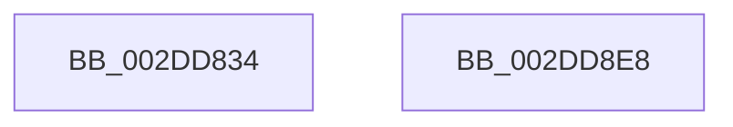

# PopExecuteOnTargetProcessors

- RVA: `0x002DD834`–`0x002DD8E9` (길이 `181` bytes)
- VA: `0x00000001402DD834`
- 실행 섹션: `.text`
- PDB 이름 있음: `예`; PDB Function 태그: `아니요`
- unwind 정보 RVA: `0x00070830`
- 디코드: `47`개 명령, `181/181` bytes 표시
- 미해석 바이트: `0` (있으면 어셈블리에 `.byte`로 보존)

> 이 문서는 커널 이미지의 기계어와 PDB 기호를 분석해 생성했습니다. 4번과 5번은 함수 원형과 자료형을 바이너리 사용 방식에서 추정한 C 해석이며 원본 소스 복구 결과는 아닙니다.

## 1. Dependencies

- 직접 호출 지점: **2**; 고유 호출 대상: **2**
- 직접 호출자로 확인된 함수: **18**
- RIP 상대 이미지 참조: **0**

### Outgoing calls
- `0x002DD8B9` → [PopQueueTargetDpc](PopQueueTargetDpc_function_002DD8F0.md) (function, `0x002DD8F0`)
- `0x002DD8CF` → [KeWaitForSingleObject](../20/KeWaitForSingleObject_function_0020E6B0.md) (function, `0x0020E6B0`)

### Direct callers
- [PoGetPerfStateAndParkingInfo](PoGetPerfStateAndParkingInfo_function_002DD484.md) at `0x002DD790`
- [PpmUpdateIdleDomains](../5D/PpmUpdateIdleDomains_function_005D0B60.md) at `0x005D0BB3`
- [PpmUpdateProcessorIdleVeto](../5D/PpmUpdateProcessorIdleVeto_function_005D0C50.md) at `0x005D0DC1`
- [PpmCheckResetProcessors](../5D/PpmCheckResetProcessors_function_005D84D0.md) at `0x005D84FF`
- [PpmCheckResetProcessors](../5D/PpmCheckResetProcessors_function_005D84D0.md) at `0x005D8541`
- [PpmParkRegisterParking](../5D/PpmParkRegisterParking_function_005DB508.md) at `0x005DB640`
- [PpmParkRegisterParkingEx](../5E/PpmParkRegisterParkingEx_function_005E183C.md) at `0x005E1926`
- [sub_006E0608](../6E/Unknown_function_006E0608.md) at `0x006E065C`
- [PpmIdleRegisterDefaultStates](../../page/75/PpmIdleRegisterDefaultStates_function_00755110.md) at `0x00755258`
- [PpmWmiIdleAccountingWork](../../page/76/PpmWmiIdleAccountingWork_function_00768670.md) at `0x00768692`
- [EtwpKernelTraceRundown](../../page/9E/EtwpKernelTraceRundown_function_009E4080.md) at `0x009E43B4`
- [PpmEventTraceControlCallback](../../page/A5/PpmEventTraceControlCallback_function_00A51F60.md) at `0x00A5232D`
- [PpmPostProcessMediaBuffering](../../page/A5/PpmPostProcessMediaBuffering_function_00A53004.md) at `0x00A530D3`
- [PpmUpdateProcessorPolicy](../../page/A5/PpmUpdateProcessorPolicy_function_00A53324.md) at `0x00A5346C`
- [PpmUpdateIdleStates](../../page/A7/PpmUpdateIdleStates_function_00A7E370.md) at `0x00A7E4B0`
- [PpmCheckInitProcessors](../../page/A8/PpmCheckInitProcessors_function_00A84AE8.md) at `0x00A84C32`
- [PpmParkUpdateConcurrencyTracking](../../page/A8/PpmParkUpdateConcurrencyTracking_function_00A850B8.md) at `0x00A851A0`
- [PpmParkUpdateConcurrencyTracking](../../page/A8/PpmParkUpdateConcurrencyTracking_function_00A850B8.md) at `0x00A85236`
- [PpmReapplyIdlePolicy](../../page/AA/PpmReapplyIdlePolicy_function_00AAFA90.md) at `0x00AAFAA8`
- [PopTransitionSystemPowerStateEx](../../pagelk/B7/PopTransitionSystemPowerStateEx_function_00B7E8C0.md) at `0x00B7EAFF`
- [PopTransitionSystemPowerStateEx](../../pagelk/B7/PopTransitionSystemPowerStateEx_function_00B7E8C0.md) at `0x00B7F87F`

### Static image references
- 디코드된 RIP-relative 메모리 참조가 없습니다.

## 2. Other-region calls and transfers

- 다른 실행 섹션으로 향하는 call: **0**
- 별도 외부 분기/꼬리 이동을 확인하지 못했습니다.

## 3. Assembly (complete function range)

```asm
002DD834  48 89 5C 24 08                  mov qword ptr [rsp + 8], rbx
002DD839  55                              push rbp
002DD83A  48 8D 6C 24 A9                  lea rbp, [rsp - 0x57]
002DD83F  48 81 EC D0 00 00 00            sub rsp, 0xd0
002DD846  33 C0                           xor eax, eax
002DD848  48 C7 45 B7 01 00 06 00         mov qword ptr [rbp - 0x49], 0x60001
002DD850  48 89 45 47                     mov qword ptr [rbp + 0x47], rax
002DD854  33 DB                           xor ebx, ebx
002DD856  89 45 4F                        mov dword ptr [rbp + 0x4f], eax
002DD859  0F 57 C0                        xorps xmm0, xmm0
002DD85C  48 8D 45 BF                     lea rax, [rbp - 0x41]
002DD860  89 5D 13                        mov dword ptr [rbp + 0x13], ebx
002DD863  48 89 45 C7                     mov qword ptr [rbp - 0x39], rax
002DD867  48 8D 45 BF                     lea rax, [rbp - 0x41]
002DD86B  48 89 45 BF                     mov qword ptr [rbp - 0x41], rax
002DD86F  48 8B 41 08                     mov rax, qword ptr [rcx + 8]
002DD873  48 89 45 D7                     mov qword ptr [rbp - 0x29], rax
002DD877  48 8D 45 CF                     lea rax, [rbp - 0x31]
002DD87B  48 89 45 07                     mov qword ptr [rbp + 7], rax
002DD87F  48 8D 45 B7                     lea rax, [rbp - 0x49]
002DD883  48 89 4D CF                     mov qword ptr [rbp - 0x31], rcx
002DD887  48 8D 4D 17                     lea rcx, [rbp + 0x17]
002DD88B  48 89 55 E7                     mov qword ptr [rbp - 0x19], rdx
002DD88F  48 8D 55 E7                     lea rdx, [rbp - 0x19]
002DD893  48 89 45 FF                     mov qword ptr [rbp - 1], rax
002DD897  0F 11 45 17                     movups xmmword ptr [rbp + 0x17], xmm0
002DD89B  89 5D E1                        mov dword ptr [rbp - 0x1f], ebx
002DD89E  0F 11 45 27                     movups xmmword ptr [rbp + 0x27], xmm0
002DD8A2  66 89 5D E5                     mov word ptr [rbp - 0x1b], bx
002DD8A6  0F 11 45 37                     movups xmmword ptr [rbp + 0x37], xmm0
002DD8AA  66 89 5D DF                     mov word ptr [rbp - 0x21], bx
002DD8AE  4C 89 45 EF                     mov qword ptr [rbp - 0x11], r8
002DD8B2  4C 89 4D F7                     mov qword ptr [rbp - 9], r9
002DD8B6  89 5D 0F                        mov dword ptr [rbp + 0xf], ebx
002DD8B9  E8 32 00 00 00                  call 0x1402dd8f0
002DD8BE  45 33 C9                        xor r9d, r9d
002DD8C1  48 89 5C 24 20                  mov qword ptr [rsp + 0x20], rbx
002DD8C6  45 33 C0                        xor r8d, r8d
002DD8C9  48 8D 4D B7                     lea rcx, [rbp - 0x49]
002DD8CD  33 D2                           xor edx, edx
002DD8CF  E8 DC 0D F3 FF                  call 0x14020e6b0
002DD8D4  8B 45 0F                        mov eax, dword ptr [rbp + 0xf]
002DD8D7  48 8B 9C 24 E0 00 00 00         mov rbx, qword ptr [rsp + 0xe0]
002DD8DF  48 81 C4 D0 00 00 00            add rsp, 0xd0
002DD8E6  5D                              pop rbp
002DD8E7  C3                              ret
002DD8E8  CC                              int3
```

## 4. C-style interpretation (structured pseudocode)

```c
__int64 __fastcall PopExecuteOnTargetProcessors(__int64 a1, __int64 a2, __int64 a3, __int64 a4)
{
    __int64 result;
    __int64 v_rbx;
    __int64 v_rsp;
    unsigned int v_stack_m10;
    unsigned __int64 v_stack_m18;
    unsigned __int64 v_stack_m28;
    unsigned __int64 v_stack_m38;
    unsigned __int64 v_stack_m48;
    unsigned int v_stack_m4C;
    unsigned int v_stack_m50;
    unsigned __int64 v_stack_m58;
    unsigned __int64 v_stack_m5F;
    unsigned __int64 v_stack_m60;
    unsigned __int64 v_stack_m68;
    unsigned __int64 v_stack_m70;
    unsigned __int64 v_stack_m78;
    unsigned __int16 v_stack_m7A;
    unsigned int v_stack_m7E;
    unsigned __int16 v_stack_m80;
    unsigned __int64 v_stack_m88;
    unsigned __int64 v_stack_m90;
    unsigned __int64 v_stack_m98;
    unsigned __int64 v_stack_mA0;
    unsigned __int64 v_stack_mA8;
    unsigned __int64 v_stack_mB8;
    unsigned __int64 v_stack_p8;

    v_stack_p8 = v_rbx;
    v_rsp = (v_rsp) - (208);
    result = 0;
    v_stack_mA8 = 0x60001ULL;
    v_stack_m18 = 0;
    v_rbx = 0;
    v_stack_m10 = 0;
    v_stack_m4C = 0;
    v_stack_m98 = v_stack_mA0;
    v_stack_mA0 = v_stack_mA0;
    v_stack_m88 = *(unsigned __int64 *)(a1 + 8);
    v_stack_m58 = v_stack_m90;
    v_stack_m90 = a1;
    v_stack_m78 = a2;
    v_stack_m60 = v_stack_mA8;
    v_stack_m48 = v_xmm0;
    v_stack_m7E = 0;
    v_stack_m38 = v_xmm0;
    v_stack_m7A = 0;
    v_stack_m28 = v_xmm0;
    v_stack_m80 = 0;
    v_stack_m70 = a3;
    v_stack_m68 = a4;
    v_stack_m50 = 0;
    result = PopQueueTargetDpc(v_stack_m48, v_stack_m78, a3, a4);
    a4 = 0;
    v_stack_mB8 = 0;
    a3 = 0;
    a2 = 0;
    result = KeWaitForSingleObject(v_stack_mA8, a2, a3, a4);
    v_rsp = (v_rsp) + (208);
    return (unsigned int)(v_stack_m50);
}
```

## 5. (Beta) C Style

```c
int64_t PopExecuteOnTargetProcessors(void *Arg1, int64_t Arg2, int64_t Arg3, int64_t Arg4)
{
    uint8_t *arg1 = (uint8_t *)Arg1;

    int64_t result;
    int64_t local_rbx;
    int64_t local_rsp;
    uint32_t v_stack_m10;
    uint64_t v_stack_m18;
    uint64_t v_stack_m28;
    uint64_t v_stack_m38;
    uint64_t v_stack_m48;
    uint32_t v_stack_m4C;
    uint32_t v_stack_m50;
    uint64_t v_stack_m58;
    uint64_t v_stack_m5F;
    uint64_t v_stack_m60;
    uint64_t v_stack_m68;
    uint64_t v_stack_m70;
    uint64_t v_stack_m78;
    uint16_t v_stack_m7A;
    uint32_t v_stack_m7E;
    uint16_t v_stack_m80;
    uint64_t v_stack_m88;
    uint64_t v_stack_m90;
    uint64_t v_stack_m98;
    uint64_t v_stack_mA0;
    uint64_t v_stack_mA8;
    uint64_t v_stack_mB8;
    uint64_t v_stack_p8;

    v_stack_p8 = local_rbx;
    local_rsp = (local_rsp) - (208);
    result = 0;
    v_stack_mA8 = 0x60001ULL;
    v_stack_m18 = 0;
    local_rbx = 0;
    v_stack_m10 = 0;
    v_stack_m4C = 0;
    v_stack_m98 = v_stack_mA0;
    v_stack_mA0 = v_stack_mA0;
    v_stack_m88 = *(uint64_t *)(arg1 + 0x8);
    v_stack_m58 = v_stack_m90;
    v_stack_m90 = Arg1;
    v_stack_m78 = Arg2;
    v_stack_m60 = v_stack_mA8;
    v_stack_m48 = v_xmm0;
    v_stack_m7E = 0;
    v_stack_m38 = v_xmm0;
    v_stack_m7A = 0;
    v_stack_m28 = v_xmm0;
    v_stack_m80 = 0;
    v_stack_m70 = Arg3;
    v_stack_m68 = Arg4;
    v_stack_m50 = 0;
    result = PopQueueTargetDpc(v_stack_m48, v_stack_m78, Arg3, Arg4);
    Arg4 = 0;
    v_stack_mB8 = 0;
    Arg3 = 0;
    Arg2 = 0;
    result = KeWaitForSingleObject(v_stack_mA8, Arg2, Arg3, Arg4);
    local_rsp = (local_rsp) + (208);
    return (uint32_t)(v_stack_m50);
}
```

### 관측된 메모리 오프셋

구조체 형식이 확인되지 않은 접근은 인자 기준의 오프셋으로만 기록했습니다.

| 기준 인자 | 오프셋 표현 | 폭 (bit) | 접근 |
|---|---:|---:|---|
| `Arg1` | `+ 0x8` | `64` | `R` |

## 6. Execution-region graph

[열기: 2D/3D 그래프와 함수 탐색 컨트롤 패널](../../../control-panel.html?section=text&rva=0x002DD834&view=graph)

- 2D 그래프는 위에서 아래로 흐르고, 3D 그래프는 빈 공간을 드래그해 회전합니다. Shift+드래그는 이동, 휠은 확대·축소, 함수 노드 선택은 대상 보고서 이동입니다.

### Static fallback


